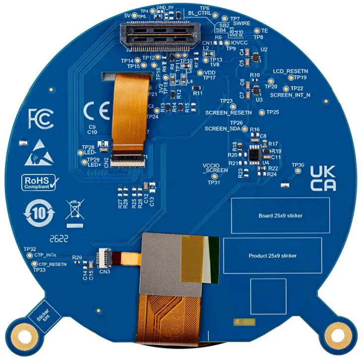

<!-- Copyright 2015-2026 Zephyr Project members and individual contributors. -->
<!-- SPDX-License-Identifier: Apache-2.0 -->
<!-- 中文翻译；编号、导航与译注为本地新增。 -->

<a id="st-lcd-dsi-mb1835"></a>

<a id="id1"></a>

# 第185章\_ST LCD DSI MB1835显示扩展板

原文：[官方页面](https://docs.zephyrproject.org/latest/boards/shields/st_lcd_dsi_mb1835/doc/index.html)。读取日期：2026-10-16；来源摘要见[来源记录](../SOURCES.md)。

<a id="overview"></a>

## 概述（Overview）

MB1835扩展板B-01版提供2.47英寸圆形TFT LCD，具有MIPI DSI接口及电容触摸屏，专为STM32U5G9J-DK1 Discovery套件设计。

扩展板特性：


- 2.47英寸圆形TFT LCD，分辨率480×480像素
- 1670万色，RGB888
- J025F1CN0201W显示模块，采用Himax HX8379C LCD控制器
- MIPI DSI®双数据通道接口
- 电容触摸面板（CTP）
- GPIO控制的LED背光

<a id="id2"></a>


MB1835显示扩展板正面图

<a id="id3"></a>



MB1835显示扩展板背面图

MB1835显示板通过CN1连接器连接STM32U5G9J-DK1：

<table>
<tr>
<th>CN1奇数脚</th>
<th>说明（Description）</th>
<th>接口（Interface）</th>
<th>CN1偶数脚</th>
<th>说明（Description）</th>
<th>接口（Interface）</th>
</tr>
<tr>
<td>1</td>
<td>地（GND）</td>
<td><ul><li></li></ul></td>
<td>2</td>
<td><ul><li></li></ul></td>
<td><ul><li></li></ul></td>
</tr>
<tr>
<td>3</td>
<td>DSI_CK_P</td>
<td>DSI</td>
<td>4</td>
<td>TOUCH_INT</td>
<td>中断输出</td>
</tr>
<tr>
<td>5</td>
<td>DSI_CK_N</td>
<td>DSI</td>
<td>6</td>
<td>地（GND）</td>
<td><ul><li></li></ul></td>
</tr>
<tr>
<td>7</td>
<td>地（GND）</td>
<td><ul><li></li></ul></td>
<td>8</td>
<td><ul><li></li></ul></td>
<td><ul><li></li></ul></td>
</tr>
<tr>
<td>9</td>
<td>DSI_D0_P</td>
<td>DSI</td>
<td>10</td>
<td><ul><li></li></ul></td>
<td><ul><li></li></ul></td>
</tr>
<tr>
<td>11</td>
<td>DSI_D0_N</td>
<td>DSI</td>
<td>12</td>
<td>地（GND）</td>
<td><ul><li></li></ul></td>
</tr>
<tr>
<td>13</td>
<td>地（GND）</td>
<td><ul><li></li></ul></td>
<td>14</td>
<td><ul><li></li></ul></td>
<td><ul><li></li></ul></td>
</tr>
<tr>
<td>15</td>
<td>DSI_D1_P</td>
<td>DSI</td>
<td>16</td>
<td><ul><li></li></ul></td>
<td><ul><li></li></ul></td>
</tr>
<tr>
<td>17</td>
<td>DSI_D1_N</td>
<td>DSI</td>
<td>18</td>
<td>地（GND）</td>
<td><ul><li></li></ul></td>
</tr>
<tr>
<td>19</td>
<td>地（GND）</td>
<td><ul><li></li></ul></td>
<td>20</td>
<td><ul><li></li></ul></td>
<td><ul><li></li></ul></td>
</tr>
<tr>
<td>21</td>
<td>背光电源BLVDD，+5 V</td>
<td><ul><li></li></ul></td>
<td>22</td>
<td><ul><li></li></ul></td>
<td><ul><li></li></ul></td>
</tr>
<tr>
<td>23</td>
<td>背光电源BLVDD，+5 V</td>
<td><ul><li></li></ul></td>
<td>24</td>
<td><ul><li></li></ul></td>
<td><ul><li></li></ul></td>
</tr>
<tr>
<td>25</td>
<td><ul><li></li></ul></td>
<td><ul><li></li></ul></td>
<td>26</td>
<td><ul><li></li></ul></td>
<td><ul><li></li></ul></td>
</tr>
<tr>
<td>27</td>
<td>BLGND</td>
<td><ul><li></li></ul></td>
<td>28</td>
<td><ul><li></li></ul></td>
<td><ul><li></li></ul></td>
</tr>
<tr>
<td>29</td>
<td>BLGND</td>
<td><ul><li></li></ul></td>
<td>30</td>
<td><ul><li></li></ul></td>
<td><ul><li></li></ul></td>
</tr>
<tr>
<td>31</td>
<td><ul><li></li></ul></td>
<td><ul><li></li></ul></td>
<td>32</td>
<td><ul><li></li></ul></td>
<td><ul><li></li></ul></td>
</tr>
<tr>
<td>33</td>
<td><ul><li></li></ul></td>
<td><ul><li></li></ul></td>
<td>34</td>
<td><ul><li></li></ul></td>
<td><ul><li></li></ul></td>
</tr>
<tr>
<td>35</td>
<td><ul><li></li></ul></td>
<td><ul><li></li></ul></td>
<td>36</td>
<td>3.3V</td>
<td><ul><li></li></ul></td>
</tr>
<tr>
<td>37</td>
<td><ul><li></li></ul></td>
<td><ul><li></li></ul></td>
<td>38</td>
<td><ul><li></li></ul></td>
<td><ul><li></li></ul></td>
</tr>
<tr>
<td>39</td>
<td><ul><li></li></ul></td>
<td><ul><li></li></ul></td>
<td>40</td>
<td>I2C_SDA</td>
<td>集成电路间总线（I2C）</td>
</tr>
<tr>
<td>41</td>
<td><ul><li></li></ul></td>
<td><ul><li></li></ul></td>
<td>42</td>
<td><ul><li></li></ul></td>
<td><ul><li></li></ul></td>
</tr>
<tr>
<td>43</td>
<td><ul><li></li></ul></td>
<td><ul><li></li></ul></td>
<td>44</td>
<td>I2C_SCL</td>
<td>集成电路间总线（I2C）</td>
</tr>
<tr>
<td>45</td>
<td><ul><li></li></ul></td>
<td><ul><li></li></ul></td>
<td>46</td>
<td><ul><li></li></ul></td>
<td><ul><li></li></ul></td>
</tr>
<tr>
<td>47</td>
<td><ul><li></li></ul></td>
<td><ul><li></li></ul></td>
<td>48</td>
<td><ul><li></li></ul></td>
<td><ul><li></li></ul></td>
</tr>
<tr>
<td>49</td>
<td>DSI_TE</td>
<td>DSI</td>
<td>50</td>
<td><ul><li></li></ul></td>
<td><ul><li></li></ul></td>
</tr>
<tr>
<td>51</td>
<td><ul><li></li></ul></td>
<td><ul><li></li></ul></td>
<td>52</td>
<td><ul><li></li></ul></td>
<td><ul><li></li></ul></td>
</tr>
<tr>
<td>53</td>
<td>BL_CTRL</td>
<td>通用输入输出（GPIO）</td>
<td>54</td>
<td><ul><li></li></ul></td>
<td><ul><li></li></ul></td>
</tr>
<tr>
<td>55</td>
<td><ul><li></li></ul></td>
<td><ul><li></li></ul></td>
<td>56</td>
<td><ul><li></li></ul></td>
<td><ul><li></li></ul></td>
</tr>
<tr>
<td>57</td>
<td>复位（RESET）</td>
<td>通用输入输出（GPIO）</td>
<td>58</td>
<td><ul><li></li></ul></td>
<td><ul><li></li></ul></td>
</tr>
<tr>
<td>59</td>
<td><ul><li></li></ul></td>
<td><ul><li></li></ul></td>
<td>60</td>
<td>1.8V</td>
<td><ul><li></li></ul></td>
</tr>
</table>

<a id="requirements"></a>

## 前置要求（Requirements）

开发板必须具有mipi_dsi设备树标签，才能使用此扩展板。

<a id="usage"></a>

## 用途（Usage）

将SHIELD设为st_lcd_dsi_mb1835并添加所需设备树属性，即可在任意应用中使用此扩展板。

调用west build时设置--shield "st_lcd_dsi_mb1835"，例如：

```text
# From the root of the zephyr repository
west build -b stm32u5g9j_dk1 --shield st_lcd_dsi_mb1835 samples/drivers/display
```

可用[绘制触摸事件（Draw Touch Events）](../interaction/P015_触摸事件绘制示例.md#draw_touch_events)示例同时测试显示及电容触摸：

```text
# From the root of the zephyr repository
west build -b stm32u5g9j_dk1 --shield st_lcd_dsi_mb1835 samples/subsys/input/draw_touch_events
```

该示例绘制随手指移动的十字，可快速验证STM32U5G9J-DK1配合此扩展板时，面板、LTDC及触摸控制器的接线与配置是否正确。

<a id="references"></a>

## 参考资料（References）


- [STM32U5G9J-DK1用户手册](https://www.st.com/resource/en/user_manual/um2967-discovery-kits-with-stm32u5x9nj-mcus-stmicroelectronics.pdf)
- [MB1835原理图，B-01版](https://www.st.com/resource/en/schematic_pack/mb1835-vdd1v8-b01-schematic.pdf)

## 原文外链核对

2026-10-16核对并重试以下原文外链时未能确认可访问性，保留原始目标，不将访问失败解释为原文内容有误。

- [mb1835-vdd1v8-b01-schematic.pdf](https://www.st.com/resource/en/schematic_pack/mb1835-vdd1v8-b01-schematic.pdf)：HTTP Error 567: Unknown Status。
- [um2967-discovery-kits-with-stm32u5x9nj-mcus-stmicroelectronics.pdf](https://www.st.com/resource/en/user_manual/um2967-discovery-kits-with-stm32u5x9nj-mcus-stmicroelectronics.pdf)：HTTP Error 567: Unknown Status。

---

[上一章](P184_ST_B-M2MEM-PACK1_M.2_serial_memory_pack.md) · [返回大纲](大纲.md) · [全站翻译进度](../PROGRESS.md) · [下一章](P186_ST_MB1897_CAM.md)
