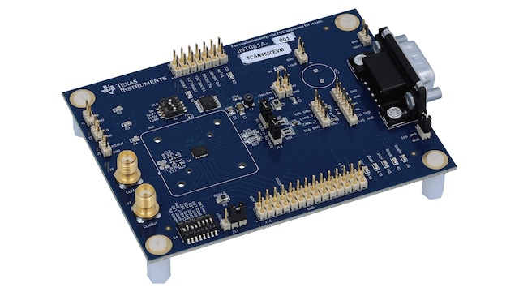

<!-- Copyright 2015-2026 Zephyr Project members and individual contributors. -->
<!-- SPDX-License-Identifier: Apache-2.0 -->
<!-- 中文翻译；编号、导航与译注为本地新增。 -->

<a id="texas-instruments-tcan4550evm"></a>

<a id="tcan4550evm-shield"></a>

# 第191章\_Texas Instruments TCAN4550EVM评估模块

原文：[官方页面](https://docs.zephyrproject.org/latest/boards/shields/tcan4550evm/doc/index.html)。读取日期：2026-10-16；来源摘要见[来源记录](../SOURCES.md)。

<a id="overview"></a>

## 概述（Overview）

Texas Instruments [TCAN4550EVM](https://www.ti.com/tool/TCAN4550EVM)采用[TI TCAN4550-Q1](https://www.ti.com/product/TCAN4550-Q1)汽车系统基础芯片（System Basis Chip，SBC），集成CAN FD控制器及收发器。

<a id="id1"></a>



TCAN4550EVM，图片来源：Texas Instruments

<a id="requirements"></a>

## 前置要求（Requirements）

该扩展板只能用于提供Arduino连接器配置，并定义SPI及GPIO接口节点别名的开发板，详情见“[扩展板（Shields）](https://docs.zephyrproject.org/latest/hardware/porting/shields.html#shields)”。

注意（Note）

虽然TCAN4550-Q1支持最高18 MHz的SPI时钟，此扩展板配置将最大SPI时钟限制为2 MHz，以适应通常用来连接TCAN4550EVM与Zephyr主板的飞线。

<a id="pin-assignments"></a>

### 引脚分配（Pin Assignments）

<table>
<tr>
<th>扩展板连接器引脚</th>
<th>功能（Function）</th>
</tr>
<tr>
<td>D6</td>
<td>nWKRQ</td>
</tr>
<tr>
<td><code>D7</code></td>
<td>WAKE_LV</td>
</tr>
<tr>
<td>D8</td>
<td>复位（RESET）</td>
</tr>
<tr>
<td>D9</td>
<td>nINT</td>
</tr>
<tr>
<td>D10</td>
<td>nCS</td>
</tr>
<tr>
<td>D11</td>
<td>SDI</td>
</tr>
<tr>
<td>D12</td>
<td>串行数据输出（SDO）</td>
</tr>
<tr>
<td>D13</td>
<td>SCLK</td>
</tr>
</table>

<a id="programming"></a>

## 编程（Programming）

调用west build时设置--shield tcan4550evm，例如：

```text
# From the root of the zephyr repository
west build -b frdm_k64f --shield tcan4550evm tests/drivers/can/api
```

## 译注

控制器支持18 MHz SPI，但官方扩展配置因飞线连接限制为2 MHz。

---

[上一章](P190_HL_RC_Module_Evaluation_Kit_Shield.md) · [返回大纲](大纲.md) · [全站翻译进度](../PROGRESS.md) · [下一章](P192_TI_Building_Automation_Sensors_MKII_Building_Automation_Multi_sensor_shield.md)
