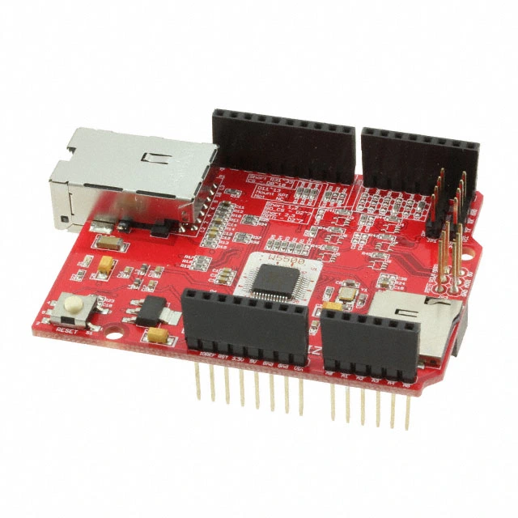

<!-- Copyright 2015-2026 Zephyr Project members and individual contributors. -->
<!-- SPDX-License-Identifier: Apache-2.0 -->
<!-- 中文翻译；编号、导航与译注为本地新增。 -->

<a id="wiznet-w5500-ethernet-shield"></a>

<a id="wiznet-w5500"></a>

# 第200章\_WIZnet W5500以太网扩展板（Ethernet Shield）

原文：[官方页面](https://docs.zephyrproject.org/latest/boards/shields/wiznet_w5500/doc/index.html)。读取日期：2026-10-16；来源摘要见[来源记录](../SOURCES.md)。

<a id="overview"></a>

## 概述（Overview）

<a id="id5"></a>

WIZnet W5500以太网扩展板[注2](#id4)采用WIZnet W5500芯片及Arduino连接器，支持3.3 V及5 V工作，兼容Arduino及ARM mbed平台。（[W5500 以太网扩展板](https://docs.wiznet.io/Product/Chip/Ethernet/W5500/W5500-Ethernet-Shield/w5500_ethernet_shield)）

扩展板特性：


- <a id="id3"></a>

  [W5500](https://wiznet.io/products/ethernet-chips/w5500)[注1](#id2)硬件TCP/IP以太网控制器，集成10/100以太网MAC及PHY；
- 32 KB内部存储器，用作8个独立套接字的缓冲区；
- 最高80 MHz的SPI串行接口；
- 完整TCP/IP协议栈支持，包括TCP、UDP、IPv4、ICMP、ARP、IGMP及PPPoE；
- 支持自动协商，全／半双工及10/100速率；
- 支持局域网唤醒（Wake-on-LAN，WOL）及掉电模式，降低功耗；
- 用户可选GPIO引脚，支持模块堆叠；
- microSD卡槽，支持FAT16及FAT32；
- I2C接口；
- UART接口；
- 集成变压器的RJ-45连接器。

<a id="id1"></a>



WIZnet W5500以太网扩展板（Ethernet Shield）

<a id="pins-assignment-of-the-w5500-shield"></a>

### W5500扩展板的引脚分配

<table>
<tr>
<th>扩展板连接器引脚</th>
<th>功能（Function）</th>
</tr>
<tr>
<td>复位（RST）</td>
<td>复位，以太网扩展板及Arduino</td>
</tr>
<tr>
<td>D2</td>
<td>中断输出，默认短接2～3脚</td>
</tr>
<tr>
<td>D10</td>
<td>SPI片选，用户可选</td>
</tr>
<tr>
<td>D11</td>
<td>SPI主机输出从机输入MOSI</td>
</tr>
<tr>
<td>D12</td>
<td>SPI主机输入从机输出MISO</td>
</tr>
<tr>
<td>D13</td>
<td>SPI时钟SCK</td>
</tr>
</table>

注意（Note）

W5500扩展板支持用户选择GPIO配置。中断默认使用D2，短接2～3脚；也可将0 Ω电阻焊到所需Dx引脚，改用其他引脚。片选引脚同样可选，以支持模块堆叠。

<a id="requirements"></a>

## 前置要求（Requirements）

该扩展板只能用于提供Arduino连接器配置，并定义SPI及GPIO节点别名的开发板，详情见“[扩展板（Shields）](https://docs.zephyrproject.org/latest/hardware/porting/shields.html#shields)”。

注意（Note）

配合5 V平台时，SD卡可能不稳定。为保证可靠工作，建议加装缓冲器及100 nF电容。

<a id="programming"></a>

## 编程（Programming）

调用west build时设置--shield wiznet_w5500，例如：

```text
# From the root of the zephyr repository
west build -b nrf52840dk/nrf52840 --shield wiznet_w5500 samples/net/dhcpv4_client
```

<a id="references"></a>

## 参考资料（References）

<a id="id2"></a>

〔[1](#id3)〕 [https://wiznet.io/products/ethernet-chips/w5500](https://wiznet.io/products/ethernet-chips/w5500)

<a id="id4"></a>

〔[2](#id5)〕 [https://docs.wiznet.io/Product/Chip/Ethernet/W5500/W5500-Ethernet-Shield/w5500_ethernet_shield](https://docs.wiznet.io/Product/Chip/Ethernet/W5500/W5500-Ethernet-Shield/w5500_ethernet_shield)

---

[上一章](P199_WeAct_Studio_MiniSTM32H7xx_OV2640_Camera_Sensor.md) · [返回大纲](大纲.md) · [全站翻译进度](../PROGRESS.md) · [下一章](P201_X-NUCLEO-53L0A1_ranging_and_gesture_detection_sensor_expansion_board.md)
