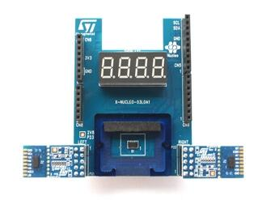

<!-- Copyright 2015-2026 Zephyr Project members and individual contributors. -->
<!-- SPDX-License-Identifier: Apache-2.0 -->
<!-- 中文翻译；编号、导航与译注为本地新增。 -->

<a id="x-nucleo-53l0a1-ranging-and-gesture-detection-sensor-expansion-board"></a>

<a id="x-nucleo-53l0a1-shield"></a>

# 第201章\_X-NUCLEO-53L0A1测距及手势检测传感器扩展板

原文：[官方页面](https://docs.zephyrproject.org/latest/boards/shields/x_nucleo_53l0a1/doc/index.html)。读取日期：2026-10-16；来源摘要见[来源记录](../SOURCES.md)。

<a id="overview"></a>

## 概述（Overview）

X-NUCLEO-53L0A1扩展板采用基于ST FlightSense™飞行时间（Time-of-Flight）技术的VL53L0X测距及手势检测传感器，是用于了解VL53L0X模块测距及手势检测能力的评估板。

扩展板上焊接了1个VL53L0X，随板提供垫片及盖板玻璃，可安装到这个中央传感器上。

通过2个10针连接器可连接2个VL53L0X卫星模块。扩展板兼容STM32 Nucleo系列及Arduino UNO R3连接器布局。



更多信息见X-NUCLEO-53L0A1网站。（[X-NUCLEO-53L0A1 网站](https://www.st.com/en/evaluation-tools/x-nucleo-53l0a1.html)）

<a id="requirements"></a>

## 前置要求（Requirements）

此扩展板只能用于已配置Arduino连接器并定义I2C接口节点别名的开发板，详情见“[扩展板（Shields）](https://docs.zephyrproject.org/latest/hardware/porting/shields.html#shields)”。

<a id="peripherals"></a>

## 外设（Peripherals）

传感器的设备树标签及I2C地址如下：


- 中央传感器，焊接在扩展板上：VL53L0X_C，0x30
- 左侧卫星传感器：VL53L0X_L，0x31
- 右侧卫星传感器：VL53L0X_R，0x32

七段显示器连接2个GPIO扩展器，每个处理2位×7段，即14个引脚：


- 最右侧2位：EXPANDER1，0x42
- 最左侧2位：EXPANDER2，0x43

<a id="external-links"></a>

## 外部链接（External Links）


- [X-NUCLEO-53L0A1测距及手势检测传感器扩展板用户手册](https://www.st.com/resource/en/user_manual/dm00285104-xnucleo53l0a1-ranging-and-gesture-detection-sensor-expansion-board-based-on-vl53l0x-for-stm32-nucleo-stmicroelectronics.pdf)
- [VL53L0X飞行时间测距及手势检测传感器数据手册](https://www.st.com/resource/en/datasheet/vl53l0x.pdf)

<a id="samples"></a>

## 示例（Samples）

[VL53L0X Time Of Flight sensor](../sensors/P063_VL53L0X飞行时间测距示例.md#vl53l0x)示例演示如何使用VL53L0X测距传感器，仅使用中央传感器。

[X-NUCLEO-53L0A1 shield](../shield_samples/P008_X_NUCLEO_53L0A1测距扩展板.md#x-nucleo-53l0a1) sample示例演示如何使用3个传感器，即板载1个及卫星2个，以及七段显示器。

<a id="programming"></a>

## 编程（Programming）

调用west build时设置--shield x_nucleo_53l0a1，例如：

```text
# From the root of the zephyr repository
west build -b nucleo_f429zi --shield x_nucleo_53l0a1 samples/sensor/vl53l0x
```

## 原文外链核对

2026-10-16核对并重试以下原文外链时未能确认可访问性，保留原始目标，不将访问失败解释为原文内容有误。

- [x-nucleo-53l0a1.html](https://www.st.com/en/evaluation-tools/x-nucleo-53l0a1.html)：HTTP Error 567: Unknown Status。
- [vl53l0x.pdf](https://www.st.com/resource/en/datasheet/vl53l0x.pdf)：HTTP Error 567: Unknown Status。
- [dm00285104-xnucleo53l0a1-ranging-and-gesture-detection-sensor-expansion-board-based-on-vl53l0x-for-stm32-nucleo-stmicroelectronics.pdf](https://www.st.com/resource/en/user_manual/dm00285104-xnucleo53l0a1-ranging-and-gesture-detection-sensor-expansion-board-based-on-vl53l0x-for-stm32-nucleo-stmicroelectronics.pdf)：HTTP Error 567: Unknown Status。

---

[上一章](P200_WIZnet_W5500_Ethernet_Shield.md) · [返回大纲](大纲.md) · [全站翻译进度](../PROGRESS.md) · [下一章](P202_X-NUCLEO-67W61M1_Wi-Fi_6_expansion_board.md)
