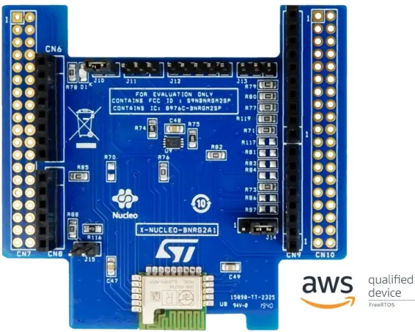

<!-- Copyright 2015-2026 Zephyr Project members and individual contributors. -->
<!-- SPDX-License-Identifier: Apache-2.0 -->
<!-- 中文翻译；编号、导航与译注为本地新增。 -->

<a id="x-nucleo-bnrg2a1-ble-expansion-board"></a>

<a id="x-nucleo-bnrg2a1"></a>

# 第203章\_X-NUCLEO-BNRG2A1：低功耗蓝牙BLE扩展板

原文：[官方页面](https://docs.zephyrproject.org/latest/boards/shields/x_nucleo_bnrg2a1/doc/index.html)。读取日期：2026-10-16；来源摘要见[来源记录](../SOURCES.md)。

<a id="overview"></a>

## 概述（Overview）

X-NUCLEO-BNRG2A1是采用BlueNRG-M2SP射频模块的低功耗蓝牙评估板，用于扩展STM32 Nucleo。模块已获FCC认证，FCC ID为S9NBNRGM2SP，以及IC认证，IC编号为8976C-BNRGM2SP。

X-NUCLEO-BNRG2A1兼容ST Morpho及Arduino UNO R3连接器布局，可按需安装ST Morpho连接器。它通过SPI引脚与主机微控制器连接，用户可更改评估板上的电阻或跳线，改变默认SPI时钟、片选及中断IRQ引脚。

注意：此扩展板出厂即兼容Arduino UNO R3连接器，但CS并非标准Arduino SPI_CS信号，见“硬件配置”。



<a id="id2"></a>

更多信息见X-NUCLEO-BNRG2A1网站[注1](#id1)。（[X-NUCLEO-BNRG2A1 网站](https://www.st.com/en/ecosystems/x-nucleo-bnrg2a1.html)）

<a id="hardware-configuration"></a>

## 硬件配置（Hardware Configuration）

X-NUCLEO-BNRG2A1出厂使用Arduino A1作为SPI CS，而不是Arduino UNO R3通常使用的D10。CS是软件驱动的GPIO，因此可使用A1；见x_nucleo_bnrg2a1.overlay中的cs-gpios。

可按以下方式移动电阻或更改跳线：

> - SPI SCK：若用D3替代D13，短接J14第2及3脚。

此外，可根据主板对BLE扩展板进行以下改动：

> - CS：若用D1替代A1，移除R76并安装R86。

nucleo_l476rg不需要硬件改动。

<a id="hardware"></a>

## 硬件（Hardware）

X-NUCLEO-BNRG2A1采用BlueNRG-M2SP芯片，主要特性：

> - 符合Bluetooth v5.2
> - 集成BALF-NRG-02D3匹配巴伦（Balun），带谐波滤波器
> - BLE数据包长度扩展（Data Packet Length Extension）

X-NUCLEO-BNRG2A1的更多信息：


- <a id="id4"></a>

  X-NUCLEO-BNRG2A1产品简介[注2](#id3)（[X-NUCLEO-BNRG2A1 产品简介](https://www.st.com/resource/en/data_brief/x-nucleo-bnrg2a1.pdf)）

<a id="programming"></a>

## 编程（Programming）

可将X-NUCLEO-BNRG2A1用作具有SPI主机控制器接口HCI-SPI的低功耗蓝牙控制器扩展板。构建项目时添加--shield参数启用：

> ```text
> west build -b your_board_name --shield x_nucleo_bnrg2a1 your_app
> ```

也可在项目CMakeLists.txt中设置使用此扩展板：

```text
set(SHIELD x_nucleo_bnrg2a1)
```

<a id="references"></a>

## 参考资料（References）

<a id="id1"></a>

〔[1](#id2)〕 [https://www.st.com/en/ecosystems/x-nucleo-bnrg2a1.html](https://www.st.com/en/ecosystems/x-nucleo-bnrg2a1.html)

<a id="id3"></a>

〔[2](#id4)〕 [https://www.st.com/resource/en/data_brief/x-nucleo-bnrg2a1.pdf](https://www.st.com/resource/en/data_brief/x-nucleo-bnrg2a1.pdf)

## 原文外链核对

2026-10-16核对并重试以下原文外链时未能确认可访问性，保留原始目标，不将访问失败解释为原文内容有误。

- [x-nucleo-bnrg2a1.html](https://www.st.com/en/ecosystems/x-nucleo-bnrg2a1.html)：HTTP Error 567: Unknown Status。
- [x-nucleo-bnrg2a1.pdf](https://www.st.com/resource/en/data_brief/x-nucleo-bnrg2a1.pdf)：HTTP Error 567: Unknown Status。

---

[上一章](P202_X-NUCLEO-67W61M1_Wi-Fi_6_expansion_board.md) · [返回大纲](大纲.md) · [全站翻译进度](../PROGRESS.md) · [下一章](P204_X-NUCLEO-EEPRMA2_EEPROM_memory_expansion_board.md)
