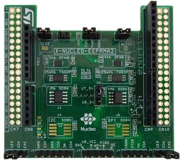

<!-- Copyright 2015-2026 Zephyr Project members and individual contributors. -->
<!-- SPDX-License-Identifier: Apache-2.0 -->
<!-- 中文翻译；编号、导航与译注为本地新增。 -->

<a id="x-nucleo-eeprma2-eeprom-memory-expansion-board"></a>

<a id="x-nucleo-eeprma2-shield"></a>

# 第204章\_X-NUCLEO-EEPRMA2 EEPROM存储器扩展板

原文：[官方页面](https://docs.zephyrproject.org/latest/boards/shields/x_nucleo_eeprma2/doc/index.html)。读取日期：2026-10-16；来源摘要见[来源记录](../SOURCES.md)。

<a id="overview"></a>

## 概述（Overview）

ST X-NUCLEO-EEPRMA2扩展板用于评估M24xx系列I2C及M95xx系列SPI EEPROM，兼容Arduino UNO R3连接器引脚分配。引脚还引到专用排针，必要时可安装ST Morpho连接器。

I2C EEPROM兼容atmel,at24驱动，SPI EEPROM兼容atmel,at25驱动。



更多信息见X-NUCLEO-EEPRMA2网站。（[X-NUCLEO-EEPRMA2 网站](https://www.st.com/en/evaluation-tools/x-nucleo-eeprma2.html)）

<a id="requirements"></a>

## 前置要求（Requirements）

此扩展板只能用于已配置Arduino连接器并定义SPI或I2C接口节点别名的开发板，详情见“[扩展板（Shields）](https://docs.zephyrproject.org/latest/hardware/porting/shields.html#shields)”。

SPI EEPROM可通过状态寄存器中相应块保护位，对整个存储块进行写保护。驱动不修改该状态寄存器，因此如需写入EEPROM，务必先禁用这些保护。

M24xx及M95xx系列EEPROM接口，尤其是X-NUCLEO-EEPRMA2的详情，见以下STMicroelectronics文档：


- [X-NUCLEO-EEPRMA2 EEPROM存储器扩展板用户手册](https://www.st.com/resource/en/user_manual/dm00671710-getting-started-with-the-xnucleoeeprma2-standard-ic-and-spi-eeprom-memory-expansion-board-based-on-m24xx-and-m95xx-series-for-stm32-nucleo-stmicroelectronics.pdf)
- [M24C02-F串行I2C总线EEPROM数据手册](https://www.st.com/resource/en/datasheet/m24c02-f.pdf)
- [M24256-DF串行I2C总线EEPROM数据手册](https://www.st.com/resource/en/datasheet/m24256-df.pdf)
- [M24M01-DF串行I2C总线EEPROM数据手册](https://www.st.com/resource/en/datasheet/m24m01-df.pdf)
- [M95040-R串行SPI总线EEPROM数据手册](https://www.st.com/resource/en/datasheet/m95040-r.pdf)
- [M95256-DF串行SPI总线EEPROM数据手册](https://www.st.com/resource/en/datasheet/m95256-df.pdf)
- [M95M04-DR串行SPI总线EEPROM数据手册](https://www.st.com/resource/en/datasheet/m95m04-dr.pdf)

<a id="samples"></a>

## 示例（Samples）

[EEPROM](../hardware/P043_EEPROM计数示例.md#eeprom)示例可演示扩展板功能。默认eeprom-0别名指向M24C02-FMC6TG EEPROM，可覆盖此别名以改用其他EEPROM。

<a id="programming"></a>

## 编程（Programming）

调用west build时设置--shield x_nucleo_eeprma2，例如：

```text
# From the root of the zephyr repository
west build -b nucleo_g0b1re --shield x_nucleo_eeprma2 samples/drivers/eeprom/
```

## 原文外链核对

2026-10-16核对并重试以下原文外链时未能确认可访问性，保留原始目标，不将访问失败解释为原文内容有误。

- [x-nucleo-eeprma2.html](https://www.st.com/en/evaluation-tools/x-nucleo-eeprma2.html)：HTTP Error 567: Unknown Status。
- [m24256-df.pdf](https://www.st.com/resource/en/datasheet/m24256-df.pdf)：HTTP Error 567: Unknown Status。
- [m24c02-f.pdf](https://www.st.com/resource/en/datasheet/m24c02-f.pdf)：HTTP Error 567: Unknown Status。
- [m24m01-df.pdf](https://www.st.com/resource/en/datasheet/m24m01-df.pdf)：HTTP Error 567: Unknown Status。
- [m95040-r.pdf](https://www.st.com/resource/en/datasheet/m95040-r.pdf)：HTTP Error 567: Unknown Status。
- [m95256-df.pdf](https://www.st.com/resource/en/datasheet/m95256-df.pdf)：HTTP Error 567: Unknown Status。
- [m95m04-dr.pdf](https://www.st.com/resource/en/datasheet/m95m04-dr.pdf)：HTTP Error 567: Unknown Status。
- [dm00671710-getting-started-with-the-xnucleoeeprma2-standard-ic-and-spi-eeprom-memory-expansion-board-based-on-m24xx-and-m95xx-series-for-stm32-nucleo-stmicroelectronics.pdf](https://www.st.com/resource/en/user_manual/dm00671710-getting-started-with-the-xnucleoeeprma2-standard-ic-and-spi-eeprom-memory-expansion-board-based-on-m24xx-and-m95xx-series-for-stm32-nucleo-stmicroelectronics.pdf)：HTTP Error 567: Unknown Status。

---

[上一章](P203_X-NUCLEO-BNRG2A1_BLE_expansion_board.md) · [返回大纲](大纲.md) · [全站翻译进度](../PROGRESS.md) · [下一章](P205_X-NUCLEO-GFX01M2_Display_expansion_board.md)
