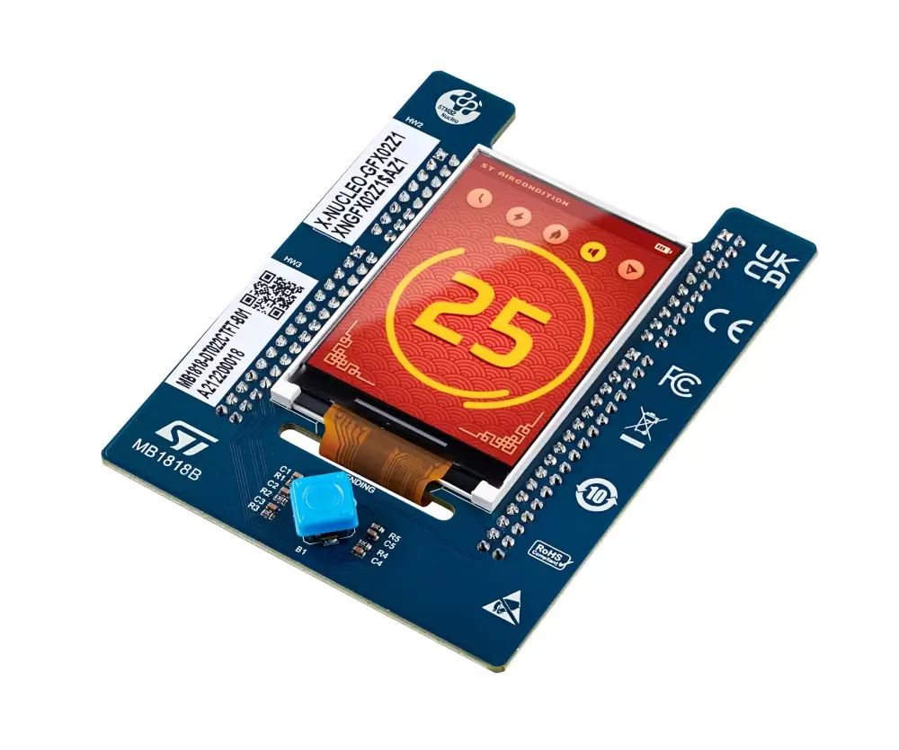

<!-- Copyright 2015-2026 Zephyr Project members and individual contributors. -->
<!-- SPDX-License-Identifier: Apache-2.0 -->
<!-- 中文翻译；编号、导航与译注为本地新增。 -->

<a id="x-nucleo-gfx02z1-display-expansion-board"></a>

<a id="x-nucleo-gfx02z1-shield"></a>

# 第206章\_X-NUCLEO-GFX02Z1显示扩展板

原文：[官方页面](https://docs.zephyrproject.org/latest/boards/shields/x_nucleo_gfx02z1/doc/index.html)。读取日期：2026-10-16；来源摘要见[来源记录](../SOURCES.md)。

<a id="overview"></a>

## 概述（Overview）

X-NUCLEO-GFX02Z1为STM32 Nucleo-144增加图形用户界面（GUI）能力，提供通过8位Intel 8080并行接口驱动的2.2英寸TFT显示屏，以及用于存储图像、文字及纹理的64 Mbit Quad-SPI NOR Flash，并有用于GUI导航的五向摇杆。

开发板有两种面板变体，可通过贴纸上的产品识别代码区分：


- XNGFX02Z1$AZ1：DT022CTFT面板，ILI9341V控制器
- XNGFX02Z1$AZ2：TCXD022IBLON-5面板，ST7789V控制器

本扩展板定义支持$AZ2，即ST7789V变体。

并行显示屏兼容sitronix,st7789v驱动，Quad-SPI NOR Flash兼容st,stm32-ospi-nor驱动。



更多信息见X-NUCLEO-GFX02Z1网站。（[X-NUCLEO-GFX02Z1 网站](https://www.st.com/en/evaluation-tools/x-nucleo-gfx02z1.html)）

<a id="requirements"></a>

## 前置要求（Requirements）

此扩展板只能用于已配置Zio连接器的STM32 Nucleo-144开发板，须提供st_zio_fmc连接器，即驱动并行显示屏的灵活存储器控制器FMC，以及st_zio_qspi连接器，即驱动Quad-SPI NOR Flash的OCTOSPI外设。扩展板使用：


- 显示屏：8位Intel 8080并行接口，FMC／MIPI DBI Type B
- NOR Flash：Quad-SPI，OCTOSPI
- 摇杆输入：GPIO

开发板使用的FMC、OCTOSPI及摇杆引脚定义，见X-NUCLEO-GFX02Z1用户手册：


- [X-NUCLEO-GFX02Z1用户手册](https://www.st.com/resource/en/user_manual/um2905-display-expansion-board-for-stm32-nucleo144-stmicroelectronics.pdf)

当前支持的开发板：


- `nucleo_u575zi_q`
- `nucleo_f446ze`

<a id="hardware-configuration"></a>

## 硬件配置（Hardware Configuration）

并行显示屏FMC、Quad-SPI NOR Flash及摇杆的引脚分配与开发板有关，由扩展板的板级覆盖文件提供。NOR Flash由不同控制器外设驱动：


- NUCLEO-U575ZI-Q使用[boards/shields/x_nucleo_gfx02z1/boards/nucleo_u575zi_q.overlay](https://github.com/zephyrproject-rtos/zephyr/blob/main/boards/shields/x_nucleo_gfx02z1/boards/nucleo_u575zi_q.overlay)，NOR Flash连接OCTOSPI控制器。
- NUCLEO-F446ZE使用[boards/shields/x_nucleo_gfx02z1/boards/nucleo_f446ze.overlay](https://github.com/zephyrproject-rtos/zephyr/blob/main/boards/shields/x_nucleo_gfx02z1/boards/nucleo_f446ze.overlay)，NOR Flash连接QUADSPI控制器。

<a id="samples"></a>

## 示例（Samples）

可用[Display](../hardware/P171_显示驱动示例.md#display)、[JESD216 flash](../driver_samples/P007_JESD216闪存参数示例.md#jesd216)、[Flash shell](../storage/P091_闪存命令行示例.md#flash-shell)及[Input dump](../interaction/P014_输入事件转储示例.md#input-dump)示例测试扩展板功能。

<a id="programming"></a>

## 编程（Programming）

调用west build时设置--shield x_nucleo_gfx02z1_az2，例如：

```text
# From the root of the zephyr repository
west build -b nucleo_u575zi_q --shield x_nucleo_gfx02z1_az2 samples/drivers/display/
```

## 译注

本扩展板定义仅支持$AZ2，即ST7789V面板；不同主板Flash控制器不同。

## 原文外链核对

2026-10-16核对并重试以下原文外链时未能确认可访问性，保留原始目标，不将访问失败解释为原文内容有误。

- [x-nucleo-gfx02z1.html](https://www.st.com/en/evaluation-tools/x-nucleo-gfx02z1.html)：HTTP Error 567: Unknown Status。
- [um2905-display-expansion-board-for-stm32-nucleo144-stmicroelectronics.pdf](https://www.st.com/resource/en/user_manual/um2905-display-expansion-board-for-stm32-nucleo144-stmicroelectronics.pdf)：HTTP Error 567: Unknown Status。

---

[上一章](P205_X-NUCLEO-GFX01M2_Display_expansion_board.md) · [返回大纲](大纲.md) · [全站翻译进度](../PROGRESS.md) · [下一章](P207_X-NUCLEO-GNSS1A1_GNSS_expansion_board_based_on_Teseo-LIV3F.md)
