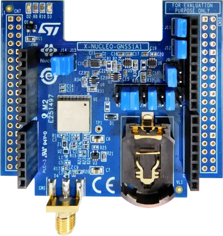

<!-- Copyright 2015-2026 Zephyr Project members and individual contributors. -->
<!-- SPDX-License-Identifier: Apache-2.0 -->
<!-- 中文翻译；编号、导航与译注为本地新增。 -->

<a id="x-nucleo-gnss1a1-gnss-expansion-board-based-on-teseo-liv3f"></a>

<a id="x-nucleo-gnss1a1"></a>

# 第207章\_X-NUCLEO-GNSS1A1：基于Teseo-LIV3F的GNSS扩展板

原文：[官方页面](https://docs.zephyrproject.org/latest/boards/shields/x_nucleo_gnss1a1/doc/index.html)。读取日期：2026-10-16；来源摘要见[来源记录](../SOURCES.md)。

<a id="overview"></a>

## 概述（Overview）

X-NUCLEO-GNSS1A1是面向STM32 Nucleo的全球导航卫星系统（GNSS）扩展板，采用ST Teseo-LIV3F模块，兼容Arduino UNO R3连接器，支持GPS、Galileo、GLONASS、北斗BeiDou及QZSS星座。

Teseo-LIV3F通过9600波特率UART通信，8N1格式，采用标准NMEA 0183语句。



<a id="id2"></a>

更多信息见X-NUCLEO-GNSS1A1网站[注1](#id1)。（[X-NUCLEO-GNSS1A1 网站](https://www.st.com/en/ecosystems/x-nucleo-gnss1a1.html)）

<a id="hardware"></a>

## 硬件（Hardware）

主要功能（Key Features）：

> - Teseo-LIV3F GNSS模块，9.7×10.1 mm
> - 多星座：GPS、Galileo、GLONASS、北斗BeiDou、QZSS
> - 灵敏度：跟踪模式−162 dBm
> - 板载26 MHz温补晶振TCXO及32 kHz RTC振荡器
> - UART及I2C接口
> - SMA天线连接器
> - 备用电池座
> - 工作电压3.3～5 V

<a id="jumper-configuration"></a>

## 跳线配置（Jumper Configuration）

X-NUCLEO-GNSS1A1用跳线在Teseo-LIV3F模块及Arduino排针间分配信号，UART可选择两组不同引脚。

出厂默认启用J3／J4，将UART连接D8／D2；并非所有STM32 Nucleo开发板都将这些引脚映射到硬件UART。

若开发板D0／D1连接USART外设，例如nucleo_wl55jc，按以下方式更改跳线：

<table>
<tr>
<th>跳线（Jumper）</th>
<th>默认（Default）</th>
<th>所需改动</th>
</tr>
<tr>
<td>J3，D8</td>
<td>闭合（Closed）</td>
<td>开路（Open）</td>
</tr>
<tr>
<td>J4，D2</td>
<td>闭合（Closed）</td>
<td>开路（Open）</td>
</tr>
<tr>
<td>J2，D1</td>
<td>开路（Open）</td>
<td>闭合（Close）</td>
</tr>
<tr>
<td>J5，D0</td>
<td>开路（Open）</td>
<td>闭合（Close）</td>
</tr>
</table>

这样将GNSS UART连接到Arduino D0接收RX及D1发送TX，在许多STM32 Nucleo-64开发板上对应USART1。

注意（Note）

若SPI1驱动Arduino D13，例如nucleo_wl55jc，则必须禁用SPI1，因为D13与通过J9启用的Teseo-LIV3F唤醒WAKEUP信号共享。板级覆盖文件会自动处理。

其余跳线可保留默认设置：

<table>
<tr>
<th>信号（Signal）</th>
<th>跳线（Jumper）</th>
<th>默认（Default）</th>
</tr>
<tr>
<td>复位Reset，D7</td>
<td>J13</td>
<td>闭合（Closed）</td>
</tr>
<tr>
<td>唤醒Wakeup，D13</td>
<td>J9</td>
<td>闭合（Closed）</td>
</tr>
<tr>
<td>每秒脉冲PPS，D6</td>
<td>J6</td>
<td>闭合（Closed）</td>
</tr>
<tr>
<td>I2C时钟SCL，D15</td>
<td>J11</td>
<td>开路（Open）</td>
</tr>
<tr>
<td>I2C数据SDA，D14</td>
<td>J12</td>
<td>开路（Open）</td>
</tr>
</table>

<a id="programming"></a>

## 编程（Programming）

调用west build时设置--shield x_nucleo_gnss1a1，例如使用GNSS示例：

> ```text
> west build -b nucleo_wl55jc --shield x_nucleo_gnss1a1 samples/drivers/gnss
> ```

<a id="references"></a>

## 参考资料（References）

<a id="id1"></a>

〔[1](#id2)〕 [https://www.st.com/en/ecosystems/x-nucleo-gnss1a1.html](https://www.st.com/en/ecosystems/x-nucleo-gnss1a1.html)

## 译注

UART默认D8／D2不适用于所有主板；D0／D1跳线及D13与SPI1共享冲突分别说明。

## 原文外链核对

2026-10-16核对并重试以下原文外链时未能确认可访问性，保留原始目标，不将访问失败解释为原文内容有误。

- [x-nucleo-gnss1a1.html](https://www.st.com/en/ecosystems/x-nucleo-gnss1a1.html)：HTTP Error 567: Unknown Status。

---

[上一章](P206_X-NUCLEO-GFX02Z1_Display_expansion_board.md) · [返回大纲](大纲.md) · [全站翻译进度](../PROGRESS.md) · [下一章](P208_X-NUCLEO-IDB05A1_BLE_expansion_board.md)
