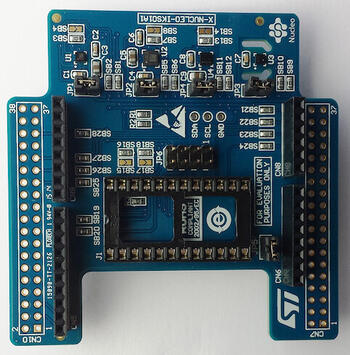

<!-- Copyright 2015-2026 Zephyr Project members and individual contributors. -->
<!-- SPDX-License-Identifier: Apache-2.0 -->
<!-- 中文翻译；编号、导航与译注为本地新增。 -->

# 第209章\_X-NUCLEO-IKS01A1：MEMS惯性及环境多传感器扩展板

原文：[官方页面](https://docs.zephyrproject.org/latest/boards/shields/x_nucleo_iks01a1/doc/index.html)。读取日期：2026-10-16；来源摘要见[来源记录](../SOURCES.md)。

## 概述（Overview）

X-NUCLEO-IKS01A1是运动微机电系统（MEMS）及环境传感器评估板系统，兼容Arduino UNO R3连接器布局。它包含STMicroelectronics LSM6DS0三轴加速度计及三轴陀螺仪、LIS3MDL三轴磁力计、HTS221温湿度传感器及LPS25HB压力传感器。

X-NUCLEO-IKS01A1通过I2C接口连接主板。

更多信息见X-NUCLEO-IKS01A1网站[注1](#id1)。（[X-NUCLEO-IKS01A1 网站](https://www.st.com/en/ecosystems/x-nucleo-iks01a1.html)）

## 硬件（Hardware）

X-NUCLEO-IKS01A1主要特性：

> - LSM6DS0：MEMS三轴加速度计，±2／±4／±8 g；三轴陀螺仪，±245／±500／±2000度每秒dps
> - LIS3MDL：MEMS三轴磁力计，±4／±8／±12／16高斯，符号按原文保留
> - LPS25HB：MEMS压力传感器，260～1260 hPa绝对压力数字输出气压计
> - HTS221：电容式数字相对湿度及温度传感器
> - DIL 24针插座，可连接额外MEMS适配器及其他传感器，例如紫外线指数传感器
> - 配备Arduino UNO R3连接器
> - 符合RoHS

X-NUCLEO-IKS01A1的更多信息：

- 

  X-NUCLEO-IKS01A1数据手册[注2](#id3)（[X-NUCLEO-IKS01A1 数据手册](https://www.st.com/resource/en/datasheet/x-nucleo-iks01a1.pdf)）

## 编程（Programming）

[X-NUCLEO-IKS01A1 shield](../shield_samples/P009_X_NUCLEO_IKS01A1传感器示例.md#x-nucleo-iks01a1) sample示例应用文档演示此扩展板用法；更多说明见“[扩展板（Shields）](https://docs.zephyrproject.org/latest/hardware/porting/shields.html#shields)”。

## 参考资料（References）

〔[1](#id2)〕 [https://www.st.com/en/ecosystems/x-nucleo-iks01a1.html](https://www.st.com/en/ecosystems/x-nucleo-iks01a1.html)

〔[2](#id4)〕 [https://www.st.com/resource/en/datasheet/x-nucleo-iks01a1.pdf](https://www.st.com/resource/en/datasheet/x-nucleo-iks01a1.pdf)

## 原文外链核对

2026-10-16核对并重试以下原文外链时未能确认可访问性，保留原始目标，不将访问失败解释为原文内容有误。

- [x-nucleo-iks01a1.html](https://www.st.com/en/ecosystems/x-nucleo-iks01a1.html)：HTTP Error 567: Unknown Status。
- [x-nucleo-iks01a1.pdf](https://www.st.com/resource/en/datasheet/x-nucleo-iks01a1.pdf)：HTTP Error 567: Unknown Status。

---

[上一章](P208_X-NUCLEO-IDB05A1_BLE_expansion_board.md) · [返回大纲](大纲.md) · [全站翻译进度](../PROGRESS.md) · [下一章](P210_X-NUCLEO-IKS01A2_MEMS_Inertial_and_Environmental_Multi_sensor_shield.md)
