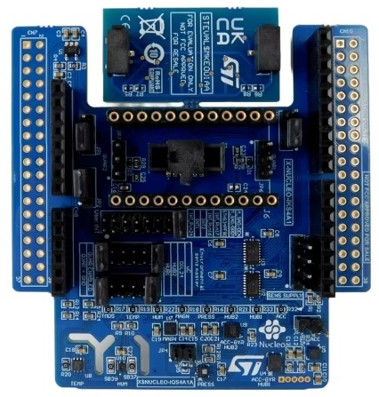

<!-- Copyright 2015-2026 Zephyr Project members and individual contributors. -->
<!-- SPDX-License-Identifier: Apache-2.0 -->
<!-- 中文翻译；编号、导航与译注为本地新增。 -->

# 第213章\_X-NUCLEO-IKS4A1：MEMS惯性及环境多传感器扩展板

原文：[官方页面](https://docs.zephyrproject.org/latest/boards/shields/x_nucleo_iks4a1/doc/index.html)。读取日期：2026-10-16；来源摘要见[来源记录](../SOURCES.md)。

## 概述（Overview）

X-NUCLEO-IKS4A1是面向STM32 Nucleo的运动MEMS及环境传感器扩展板，采用Arduino UNO R3连接器布局，可开发使用LSM6DSO16IS及LSM6DSV16X传感器集线器、摄像头模块集成及Qvar触摸／滑动手势等功能的应用；Qvar使用随附电极。

更多一般信息见X-NUCLEO-IKS4A1网站。（[X-NUCLEO-IKS4A1 网站](http://www.st.com/en/ecosystems/x-nucleo-iks4a1.html)）

## 硬件说明（Hardware Description）

X-NUCLEO-IKS4A1主要特性：

> - LSM6DSO16IS：MEMS三轴加速度计，±2／±4／±8／±16 g；三轴陀螺仪，±125／±250／±500／±1000／±2000 dps；带智能处理单元ISPU
> - LIS2MDL：MEMS三轴磁力计，±50高斯
> - LIS2DUXS12：超低功耗MEMS三轴加速度计，±2／±4／±8／±16 g，带Qvar、人工智能AI及抗混叠功能
> - LPS22DF：低功耗高精度MEMS压力传感器，260～1260 hPa绝对压力数字输出气压计
> - SHT40AD1B：Sensirion高精度超低功耗相对湿度及温度传感器
> - STTS22H：低电压、超低功耗温度传感器，精度0.5 °C，范围−40～+125 °C
> - LSM6DSV16X：MEMS三轴加速度计，±2／±4／±8／±16 g；三轴陀螺仪，±125／±250／±500／±1000／±2000／±4000 dps；嵌入传感器融合、AI及Qvar
> - DIL 24针插座，用于额外MEMS适配器及其他传感器
> - 免费完整开发固件库及所有传感器示例，兼容STM32Cube固件
> - 配备Qvar触摸／滑动电极
> - 可使用LSM6DSO及LSM6DSV16X的I²C传感器集线器功能；前者型号按原文保留
> - 兼容MIPI I3C®，用于与LIS2DUXS12、LSM6DSV16X及LPS22DF通信
> - 兼容STM32 Nucleo开发板
> - 配备Arduino UNO R3连接器
> - 配备工业连接器，用于STHS34PF80红外传感器应用开发，可与通过DIL24适配器连接的外部MEMS同时使用
> - 提供外部摄像头模块应用接口，通过3线／4线辅助SPI与LSM6DSV16X连接
> - 符合RoHS
> - 符合WEEE
> - 符合UKCA

## 硬件配置（Hardware Configuration）

X-NUCLEO-IKS4A1可通过J4及J5选择5种模式。配置模式及传感器互连详情见X-NUCLEO-IKS4A1用户手册。（[X-NUCLEO-IKS4A1 用户手册](https://www.st.com/resource/en/user_manual/um3239-getting-started-with-the-xnucleoiks4a1-motion-mems-and-environmental-sensor-expansion-board-for-stm32-nucleo-stmicroelectronics.pdf)）

### 模式1：标准模式（Standard Mode）

标准I2C模式下，所有设备通过同一I2C总线连接外部主板。

开发板配置如下：

> - J4连接1-2及11-12，STM_SDA = SENS_SDA，HUB_SDx = GND
> - J5连接1-2及11-12，STM_SCL = SENS_SCL，HUB_SCx = GND

### 模式2：LSM6DSO16IS传感器集线器模式，SHUB2

在此I2C传感器集线器模式下，通过辅助I2Cz总线SENS_I2C直接控制板载环境传感器，即温度、压力及磁力计，以及DIL24外部传感器，收集外部数据以增强六轴惯性测量单元IMU的功能。LSM6DSV16X、LIS2DUXS12及SHT40AD1B仍连接外部主板的uC_I2C主总线。

开发板配置如下：

> - J4连接7-8，HUB2_SDx = SENS_SDA
> - J5连接7-8，HUB2_SCx = SENS_SCL

### 模式3：LSM6DSV16X传感器集线器模式，SHUB1

在此传感器集线器模式下，通过辅助I2C总线SENS_I2C直接控制板载环境传感器，即温度、压力及磁力计，以及DIL24外部传感器，收集外部数据以增强六轴IMU功能。LSM6DSO16IS、LIS2DUXS12及SHT40AD1B仍连接外部主板的uC_I2C主总线。

开发板配置如下：

> - J4连接5-6，HUB1_SDx = SENS_SDA
> - J5连接5-6，HUB1_SDx = SENS_SDA，信号名称按原文保留

### 模式4：DIL24传感器集线器模式

若通过DIL24适配器安装内置传感器集线器功能的传感器，可像LSM6DSO16IS及LSM6DSV16X一样使用该功能。此配置可能需要通过SPI连接DIL24与外部主板，以避免与LSM6DSO16IS及LSM6DSV16X发生I2C地址冲突；通过更改SBx配置实现。

开发板配置如下：

> - J4连接9-10，DIL_SDx = SENS_SDA
> - J5连接9-10，DIL_SDx = SENS_SDA，信号名称按原文保留

### 模式5：LSM6DSV16X作为Qvar控制器

此配置中，将随附Qvar滑动电极插入JP6及JP7，即可通过LSM6DSV16X使用。

开发板配置如下：

> - J4连接3-4，HUB1_SDx = QVAR1
> - J5连接3-4，HUB1_Scx = QVAR2

## 设备树覆盖文件（Devicetree Overlays）

扩展板预定义3个设备树覆盖文件：

- [boards/shields/x_nucleo_iks4a1/x_nucleo_iks4a1.overlay](https://github.com/zephyrproject-rtos/zephyr/blob/main/boards/shields/x_nucleo_iks4a1/x_nucleo_iks4a1.overlay)：描述标准模式1中的传感器连接及相应所需硬件配置。（[模式1：标准模式（Standard Mode）](#x-nucleo-iks4a1-mode-1)）
- [boards/shields/x_nucleo_iks4a1/x_nucleo_iks4a1_shub1.overlay](https://github.com/zephyrproject-rtos/zephyr/blob/main/boards/shields/x_nucleo_iks4a1/x_nucleo_iks4a1_shub1.overlay)：描述SHUB1模式3，即LSM6DSV16X传感器集线器模式中的传感器连接及相应硬件配置。（[模式3：LSM6DSV16X传感器集线器模式，SHUB1](#x-nucleo-iks4a1-mode-3)）
- [boards/shields/x_nucleo_iks4a1/x_nucleo_iks4a1_shub2.overlay](https://github.com/zephyrproject-rtos/zephyr/blob/main/boards/shields/x_nucleo_iks4a1/x_nucleo_iks4a1_shub2.overlay)：描述SHUB2模式2，即LSM6DSO16IS传感器集线器模式中的传感器连接及相应硬件配置。（[模式2：LSM6DSO16IS传感器集线器模式，SHUB2](#x-nucleo-iks4a1-mode-2)）

## 示例（Examples）

为x-nucleo-iks4a1提供3个示例，各自对应上述一个覆盖文件：

- X-NUCLEO-IKS4A1标准模式1应用，适用于Standard Mode，即模式1。（[X-NUCLEO-IKS4A1 扩展板 - 标准模式1](../shield_samples/P019_IKS4A1标准模式.md#x-nucleo-iks4a1-std)）
- X-NUCLEO-IKS4A1传感器集线器模式3应用，适用于SHUB1，即模式3。（[X-NUCLEO-IKS4A1 扩展板 - 传感器集线器模式3](../shield_samples/P020_IKS4A1传感器集线器模式3.md#x-nucleo-iks4a1-shub1)）
- X-NUCLEO-IKS4A1传感器集线器模式2应用，适用于SHUB2，即模式2。（[X-NUCLEO-IKS4A1 扩展板 - 传感器集线器模式2](../shield_samples/P021_IKS4A1传感器集线器模式2.md#x-nucleo-iks4a1-shub2)）

更多说明另见“[扩展板（Shields）](https://docs.zephyrproject.org/latest/hardware/porting/shields.html#shields)”。

## 译注

模式3及模式4的J5信号文字与J4重复，均按官方原文保留，未推测修改接线。

## 原文外链核对

2026-10-16核对并重试以下原文外链时未能确认可访问性，保留原始目标，不将访问失败解释为原文内容有误。

- [x-nucleo-iks4a1.html](http://www.st.com/en/ecosystems/x-nucleo-iks4a1.html)：HTTP Error 567: Unknown Status。
- [um3239-getting-started-with-the-xnucleoiks4a1-motion-mems-and-environmental-sensor-expansion-board-for-stm32-nucleo-stmicroelectronics.pdf](https://www.st.com/resource/en/user_manual/um3239-getting-started-with-the-xnucleoiks4a1-motion-mems-and-environmental-sensor-expansion-board-for-stm32-nucleo-stmicroelectronics.pdf)：HTTP Error 567: Unknown Status。

---

[上一章](P212_X-NUCLEO-IKS02A1_MEMS_Inertial_and_Environmental_Multi_sensor_shield.md) · [返回大纲](大纲.md) · [全站翻译进度](../PROGRESS.md) · [下一章](P214_X-NUCLEO-IKS5A1_MEMS_Inertial_and_Environmental_Multi_sensor_shield.md)
