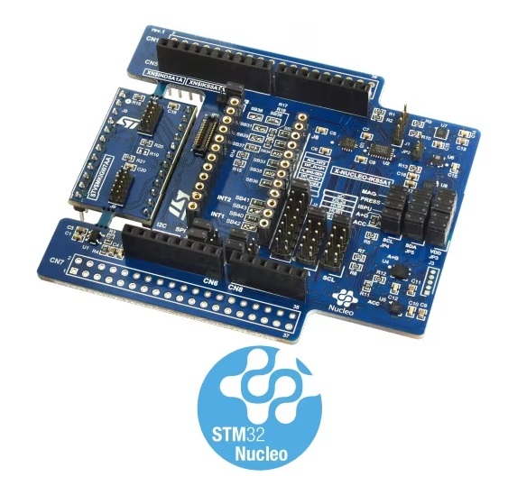

<!-- Copyright 2015-2026 Zephyr Project members and individual contributors. -->
<!-- SPDX-License-Identifier: Apache-2.0 -->
<!-- 中文翻译；编号、导航与译注为本地新增。 -->

<a id="x-nucleo-iks5a1-mems-inertial-and-environmental-multi-sensor-shield"></a>

<a id="x-nucleo-iks5a1"></a>

# 第214章\_X-NUCLEO-IKS5A1：MEMS惯性及环境多传感器扩展板

原文：[官方页面](https://docs.zephyrproject.org/latest/boards/shields/x_nucleo_iks5a1/doc/index.html)。读取日期：2026-10-16；来源摘要见[来源记录](../SOURCES.md)。

<a id="overview"></a>

## 概述（Overview）

X-NUCLEO-IKS5A1是工业运动MEMS及环境传感器评估套件，由以下部分组成：

> - X-NUCLEO-IND5A1主板，安装运动MEMS及环境传感器。
> - STEVAL-MKGI07A可拆卸附加板，具有2个工业连接器。

X-NUCLEO-IKS5A1支持开发使用有限状态机FSM、机器学习核心MLC、智能处理单元ISPU及传感器集线器等功能的应用，板载ISM330IS及ISM6HG256X。



更多一般信息见X-NUCLEO-IKS5A1网站。（[X-NUCLEO-IKS5A1 网站](https://www.st.com/en/evaluation-tools/x-nucleo-iks5a1.html)）

<a id="hardware-description"></a>

## 硬件说明（Hardware Description）

X-NUCLEO-IKS5A1主要特性：


- 多种工业运动及环境传感器：


  - ISM6HG256X：智能IMU，可同时检测低g及高g加速度
  - ISM330IS：六轴IMU，带ISPU的常开三轴加速度计及三轴陀螺仪
  - IIS2DULPX：面向工业应用的智能超低功耗加速度计
  - ILPS22QS：双量程1260及4060 hPa的绝对压力数字输出气压计
  - IIS2MDC：高精度超低功耗三轴数字输出磁力计
- 用于外部传感器的DIL24插座及工业连接器
- 兼容STM32Cube扩展软件包X-CUBE-MEMS1
- 可使用ISM330IS及ISM6HG256X的I2C传感器集线器功能
- 支持MEMS-Studio软件，可用图形化无代码方式设计MEMS传感器算法并开发嵌入式AI功能
- 兼容STM32 Nucleo开发板
- 配备Arduino UNO R3连接器
- 符合RoHS及WEEE

<a id="hardware-configuration"></a>

## 硬件配置（Hardware Configuration）

X-NUCLEO-IKS5A1可通过J4及J5选择5种模式。配置模式及传感器互连详情见X-NUCLEO-IKS5A1用户手册。（[X-NUCLEO-IKS5A1 用户手册](https://www.st.com/resource/en/user_manual/um3550-getting-started-with-the-xnucleoiks5a1-motion-mems-and-environmental-sensor-expansion-board-for-stm32-nucleo-stmicroelectronics.pdf)）

<a id="mode-1-standard-mode"></a>

<a id="x-nucleo-iks5a1-mode-1"></a>

### 模式1：标准模式（Standard Mode）

标准I2C模式下，所有设备通过同一I2C总线连接外部主板。

开发板配置如下：

> - J4连接1-2及9-10，HUB2_SCx = GND，STM_SCL = SENS_SCL
> - J5连接1-2及9-10，HUB2_SDx = GND，STM_SDA = SENS_SDA
> - JP6、JP8、JP9及JP10闭合到I2C位置

<a id="mode-2-ism330is-sensorhub-mode-shub2"></a>

<a id="x-nucleo-iks5a1-mode-2"></a>

### 模式2：ISM330IS传感器集线器模式，SHUB2

在此I2C传感器集线器模式下，通过辅助I2C总线SENS_I2C直接控制板载环境传感器，原文列作磁力计及传感器，以及DIL24外部传感器，收集外部数据以增强六轴IMU功能。ISM6HG256X及IIS2DULPX仍连接外部主板的uC_I2C主总线。

开发板配置如下：

> - J4连接3-4，HUB1_SCx = SENS_SCL
> - J5连接3-4，HUB1_SDx = SENS_SDA

<a id="mode-3-ism6hg256x-i2c-sensor-hub"></a>

<a id="x-nucleo-iks5a1-mode-3"></a>

### 模式3：ISM6HG256X I2C传感器集线器

在此I2C传感器集线器模式下，通过辅助I2C总线SENS_I2C直接控制板载环境传感器，原文列作磁力计及传感器，以及DIL24外部传感器，收集外部数据以增强六轴IMU功能。ISM330IS及IIS2DULPX仍连接外部主板的uC_I2C主总线。

开发板配置如下：

> - J4连接5-6，HUB_SCx = SENS_SCL
> - J5连接5-6，HUB_SDx = SENS_SDA

<a id="mode-4-dil24-sensorhub-mode"></a>

### 模式4：DIL24传感器集线器模式

此模式通过DIL24适配器将具有传感器集线器功能的传感器安装到X-NUCLEO-IKS5A1上，像ISM330IS及ISM6HG256X一样使用该功能。

开发板配置如下：

> - J4连接7-8，DIL_SDx = SENS_SDA
> - J5连接7-8，DIL_SDx = SENS_SDA，信号名称按原文保留

<a id="mode-5-dil24-spi-communication"></a>

### 模式5：DIL24 SPI通信

X-NUCLEO-IKS5A1可通过DIL24适配器使用SPI替代I2C。此配置下所有信号线绕过电平转换器，因此信号必须为3.3 V，而非默认1.8 V。

开发板配置如下：

> - 闭合JP7，选择3.3 V而非1.8 V。
> - 断开SB39并焊接SB38，选择VDDIO作为VDD。
> - 将JP6、JP8、JP9及JP10连接2-3，选择SPI通信。
> - 移除SB40及SB4，焊接SB42及SB43，用于INT1及INT2；原文在此括号未闭合，SB4名称按原文保留。

<a id="devicetree-overlays"></a>

## 设备树覆盖文件（Devicetree Overlays）

扩展板预定义1个设备树覆盖文件：


- [boards/shields/x_nucleo_iks5a1/x_nucleo_iks5a1.overlay](https://github.com/zephyrproject-rtos/zephyr/blob/main/boards/shields/x_nucleo_iks5a1/x_nucleo_iks5a1.overlay)：描述标准模式1中的传感器连接。目前支持ISM6HG256X、IIS2MDC及ILPS22QS。（[模式1：标准模式（Standard Mode）](#x-nucleo-iks5a1-mode-1)）

<a id="samples"></a>

## 示例（Samples）

可用通用示例访问扩展板传感器。以下示例假定扩展板安装在[Nucleo H503RB](../boards_st_nucleo/P040_Nucleo_H503RB.md#nucleo_h503rb)上。


- 从ISM6HG256X FIFO流式读取加速度数据，可用[6dof device FIFO streaming](../sensors/P013_六自由度FIFO流式读取示例.md#6dof_fifo_stream)示例：

```text
west build -b nucleo_h503rb --shield x_nucleo_iks5a1 samples/sensor/6dof_fifo_stream -- -DEXTRA_DTC_OVERLAY_FILE="x_nucleo_iks5a1.overlay" -DEXTRA_CONF_FILE="x_nucleo_iks5a1.conf"
west flash
```


- 轮询ISM6HG256X加速度数据，可用[Generic 3-Axis accelerometer polling](../sensors/P009_三轴加速度计轮询示例.md#accel_polling)示例：

```text
west build -b nucleo_h503rb --shield x_nucleo_iks5a1 samples/sensor/accel_polling
west flash
```


- 轮询ILPS22QS气压数据，可用[Barometric pressure and temperature sensor polling example](../sensors/P022_气压温度传感器轮询示例.md#pressure_polling)示例：

```text
west build -b nucleo_h503rb --shield x_nucleo_iks5a1 samples/sensor/pressure_polling
west flash
```


- 在数据就绪时接收IIS2MDC磁力计数据，可用[Magnetometer trigger](../sensors/P021_磁力计触发器示例.md#magn-trig)示例：

```text
west build -b nucleo_h503rb --shield x_nucleo_iks5a1 samples/sensor/magn_trig
west flash
```

更多说明另见“[扩展板（Shields）](https://docs.zephyrproject.org/latest/hardware/porting/shields.html#shields)”。

## 译注

DIL24 SPI绕过电平转换器，要求3.3 V；原文SB4及未闭合括号保留来源说明。预定义覆盖文件目前只支持3个列明传感器。

## 原文外链核对

2026-10-16核对并重试以下原文外链时未能确认可访问性，保留原始目标，不将访问失败解释为原文内容有误。

- [x-nucleo-iks5a1.html](https://www.st.com/en/evaluation-tools/x-nucleo-iks5a1.html)：HTTP Error 567: Unknown Status。
- [um3550-getting-started-with-the-xnucleoiks5a1-motion-mems-and-environmental-sensor-expansion-board-for-stm32-nucleo-stmicroelectronics.pdf](https://www.st.com/resource/en/user_manual/um3550-getting-started-with-the-xnucleoiks5a1-motion-mems-and-environmental-sensor-expansion-board-for-stm32-nucleo-stmicroelectronics.pdf)：HTTP Error 567: Unknown Status。

---

[上一章](P213_X-NUCLEO-IKS4A1_MEMS_Inertial_and_Environmental_Multi_sensor_shield.md) · [返回大纲](大纲.md) · [全站翻译进度](../PROGRESS.md) · [下一章](P215_X-NUCLEO-PGEEZ1_page_EEPROM_expansion_board.md)
