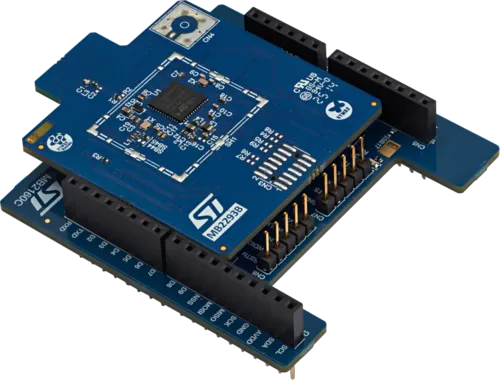

<!-- Copyright 2015-2026 Zephyr Project members and individual contributors. -->
<!-- SPDX-License-Identifier: Apache-2.0 -->
<!-- 中文翻译；编号、导航与译注为本地新增。 -->

<a id="x-nucleo-wba25a1-ble-expansion-board"></a>

<a id="x-nucleo-wba25a1"></a>

# 第217章\_X-NUCLEO-WBA25A1：低功耗蓝牙BLE扩展板

原文：[官方页面](https://docs.zephyrproject.org/latest/boards/shields/x_nucleo_wba25a1/doc/index.html)。读取日期：2026-10-16；来源摘要见[来源记录](../SOURCES.md)。

<a id="overview"></a>

## 概述（Overview）

X-NUCLEO-WBA25A1是符合Bluetooth® v6.0的扩展板，采用STM32WBA25CE MCU，预装带UART接口的网络协处理器固件。射频模块已获FCC认证，FCC ID为YCP-MB229301，以及IC认证，IC编号为8976A-MB229301。

<a id="id2"></a>

X-NUCLEO-WBA25A1出厂即兼容Arduino UNO R3连接器，通过默认UART或SPI外设连接主机微控制器。但出厂固件与Zephyr不兼容，须使用[UM3608](https://www.st.com/resource/en/user_manual/um3608-bluetooth-le-expansion-board-based-on-the-stm32wba25ce-mcu-for-stm32-nucleo-boards-stmicroelectronics.pdf)[注1](#id1)第9.1节所述CN8排针烧录仅控制器镜像。



<a id="id4"></a>

更多信息见X-NUCLEO-WBA25A1网站[注2](#id3)。（[X-NUCLEO-WBA25A1 网站](https://www.st.com/en/evaluation-tools/x-nucleo-wba25a1.html)）

<a id="how-to-change-the-firmware"></a>

## 如何更换固件（How to Change the Firmware）


- <a id="id6"></a>

  <a id="id8"></a>

  步骤1：下载并安装[X-CUBE-WBA](https://www.st.com/en/embedded-software/x-cube-wba.html)[注3](#id5)及[STM32CubeProg](https://www.st.com/en/development-tools/stm32cubeprog)[注4](#id7)。
- 步骤2：打开STM32CubeProgrammer，即STM32CubeProg，擦除STM32WBA25CE的Flash。
- 步骤3：加载BLE_TransparentMode_UART_STM32WBA2_RCP.bin，或

  按使用场景选择BLE_TransparentMode_SPI_STM32WBA2_RCP.bin。固件位于X-CUBE-WBA安装目录的Utilities/BLE_TransparentMode_RCP。
- 步骤4：以0x08000000为起始地址，编程SoC。

<a id="configurations"></a>

## 配置（Configurations）

X-NUCLEO-WBA25A1可作为具有UART或SPI主机控制器接口HCI-UART／HCI-SPI的低功耗蓝牙控制器扩展板。

UART默认设置：


- 波特率：115200 bps
- 8个数据位，无校验，1个停止位

<table>
<tr>
<th>UART引脚</th>
<th>Arduino连接器引脚</th>
</tr>
<tr>
<td>接收（RX）</td>
<td>D0</td>
</tr>
<tr>
<td>发送（TX）</td>
<td>D1</td>
</tr>
</table>

SPI默认设置：


- 模式：全双工从机
- 帧格式：Motorola
- 数据长度：8位，高位先传MSB first
- 时钟极性：高，CPOL=1
- 时钟相位：第二边沿，CPHA=1
- CS类型：软件控制

除SPI引脚外，还需要IRQ及复位引脚。

<table>
<tr>
<th>SPI配置引脚</th>
<th>Arduino连接器引脚</th>
</tr>
<tr>
<td>串行时钟（SCK）</td>
<td>D13</td>
</tr>
<tr>
<td>主机输入从机输出（MISO）</td>
<td>D12</td>
</tr>
<tr>
<td>主机输出从机输入（MOSI）</td>
<td>D11</td>
</tr>
<tr>
<td>片选（CS）</td>
<td>D10</td>
</tr>
<tr>
<td>IRQ</td>
<td>A0</td>
</tr>
<tr>
<td>复位（RESET）</td>
<td><code>D7</code></td>
</tr>
</table>

<a id="programming"></a>

## 编程（Programming）

按UART或SPI接口选择，在west build中添加--shield x_nucleo_wba25a1_uart或--shield x_nucleo_wba25a1_spi，为项目构建启用扩展板：

> ```text
> west build -b your_board_name --shield x_nucleo_wba25a1_uart your_app
> ```

或（Or）

> ```text
> west build -b your_board_name --shield x_nucleo_wba25a1_spi your_app
> ```

<a id="references"></a>

## 参考资料（References）

<a id="id1"></a>

〔[1](#id2)〕 [https://www.st.com/resource/en/user_manual/um3608-bluetooth-le-expansion-board-based-on-the-stm32wba25ce-mcu-for-stm32-nucleo-boards-stmicroelectronics.pdf](https://www.st.com/resource/en/user_manual/um3608-bluetooth-le-expansion-board-based-on-the-stm32wba25ce-mcu-for-stm32-nucleo-boards-stmicroelectronics.pdf)

<a id="id3"></a>

〔[2](#id4)〕 [https://www.st.com/en/evaluation-tools/x-nucleo-wba25a1.html](https://www.st.com/en/evaluation-tools/x-nucleo-wba25a1.html)

<a id="id5"></a>

〔[3](#id6)〕 [https://www.st.com/en/embedded-software/x-cube-wba.html](https://www.st.com/en/embedded-software/x-cube-wba.html)

<a id="id7"></a>

〔[4](#id8)〕 [https://www.st.com/en/development-tools/stm32cubeprog](https://www.st.com/en/development-tools/stm32cubeprog)

## 译注

须按所选UART／SPI烧录对应RCP固件，起始地址0x08000000；默认UART为115200波特率。

## 原文外链核对

2026-10-16核对并重试以下原文外链时未能确认可访问性，保留原始目标，不将访问失败解释为原文内容有误。

- [stm32cubeprog](https://www.st.com/en/development-tools/stm32cubeprog)：HTTP Error 567: Unknown Status。
- [x-cube-wba.html](https://www.st.com/en/embedded-software/x-cube-wba.html)：HTTP Error 567: Unknown Status。
- [x-nucleo-wba25a1.html](https://www.st.com/en/evaluation-tools/x-nucleo-wba25a1.html)：HTTP Error 567: Unknown Status。
- [um3608-bluetooth-le-expansion-board-based-on-the-stm32wba25ce-mcu-for-stm32-nucleo-boards-stmicroelectronics.pdf](https://www.st.com/resource/en/user_manual/um3608-bluetooth-le-expansion-board-based-on-the-stm32wba25ce-mcu-for-stm32-nucleo-boards-stmicroelectronics.pdf)：HTTP Error 567: Unknown Status。

---

[上一章](P216_X-NUCLEO-WB05KN1_BLE_expansion_board.md) · [返回大纲](大纲.md) · [全站翻译进度](../PROGRESS.md) · [下一章](P218_NXP_ZC143AC72MIPI_MIPI_Display.md)
