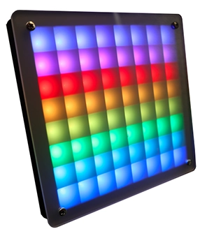

<!-- Copyright 2015-2026 Zephyr Project members and individual contributors. -->
<!-- SPDX-License-Identifier: Apache-2.0 -->
<!-- 中文翻译；编号、导航与译注为本地新增。 -->

<a id="zhaw-luma-matrix-shield"></a>

<a id="zhaw-lumamatrix"></a>

# 第219章\_ZHAW Luma Matrix矩阵扩展板（Shield）

原文：[官方页面](https://docs.zephyrproject.org/latest/boards/shields/zhaw_lumamatrix/doc/index.html)。读取日期：2026-10-16；来源摘要见[来源记录](../SOURCES.md)。

<a id="overview"></a>

## 概述（Overview）

ZHAW Luma Matrix扩展板提供8×8 WS2812B RGB LED矩阵，Adafruit将这类LED称为Neopixel，背面有摇杆及开关。扩展板设计为兼容任何支持Pico排针且具有可用PIO模块pio0的开发板。（[ZHAW Luma Matrix矩阵扩展板（Shield）](#zhaw-luma-matrix-shield)）

<a id="id1"></a>



ZHAW Luma Matrix矩阵扩展板，图片来源：ZHAW

<a id="pin-assignments"></a>

### 引脚分配（Pin Assignments）

<table>
<tr>
<th>扩展板连接器引脚</th>
<th>功能（Function）</th>
</tr>
<tr>
<td>J9_4</td>
<td>摇杆向左</td>
</tr>
<tr>
<td>J9_5</td>
<td>摇杆向上</td>
</tr>
<tr>
<td>J9_9</td>
<td>摇杆向下</td>
</tr>
<tr>
<td>J9_11</td>
<td>摇杆中心</td>
</tr>
<tr>
<td>J9_12</td>
<td>拨码开关（DIP Switch）</td>
</tr>
<tr>
<td>J8_16</td>
<td>WS2812B驱动引脚</td>
</tr>
</table>

<a id="requirements"></a>

## 前置要求（Requirements）

此扩展板可用于任何兼容Pico排针且具有可用PIO模块pio0的开发板。

<a id="programming"></a>

## 编程（Programming）

<a id="led-strip-sample"></a>

### LED灯带示例（LED Strip Sample）

调用west build时设置--shield zhaw_lumamatrix，例如：

```text
# From the root of the zephyr repository
west build -b rpi_pico --shield zhaw_lumamatrix samples/drivers/led/led_strip
```

---

[上一章](P218_NXP_ZC143AC72MIPI_MIPI_Display.md) · [返回大纲](大纲.md) · [全站翻译进度](../PROGRESS.md)
