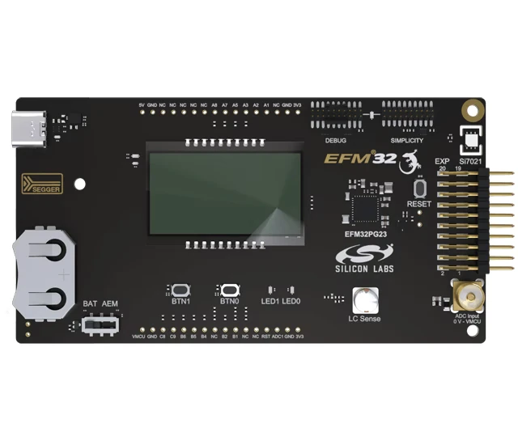

<!-- Copyright 2015-2026 Zephyr Project members and individual contributors. -->
<!-- SPDX-License-Identifier: Apache-2.0 -->
<!-- 中文翻译；编号、导航与译注为本地新增。 -->

<a id="pg28_pk2506a"></a>

# 第3章\_EFM32PG28专业套件，PG28-PK2506A

原文：[官方页面](https://docs.zephyrproject.org/latest/boards/silabs/dev_kits/pg28_pk2506a/doc/index.html)。读取日期：2026-10-16；来源摘要见[来源记录](../SOURCES.md)。

开发板概览（Board Overview）

<a id="id1"></a>

[](images/pg28_pk2506a.webp)

EFM32PG28专业套件，PG28-PK2506A

名称（Name）：

`pg28_pk2506a`

厂商（Vendor）：

[芯科科技（Silicon Laboratories）](https://docs.zephyrproject.org/latest/boards/index.html#vendor=silabs)

状态（Status）：

维护中（Maintained）

架构（Architecture）：

[arm](https://docs.zephyrproject.org/latest/boards/index.html#arch=arm)

片上系统（SoC）：

[efm32pg28b310f1024im68](https://docs.zephyrproject.org/latest/boards/index.html#soc=efm32pg28b310f1024im68)

<a id="board-github-link"></a>

[浏览开发板源码（Browse Board Sources）](https://github.com/zephyrproject-rtos/zephyr/blob/main//boards/silabs/dev_kits/pg28_pk2506a/doc/index.rst/../..)<a id="overview"></a>

## 概述（Overview）

EFM32PG28 Pearl Gecko开发套件搭载EFM32PG28系列SoC，基于Arm Cortex-M33处理器，具有优良低功耗能力。

<a id="hardware"></a>

## 硬件（Hardware）


- EFM32PG28B310F1024IM68 Pearl Gecko片上系统（SoC）
- CPU内核：Arm Cortex-M33
- 闪存容量：1024 kB
- 随机存取存储器（RAM）：256 kB
- 主要功能：USB连接；高级能耗监视器（Advanced Energy Monitor，AEM）；板载SEGGER J-Link调试器；支持外部硬件及板载MCU的调试多路复用器；4×10段式LCD；用户LED及按键；Silicon Labs Si7021相对湿度及温度传感器；用于IADC演示的SMA连接器；电感式LC传感器；扩展板20针2.54 mm排针；直接访问I/O引脚的引出焊盘；USB及CR2032纽扣电池供电。

EFM32PG28 SoC及BRD2506A更多信息见：


- [EFM32PG28网站](https://www.silabs.com/mcu/32-bit-microcontrollers/efm32pg28-series-2)
- [EFM32PG28数据手册](https://www.silabs.com/documents/public/data-sheets/efm32pg28-datasheet.pdf)
- [EFM32PG28参考手册](https://www.silabs.com/documents/public/reference-manuals/efm32pg28-rm.pdf)
- [BRD2506A用户指南](https://www.silabs.com/documents/public/user-guides/ug545-efm32pg28-brd2506a-user-guide.pdf)

<a id="supported-features"></a>

### 支持的功能（Supported Features）

`pg28_pk2506a`开发板支持下表所列的硬件功能。

片上／板载（On-Chip / On-Board）

功能集成在片上系统（SoC）内／位于开发板上。

2 / 2

分别表示已启用／已禁用的实例数。点击数量标签，可查看开发板或SoC设备树源码（DTS）中该功能的第一个实例。

`vnd,foo`

与此功能匹配的设备树绑定兼容字符串（Compatible String）；点击链接可查看绑定文档。

<a id="pg28_pk2506a-hw-features"></a>

<a id="pg28_pk2506a-pg28_pk2506a/efm32pg28b310f1024im68-hw-features-section"></a>

#### `pg28_pk2506a/efm32pg28b310f1024im68`目标（Target）

<a id="pg28_pk2506a-pg28_pk2506a/efm32pg28b310f1024im68-hw-features-panel"></a>

<a id="pg28_pk2506a-pg28_pk2506a/efm32pg28b310f1024im68-hw-features-memory"></a>

此开发板目标可用存储器：256 KiB RAM、1 MiB 闪存。

<a id="pg28_pk2506a-pg28_pk2506a/efm32pg28b310f1024im68-hw-features-table"></a>

<table>
<tr>
<th>类型（Type）</th>
<th>位置（Location）</th>
<th>说明（Description）</th>
<th>兼容字符串（Compatible）</th>
</tr>
<tr>
<td rowspan="1">中央处理器（CPU）</td>
<td>片上（On-Chip）</td>
<td>ARM Cortex-M33处理器（CPU）（<a href="https://github.com/zephyrproject-rtos/zephyr/blob/main/dts/arm/silabs/xg28/xg28.dtsi?plain=1#L174">已启用：1</a>）</td>
<td><a href="../cpu_arm_riscv_binding_reference/P022_arm_cortex-m33.md#std-dtcompatible-arm-cortex-m33"><code>arm,cortex-m33</code></a></td>
</tr>
<tr>
<td rowspan="1">模数转换器（ADC）</td>
<td>片上（On-Chip）</td>
<td>Silicon Labs Series 2增量式模数转换器（IADC）（<a href="https://github.com/zephyrproject-rtos/zephyr/blob/main/dts/arm/silabs/xg28/xg28.dtsi?plain=1#L608">已禁用：1</a>）</td>
<td><a href="../hardware/P900_SiliconLabsIADC绑定.md#dtbinding-silabs-iadc"><code>silabs,iadc</code></a></td>
</tr>
<tr>
<td rowspan="9">时钟控制（Clock Control）</td>
<td>片上（On-Chip）</td>
<td>Silicon Labs Series 2时钟管理单元（CMU）（<a href="https://github.com/zephyrproject-rtos/zephyr/blob/main/dts/arm/silabs/xg28/xg28.dtsi?plain=1#L222">已启用：1</a>）</td>
<td><a href="../clock_renesas_rockchip_sifli_silabs_binding_reference/P029_silabs_series-clock.md#std-dtcompatible-silabs-series-clock"><code>silabs,series-clock</code></a></td>
</tr>
<tr>
<td>片上（On-Chip）</td>
<td>Silicon Labs CMU时钟输出（CLKOUT）（<a href="https://github.com/zephyrproject-rtos/zephyr/blob/main/dts/arm/silabs/xg28/xg28.dtsi?plain=1#L230">已禁用：1</a>）</td>
<td><a href="../clock_renesas_rockchip_sifli_silabs_binding_reference/P028_silabs_series-clock-output.md#std-dtcompatible-silabs-series-clock-output"><code>silabs,series-clock-output</code></a></td>
</tr>
<tr>
<td>片上（On-Chip）</td>
<td>Silicon Labs Series 2高频RC振荡器数字锁相环（HFRCODPLL）（<a href="https://github.com/zephyrproject-rtos/zephyr/blob/main/dts/arm/silabs/xg28/xg28.dtsi?plain=1#L254">已启用：1</a>）</td>
<td><a href="../clock_silabs_ti_xilinx_binding_reference/P004_silabs_series2-hfrcodpll.md#std-dtcompatible-silabs-series2-hfrcodpll"><code>silabs,series2-hfrcodpll</code></a></td>
</tr>
<tr>
<td>片上（On-Chip）</td>
<td>通用固定频率时钟提供者（Fixed-Rate Clock Provider）（<a href="https://github.com/zephyrproject-rtos/zephyr/blob/main/dts/arm/silabs/xg28/xg28.dtsi?plain=1#L263">已启用：3</a>）</td>
<td><a href="../hardware/P566_固定时钟绑定.md#dtbinding-fixed-clock"><code>fixed-clock</code></a></td>
</tr>
<tr>
<td>片上（On-Chip）</td>
<td>Silicon Labs Series 2低频外部晶体振荡器（LFXO）（<a href="https://github.com/zephyrproject-rtos/zephyr/blob/main/dts/arm/silabs/xg28/xg28.dtsi?plain=1#L271">已启用：1</a>）</td>
<td><a href="../clock_silabs_ti_xilinx_binding_reference/P007_silabs_series2-lfxo.md#std-dtcompatible-silabs-series2-lfxo"><code>silabs,series2-lfxo</code></a></td>
</tr>
<tr>
<td>片上（On-Chip）</td>
<td>Silicon Labs Series 2低频RC振荡器（LFRCO）（<a href="https://github.com/zephyrproject-rtos/zephyr/blob/main/dts/arm/silabs/xg28/xg28.dtsi?plain=1#L285">已启用：1</a>）</td>
<td><a href="../clock_silabs_ti_xilinx_binding_reference/P006_silabs_series2-lfrco.md#std-dtcompatible-silabs-series2-lfrco"><code>silabs,series2-lfrco</code></a></td>
</tr>
<tr>
<td>片上（On-Chip）</td>
<td>Silicon Labs Series 2 EM2／EM3模式高频RC振荡器（HFRCOEM23）（<a href="https://github.com/zephyrproject-rtos/zephyr/blob/main/dts/arm/silabs/xg28/xg28.dtsi?plain=1#L656">已启用：1</a>）</td>
<td><a href="../clock_silabs_ti_xilinx_binding_reference/P005_silabs_series2-hfrcoem23.md#std-dtcompatible-silabs-series2-hfrcoem23"><code>silabs,series2-hfrcoem23</code></a></td>
</tr>
<tr>
<td>片上（On-Chip）</td>
<td>Silicon Labs Series 2高频外部晶体振荡器（HFXO）（<a href="https://github.com/zephyrproject-rtos/zephyr/blob/main/dts/arm/silabs/xg28/xg28.dtsi?plain=1#L666">已启用：1</a>）</td>
<td><a href="../clock_renesas_rockchip_sifli_silabs_binding_reference/P027_silabs_hfxo.md#std-dtcompatible-silabs-hfxo"><code>silabs,hfxo</code></a></td>
</tr>
<tr>
<td>片上（On-Chip）</td>
<td>通用固定比例时钟提供器（Fixed Factor Clock Provider）（<a href="https://github.com/zephyrproject-rtos/zephyr/blob/main/dts/arm/silabs/xg28/xg28.dtsi?plain=1#L25">已启用：23</a>）</td>
<td><a href="../timer_reference/P110_固定比例时钟绑定.md#dtbinding-fixed-factor-clock"><code>fixed-factor-clock</code></a></td>
</tr>
<tr>
<td rowspan="1">比较器（Comparator）</td>
<td>片上（On-Chip）</td>
<td>Silicon Labs Series 2模拟比较器（ACMP）（<a href="https://github.com/zephyrproject-rtos/zephyr/blob/main/dts/arm/silabs/xg28/xg28.dtsi?plain=1#L618">已禁用：2</a>）</td>
<td><a href="../hardware/P757_SiliconLabs模拟比较器绑定.md#dtbinding-silabs-acmp"><code>silabs,acmp</code></a></td>
</tr>
<tr>
<td rowspan="2">计数器（Counter）</td>
<td>片上（On-Chip）</td>
<td>Silicon Labs TIMER计数器（Counter）（<a href="https://github.com/zephyrproject-rtos/zephyr/blob/main/dts/arm/silabs/xg28/xg28.dtsi?plain=1#L411">已禁用：5</a>）</td>
<td><a href="../stm32_ti_xilinx_counter_binding_reference/P005_silabs_timer-counter.md#std-dtcompatible-silabs-timer-counter"><code>silabs,timer-counter</code></a></td>
</tr>
<tr>
<td>片上（On-Chip）</td>
<td>Silicon Labs Series 2备份实时时钟（BURTC）（<a href="https://github.com/zephyrproject-rtos/zephyr/blob/main/dts/arm/silabs/xg28/xg28.dtsi?plain=1#L520">已禁用：1</a>）</td>
<td><a href="../stm32_ti_xilinx_counter_binding_reference/P003_silabs_burtc-counter.md#std-dtcompatible-silabs-burtc-counter"><code>silabs,burtc-counter</code></a></td>
</tr>
<tr>
<td rowspan="1">循环冗余校验（CRC）</td>
<td>片上（On-Chip）</td>
<td>Silabs通用循环冗余校验（CRC）（<a href="https://github.com/zephyrproject-rtos/zephyr/blob/main/dts/arm/silabs/xg28/xg28.dtsi?plain=1#L548">已启用：1</a>）</td>
<td><a href="../crc_clock_monitor_binding_reference/P010_silabs_gpcrc.md#std-dtcompatible-silabs-gpcrc"><code>silabs,gpcrc</code></a></td>
</tr>
<tr>
<td rowspan="1">密码学加速器（Cryptographic Accelerator）</td>
<td>片上（On-Chip）</td>
<td>Silicon Labs Series 2安全引擎邮箱（SE Mailbox）（<a href="https://github.com/zephyrproject-rtos/zephyr/blob/main/dts/arm/silabs/xg28/xg28.dtsi?plain=1#L720">已启用：1</a>）</td>
<td><a href="../crypto_secure_engine_st_ti_binding_reference/P012_silabs_gecko-semailbox.md#std-dtcompatible-silabs-gecko-semailbox"><code>silabs,gecko-semailbox</code></a></td>
</tr>
<tr>
<td rowspan="1">数模转换器（DAC）</td>
<td>片上（On-Chip）</td>
<td>Silicon Labs Series 2电压数模转换器（VDAC）（<a href="https://github.com/zephyrproject-rtos/zephyr/blob/main/dts/arm/silabs/xg28/xg28.dtsi?plain=1#L636">已禁用：1</a>）</td>
<td><a href="../hardware/P774_SiliconLabs电压数模转换器绑定.md#dtbinding-silabs-vdac"><code>silabs,vdac</code></a></td>
</tr>
<tr>
<td rowspan="1">调试（Debug）</td>
<td>片上（On-Chip）</td>
<td>ARMv8仪器跟踪宏单元（Instrumentation Trace Macrocell）（<a href="https://github.com/zephyrproject-rtos/zephyr/blob/main/dts/arm/silabs/xg28/xg28.dtsi?plain=1#L186">已启用：1</a>）</td>
<td><a href="../debug_binding_reference/P002_ARMv8M_ITM调试绑定.md#std-dtcompatible-arm-armv8m-itm"><code>arm,armv8m-itm</code></a></td>
</tr>
<tr>
<td rowspan="1">直接存储器访问（DMA）</td>
<td>片上（On-Chip）</td>
<td>Silicon Labs Series 2链式直接存储器访问（LDMA）（<a href="https://github.com/zephyrproject-rtos/zephyr/blob/main/dts/arm/silabs/xg28/xg28.dtsi?plain=1#L388">已禁用：1</a>）</td>
<td><a href="../stm32_ti_xilinx_dma_binding_reference/P001_silabs_ldma.md#std-dtcompatible-silabs-ldma"><code>silabs,ldma</code></a></td>
</tr>
<tr>
<td rowspan="1">闪存控制器（Flash Controller）</td>
<td>片上（On-Chip）</td>
<td>Silicon Labs Series 2存储器系统控制器（MSC）（<a href="https://github.com/zephyrproject-rtos/zephyr/blob/main/dts/arm/silabs/xg28/xg28.dtsi?plain=1#L305">已启用：1</a>）</td>
<td><a href="../flash_renesas_st_ti_binding_reference/P007_silabs_series2-flash-controller.md#std-dtcompatible-silabs-series2-flash-controller"><code>silabs,series2-flash-controller</code></a></td>
</tr>
<tr>
<td rowspan="3">通用输入输出与接插件（GPIO &amp; Headers）</td>
<td>片上（On-Chip）</td>
<td>Silicon Labs Series 2通用输入输出外设（GPIO Peripheral）（<a href="https://github.com/zephyrproject-rtos/zephyr/blob/main/dts/arm/silabs/xg28/xg28.dtsi?plain=1#L324">已启用：1</a>）</td>
<td><a href="../gpio_silabs_st_connectors_binding_reference/P015_silabs_gpio.md#std-dtcompatible-silabs-gpio"><code>silabs,gpio</code></a></td>
</tr>
<tr>
<td>片上（On-Chip）</td>
<td>Silicon Labs Series 2 GPIO端口（Port）（<a href="https://github.com/zephyrproject-rtos/zephyr/blob/main/dts/arm/silabs/xg28/xg28.dtsi?plain=1#L334">已启用：4</a>）</td>
<td><a href="../gpio_silabs_st_connectors_binding_reference/P014_silabs_gpio-port.md#std-dtcompatible-silabs-gpio-port"><code>silabs,gpio-port</code></a></td>
</tr>
<tr>
<td>板载（On-Board）</td>
<td>Silicon Labs套件扩展排针（<a href="https://github.com/zephyrproject-rtos/zephyr/blob/main/boards/silabs/dev_kits/pg28_pk2506a/pg28_pk2506a.dts?plain=1#L89">已启用：1</a>）</td>
<td><a href="../gpio_silabs_st_connectors_binding_reference/P011_silabs_exp-header.md#std-dtcompatible-silabs-exp-header"><code>silabs,exp-header</code></a></td>
</tr>
<tr>
<td rowspan="1">集成电路间总线（I2C）</td>
<td>片上（On-Chip）</td>
<td>Silicon Labs Series 2的I2C控制器（<a href="https://github.com/zephyrproject-rtos/zephyr/blob/main/dts/arm/silabs/xg28/xg28.dtsi?plain=1#L679">已启用：1</a>；<a href="https://github.com/zephyrproject-rtos/zephyr/blob/main/dts/arm/silabs/xg28/xg28.dtsi?plain=1#L529">已禁用：1</a>）</td>
<td><a href="../i2c_stm32_ti_mux_binding_reference/P005_silabs_i2c.md#std-dtcompatible-silabs-i2c"><code>silabs,i2c</code></a></td>
</tr>
<tr>
<td rowspan="1">输入（Input）</td>
<td>板载（On-Board）</td>
<td>一组绑定到 GPIO 的输入按键（GPIO-Bound Input Keys）（<a href="https://github.com/zephyrproject-rtos/zephyr/blob/main/boards/silabs/dev_kits/pg28_pk2506a/pg28_pk2506a.dts?plain=1#L66">已启用：1</a>）</td>
<td><a href="../hardware/P563_GPIO按键绑定.md#std-dtcompatible-gpio-keys"><code>gpio-keys</code></a></td>
</tr>
<tr>
<td rowspan="1">中断控制器（Interrupt Controller）</td>
<td>片上（On-Chip）</td>
<td>ARMv8-M嵌套向量中断控制器（NVIC / Nested Vectored Interrupt Controller）（<a href="https://github.com/zephyrproject-rtos/zephyr/blob/main/dts/arm/armv8-m.dtsi?plain=1#L13">已启用：1</a>）</td>
<td><a href="../arm_interrupt_timer_binding_reference/P003_ARMv8_M_NVIC.md#std-dtcompatible-arm-v8m-nvic"><code>arm,v8m-nvic</code></a></td>
</tr>
<tr>
<td rowspan="2">发光二极管（LED）</td>
<td>板载（On-Board）</td>
<td>一组由 GPIO 控制的 LED（GPIO-Controlled LEDs）（<a href="https://github.com/zephyrproject-rtos/zephyr/blob/main/boards/silabs/dev_kits/pg28_pk2506a/pg28_pk2506a.dts?plain=1#L38">已启用：1</a>）</td>
<td><a href="../hardware/P564_GPIO指示灯绑定.md#dtbinding-gpio-leds"><code>gpio-leds</code></a></td>
</tr>
<tr>
<td>板载（On-Board）</td>
<td>一组由脉宽调制（PWM）控制的LED（<a href="https://github.com/zephyrproject-rtos/zephyr/blob/main/boards/silabs/dev_kits/pg28_pk2506a/pg28_pk2506a.dts?plain=1#L52">已启用：1</a>）</td>
<td><a href="../hardware/P565_PWM指示灯绑定.md#dtbinding-pwm-leds"><code>pwm-leds</code></a></td>
</tr>
<tr>
<td rowspan="1">内存管理单元／内存保护单元（MMU / MPU）</td>
<td>片上（On-Chip）</td>
<td>ARMv8-M存储器保护单元（MPU / Memory Protection Unit）（<a href="https://github.com/zephyrproject-rtos/zephyr/blob/main/dts/arm/silabs/xg28/xg28.dtsi?plain=1#L191">已启用：1</a>）</td>
<td><a href="../memory_protection_binding_reference/P007_arm_armv8m-mpu.md#std-dtcompatible-arm-armv8m-mpu"><code>arm,armv8m-mpu</code></a></td>
</tr>
<tr>
<td rowspan="1">存储技术设备（MTD）</td>
<td>片上（On-Chip）</td>
<td>闪存（Flash）节点（<a href="https://github.com/zephyrproject-rtos/zephyr/blob/main/dts/arm/silabs/xg28/xg28.dtsi?plain=1#L315">已启用：1</a>）</td>
<td><a href="../mtd_nxp_st_ti_partition_binding_reference/P013_soc-nv-flash.md#std-dtcompatible-soc-nv-flash"><code>soc-nv-flash</code></a></td>
</tr>
<tr>
<td rowspan="1">引脚控制（Pin Control）</td>
<td>片上（On-Chip）</td>
<td>Silicon Labs Series 2 DBUS引脚控制器（Pin Controller）（<a href="https://github.com/zephyrproject-rtos/zephyr/blob/main/dts/arm/silabs/xg28/xg28.dtsi?plain=1#L375">已启用：1</a>）</td>
<td><a href="../pinctrl_renesas_silabs_binding_reference/P024_silabs_dbus-pinctrl.md#std-dtcompatible-silabs-dbus-pinctrl"><code>silabs,dbus-pinctrl</code></a></td>
</tr>
<tr>
<td rowspan="2">脉宽调制（PWM）</td>
<td>片上（On-Chip）</td>
<td>Silicon Labs TIMER脉宽调制（PWM）（<a href="https://github.com/zephyrproject-rtos/zephyr/blob/main/dts/arm/silabs/xg28/xg28.dtsi?plain=1#L416">已启用：1</a>；<a href="https://github.com/zephyrproject-rtos/zephyr/blob/main/dts/arm/silabs/xg28/xg28.dtsi?plain=1#L438">已禁用：4</a>）</td>
<td><a href="../pwm_stm32_ti_generic_binding_reference/P010_silabs_timer-pwm.md#std-dtcompatible-silabs-timer-pwm"><code>silabs,timer-pwm</code></a></td>
</tr>
<tr>
<td>片上（On-Chip）</td>
<td>Silicon Labs低能耗定时器脉宽调制（LETIMER PWM）（<a href="https://github.com/zephyrproject-rtos/zephyr/blob/main/dts/arm/silabs/xg28/xg28.dtsi?plain=1#L601">已禁用：1</a>）</td>
<td><a href="../pwm_stm32_ti_generic_binding_reference/P008_silabs_letimer-pwm.md#std-dtcompatible-silabs-letimer-pwm"><code>silabs,letimer-pwm</code></a></td>
</tr>
<tr>
<td rowspan="2">稳压器（Regulator）</td>
<td>片上（On-Chip）</td>
<td>Silicon Labs Series 2直流电压转换器（DC-DC Converter）（<a href="https://github.com/zephyrproject-rtos/zephyr/blob/main/dts/arm/silabs/xg28/xg28.dtsi?plain=1#L555">已启用：1</a>）</td>
<td><a href="../hardware/P657_SiliconLabs_Series2直流转换器绑定.md#dtbinding-silabs-series2-dcdc"><code>silabs,series2-dcdc</code></a></td>
</tr>
<tr>
<td>板载（On-Board）</td>
<td>固定电压稳压器（Fixed Voltage Regulators）（<a href="https://github.com/zephyrproject-rtos/zephyr/blob/main/boards/silabs/dev_kits/pg28_pk2506a/pg28_pk2506a.dts?plain=1#L82">已启用：1</a>）</td>
<td><a href="../hardware/P635_固定稳压器设备树绑定.md#dtbinding-regulator-fixed"><code>regulator-fixed</code></a></td>
</tr>
<tr>
<td rowspan="1">保持存储器（Retained Memory）</td>
<td>片上（On-Chip）</td>
<td>Silicon Labs Series 2备份RAM（BURAM）（<a href="https://github.com/zephyrproject-rtos/zephyr/blob/main/dts/arm/silabs/xg28/xg28.dtsi?plain=1#L541">已禁用：1</a>）</td>
<td><a href="../hardware/P629_SiliconLabs备份RAM绑定.md#dtbinding-silabs-buram"><code>silabs,buram</code></a></td>
</tr>
<tr>
<td rowspan="1">实时时钟（RTC）</td>
<td>片上（On-Chip）</td>
<td>Silicon Labs Series 2系统实时时钟（SYSRTC）（<a href="https://github.com/zephyrproject-rtos/zephyr/blob/main/dts/arm/silabs/xg28/xg28.dtsi?plain=1#L582">已启用：1</a>）</td>
<td><a href="../soc_rtc_binding_reference/P013_silabs_sysrtc.md#std-dtcompatible-silabs-sysrtc"><code>silabs,sysrtc</code></a></td>
</tr>
<tr>
<td rowspan="1">传感器（Sensors）</td>
<td>板载（On-Board）</td>
<td>Silicon Labs Si7006／13／20／21相对湿度及温度（RHT）传感器（<a href="https://github.com/zephyrproject-rtos/zephyr/blob/main/boards/silabs/dev_kits/pg28_pk2506a/pg28_pk2506a.dts?plain=1#L176">已启用：1</a>）</td>
<td><a href="../sensor_silabs_st_industrial_binding_reference/P002_silabs_si7006.md#std-dtcompatible-silabs-si7006"><code>silabs,si7006</code></a></td>
</tr>
<tr>
<td rowspan="2">串行控制器（Serial Controller）</td>
<td>片上（On-Chip）</td>
<td>Silicon Labs Series 2通用同步／异步收发器（USART）（<a href="https://github.com/zephyrproject-rtos/zephyr/blob/main/dts/arm/silabs/xg28/xg28.dtsi?plain=1#L511">已禁用：1</a>）</td>
<td><a href="../uart_silabs_stm32_ti_binding_reference/P010_silabs_usart-uart.md#std-dtcompatible-silabs-usart-uart"><code>silabs,usart-uart</code></a></td>
</tr>
<tr>
<td>片上（On-Chip）</td>
<td>Silicon Labs Series 2增强型通用同步／异步收发器（EUSART）（<a href="https://github.com/zephyrproject-rtos/zephyr/blob/main/dts/arm/silabs/xg28/xg28.dtsi?plain=1#L564">已启用：1</a>）</td>
<td><a href="../uart_silabs_stm32_ti_binding_reference/P005_silabs_eusart-uart.md#std-dtcompatible-silabs-eusart-uart"><code>silabs,eusart-uart</code></a></td>
</tr>
<tr>
<td rowspan="1">串行外设接口（SPI）</td>
<td>片上（On-Chip）</td>
<td>Silicon Labs Series 2增强型通用同步／异步收发器（EUSART）（<a href="https://github.com/zephyrproject-rtos/zephyr/blob/main/dts/arm/silabs/xg28/xg28.dtsi?plain=1#L573">已禁用：2</a>）</td>
<td><a href="../spi_stm32_ti_xilinx_binding_reference/P005_silabs_eusart-spi.md#std-dtcompatible-silabs-eusart-spi"><code>silabs,eusart-spi</code></a></td>
</tr>
<tr>
<td rowspan="1">静态随机存储器（SRAM）</td>
<td>片上（On-Chip）</td>
<td>通用片上静态随机存储器（SRAM）（<a href="https://github.com/zephyrproject-rtos/zephyr/blob/main/dts/arm/silabs/xg28/xg28.dtsi?plain=1#L729">已启用：1</a>）</td>
<td><a href="../hardware/P567_内存映射SRAM绑定.md#dtbinding-mmio-sram"><code>mmio-sram</code></a></td>
</tr>
<tr>
<td rowspan="3">定时器（Timer）</td>
<td>片上（On-Chip）</td>
<td>ARMv8-M系统节拍（System Tick）（<a href="https://github.com/zephyrproject-rtos/zephyr/blob/main/dts/arm/armv8-m.dtsi?plain=1#L21">已启用：1</a>）</td>
<td><a href="../arm_interrupt_timer_binding_reference/P007_ARMv8_M_SysTick.md#std-dtcompatible-arm-armv8m-systick"><code>arm,armv8m-systick</code></a></td>
</tr>
<tr>
<td>片上（On-Chip）</td>
<td>Silicon Labs定时器（TIMER）（<a href="https://github.com/zephyrproject-rtos/zephyr/blob/main/dts/arm/silabs/xg28/xg28.dtsi?plain=1#L401">已启用：1</a>；<a href="https://github.com/zephyrproject-rtos/zephyr/blob/main/dts/arm/silabs/xg28/xg28.dtsi?plain=1#L423">已禁用：4</a>）</td>
<td><a href="../stm32_ti_silabs_timer_binding_reference/P006_silabs_series2-timer.md#std-dtcompatible-silabs-series2-timer"><code>silabs,series2-timer</code></a></td>
</tr>
<tr>
<td>片上（On-Chip）</td>
<td>Silicon Labs低能耗定时器（LETIMER）（<a href="https://github.com/zephyrproject-rtos/zephyr/blob/main/dts/arm/silabs/xg28/xg28.dtsi?plain=1#L593">已禁用：1</a>）</td>
<td><a href="../stm32_ti_silabs_timer_binding_reference/P005_silabs_series2-letimer.md#std-dtcompatible-silabs-series2-letimer"><code>silabs,series2-letimer</code></a></td>
</tr>
<tr>
<td rowspan="1">看门狗（Watchdog）</td>
<td>片上（On-Chip）</td>
<td>Silicon Labs Series 0–2看门狗（WDOG）（<a href="https://github.com/zephyrproject-rtos/zephyr/blob/main/dts/arm/silabs/xg28/xg28.dtsi?plain=1#L691">已启用：1</a>；<a href="https://github.com/zephyrproject-rtos/zephyr/blob/main/dts/arm/silabs/xg28/xg28.dtsi?plain=1#L701">已禁用：1</a>）</td>
<td><a href="../realtek_renesas_silabs_watchdog_binding_reference/P011_silabs_gecko-wdog.md#std-dtcompatible-silabs-gecko-wdog"><code>silabs,gecko-wdog</code></a></td>
</tr>
</table>

<a id="connections-and-ios"></a>

### 连接与输入输出（Connections and IOs）

下表Name列为引脚名称，例如PA2表示A端口第2脚，与板卡数据手册及用户手册一致。

<table>
<tr>
<th>名称（Name）</th>
<th>功能（Function）</th>
<th>用途（Usage）</th>
</tr>
<tr>
<td>PB1</td>
<td>通用输入输出（GPIO）</td>
<td>按键0</td>
</tr>
<tr>
<td>PB6</td>
<td>通用输入输出（GPIO）</td>
<td>按键1</td>
</tr>
<tr>
<td>PC10</td>
<td>GPIO/TIMER0_CC0</td>
<td>LED0</td>
</tr>
<tr>
<td>PC11</td>
<td>GPIO/TIMER0_CC1</td>
<td>LED1</td>
</tr>
<tr>
<td>PD7</td>
<td>EUSART1_TX</td>
<td>控制台发送（Tx）</td>
</tr>
<tr>
<td>PD8</td>
<td>EUSART1_RX</td>
<td>控制台接收（Rx）</td>
</tr>
<tr>
<td>PD9</td>
<td>I2C0_SDA</td>
<td>Si7021 I2C数据</td>
</tr>
<tr>
<td>PD10</td>
<td>I2C0_SCL</td>
<td>Si7021 I2C时钟</td>
</tr>
</table>

默认配置见[boards/silabs/dev_kits/pg28_pk2506a/pg28_pk2506a_defconfig](https://github.com/zephyrproject-rtos/zephyr/blob/main/boards/silabs/dev_kits/pg28_pk2506a/pg28_pk2506a_defconfig)。

<a id="system-clock"></a>

### 系统时钟（System Clock）

EFM32PG28 SoC配置为使用板载39 MHz外部振荡器。

<a id="serial-port"></a>

### 串口（Serial Port）

EFM32PG28 SoC具有一个USART及三个EUSART。EUSART1连接到板卡控制器，用作控制台。

<a id="programming-and-debugging"></a>

## 烧录与调试（Programming and Debugging）

`pg28_pk2506a`开发板支持下表所列的运行工具（Runners）及相关west命令。

<table>
<tr>
<th></th>
<th>烧录（flash）</th>
<th>调试（debug）</th>
<th>连接调试会话（attach）</th>
<th>实时传输（rtt）</th>
<th>复位（reset）</th>
<th>调试服务器（debugserver）</th>
</tr>
<tr>
<td><a href="https://docs.zephyrproject.org/latest/develop/flash_debug/host-tools.html#runner-jlink">jlink</a></td>
<td>✅（默认 / default）</td>
<td>✅（默认 / default）</td>
<td>✅</td>
<td>✅</td>
<td>✅</td>
<td>✅</td>
</tr>
<tr>
<td><a href="https://docs.zephyrproject.org/latest/develop/flash_debug/host-tools.html#runner-openocd">openocd</a></td>
<td>✅</td>
<td>✅</td>
<td>✅</td>
<td>✅</td>
<td></td>
<td>✅</td>
</tr>
<tr>
<td>silabs_commander</td>
<td>✅</td>
<td></td>
<td></td>
<td></td>
<td></td>
<td></td>
</tr>
</table>

注意（Note）

原文要求首次使用套件前，在Simplicity Studio更新J-Link固件。

<a id="flashing"></a>

### 烧录（Flashing）

下面以[Hello World](../getting_started/P005_HelloWorld示例.md#hello_world)为例，构建Zephyr内核及应用：

```text
# From the root of the zephyr repository
west build -b pg28_pk2506a samples/hello_world
```

通过USB端口将pg28_pk2506a连接主机，应能看到USB连接。

打开串口终端（如minicom或PuTTY），设置如下：


- 速率（Speed）：115200波特率
- 数据位（Data）：8位
- 奇偶校验（Parity）：无（None）
- 停止位（Stop Bits）：1位

复位开发板后，对应串口终端应显示以下消息：

```text
Hello World! pg28_pk2506a
```

<a id="troubleshooting"></a>

### 故障排查（Troubleshooting）

若没有串口输出，使用SEGGER RTT Viewer，并按以下内容更新[boards/silabs/dev_kits/pg28_pk2506a/pg28_pk2506a_defconfig](https://github.com/zephyrproject-rtos/zephyr/blob/main/boards/silabs/dev_kits/pg28_pk2506a/pg28_pk2506a_defconfig)：

```text
CONFIG_UART_CONSOLE=n
CONFIG_RTT_CONSOLE=y
CONFIG_USE_SEGGER_RTT=y
```

## 译注

PG28使用39 MHz主晶体与EUSART1控制台。LCD、按键及扩展口按本页保留。

## 原文外链核对

2026-10-16核对并重试以下原文外链时未能确认可访问性，保留原始目标，不将访问失败解释为原文内容有误。

- [efm32pg28-datasheet.pdf](https://www.silabs.com/documents/public/data-sheets/efm32pg28-datasheet.pdf)：HTTP Error 403: Forbidden。
- [efm32pg28-rm.pdf](https://www.silabs.com/documents/public/reference-manuals/efm32pg28-rm.pdf)：HTTP Error 403: Forbidden。
- [ug545-efm32pg28-brd2506a-user-guide.pdf](https://www.silabs.com/documents/public/user-guides/ug545-efm32pg28-brd2506a-user-guide.pdf)：HTTP Error 403: Forbidden。
- [efm32pg28-series-2](https://www.silabs.com/mcu/32-bit-microcontrollers/efm32pg28-series-2)：HTTP Error 403: Forbidden。

---

[上一章](P002_EFM32PG23_Pro_Kit_PG23-PK2504A.md) · [返回大纲](大纲.md) · [全站翻译进度](../PROGRESS.md) · [下一章](P004_SiM3U1xx_32-bit_MCU_USB_Development_Kit.md)
