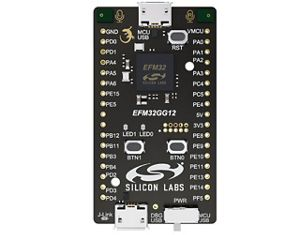

<!-- Copyright 2015-2026 Zephyr Project members and individual contributors. -->
<!-- SPDX-License-Identifier: Apache-2.0 -->
<!-- 中文翻译；编号、导航与译注为本地新增。 -->

<a id="sltb009a"></a>

# 第7章\_EFM32GG12 Thunderboard，SLTB009A

原文：[官方页面](https://docs.zephyrproject.org/latest/boards/silabs/dev_kits/sltb009a/doc/index.html)。读取日期：2026-10-16；来源摘要见[来源记录](../SOURCES.md)。

开发板概览（Board Overview）

<a id="id1"></a>

[](images/sltb009a.jpg)

EFM32GG12 Thunderboard，SLTB009A

名称（Name）：

`sltb009a`

厂商（Vendor）：

[芯科科技（Silicon Laboratories）](https://docs.zephyrproject.org/latest/boards/index.html#vendor=silabs)

状态（Status）：

维护中（Maintained）

架构（Architecture）：

[arm](https://docs.zephyrproject.org/latest/boards/index.html#arch=arm)

片上系统（SoC）：

[efm32gg12b810f1024gm64](https://docs.zephyrproject.org/latest/boards/index.html#soc=efm32gg12b810f1024gm64)

<a id="board-github-link"></a>

[浏览开发板源码（Browse Board Sources）](https://github.com/zephyrproject-rtos/zephyr/blob/main//boards/silabs/dev_kits/sltb009a/doc/index.rst/../..)<a id="overview"></a>

## 概述（Overview）

EFM32GG12 Thunderboard套件SLTB009A是EFM32GG12 Giant Gecko微控制器评估平台，采用带浮点运算单元（FPU）的Arm Cortex-M4，具有1024 kB闪存及192 kB RAM。

<a id="hardware"></a>

## 硬件（Hardware）


- 脉冲密度调制（PDM）立体声麦克风
- USB连接功能
- 板载SEGGER J-Link USB调试器
- 2个用户按键及2个LED
- USB-C连接器

WGM160P及SLTB009A更多信息见以下文档；原文此处写WGM160P，与本页EFM32GG12型号不同。


- [SLTB009A网站](https://www.silabs.com/development-tools/thunderboard/thunderboard-gg12-kit)
- [SLTB009A用户指南](https://www.silabs.com/documents/public/user-guides/ug371-sltb009a-user-guide.pdf)
- [EFM32GG12数据手册](https://www.silabs.com/documents/public/data-sheets/efm32gg12-datasheet.pdf)
- [EFM32GG12参考手册](https://www.silabs.com/documents/public/reference-manuals/efm32gg12-rm.pdf)

<a id="supported-features"></a>

### 支持的功能（Supported Features）

`sltb009a`开发板支持下表所列的硬件功能。

片上／板载（On-Chip / On-Board）

功能集成在片上系统（SoC）内／位于开发板上。

2 / 2

分别表示已启用／已禁用的实例数。点击数量标签，可查看开发板或SoC设备树源码（DTS）中该功能的第一个实例。

`vnd,foo`

与此功能匹配的设备树绑定兼容字符串（Compatible String）；点击链接可查看绑定文档。

<a id="sltb009a-hw-features"></a>

<a id="sltb009a-sltb009a/efm32gg12b810f1024gm64-hw-features-section"></a>

#### `sltb009a/efm32gg12b810f1024gm64`目标（Target）

<a id="sltb009a-sltb009a/efm32gg12b810f1024gm64-hw-features-panel"></a>

<a id="sltb009a-sltb009a/efm32gg12b810f1024gm64-hw-features-memory"></a>

该开发板目标的片上存储容量：192 KiB RAM、1 MiB Flash。

<a id="sltb009a-sltb009a/efm32gg12b810f1024gm64-hw-features-table"></a>

<table>
<tr>
<th>类型（Type）</th>
<th>位置（Location）</th>
<th>说明（Description）</th>
<th>兼容字符串（Compatible）</th>
</tr>
<tr>
<td rowspan="1">中央处理器（CPU）</td>
<td>片上（On-Chip）</td>
<td>ARM Cortex-M4F 处理器（CPU）（<a href="https://github.com/zephyrproject-rtos/zephyr/blob/main/dts/arm/silabs/gg12/efm32gg12.dtsi?plain=1#L22">已启用：1</a>）</td>
<td><a href="../cpu_arm_riscv_binding_reference/P025_arm_cortex-m4f.md#std-dtcompatible-arm-cortex-m4f"><code>arm,cortex-m4f</code></a></td>
</tr>
<tr>
<td rowspan="6">时钟控制（Clock Control）</td>
<td>片上（On-Chip）</td>
<td>Silabs Gecko时钟管理单元（Clock Management Unit）（<a href="https://github.com/zephyrproject-rtos/zephyr/blob/main/dts/arm/silabs/gg12/efm32gg12.dtsi?plain=1#L95">已启用：1</a>）</td>
<td><a href="../clock_renesas_rockchip_sifli_silabs_binding_reference/P030_silabs_series0-cmu.md#std-dtcompatible-silabs-series0-cmu"><code>silabs,series0-cmu</code></a></td>
</tr>
<tr>
<td>片上（On-Chip）</td>
<td>Silicon Labs Series 0低频晶体振荡器（LFXO）（<a href="https://github.com/zephyrproject-rtos/zephyr/blob/main/dts/arm/silabs/gg12/efm32gg12.dtsi?plain=1#L33">已启用：1</a>）</td>
<td><a href="../clock_silabs_ti_xilinx_binding_reference/P003_silabs_series0-lfxo.md#std-dtcompatible-silabs-series0-lfxo"><code>silabs,series0-lfxo</code></a></td>
</tr>
<tr>
<td>片上（On-Chip）</td>
<td>Silicon Labs Series 0低频RC振荡器（LFRCO）（<a href="https://github.com/zephyrproject-rtos/zephyr/blob/main/dts/arm/silabs/gg12/efm32gg12.dtsi?plain=1#L40">已禁用：1</a>）</td>
<td><a href="../clock_silabs_ti_xilinx_binding_reference/P002_silabs_series0-lfrco.md#std-dtcompatible-silabs-series0-lfrco"><code>silabs,series0-lfrco</code></a></td>
</tr>
<tr>
<td>片上（On-Chip）</td>
<td>Silicon Labs Series 0高频晶体振荡器（HFXO）（<a href="https://github.com/zephyrproject-rtos/zephyr/blob/main/dts/arm/silabs/gg12/efm32gg12.dtsi?plain=1#L47">已禁用：1</a>）</td>
<td><a href="../clock_silabs_ti_xilinx_binding_reference/P001_silabs_series0-hfxo.md#std-dtcompatible-silabs-series0-hfxo"><code>silabs,series0-hfxo</code></a></td>
</tr>
<tr>
<td>片上（On-Chip）</td>
<td>通用固定频率时钟提供者（Fixed-Rate Clock Provider）（<a href="https://github.com/zephyrproject-rtos/zephyr/blob/main/dts/arm/silabs/gg12/efm32gg12.dtsi?plain=1#L53">已启用：1</a>）</td>
<td><a href="../hardware/P566_固定时钟绑定.md#dtbinding-fixed-clock"><code>fixed-clock</code></a></td>
</tr>
<tr>
<td>片上（On-Chip）</td>
<td>通用固定比例时钟提供器（Fixed Factor Clock Provider）（<a href="https://github.com/zephyrproject-rtos/zephyr/blob/main/dts/arm/silabs/gg12/efm32gg12.dtsi?plain=1#L66">已启用：3</a>；<a href="https://github.com/zephyrproject-rtos/zephyr/blob/main/dts/arm/silabs/gg12/efm32gg12.dtsi?plain=1#L59">已禁用：2</a>）</td>
<td><a href="../timer_reference/P110_固定比例时钟绑定.md#dtbinding-fixed-factor-clock"><code>fixed-factor-clock</code></a></td>
</tr>
<tr>
<td rowspan="1">闪存控制器（Flash Controller）</td>
<td>片上（On-Chip）</td>
<td>Silicon Labs Gecko闪存控制器（Flash Controller）（<a href="https://github.com/zephyrproject-rtos/zephyr/blob/main/dts/arm/silabs/gg12/efm32gg12.dtsi?plain=1#L105">已启用：1</a>）</td>
<td><a href="../flash_renesas_st_ti_binding_reference/P006_silabs_gecko-flash-controller.md#std-dtcompatible-silabs-gecko-flash-controller"><code>silabs,gecko-flash-controller</code></a></td>
</tr>
<tr>
<td rowspan="2">通用输入输出与接插件（GPIO &amp; Headers）</td>
<td>片上（On-Chip）</td>
<td>Silicon Labs Series 0—2 GPIO外设（<a href="https://github.com/zephyrproject-rtos/zephyr/blob/main/dts/arm/silabs/gg12/efm32gg12.dtsi?plain=1#L231">已启用：1</a>）</td>
<td><a href="../gpio_silabs_st_connectors_binding_reference/P013_silabs_gecko-gpio.md#std-dtcompatible-silabs-gecko-gpio"><code>silabs,gecko-gpio</code></a></td>
</tr>
<tr>
<td>片上（On-Chip）</td>
<td>Silicon Labs Series 0—2 GPIO端口（<a href="https://github.com/zephyrproject-rtos/zephyr/blob/main/dts/arm/silabs/gg12/efm32gg12.dtsi?plain=1#L241">已启用：6</a>）</td>
<td><a href="../gpio_silabs_st_connectors_binding_reference/P012_silabs_gecko-gpio-port.md#std-dtcompatible-silabs-gecko-gpio-port"><code>silabs,gecko-gpio-port</code></a></td>
</tr>
<tr>
<td rowspan="1">集成电路间总线（I2C）</td>
<td>片上（On-Chip）</td>
<td>Silicon Labs Series 0—2 I2C（<a href="https://github.com/zephyrproject-rtos/zephyr/blob/main/dts/arm/silabs/gg12/efm32gg12.dtsi?plain=1#L211">已启用：2</a>）</td>
<td><a href="../i2c_stm32_ti_mux_binding_reference/P004_silabs_gecko-i2c.md#std-dtcompatible-silabs-gecko-i2c"><code>silabs,gecko-i2c</code></a></td>
</tr>
<tr>
<td rowspan="1">输入（Input）</td>
<td>板载（On-Board）</td>
<td>一组绑定到 GPIO 的输入按键（GPIO-Bound Input Keys）（<a href="https://github.com/zephyrproject-rtos/zephyr/blob/main/boards/silabs/dev_kits/sltb009a/sltb009a.dts?plain=1#L47">已启用：1</a>）</td>
<td><a href="../hardware/P563_GPIO按键绑定.md#std-dtcompatible-gpio-keys"><code>gpio-keys</code></a></td>
</tr>
<tr>
<td rowspan="1">中断控制器（Interrupt Controller）</td>
<td>片上（On-Chip）</td>
<td>ARMv7-M 嵌套向量中断控制器（Nested Vectored Interrupt Controller，NVIC）（<a href="https://github.com/zephyrproject-rtos/zephyr/blob/main/dts/arm/armv7-m.dtsi?plain=1#L13">已启用：1</a>）</td>
<td><a href="../arm_interrupt_timer_binding_reference/P002_ARMv7_M_NVIC.md#std-dtcompatible-arm-v7m-nvic"><code>arm,v7m-nvic</code></a></td>
</tr>
<tr>
<td rowspan="1">发光二极管（LED）</td>
<td>板载（On-Board）</td>
<td>一组由 GPIO 控制的 LED（GPIO-Controlled LEDs）（<a href="https://github.com/zephyrproject-rtos/zephyr/blob/main/boards/silabs/dev_kits/sltb009a/sltb009a.dts?plain=1#L33">已启用：1</a>）</td>
<td><a href="../hardware/P564_GPIO指示灯绑定.md#dtbinding-gpio-leds"><code>gpio-leds</code></a></td>
</tr>
<tr>
<td rowspan="1">存储技术设备（MTD）</td>
<td>片上（On-Chip）</td>
<td>闪存（Flash）节点（<a href="https://github.com/zephyrproject-rtos/zephyr/blob/main/dts/arm/silabs/gg12/efm32gg12.dtsi?plain=1#L114">已启用：1</a>）</td>
<td><a href="../mtd_nxp_st_ti_partition_binding_reference/P013_soc-nv-flash.md#std-dtcompatible-soc-nv-flash"><code>soc-nv-flash</code></a></td>
</tr>
<tr>
<td rowspan="1">引脚控制（Pin Control）</td>
<td>片上（On-Chip）</td>
<td>Silabs Gecko引脚控制器（Pin Controller）（<a href="https://github.com/zephyrproject-rtos/zephyr/blob/main/dts/arm/silabs/gg12/efm32gg12.dtsi?plain=1#L319">已启用：1</a>）</td>
<td><a href="../pinctrl_renesas_silabs_binding_reference/P025_silabs_gecko-pinctrl.md#std-dtcompatible-silabs-gecko-pinctrl"><code>silabs,gecko-pinctrl</code></a></td>
</tr>
<tr>
<td rowspan="1">随机数生成器（RNG）</td>
<td>片上（On-Chip）</td>
<td>GECKO真随机数发生器（TRNG / True Random Number Generator）（<a href="https://github.com/zephyrproject-rtos/zephyr/blob/main/dts/arm/silabs/gg12/efm32gg12.dtsi?plain=1#L296">已启用：1</a>）</td>
<td><a href="../soc_rng_binding_reference/P013_silabs_gecko-trng.md#std-dtcompatible-silabs-gecko-trng"><code>silabs,gecko-trng</code></a></td>
</tr>
<tr>
<td rowspan="1">实时时钟（RTC）</td>
<td>片上（On-Chip）</td>
<td>Silicon Labs Gecko实时计数器（Real-Time Counter，RTCC）（<a href="https://github.com/zephyrproject-rtos/zephyr/blob/main/dts/arm/silabs/gg12/efm32gg12.dtsi?plain=1#L123">已启用：1</a>）</td>
<td><a href="../soc_rtc_binding_reference/P009_silabs_gecko-rtcc.md#std-dtcompatible-silabs-gecko-rtcc"><code>silabs,gecko-rtcc</code></a></td>
</tr>
<tr>
<td rowspan="3">串行控制器（Serial Controller）</td>
<td>片上（On-Chip）</td>
<td>Gecko UART（<a href="https://github.com/zephyrproject-rtos/zephyr/blob/main/dts/arm/silabs/gg12/efm32gg12.dtsi?plain=1#L132">已禁用：2</a>）</td>
<td><a href="../uart_silabs_stm32_ti_binding_reference/P007_silabs_gecko-uart.md#std-dtcompatible-silabs-gecko-uart"><code>silabs,gecko-uart</code></a></td>
</tr>
<tr>
<td>片上（On-Chip）</td>
<td>Gecko通用同步／异步收发器（USART）（<a href="https://github.com/zephyrproject-rtos/zephyr/blob/main/dts/arm/silabs/gg12/efm32gg12.dtsi?plain=1#L150">已启用：2</a>；<a href="https://github.com/zephyrproject-rtos/zephyr/blob/main/dts/arm/silabs/gg12/efm32gg12.dtsi?plain=1#L159">已禁用：3</a>）</td>
<td><a href="../uart_silabs_stm32_ti_binding_reference/P008_silabs_gecko-usart.md#std-dtcompatible-silabs-gecko-usart"><code>silabs,gecko-usart</code></a></td>
</tr>
<tr>
<td>片上（On-Chip）</td>
<td>Gecko低能耗UART（LEUART）（<a href="https://github.com/zephyrproject-rtos/zephyr/blob/main/dts/arm/silabs/gg12/efm32gg12.dtsi?plain=1#L195">已启用：1</a>；<a href="https://github.com/zephyrproject-rtos/zephyr/blob/main/dts/arm/silabs/gg12/efm32gg12.dtsi?plain=1#L203">已禁用：1</a>）</td>
<td><a href="../uart_silabs_stm32_ti_binding_reference/P006_silabs_gecko-leuart.md#std-dtcompatible-silabs-gecko-leuart"><code>silabs,gecko-leuart</code></a></td>
</tr>
<tr>
<td rowspan="1">静态随机存储器（SRAM）</td>
<td>片上（On-Chip）</td>
<td>通用片上静态随机存储器（SRAM）（<a href="https://github.com/zephyrproject-rtos/zephyr/blob/main/dts/arm/silabs/gg12/efm32gg12.dtsi?plain=1#L28">已启用：1</a>）</td>
<td><a href="../hardware/P567_内存映射SRAM绑定.md#dtbinding-mmio-sram"><code>mmio-sram</code></a></td>
</tr>
<tr>
<td rowspan="1">定时器（Timer）</td>
<td>片上（On-Chip）</td>
<td>ARMv7-M 系统节拍（System Tick）（<a href="https://github.com/zephyrproject-rtos/zephyr/blob/main/dts/arm/armv7-m.dtsi?plain=1#L21">已启用：1</a>）</td>
<td><a href="../arm_interrupt_timer_binding_reference/P006_ARMv7_M_SysTick.md#std-dtcompatible-arm-armv7m-systick"><code>arm,armv7m-systick</code></a></td>
</tr>
<tr>
<td rowspan="1">看门狗（Watchdog）</td>
<td>片上（On-Chip）</td>
<td>Silicon Labs Series 0–2看门狗（WDOG）（<a href="https://github.com/zephyrproject-rtos/zephyr/blob/main/dts/arm/silabs/gg12/efm32gg12.dtsi?plain=1#L303">已启用：1</a>；<a href="https://github.com/zephyrproject-rtos/zephyr/blob/main/dts/arm/silabs/gg12/efm32gg12.dtsi?plain=1#L311">已禁用：1</a>）</td>
<td><a href="../realtek_renesas_silabs_watchdog_binding_reference/P011_silabs_gecko-wdog.md#std-dtcompatible-silabs-gecko-wdog"><code>silabs,gecko-wdog</code></a></td>
</tr>
</table>

<a id="connections-and-ios"></a>

### 连接与输入输出（Connections and IOs）

EFM32GG12 MCU具有六个GPIO控制器PORTA～PORTF，SLTB009A当前全部启用。

下表Name列为引脚名称，例如PE1表示PORTE第1脚，与板卡数据手册及用户手册一致。

<table>
<tr>
<th>名称（Name）</th>
<th>功能（Function）</th>
<th>用途（Usage）</th>
</tr>
<tr>
<td>PE12</td>
<td>通用输入输出（GPIO）</td>
<td>LED0</td>
</tr>
<tr>
<td>PA13</td>
<td>通用输入输出（GPIO）</td>
<td>LED1</td>
</tr>
<tr>
<td>PD5</td>
<td>通用输入输出（GPIO）</td>
<td>按键PB0</td>
</tr>
<tr>
<td>PD8</td>
<td>通用输入输出（GPIO）</td>
<td>按键PB1</td>
</tr>
<tr>
<td>PE7</td>
<td>UART_TX</td>
<td>UART发送控制台：VCOM_TX，US0_TX，#1</td>
</tr>
<tr>
<td>PE6</td>
<td>UART_RX</td>
<td>UART接收控制台：VCOM_RX，US0_RX，#1</td>
</tr>
<tr>
<td>PC0</td>
<td>I2C_SDA</td>
<td>SENSOR_I2C_SDA，I2C0_SDA，#1</td>
</tr>
<tr>
<td>PC1</td>
<td>I2C_SCL</td>
<td>SENSOR_I2C_SCL，I2C0_SCL，#1</td>
</tr>
<tr>
<td>PC4</td>
<td>I2C_SDA</td>
<td>SENSOR_I2C_SDA，I2C1_SDA，#1</td>
</tr>
<tr>
<td>PC5</td>
<td>I2C_SCL</td>
<td>SENSOR_I2C_SCL，I2C1_SCL，#1</td>
</tr>
</table>

<a id="system-clock"></a>

### 系统时钟（System Clock）

EFM32GG12 MCU配置为运行于72 MHz。

<a id="serial-port"></a>

### 串口（Serial Port）

EFM32GG12 SoC具有五个USART、两个UART及两个低能耗UART（LEUART）。USART0连接到板卡控制器，用作控制台。

<a id="programming-and-debugging"></a>

## 烧录与调试（Programming and Debugging）

`sltb009a`开发板支持下表所列的运行工具（Runners）及相关west命令。

<table>
<tr>
<th></th>
<th>烧录（flash）</th>
<th>调试（debug）</th>
<th>连接调试会话（attach）</th>
<th>实时传输（rtt）</th>
<th>复位（reset）</th>
<th>调试服务器（debugserver）</th>
</tr>
<tr>
<td><a href="https://docs.zephyrproject.org/latest/develop/flash_debug/host-tools.html#runner-jlink">jlink</a></td>
<td>✅（默认 / default）</td>
<td>✅（默认 / default）</td>
<td>✅</td>
<td>✅</td>
<td>✅</td>
<td>✅</td>
</tr>
</table>

注意（Note）

原文要求首次使用套件前，在Simplicity Studio更新J-Link固件。

<a id="flashing"></a>

### 烧录（Flashing）

SLTB009A内置[J-Link](https://www.segger.com/jlink-debug-probes.html)串口及调试适配器，提供：


- 与主机的USB连接
- 通过USB串口接口转发的物理UART连接。

<a id="flashing-an-application-to-sltb009a"></a>

#### 向SLTB009A烧录应用

通过USB端口将SLTB009A连接主机。

以下为构建并烧录[Hello World](../getting_started/P005_HelloWorld示例.md#hello_world)应用的示例。

```text
# From the root of the zephyr repository
west build -b sltb009a samples/hello_world
west flash
```

打开串口终端（如minicom或PuTTY），设置如下：


- 速率（Speed）：115200波特率
- 数据位（Data）：8位
- 奇偶校验（Parity）：无（None）
- 停止位（Stop Bits）：1位

复位开发板后，对应串口终端应显示以下消息：

```text
Hello World! sltb009a
```

## 译注

SLTB009A为EFM32GG12开发板，但原文信息链接说明写WGM160P，保留并提示型号不一致。

## 原文外链核对

2026-10-16核对并重试以下原文外链时未能确认可访问性，保留原始目标，不将访问失败解释为原文内容有误。

- [thunderboard-gg12-kit](https://www.silabs.com/development-tools/thunderboard/thunderboard-gg12-kit)：HTTP Error 403: Forbidden。
- [efm32gg12-datasheet.pdf](https://www.silabs.com/documents/public/data-sheets/efm32gg12-datasheet.pdf)：HTTP Error 403: Forbidden。
- [efm32gg12-rm.pdf](https://www.silabs.com/documents/public/reference-manuals/efm32gg12-rm.pdf)：HTTP Error 403: Forbidden。
- [ug371-sltb009a-user-guide.pdf](https://www.silabs.com/documents/public/user-guides/ug371-sltb009a-user-guide.pdf)：HTTP Error 403: Forbidden。

---

[上一章](P006_EFR32MG12_Thunderboard_SLTB004A.md) · [返回大纲](大纲.md) · [全站翻译进度](../PROGRESS.md) · [下一章](P008_EFR32BG22_Thunderboard_SLTB010A.md)
