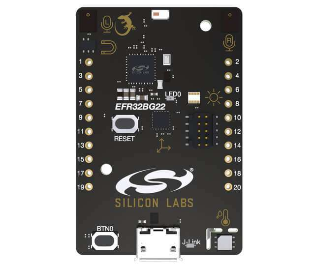

<!-- Copyright 2015-2026 Zephyr Project members and individual contributors. -->
<!-- SPDX-License-Identifier: Apache-2.0 -->
<!-- 中文翻译；编号、导航与译注为本地新增。 -->

<a id="sltb010a"></a>

# 第8章\_EFR32BG22 Thunderboard，SLTB010A

原文：[官方页面](https://docs.zephyrproject.org/latest/boards/silabs/dev_kits/sltb010a/doc/index.html)。读取日期：2026-10-16；来源摘要见[来源记录](../SOURCES.md)。

开发板概览（Board Overview）

<a id="id1"></a>

[](images/sltb010a.jpg)

EFR32BG22 Thunderboard，SLTB010A

名称（Name）：

`sltb010a`

厂商（Vendor）：

[芯科科技（Silicon Laboratories）](https://docs.zephyrproject.org/latest/boards/index.html#vendor=silabs)

状态（Status）：

维护中（Maintained）

架构（Architecture）：

[arm](https://docs.zephyrproject.org/latest/boards/index.html#arch=arm)

片上系统（SoC）：

[efr32bg22c224f512im40](https://docs.zephyrproject.org/latest/boards/index.html#soc=efr32bg22c224f512im40)

<a id="board-github-link"></a>

[浏览开发板源码（Browse Board Sources）](https://github.com/zephyrproject-rtos/zephyr/blob/main//boards/silabs/dev_kits/sltb010a/doc/index.rst/../..)SLTB010A是基于EFR32BG22 SoC的开发套件。早期A00及A01版本采用BRD4184A PCB，与后续BRD4184B略有不同。

<a id="hardware"></a>

## 硬件（Hardware）


- EFR32BG22 Blue Gecko无线SoC，工作频率最高76.8 MHz
- Arm Cortex-M33内核，32 kB RAM及512 kB闪存
- 旺宏（Macronix）超低功耗8 Mbit SPI闪存，MX25R8035F
- 用于无线传输的2.4 GHz陶瓷天线
- Silicon Labs Si7021相对湿度及温度传感器
- Silicon Labs Si1133紫外线指数及环境光传感器，EFR32BG22-BRD4184A
- Vishay VEML6035环境光传感器，EFR32BG22-BRD4184B
- Silicon Labs Si7210霍尔效应传感器
- TDK InvenSense ICM-20648六轴惯性传感器
- 两个Knowles SPK0641HT4H-1 MEMS麦克风，PDM输出，EFR32BG22-BRD4184B
- 一个LED及一个按键
- 电源使能信号及隔离开关，用于超低功耗运行
- 板载SEGGER J-Link便于编程及调试，包括USB虚拟COM端口及数据包跟踪接口（Packet Trace Interface，PTI）
- Mini Simplicity连接器，用于能耗分析及高级无线网络调试
- 引出焊盘，用于访问GPIO及连接外部硬件
- 复位按键（Reset Button）
- USB与电池供电自动切换
- CR2032纽扣电池座及外部电池连接器

EFR32BG SoC及Thunderboard EFR32BG22更多信息见：


- [EFR32BG22网站](https://www.silabs.com/wireless/bluetooth/efr32bg22-series-2-socs)
- [EFR32BG22数据手册](https://www.silabs.com/documents/public/data-sheets/efr32bg22-datasheet.pdf)
- [EFR32xG22参考手册](https://www.silabs.com/documents/public/reference-manuals/efr32xg22-rm.pdf)
- [Thunderboard EFR32BG22网站](https://www.silabs.com/development-tools/thunderboard/thunderboard-bg22-kit)
- [EFR32BG22-BRD4184A用户指南](https://www.silabs.com/documents/public/user-guides/ug415-sltb010a-user-guide.pdf)
- [EFR32BG22-BRD4184B用户指南](https://www.silabs.com/documents/public/user-guides/ug464-brd4184b-user-guide.pdf)
- [EFR32BG22-BRD4184A原理图](https://www.silabs.com/documents/public/schematic-files/BRD4184A-A01-schematic.pdf)
- [EFR32BG22-BRD4184B原理图](https://www.silabs.com/documents/public/schematic-files/BRD4184B-A02-schematic.pdf)

<a id="supported-features"></a>

### 支持的功能（Supported Features）

`sltb010a`开发板支持下表所列的硬件功能。

片上／板载（On-Chip / On-Board）

功能集成在片上系统（SoC）内／位于开发板上。

2 / 2

分别表示已启用／已禁用的实例数。点击数量标签，可查看开发板或SoC设备树源码（DTS）中该功能的第一个实例。

`vnd,foo`

与此功能匹配的设备树绑定兼容字符串（Compatible String）；点击链接可查看绑定文档。

<a id="sltb010a-hw-features"></a>

<a id="sltb010a-sltb010a@0/efr32bg22c224f512im40-hw-features-section"></a>

#### `sltb010a@0/efr32bg22c224f512im40`目标（Target）

<a id="sltb010a-sltb010a@0/efr32bg22c224f512im40-hw-features-panel"></a>

<a id="sltb010a-sltb010a@0/efr32bg22c224f512im40-hw-features-memory"></a>

该开发板目标的片上存储容量：32 KiB RAM、512 KiB Flash。

<a id="sltb010a-sltb010a@0/efr32bg22c224f512im40-hw-features-table"></a>

<table>
<tr>
<th>类型（Type）</th>
<th>位置（Location）</th>
<th>说明（Description）</th>
<th>兼容字符串（Compatible）</th>
</tr>
<tr>
<td rowspan="1">中央处理器（CPU）</td>
<td>片上（On-Chip）</td>
<td>ARM Cortex-M33处理器（CPU）（<a href="https://github.com/zephyrproject-rtos/zephyr/blob/main/dts/arm/silabs/xg22/xg22.dtsi?plain=1#L150">已启用：1</a>）</td>
<td><a href="../cpu_arm_riscv_binding_reference/P022_arm_cortex-m33.md#std-dtcompatible-arm-cortex-m33"><code>arm,cortex-m33</code></a></td>
</tr>
<tr>
<td rowspan="1">模数转换器（ADC）</td>
<td>片上（On-Chip）</td>
<td>Silicon Labs Series 2增量式模数转换器（IADC）（<a href="https://github.com/zephyrproject-rtos/zephyr/blob/main/dts/arm/silabs/xg22/xg22.dtsi?plain=1#L588">已启用：1</a>）</td>
<td><a href="../hardware/P900_SiliconLabsIADC绑定.md#dtbinding-silabs-iadc"><code>silabs,iadc</code></a></td>
</tr>
<tr>
<td rowspan="1">蓝牙（Bluetooth）</td>
<td>片上（On-Chip）</td>
<td>Silicon Labs Series 2蓝牙主机控制器接口（Bluetooth HCI）（<a href="https://github.com/zephyrproject-rtos/zephyr/blob/main/dts/arm/silabs/xg22/efr32bg22.dtsi?plain=1#L10">已启用：1</a>）</td>
<td><a href="../bluetooth_vendor_hci_binding_reference/P015_silabs_bt-hci-efr32.md#std-dtcompatible-silabs-bt-hci-efr32"><code>silabs,bt-hci-efr32</code></a></td>
</tr>
<tr>
<td rowspan="8">时钟控制（Clock Control）</td>
<td>片上（On-Chip）</td>
<td>Silicon Labs Series 2时钟管理单元（CMU）（<a href="https://github.com/zephyrproject-rtos/zephyr/blob/main/dts/arm/silabs/xg22/xg22.dtsi?plain=1#L198">已启用：1</a>）</td>
<td><a href="../clock_renesas_rockchip_sifli_silabs_binding_reference/P029_silabs_series-clock.md#std-dtcompatible-silabs-series-clock"><code>silabs,series-clock</code></a></td>
</tr>
<tr>
<td>片上（On-Chip）</td>
<td>Silicon Labs CMU时钟输出（CLKOUT）（<a href="https://github.com/zephyrproject-rtos/zephyr/blob/main/dts/arm/silabs/xg22/xg22.dtsi?plain=1#L206">已禁用：1</a>）</td>
<td><a href="../clock_renesas_rockchip_sifli_silabs_binding_reference/P028_silabs_series-clock-output.md#std-dtcompatible-silabs-series-clock-output"><code>silabs,series-clock-output</code></a></td>
</tr>
<tr>
<td>片上（On-Chip）</td>
<td>Silicon Labs Series 2高频外部晶体振荡器（HFXO）（<a href="https://github.com/zephyrproject-rtos/zephyr/blob/main/dts/arm/silabs/xg22/xg22.dtsi?plain=1#L230">已启用：1</a>）</td>
<td><a href="../clock_renesas_rockchip_sifli_silabs_binding_reference/P027_silabs_hfxo.md#std-dtcompatible-silabs-hfxo"><code>silabs,hfxo</code></a></td>
</tr>
<tr>
<td>片上（On-Chip）</td>
<td>Silicon Labs Series 2高频RC振荡器数字锁相环（HFRCODPLL）（<a href="https://github.com/zephyrproject-rtos/zephyr/blob/main/dts/arm/silabs/xg22/xg22.dtsi?plain=1#L243">已启用：1</a>）</td>
<td><a href="../clock_silabs_ti_xilinx_binding_reference/P004_silabs_series2-hfrcodpll.md#std-dtcompatible-silabs-series2-hfrcodpll"><code>silabs,series2-hfrcodpll</code></a></td>
</tr>
<tr>
<td>片上（On-Chip）</td>
<td>通用固定频率时钟提供者（Fixed-Rate Clock Provider）（<a href="https://github.com/zephyrproject-rtos/zephyr/blob/main/dts/arm/silabs/xg22/xg22.dtsi?plain=1#L252">已启用：3</a>）</td>
<td><a href="../hardware/P566_固定时钟绑定.md#dtbinding-fixed-clock"><code>fixed-clock</code></a></td>
</tr>
<tr>
<td>片上（On-Chip）</td>
<td>Silicon Labs Series 2低频外部晶体振荡器（LFXO）（<a href="https://github.com/zephyrproject-rtos/zephyr/blob/main/dts/arm/silabs/xg22/xg22.dtsi?plain=1#L260">已启用：1</a>）</td>
<td><a href="../clock_silabs_ti_xilinx_binding_reference/P007_silabs_series2-lfxo.md#std-dtcompatible-silabs-series2-lfxo"><code>silabs,series2-lfxo</code></a></td>
</tr>
<tr>
<td>片上（On-Chip）</td>
<td>Silicon Labs Series 2低频RC振荡器（LFRCO）（<a href="https://github.com/zephyrproject-rtos/zephyr/blob/main/dts/arm/silabs/xg22/xg22.dtsi?plain=1#L274">已启用：1</a>）</td>
<td><a href="../clock_silabs_ti_xilinx_binding_reference/P006_silabs_series2-lfrco.md#std-dtcompatible-silabs-series2-lfrco"><code>silabs,series2-lfrco</code></a></td>
</tr>
<tr>
<td>片上（On-Chip）</td>
<td>通用固定比例时钟提供器（Fixed Factor Clock Provider）（<a href="https://github.com/zephyrproject-rtos/zephyr/blob/main/dts/arm/silabs/xg22/xg22.dtsi?plain=1#L25">已启用：19</a>）</td>
<td><a href="../timer_reference/P110_固定比例时钟绑定.md#dtbinding-fixed-factor-clock"><code>fixed-factor-clock</code></a></td>
</tr>
<tr>
<td rowspan="3">计数器（Counter）</td>
<td>片上（On-Chip）</td>
<td>Silicon Labs TIMER计数器（Counter）（<a href="https://github.com/zephyrproject-rtos/zephyr/blob/main/dts/arm/silabs/xg22/xg22.dtsi?plain=1#L400">已禁用：5</a>）</td>
<td><a href="../stm32_ti_xilinx_counter_binding_reference/P005_silabs_timer-counter.md#std-dtcompatible-silabs-timer-counter"><code>silabs,timer-counter</code></a></td>
</tr>
<tr>
<td>片上（On-Chip）</td>
<td>Silicon Labs Series 2备份实时时钟（BURTC）（<a href="https://github.com/zephyrproject-rtos/zephyr/blob/main/dts/arm/silabs/xg22/xg22.dtsi?plain=1#L518">已禁用：1</a>）</td>
<td><a href="../stm32_ti_xilinx_counter_binding_reference/P003_silabs_burtc-counter.md#std-dtcompatible-silabs-burtc-counter"><code>silabs,burtc-counter</code></a></td>
</tr>
<tr>
<td>片上（On-Chip）</td>
<td>Silicon Labs PROTIMER计数器（Counter）（<a href="https://github.com/zephyrproject-rtos/zephyr/blob/main/dts/arm/silabs/xg22/efr32xg22.dtsi?plain=1#L26">已禁用：1</a>）</td>
<td><a href="../stm32_ti_xilinx_counter_binding_reference/P004_silabs_protimer.md#std-dtcompatible-silabs-protimer"><code>silabs,protimer</code></a></td>
</tr>
<tr>
<td rowspan="1">循环冗余校验（CRC）</td>
<td>片上（On-Chip）</td>
<td>Silabs通用循环冗余校验（CRC）（<a href="https://github.com/zephyrproject-rtos/zephyr/blob/main/dts/arm/silabs/xg22/xg22.dtsi?plain=1#L546">已启用：1</a>）</td>
<td><a href="../crc_clock_monitor_binding_reference/P010_silabs_gpcrc.md#std-dtcompatible-silabs-gpcrc"><code>silabs,gpcrc</code></a></td>
</tr>
<tr>
<td rowspan="2">调试（Debug）</td>
<td>片上（On-Chip）</td>
<td>Silicon Labs数据包跟踪接口（Packet Trace Interface）（<a href="https://github.com/zephyrproject-rtos/zephyr/blob/main/dts/arm/silabs/xg22/efr32xg22.dtsi?plain=1#L31">已禁用：1</a>）</td>
<td><a href="../debug_binding_reference/P006_Silicon_Labs数据包跟踪绑定.md#std-dtcompatible-silabs-pti"><code>silabs,pti</code></a></td>
</tr>
<tr>
<td>片上（On-Chip）</td>
<td>ARMv8仪器跟踪宏单元（Instrumentation Trace Macrocell）（<a href="https://github.com/zephyrproject-rtos/zephyr/blob/main/dts/arm/silabs/xg22/xg22.dtsi?plain=1#L162">已启用：1</a>）</td>
<td><a href="../debug_binding_reference/P002_ARMv8M_ITM调试绑定.md#std-dtcompatible-arm-armv8m-itm"><code>arm,armv8m-itm</code></a></td>
</tr>
<tr>
<td rowspan="1">直接存储器访问（DMA）</td>
<td>片上（On-Chip）</td>
<td>Silicon Labs Series 2链式直接存储器访问（LDMA）（<a href="https://github.com/zephyrproject-rtos/zephyr/blob/main/dts/arm/silabs/xg22/xg22.dtsi?plain=1#L377">已禁用：1</a>）</td>
<td><a href="../stm32_ti_xilinx_dma_binding_reference/P001_silabs_ldma.md#std-dtcompatible-silabs-ldma"><code>silabs,ldma</code></a></td>
</tr>
<tr>
<td rowspan="1">闪存控制器（Flash Controller）</td>
<td>片上（On-Chip）</td>
<td>Silicon Labs Series 2存储器系统控制器（MSC）（<a href="https://github.com/zephyrproject-rtos/zephyr/blob/main/dts/arm/silabs/xg22/xg22.dtsi?plain=1#L294">已启用：1</a>）</td>
<td><a href="../flash_renesas_st_ti_binding_reference/P007_silabs_series2-flash-controller.md#std-dtcompatible-silabs-series2-flash-controller"><code>silabs,series2-flash-controller</code></a></td>
</tr>
<tr>
<td rowspan="3">通用输入输出与接插件（GPIO &amp; Headers）</td>
<td>片上（On-Chip）</td>
<td>Silicon Labs Series 2通用输入输出外设（GPIO Peripheral）（<a href="https://github.com/zephyrproject-rtos/zephyr/blob/main/dts/arm/silabs/xg22/xg22.dtsi?plain=1#L313">已启用：1</a>）</td>
<td><a href="../gpio_silabs_st_connectors_binding_reference/P015_silabs_gpio.md#std-dtcompatible-silabs-gpio"><code>silabs,gpio</code></a></td>
</tr>
<tr>
<td>片上（On-Chip）</td>
<td>Silicon Labs Series 2 GPIO端口（Port）（<a href="https://github.com/zephyrproject-rtos/zephyr/blob/main/dts/arm/silabs/xg22/xg22.dtsi?plain=1#L323">已启用：3</a>；<a href="https://github.com/zephyrproject-rtos/zephyr/blob/main/dts/arm/silabs/xg22/xg22.dtsi?plain=1#L353">已禁用：1</a>）</td>
<td><a href="../gpio_silabs_st_connectors_binding_reference/P014_silabs_gpio-port.md#std-dtcompatible-silabs-gpio-port"><code>silabs,gpio-port</code></a></td>
</tr>
<tr>
<td>板载（On-Board）</td>
<td>Silicon Labs套件扩展排针（<a href="https://github.com/zephyrproject-rtos/zephyr/blob/main/boards/silabs/dev_kits/sltb010a/thunderboard.dtsi?plain=1#L48">已启用：1</a>）</td>
<td><a href="../gpio_silabs_st_connectors_binding_reference/P011_silabs_exp-header.md#std-dtcompatible-silabs-exp-header"><code>silabs,exp-header</code></a></td>
</tr>
<tr>
<td rowspan="1">集成电路间总线（I2C）</td>
<td>片上（On-Chip）</td>
<td>Silicon Labs Series 2的I2C控制器（<a href="https://github.com/zephyrproject-rtos/zephyr/blob/main/dts/arm/silabs/xg22/xg22.dtsi?plain=1#L598">已启用：1</a>；<a href="https://github.com/zephyrproject-rtos/zephyr/blob/main/dts/arm/silabs/xg22/xg22.dtsi?plain=1#L527">已禁用：1</a>）</td>
<td><a href="../i2c_stm32_ti_mux_binding_reference/P005_silabs_i2c.md#std-dtcompatible-silabs-i2c"><code>silabs,i2c</code></a></td>
</tr>
<tr>
<td rowspan="1">输入（Input）</td>
<td>板载（On-Board）</td>
<td>一组绑定到 GPIO 的输入按键（GPIO-Bound Input Keys）（<a href="https://github.com/zephyrproject-rtos/zephyr/blob/main/boards/silabs/dev_kits/sltb010a/thunderboard.dtsi?plain=1#L38">已启用：1</a>）</td>
<td><a href="../hardware/P563_GPIO按键绑定.md#std-dtcompatible-gpio-keys"><code>gpio-keys</code></a></td>
</tr>
<tr>
<td rowspan="1">中断控制器（Interrupt Controller）</td>
<td>片上（On-Chip）</td>
<td>ARMv8-M嵌套向量中断控制器（NVIC / Nested Vectored Interrupt Controller）（<a href="https://github.com/zephyrproject-rtos/zephyr/blob/main/dts/arm/armv8-m.dtsi?plain=1#L13">已启用：1</a>）</td>
<td><a href="../arm_interrupt_timer_binding_reference/P003_ARMv8_M_NVIC.md#std-dtcompatible-arm-v8m-nvic"><code>arm,v8m-nvic</code></a></td>
</tr>
<tr>
<td rowspan="2">发光二极管（LED）</td>
<td>板载（On-Board）</td>
<td>一组由 GPIO 控制的 LED（GPIO-Controlled LEDs）（<a href="https://github.com/zephyrproject-rtos/zephyr/blob/main/boards/silabs/dev_kits/sltb010a/thunderboard.dtsi?plain=1#L20">已启用：1</a>）</td>
<td><a href="../hardware/P564_GPIO指示灯绑定.md#dtbinding-gpio-leds"><code>gpio-leds</code></a></td>
</tr>
<tr>
<td>板载（On-Board）</td>
<td>一组由脉宽调制（PWM）控制的LED（<a href="https://github.com/zephyrproject-rtos/zephyr/blob/main/boards/silabs/dev_kits/sltb010a/thunderboard.dtsi?plain=1#L29">已启用：1</a>）</td>
<td><a href="../hardware/P565_PWM指示灯绑定.md#dtbinding-pwm-leds"><code>pwm-leds</code></a></td>
</tr>
<tr>
<td rowspan="1">内存管理单元／内存保护单元（MMU / MPU）</td>
<td>片上（On-Chip）</td>
<td>ARMv8-M存储器保护单元（MPU / Memory Protection Unit）（<a href="https://github.com/zephyrproject-rtos/zephyr/blob/main/dts/arm/silabs/xg22/xg22.dtsi?plain=1#L167">已启用：1</a>）</td>
<td><a href="../memory_protection_binding_reference/P007_arm_armv8m-mpu.md#std-dtcompatible-arm-armv8m-mpu"><code>arm,armv8m-mpu</code></a></td>
</tr>
<tr>
<td rowspan="2">存储技术设备（MTD）</td>
<td>片上（On-Chip）</td>
<td>闪存（Flash）节点（<a href="https://github.com/zephyrproject-rtos/zephyr/blob/main/dts/arm/silabs/xg22/xg22.dtsi?plain=1#L304">已启用：1</a>）</td>
<td><a href="../mtd_nxp_st_ti_partition_binding_reference/P013_soc-nv-flash.md#std-dtcompatible-soc-nv-flash"><code>soc-nv-flash</code></a></td>
</tr>
<tr>
<td>板载（On-Board）</td>
<td>这些属性用于支持Zephyr的<code>spi-nor</code>闪存驱动通过Zephyr SPI API，使用基于M25P80的标准命令集控制串行闪存（Serial Flash Memory）。（<a href="https://github.com/zephyrproject-rtos/zephyr/blob/main/boards/silabs/dev_kits/sltb010a/thunderboard.dtsi?plain=1#L106">已启用：1</a>）</td>
<td><a href="../mtd_microchip_nordic_nxp_binding_reference/P002_jedec_spi-nor.md#std-dtcompatible-jedec-spi-nor"><code>jedec,spi-nor</code></a></td>
</tr>
<tr>
<td rowspan="1">网络（Networking）</td>
<td>片上（On-Chip）</td>
<td>Silicon Labs Series 2无线电接口（Radio Interface）（<a href="https://github.com/zephyrproject-rtos/zephyr/blob/main/dts/arm/silabs/xg22/efr32xg22.dtsi?plain=1#L11">已启用：1</a>）</td>
<td><a href="../network_radio_frontend_binding_reference/P014_silabs_series2-radio.md#std-dtcompatible-silabs-series2-radio"><code>silabs,series2-radio</code></a></td>
</tr>
<tr>
<td rowspan="1">引脚控制（Pin Control）</td>
<td>片上（On-Chip）</td>
<td>Silicon Labs Series 2 DBUS引脚控制器（Pin Controller）（<a href="https://github.com/zephyrproject-rtos/zephyr/blob/main/dts/arm/silabs/xg22/xg22.dtsi?plain=1#L364">已启用：1</a>）</td>
<td><a href="../pinctrl_renesas_silabs_binding_reference/P024_silabs_dbus-pinctrl.md#std-dtcompatible-silabs-dbus-pinctrl"><code>silabs,dbus-pinctrl</code></a></td>
</tr>
<tr>
<td rowspan="2">脉宽调制（PWM）</td>
<td>片上（On-Chip）</td>
<td>Silicon Labs TIMER脉宽调制（PWM）（<a href="https://github.com/zephyrproject-rtos/zephyr/blob/main/dts/arm/silabs/xg22/xg22.dtsi?plain=1#L405">已启用：1</a>；<a href="https://github.com/zephyrproject-rtos/zephyr/blob/main/dts/arm/silabs/xg22/xg22.dtsi?plain=1#L427">已禁用：4</a>）</td>
<td><a href="../pwm_stm32_ti_generic_binding_reference/P010_silabs_timer-pwm.md#std-dtcompatible-silabs-timer-pwm"><code>silabs,timer-pwm</code></a></td>
</tr>
<tr>
<td>片上（On-Chip）</td>
<td>Silicon Labs低能耗定时器脉宽调制（LETIMER PWM）（<a href="https://github.com/zephyrproject-rtos/zephyr/blob/main/dts/arm/silabs/xg22/xg22.dtsi?plain=1#L581">已禁用：1</a>）</td>
<td><a href="../pwm_stm32_ti_generic_binding_reference/P008_silabs_letimer-pwm.md#std-dtcompatible-silabs-letimer-pwm"><code>silabs,letimer-pwm</code></a></td>
</tr>
<tr>
<td rowspan="2">稳压器（Regulator）</td>
<td>片上（On-Chip）</td>
<td>Silicon Labs Series 2直流电压转换器（DC-DC Converter）（<a href="https://github.com/zephyrproject-rtos/zephyr/blob/main/dts/arm/silabs/xg22/xg22.dtsi?plain=1#L553">已启用：1</a>）</td>
<td><a href="../hardware/P657_SiliconLabs_Series2直流转换器绑定.md#dtbinding-silabs-series2-dcdc"><code>silabs,series2-dcdc</code></a></td>
</tr>
<tr>
<td>板载（On-Board）</td>
<td>固定电压稳压器（Fixed Voltage Regulators）（<a href="https://github.com/zephyrproject-rtos/zephyr/blob/main/boards/silabs/dev_kits/sltb010a/thunderboard.dtsi?plain=1#L56">已启用：3</a>）</td>
<td><a href="../hardware/P635_固定稳压器设备树绑定.md#dtbinding-regulator-fixed"><code>regulator-fixed</code></a></td>
</tr>
<tr>
<td rowspan="1">保持存储器（Retained Memory）</td>
<td>片上（On-Chip）</td>
<td>Silicon Labs Series 2备份RAM（BURAM）（<a href="https://github.com/zephyrproject-rtos/zephyr/blob/main/dts/arm/silabs/xg22/xg22.dtsi?plain=1#L539">已禁用：1</a>）</td>
<td><a href="../hardware/P629_SiliconLabs备份RAM绑定.md#dtbinding-silabs-buram"><code>silabs,buram</code></a></td>
</tr>
<tr>
<td rowspan="1">随机数生成器（RNG）</td>
<td>片上（On-Chip）</td>
<td>GECKO真随机数发生器（TRNG / True Random Number Generator）（<a href="https://github.com/zephyrproject-rtos/zephyr/blob/main/dts/arm/silabs/xg22/xg22.dtsi?plain=1#L629">已启用：1</a>）</td>
<td><a href="../soc_rng_binding_reference/P013_silabs_gecko-trng.md#std-dtcompatible-silabs-gecko-trng"><code>silabs,gecko-trng</code></a></td>
</tr>
<tr>
<td rowspan="1">实时时钟（RTC）</td>
<td>片上（On-Chip）</td>
<td>Silicon Labs Series 2实时时钟与计数器（RTCC）（<a href="https://github.com/zephyrproject-rtos/zephyr/blob/main/dts/arm/silabs/xg22/xg22.dtsi?plain=1#L562">已启用：1</a>）</td>
<td><a href="../soc_rtc_binding_reference/P011_silabs_rtcc.md#std-dtcompatible-silabs-rtcc"><code>silabs,rtcc</code></a></td>
</tr>
<tr>
<td rowspan="1">传感器（Sensors）</td>
<td>板载（On-Board）</td>
<td>Si7210霍尔效应磁位置及温度传感器（<a href="https://github.com/zephyrproject-rtos/zephyr/blob/main/boards/silabs/dev_kits/sltb010a/thunderboard.dtsi?plain=1#L167">已启用：1</a>）</td>
<td><a href="../sensor_silabs_st_industrial_binding_reference/P005_silabs_si7210.md#std-dtcompatible-silabs-si7210"><code>silabs,si7210</code></a></td>
</tr>
<tr>
<td rowspan="2">串行控制器（Serial Controller）</td>
<td>片上（On-Chip）</td>
<td>Silicon Labs Series 2通用同步／异步收发器（USART）（<a href="https://github.com/zephyrproject-rtos/zephyr/blob/main/dts/arm/silabs/xg22/xg22.dtsi?plain=1#L509">已启用：1</a>）</td>
<td><a href="../uart_silabs_stm32_ti_binding_reference/P010_silabs_usart-uart.md#std-dtcompatible-silabs-usart-uart"><code>silabs,usart-uart</code></a></td>
</tr>
<tr>
<td>片上（On-Chip）</td>
<td>Silicon Labs Series 2增强型通用同步／异步收发器（EUSART）（<a href="https://github.com/zephyrproject-rtos/zephyr/blob/main/dts/arm/silabs/xg22/xg22.dtsi?plain=1#L620">已禁用：1</a>）</td>
<td><a href="../uart_silabs_stm32_ti_binding_reference/P005_silabs_eusart-uart.md#std-dtcompatible-silabs-eusart-uart"><code>silabs,eusart-uart</code></a></td>
</tr>
<tr>
<td rowspan="1">串行外设接口（SPI）</td>
<td>片上（On-Chip）</td>
<td>Silicon Labs Series 2通用同步／异步收发器（USART）（<a href="https://github.com/zephyrproject-rtos/zephyr/blob/main/dts/arm/silabs/xg22/xg22.dtsi?plain=1#L500">已启用：1</a>）</td>
<td><a href="../spi_stm32_ti_xilinx_binding_reference/P007_silabs_usart-spi.md#std-dtcompatible-silabs-usart-spi"><code>silabs,usart-spi</code></a></td>
</tr>
<tr>
<td rowspan="1">静态随机存储器（SRAM）</td>
<td>片上（On-Chip）</td>
<td>通用片上静态随机存储器（SRAM）（<a href="https://github.com/zephyrproject-rtos/zephyr/blob/main/dts/arm/silabs/xg22/xg22.dtsi?plain=1#L639">已启用：1</a>）</td>
<td><a href="../hardware/P567_内存映射SRAM绑定.md#dtbinding-mmio-sram"><code>mmio-sram</code></a></td>
</tr>
<tr>
<td rowspan="3">定时器（Timer）</td>
<td>片上（On-Chip）</td>
<td>ARMv8-M系统节拍（System Tick）（<a href="https://github.com/zephyrproject-rtos/zephyr/blob/main/dts/arm/armv8-m.dtsi?plain=1#L21">已启用：1</a>）</td>
<td><a href="../arm_interrupt_timer_binding_reference/P007_ARMv8_M_SysTick.md#std-dtcompatible-arm-armv8m-systick"><code>arm,armv8m-systick</code></a></td>
</tr>
<tr>
<td>片上（On-Chip）</td>
<td>Silicon Labs定时器（TIMER）（<a href="https://github.com/zephyrproject-rtos/zephyr/blob/main/dts/arm/silabs/xg22/xg22.dtsi?plain=1#L390">已启用：1</a>；<a href="https://github.com/zephyrproject-rtos/zephyr/blob/main/dts/arm/silabs/xg22/xg22.dtsi?plain=1#L412">已禁用：4</a>）</td>
<td><a href="../stm32_ti_silabs_timer_binding_reference/P006_silabs_series2-timer.md#std-dtcompatible-silabs-series2-timer"><code>silabs,series2-timer</code></a></td>
</tr>
<tr>
<td>片上（On-Chip）</td>
<td>Silicon Labs低能耗定时器（LETIMER）（<a href="https://github.com/zephyrproject-rtos/zephyr/blob/main/dts/arm/silabs/xg22/xg22.dtsi?plain=1#L573">已禁用：1</a>）</td>
<td><a href="../stm32_ti_silabs_timer_binding_reference/P005_silabs_series2-letimer.md#std-dtcompatible-silabs-series2-letimer"><code>silabs,series2-letimer</code></a></td>
</tr>
<tr>
<td rowspan="1">看门狗（Watchdog）</td>
<td>片上（On-Chip）</td>
<td>Silicon Labs Series 0–2看门狗（WDOG）（<a href="https://github.com/zephyrproject-rtos/zephyr/blob/main/dts/arm/silabs/xg22/xg22.dtsi?plain=1#L610">已启用：1</a>）</td>
<td><a href="../realtek_renesas_silabs_watchdog_binding_reference/P011_silabs_gecko-wdog.md#std-dtcompatible-silabs-gecko-wdog"><code>silabs,gecko-wdog</code></a></td>
</tr>
</table>

<a id="sltb010a-sltb010a@2/efr32bg22c224f512im40-hw-features-section"></a>

#### `sltb010a@2/efr32bg22c224f512im40`目标（Target）

<a id="sltb010a-sltb010a@2/efr32bg22c224f512im40-hw-features-panel"></a>

<a id="sltb010a-sltb010a@2/efr32bg22c224f512im40-hw-features-memory"></a>

该开发板目标的片上存储容量：32 KiB RAM、512 KiB Flash。

<a id="sltb010a-sltb010a@2/efr32bg22c224f512im40-hw-features-table"></a>

<table>
<tr>
<th>类型（Type）</th>
<th>位置（Location）</th>
<th>说明（Description）</th>
<th>兼容字符串（Compatible）</th>
</tr>
<tr>
<td rowspan="1">中央处理器（CPU）</td>
<td>片上（On-Chip）</td>
<td>ARM Cortex-M33处理器（CPU）（<a href="https://github.com/zephyrproject-rtos/zephyr/blob/main/dts/arm/silabs/xg22/xg22.dtsi?plain=1#L150">已启用：1</a>）</td>
<td><a href="../cpu_arm_riscv_binding_reference/P022_arm_cortex-m33.md#std-dtcompatible-arm-cortex-m33"><code>arm,cortex-m33</code></a></td>
</tr>
<tr>
<td rowspan="1">模数转换器（ADC）</td>
<td>片上（On-Chip）</td>
<td>Silicon Labs Series 2增量式模数转换器（IADC）（<a href="https://github.com/zephyrproject-rtos/zephyr/blob/main/dts/arm/silabs/xg22/xg22.dtsi?plain=1#L588">已启用：1</a>）</td>
<td><a href="../hardware/P900_SiliconLabsIADC绑定.md#dtbinding-silabs-iadc"><code>silabs,iadc</code></a></td>
</tr>
<tr>
<td rowspan="1">蓝牙（Bluetooth）</td>
<td>片上（On-Chip）</td>
<td>Silicon Labs Series 2蓝牙主机控制器接口（Bluetooth HCI）（<a href="https://github.com/zephyrproject-rtos/zephyr/blob/main/dts/arm/silabs/xg22/efr32bg22.dtsi?plain=1#L10">已启用：1</a>）</td>
<td><a href="../bluetooth_vendor_hci_binding_reference/P015_silabs_bt-hci-efr32.md#std-dtcompatible-silabs-bt-hci-efr32"><code>silabs,bt-hci-efr32</code></a></td>
</tr>
<tr>
<td rowspan="8">时钟控制（Clock Control）</td>
<td>片上（On-Chip）</td>
<td>Silicon Labs Series 2时钟管理单元（CMU）（<a href="https://github.com/zephyrproject-rtos/zephyr/blob/main/dts/arm/silabs/xg22/xg22.dtsi?plain=1#L198">已启用：1</a>）</td>
<td><a href="../clock_renesas_rockchip_sifli_silabs_binding_reference/P029_silabs_series-clock.md#std-dtcompatible-silabs-series-clock"><code>silabs,series-clock</code></a></td>
</tr>
<tr>
<td>片上（On-Chip）</td>
<td>Silicon Labs CMU时钟输出（CLKOUT）（<a href="https://github.com/zephyrproject-rtos/zephyr/blob/main/dts/arm/silabs/xg22/xg22.dtsi?plain=1#L206">已禁用：1</a>）</td>
<td><a href="../clock_renesas_rockchip_sifli_silabs_binding_reference/P028_silabs_series-clock-output.md#std-dtcompatible-silabs-series-clock-output"><code>silabs,series-clock-output</code></a></td>
</tr>
<tr>
<td>片上（On-Chip）</td>
<td>Silicon Labs Series 2高频外部晶体振荡器（HFXO）（<a href="https://github.com/zephyrproject-rtos/zephyr/blob/main/dts/arm/silabs/xg22/xg22.dtsi?plain=1#L230">已启用：1</a>）</td>
<td><a href="../clock_renesas_rockchip_sifli_silabs_binding_reference/P027_silabs_hfxo.md#std-dtcompatible-silabs-hfxo"><code>silabs,hfxo</code></a></td>
</tr>
<tr>
<td>片上（On-Chip）</td>
<td>Silicon Labs Series 2高频RC振荡器数字锁相环（HFRCODPLL）（<a href="https://github.com/zephyrproject-rtos/zephyr/blob/main/dts/arm/silabs/xg22/xg22.dtsi?plain=1#L243">已启用：1</a>）</td>
<td><a href="../clock_silabs_ti_xilinx_binding_reference/P004_silabs_series2-hfrcodpll.md#std-dtcompatible-silabs-series2-hfrcodpll"><code>silabs,series2-hfrcodpll</code></a></td>
</tr>
<tr>
<td>片上（On-Chip）</td>
<td>通用固定频率时钟提供者（Fixed-Rate Clock Provider）（<a href="https://github.com/zephyrproject-rtos/zephyr/blob/main/dts/arm/silabs/xg22/xg22.dtsi?plain=1#L252">已启用：3</a>）</td>
<td><a href="../hardware/P566_固定时钟绑定.md#dtbinding-fixed-clock"><code>fixed-clock</code></a></td>
</tr>
<tr>
<td>片上（On-Chip）</td>
<td>Silicon Labs Series 2低频外部晶体振荡器（LFXO）（<a href="https://github.com/zephyrproject-rtos/zephyr/blob/main/dts/arm/silabs/xg22/xg22.dtsi?plain=1#L260">已启用：1</a>）</td>
<td><a href="../clock_silabs_ti_xilinx_binding_reference/P007_silabs_series2-lfxo.md#std-dtcompatible-silabs-series2-lfxo"><code>silabs,series2-lfxo</code></a></td>
</tr>
<tr>
<td>片上（On-Chip）</td>
<td>Silicon Labs Series 2低频RC振荡器（LFRCO）（<a href="https://github.com/zephyrproject-rtos/zephyr/blob/main/dts/arm/silabs/xg22/xg22.dtsi?plain=1#L274">已启用：1</a>）</td>
<td><a href="../clock_silabs_ti_xilinx_binding_reference/P006_silabs_series2-lfrco.md#std-dtcompatible-silabs-series2-lfrco"><code>silabs,series2-lfrco</code></a></td>
</tr>
<tr>
<td>片上（On-Chip）</td>
<td>通用固定比例时钟提供器（Fixed Factor Clock Provider）（<a href="https://github.com/zephyrproject-rtos/zephyr/blob/main/dts/arm/silabs/xg22/xg22.dtsi?plain=1#L25">已启用：19</a>）</td>
<td><a href="../timer_reference/P110_固定比例时钟绑定.md#dtbinding-fixed-factor-clock"><code>fixed-factor-clock</code></a></td>
</tr>
<tr>
<td rowspan="3">计数器（Counter）</td>
<td>片上（On-Chip）</td>
<td>Silicon Labs TIMER计数器（Counter）（<a href="https://github.com/zephyrproject-rtos/zephyr/blob/main/dts/arm/silabs/xg22/xg22.dtsi?plain=1#L400">已禁用：5</a>）</td>
<td><a href="../stm32_ti_xilinx_counter_binding_reference/P005_silabs_timer-counter.md#std-dtcompatible-silabs-timer-counter"><code>silabs,timer-counter</code></a></td>
</tr>
<tr>
<td>片上（On-Chip）</td>
<td>Silicon Labs Series 2备份实时时钟（BURTC）（<a href="https://github.com/zephyrproject-rtos/zephyr/blob/main/dts/arm/silabs/xg22/xg22.dtsi?plain=1#L518">已禁用：1</a>）</td>
<td><a href="../stm32_ti_xilinx_counter_binding_reference/P003_silabs_burtc-counter.md#std-dtcompatible-silabs-burtc-counter"><code>silabs,burtc-counter</code></a></td>
</tr>
<tr>
<td>片上（On-Chip）</td>
<td>Silicon Labs PROTIMER计数器（Counter）（<a href="https://github.com/zephyrproject-rtos/zephyr/blob/main/dts/arm/silabs/xg22/efr32xg22.dtsi?plain=1#L26">已禁用：1</a>）</td>
<td><a href="../stm32_ti_xilinx_counter_binding_reference/P004_silabs_protimer.md#std-dtcompatible-silabs-protimer"><code>silabs,protimer</code></a></td>
</tr>
<tr>
<td rowspan="1">循环冗余校验（CRC）</td>
<td>片上（On-Chip）</td>
<td>Silabs通用循环冗余校验（CRC）（<a href="https://github.com/zephyrproject-rtos/zephyr/blob/main/dts/arm/silabs/xg22/xg22.dtsi?plain=1#L546">已启用：1</a>）</td>
<td><a href="../crc_clock_monitor_binding_reference/P010_silabs_gpcrc.md#std-dtcompatible-silabs-gpcrc"><code>silabs,gpcrc</code></a></td>
</tr>
<tr>
<td rowspan="2">调试（Debug）</td>
<td>片上（On-Chip）</td>
<td>Silicon Labs数据包跟踪接口（Packet Trace Interface）（<a href="https://github.com/zephyrproject-rtos/zephyr/blob/main/dts/arm/silabs/xg22/efr32xg22.dtsi?plain=1#L31">已禁用：1</a>）</td>
<td><a href="../debug_binding_reference/P006_Silicon_Labs数据包跟踪绑定.md#std-dtcompatible-silabs-pti"><code>silabs,pti</code></a></td>
</tr>
<tr>
<td>片上（On-Chip）</td>
<td>ARMv8仪器跟踪宏单元（Instrumentation Trace Macrocell）（<a href="https://github.com/zephyrproject-rtos/zephyr/blob/main/dts/arm/silabs/xg22/xg22.dtsi?plain=1#L162">已启用：1</a>）</td>
<td><a href="../debug_binding_reference/P002_ARMv8M_ITM调试绑定.md#std-dtcompatible-arm-armv8m-itm"><code>arm,armv8m-itm</code></a></td>
</tr>
<tr>
<td rowspan="1">直接存储器访问（DMA）</td>
<td>片上（On-Chip）</td>
<td>Silicon Labs Series 2链式直接存储器访问（LDMA）（<a href="https://github.com/zephyrproject-rtos/zephyr/blob/main/dts/arm/silabs/xg22/xg22.dtsi?plain=1#L377">已禁用：1</a>）</td>
<td><a href="../stm32_ti_xilinx_dma_binding_reference/P001_silabs_ldma.md#std-dtcompatible-silabs-ldma"><code>silabs,ldma</code></a></td>
</tr>
<tr>
<td rowspan="1">闪存控制器（Flash Controller）</td>
<td>片上（On-Chip）</td>
<td>Silicon Labs Series 2存储器系统控制器（MSC）（<a href="https://github.com/zephyrproject-rtos/zephyr/blob/main/dts/arm/silabs/xg22/xg22.dtsi?plain=1#L294">已启用：1</a>）</td>
<td><a href="../flash_renesas_st_ti_binding_reference/P007_silabs_series2-flash-controller.md#std-dtcompatible-silabs-series2-flash-controller"><code>silabs,series2-flash-controller</code></a></td>
</tr>
<tr>
<td rowspan="3">通用输入输出与接插件（GPIO &amp; Headers）</td>
<td>片上（On-Chip）</td>
<td>Silicon Labs Series 2通用输入输出外设（GPIO Peripheral）（<a href="https://github.com/zephyrproject-rtos/zephyr/blob/main/dts/arm/silabs/xg22/xg22.dtsi?plain=1#L313">已启用：1</a>）</td>
<td><a href="../gpio_silabs_st_connectors_binding_reference/P015_silabs_gpio.md#std-dtcompatible-silabs-gpio"><code>silabs,gpio</code></a></td>
</tr>
<tr>
<td>片上（On-Chip）</td>
<td>Silicon Labs Series 2 GPIO端口（Port）（<a href="https://github.com/zephyrproject-rtos/zephyr/blob/main/dts/arm/silabs/xg22/xg22.dtsi?plain=1#L323">已启用：3</a>；<a href="https://github.com/zephyrproject-rtos/zephyr/blob/main/dts/arm/silabs/xg22/xg22.dtsi?plain=1#L353">已禁用：1</a>）</td>
<td><a href="../gpio_silabs_st_connectors_binding_reference/P014_silabs_gpio-port.md#std-dtcompatible-silabs-gpio-port"><code>silabs,gpio-port</code></a></td>
</tr>
<tr>
<td>板载（On-Board）</td>
<td>Silicon Labs套件扩展排针（<a href="https://github.com/zephyrproject-rtos/zephyr/blob/main/boards/silabs/dev_kits/sltb010a/thunderboard.dtsi?plain=1#L48">已启用：1</a>）</td>
<td><a href="../gpio_silabs_st_connectors_binding_reference/P011_silabs_exp-header.md#std-dtcompatible-silabs-exp-header"><code>silabs,exp-header</code></a></td>
</tr>
<tr>
<td rowspan="1">集成电路间总线（I2C）</td>
<td>片上（On-Chip）</td>
<td>Silicon Labs Series 2的I2C控制器（<a href="https://github.com/zephyrproject-rtos/zephyr/blob/main/dts/arm/silabs/xg22/xg22.dtsi?plain=1#L598">已启用：1</a>；<a href="https://github.com/zephyrproject-rtos/zephyr/blob/main/dts/arm/silabs/xg22/xg22.dtsi?plain=1#L527">已禁用：1</a>）</td>
<td><a href="../i2c_stm32_ti_mux_binding_reference/P005_silabs_i2c.md#std-dtcompatible-silabs-i2c"><code>silabs,i2c</code></a></td>
</tr>
<tr>
<td rowspan="1">输入（Input）</td>
<td>板载（On-Board）</td>
<td>一组绑定到 GPIO 的输入按键（GPIO-Bound Input Keys）（<a href="https://github.com/zephyrproject-rtos/zephyr/blob/main/boards/silabs/dev_kits/sltb010a/thunderboard.dtsi?plain=1#L38">已启用：1</a>）</td>
<td><a href="../hardware/P563_GPIO按键绑定.md#std-dtcompatible-gpio-keys"><code>gpio-keys</code></a></td>
</tr>
<tr>
<td rowspan="1">中断控制器（Interrupt Controller）</td>
<td>片上（On-Chip）</td>
<td>ARMv8-M嵌套向量中断控制器（NVIC / Nested Vectored Interrupt Controller）（<a href="https://github.com/zephyrproject-rtos/zephyr/blob/main/dts/arm/armv8-m.dtsi?plain=1#L13">已启用：1</a>）</td>
<td><a href="../arm_interrupt_timer_binding_reference/P003_ARMv8_M_NVIC.md#std-dtcompatible-arm-v8m-nvic"><code>arm,v8m-nvic</code></a></td>
</tr>
<tr>
<td rowspan="2">发光二极管（LED）</td>
<td>板载（On-Board）</td>
<td>一组由 GPIO 控制的 LED（GPIO-Controlled LEDs）（<a href="https://github.com/zephyrproject-rtos/zephyr/blob/main/boards/silabs/dev_kits/sltb010a/thunderboard.dtsi?plain=1#L20">已启用：1</a>）</td>
<td><a href="../hardware/P564_GPIO指示灯绑定.md#dtbinding-gpio-leds"><code>gpio-leds</code></a></td>
</tr>
<tr>
<td>板载（On-Board）</td>
<td>一组由脉宽调制（PWM）控制的LED（<a href="https://github.com/zephyrproject-rtos/zephyr/blob/main/boards/silabs/dev_kits/sltb010a/thunderboard.dtsi?plain=1#L29">已启用：1</a>）</td>
<td><a href="../hardware/P565_PWM指示灯绑定.md#dtbinding-pwm-leds"><code>pwm-leds</code></a></td>
</tr>
<tr>
<td rowspan="1">内存管理单元／内存保护单元（MMU / MPU）</td>
<td>片上（On-Chip）</td>
<td>ARMv8-M存储器保护单元（MPU / Memory Protection Unit）（<a href="https://github.com/zephyrproject-rtos/zephyr/blob/main/dts/arm/silabs/xg22/xg22.dtsi?plain=1#L167">已启用：1</a>）</td>
<td><a href="../memory_protection_binding_reference/P007_arm_armv8m-mpu.md#std-dtcompatible-arm-armv8m-mpu"><code>arm,armv8m-mpu</code></a></td>
</tr>
<tr>
<td rowspan="2">存储技术设备（MTD）</td>
<td>片上（On-Chip）</td>
<td>闪存（Flash）节点（<a href="https://github.com/zephyrproject-rtos/zephyr/blob/main/dts/arm/silabs/xg22/xg22.dtsi?plain=1#L304">已启用：1</a>）</td>
<td><a href="../mtd_nxp_st_ti_partition_binding_reference/P013_soc-nv-flash.md#std-dtcompatible-soc-nv-flash"><code>soc-nv-flash</code></a></td>
</tr>
<tr>
<td>板载（On-Board）</td>
<td>这些属性用于支持Zephyr的<code>spi-nor</code>闪存驱动通过Zephyr SPI API，使用基于M25P80的标准命令集控制串行闪存（Serial Flash Memory）。（<a href="https://github.com/zephyrproject-rtos/zephyr/blob/main/boards/silabs/dev_kits/sltb010a/thunderboard.dtsi?plain=1#L106">已启用：1</a>）</td>
<td><a href="../mtd_microchip_nordic_nxp_binding_reference/P002_jedec_spi-nor.md#std-dtcompatible-jedec-spi-nor"><code>jedec,spi-nor</code></a></td>
</tr>
<tr>
<td rowspan="1">网络（Networking）</td>
<td>片上（On-Chip）</td>
<td>Silicon Labs Series 2无线电接口（Radio Interface）（<a href="https://github.com/zephyrproject-rtos/zephyr/blob/main/dts/arm/silabs/xg22/efr32xg22.dtsi?plain=1#L11">已启用：1</a>）</td>
<td><a href="../network_radio_frontend_binding_reference/P014_silabs_series2-radio.md#std-dtcompatible-silabs-series2-radio"><code>silabs,series2-radio</code></a></td>
</tr>
<tr>
<td rowspan="1">引脚控制（Pin Control）</td>
<td>片上（On-Chip）</td>
<td>Silicon Labs Series 2 DBUS引脚控制器（Pin Controller）（<a href="https://github.com/zephyrproject-rtos/zephyr/blob/main/dts/arm/silabs/xg22/xg22.dtsi?plain=1#L364">已启用：1</a>）</td>
<td><a href="../pinctrl_renesas_silabs_binding_reference/P024_silabs_dbus-pinctrl.md#std-dtcompatible-silabs-dbus-pinctrl"><code>silabs,dbus-pinctrl</code></a></td>
</tr>
<tr>
<td rowspan="2">脉宽调制（PWM）</td>
<td>片上（On-Chip）</td>
<td>Silicon Labs TIMER脉宽调制（PWM）（<a href="https://github.com/zephyrproject-rtos/zephyr/blob/main/dts/arm/silabs/xg22/xg22.dtsi?plain=1#L405">已启用：1</a>；<a href="https://github.com/zephyrproject-rtos/zephyr/blob/main/dts/arm/silabs/xg22/xg22.dtsi?plain=1#L427">已禁用：4</a>）</td>
<td><a href="../pwm_stm32_ti_generic_binding_reference/P010_silabs_timer-pwm.md#std-dtcompatible-silabs-timer-pwm"><code>silabs,timer-pwm</code></a></td>
</tr>
<tr>
<td>片上（On-Chip）</td>
<td>Silicon Labs低能耗定时器脉宽调制（LETIMER PWM）（<a href="https://github.com/zephyrproject-rtos/zephyr/blob/main/dts/arm/silabs/xg22/xg22.dtsi?plain=1#L581">已禁用：1</a>）</td>
<td><a href="../pwm_stm32_ti_generic_binding_reference/P008_silabs_letimer-pwm.md#std-dtcompatible-silabs-letimer-pwm"><code>silabs,letimer-pwm</code></a></td>
</tr>
<tr>
<td rowspan="2">稳压器（Regulator）</td>
<td>片上（On-Chip）</td>
<td>Silicon Labs Series 2直流电压转换器（DC-DC Converter）（<a href="https://github.com/zephyrproject-rtos/zephyr/blob/main/dts/arm/silabs/xg22/xg22.dtsi?plain=1#L553">已启用：1</a>）</td>
<td><a href="../hardware/P657_SiliconLabs_Series2直流转换器绑定.md#dtbinding-silabs-series2-dcdc"><code>silabs,series2-dcdc</code></a></td>
</tr>
<tr>
<td>板载（On-Board）</td>
<td>固定电压稳压器（Fixed Voltage Regulators）（<a href="https://github.com/zephyrproject-rtos/zephyr/blob/main/boards/silabs/dev_kits/sltb010a/thunderboard.dtsi?plain=1#L56">已启用：3</a>）</td>
<td><a href="../hardware/P635_固定稳压器设备树绑定.md#dtbinding-regulator-fixed"><code>regulator-fixed</code></a></td>
</tr>
<tr>
<td rowspan="1">保持存储器（Retained Memory）</td>
<td>片上（On-Chip）</td>
<td>Silicon Labs Series 2备份RAM（BURAM）（<a href="https://github.com/zephyrproject-rtos/zephyr/blob/main/dts/arm/silabs/xg22/xg22.dtsi?plain=1#L539">已禁用：1</a>）</td>
<td><a href="../hardware/P629_SiliconLabs备份RAM绑定.md#dtbinding-silabs-buram"><code>silabs,buram</code></a></td>
</tr>
<tr>
<td rowspan="1">随机数生成器（RNG）</td>
<td>片上（On-Chip）</td>
<td>GECKO真随机数发生器（TRNG / True Random Number Generator）（<a href="https://github.com/zephyrproject-rtos/zephyr/blob/main/dts/arm/silabs/xg22/xg22.dtsi?plain=1#L629">已启用：1</a>）</td>
<td><a href="../soc_rng_binding_reference/P013_silabs_gecko-trng.md#std-dtcompatible-silabs-gecko-trng"><code>silabs,gecko-trng</code></a></td>
</tr>
<tr>
<td rowspan="1">实时时钟（RTC）</td>
<td>片上（On-Chip）</td>
<td>Silicon Labs Series 2实时时钟与计数器（RTCC）（<a href="https://github.com/zephyrproject-rtos/zephyr/blob/main/dts/arm/silabs/xg22/xg22.dtsi?plain=1#L562">已启用：1</a>）</td>
<td><a href="../soc_rtc_binding_reference/P011_silabs_rtcc.md#std-dtcompatible-silabs-rtcc"><code>silabs,rtcc</code></a></td>
</tr>
<tr>
<td rowspan="1">传感器（Sensors）</td>
<td>板载（On-Board）</td>
<td>Si7210霍尔效应磁位置及温度传感器（<a href="https://github.com/zephyrproject-rtos/zephyr/blob/main/boards/silabs/dev_kits/sltb010a/thunderboard.dtsi?plain=1#L167">已启用：1</a>）</td>
<td><a href="../sensor_silabs_st_industrial_binding_reference/P005_silabs_si7210.md#std-dtcompatible-silabs-si7210"><code>silabs,si7210</code></a></td>
</tr>
<tr>
<td rowspan="2">串行控制器（Serial Controller）</td>
<td>片上（On-Chip）</td>
<td>Silicon Labs Series 2通用同步／异步收发器（USART）（<a href="https://github.com/zephyrproject-rtos/zephyr/blob/main/dts/arm/silabs/xg22/xg22.dtsi?plain=1#L509">已启用：1</a>）</td>
<td><a href="../uart_silabs_stm32_ti_binding_reference/P010_silabs_usart-uart.md#std-dtcompatible-silabs-usart-uart"><code>silabs,usart-uart</code></a></td>
</tr>
<tr>
<td>片上（On-Chip）</td>
<td>Silicon Labs Series 2增强型通用同步／异步收发器（EUSART）（<a href="https://github.com/zephyrproject-rtos/zephyr/blob/main/dts/arm/silabs/xg22/xg22.dtsi?plain=1#L620">已禁用：1</a>）</td>
<td><a href="../uart_silabs_stm32_ti_binding_reference/P005_silabs_eusart-uart.md#std-dtcompatible-silabs-eusart-uart"><code>silabs,eusart-uart</code></a></td>
</tr>
<tr>
<td rowspan="1">串行外设接口（SPI）</td>
<td>片上（On-Chip）</td>
<td>Silicon Labs Series 2通用同步／异步收发器（USART）（<a href="https://github.com/zephyrproject-rtos/zephyr/blob/main/dts/arm/silabs/xg22/xg22.dtsi?plain=1#L500">已启用：1</a>）</td>
<td><a href="../spi_stm32_ti_xilinx_binding_reference/P007_silabs_usart-spi.md#std-dtcompatible-silabs-usart-spi"><code>silabs,usart-spi</code></a></td>
</tr>
<tr>
<td rowspan="1">静态随机存储器（SRAM）</td>
<td>片上（On-Chip）</td>
<td>通用片上静态随机存储器（SRAM）（<a href="https://github.com/zephyrproject-rtos/zephyr/blob/main/dts/arm/silabs/xg22/xg22.dtsi?plain=1#L639">已启用：1</a>）</td>
<td><a href="../hardware/P567_内存映射SRAM绑定.md#dtbinding-mmio-sram"><code>mmio-sram</code></a></td>
</tr>
<tr>
<td rowspan="3">定时器（Timer）</td>
<td>片上（On-Chip）</td>
<td>ARMv8-M系统节拍（System Tick）（<a href="https://github.com/zephyrproject-rtos/zephyr/blob/main/dts/arm/armv8-m.dtsi?plain=1#L21">已启用：1</a>）</td>
<td><a href="../arm_interrupt_timer_binding_reference/P007_ARMv8_M_SysTick.md#std-dtcompatible-arm-armv8m-systick"><code>arm,armv8m-systick</code></a></td>
</tr>
<tr>
<td>片上（On-Chip）</td>
<td>Silicon Labs定时器（TIMER）（<a href="https://github.com/zephyrproject-rtos/zephyr/blob/main/dts/arm/silabs/xg22/xg22.dtsi?plain=1#L390">已启用：1</a>；<a href="https://github.com/zephyrproject-rtos/zephyr/blob/main/dts/arm/silabs/xg22/xg22.dtsi?plain=1#L412">已禁用：4</a>）</td>
<td><a href="../stm32_ti_silabs_timer_binding_reference/P006_silabs_series2-timer.md#std-dtcompatible-silabs-series2-timer"><code>silabs,series2-timer</code></a></td>
</tr>
<tr>
<td>片上（On-Chip）</td>
<td>Silicon Labs低能耗定时器（LETIMER）（<a href="https://github.com/zephyrproject-rtos/zephyr/blob/main/dts/arm/silabs/xg22/xg22.dtsi?plain=1#L573">已禁用：1</a>）</td>
<td><a href="../stm32_ti_silabs_timer_binding_reference/P005_silabs_series2-letimer.md#std-dtcompatible-silabs-series2-letimer"><code>silabs,series2-letimer</code></a></td>
</tr>
<tr>
<td rowspan="1">看门狗（Watchdog）</td>
<td>片上（On-Chip）</td>
<td>Silicon Labs Series 0–2看门狗（WDOG）（<a href="https://github.com/zephyrproject-rtos/zephyr/blob/main/dts/arm/silabs/xg22/xg22.dtsi?plain=1#L610">已启用：1</a>）</td>
<td><a href="../realtek_renesas_silabs_watchdog_binding_reference/P011_silabs_gecko-wdog.md#std-dtcompatible-silabs-gecko-wdog"><code>silabs,gecko-wdog</code></a></td>
</tr>
</table>

<a id="connections-and-ios"></a>

### 连接与输入输出（Connections and IOs）

EFR32BG22 SoC具有四个GPIO控制器：PORTA、PORTB、PORTC及PORTD。

此板有A及B两种变体，GPIO引脚绑定不同，请查看实际PCB确认版本。

BRD4184A，对应SLTB010A A00及A01版本：

<table>
<tr>
<th>引脚（Pin）</th>
<th>功能（Function）</th>
<th>用途（Usage）</th>
</tr>
<tr>
<td>PB0</td>
<td>通用输入输出（GPIO）</td>
<td>LED0，黄色</td>
</tr>
<tr>
<td>PB1</td>
<td>通用输入输出（GPIO）</td>
<td>SW0按键PB0</td>
</tr>
<tr>
<td>PA5</td>
<td>UART_TX</td>
<td>UART发送控制台：VCOM_TX，US1_TX，#1</td>
</tr>
<tr>
<td>PA6</td>
<td>UART_RX</td>
<td>UART接收控制台：VCOM_RX，US1_RX，#1</td>
</tr>
</table>

BRD4184B，对应SLTB010A A02及以后版本：

<table>
<tr>
<th>引脚（Pin）</th>
<th>功能（Function）</th>
<th>用途（Usage）</th>
</tr>
<tr>
<td>PA4</td>
<td>通用输入输出（GPIO）</td>
<td>LED0，黄色</td>
</tr>
<tr>
<td>PB3</td>
<td>通用输入输出（GPIO）</td>
<td>SW0按键PB0</td>
</tr>
<tr>
<td>PA5</td>
<td>UART_TX</td>
<td>UART发送控制台：VCOM_TX，US1_TX，#1</td>
</tr>
<tr>
<td>PA6</td>
<td>UART_RX</td>
<td>UART接收控制台：VCOM_RX，US1_RX，#1</td>
</tr>
</table>

<a id="system-clock"></a>

### 系统时钟（System Clock）

EFR32BG22 SoC配置为使用板载38.4 MHz外部振荡器。

<a id="programming-and-debugging"></a>

### 烧录与调试（Programming and Debugging）

`sltb010a`开发板支持下表所列的运行工具（Runners）及相关west命令。

<table>
<tr>
<th></th>
<th>烧录（flash）</th>
<th>调试（debug）</th>
<th>连接调试会话（attach）</th>
<th>实时传输（rtt）</th>
<th>复位（reset）</th>
<th>调试服务器（debugserver）</th>
</tr>
<tr>
<td><a href="https://docs.zephyrproject.org/latest/develop/flash_debug/host-tools.html#runner-jlink">jlink</a></td>
<td>✅（默认 / default）</td>
<td>✅（默认 / default）</td>
<td>✅</td>
<td>✅</td>
<td>✅</td>
<td>✅</td>
</tr>
</table>

<a id="flashing-an-application"></a>

#### 烧录应用（Flashing an Application）

通过USB端口将设备连接主机。此处以[Hello World](../getting_started/P005_HelloWorld示例.md#hello_world)为例，构建Zephyr内核及应用，然后烧录到设备：

BRD4184A:

```text
# From the root of the zephyr repository
west build -b sltb010a@0 samples/hello_world
west flash
```

BRD4184B:

```text
# From the root of the zephyr repository
west build -b sltb010a@2 samples/hello_world
west flash
```

注意（Note）

west flash要求主机安装[SEGGER J-Link软件](https://www.segger.com/downloads/jlink)。

打开串口终端（如minicom或PuTTY），设置如下：


- 速率（Speed）：115200波特率
- 数据位（Data）：8位
- 奇偶校验（Parity）：无（None）
- 停止位（Stop Bits）：1位

复位开发板后，应能在相应串口（Serial Port）看到以下消息：

```text
Hello World! sltb010a
```

<a id="bluetooth"></a>

### 蓝牙（Bluetooth）

使用BLE前，运行以下命令从SiLabs HAL仓库获取所需二进制文件（Binary Blobs）。

```text
west blobs fetch hal_silabs
```

随后用以下命令构建Zephyr内核和蓝牙示例。本例使用[Observer](../bluetooth_samples/P003_蓝牙观察者.md#bluetooth_observer)观察者示例应用。

BRD4184A:

```text
# From the root of the zephyr repository
west build -b sltb010a@0 samples/bluetooth/observer
```

BRD4184B:

```text
# From the root of the zephyr repository
west build -b sltb010a@2 samples/bluetooth/observer
```

## 译注

SLTB010A的A00／A01版本为BRD4184A，使用Si1133；A02及以后为BRD4184B，使用VEML6035及双PDM麦克风，不能混用引脚表。

## 原文外链核对

2026-10-16核对并重试以下原文外链时未能确认可访问性，保留原始目标，不将访问失败解释为原文内容有误。

- [thunderboard-bg22-kit](https://www.silabs.com/development-tools/thunderboard/thunderboard-bg22-kit)：HTTP Error 403: Forbidden。
- [efr32bg22-datasheet.pdf](https://www.silabs.com/documents/public/data-sheets/efr32bg22-datasheet.pdf)：HTTP Error 403: Forbidden。
- [efr32xg22-rm.pdf](https://www.silabs.com/documents/public/reference-manuals/efr32xg22-rm.pdf)：HTTP Error 403: Forbidden。
- [BRD4184A-A01-schematic.pdf](https://www.silabs.com/documents/public/schematic-files/BRD4184A-A01-schematic.pdf)：HTTP Error 403: Forbidden。
- [BRD4184B-A02-schematic.pdf](https://www.silabs.com/documents/public/schematic-files/BRD4184B-A02-schematic.pdf)：HTTP Error 403: Forbidden。
- [ug415-sltb010a-user-guide.pdf](https://www.silabs.com/documents/public/user-guides/ug415-sltb010a-user-guide.pdf)：HTTP Error 403: Forbidden。
- [ug464-brd4184b-user-guide.pdf](https://www.silabs.com/documents/public/user-guides/ug464-brd4184b-user-guide.pdf)：HTTP Error 403: Forbidden。
- [efr32bg22-series-2-socs](https://www.silabs.com/wireless/bluetooth/efr32bg22-series-2-socs)：HTTP Error 403: Forbidden。

---

[上一章](P007_EFM32GG12_Thunderboard_SLTB009A.md) · [返回大纲](大纲.md) · [全站翻译进度](../PROGRESS.md) · [下一章](P009_EFR32xG24_Dev_Kit_xG24-DK2601B.md)
