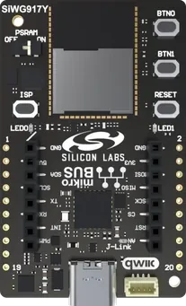

<!-- Copyright 2015-2026 Zephyr Project members and individual contributors. -->
<!-- SPDX-License-Identifier: Apache-2.0 -->
<!-- 中文翻译；编号、导航与译注为本地新增。 -->

<a id="siwx917_ek2708a"></a>

# 第14章\_SiWx917Y模块Wi-Fi 6与低功耗蓝牙探索套件，BRD2708A

原文：[官方页面](https://docs.zephyrproject.org/latest/boards/silabs/explorer_kits/siwx917/doc/siwx917_ek2708a.html)。读取日期：2026-10-16；来源摘要见[来源记录](../SOURCES.md)。

开发板概览（Board Overview）

<a id="id1"></a>

[](images/siwx917_ek2708a.webp)

SiWx917Y模块Wi-Fi 6与低功耗蓝牙探索套件，BRD2708A

名称（Name）：

`siwx917_ek2708a`

厂商（Vendor）：

[芯科科技（Silicon Laboratories）](https://docs.zephyrproject.org/latest/boards/index.html#vendor=silabs)

状态（Status）：

维护中（Maintained）

架构（Architecture）：

[arm](https://docs.zephyrproject.org/latest/boards/index.html#arch=arm)

片上系统（SoC）：

[siwg917y111mgaba](https://docs.zephyrproject.org/latest/boards/index.html#soc=siwg917y111mgaba)

<a id="board-github-link"></a>

[浏览开发板源码（Browse Board Sources）](https://github.com/zephyrproject-rtos/zephyr/blob/main//boards/silabs/explorer_kits/siwx917/doc/siwx917_ek2708a.rst/../..)<a id="overview"></a>

## 概述（Overview）

[SiWx917Y探索套件](https://www.silabs.com/development-tools/wireless/wi-fi/siw917y-ek2708a-explorer-kit)BRD2708A是基于SiWG917Y模块的小尺寸开发及评估平台，支持Wi-Fi 6、Bluetooth LE、mikroBUS插座、Qwiic连接器、用户LED及按键，以及外部伪静态随机存取存储器（PSRAM）。

<a id="hardware"></a>

## 硬件（Hardware）


- SiWG917Y111MGABA模块
- ARM Cortex-M4F 处理器（CPU）
- 8 MB闪存及8 MB外部PSRAM
- 两个用户LED及两个用户按键
- mikroBUS插座
- Qwiic连接器
- 板载SEGGER J-Link调试器及虚拟COM端口

注意（Note）

板载PSRAM通过模拟开关与模块隔离，模拟开关由PSRAM Power Control滑动开关控制。该开关必须处于ON，memc驱动及psram存储区域才能工作。Silicon Labs建议在不使用PSRAM时设为OFF，以降低电流消耗。

SiWG917Y模块及BRD2708A更多信息见：


- [SiWG917网站](https://www.silabs.com/wireless/wi-fi/siwx917-wireless-socs)
- [SiWG917数据手册](https://www.silabs.com/documents/public/data-sheets/siwg917-datasheet.pdf)
- [SiWG917参考手册](https://www.silabs.com/documents/public/reference-manuals/siw917x-family-rm.pdf)
- [SiWx917Y探索套件](https://www.silabs.com/development-tools/wireless/wi-fi/siw917y-ek2708a-explorer-kit)
- [SiWx917Y探索套件用户指南](https://www.silabs.com/documents/public/user-guides/ug590-brd2708a-user-guide.pdf)

<a id="supported-features"></a>

## 支持的功能（Supported Features）

`siwx917_ek2708a`开发板支持下表所列的硬件功能。

片上／板载（On-Chip / On-Board）

功能集成在片上系统（SoC）内／位于开发板上。

2 / 2

分别表示已启用／已禁用的实例数。点击数量标签，可查看开发板或SoC设备树源码（DTS）中该功能的第一个实例。

`vnd,foo`

与此功能匹配的设备树绑定兼容字符串（Compatible String）；点击链接可查看绑定文档。

<a id="siwx917_ek2708a-hw-features"></a>

<a id="siwx917_ek2708a-siwx917_ek2708a/siwg917y111mgaba-hw-features-section"></a>

### `siwx917_ek2708a/siwg917y111mgaba`目标（Target）

<a id="siwx917_ek2708a-siwx917_ek2708a/siwg917y111mgaba-hw-features-panel"></a>

<a id="siwx917_ek2708a-siwx917_ek2708a/siwg917y111mgaba-hw-features-memory"></a>

此开发板目标的存储器：319 KiB RAM、8 MiB闪存。

<a id="siwx917_ek2708a-siwx917_ek2708a/siwg917y111mgaba-hw-features-table"></a>

<table>
<tr>
<th>类型（Type）</th>
<th>位置（Location）</th>
<th>说明（Description）</th>
<th>兼容字符串（Compatible）</th>
</tr>
<tr>
<td rowspan="1">中央处理器（CPU）</td>
<td>片上（On-Chip）</td>
<td>ARM Cortex-M4F 处理器（CPU）（<a href="https://github.com/zephyrproject-rtos/zephyr/blob/main/dts/arm/silabs/siwg917.dtsi?plain=1#L58">已启用：1</a>）</td>
<td><a href="../cpu_arm_riscv_binding_reference/P025_arm_cortex-m4f.md#std-dtcompatible-arm-cortex-m4f"><code>arm,cortex-m4f</code></a></td>
</tr>
<tr>
<td rowspan="1">模数转换器（ADC）</td>
<td>片上（On-Chip）</td>
<td>Silicon Labs SiWx91x模数转换器（ADC）（<a href="https://github.com/zephyrproject-rtos/zephyr/blob/main/dts/arm/silabs/siwg917.dtsi?plain=1#L727">已启用：1</a>）</td>
<td><a href="../hardware/P902_SiliconLabsSiWx91x模数转换器绑定.md#dtbinding-silabs-siwx91x-adc"><code>silabs,siwx91x-adc</code></a></td>
</tr>
<tr>
<td rowspan="1">蓝牙（Bluetooth）</td>
<td>片上（On-Chip）</td>
<td>Silicon Labs板卡上的蓝牙主机控制器接口（Bluetooth HCI）（<a href="https://github.com/zephyrproject-rtos/zephyr/blob/main/dts/arm/silabs/siwg917.dtsi?plain=1#L123">已启用：1</a>）</td>
<td><a href="../bluetooth_st_transport_binding_reference/P001_silabs_siwx91x-bt-hci.md#std-dtcompatible-silabs-siwx91x-bt-hci"><code>silabs,siwx91x-bt-hci</code></a></td>
</tr>
<tr>
<td rowspan="7">时钟控制（Clock Control）</td>
<td>片上（On-Chip）</td>
<td>SiWx91x常开（Always-On，AON）／超超低功耗（Ultra Ultra Low-Power，UULP）时钟管理器（<a href="https://github.com/zephyrproject-rtos/zephyr/blob/main/dts/arm/silabs/siwg917.dtsi?plain=1#L135">已启用：1</a>）</td>
<td><a href="../clock_silabs_ti_xilinx_binding_reference/P012_silabs_siwx91x-cmu-aon.md#std-dtcompatible-silabs-siwx91x-cmu-aon"><code>silabs,siwx91x-cmu-aon</code></a></td>
</tr>
<tr>
<td>片上（On-Chip）</td>
<td>SiWx91x位于HP、ULP或AON时钟管理单元（CMU）节点下的时钟路由（<a href="https://github.com/zephyrproject-rtos/zephyr/blob/main/dts/arm/silabs/siwg917.dtsi?plain=1#L144">已启用：23</a>）</td>
<td><a href="../clock_silabs_ti_xilinx_binding_reference/P011_silabs_siwx91x-clock-route.md#std-dtcompatible-silabs-siwx91x-clock-route"><code>silabs,siwx91x-clock-route</code></a></td>
</tr>
<tr>
<td>片上（On-Chip）</td>
<td>SiWx91x超低功耗（Ultra Low Power，ULP）时钟管理器（<a href="https://github.com/zephyrproject-rtos/zephyr/blob/main/dts/arm/silabs/siwg917.dtsi?plain=1#L176">已启用：1</a>）</td>
<td><a href="../clock_silabs_ti_xilinx_binding_reference/P014_silabs_siwx91x-cmu-ulp.md#std-dtcompatible-silabs-siwx91x-cmu-ulp"><code>silabs,siwx91x-cmu-ulp</code></a></td>
</tr>
<tr>
<td>片上（On-Chip）</td>
<td>SiWx91x高功率（High Power，HP）时钟管理器（<a href="https://github.com/zephyrproject-rtos/zephyr/blob/main/dts/arm/silabs/siwg917.dtsi?plain=1#L237">已启用：1</a>）</td>
<td><a href="../clock_silabs_ti_xilinx_binding_reference/P013_silabs_siwx91x-cmu-hp.md#std-dtcompatible-silabs-siwx91x-cmu-hp"><code>silabs,siwx91x-cmu-hp</code></a></td>
</tr>
<tr>
<td>片上（On-Chip）</td>
<td>SiWx91x锁相环（PLL）输出描述（<a href="https://github.com/zephyrproject-rtos/zephyr/blob/main/dts/arm/silabs/siwg917.dtsi?plain=1#L275">已启用：3</a>）</td>
<td><a href="../clock_silabs_ti_xilinx_binding_reference/P016_silabs_siwx91x-pll.md#std-dtcompatible-silabs-siwx91x-pll"><code>silabs,siwx91x-pll</code></a></td>
</tr>
<tr>
<td>片上（On-Chip）</td>
<td>通用固定频率时钟提供者（Fixed-Rate Clock Provider）（<a href="https://github.com/zephyrproject-rtos/zephyr/blob/main/dts/arm/silabs/siwg917.dtsi?plain=1#L22">已启用：1</a>）</td>
<td><a href="../hardware/P566_固定时钟绑定.md#dtbinding-fixed-clock"><code>fixed-clock</code></a></td>
</tr>
<tr>
<td>片上（On-Chip）</td>
<td>SiWx91x SoC片上RC或晶体振荡器（<a href="https://github.com/zephyrproject-rtos/zephyr/blob/main/dts/arm/silabs/siwg917.dtsi?plain=1#L29">已启用：3</a>）</td>
<td><a href="../clock_silabs_ti_xilinx_binding_reference/P015_silabs_siwx91x-physical-clock.md#std-dtcompatible-silabs-siwx91x-physical-clock"><code>silabs,siwx91x-physical-clock</code></a></td>
</tr>
<tr>
<td rowspan="2">直接存储器访问（DMA）</td>
<td>片上（On-Chip）</td>
<td>Silicon Labs SiWx91x微型DMA（micro-DMA，UDMA）（<a href="https://github.com/zephyrproject-rtos/zephyr/blob/main/dts/arm/silabs/siwg917.dtsi?plain=1#L583">已启用：2</a>）</td>
<td><a href="../stm32_ti_xilinx_dma_binding_reference/P003_silabs_udma.md#std-dtcompatible-silabs-udma"><code>silabs,udma</code></a></td>
</tr>
<tr>
<td>片上（On-Chip）</td>
<td>Silicon Labs SiWx91x通用DMA（GPDMA）控制器（<a href="https://github.com/zephyrproject-rtos/zephyr/blob/main/dts/arm/silabs/siwg917.dtsi?plain=1#L614">已启用：1</a>）</td>
<td><a href="../nxp_realtek_renesas_dma_binding_reference/P018_silabs_gpdma.md#std-dtcompatible-silabs-gpdma"><code>silabs,gpdma</code></a></td>
</tr>
<tr>
<td rowspan="1">闪存控制器（Flash Controller）</td>
<td>片上（On-Chip）</td>
<td>Silicon Labs SiWx91x闪存控制器（<a href="https://github.com/zephyrproject-rtos/zephyr/blob/main/dts/arm/silabs/siwg917.dtsi?plain=1#L369">已启用：1</a>）</td>
<td><a href="../flash_renesas_st_ti_binding_reference/P010_silabs_siwx91x-flash-controller.md#std-dtcompatible-silabs-siwx91x-flash-controller"><code>silabs,siwx91x-flash-controller</code></a></td>
</tr>
<tr>
<td rowspan="5">通用输入输出与接插件（GPIO &amp; Headers）</td>
<td>片上（On-Chip）</td>
<td>Silicon Labs SiWx91x GPIO（<a href="https://github.com/zephyrproject-rtos/zephyr/blob/main/dts/arm/silabs/siwg917.dtsi?plain=1#L447">已启用：2</a>）</td>
<td><a href="../gpio_silabs_st_connectors_binding_reference/P019_silabs_siwx91x-gpio.md#std-dtcompatible-silabs-siwx91x-gpio"><code>silabs,siwx91x-gpio</code></a></td>
</tr>
<tr>
<td>片上（On-Chip）</td>
<td>Silicon Labs SiWx91x GPIO端口（<a href="https://github.com/zephyrproject-rtos/zephyr/blob/main/dts/arm/silabs/siwg917.dtsi?plain=1#L460">已启用：5</a>）</td>
<td><a href="../gpio_silabs_st_connectors_binding_reference/P017_silabs_siwx91x-gpio-port.md#std-dtcompatible-silabs-siwx91x-gpio-port"><code>silabs,siwx91x-gpio-port</code></a></td>
</tr>
<tr>
<td>片上（On-Chip）</td>
<td>Silicon Labs SiWx91x超超低功耗（UULP）GPIO端口（<a href="https://github.com/zephyrproject-rtos/zephyr/blob/main/dts/arm/silabs/siwg917.dtsi?plain=1#L531">已启用：1</a>）</td>
<td><a href="../gpio_silabs_st_connectors_binding_reference/P018_silabs_siwx91x-gpio-uulp.md#std-dtcompatible-silabs-siwx91x-gpio-uulp"><code>silabs,siwx91x-gpio-uulp</code></a></td>
</tr>
<tr>
<td>板载（On-Board）</td>
<td>通过Mikro BUS排针引出的GPIO引脚（<a href="https://github.com/zephyrproject-rtos/zephyr/blob/main/boards/silabs/explorer_kits/siwx917/siwx917_ek2708a.dts?plain=1#L65">已启用：1</a>）</td>
<td><a href="../gpio_microchip_nordic_nuvoton_binding_reference/P006_mikro-bus.md#std-dtcompatible-mikro-bus"><code>mikro-bus</code></a></td>
</tr>
<tr>
<td>板载（On-Board）</td>
<td>STEMMA QT是一种用于I2C设备的4针JST-SH接口。（<a href="https://github.com/zephyrproject-rtos/zephyr/blob/main/boards/silabs/explorer_kits/siwx917/siwx917_ek2708a.dts?plain=1#L84">已启用：1</a>）</td>
<td><a href="../gpio_ti_xilinx_sdl_binding_reference/P005_stemma-qt-connector.md#std-dtcompatible-stemma-qt-connector"><code>stemma-qt-connector</code></a></td>
</tr>
<tr>
<td rowspan="1">集成电路间总线（I2C）</td>
<td>片上（On-Chip）</td>
<td>Synopsys DesignWare I2C（<a href="https://github.com/zephyrproject-rtos/zephyr/blob/main/dts/arm/silabs/siwg917.dtsi?plain=1#L557">已启用：1</a>；<a href="https://github.com/zephyrproject-rtos/zephyr/blob/main/dts/arm/silabs/siwg917.dtsi?plain=1#L544">已禁用：2</a>）</td>
<td><a href="../i2c_stm32_ti_mux_binding_reference/P006_snps_designware-i2c.md#std-dtcompatible-snps-designware-i2c"><code>snps,designware-i2c</code></a></td>
</tr>
<tr>
<td rowspan="1">集成电路间音频总线（I2S）</td>
<td>片上（On-Chip）</td>
<td>Silicon Labs SiWx91x芯片间音频接口（Inter-IC Sound，I2S）（<a href="https://github.com/zephyrproject-rtos/zephyr/blob/main/dts/arm/silabs/siwg917.dtsi?plain=1#L695">已禁用：2</a>）</td>
<td><a href="../i2s_binding_reference/P015_silabs_siwx91x-i2s.md#std-dtcompatible-silabs-siwx91x-i2s"><code>silabs,siwx91x-i2s</code></a></td>
</tr>
<tr>
<td rowspan="1">输入（Input）</td>
<td>板载（On-Board）</td>
<td>一组绑定到 GPIO 的输入按键（GPIO-Bound Input Keys）（<a href="https://github.com/zephyrproject-rtos/zephyr/blob/main/boards/silabs/explorer_kits/siwx917/siwx917_ek2708a.dts?plain=1#L51">已启用：1</a>）</td>
<td><a href="../hardware/P563_GPIO按键绑定.md#std-dtcompatible-gpio-keys"><code>gpio-keys</code></a></td>
</tr>
<tr>
<td rowspan="1">中断控制器（Interrupt Controller）</td>
<td>片上（On-Chip）</td>
<td>ARMv7-M 嵌套向量中断控制器（Nested Vectored Interrupt Controller，NVIC）（<a href="https://github.com/zephyrproject-rtos/zephyr/blob/main/dts/arm/armv7-m.dtsi?plain=1#L13">已启用：1</a>）</td>
<td><a href="../arm_interrupt_timer_binding_reference/P002_ARMv7_M_NVIC.md#std-dtcompatible-arm-v7m-nvic"><code>arm,v7m-nvic</code></a></td>
</tr>
<tr>
<td rowspan="1">发光二极管（LED）</td>
<td>板载（On-Board）</td>
<td>一组由 GPIO 控制的 LED（GPIO-Controlled LEDs）（<a href="https://github.com/zephyrproject-rtos/zephyr/blob/main/boards/silabs/explorer_kits/siwx917/siwx917_ek2708a.dts?plain=1#L37">已启用：1</a>）</td>
<td><a href="../hardware/P564_GPIO指示灯绑定.md#dtbinding-gpio-leds"><code>gpio-leds</code></a></td>
</tr>
<tr>
<td rowspan="1">存储器控制器（Memory Controller）</td>
<td>片上（On-Chip）</td>
<td>Silicon Labs四线串行协议接口（QSPI）存储控制器（<a href="https://github.com/zephyrproject-rtos/zephyr/blob/main/dts/arm/silabs/siwg917.dtsi?plain=1#L386">已启用：1</a>）</td>
<td><a href="../memory_controller_sdram_psram_binding_reference/P008_silabs_siwx91x-qspi-memory.md#std-dtcompatible-silabs-siwx91x-qspi-memory"><code>silabs,siwx91x-qspi-memory</code></a></td>
</tr>
<tr>
<td rowspan="1">存储技术设备（MTD）</td>
<td>片上（On-Chip）</td>
<td>闪存（Flash）节点（<a href="https://github.com/zephyrproject-rtos/zephyr/blob/main/dts/arm/silabs/siwg917.dtsi?plain=1#L377">已启用：1</a>）</td>
<td><a href="../mtd_nxp_st_ti_partition_binding_reference/P013_soc-nv-flash.md#std-dtcompatible-soc-nv-flash"><code>soc-nv-flash</code></a></td>
</tr>
<tr>
<td rowspan="1">网络（Networking）</td>
<td>片上（On-Chip）</td>
<td>Silicon Labs SiWx91x网络处理器（NWP）（<a href="https://github.com/zephyrproject-rtos/zephyr/blob/main/dts/arm/silabs/siwg917.dtsi?plain=1#L110">已启用：1</a>）</td>
<td><a href="../network_radio_frontend_binding_reference/P015_silabs_siwx91x-nwp.md#std-dtcompatible-silabs-siwx91x-nwp"><code>silabs,siwx91x-nwp</code></a></td>
</tr>
<tr>
<td rowspan="1">引脚控制（Pin Control）</td>
<td>片上（On-Chip）</td>
<td>Silicon Labs SiWx91x引脚控制器（<a href="https://github.com/zephyrproject-rtos/zephyr/blob/main/dts/arm/silabs/siwg917.dtsi?plain=1#L364">已启用：1</a>）</td>
<td><a href="../pinctrl_stm32_ti_xilinx_binding_reference/P002_silabs_siwx91x-pinctrl.md#std-dtcompatible-silabs-siwx91x-pinctrl"><code>silabs,siwx91x-pinctrl</code></a></td>
</tr>
<tr>
<td rowspan="1">电源域（Power Domain）</td>
<td>片上（On-Chip）</td>
<td>Silicon Labs SiWx91x SoC电源域（<a href="https://github.com/zephyrproject-rtos/zephyr/blob/main/dts/arm/silabs/siwg917.dtsi?plain=1#L395">已启用：1</a>）</td>
<td><a href="../power_domain_binding_reference/P010_silabs_siwx91x-power-domain.md#std-dtcompatible-silabs-siwx91x-power-domain"><code>silabs,siwx91x-power-domain</code></a></td>
</tr>
<tr>
<td rowspan="1">脉宽调制（PWM）</td>
<td>片上（On-Chip）</td>
<td>Silicon Labs SiWx91x PWM控制器（<a href="https://github.com/zephyrproject-rtos/zephyr/blob/main/dts/arm/silabs/siwg917.dtsi?plain=1#L630">已禁用：1</a>）</td>
<td><a href="../pwm_stm32_ti_generic_binding_reference/P009_silabs_siwx91x-pwm.md#std-dtcompatible-silabs-siwx91x-pwm"><code>silabs,siwx91x-pwm</code></a></td>
</tr>
<tr>
<td rowspan="1">随机数生成器（RNG）</td>
<td>片上（On-Chip）</td>
<td>Silicon Labs SiWx91x芯片内置硬件随机数发生器（Hardware Random Number Generator）（<a href="https://github.com/zephyrproject-rtos/zephyr/blob/main/dts/arm/silabs/siwg917.dtsi?plain=1#L439">已启用：1</a>）</td>
<td><a href="../soc_rng_binding_reference/P014_silabs_siwx91x-rng.md#std-dtcompatible-silabs-siwx91x-rng"><code>silabs,siwx91x-rng</code></a></td>
</tr>
<tr>
<td rowspan="2">实时时钟（RTC）</td>
<td>片上（On-Chip）</td>
<td>Silicon Labs SiWx91x实时计数器（Real-Time Counter，RTC）（<a href="https://github.com/zephyrproject-rtos/zephyr/blob/main/dts/arm/silabs/siwg917.dtsi?plain=1#L645">已禁用：1</a>）</td>
<td><a href="../soc_rtc_binding_reference/P012_silabs_siwx91x-rtc.md#std-dtcompatible-silabs-siwx91x-rtc"><code>silabs,siwx91x-rtc</code></a></td>
</tr>
<tr>
<td>片上（On-Chip）</td>
<td>Silicon Labs Series 2系统实时时钟（SYSRTC）（<a href="https://github.com/zephyrproject-rtos/zephyr/blob/main/dts/arm/silabs/siwg917.dtsi?plain=1#L665">已启用：1</a>）</td>
<td><a href="../soc_rtc_binding_reference/P013_silabs_sysrtc.md#std-dtcompatible-silabs-sysrtc"><code>silabs,sysrtc</code></a></td>
</tr>
<tr>
<td rowspan="1">串行控制器（Serial Controller）</td>
<td>片上（On-Chip）</td>
<td>DesignWare 8250 UART控制器（<a href="https://github.com/zephyrproject-rtos/zephyr/blob/main/dts/arm/silabs/siwg917.dtsi?plain=1#L403">已启用：1</a>；<a href="https://github.com/zephyrproject-rtos/zephyr/blob/main/dts/arm/silabs/siwg917.dtsi?plain=1#L415">已禁用：2</a>）</td>
<td><a href="../uart_silabs_stm32_ti_binding_reference/P011_snps_dw-apb-uart.md#std-dtcompatible-snps-dw-apb-uart"><code>snps,dw-apb-uart</code></a></td>
</tr>
<tr>
<td rowspan="1">串行外设接口（SPI）</td>
<td>片上（On-Chip）</td>
<td>Silicon Labs GSPI（<a href="https://github.com/zephyrproject-rtos/zephyr/blob/main/dts/arm/silabs/siwg917.dtsi?plain=1#L680">已禁用：1</a>）</td>
<td><a href="../spi_stm32_ti_xilinx_binding_reference/P006_silabs_gspi.md#std-dtcompatible-silabs-gspi"><code>silabs,gspi</code></a></td>
</tr>
<tr>
<td rowspan="1">静态随机存储器（SRAM）</td>
<td>片上（On-Chip）</td>
<td>通用片上静态随机存储器（SRAM）（<a href="https://github.com/zephyrproject-rtos/zephyr/blob/main/dts/arm/silabs/siwg917.dtsi?plain=1#L88">已启用：1</a>）</td>
<td><a href="../hardware/P567_内存映射SRAM绑定.md#dtbinding-mmio-sram"><code>mmio-sram</code></a></td>
</tr>
<tr>
<td rowspan="1">定时器（Timer）</td>
<td>片上（On-Chip）</td>
<td>ARMv7-M 系统节拍（System Tick）（<a href="https://github.com/zephyrproject-rtos/zephyr/blob/main/dts/arm/armv7-m.dtsi?plain=1#L21">已启用：1</a>）</td>
<td><a href="../arm_interrupt_timer_binding_reference/P006_ARMv7_M_SysTick.md#std-dtcompatible-arm-armv7m-systick"><code>arm,armv7m-systick</code></a></td>
</tr>
<tr>
<td rowspan="1">看门狗（Watchdog）</td>
<td>片上（On-Chip）</td>
<td>Silicon Labs SiWx91x看门狗（Watchdog）（<a href="https://github.com/zephyrproject-rtos/zephyr/blob/main/dts/arm/silabs/siwg917.dtsi?plain=1#L654">已启用：1</a>）</td>
<td><a href="../realtek_renesas_silabs_watchdog_binding_reference/P012_silabs_siwx91x-wdt.md#std-dtcompatible-silabs-siwx91x-wdt"><code>silabs,siwx91x-wdt</code></a></td>
</tr>
<tr>
<td rowspan="1">无线局域网（Wi-Fi）</td>
<td>片上（On-Chip）</td>
<td>Silicon Labs SiWx91x SoC Wi-Fi（<a href="https://github.com/zephyrproject-rtos/zephyr/blob/main/dts/arm/silabs/siwg917.dtsi?plain=1#L128">已启用：1</a>）</td>
<td><a href="../wifi_nordic_nxp_simulation_binding_reference/P012_silabs_siwx91x-wifi.md#std-dtcompatible-silabs-siwx91x-wifi"><code>silabs,siwx91x-wifi</code></a></td>
</tr>
</table>

受支持的Wi-Fi功能列表见“[SiWx917 Wi-Fi功能，Alpha阶段](P027_SiWx917_Wi-Fi_Features_Alpha.md#siwx917-wifi-features)”页面。

<a id="programming-and-debugging"></a>

## 烧录与调试（Programming and Debugging）

`siwx917_ek2708a`开发板支持下表所列的运行工具（Runners）及相关west命令。

<table>
<tr>
<th></th>
<th>烧录（flash）</th>
<th>调试（debug）</th>
<th>连接调试会话（attach）</th>
<th>实时传输（rtt）</th>
<th>复位（reset）</th>
<th>调试服务器（debugserver）</th>
</tr>
<tr>
<td><a href="https://docs.zephyrproject.org/latest/develop/flash_debug/host-tools.html#runner-jlink">jlink</a></td>
<td>✅</td>
<td>✅（默认 / default）</td>
<td>✅</td>
<td>✅</td>
<td>✅</td>
<td>✅</td>
</tr>
<tr>
<td>silabs_commander</td>
<td>✅（默认 / default）</td>
<td></td>
<td></td>
<td></td>
<td></td>
<td></td>
</tr>
</table>

<a id="building-and-flashing"></a>

## 构建与烧录（Building and Flashing）

siwx917_ek2708a应用可按常规方式构建，烧录要求主机已安装[Simplicity Commander](https://www.silabs.com/developer-tools/simplicity-studio/simplicity-commander)。

通过USB Type-C连接器将开发板连接主机。

SiWG917Y模块包含网络协处理器（Network Co-Processor，NWP）。确认NWP已烧录与当前Zephyr版本配套的固件，该固件由hal_silabs模块提供：

```text
west blobs fetch hal_silabs
cd modules/hal/silabs/zephyr/blobs/wiseconnect/connectivity_firmware/standard
commander flash SiWG917-*.rps
```

只有NWP固件版本变化时，才需要重新烧录。

下面是[Hello World](../getting_started/P005_HelloWorld示例.md#hello_world)应用示例：

```text
# From the root of the zephyr repository
west build -b siwx917_ek2708a samples/hello_world
west flash
```

打开串口终端（如minicom或PuTTY），设置如下：


- 速率（Speed）：115200波特率
- 数据位（Data）：8位
- 奇偶校验（Parity）：无（None）
- 停止位（Stop Bits）：1位

复位开发板后，终端应显示以下消息：

```text
Hello World! siwx917_ek2708a/siwg917y111mgaba
```

<a id="debugging"></a>

## 调试（Debugging）

调试依赖J-Link，但它不能烧录此固件，因此须分两步进行。先用west flash通过Simplicity Commander烧录，再用west attach通过J-Link附加到开发板。此时Zephyr可能已启动，可在GDB命令提示符执行monitor reset复位开发板。

## 译注

SiWx917Y使用外部PSRAM时必须打开其电源开关；未使用时关闭可降低功耗。网络处理器（NWP）固件须匹配Zephyr，只在版本变化时重写。

## 原文外链核对

2026-10-16核对并重试以下原文外链时未能确认可访问性，保留原始目标，不将访问失败解释为原文内容有误。

- [simplicity-commander](https://www.silabs.com/developer-tools/simplicity-studio/simplicity-commander)：HTTP Error 403: Forbidden。
- [siw917y-ek2708a-explorer-kit](https://www.silabs.com/development-tools/wireless/wi-fi/siw917y-ek2708a-explorer-kit)：HTTP Error 403: Forbidden。
- [siwg917-datasheet.pdf](https://www.silabs.com/documents/public/data-sheets/siwg917-datasheet.pdf)：HTTP Error 403: Forbidden。
- [siw917x-family-rm.pdf](https://www.silabs.com/documents/public/reference-manuals/siw917x-family-rm.pdf)：HTTP Error 403: Forbidden。
- [ug590-brd2708a-user-guide.pdf](https://www.silabs.com/documents/public/user-guides/ug590-brd2708a-user-guide.pdf)：HTTP Error 403: Forbidden。
- [siwx917-wireless-socs](https://www.silabs.com/wireless/wi-fi/siwx917-wireless-socs)：HTTP Error 403: Forbidden。

---

[上一章](P013_Explorer_Kits.md) · [返回大纲](大纲.md) · [全站翻译进度](../PROGRESS.md) · [下一章](P015_EFR32BG22_Explorer_Kit_BG22-EK4108A.md)
