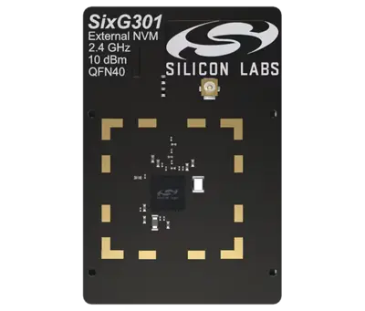

<!-- Copyright 2015-2026 Zephyr Project members and individual contributors. -->
<!-- SPDX-License-Identifier: Apache-2.0 -->
<!-- 中文翻译；编号、导航与译注为本地新增。 -->

<a id="sixg301_rb4407a"></a>

# 第28章\_SixG301 +10 dBm、4 MB闪存无线电板

原文：[官方页面](https://docs.zephyrproject.org/latest/boards/silabs/radio_boards/six301/doc/sixg301_rb4407a.html)。读取日期：2026-10-16；来源摘要见[来源记录](../SOURCES.md)。

开发板概览（Board Overview）

<a id="id1"></a>

[](images/sixg301_rb4407a.webp)

SixG301 +10 dBm、4 MB闪存无线电板

名称（Name）：

`sixg301_rb4407a`

厂商（Vendor）：

[芯科科技（Silicon Laboratories）](https://docs.zephyrproject.org/latest/boards/index.html#vendor=silabs)

状态（Status）：

维护中（Maintained）

架构（Architecture）：

[arm](https://docs.zephyrproject.org/latest/boards/index.html#arch=arm)

片上系统（SoC）：

[simg301m104lil](https://docs.zephyrproject.org/latest/boards/index.html#soc=simg301m104lil)

<a id="board-github-link"></a>

[浏览开发板源码（Browse Board Sources）](https://github.com/zephyrproject-rtos/zephyr/blob/main//boards/silabs/radio_boards/six301/doc/sixg301_rb4407a.rst/../..)<a id="overview"></a>

## 概述（Overview）

[SixG301 +10 dBm、4 MB闪存无线电板](https://www.silabs.com/development-tools/wireless/sixg301-rb4407a-wireless-10-dbm-4-mb-flash-radio-board)用于开发基于2.4 GHz无线协议的IoT设备，包括BLE、Bluetooth Mesh、Matter、OpenThread及Zigbee。

该无线电板插接无线专业套件主板，在Zephyr中作为一种无线电板获得支持。（[无线电板（Radio Boards）](P023_Radio_Boards.md#silabs-radio-boards)）

<a id="hardware"></a>

## 硬件（Hardware）


- SIMG301M104LIL片上系统（SoC）
- CPU内核：ARM Cortex®-M33，带浮点单元（FPU）
- CPU时钟频率：150 MHz
- 闪存：4096 kB封装内QSPI NOR闪存
- RAM容量：512 kB
- 发射功率：最高+10 dBm
- 工作频率（Operation Frequency）：2.4 GHz
- 高频晶体振荡器，38.4 MHz

<a id="supported-features"></a>

### 支持的功能（Supported Features）

`sixg301_rb4407a`开发板支持下表所列的硬件功能。

片上／板载（On-Chip / On-Board）

功能集成在片上系统（SoC）内／位于开发板上。

2 / 2

分别表示已启用／已禁用的实例数。点击数量标签，可查看开发板或SoC设备树源码（DTS）中该功能的第一个实例。

`vnd,foo`

与此功能匹配的设备树绑定兼容字符串（Compatible String）；点击链接可查看绑定文档。

<a id="sixg301_rb4407a-hw-features"></a>

<a id="sixg301_rb4407a-sixg301_rb4407a/simg301m104lil-hw-features-section"></a>

#### `sixg301_rb4407a/simg301m104lil`目标（Target）

<a id="sixg301_rb4407a-sixg301_rb4407a/simg301m104lil-hw-features-panel"></a>

<a id="sixg301_rb4407a-sixg301_rb4407a/simg301m104lil-hw-features-memory"></a>

此开发板目标的存储器：512 KiB RAM、3652 KiB闪存。

<a id="sixg301_rb4407a-sixg301_rb4407a/simg301m104lil-hw-features-table"></a>

<table>
<tr>
<th>类型（Type）</th>
<th>位置（Location）</th>
<th>说明（Description）</th>
<th>兼容字符串（Compatible）</th>
</tr>
<tr>
<td rowspan="1">中央处理器（CPU）</td>
<td>片上（On-Chip）</td>
<td>ARM Cortex-M33处理器（CPU）（<a href="https://github.com/zephyrproject-rtos/zephyr/blob/main/dts/arm/silabs/six301/six301.dtsi?plain=1#L179">已启用：1</a>）</td>
<td><a href="../cpu_arm_riscv_binding_reference/P022_arm_cortex-m33.md#std-dtcompatible-arm-cortex-m33"><code>arm,cortex-m33</code></a></td>
</tr>
<tr>
<td rowspan="1">模数转换器（ADC）</td>
<td>片上（On-Chip）</td>
<td>Silicon Labs Series 3模数转换器（ADC）（<a href="https://github.com/zephyrproject-rtos/zephyr/blob/main/dts/arm/silabs/six301/six301.dtsi?plain=1#L242">已启用：1</a>）</td>
<td><a href="../hardware/P901_SiliconLabsSeries3模数转换器绑定.md#dtbinding-silabs-series3-adc"><code>silabs,series3-adc</code></a></td>
</tr>
<tr>
<td rowspan="1">蓝牙（Bluetooth）</td>
<td>片上（On-Chip）</td>
<td>Silicon Labs Series 2蓝牙主机控制器接口（Bluetooth HCI）（<a href="https://github.com/zephyrproject-rtos/zephyr/blob/main/dts/arm/silabs/six301/simg301.dtsi?plain=1#L31">已启用：1</a>）</td>
<td><a href="../bluetooth_vendor_hci_binding_reference/P015_silabs_bt-hci-efr32.md#std-dtcompatible-silabs-bt-hci-efr32"><code>silabs,bt-hci-efr32</code></a></td>
</tr>
<tr>
<td rowspan="10">时钟控制（Clock Control）</td>
<td>片上（On-Chip）</td>
<td>Silicon Labs Series 2 EM2／EM3模式高频RC振荡器（HFRCOEM23）（<a href="https://github.com/zephyrproject-rtos/zephyr/blob/main/dts/arm/silabs/six301/six301.dtsi?plain=1#L270">已启用：1</a>）</td>
<td><a href="../clock_silabs_ti_xilinx_binding_reference/P005_silabs_series2-hfrcoem23.md#std-dtcompatible-silabs-series2-hfrcoem23"><code>silabs,series2-hfrcoem23</code></a></td>
</tr>
<tr>
<td>片上（On-Chip）</td>
<td>Silicon Labs Series 2高频外部晶体振荡器（HFXO）（<a href="https://github.com/zephyrproject-rtos/zephyr/blob/main/dts/arm/silabs/six301/six301.dtsi?plain=1#L280">已启用：1</a>）</td>
<td><a href="../clock_renesas_rockchip_sifli_silabs_binding_reference/P027_silabs_hfxo.md#std-dtcompatible-silabs-hfxo"><code>silabs,hfxo</code></a></td>
</tr>
<tr>
<td>片上（On-Chip）</td>
<td>Silicon Labs片上系统锁相环（SOCPLL）（<a href="https://github.com/zephyrproject-rtos/zephyr/blob/main/dts/arm/silabs/six301/six301.dtsi?plain=1#L323">已启用：1</a>）</td>
<td><a href="../clock_silabs_ti_xilinx_binding_reference/P017_silabs_socpll.md#std-dtcompatible-silabs-socpll"><code>silabs,socpll</code></a></td>
</tr>
<tr>
<td>片上（On-Chip）</td>
<td>Silicon Labs Series 2时钟管理单元（CMU）（<a href="https://github.com/zephyrproject-rtos/zephyr/blob/main/dts/arm/silabs/six301/six301.dtsi?plain=1#L332">已启用：1</a>）</td>
<td><a href="../clock_renesas_rockchip_sifli_silabs_binding_reference/P029_silabs_series-clock.md#std-dtcompatible-silabs-series-clock"><code>silabs,series-clock</code></a></td>
</tr>
<tr>
<td>片上（On-Chip）</td>
<td>Silicon Labs CMU时钟输出（CLKOUT）（<a href="https://github.com/zephyrproject-rtos/zephyr/blob/main/dts/arm/silabs/six301/six301.dtsi?plain=1#L340">已禁用：1</a>）</td>
<td><a href="../clock_renesas_rockchip_sifli_silabs_binding_reference/P028_silabs_series-clock-output.md#std-dtcompatible-silabs-series-clock-output"><code>silabs,series-clock-output</code></a></td>
</tr>
<tr>
<td>片上（On-Chip）</td>
<td>Silicon Labs Series 2高频RC振荡器数字锁相环（HFRCODPLL）（<a href="https://github.com/zephyrproject-rtos/zephyr/blob/main/dts/arm/silabs/six301/six301.dtsi?plain=1#L364">已禁用：1</a>）</td>
<td><a href="../clock_silabs_ti_xilinx_binding_reference/P004_silabs_series2-hfrcodpll.md#std-dtcompatible-silabs-series2-hfrcodpll"><code>silabs,series2-hfrcodpll</code></a></td>
</tr>
<tr>
<td>片上（On-Chip）</td>
<td>通用固定频率时钟提供者（Fixed-Rate Clock Provider）（<a href="https://github.com/zephyrproject-rtos/zephyr/blob/main/dts/arm/silabs/six301/six301.dtsi?plain=1#L389">已启用：3</a>）</td>
<td><a href="../hardware/P566_固定时钟绑定.md#dtbinding-fixed-clock"><code>fixed-clock</code></a></td>
</tr>
<tr>
<td>片上（On-Chip）</td>
<td>Silicon Labs Series 2低频外部晶体振荡器（LFXO）（<a href="https://github.com/zephyrproject-rtos/zephyr/blob/main/dts/arm/silabs/six301/six301.dtsi?plain=1#L397">已禁用：1</a>）</td>
<td><a href="../clock_silabs_ti_xilinx_binding_reference/P007_silabs_series2-lfxo.md#std-dtcompatible-silabs-series2-lfxo"><code>silabs,series2-lfxo</code></a></td>
</tr>
<tr>
<td>片上（On-Chip）</td>
<td>Silicon Labs Series 2低频RC振荡器（LFRCO）（<a href="https://github.com/zephyrproject-rtos/zephyr/blob/main/dts/arm/silabs/six301/six301.dtsi?plain=1#L411">已启用：1</a>）</td>
<td><a href="../clock_silabs_ti_xilinx_binding_reference/P006_silabs_series2-lfrco.md#std-dtcompatible-silabs-series2-lfrco"><code>silabs,series2-lfrco</code></a></td>
</tr>
<tr>
<td>片上（On-Chip）</td>
<td>通用固定比例时钟提供器（Fixed Factor Clock Provider）（<a href="https://github.com/zephyrproject-rtos/zephyr/blob/main/dts/arm/silabs/six301/six301.dtsi?plain=1#L23">已启用：24</a>）</td>
<td><a href="../timer_reference/P110_固定比例时钟绑定.md#dtbinding-fixed-factor-clock"><code>fixed-factor-clock</code></a></td>
</tr>
<tr>
<td rowspan="1">比较器（Comparator）</td>
<td>片上（On-Chip）</td>
<td>Silicon Labs Series 2模拟比较器（ACMP）（<a href="https://github.com/zephyrproject-rtos/zephyr/blob/main/dts/arm/silabs/six301/six301.dtsi?plain=1#L252">已禁用：2</a>）</td>
<td><a href="../hardware/P757_SiliconLabs模拟比较器绑定.md#dtbinding-silabs-acmp"><code>silabs,acmp</code></a></td>
</tr>
<tr>
<td rowspan="3">计数器（Counter）</td>
<td>片上（On-Chip）</td>
<td>Silicon Labs TIMER计数器（Counter）（<a href="https://github.com/zephyrproject-rtos/zephyr/blob/main/dts/arm/silabs/six301/six301.dtsi?plain=1#L503">已禁用：4</a>）</td>
<td><a href="../stm32_ti_xilinx_counter_binding_reference/P005_silabs_timer-counter.md#std-dtcompatible-silabs-timer-counter"><code>silabs,timer-counter</code></a></td>
</tr>
<tr>
<td>片上（On-Chip）</td>
<td>Silicon Labs Series 2备份实时时钟（BURTC）（<a href="https://github.com/zephyrproject-rtos/zephyr/blob/main/dts/arm/silabs/six301/six301.dtsi?plain=1#L581">已禁用：1</a>）</td>
<td><a href="../stm32_ti_xilinx_counter_binding_reference/P003_silabs_burtc-counter.md#std-dtcompatible-silabs-burtc-counter"><code>silabs,burtc-counter</code></a></td>
</tr>
<tr>
<td>片上（On-Chip）</td>
<td>Silicon Labs PROTIMER计数器（Counter）（<a href="https://github.com/zephyrproject-rtos/zephyr/blob/main/dts/arm/silabs/six301/simg301.dtsi?plain=1#L41">已启用：1</a>）</td>
<td><a href="../stm32_ti_xilinx_counter_binding_reference/P004_silabs_protimer.md#std-dtcompatible-silabs-protimer"><code>silabs,protimer</code></a></td>
</tr>
<tr>
<td rowspan="1">循环冗余校验（CRC）</td>
<td>片上（On-Chip）</td>
<td>Silabs通用循环冗余校验（CRC）（<a href="https://github.com/zephyrproject-rtos/zephyr/blob/main/dts/arm/silabs/six301/six301.dtsi?plain=1#L609">已启用：1</a>）</td>
<td><a href="../crc_clock_monitor_binding_reference/P010_silabs_gpcrc.md#std-dtcompatible-silabs-gpcrc"><code>silabs,gpcrc</code></a></td>
</tr>
<tr>
<td rowspan="2">密码学加速器（Cryptographic Accelerator）</td>
<td>片上（On-Chip）</td>
<td>Silicon Labs Series 3加密模块（Crypto）（<a href="https://github.com/zephyrproject-rtos/zephyr/blob/main/dts/arm/silabs/six301/six301.dtsi?plain=1#L664">已启用：1</a>；<a href="https://github.com/zephyrproject-rtos/zephyr/blob/main/dts/arm/silabs/six301/six301.dtsi?plain=1#L655">已禁用：1</a>）</td>
<td><a href="../crypto_secure_engine_st_ti_binding_reference/P013_silabs_series3-crypto.md#std-dtcompatible-silabs-series3-crypto"><code>silabs,series3-crypto</code></a></td>
</tr>
<tr>
<td>片上（On-Chip）</td>
<td>Silicon Labs Series 2安全引擎邮箱（SE Mailbox）（<a href="https://github.com/zephyrproject-rtos/zephyr/blob/main/dts/arm/silabs/six301/six301.dtsi?plain=1#L673">已启用：1</a>）</td>
<td><a href="../crypto_secure_engine_st_ti_binding_reference/P012_silabs_gecko-semailbox.md#std-dtcompatible-silabs-gecko-semailbox"><code>silabs,gecko-semailbox</code></a></td>
</tr>
<tr>
<td rowspan="2">调试（Debug）</td>
<td>片上（On-Chip）</td>
<td>Silicon Labs数据包跟踪接口（Packet Trace Interface）（<a href="https://github.com/zephyrproject-rtos/zephyr/blob/main/dts/arm/silabs/six301/simg301.dtsi?plain=1#L46">已启用：1</a>）</td>
<td><a href="../debug_binding_reference/P006_Silicon_Labs数据包跟踪绑定.md#std-dtcompatible-silabs-pti"><code>silabs,pti</code></a></td>
</tr>
<tr>
<td>片上（On-Chip）</td>
<td>ARMv8仪器跟踪宏单元（Instrumentation Trace Macrocell）（<a href="https://github.com/zephyrproject-rtos/zephyr/blob/main/dts/arm/silabs/six301/six301.dtsi?plain=1#L191">已启用：1</a>）</td>
<td><a href="../debug_binding_reference/P002_ARMv8M_ITM调试绑定.md#std-dtcompatible-arm-armv8m-itm"><code>arm,armv8m-itm</code></a></td>
</tr>
<tr>
<td rowspan="1">显示（Display）</td>
<td>板载（On-Board）</td>
<td>Sharp LS0XX存储型显示控制器（Memory Display Controller）（<a href="https://github.com/zephyrproject-rtos/zephyr/blob/main/boards/silabs/radio_boards/six301/sixg301_rb4407a.dts?plain=1#L187">已启用：1</a>）</td>
<td><a href="../display_panel_renesas_sharp_binding_reference/P015_sharp_ls0xx.md#std-dtcompatible-sharp-ls0xx"><code>sharp,ls0xx</code></a></td>
</tr>
<tr>
<td rowspan="1">直接存储器访问（DMA）</td>
<td>片上（On-Chip）</td>
<td>Silicon Labs Series 2链式直接存储器访问（LDMA）（<a href="https://github.com/zephyrproject-rtos/zephyr/blob/main/dts/arm/silabs/six301/six301.dtsi?plain=1#L373">已禁用：1</a>）</td>
<td><a href="../stm32_ti_xilinx_dma_binding_reference/P001_silabs_ldma.md#std-dtcompatible-silabs-ldma"><code>silabs,ldma</code></a></td>
</tr>
<tr>
<td rowspan="1">闪存控制器（Flash Controller）</td>
<td>片上（On-Chip）</td>
<td>Silicon Labs Series 3外部存储器（EXTMEM）（<a href="https://github.com/zephyrproject-rtos/zephyr/blob/main/dts/arm/silabs/six301/six301.dtsi?plain=1#L683">已启用：1</a>）</td>
<td><a href="../flash_renesas_st_ti_binding_reference/P008_silabs_series3-extmem.md#std-dtcompatible-silabs-series3-extmem"><code>silabs,series3-extmem</code></a></td>
</tr>
<tr>
<td rowspan="3">通用输入输出与接插件（GPIO &amp; Headers）</td>
<td>片上（On-Chip）</td>
<td>Silicon Labs Series 2通用输入输出外设（GPIO Peripheral）（<a href="https://github.com/zephyrproject-rtos/zephyr/blob/main/dts/arm/silabs/six301/six301.dtsi?plain=1#L431">已启用：1</a>）</td>
<td><a href="../gpio_silabs_st_connectors_binding_reference/P015_silabs_gpio.md#std-dtcompatible-silabs-gpio"><code>silabs,gpio</code></a></td>
</tr>
<tr>
<td>片上（On-Chip）</td>
<td>Silicon Labs Series 2 GPIO端口（Port）（<a href="https://github.com/zephyrproject-rtos/zephyr/blob/main/dts/arm/silabs/six301/six301.dtsi?plain=1#L441">已启用：4</a>）</td>
<td><a href="../gpio_silabs_st_connectors_binding_reference/P014_silabs_gpio-port.md#std-dtcompatible-silabs-gpio-port"><code>silabs,gpio-port</code></a></td>
</tr>
<tr>
<td>板载（On-Board）</td>
<td>Silicon Labs套件扩展排针（<a href="https://github.com/zephyrproject-rtos/zephyr/blob/main/boards/silabs/radio_boards/six301/sixg301_rb4407a.dts?plain=1#L61">已启用：1</a>）</td>
<td><a href="../gpio_silabs_st_connectors_binding_reference/P011_silabs_exp-header.md#std-dtcompatible-silabs-exp-header"><code>silabs,exp-header</code></a></td>
</tr>
<tr>
<td rowspan="1">集成电路间总线（I2C）</td>
<td>片上（On-Chip）</td>
<td>Silicon Labs Series 2的I2C控制器（<a href="https://github.com/zephyrproject-rtos/zephyr/blob/main/dts/arm/silabs/six301/six301.dtsi?plain=1#L293">已启用：1</a>；<a href="https://github.com/zephyrproject-rtos/zephyr/blob/main/dts/arm/silabs/six301/six301.dtsi?plain=1#L590">已禁用：2</a>）</td>
<td><a href="../i2c_stm32_ti_mux_binding_reference/P005_silabs_i2c.md#std-dtcompatible-silabs-i2c"><code>silabs,i2c</code></a></td>
</tr>
<tr>
<td rowspan="1">低速率无线个域网（IEEE 802.15.4）</td>
<td>片上（On-Chip）</td>
<td>Silicon Labs EFR32 IEEE 802.15.4无线电（Radio）（<a href="https://github.com/zephyrproject-rtos/zephyr/blob/main/dts/arm/silabs/six301/simg301.dtsi?plain=1#L36">已启用：1</a>）</td>
<td><a href="../lora_ieee802154_binding_reference/P009_silabs_efr32-ieee802154.md#std-dtcompatible-silabs-efr32-ieee802154"><code>silabs,efr32-ieee802154</code></a></td>
</tr>
<tr>
<td rowspan="2">输入（Input）</td>
<td>板载（On-Board）</td>
<td>一组绑定到 GPIO 的输入按键（GPIO-Bound Input Keys）（<a href="https://github.com/zephyrproject-rtos/zephyr/blob/main/boards/silabs/radio_boards/six301/sixg301_rb4407a.dts?plain=1#L32">已启用：1</a>）</td>
<td><a href="../hardware/P563_GPIO按键绑定.md#std-dtcompatible-gpio-keys"><code>gpio-keys</code></a></td>
</tr>
<tr>
<td>板载（On-Board）</td>
<td>连接ADC电阻梯形网络按键（Resistor Ladder Buttons）的输入驱动（<a href="https://github.com/zephyrproject-rtos/zephyr/blob/main/boards/silabs/radio_boards/six301/sixg301_rb4407a.dts?plain=1#L82">已启用：1</a>）</td>
<td><a href="../input_adc_touch_matrix_binding_reference/P002_adc-keys.md#std-dtcompatible-adc-keys"><code>adc-keys</code></a></td>
</tr>
<tr>
<td rowspan="1">中断控制器（Interrupt Controller）</td>
<td>片上（On-Chip）</td>
<td>ARMv8-M嵌套向量中断控制器（NVIC / Nested Vectored Interrupt Controller）（<a href="https://github.com/zephyrproject-rtos/zephyr/blob/main/dts/arm/armv8-m.dtsi?plain=1#L13">已启用：1</a>）</td>
<td><a href="../arm_interrupt_timer_binding_reference/P003_ARMv8_M_NVIC.md#std-dtcompatible-arm-v8m-nvic"><code>arm,v8m-nvic</code></a></td>
</tr>
<tr>
<td rowspan="2">发光二极管（LED）</td>
<td>板载（On-Board）</td>
<td>一组由 GPIO 控制的 LED（GPIO-Controlled LEDs）（<a href="https://github.com/zephyrproject-rtos/zephyr/blob/main/boards/silabs/radio_boards/six301/sixg301_rb4407a.dts?plain=1#L113">已启用：1</a>）</td>
<td><a href="../hardware/P564_GPIO指示灯绑定.md#dtbinding-gpio-leds"><code>gpio-leds</code></a></td>
</tr>
<tr>
<td>板载（On-Board）</td>
<td>一组由脉宽调制（PWM）控制的LED（<a href="https://github.com/zephyrproject-rtos/zephyr/blob/main/boards/silabs/radio_boards/six301/sixg301_rb4407a.dts?plain=1#L125">已启用：1</a>）</td>
<td><a href="../hardware/P565_PWM指示灯绑定.md#dtbinding-pwm-leds"><code>pwm-leds</code></a></td>
</tr>
<tr>
<td rowspan="1">内存管理单元／内存保护单元（MMU / MPU）</td>
<td>片上（On-Chip）</td>
<td>ARMv8-M存储器保护单元（MPU / Memory Protection Unit）（<a href="https://github.com/zephyrproject-rtos/zephyr/blob/main/dts/arm/silabs/six301/six301.dtsi?plain=1#L196">已启用：1</a>）</td>
<td><a href="../memory_protection_binding_reference/P007_arm_armv8m-mpu.md#std-dtcompatible-arm-armv8m-mpu"><code>arm,armv8m-mpu</code></a></td>
</tr>
<tr>
<td rowspan="1">存储技术设备（MTD）</td>
<td>片上（On-Chip）</td>
<td>闪存（Flash）节点（<a href="https://github.com/zephyrproject-rtos/zephyr/blob/main/dts/arm/silabs/six301/six301.dtsi?plain=1#L690">已启用：1</a>）</td>
<td><a href="../mtd_nxp_st_ti_partition_binding_reference/P013_soc-nv-flash.md#std-dtcompatible-soc-nv-flash"><code>soc-nv-flash</code></a></td>
</tr>
<tr>
<td rowspan="1">网络（Networking）</td>
<td>片上（On-Chip）</td>
<td>Silicon Labs Series 2无线电接口（Radio Interface）（<a href="https://github.com/zephyrproject-rtos/zephyr/blob/main/dts/arm/silabs/six301/simg301.dtsi?plain=1#L11">已启用：1</a>）</td>
<td><a href="../network_radio_frontend_binding_reference/P014_silabs_series2-radio.md#std-dtcompatible-silabs-series2-radio"><code>silabs,series2-radio</code></a></td>
</tr>
<tr>
<td rowspan="1">引脚控制（Pin Control）</td>
<td>片上（On-Chip）</td>
<td>Silicon Labs Series 2 DBUS引脚控制器（Pin Controller）（<a href="https://github.com/zephyrproject-rtos/zephyr/blob/main/dts/arm/silabs/six301/six301.dtsi?plain=1#L480">已启用：1</a>）</td>
<td><a href="../pinctrl_renesas_silabs_binding_reference/P024_silabs_dbus-pinctrl.md#std-dtcompatible-silabs-dbus-pinctrl"><code>silabs,dbus-pinctrl</code></a></td>
</tr>
<tr>
<td rowspan="2">脉宽调制（PWM）</td>
<td>片上（On-Chip）</td>
<td>Silicon Labs低能耗定时器脉宽调制（LETIMER PWM）（<a href="https://github.com/zephyrproject-rtos/zephyr/blob/main/dts/arm/silabs/six301/six301.dtsi?plain=1#L235">已禁用：1</a>）</td>
<td><a href="../pwm_stm32_ti_generic_binding_reference/P008_silabs_letimer-pwm.md#std-dtcompatible-silabs-letimer-pwm"><code>silabs,letimer-pwm</code></a></td>
</tr>
<tr>
<td>片上（On-Chip）</td>
<td>Silicon Labs TIMER脉宽调制（PWM）（<a href="https://github.com/zephyrproject-rtos/zephyr/blob/main/dts/arm/silabs/six301/six301.dtsi?plain=1#L508">已启用：1</a>；<a href="https://github.com/zephyrproject-rtos/zephyr/blob/main/dts/arm/silabs/six301/six301.dtsi?plain=1#L530">已禁用：3</a>）</td>
<td><a href="../pwm_stm32_ti_generic_binding_reference/P010_silabs_timer-pwm.md#std-dtcompatible-silabs-timer-pwm"><code>silabs,timer-pwm</code></a></td>
</tr>
<tr>
<td rowspan="1">稳压器（Regulator）</td>
<td>板载（On-Board）</td>
<td>固定电压稳压器（Fixed Voltage Regulators）（<a href="https://github.com/zephyrproject-rtos/zephyr/blob/main/boards/silabs/radio_boards/six301/sixg301_rb4407a.dts?plain=1#L137">已启用：1</a>）</td>
<td><a href="../hardware/P635_固定稳压器设备树绑定.md#dtbinding-regulator-fixed"><code>regulator-fixed</code></a></td>
</tr>
<tr>
<td rowspan="1">保持存储器（Retained Memory）</td>
<td>片上（On-Chip）</td>
<td>Silicon Labs Series 2备份RAM（BURAM）（<a href="https://github.com/zephyrproject-rtos/zephyr/blob/main/dts/arm/silabs/six301/six301.dtsi?plain=1#L602">已禁用：1</a>）</td>
<td><a href="../hardware/P629_SiliconLabs备份RAM绑定.md#dtbinding-silabs-buram"><code>silabs,buram</code></a></td>
</tr>
<tr>
<td rowspan="1">实时时钟（RTC）</td>
<td>片上（On-Chip）</td>
<td>Silicon Labs Series 2系统实时时钟（SYSRTC）（<a href="https://github.com/zephyrproject-rtos/zephyr/blob/main/dts/arm/silabs/six301/six301.dtsi?plain=1#L700">已启用：1</a>）</td>
<td><a href="../soc_rtc_binding_reference/P013_silabs_sysrtc.md#std-dtcompatible-silabs-sysrtc"><code>silabs,sysrtc</code></a></td>
</tr>
<tr>
<td rowspan="1">传感器（Sensors）</td>
<td>板载（On-Board）</td>
<td>Silicon Labs Si7006／13／20／21相对湿度及温度（RHT）传感器（<a href="https://github.com/zephyrproject-rtos/zephyr/blob/main/boards/silabs/radio_boards/six301/sixg301_rb4407a.dts?plain=1#L284">已启用：1</a>）</td>
<td><a href="../sensor_silabs_st_industrial_binding_reference/P002_silabs_si7006.md#std-dtcompatible-silabs-si7006"><code>silabs,si7006</code></a></td>
</tr>
<tr>
<td rowspan="1">串行控制器（Serial Controller）</td>
<td>片上（On-Chip）</td>
<td>Silicon Labs Series 2增强型通用同步／异步收发器（EUSART）（<a href="https://github.com/zephyrproject-rtos/zephyr/blob/main/dts/arm/silabs/six301/six301.dtsi?plain=1#L314">已启用：1</a>）</td>
<td><a href="../uart_silabs_stm32_ti_binding_reference/P005_silabs_eusart-uart.md#std-dtcompatible-silabs-eusart-uart"><code>silabs,eusart-uart</code></a></td>
</tr>
<tr>
<td rowspan="1">串行外设接口（SPI）</td>
<td>片上（On-Chip）</td>
<td>Silicon Labs Series 2增强型通用同步／异步收发器（EUSART）（<a href="https://github.com/zephyrproject-rtos/zephyr/blob/main/dts/arm/silabs/six301/six301.dtsi?plain=1#L616">已启用：1</a>；<a href="https://github.com/zephyrproject-rtos/zephyr/blob/main/dts/arm/silabs/six301/six301.dtsi?plain=1#L625">已禁用：1</a>）</td>
<td><a href="../spi_stm32_ti_xilinx_binding_reference/P005_silabs_eusart-spi.md#std-dtcompatible-silabs-eusart-spi"><code>silabs,eusart-spi</code></a></td>
</tr>
<tr>
<td rowspan="1">静态随机存储器（SRAM）</td>
<td>片上（On-Chip）</td>
<td>通用片上静态随机存储器（SRAM）（<a href="https://github.com/zephyrproject-rtos/zephyr/blob/main/dts/arm/silabs/six301/six301.dtsi?plain=1#L712">已启用：1</a>）</td>
<td><a href="../hardware/P567_内存映射SRAM绑定.md#dtbinding-mmio-sram"><code>mmio-sram</code></a></td>
</tr>
<tr>
<td rowspan="3">定时器（Timer）</td>
<td>片上（On-Chip）</td>
<td>ARMv8-M系统节拍（System Tick）（<a href="https://github.com/zephyrproject-rtos/zephyr/blob/main/dts/arm/armv8-m.dtsi?plain=1#L21">已启用：1</a>）</td>
<td><a href="../arm_interrupt_timer_binding_reference/P007_ARMv8_M_SysTick.md#std-dtcompatible-arm-armv8m-systick"><code>arm,armv8m-systick</code></a></td>
</tr>
<tr>
<td>片上（On-Chip）</td>
<td>Silicon Labs低能耗定时器（LETIMER）（<a href="https://github.com/zephyrproject-rtos/zephyr/blob/main/dts/arm/silabs/six301/six301.dtsi?plain=1#L227">已禁用：1</a>）</td>
<td><a href="../stm32_ti_silabs_timer_binding_reference/P005_silabs_series2-letimer.md#std-dtcompatible-silabs-series2-letimer"><code>silabs,series2-letimer</code></a></td>
</tr>
<tr>
<td>片上（On-Chip）</td>
<td>Silicon Labs定时器（TIMER）（<a href="https://github.com/zephyrproject-rtos/zephyr/blob/main/dts/arm/silabs/six301/six301.dtsi?plain=1#L493">已启用：1</a>；<a href="https://github.com/zephyrproject-rtos/zephyr/blob/main/dts/arm/silabs/six301/six301.dtsi?plain=1#L515">已禁用：3</a>）</td>
<td><a href="../stm32_ti_silabs_timer_binding_reference/P006_silabs_series2-timer.md#std-dtcompatible-silabs-series2-timer"><code>silabs,series2-timer</code></a></td>
</tr>
<tr>
<td rowspan="1">看门狗（Watchdog）</td>
<td>片上（On-Chip）</td>
<td>Silicon Labs Series 3看门狗（WDOG）（<a href="https://github.com/zephyrproject-rtos/zephyr/blob/main/dts/arm/silabs/six301/six301.dtsi?plain=1#L305">已启用：1</a>；<a href="https://github.com/zephyrproject-rtos/zephyr/blob/main/dts/arm/silabs/six301/six301.dtsi?plain=1#L646">已禁用：1</a>）</td>
<td><a href="../realtek_renesas_silabs_watchdog_binding_reference/P013_silabs_wdog.md#std-dtcompatible-silabs-wdog"><code>silabs,wdog</code></a></td>
</tr>
</table>

<a id="system-clock"></a>

### 系统时钟（System Clock）

SiMG301 SoC使用150 MHz的SOCPLL振荡器作为系统时钟。

<a id="serial-port"></a>

### 串口（Serial Port）

SiMG301 SoC具有三个EUSART，EUSART0连接板卡控制器，用作控制台。

<a id="programming-and-debugging"></a>

## 烧录与调试（Programming and Debugging）

`sixg301_rb4407a`开发板支持下表所列的运行工具（Runners）及相关west命令。

<table>
<tr>
<th></th>
<th>烧录（flash）</th>
<th>调试（debug）</th>
</tr>
<tr>
<td>silabs_commander</td>
<td>✅（默认 / default）</td>
<td></td>
</tr>
</table>

<a id="memory-configuration"></a>

### 存储器配置（Memory Configuration）

SiMG301闪存控制器将存储器划分为8个代码区域及1个数据区域。代码区域由32 kB可擦除页组成，用于存储固件镜像；数据区域由4 kB可擦除页组成，用于存储数据。

代码区域可配置为无保护、加密原位执行（Encrypted Execute-in-place，EXiP）或认证原位执行（Authenticated Execute-in-place，AXiP）。启用AXiP后，每32字节密文另存4字节消息认证码（Message Authentication Code，MAC），即每32 kB固件占用36 kB物理存储。MAC不能直接访问，但计算代码及数据区域大小时必须计入。详见“配置代码区域”。（[配置代码区域（Code Regions）](https://docs.silabs.com/iot-security/latest/iot-security-series-3-axip/configuring-code-regions)）

Zephyr设备树中的分区必须与器件配置的逻辑存储映射一致。可见逻辑容量会随用于AXiP代码区域的闪存页数量变化，因此总闪存容量也须与器件配置匹配。

<a id="configuring-the-board-for-development"></a>

#### 为开发配置板卡

启用AXiP或EXiP时，建议将开发器件配置为在每次烧录镜像时不重新生成闪存加密初始值（Initial Value，IV），以减少一次性可编程存储器（OTP）位的消耗。

可使用Simplicity Commander执行以下命令完成配置：

```text
commander security transitiontodevelopment
```

更多说明见“开发器件注意事项”；OTP位消耗见“Series 3安全引擎防回滚OTP位消耗”。（[开发设备的注意事项（Considerations for Development Devices）](https://docs.silabs.com/iot-security/latest/iot-security-series-3-axip/considerations-for-development-devices)；[Series 3安全引擎（SE）防回滚的一次性可编程（OTP）位消耗](https://docs.silabs.com/iot-security/latest/iot-security-anti-rollback-series3)）

<a id="flashing"></a>

### 烧录（Flashing）

将BRD4407A无线电板安装到BRD4002A主板，通过USB-C连接主机。

构建并烧录[Hello World](../getting_started/P005_HelloWorld示例.md#hello_world)应用。

```text
# From the root of the zephyr repository
west build -b sixg301_rb4407a samples/hello_world
west flash
```

打开串口终端（如minicom或PuTTY），设置如下：


- 速率（Speed）：115200波特率
- 数据位（Data）：8位
- 奇偶校验（Parity）：无（None）
- 停止位（Stop Bits）：1位

复位开发板后，终端应显示以下消息：

```text
Hello World! sixg301_rb4407a
```

<a id="bluetooth"></a>

### 蓝牙（Bluetooth）

使用蓝牙功能前，运行以下命令从Silicon Labs硬件抽象层（HAL）仓库获取所需二进制固件（Binary Blobs）。

```text
west blobs fetch hal_silabs
```

随后用以下命令构建Zephyr内核和蓝牙示例。本例使用[Observer](../bluetooth_samples/P003_蓝牙观察者.md#bluetooth_observer)观察者示例应用。

```text
# From the root of the zephyr repository
west build -b sixg301_rb4407a samples/bluetooth/observer
west flash
```

<a id="references"></a>

## 参考资料（References）


- [SiMG301网站](https://www.silabs.com/wireless/zigbee/simg301-series-3-socs)
- [SiMG301数据手册](https://www.silabs.com/documents/public/data-sheets/simg301-datasheet.pdf)
- [SixG301参考手册](https://www.silabs.com/documents/public/reference-manuals/sixg301-rm.pdf)
- [SixG301-RB4407A用户指南](https://www.silabs.com/documents/public/user-guides/ug578-brd4407a-user-guide.pdf)

## 译注

SixG301的物理Flash容量与可用目标容量不同。加密就地执行（AXiP）每32字节密文附加4字节MAC，36 KB物理空间对应32 KB固件。开发流程重新生成IV以避免消耗一次性可编程（OTP）位；本文保留命令，但本次未执行任何设备操作。

## 原文外链核对

2026-10-16核对并重试以下原文外链时未能确认可访问性，保留原始目标，不将访问失败解释为原文内容有误。

- [sixg301-rb4407a-wireless-10-dbm-4-mb-flash-radio-board](https://www.silabs.com/development-tools/wireless/sixg301-rb4407a-wireless-10-dbm-4-mb-flash-radio-board)：HTTP Error 403: Forbidden。
- [simg301-datasheet.pdf](https://www.silabs.com/documents/public/data-sheets/simg301-datasheet.pdf)：HTTP Error 403: Forbidden。
- [sixg301-rm.pdf](https://www.silabs.com/documents/public/reference-manuals/sixg301-rm.pdf)：HTTP Error 403: Forbidden。
- [ug578-brd4407a-user-guide.pdf](https://www.silabs.com/documents/public/user-guides/ug578-brd4407a-user-guide.pdf)：HTTP Error 403: Forbidden。
- [simg301-series-3-socs](https://www.silabs.com/wireless/zigbee/simg301-series-3-socs)：HTTP Error 403: Forbidden。

---

[上一章](P027_SiWx917_Wi-Fi_Features_Alpha.md) · [返回大纲](大纲.md) · [全站翻译进度](../PROGRESS.md) · [下一章](P029_EFR32BG13_2.4_GHz_10_dBm_SLWRB4104A.md)
