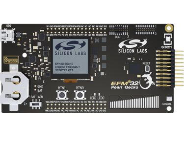

<!-- Copyright 2015-2026 Zephyr Project members and individual contributors. -->
<!-- SPDX-License-Identifier: Apache-2.0 -->
<!-- 中文翻译；编号、导航与译注为本地新增。 -->

<a id="slstk3402a"></a>

# 第66章\_EFM32 Pearl Gecko 12入门套件，SLSTK3402A

原文：[官方页面](https://docs.zephyrproject.org/latest/boards/silabs/starter_kits/slstk3402a/doc/index.html)。读取日期：2026-10-16；来源摘要见[来源记录](../SOURCES.md)。

开发板概览（Board Overview）

<a id="id1"></a>

[](images/slstk3402a.jpg)

EFM32 Pearl Gecko 12入门套件，SLSTK3402A

名称（Name）：

`slstk3402a`

厂商（Vendor）：

[芯科科技（Silicon Laboratories）](https://docs.zephyrproject.org/latest/boards/index.html#vendor=silabs)

状态（Status）：

维护中（Maintained）

架构（Architecture）：

[arm](https://docs.zephyrproject.org/latest/boards/index.html#arch=arm)

片上系统（SoC）：

[efm32pg12b500f1024gl125](https://docs.zephyrproject.org/latest/boards/index.html#soc=efm32pg12b500f1024gl125)、[efm32jg12b500f1024gl125](https://docs.zephyrproject.org/latest/boards/index.html#soc=efm32jg12b500f1024gl125)

<a id="board-github-link"></a>

[浏览开发板源码（Browse Board Sources）](https://github.com/zephyrproject-rtos/zephyr/blob/main//boards/silabs/starter_kits/slstk3402a/doc/index.rst/../..)<a id="overview"></a>

## 概述（Overview）

EFM32 Pearl Gecko 12入门套件SLSTK3402A搭载基于Arm Cortex-M4F的EFM32PG系列MCU，具有优良低功耗能力。

<a id="hardware"></a>

## 硬件（Hardware）


- 高级能耗监视（AEM）提供应用或原型设计的实时能耗信息。
- 超低功耗128×128像素存储型LCD
- 2个用户按键、2个LED及1个触摸滑条
- 湿度、温度及电感电容式金属传感器
- 板载SEGGER J-Link USB调试器

EFM32PG SoC及SLSTK3402A更多信息见：


- [EFM32PG网站](https://www.silabs.com/products/mcu/32-bit/efm32-pearl-gecko)
- [EFM32PG12数据手册](https://www.silabs.com/documents/public/data-sheets/efm32pg12-datasheet.pdf)
- [EFM32PG12参考手册](https://www.silabs.com/documents/public/reference-manuals/efm32pg12-rm.pdf)
- [SLSTK3402A网站](https://www.silabs.com/products/development-tools/mcu/32-bit/efm32-pearl-gecko-pg12-starter-kit)
- [SLSTK3402A用户指南](https://www.silabs.com/documents/public/user-guides/ug257-stk3402-usersguide.pdf)
- [SLSTK3402A原理图](https://www.silabs.com/documents/public/schematic-files/BRD2501A-A01-schematic.pdf)

<a id="supported-features"></a>

### 支持的功能（Supported Features）

`slstk3402a`开发板支持下表所列的硬件功能。

片上／板载（On-Chip / On-Board）

功能集成在片上系统（SoC）内／位于开发板上。

2 / 2

分别表示已启用／已禁用的实例数。点击数量标签，可查看开发板或SoC设备树源码（DTS）中该功能的第一个实例。

`vnd,foo`

与此功能匹配的设备树绑定兼容字符串（Compatible String）；点击链接可查看绑定文档。

<a id="slstk3402a-hw-features"></a>

<a id="slstk3402a-slstk3402a/efm32jg12b500f1024gl125-hw-features-section"></a>

#### `slstk3402a/efm32jg12b500f1024gl125`目标（Target）

<a id="slstk3402a-slstk3402a/efm32jg12b500f1024gl125-hw-features-panel"></a>

<a id="slstk3402a-slstk3402a/efm32jg12b500f1024gl125-hw-features-memory"></a>

此开发板目标可用存储器：256 KiB RAM、1 MiB 闪存。

<a id="slstk3402a-slstk3402a/efm32jg12b500f1024gl125-hw-features-table"></a>

<table>
<tr>
<th>类型（Type）</th>
<th>位置（Location）</th>
<th>说明（Description）</th>
<th>兼容字符串（Compatible）</th>
</tr>
<tr>
<td rowspan="1">中央处理器（CPU）</td>
<td>片上（On-Chip）</td>
<td>ARM Cortex-M3处理器（CPU）（<a href="https://github.com/zephyrproject-rtos/zephyr/blob/main/dts/arm/silabs/xg12/xg12.dtsi?plain=1#L24">已启用：1</a>）</td>
<td><a href="../cpu_arm_riscv_binding_reference/P021_arm_cortex-m3.md#std-dtcompatible-arm-cortex-m3"><code>arm,cortex-m3</code></a></td>
</tr>
<tr>
<td rowspan="1">模数转换器（ADC）</td>
<td>片上（On-Chip）</td>
<td>Silicon Labs Gecko Series 1模数转换器（ADC）（<a href="https://github.com/zephyrproject-rtos/zephyr/blob/main/dts/arm/silabs/xg12/xg12.dtsi?plain=1#L117">已启用：1</a>）</td>
<td><a href="../hardware/P899_SiliconLabsGecko模数转换器绑定.md#dtbinding-silabs-gecko-adc"><code>silabs,gecko-adc</code></a></td>
</tr>
<tr>
<td rowspan="6">时钟控制（Clock Control）</td>
<td>片上（On-Chip）</td>
<td>Silabs Gecko时钟管理单元（Clock Management Unit）（<a href="https://github.com/zephyrproject-rtos/zephyr/blob/main/dts/arm/silabs/xg12/xg12.dtsi?plain=1#L90">已启用：1</a>）</td>
<td><a href="../clock_renesas_rockchip_sifli_silabs_binding_reference/P030_silabs_series0-cmu.md#std-dtcompatible-silabs-series0-cmu"><code>silabs,series0-cmu</code></a></td>
</tr>
<tr>
<td>片上（On-Chip）</td>
<td>Silicon Labs Series 0低频晶体振荡器（LFXO）（<a href="https://github.com/zephyrproject-rtos/zephyr/blob/main/dts/arm/silabs/xg12/xg12.dtsi?plain=1#L35">已启用：1</a>）</td>
<td><a href="../clock_silabs_ti_xilinx_binding_reference/P003_silabs_series0-lfxo.md#std-dtcompatible-silabs-series0-lfxo"><code>silabs,series0-lfxo</code></a></td>
</tr>
<tr>
<td>片上（On-Chip）</td>
<td>Silicon Labs Series 0低频RC振荡器（LFRCO）（<a href="https://github.com/zephyrproject-rtos/zephyr/blob/main/dts/arm/silabs/xg12/xg12.dtsi?plain=1#L42">已禁用：1</a>）</td>
<td><a href="../clock_silabs_ti_xilinx_binding_reference/P002_silabs_series0-lfrco.md#std-dtcompatible-silabs-series0-lfrco"><code>silabs,series0-lfrco</code></a></td>
</tr>
<tr>
<td>片上（On-Chip）</td>
<td>Silicon Labs Series 0高频晶体振荡器（HFXO）（<a href="https://github.com/zephyrproject-rtos/zephyr/blob/main/dts/arm/silabs/xg12/xg12.dtsi?plain=1#L49">已启用：1</a>）</td>
<td><a href="../clock_silabs_ti_xilinx_binding_reference/P001_silabs_series0-hfxo.md#std-dtcompatible-silabs-series0-hfxo"><code>silabs,series0-hfxo</code></a></td>
</tr>
<tr>
<td>片上（On-Chip）</td>
<td>通用固定频率时钟提供者（Fixed-Rate Clock Provider）（<a href="https://github.com/zephyrproject-rtos/zephyr/blob/main/dts/arm/silabs/xg12/xg12.dtsi?plain=1#L55">已禁用：1</a>）</td>
<td><a href="../hardware/P566_固定时钟绑定.md#dtbinding-fixed-clock"><code>fixed-clock</code></a></td>
</tr>
<tr>
<td>片上（On-Chip）</td>
<td>通用固定比例时钟提供器（Fixed Factor Clock Provider）（<a href="https://github.com/zephyrproject-rtos/zephyr/blob/main/dts/arm/silabs/xg12/xg12.dtsi?plain=1#L68">已启用：3</a>；<a href="https://github.com/zephyrproject-rtos/zephyr/blob/main/dts/arm/silabs/xg12/xg12.dtsi?plain=1#L61">已禁用：1</a>）</td>
<td><a href="../timer_reference/P110_固定比例时钟绑定.md#dtbinding-fixed-factor-clock"><code>fixed-factor-clock</code></a></td>
</tr>
<tr>
<td rowspan="1">闪存控制器（Flash Controller）</td>
<td>片上（On-Chip）</td>
<td>Silicon Labs Gecko闪存控制器（Flash Controller）（<a href="https://github.com/zephyrproject-rtos/zephyr/blob/main/dts/arm/silabs/xg12/xg12.dtsi?plain=1#L99">已启用：1</a>）</td>
<td><a href="../flash_renesas_st_ti_binding_reference/P006_silabs_gecko-flash-controller.md#std-dtcompatible-silabs-gecko-flash-controller"><code>silabs,gecko-flash-controller</code></a></td>
</tr>
<tr>
<td rowspan="2">通用输入输出与接插件（GPIO &amp; Headers）</td>
<td>片上（On-Chip）</td>
<td>Silicon Labs Series 0—2 GPIO外设（<a href="https://github.com/zephyrproject-rtos/zephyr/blob/main/dts/arm/silabs/xg12/xg12.dtsi?plain=1#L199">已启用：1</a>）</td>
<td><a href="../gpio_silabs_st_connectors_binding_reference/P013_silabs_gecko-gpio.md#std-dtcompatible-silabs-gecko-gpio"><code>silabs,gecko-gpio</code></a></td>
</tr>
<tr>
<td>片上（On-Chip）</td>
<td>Silicon Labs Series 0—2 GPIO端口（<a href="https://github.com/zephyrproject-rtos/zephyr/blob/main/dts/arm/silabs/xg12/xg12.dtsi?plain=1#L209">已启用：4</a>；<a href="https://github.com/zephyrproject-rtos/zephyr/blob/main/dts/arm/silabs/xg12/xg12.dtsi?plain=1#L227">已禁用：4</a>）</td>
<td><a href="../gpio_silabs_st_connectors_binding_reference/P012_silabs_gecko-gpio-port.md#std-dtcompatible-silabs-gecko-gpio-port"><code>silabs,gecko-gpio-port</code></a></td>
</tr>
<tr>
<td rowspan="1">集成电路间总线（I2C）</td>
<td>片上（On-Chip）</td>
<td>Silicon Labs Series 0—2 I2C（<a href="https://github.com/zephyrproject-rtos/zephyr/blob/main/dts/arm/silabs/xg12/xg12.dtsi?plain=1#L170">已启用：1</a>；<a href="https://github.com/zephyrproject-rtos/zephyr/blob/main/dts/arm/silabs/xg12/xg12.dtsi?plain=1#L180">已禁用：1</a>）</td>
<td><a href="../i2c_stm32_ti_mux_binding_reference/P004_silabs_gecko-i2c.md#std-dtcompatible-silabs-gecko-i2c"><code>silabs,gecko-i2c</code></a></td>
</tr>
<tr>
<td rowspan="1">输入（Input）</td>
<td>板载（On-Board）</td>
<td>一组绑定到 GPIO 的输入按键（GPIO-Bound Input Keys）（<a href="https://github.com/zephyrproject-rtos/zephyr/blob/main/boards/silabs/starter_kits/slstk3402a/slstk3402a_common.dtsi?plain=1#L46">已启用：1</a>）</td>
<td><a href="../hardware/P563_GPIO按键绑定.md#std-dtcompatible-gpio-keys"><code>gpio-keys</code></a></td>
</tr>
<tr>
<td rowspan="1">中断控制器（Interrupt Controller）</td>
<td>片上（On-Chip）</td>
<td>ARMv7-M 嵌套向量中断控制器（Nested Vectored Interrupt Controller，NVIC）（<a href="https://github.com/zephyrproject-rtos/zephyr/blob/main/dts/arm/armv7-m.dtsi?plain=1#L13">已启用：1</a>）</td>
<td><a href="../arm_interrupt_timer_binding_reference/P002_ARMv7_M_NVIC.md#std-dtcompatible-arm-v7m-nvic"><code>arm,v7m-nvic</code></a></td>
</tr>
<tr>
<td rowspan="2">发光二极管（LED）</td>
<td>板载（On-Board）</td>
<td>一组由 GPIO 控制的 LED（GPIO-Controlled LEDs）（<a href="https://github.com/zephyrproject-rtos/zephyr/blob/main/boards/silabs/starter_kits/slstk3402a/slstk3402a_common.dtsi?plain=1#L32">已启用：1</a>）</td>
<td><a href="../hardware/P564_GPIO指示灯绑定.md#dtbinding-gpio-leds"><code>gpio-leds</code></a></td>
</tr>
<tr>
<td>板载（On-Board）</td>
<td>一组由脉宽调制（PWM）控制的LED（<a href="https://github.com/zephyrproject-rtos/zephyr/blob/main/boards/silabs/starter_kits/slstk3402a/slstk3402a_common.dtsi?plain=1#L64">已启用：1</a>）</td>
<td><a href="../hardware/P565_PWM指示灯绑定.md#dtbinding-pwm-leds"><code>pwm-leds</code></a></td>
</tr>
<tr>
<td rowspan="1">存储技术设备（MTD）</td>
<td>片上（On-Chip）</td>
<td>闪存（Flash）节点（<a href="https://github.com/zephyrproject-rtos/zephyr/blob/main/dts/arm/silabs/xg12/xg12.dtsi?plain=1#L108">已启用：1</a>）</td>
<td><a href="../mtd_nxp_st_ti_partition_binding_reference/P013_soc-nv-flash.md#std-dtcompatible-soc-nv-flash"><code>soc-nv-flash</code></a></td>
</tr>
<tr>
<td rowspan="1">引脚控制（Pin Control）</td>
<td>片上（On-Chip）</td>
<td>Silabs Gecko引脚控制器（Pin Controller）（<a href="https://github.com/zephyrproject-rtos/zephyr/blob/main/dts/arm/silabs/xg12/xg12.dtsi?plain=1#L318">已启用：1</a>）</td>
<td><a href="../pinctrl_renesas_silabs_binding_reference/P025_silabs_gecko-pinctrl.md#std-dtcompatible-silabs-gecko-pinctrl"><code>silabs,gecko-pinctrl</code></a></td>
</tr>
<tr>
<td rowspan="1">脉宽调制（PWM）</td>
<td>片上（On-Chip）</td>
<td>Silicon Labs Gecko PWM端口（<a href="https://github.com/zephyrproject-rtos/zephyr/blob/main/dts/arm/silabs/xg12/xg12.dtsi?plain=1#L303">已启用：1</a>）</td>
<td><a href="../pwm_stm32_ti_generic_binding_reference/P007_silabs_gecko-pwm.md#std-dtcompatible-silabs-gecko-pwm"><code>silabs,gecko-pwm</code></a></td>
</tr>
<tr>
<td rowspan="1">随机数生成器（RNG）</td>
<td>片上（On-Chip）</td>
<td>GECKO真随机数发生器（TRNG / True Random Number Generator）（<a href="https://github.com/zephyrproject-rtos/zephyr/blob/main/dts/arm/silabs/xg12/xg12.dtsi?plain=1#L310">已启用：1</a>）</td>
<td><a href="../soc_rng_binding_reference/P013_silabs_gecko-trng.md#std-dtcompatible-silabs-gecko-trng"><code>silabs,gecko-trng</code></a></td>
</tr>
<tr>
<td rowspan="1">实时时钟（RTC）</td>
<td>片上（On-Chip）</td>
<td>Silicon Labs Gecko实时计数器（Real-Time Counter，RTCC）（<a href="https://github.com/zephyrproject-rtos/zephyr/blob/main/dts/arm/silabs/xg12/xg12.dtsi?plain=1#L190">已启用：1</a>）</td>
<td><a href="../soc_rtc_binding_reference/P009_silabs_gecko-rtcc.md#std-dtcompatible-silabs-gecko-rtcc"><code>silabs,gecko-rtcc</code></a></td>
</tr>
<tr>
<td rowspan="2">串行控制器（Serial Controller）</td>
<td>片上（On-Chip）</td>
<td>Gecko通用同步／异步收发器（USART）（<a href="https://github.com/zephyrproject-rtos/zephyr/blob/main/dts/arm/silabs/xg12/xg12.dtsi?plain=1#L126">已启用：1</a>；<a href="https://github.com/zephyrproject-rtos/zephyr/blob/main/dts/arm/silabs/xg12/xg12.dtsi?plain=1#L135">已禁用：3</a>）</td>
<td><a href="../uart_silabs_stm32_ti_binding_reference/P008_silabs_gecko-usart.md#std-dtcompatible-silabs-gecko-usart"><code>silabs,gecko-usart</code></a></td>
</tr>
<tr>
<td>片上（On-Chip）</td>
<td>Gecko低能耗UART（LEUART）（<a href="https://github.com/zephyrproject-rtos/zephyr/blob/main/dts/arm/silabs/xg12/xg12.dtsi?plain=1#L162">已启用：1</a>）</td>
<td><a href="../uart_silabs_stm32_ti_binding_reference/P006_silabs_gecko-leuart.md#std-dtcompatible-silabs-gecko-leuart"><code>silabs,gecko-leuart</code></a></td>
</tr>
<tr>
<td rowspan="1">静态随机存储器（SRAM）</td>
<td>片上（On-Chip）</td>
<td>通用片上静态随机存储器（SRAM）（<a href="https://github.com/zephyrproject-rtos/zephyr/blob/main/dts/arm/silabs/xg12/xg12.dtsi?plain=1#L30">已启用：1</a>）</td>
<td><a href="../hardware/P567_内存映射SRAM绑定.md#dtbinding-mmio-sram"><code>mmio-sram</code></a></td>
</tr>
<tr>
<td rowspan="1">定时器（Timer）</td>
<td>片上（On-Chip）</td>
<td>ARMv7-M 系统节拍（System Tick）（<a href="https://github.com/zephyrproject-rtos/zephyr/blob/main/dts/arm/armv7-m.dtsi?plain=1#L21">已启用：1</a>）</td>
<td><a href="../arm_interrupt_timer_binding_reference/P006_ARMv7_M_SysTick.md#std-dtcompatible-arm-armv7m-systick"><code>arm,armv7m-systick</code></a></td>
</tr>
<tr>
<td rowspan="1">看门狗（Watchdog）</td>
<td>片上（On-Chip）</td>
<td>Silicon Labs Series 0–2看门狗（WDOG）（<a href="https://github.com/zephyrproject-rtos/zephyr/blob/main/dts/arm/silabs/xg12/xg12.dtsi?plain=1#L282">已启用：2</a>）</td>
<td><a href="../realtek_renesas_silabs_watchdog_binding_reference/P011_silabs_gecko-wdog.md#std-dtcompatible-silabs-gecko-wdog"><code>silabs,gecko-wdog</code></a></td>
</tr>
</table>

<a id="slstk3402a-slstk3402a/efm32pg12b500f1024gl125-hw-features-section"></a>

#### `slstk3402a/efm32pg12b500f1024gl125`目标（Target）

<a id="slstk3402a-slstk3402a/efm32pg12b500f1024gl125-hw-features-panel"></a>

<a id="slstk3402a-slstk3402a/efm32pg12b500f1024gl125-hw-features-memory"></a>

此开发板目标可用存储器：256 KiB RAM、1 MiB 闪存。

<a id="slstk3402a-slstk3402a/efm32pg12b500f1024gl125-hw-features-table"></a>

<table>
<tr>
<th>类型（Type）</th>
<th>位置（Location）</th>
<th>说明（Description）</th>
<th>兼容字符串（Compatible）</th>
</tr>
<tr>
<td rowspan="1">中央处理器（CPU）</td>
<td>片上（On-Chip）</td>
<td>ARM Cortex-M4F 处理器（CPU）（<a href="https://github.com/zephyrproject-rtos/zephyr/blob/main/dts/arm/silabs/xg12/xg12.dtsi?plain=1#L24">已启用：1</a>）</td>
<td><a href="../cpu_arm_riscv_binding_reference/P025_arm_cortex-m4f.md#std-dtcompatible-arm-cortex-m4f"><code>arm,cortex-m4f</code></a></td>
</tr>
<tr>
<td rowspan="1">模数转换器（ADC）</td>
<td>片上（On-Chip）</td>
<td>Silicon Labs Gecko Series 1模数转换器（ADC）（<a href="https://github.com/zephyrproject-rtos/zephyr/blob/main/dts/arm/silabs/xg12/xg12.dtsi?plain=1#L117">已启用：1</a>）</td>
<td><a href="../hardware/P899_SiliconLabsGecko模数转换器绑定.md#dtbinding-silabs-gecko-adc"><code>silabs,gecko-adc</code></a></td>
</tr>
<tr>
<td rowspan="6">时钟控制（Clock Control）</td>
<td>片上（On-Chip）</td>
<td>Silabs Gecko时钟管理单元（Clock Management Unit）（<a href="https://github.com/zephyrproject-rtos/zephyr/blob/main/dts/arm/silabs/xg12/xg12.dtsi?plain=1#L90">已启用：1</a>）</td>
<td><a href="../clock_renesas_rockchip_sifli_silabs_binding_reference/P030_silabs_series0-cmu.md#std-dtcompatible-silabs-series0-cmu"><code>silabs,series0-cmu</code></a></td>
</tr>
<tr>
<td>片上（On-Chip）</td>
<td>Silicon Labs Series 0低频晶体振荡器（LFXO）（<a href="https://github.com/zephyrproject-rtos/zephyr/blob/main/dts/arm/silabs/xg12/xg12.dtsi?plain=1#L35">已启用：1</a>）</td>
<td><a href="../clock_silabs_ti_xilinx_binding_reference/P003_silabs_series0-lfxo.md#std-dtcompatible-silabs-series0-lfxo"><code>silabs,series0-lfxo</code></a></td>
</tr>
<tr>
<td>片上（On-Chip）</td>
<td>Silicon Labs Series 0低频RC振荡器（LFRCO）（<a href="https://github.com/zephyrproject-rtos/zephyr/blob/main/dts/arm/silabs/xg12/xg12.dtsi?plain=1#L42">已禁用：1</a>）</td>
<td><a href="../clock_silabs_ti_xilinx_binding_reference/P002_silabs_series0-lfrco.md#std-dtcompatible-silabs-series0-lfrco"><code>silabs,series0-lfrco</code></a></td>
</tr>
<tr>
<td>片上（On-Chip）</td>
<td>Silicon Labs Series 0高频晶体振荡器（HFXO）（<a href="https://github.com/zephyrproject-rtos/zephyr/blob/main/dts/arm/silabs/xg12/xg12.dtsi?plain=1#L49">已启用：1</a>）</td>
<td><a href="../clock_silabs_ti_xilinx_binding_reference/P001_silabs_series0-hfxo.md#std-dtcompatible-silabs-series0-hfxo"><code>silabs,series0-hfxo</code></a></td>
</tr>
<tr>
<td>片上（On-Chip）</td>
<td>通用固定频率时钟提供者（Fixed-Rate Clock Provider）（<a href="https://github.com/zephyrproject-rtos/zephyr/blob/main/dts/arm/silabs/xg12/xg12.dtsi?plain=1#L55">已禁用：1</a>）</td>
<td><a href="../hardware/P566_固定时钟绑定.md#dtbinding-fixed-clock"><code>fixed-clock</code></a></td>
</tr>
<tr>
<td>片上（On-Chip）</td>
<td>通用固定比例时钟提供器（Fixed Factor Clock Provider）（<a href="https://github.com/zephyrproject-rtos/zephyr/blob/main/dts/arm/silabs/xg12/xg12.dtsi?plain=1#L68">已启用：3</a>；<a href="https://github.com/zephyrproject-rtos/zephyr/blob/main/dts/arm/silabs/xg12/xg12.dtsi?plain=1#L61">已禁用：1</a>）</td>
<td><a href="../timer_reference/P110_固定比例时钟绑定.md#dtbinding-fixed-factor-clock"><code>fixed-factor-clock</code></a></td>
</tr>
<tr>
<td rowspan="1">闪存控制器（Flash Controller）</td>
<td>片上（On-Chip）</td>
<td>Silicon Labs Gecko闪存控制器（Flash Controller）（<a href="https://github.com/zephyrproject-rtos/zephyr/blob/main/dts/arm/silabs/xg12/xg12.dtsi?plain=1#L99">已启用：1</a>）</td>
<td><a href="../flash_renesas_st_ti_binding_reference/P006_silabs_gecko-flash-controller.md#std-dtcompatible-silabs-gecko-flash-controller"><code>silabs,gecko-flash-controller</code></a></td>
</tr>
<tr>
<td rowspan="2">通用输入输出与接插件（GPIO &amp; Headers）</td>
<td>片上（On-Chip）</td>
<td>Silicon Labs Series 0—2 GPIO外设（<a href="https://github.com/zephyrproject-rtos/zephyr/blob/main/dts/arm/silabs/xg12/xg12.dtsi?plain=1#L199">已启用：1</a>）</td>
<td><a href="../gpio_silabs_st_connectors_binding_reference/P013_silabs_gecko-gpio.md#std-dtcompatible-silabs-gecko-gpio"><code>silabs,gecko-gpio</code></a></td>
</tr>
<tr>
<td>片上（On-Chip）</td>
<td>Silicon Labs Series 0—2 GPIO端口（<a href="https://github.com/zephyrproject-rtos/zephyr/blob/main/dts/arm/silabs/xg12/xg12.dtsi?plain=1#L209">已启用：4</a>；<a href="https://github.com/zephyrproject-rtos/zephyr/blob/main/dts/arm/silabs/xg12/xg12.dtsi?plain=1#L227">已禁用：4</a>）</td>
<td><a href="../gpio_silabs_st_connectors_binding_reference/P012_silabs_gecko-gpio-port.md#std-dtcompatible-silabs-gecko-gpio-port"><code>silabs,gecko-gpio-port</code></a></td>
</tr>
<tr>
<td rowspan="1">集成电路间总线（I2C）</td>
<td>片上（On-Chip）</td>
<td>Silicon Labs Series 0—2 I2C（<a href="https://github.com/zephyrproject-rtos/zephyr/blob/main/dts/arm/silabs/xg12/xg12.dtsi?plain=1#L170">已启用：1</a>；<a href="https://github.com/zephyrproject-rtos/zephyr/blob/main/dts/arm/silabs/xg12/xg12.dtsi?plain=1#L180">已禁用：1</a>）</td>
<td><a href="../i2c_stm32_ti_mux_binding_reference/P004_silabs_gecko-i2c.md#std-dtcompatible-silabs-gecko-i2c"><code>silabs,gecko-i2c</code></a></td>
</tr>
<tr>
<td rowspan="1">输入（Input）</td>
<td>板载（On-Board）</td>
<td>一组绑定到 GPIO 的输入按键（GPIO-Bound Input Keys）（<a href="https://github.com/zephyrproject-rtos/zephyr/blob/main/boards/silabs/starter_kits/slstk3402a/slstk3402a_common.dtsi?plain=1#L46">已启用：1</a>）</td>
<td><a href="../hardware/P563_GPIO按键绑定.md#std-dtcompatible-gpio-keys"><code>gpio-keys</code></a></td>
</tr>
<tr>
<td rowspan="1">中断控制器（Interrupt Controller）</td>
<td>片上（On-Chip）</td>
<td>ARMv7-M 嵌套向量中断控制器（Nested Vectored Interrupt Controller，NVIC）（<a href="https://github.com/zephyrproject-rtos/zephyr/blob/main/dts/arm/armv7-m.dtsi?plain=1#L13">已启用：1</a>）</td>
<td><a href="../arm_interrupt_timer_binding_reference/P002_ARMv7_M_NVIC.md#std-dtcompatible-arm-v7m-nvic"><code>arm,v7m-nvic</code></a></td>
</tr>
<tr>
<td rowspan="2">发光二极管（LED）</td>
<td>板载（On-Board）</td>
<td>一组由 GPIO 控制的 LED（GPIO-Controlled LEDs）（<a href="https://github.com/zephyrproject-rtos/zephyr/blob/main/boards/silabs/starter_kits/slstk3402a/slstk3402a_common.dtsi?plain=1#L32">已启用：1</a>）</td>
<td><a href="../hardware/P564_GPIO指示灯绑定.md#dtbinding-gpio-leds"><code>gpio-leds</code></a></td>
</tr>
<tr>
<td>板载（On-Board）</td>
<td>一组由脉宽调制（PWM）控制的LED（<a href="https://github.com/zephyrproject-rtos/zephyr/blob/main/boards/silabs/starter_kits/slstk3402a/slstk3402a_common.dtsi?plain=1#L64">已启用：1</a>）</td>
<td><a href="../hardware/P565_PWM指示灯绑定.md#dtbinding-pwm-leds"><code>pwm-leds</code></a></td>
</tr>
<tr>
<td rowspan="1">存储技术设备（MTD）</td>
<td>片上（On-Chip）</td>
<td>闪存（Flash）节点（<a href="https://github.com/zephyrproject-rtos/zephyr/blob/main/dts/arm/silabs/xg12/xg12.dtsi?plain=1#L108">已启用：1</a>）</td>
<td><a href="../mtd_nxp_st_ti_partition_binding_reference/P013_soc-nv-flash.md#std-dtcompatible-soc-nv-flash"><code>soc-nv-flash</code></a></td>
</tr>
<tr>
<td rowspan="1">引脚控制（Pin Control）</td>
<td>片上（On-Chip）</td>
<td>Silabs Gecko引脚控制器（Pin Controller）（<a href="https://github.com/zephyrproject-rtos/zephyr/blob/main/dts/arm/silabs/xg12/xg12.dtsi?plain=1#L318">已启用：1</a>）</td>
<td><a href="../pinctrl_renesas_silabs_binding_reference/P025_silabs_gecko-pinctrl.md#std-dtcompatible-silabs-gecko-pinctrl"><code>silabs,gecko-pinctrl</code></a></td>
</tr>
<tr>
<td rowspan="1">脉宽调制（PWM）</td>
<td>片上（On-Chip）</td>
<td>Silicon Labs Gecko PWM端口（<a href="https://github.com/zephyrproject-rtos/zephyr/blob/main/dts/arm/silabs/xg12/xg12.dtsi?plain=1#L303">已启用：1</a>）</td>
<td><a href="../pwm_stm32_ti_generic_binding_reference/P007_silabs_gecko-pwm.md#std-dtcompatible-silabs-gecko-pwm"><code>silabs,gecko-pwm</code></a></td>
</tr>
<tr>
<td rowspan="1">随机数生成器（RNG）</td>
<td>片上（On-Chip）</td>
<td>GECKO真随机数发生器（TRNG / True Random Number Generator）（<a href="https://github.com/zephyrproject-rtos/zephyr/blob/main/dts/arm/silabs/xg12/xg12.dtsi?plain=1#L310">已启用：1</a>）</td>
<td><a href="../soc_rng_binding_reference/P013_silabs_gecko-trng.md#std-dtcompatible-silabs-gecko-trng"><code>silabs,gecko-trng</code></a></td>
</tr>
<tr>
<td rowspan="1">实时时钟（RTC）</td>
<td>片上（On-Chip）</td>
<td>Silicon Labs Gecko实时计数器（Real-Time Counter，RTCC）（<a href="https://github.com/zephyrproject-rtos/zephyr/blob/main/dts/arm/silabs/xg12/xg12.dtsi?plain=1#L190">已启用：1</a>）</td>
<td><a href="../soc_rtc_binding_reference/P009_silabs_gecko-rtcc.md#std-dtcompatible-silabs-gecko-rtcc"><code>silabs,gecko-rtcc</code></a></td>
</tr>
<tr>
<td rowspan="2">串行控制器（Serial Controller）</td>
<td>片上（On-Chip）</td>
<td>Gecko通用同步／异步收发器（USART）（<a href="https://github.com/zephyrproject-rtos/zephyr/blob/main/dts/arm/silabs/xg12/xg12.dtsi?plain=1#L126">已启用：1</a>；<a href="https://github.com/zephyrproject-rtos/zephyr/blob/main/dts/arm/silabs/xg12/xg12.dtsi?plain=1#L135">已禁用：3</a>）</td>
<td><a href="../uart_silabs_stm32_ti_binding_reference/P008_silabs_gecko-usart.md#std-dtcompatible-silabs-gecko-usart"><code>silabs,gecko-usart</code></a></td>
</tr>
<tr>
<td>片上（On-Chip）</td>
<td>Gecko低能耗UART（LEUART）（<a href="https://github.com/zephyrproject-rtos/zephyr/blob/main/dts/arm/silabs/xg12/xg12.dtsi?plain=1#L162">已启用：1</a>）</td>
<td><a href="../uart_silabs_stm32_ti_binding_reference/P006_silabs_gecko-leuart.md#std-dtcompatible-silabs-gecko-leuart"><code>silabs,gecko-leuart</code></a></td>
</tr>
<tr>
<td rowspan="1">静态随机存储器（SRAM）</td>
<td>片上（On-Chip）</td>
<td>通用片上静态随机存储器（SRAM）（<a href="https://github.com/zephyrproject-rtos/zephyr/blob/main/dts/arm/silabs/xg12/xg12.dtsi?plain=1#L30">已启用：1</a>）</td>
<td><a href="../hardware/P567_内存映射SRAM绑定.md#dtbinding-mmio-sram"><code>mmio-sram</code></a></td>
</tr>
<tr>
<td rowspan="1">定时器（Timer）</td>
<td>片上（On-Chip）</td>
<td>ARMv7-M 系统节拍（System Tick）（<a href="https://github.com/zephyrproject-rtos/zephyr/blob/main/dts/arm/armv7-m.dtsi?plain=1#L21">已启用：1</a>）</td>
<td><a href="../arm_interrupt_timer_binding_reference/P006_ARMv7_M_SysTick.md#std-dtcompatible-arm-armv7m-systick"><code>arm,armv7m-systick</code></a></td>
</tr>
<tr>
<td rowspan="1">看门狗（Watchdog）</td>
<td>片上（On-Chip）</td>
<td>Silicon Labs Series 0–2看门狗（WDOG）（<a href="https://github.com/zephyrproject-rtos/zephyr/blob/main/dts/arm/silabs/xg12/xg12.dtsi?plain=1#L282">已启用：2</a>）</td>
<td><a href="../realtek_renesas_silabs_watchdog_binding_reference/P011_silabs_gecko-wdog.md#std-dtcompatible-silabs-gecko-wdog"><code>silabs,gecko-wdog</code></a></td>
</tr>
</table>

<a id="efm32-jade-gecko-soc"></a>

#### EFM32 Jade Gecko片上系统（SoC）

EFM32 Pearl Gecko入门套件SLSTK3402A也可用于评估EFM32 Jade Gecko SoC，即EFM32JG12。原文指出Pearl Gecko与Jade Gecko仅内核不同：前者为Arm Cortex-M4F，后者为Arm Cortex-M3，存储及外设等其他功能相同。

为Jade Gecko构建的代码也能在对应Pearl Gecko上运行。

若要构建Jade Gecko固件并在EFM32 Pearl Gecko入门套件上运行，请使用slstk3402a/efm32jg12b500f1024gl125板级目标，替代slstk3402a/efm32pg12b500f1024gl125。

<a id="connections-and-ios"></a>

### 连接与输入输出（Connections and IOs）

EFM32PG12 SoC具有PORTA～PORTL十二个GPIO控制器，但SLSTK3402A目前仅启用PORTA、PORTB、PORTD及PORTF四个。

下表Name列为引脚名称，例如PE2表示PORTE第2脚，与板卡数据手册及用户手册一致。

<table>
<tr>
<th>名称（Name）</th>
<th>功能（Function）</th>
<th>用途（Usage）</th>
</tr>
<tr>
<td>PF4</td>
<td>通用输入输出（GPIO）</td>
<td>LED0</td>
</tr>
<tr>
<td>PF5</td>
<td>通用输入输出（GPIO）</td>
<td>LED1</td>
</tr>
<tr>
<td>PF6</td>
<td>通用输入输出（GPIO）</td>
<td>按键PB0</td>
</tr>
<tr>
<td>PF7</td>
<td>通用输入输出（GPIO）</td>
<td>按键PB1</td>
</tr>
<tr>
<td>PA5</td>
<td>通用输入输出（GPIO）</td>
<td>板卡控制器使能：EFM_BC_EN</td>
</tr>
<tr>
<td>PA0</td>
<td>UART_TX</td>
<td>UART发送控制台：VCOM_TX，US0_TX，#0</td>
</tr>
<tr>
<td>PA1</td>
<td>UART_RX</td>
<td>UART接收控制台：VCOM_RX，US0_RX，#0</td>
</tr>
<tr>
<td>PD10</td>
<td>UART_TX</td>
<td>EXP12_UART_TX，LEU0_TX，#18</td>
</tr>
<tr>
<td>PD11</td>
<td>UART_RX</td>
<td>EXP14_UART_RX，LEU0_RX，#18</td>
</tr>
<tr>
<td>PC10</td>
<td>I2C_SDA</td>
<td>ENV_I2C_SDA，I2C0_SDA，#15</td>
</tr>
<tr>
<td>PC11</td>
<td>I2C_SCL</td>
<td>ENV_I2C_SCL，I2C0_SCL，#15</td>
</tr>
</table>

<a id="system-clock"></a>

### 系统时钟（System Clock）

EFM32PG12 SoC配置为使用板载40 MHz外部振荡器。

<a id="serial-port"></a>

### 串口（Serial Port）

EFM32PG12 SoC具有四个USART及一个低能耗UART（LEUART）。

<a id="programming-and-debugging"></a>

## 烧录与调试（Programming and Debugging）

`slstk3402a`开发板支持下表所列的运行工具（Runners）及相关west命令。

<table>
<tr>
<th></th>
<th>烧录（flash）</th>
<th>调试（debug）</th>
<th>连接调试会话（attach）</th>
<th>实时传输（rtt）</th>
<th>复位（reset）</th>
<th>调试服务器（debugserver）</th>
</tr>
<tr>
<td><a href="https://docs.zephyrproject.org/latest/develop/flash_debug/host-tools.html#runner-jlink">jlink</a></td>
<td>✅（默认 / default）</td>
<td>✅（默认 / default）</td>
<td>✅</td>
<td>✅</td>
<td>✅</td>
<td>✅</td>
</tr>
</table>

注意（Note）

原文要求首次使用套件前，在Simplicity Studio更新J-Link固件。

<a id="flashing"></a>

### 烧录（Flashing）

SLSTK3402A内置[J-Link](https://www.segger.com/jlink-debug-probes.html)串口及调试适配器，提供：


- 与主机的USB连接，呈现大容量存储设备及USB串口。
- 串行闪存器件，用于实现USB闪存盘文件存储。
- 通过USB串口接口转发的物理UART连接。

<a id="flashing-an-application-to-slstk3402a"></a>

#### 向SLSTK3402A烧录应用

下面以[Hello World](../getting_started/P005_HelloWorld示例.md#hello_world)为例，构建Zephyr内核及应用：

```text
# From the root of the zephyr repository
west build -b slstk3402a/efm32pg12b500f1024gl125 samples/hello_world
```

通过USB将SLSTK3402A连接主机，应能看到大容量存储设备STK3402A。将生成的zephyr.bin复制到STK3402A驱动器。

使用FT232或CP2102等USB转UART转换器连接扩展排针上的UART。

打开串口终端（如minicom或PuTTY），设置如下：


- 速率（Speed）：115200波特率
- 数据位（Data）：8位
- 奇偶校验（Parity）：无（None）
- 停止位（Stop Bits）：1位

复位开发板后，对应串口终端应显示以下消息：

```text
Hello World! slstk3402a
```

## 译注

Pearl Gecko 12板可使用Pearl Cortex-M4F或Jade Cortex-M3目标，原文分别给出构建目标；原文列12个GPIO端口，但仅启用A、B、D、F。

## 原文外链核对

2026-10-16核对并重试以下原文外链时未能确认可访问性，保留原始目标，不将访问失败解释为原文内容有误。

- [efm32pg12-datasheet.pdf](https://www.silabs.com/documents/public/data-sheets/efm32pg12-datasheet.pdf)：HTTP Error 403: Forbidden。
- [efm32pg12-rm.pdf](https://www.silabs.com/documents/public/reference-manuals/efm32pg12-rm.pdf)：HTTP Error 403: Forbidden。
- [BRD2501A-A01-schematic.pdf](https://www.silabs.com/documents/public/schematic-files/BRD2501A-A01-schematic.pdf)：HTTP Error 403: Forbidden。
- [ug257-stk3402-usersguide.pdf](https://www.silabs.com/documents/public/user-guides/ug257-stk3402-usersguide.pdf)：HTTP Error 403: Forbidden。
- [efm32-pearl-gecko-pg12-starter-kit](https://www.silabs.com/products/development-tools/mcu/32-bit/efm32-pearl-gecko-pg12-starter-kit)：HTTP Error 403: Forbidden。
- [efm32-pearl-gecko](https://www.silabs.com/products/mcu/32-bit/efm32-pearl-gecko)：HTTP Error 403: Forbidden。

---

[上一章](P065_EFM32_Pearl_Gecko_SLSTK3401A.md) · [返回大纲](大纲.md) · [全站翻译进度](../PROGRESS.md) · [下一章](P067_EFM32_Giant_Gecko_11_SLSTK3701A.md)
