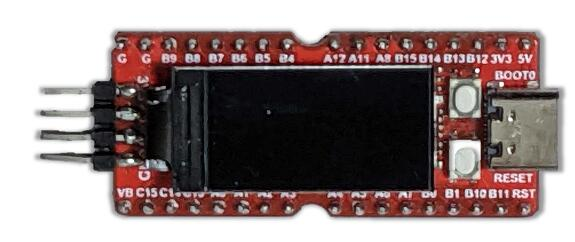

<!-- Copyright 2015-2026 Zephyr Project members and individual contributors. -->
<!-- SPDX-License-Identifier: Apache-2.0 -->
<!-- 中文翻译；编号、导航与译注为本地新增。 -->

<a id="longan_nano"></a>

# 第2章\_Longan Nano

原文：[官方页面](https://docs.zephyrproject.org/latest/boards/sipeed/longan_nano/doc/index.html)。读取日期：2026-10-16；来源摘要见[来源记录](../SOURCES.md)。

开发板概览（Board Overview）

<a id="id1"></a>

[](images/longan_nano.jpg)

Longan Nano

名称（Name）：

`longan_nano`

厂商（Vendor）：

[Shenzhen Sipeed Technology Co., Ltd.](https://docs.zephyrproject.org/latest/boards/index.html#vendor=sipeed)

状态（Status）：

当前未积极维护（Not Actively Maintained）

架构（Architecture）：

[riscv](https://docs.zephyrproject.org/latest/boards/index.html#arch=riscv)

片上系统（SoC）：

[gd32vf103](https://docs.zephyrproject.org/latest/boards/index.html#soc=gd32vf103)

<a id="board-github-link"></a>

[浏览开发板源码（Browse Board Sources）](https://github.com/zephyrproject-rtos/zephyr/blob/main//boards/sipeed/longan_nano/doc/index.rst/../..)<a id="overview"></a>

## 概述（Overview）

Sipeed Longan Nano及Longan Nano Lite是小型开发板，采用GigaDevice GD32VF103 SoC，处理器基于芯来科技（Nuclei）的N200 RISC-V IP核。更多信息见：


- [Sipeed Longan网站](https://longan.sipeed.com/en/)
- [GD32VF103数据手册](https://www.gigadevice.com/datasheet/gd32vf103xxxx-datasheet/)
- [GD32VF103用户手册](https://www.gd32mcu.com/data/documents/userManual/GD32VF103_User_Manual_Rev1.4.pdf)
- [Nuclei网站](https://www.nucleisys.com/download.php)
- [Nuclei Bumblebee处理器核文档](https://github.com/nucleisys/Bumblebee_Core_Doc)
- [Nuclei指令集架构规范（ISA Specification）](https://doc.nucleisys.com/nuclei_spec/)

<a id="hardware"></a>

## 硬件（Hardware）


- 四个16位通用定时器
- 两个16位基本定时器
- 一个16位高级定时器
- 看门狗定时器（Watchdog Timer）
- 实时时钟（RTC）
- 系统节拍定时器（SysTick）
- 三路USART
- 两路I2C
- 三路SPI
- 两路I2S
- 两路CAN
- 一路全速USB OTG（USBFS）
- 两个模数转换器（ADC），10通道
- 两个数模转换器（DAC）

<a id="supported-features"></a>

### 支持的功能（Supported Features）

`longan_nano`开发板支持下表所列的硬件功能。

片上／板载（On-Chip / On-Board）

功能集成在片上系统（SoC）内／位于开发板上。

2 / 2

分别表示已启用／已禁用的实例数。点击数量标签，可查看开发板或SoC设备树源码（DTS）中该功能的第一个实例。

`vnd,foo`

与此功能匹配的设备树绑定兼容字符串（Compatible String）；点击链接可查看绑定文档。

<a id="longan_nano-hw-features"></a>

<a id="longan_nano-longan_nano/gd32vf103-hw-features-section"></a>

#### `longan_nano/gd32vf103`目标（Target）

<a id="longan_nano-longan_nano/gd32vf103-hw-features-panel"></a>

<a id="longan_nano-longan_nano/gd32vf103-hw-features-memory"></a>

该开发板目标的片上存储容量：32 KiB RAM、128 KiB Flash。

<a id="longan_nano-longan_nano/gd32vf103-hw-features-table"></a>

<table>
<tr>
<th>类型（Type）</th>
<th>位置（Location）</th>
<th>说明（Description）</th>
<th>兼容字符串（Compatible）</th>
</tr>
<tr>
<td rowspan="1">中央处理器（CPU）</td>
<td>片上（On-Chip）</td>
<td>芯来（Nuclei）Bumblebee RISC-V内核（<a href="https://github.com/zephyrproject-rtos/zephyr/blob/main/dts/riscv/gd/gd32vf103.dtsi?plain=1#L26">已启用：1</a>）</td>
<td><a href="../cpu_vendor_multiarc_binding_reference/P023_nuclei_bumblebee.md#std-dtcompatible-nuclei-bumblebee"><code>nuclei,bumblebee</code></a></td>
</tr>
<tr>
<td rowspan="1">模数转换器（ADC）</td>
<td>片上（On-Chip）</td>
<td>兆易创新GD32模数转换器（ADC）（<a href="https://github.com/zephyrproject-rtos/zephyr/blob/main/dts/riscv/gd/gd32vf103.dtsi?plain=1#L142">已启用：1</a>；<a href="https://github.com/zephyrproject-rtos/zephyr/blob/main/dts/riscv/gd/gd32vf103.dtsi?plain=1#L153">已禁用：1</a>）</td>
<td><a href="../hardware/P844_GD32模数转换器绑定.md#dtbinding-gd-gd32-adc"><code>gd,gd32-adc</code></a></td>
</tr>
<tr>
<td rowspan="1">时钟控制（Clock Control）</td>
<td>片上（On-Chip）</td>
<td>兆易创新复位与时钟单元（RCU）时钟控制器（<a href="https://github.com/zephyrproject-rtos/zephyr/blob/main/dts/riscv/gd/gd32vf103.dtsi?plain=1#L67">已启用：1</a>）</td>
<td><a href="../timer_reference/P184_GD32时钟控制绑定.md#dtbinding-gd-gd32-cctl"><code>gd,gd32-cctl</code></a></td>
</tr>
<tr>
<td rowspan="1">计数器（Counter）</td>
<td>片上（On-Chip）</td>
<td>兆易创新GD32定时器（Timer）（<a href="https://github.com/zephyrproject-rtos/zephyr/blob/main/dts/riscv/gd/gd32vf103.dtsi?plain=1#L321">已启用：1</a>；<a href="https://github.com/zephyrproject-rtos/zephyr/blob/main/dts/riscv/gd/gd32vf103.dtsi?plain=1#L303">已禁用：6</a>）</td>
<td><a href="../counter_binding_reference/P018_gd_gd32-timer.md#std-dtcompatible-gd-gd32-timer"><code>gd,gd32-timer</code></a></td>
</tr>
<tr>
<td rowspan="1">数模转换器（DAC）</td>
<td>片上（On-Chip）</td>
<td>兆易创新GD32系列数模转换器（DAC）模块（<a href="https://github.com/zephyrproject-rtos/zephyr/blob/main/dts/riscv/gd/gd32vf103.dtsi?plain=1#L164">已启用：1</a>）</td>
<td><a href="../hardware/P761_GD32数模转换器绑定.md#dtbinding-gd-gd32-dac"><code>gd,gd32-dac</code></a></td>
</tr>
<tr>
<td rowspan="1">显示（Display）</td>
<td>板载（On-Board）</td>
<td>Sitronix ST7735X显示控制器（Display Controller）（<a href="https://github.com/zephyrproject-rtos/zephyr/blob/main/boards/sipeed/longan_nano/longan_nano-common.dtsi?plain=1#L87">已启用：1</a>）</td>
<td><a href="../display_sinowealth_sitronix_solomon_binding_reference/P010_sitronix_st7735r.md#std-dtcompatible-sitronix-st7735r"><code>sitronix,st7735r</code></a></td>
</tr>
<tr>
<td rowspan="1">直接存储器访问（DMA）</td>
<td>片上（On-Chip）</td>
<td>GD32直接存储器访问（DMA）控制器（<a href="https://github.com/zephyrproject-rtos/zephyr/blob/main/dts/riscv/gd/gd32vf103.dtsi?plain=1#L411">已禁用：2</a>）</td>
<td><a href="../dma_binding_reference/P017_gd_gd32-dma.md#std-dtcompatible-gd-gd32-dma"><code>gd,gd32-dma</code></a></td>
</tr>
<tr>
<td rowspan="1">闪存控制器（Flash Controller）</td>
<td>片上（On-Chip）</td>
<td>GD32闪存控制器（FMC）有三种类型（<a href="https://github.com/zephyrproject-rtos/zephyr/blob/main/dts/riscv/gd/gd32vf103.dtsi?plain=1#L80">已启用：1</a>）</td>
<td><a href="../flash_adi_microchip_nordic_binding_reference/P013_gd_gd32-flash-controller.md#std-dtcompatible-gd-gd32-flash-controller"><code>gd,gd32-flash-controller</code></a></td>
</tr>
<tr>
<td rowspan="1">通用输入输出与接插件（GPIO &amp; Headers）</td>
<td>片上（On-Chip）</td>
<td>GD32通用输入输出（GPIO）（<a href="https://github.com/zephyrproject-rtos/zephyr/blob/main/dts/riscv/gd/gd32vf103.dtsi?plain=1#L252">已启用：3</a>；<a href="https://github.com/zephyrproject-rtos/zephyr/blob/main/dts/riscv/gd/gd32vf103.dtsi?plain=1#L282">已禁用：2</a>）</td>
<td><a href="../gpio_connectors_bflb_esp_binding_reference/P027_gd_gd32-gpio.md#std-dtcompatible-gd-gd32-gpio"><code>gd,gd32-gpio</code></a></td>
</tr>
<tr>
<td rowspan="1">集成电路间总线（I2C）</td>
<td>片上（On-Chip）</td>
<td>兆易创新GD32 I2C（<a href="https://github.com/zephyrproject-rtos/zephyr/blob/main/dts/riscv/gd/gd32vf103.dtsi?plain=1#L174">已禁用：1</a>）</td>
<td><a href="../i2c_adi_atmel_esp_binding_reference/P020_gd_gd32-i2c.md#std-dtcompatible-gd-gd32-i2c"><code>gd,gd32-i2c</code></a></td>
</tr>
<tr>
<td rowspan="1">输入（Input）</td>
<td>板载（On-Board）</td>
<td>一组绑定到 GPIO 的输入按键（GPIO-Bound Input Keys）（<a href="https://github.com/zephyrproject-rtos/zephyr/blob/main/boards/sipeed/longan_nano/longan_nano-common.dtsi?plain=1#L39">已启用：1</a>）</td>
<td><a href="../hardware/P563_GPIO按键绑定.md#std-dtcompatible-gpio-keys"><code>gpio-keys</code></a></td>
</tr>
<tr>
<td rowspan="2">中断控制器（Interrupt Controller）</td>
<td>片上（On-Chip）</td>
<td>芯来增强型内核本地中断控制器（Nuclei ECLIC）（<a href="https://github.com/zephyrproject-rtos/zephyr/blob/main/dts/riscv/gd/gd32vf103.dtsi?plain=1#L54">已启用：1</a>）</td>
<td><a href="../riscv_interrupt_binding_reference/P005_nuclei_eclic.md#std-dtcompatible-nuclei-eclic"><code>nuclei,eclic</code></a></td>
</tr>
<tr>
<td>片上（On-Chip）</td>
<td>兆易创新外部中断控制器（External Interrupt Controller）（<a href="https://github.com/zephyrproject-rtos/zephyr/blob/main/dts/riscv/gd/gd32vf103.dtsi?plain=1#L216">已启用：1</a>）</td>
<td><a href="../mcu_external_interrupt_binding_reference/P007_gd_gd32-exti.md#std-dtcompatible-gd-gd32-exti"><code>gd,gd32-exti</code></a></td>
</tr>
<tr>
<td rowspan="2">发光二极管（LED）</td>
<td>板载（On-Board）</td>
<td>一组由 GPIO 控制的 LED（GPIO-Controlled LEDs）（<a href="https://github.com/zephyrproject-rtos/zephyr/blob/main/boards/sipeed/longan_nano/longan_nano-common.dtsi?plain=1#L20">已启用：1</a>）</td>
<td><a href="../hardware/P564_GPIO指示灯绑定.md#dtbinding-gpio-leds"><code>gpio-leds</code></a></td>
</tr>
<tr>
<td>板载（On-Board）</td>
<td>一组由脉宽调制（PWM）控制的LED（<a href="https://github.com/zephyrproject-rtos/zephyr/blob/main/boards/sipeed/longan_nano/longan_nano-common.dtsi?plain=1#L49">已启用：1</a>）</td>
<td><a href="../hardware/P565_PWM指示灯绑定.md#dtbinding-pwm-leds"><code>pwm-leds</code></a></td>
</tr>
<tr>
<td rowspan="1">多功能设备（Multi-Function Device）</td>
<td>片上（On-Chip）</td>
<td>兆易创新复位与时钟单元（RCU）（<a href="https://github.com/zephyrproject-rtos/zephyr/blob/main/dts/riscv/gd/gd32vf103.dtsi?plain=1#L62">已启用：1</a>）</td>
<td><a href="../hardware/P705_GD32复位与时钟单元绑定.md#dtbinding-gd-gd32-rcu"><code>gd,gd32-rcu</code></a></td>
</tr>
<tr>
<td rowspan="1">存储技术设备（MTD）</td>
<td>片上（On-Chip）</td>
<td>GD32 FMC v1的闪存绑定（<a href="https://github.com/zephyrproject-rtos/zephyr/blob/main/dts/riscv/gd/gd32vf103.dtsi?plain=1#L87">已启用：1</a>）</td>
<td><a href="../mtd_atmel_bouffalo_binding_reference/P016_gd_gd32-nv-flash-v1.md#std-dtcompatible-gd-gd32-nv-flash-v1"><code>gd,gd32-nv-flash-v1</code></a></td>
</tr>
<tr>
<td rowspan="2">引脚控制（Pin Control）</td>
<td>片上（On-Chip）</td>
<td>GD32复用功能输入输出（AFIO）（<a href="https://github.com/zephyrproject-rtos/zephyr/blob/main/dts/riscv/gd/gd32vf103.dtsi?plain=1#L209">已启用：1</a>）</td>
<td><a href="../pinctrl_adi_ambiq_arm_binding_reference/P023_gd_gd32-afio.md#std-dtcompatible-gd-gd32-afio"><code>gd,gd32-afio</code></a></td>
</tr>
<tr>
<td>片上（On-Chip）</td>
<td>GD32引脚控制器，AFIO模型（<a href="https://github.com/zephyrproject-rtos/zephyr/blob/main/dts/riscv/gd/gd32vf103.dtsi?plain=1#L245">已启用：1</a>）</td>
<td><a href="../pinctrl_adi_ambiq_arm_binding_reference/P025_gd_gd32-pinctrl-afio.md#std-dtcompatible-gd-gd32-pinctrl-afio"><code>gd,gd32-pinctrl-afio</code></a></td>
</tr>
<tr>
<td rowspan="1">脉宽调制（PWM）</td>
<td>片上（On-Chip）</td>
<td>兆易创新GD32脉宽调制（PWM）（<a href="https://github.com/zephyrproject-rtos/zephyr/blob/main/dts/riscv/gd/gd32vf103.dtsi?plain=1#L331">已启用：1</a>；<a href="https://github.com/zephyrproject-rtos/zephyr/blob/main/dts/riscv/gd/gd32vf103.dtsi?plain=1#L314">已禁用：4</a>）</td>
<td><a href="../pwm_adi_esp_infineon_binding_reference/P018_gd_gd32-pwm.md#std-dtcompatible-gd-gd32-pwm"><code>gd,gd32-pwm</code></a></td>
</tr>
<tr>
<td rowspan="1">复位控制器（Reset Controller）</td>
<td>片上（On-Chip）</td>
<td>兆易创新RCU复位控制器（<a href="https://github.com/zephyrproject-rtos/zephyr/blob/main/dts/riscv/gd/gd32vf103.dtsi?plain=1#L73">已启用：1</a>）</td>
<td><a href="../reset_controller_binding_reference/P003_gd_gd32-rctl.md#std-dtcompatible-gd-gd32-rctl"><code>gd,gd32-rctl</code></a></td>
</tr>
<tr>
<td rowspan="1">串行控制器（Serial Controller）</td>
<td>片上（On-Chip）</td>
<td>兆易创新通用同步异步收发器（USART）（<a href="https://github.com/zephyrproject-rtos/zephyr/blob/main/dts/riscv/gd/gd32vf103.dtsi?plain=1#L97">已启用：1</a>；<a href="https://github.com/zephyrproject-rtos/zephyr/blob/main/dts/riscv/gd/gd32vf103.dtsi?plain=1#L106">已禁用：4</a>）</td>
<td><a href="../uart_espressif_infineon_microchip_binding_reference/P006_gd_gd32-usart.md#std-dtcompatible-gd-gd32-usart"><code>gd,gd32-usart</code></a></td>
</tr>
<tr>
<td rowspan="1">串行外设接口（SPI）</td>
<td>片上（On-Chip）</td>
<td>兆易创新GD32 SPI（<a href="https://github.com/zephyrproject-rtos/zephyr/blob/main/dts/riscv/gd/gd32vf103.dtsi?plain=1#L187">已启用：2</a>）</td>
<td><a href="../spi_adi_atmel_esp_binding_reference/P016_gd_gd32-spi.md#std-dtcompatible-gd-gd32-spi"><code>gd,gd32-spi</code></a></td>
</tr>
<tr>
<td rowspan="1">静态随机存储器（SRAM）</td>
<td>片上（On-Chip）</td>
<td>通用片上静态随机存储器（SRAM）（<a href="https://github.com/zephyrproject-rtos/zephyr/blob/main/dts/riscv/gd/gd32vf103.dtsi?plain=1#L35">已启用：1</a>）</td>
<td><a href="../hardware/P567_内存映射SRAM绑定.md#dtbinding-mmio-sram"><code>mmio-sram</code></a></td>
</tr>
<tr>
<td rowspan="1">定时器（Timer）</td>
<td>片上（On-Chip）</td>
<td>芯来系统定时器（Nuclei System Timer）（<a href="https://github.com/zephyrproject-rtos/zephyr/blob/main/dts/riscv/gd/gd32vf103.dtsi?plain=1#L46">已启用：1</a>）</td>
<td><a href="../system_timer_binding_reference/P012_nuclei_systimer.md#std-dtcompatible-nuclei-systimer"><code>nuclei,systimer</code></a></td>
</tr>
<tr>
<td rowspan="2">看门狗（Watchdog）</td>
<td>片上（On-Chip）</td>
<td>GD32独立看门狗定时器（Free Watchdog Timer）（<a href="https://github.com/zephyrproject-rtos/zephyr/blob/main/dts/riscv/gd/gd32vf103.dtsi?plain=1#L230">已启用：1</a>）</td>
<td><a href="../watchdog_binding_reference/P015_gd_gd32-fwdgt.md#std-dtcompatible-gd-gd32-fwdgt"><code>gd,gd32-fwdgt</code></a></td>
</tr>
<tr>
<td>片上（On-Chip）</td>
<td>GD32窗口看门狗定时器（Window Watchdog Timer）（<a href="https://github.com/zephyrproject-rtos/zephyr/blob/main/dts/riscv/gd/gd32vf103.dtsi?plain=1#L236">已禁用：1</a>）</td>
<td><a href="../watchdog_binding_reference/P016_gd_gd32-wwdgt.md#std-dtcompatible-gd-gd32-wwdgt"><code>gd,gd32-wwdgt</code></a></td>
</tr>
</table>

<a id="longan_nano-longan_nano/gd32vf103/lite-hw-features-section"></a>

#### `longan_nano/gd32vf103/lite`目标（Target）

<a id="longan_nano-longan_nano/gd32vf103/lite-hw-features-panel"></a>

<a id="longan_nano-longan_nano/gd32vf103/lite-hw-features-memory"></a>

该开发板目标的片上存储容量：20 KiB RAM、64 KiB Flash。

<a id="longan_nano-longan_nano/gd32vf103/lite-hw-features-table"></a>

<table>
<tr>
<th>类型（Type）</th>
<th>位置（Location）</th>
<th>说明（Description）</th>
<th>兼容字符串（Compatible）</th>
</tr>
<tr>
<td rowspan="1">中央处理器（CPU）</td>
<td>片上（On-Chip）</td>
<td>芯来（Nuclei）Bumblebee RISC-V内核（<a href="https://github.com/zephyrproject-rtos/zephyr/blob/main/dts/riscv/gd/gd32vf103.dtsi?plain=1#L26">已启用：1</a>）</td>
<td><a href="../cpu_vendor_multiarc_binding_reference/P023_nuclei_bumblebee.md#std-dtcompatible-nuclei-bumblebee"><code>nuclei,bumblebee</code></a></td>
</tr>
<tr>
<td rowspan="1">模数转换器（ADC）</td>
<td>片上（On-Chip）</td>
<td>兆易创新GD32模数转换器（ADC）（<a href="https://github.com/zephyrproject-rtos/zephyr/blob/main/dts/riscv/gd/gd32vf103.dtsi?plain=1#L142">已启用：1</a>；<a href="https://github.com/zephyrproject-rtos/zephyr/blob/main/dts/riscv/gd/gd32vf103.dtsi?plain=1#L153">已禁用：1</a>）</td>
<td><a href="../hardware/P844_GD32模数转换器绑定.md#dtbinding-gd-gd32-adc"><code>gd,gd32-adc</code></a></td>
</tr>
<tr>
<td rowspan="1">时钟控制（Clock Control）</td>
<td>片上（On-Chip）</td>
<td>兆易创新复位与时钟单元（RCU）时钟控制器（<a href="https://github.com/zephyrproject-rtos/zephyr/blob/main/dts/riscv/gd/gd32vf103.dtsi?plain=1#L67">已启用：1</a>）</td>
<td><a href="../timer_reference/P184_GD32时钟控制绑定.md#dtbinding-gd-gd32-cctl"><code>gd,gd32-cctl</code></a></td>
</tr>
<tr>
<td rowspan="1">计数器（Counter）</td>
<td>片上（On-Chip）</td>
<td>兆易创新GD32定时器（Timer）（<a href="https://github.com/zephyrproject-rtos/zephyr/blob/main/dts/riscv/gd/gd32vf103.dtsi?plain=1#L321">已启用：1</a>；<a href="https://github.com/zephyrproject-rtos/zephyr/blob/main/dts/riscv/gd/gd32vf103.dtsi?plain=1#L303">已禁用：6</a>）</td>
<td><a href="../counter_binding_reference/P018_gd_gd32-timer.md#std-dtcompatible-gd-gd32-timer"><code>gd,gd32-timer</code></a></td>
</tr>
<tr>
<td rowspan="1">数模转换器（DAC）</td>
<td>片上（On-Chip）</td>
<td>兆易创新GD32系列数模转换器（DAC）模块（<a href="https://github.com/zephyrproject-rtos/zephyr/blob/main/dts/riscv/gd/gd32vf103.dtsi?plain=1#L164">已启用：1</a>）</td>
<td><a href="../hardware/P761_GD32数模转换器绑定.md#dtbinding-gd-gd32-dac"><code>gd,gd32-dac</code></a></td>
</tr>
<tr>
<td rowspan="1">显示（Display）</td>
<td>板载（On-Board）</td>
<td>Sitronix ST7735X显示控制器（Display Controller）（<a href="https://github.com/zephyrproject-rtos/zephyr/blob/main/boards/sipeed/longan_nano/longan_nano-common.dtsi?plain=1#L87">已启用：1</a>）</td>
<td><a href="../display_sinowealth_sitronix_solomon_binding_reference/P010_sitronix_st7735r.md#std-dtcompatible-sitronix-st7735r"><code>sitronix,st7735r</code></a></td>
</tr>
<tr>
<td rowspan="1">直接存储器访问（DMA）</td>
<td>片上（On-Chip）</td>
<td>GD32直接存储器访问（DMA）控制器（<a href="https://github.com/zephyrproject-rtos/zephyr/blob/main/dts/riscv/gd/gd32vf103.dtsi?plain=1#L411">已禁用：2</a>）</td>
<td><a href="../dma_binding_reference/P017_gd_gd32-dma.md#std-dtcompatible-gd-gd32-dma"><code>gd,gd32-dma</code></a></td>
</tr>
<tr>
<td rowspan="1">闪存控制器（Flash Controller）</td>
<td>片上（On-Chip）</td>
<td>GD32闪存控制器（FMC）有三种类型（<a href="https://github.com/zephyrproject-rtos/zephyr/blob/main/dts/riscv/gd/gd32vf103.dtsi?plain=1#L80">已启用：1</a>）</td>
<td><a href="../flash_adi_microchip_nordic_binding_reference/P013_gd_gd32-flash-controller.md#std-dtcompatible-gd-gd32-flash-controller"><code>gd,gd32-flash-controller</code></a></td>
</tr>
<tr>
<td rowspan="1">通用输入输出与接插件（GPIO &amp; Headers）</td>
<td>片上（On-Chip）</td>
<td>GD32通用输入输出（GPIO）（<a href="https://github.com/zephyrproject-rtos/zephyr/blob/main/dts/riscv/gd/gd32vf103.dtsi?plain=1#L252">已启用：3</a>；<a href="https://github.com/zephyrproject-rtos/zephyr/blob/main/dts/riscv/gd/gd32vf103.dtsi?plain=1#L282">已禁用：2</a>）</td>
<td><a href="../gpio_connectors_bflb_esp_binding_reference/P027_gd_gd32-gpio.md#std-dtcompatible-gd-gd32-gpio"><code>gd,gd32-gpio</code></a></td>
</tr>
<tr>
<td rowspan="1">集成电路间总线（I2C）</td>
<td>片上（On-Chip）</td>
<td>兆易创新GD32 I2C（<a href="https://github.com/zephyrproject-rtos/zephyr/blob/main/dts/riscv/gd/gd32vf103.dtsi?plain=1#L174">已禁用：1</a>）</td>
<td><a href="../i2c_adi_atmel_esp_binding_reference/P020_gd_gd32-i2c.md#std-dtcompatible-gd-gd32-i2c"><code>gd,gd32-i2c</code></a></td>
</tr>
<tr>
<td rowspan="1">输入（Input）</td>
<td>板载（On-Board）</td>
<td>一组绑定到 GPIO 的输入按键（GPIO-Bound Input Keys）（<a href="https://github.com/zephyrproject-rtos/zephyr/blob/main/boards/sipeed/longan_nano/longan_nano-common.dtsi?plain=1#L39">已启用：1</a>）</td>
<td><a href="../hardware/P563_GPIO按键绑定.md#std-dtcompatible-gpio-keys"><code>gpio-keys</code></a></td>
</tr>
<tr>
<td rowspan="2">中断控制器（Interrupt Controller）</td>
<td>片上（On-Chip）</td>
<td>芯来增强型内核本地中断控制器（Nuclei ECLIC）（<a href="https://github.com/zephyrproject-rtos/zephyr/blob/main/dts/riscv/gd/gd32vf103.dtsi?plain=1#L54">已启用：1</a>）</td>
<td><a href="../riscv_interrupt_binding_reference/P005_nuclei_eclic.md#std-dtcompatible-nuclei-eclic"><code>nuclei,eclic</code></a></td>
</tr>
<tr>
<td>片上（On-Chip）</td>
<td>兆易创新外部中断控制器（External Interrupt Controller）（<a href="https://github.com/zephyrproject-rtos/zephyr/blob/main/dts/riscv/gd/gd32vf103.dtsi?plain=1#L216">已启用：1</a>）</td>
<td><a href="../mcu_external_interrupt_binding_reference/P007_gd_gd32-exti.md#std-dtcompatible-gd-gd32-exti"><code>gd,gd32-exti</code></a></td>
</tr>
<tr>
<td rowspan="2">发光二极管（LED）</td>
<td>板载（On-Board）</td>
<td>一组由 GPIO 控制的 LED（GPIO-Controlled LEDs）（<a href="https://github.com/zephyrproject-rtos/zephyr/blob/main/boards/sipeed/longan_nano/longan_nano-common.dtsi?plain=1#L20">已启用：1</a>）</td>
<td><a href="../hardware/P564_GPIO指示灯绑定.md#dtbinding-gpio-leds"><code>gpio-leds</code></a></td>
</tr>
<tr>
<td>板载（On-Board）</td>
<td>一组由脉宽调制（PWM）控制的LED（<a href="https://github.com/zephyrproject-rtos/zephyr/blob/main/boards/sipeed/longan_nano/longan_nano-common.dtsi?plain=1#L49">已启用：1</a>）</td>
<td><a href="../hardware/P565_PWM指示灯绑定.md#dtbinding-pwm-leds"><code>pwm-leds</code></a></td>
</tr>
<tr>
<td rowspan="1">多功能设备（Multi-Function Device）</td>
<td>片上（On-Chip）</td>
<td>兆易创新复位与时钟单元（RCU）（<a href="https://github.com/zephyrproject-rtos/zephyr/blob/main/dts/riscv/gd/gd32vf103.dtsi?plain=1#L62">已启用：1</a>）</td>
<td><a href="../hardware/P705_GD32复位与时钟单元绑定.md#dtbinding-gd-gd32-rcu"><code>gd,gd32-rcu</code></a></td>
</tr>
<tr>
<td rowspan="1">存储技术设备（MTD）</td>
<td>片上（On-Chip）</td>
<td>GD32 FMC v1的闪存绑定（<a href="https://github.com/zephyrproject-rtos/zephyr/blob/main/dts/riscv/gd/gd32vf103.dtsi?plain=1#L87">已启用：1</a>）</td>
<td><a href="../mtd_atmel_bouffalo_binding_reference/P016_gd_gd32-nv-flash-v1.md#std-dtcompatible-gd-gd32-nv-flash-v1"><code>gd,gd32-nv-flash-v1</code></a></td>
</tr>
<tr>
<td rowspan="2">引脚控制（Pin Control）</td>
<td>片上（On-Chip）</td>
<td>GD32复用功能输入输出（AFIO）（<a href="https://github.com/zephyrproject-rtos/zephyr/blob/main/dts/riscv/gd/gd32vf103.dtsi?plain=1#L209">已启用：1</a>）</td>
<td><a href="../pinctrl_adi_ambiq_arm_binding_reference/P023_gd_gd32-afio.md#std-dtcompatible-gd-gd32-afio"><code>gd,gd32-afio</code></a></td>
</tr>
<tr>
<td>片上（On-Chip）</td>
<td>GD32引脚控制器，AFIO模型（<a href="https://github.com/zephyrproject-rtos/zephyr/blob/main/dts/riscv/gd/gd32vf103.dtsi?plain=1#L245">已启用：1</a>）</td>
<td><a href="../pinctrl_adi_ambiq_arm_binding_reference/P025_gd_gd32-pinctrl-afio.md#std-dtcompatible-gd-gd32-pinctrl-afio"><code>gd,gd32-pinctrl-afio</code></a></td>
</tr>
<tr>
<td rowspan="1">脉宽调制（PWM）</td>
<td>片上（On-Chip）</td>
<td>兆易创新GD32脉宽调制（PWM）（<a href="https://github.com/zephyrproject-rtos/zephyr/blob/main/dts/riscv/gd/gd32vf103.dtsi?plain=1#L331">已启用：1</a>；<a href="https://github.com/zephyrproject-rtos/zephyr/blob/main/dts/riscv/gd/gd32vf103.dtsi?plain=1#L314">已禁用：4</a>）</td>
<td><a href="../pwm_adi_esp_infineon_binding_reference/P018_gd_gd32-pwm.md#std-dtcompatible-gd-gd32-pwm"><code>gd,gd32-pwm</code></a></td>
</tr>
<tr>
<td rowspan="1">复位控制器（Reset Controller）</td>
<td>片上（On-Chip）</td>
<td>兆易创新RCU复位控制器（<a href="https://github.com/zephyrproject-rtos/zephyr/blob/main/dts/riscv/gd/gd32vf103.dtsi?plain=1#L73">已启用：1</a>）</td>
<td><a href="../reset_controller_binding_reference/P003_gd_gd32-rctl.md#std-dtcompatible-gd-gd32-rctl"><code>gd,gd32-rctl</code></a></td>
</tr>
<tr>
<td rowspan="1">串行控制器（Serial Controller）</td>
<td>片上（On-Chip）</td>
<td>兆易创新通用同步异步收发器（USART）（<a href="https://github.com/zephyrproject-rtos/zephyr/blob/main/dts/riscv/gd/gd32vf103.dtsi?plain=1#L97">已启用：1</a>；<a href="https://github.com/zephyrproject-rtos/zephyr/blob/main/dts/riscv/gd/gd32vf103.dtsi?plain=1#L106">已禁用：4</a>）</td>
<td><a href="../uart_espressif_infineon_microchip_binding_reference/P006_gd_gd32-usart.md#std-dtcompatible-gd-gd32-usart"><code>gd,gd32-usart</code></a></td>
</tr>
<tr>
<td rowspan="1">串行外设接口（SPI）</td>
<td>片上（On-Chip）</td>
<td>兆易创新GD32 SPI（<a href="https://github.com/zephyrproject-rtos/zephyr/blob/main/dts/riscv/gd/gd32vf103.dtsi?plain=1#L187">已启用：2</a>）</td>
<td><a href="../spi_adi_atmel_esp_binding_reference/P016_gd_gd32-spi.md#std-dtcompatible-gd-gd32-spi"><code>gd,gd32-spi</code></a></td>
</tr>
<tr>
<td rowspan="1">静态随机存储器（SRAM）</td>
<td>片上（On-Chip）</td>
<td>通用片上静态随机存储器（SRAM）（<a href="https://github.com/zephyrproject-rtos/zephyr/blob/main/dts/riscv/gd/gd32vf103.dtsi?plain=1#L35">已启用：1</a>）</td>
<td><a href="../hardware/P567_内存映射SRAM绑定.md#dtbinding-mmio-sram"><code>mmio-sram</code></a></td>
</tr>
<tr>
<td rowspan="1">定时器（Timer）</td>
<td>片上（On-Chip）</td>
<td>芯来系统定时器（Nuclei System Timer）（<a href="https://github.com/zephyrproject-rtos/zephyr/blob/main/dts/riscv/gd/gd32vf103.dtsi?plain=1#L46">已启用：1</a>）</td>
<td><a href="../system_timer_binding_reference/P012_nuclei_systimer.md#std-dtcompatible-nuclei-systimer"><code>nuclei,systimer</code></a></td>
</tr>
<tr>
<td rowspan="2">看门狗（Watchdog）</td>
<td>片上（On-Chip）</td>
<td>GD32独立看门狗定时器（Free Watchdog Timer）（<a href="https://github.com/zephyrproject-rtos/zephyr/blob/main/dts/riscv/gd/gd32vf103.dtsi?plain=1#L230">已启用：1</a>）</td>
<td><a href="../watchdog_binding_reference/P015_gd_gd32-fwdgt.md#std-dtcompatible-gd-gd32-fwdgt"><code>gd,gd32-fwdgt</code></a></td>
</tr>
<tr>
<td>片上（On-Chip）</td>
<td>GD32窗口看门狗定时器（Window Watchdog Timer）（<a href="https://github.com/zephyrproject-rtos/zephyr/blob/main/dts/riscv/gd/gd32vf103.dtsi?plain=1#L236">已禁用：1</a>）</td>
<td><a href="../watchdog_binding_reference/P016_gd_gd32-wwdgt.md#std-dtcompatible-gd-gd32-wwdgt"><code>gd,gd32-wwdgt</code></a></td>
</tr>
</table>

Longan Nano板上的MicroSD读卡器连接SPI1。

<a id="serial-port"></a>

### 串口（Serial Port）

USART0位于USB接口相对一端，连接TX0（PA9）及RX0（PA10）。

<a id="programming-and-debugging"></a>

## 编程与调试（Programming and Debugging）

`longan_nano`开发板支持下表所列的运行工具（Runners）及相关west命令。

<table>
<tr>
<th></th>
<th>烧录（flash）</th>
<th>调试（debug）</th>
<th>连接调试会话（attach）</th>
<th>实时传输（rtt）</th>
<th>复位（reset）</th>
<th>调试服务器（debugserver）</th>
</tr>
<tr>
<td>dfu-util</td>
<td>✅</td>
<td></td>
<td></td>
<td></td>
<td></td>
<td></td>
</tr>
<tr>
<td><a href="https://docs.zephyrproject.org/latest/develop/flash_debug/host-tools.html#runner-jlink">jlink</a></td>
<td>✅</td>
<td>✅</td>
<td>✅</td>
<td>✅</td>
<td>✅</td>
<td>✅</td>
</tr>
<tr>
<td><a href="https://docs.zephyrproject.org/latest/develop/flash_debug/host-tools.html#runner-openocd">openocd</a></td>
<td>✅（默认 / default）</td>
<td>✅（默认 / default）</td>
<td>✅</td>
<td>✅</td>
<td></td>
<td>✅</td>
</tr>
</table>

<a id="building-flashing"></a>

### 构建与烧录（Building & Flashing）

下面展示构建[Blinky](../getting_started/P004_LED闪烁示例.md#blinky)应用的示例。

```text
# From the root of the zephyr repository
west build -b longan_nano samples/basic/blinky
west flash
```

使用自定义工具链时，将下载的OpenOCD可执行文件加入PATH通常即可。

默认运行工具通过外部编程器及OpenOCD尝试烧录。若通过USB端口烧录，请选择设备固件升级（DFU）运行工具：

```text
west flash --runner dfu-util
```

<a id="debugging"></a>

### 调试（Debugging）

可以按通常方式调试应用，以下以[Blinky](../getting_started/P004_LED闪烁示例.md#blinky)为例。

```text
# From the root of the zephyr repository
west build -b longan_nano samples/basic/blinky
west debug
```

## 译注

Longan Nano及Lite均采用GD32VF103。默认经外部编程器与OpenOCD烧录，USB烧录需显式选择DFU运行工具。

---

[上一章](P001_Sipeed.md) · [返回大纲](大纲.md) · [全站翻译进度](../PROGRESS.md) · [下一章](P003_Sipeed_M0Sense.md)
