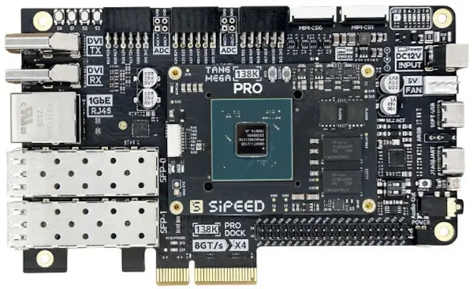

<!-- Copyright 2015-2026 Zephyr Project members and individual contributors. -->
<!-- SPDX-License-Identifier: Apache-2.0 -->
<!-- 中文翻译；编号、导航与译注为本地新增。 -->

<a id="tang_mega_138k_pro_dock"></a>

# 第6章\_Tang Mega 138K Pro Dock

原文：[官方页面](https://docs.zephyrproject.org/latest/boards/sipeed/tang_mega_138k_pro_dock/doc/index.html)。读取日期：2026-10-16；来源摘要见[来源记录](../SOURCES.md)。

开发板概览（Board Overview）

<a id="id1"></a>

[](images/tang_mega_138k_pro_dock.webp)

Tang Mega 138K Pro Dock

名称（Name）：

`tang_mega_138k_pro_dock`

厂商（Vendor）：

[Shenzhen Sipeed Technology Co., Ltd.](https://docs.zephyrproject.org/latest/boards/index.html#vendor=sipeed)

状态（Status）：

当前未积极维护（Not Actively Maintained）

架构（Architecture）：

[riscv](https://docs.zephyrproject.org/latest/boards/index.html#arch=riscv)

片上系统（SoC）：

[ae350](https://docs.zephyrproject.org/latest/boards/index.html#soc=ae350)

<a id="board-github-link"></a>

[浏览开发板源码（Browse Board Sources）](https://github.com/zephyrproject-rtos/zephyr/blob/main//boards/sipeed/tang_mega_138k_pro_dock/doc/index.rst/../..)<a id="overview"></a>

## 概述（Overview）

<a id="id3"></a>

<a id="id5"></a>

[Tang Mega 138K Pro Dock](https://en.wiki.sipeed.com/hardware/en/tang/tang-mega-138k/mega-138k-pro.html) [注1](#id2)是Sipeed基于Gowin GW5AST-LV138器件的FPGA开发板，结合大规模可编程逻辑资源与集成的32位RISC-V [AndesTech AE350](http://www.andestech.com/en/products-solutions/andeshape-platforms/ae350-axi-based-platform-pre-integrated-with-n25f-nx25f-a25-ax25/) SoC [注2](#id4)，提供DDR3、PCIe Gen3 x4、SFP+、千兆以太网、HDMI／DVI、MIPI CSI及M.2等接口。

<a id="hardware"></a>

## 硬件（Hardware）

Tang Mega 138K Pro Dock提供以下硬件：


- Andes AE350 32位RISC-V处理器
- 1 GB DDR3内存
- 两个128 Mbit SPI闪存
- 一个8 Kbit I2C EPROM；名称按原文保留
- PCIe连接器
- 两个SFP+连接器
- 千兆以太网（Gigabit Ethernet）
- 两个DVI发送TX接口
- 两个DVI接收RX接口
- 数字视频端口（DVP）接口
- RGB接口
- 两个MIPI摄像头串行接口（CSI）连接器
- 两个模数转换器（ADC）
- 两个MS5351时钟发生器
- MicroSD卡槽（Card Slot）
- M.2 Key-B插座
- 三个Pmod连接器
- 一个可自定义的USB-C连接器
- 40引脚扩展排针
- 3.5 mm耳机插孔
- 扬声器连接器
- 麦克风阵列接口（Mic Array）
- WS2812 RGB LED及aRGB／WS2812灯带连接器
- PWM风扇连接器
- JTAG及UART调试接口
- 用户LED及按键

<a id="supported-features"></a>

### 支持的功能（Supported Features）

`tang_mega_138k_pro_dock`开发板支持下表所列的硬件功能。

片上／板载（On-Chip / On-Board）

功能集成在片上系统（SoC）内／位于开发板上。

2 / 2

分别表示已启用／已禁用的实例数。点击数量标签，可查看开发板或SoC设备树源码（DTS）中该功能的第一个实例。

`vnd,foo`

与此功能匹配的设备树绑定兼容字符串（Compatible String）；点击链接可查看绑定文档。

<a id="tang_mega_138k_pro_dock-hw-features"></a>

<a id="tang_mega_138k_pro_dock-tang_mega_138k_pro_dock/ae350-hw-features-section"></a>

#### `tang_mega_138k_pro_dock/ae350`目标（Target）

<a id="tang_mega_138k_pro_dock-tang_mega_138k_pro_dock/ae350-hw-features-panel"></a>

<a id="tang_mega_138k_pro_dock-tang_mega_138k_pro_dock/ae350-hw-features-memory"></a>

此板级目标的存储：1 GiB RAM及10 MiB Flash。

<a id="tang_mega_138k_pro_dock-tang_mega_138k_pro_dock/ae350-hw-features-table"></a>

<table>
<tr>
<th>类型（Type）</th>
<th>位置（Location）</th>
<th>说明（Description）</th>
<th>兼容字符串（Compatible）</th>
</tr>
<tr>
<td rowspan="1">中央处理器（CPU）</td>
<td>片上（On-Chip）</td>
<td>晶心科技AndesCore v5系列RISC-V内核（<a href="https://github.com/zephyrproject-rtos/zephyr/blob/main/dts/riscv/andes/andes_v5_ae350.dtsi?plain=1#L19">已启用：1</a>）</td>
<td><a href="../cpu_arm_riscv_binding_reference/P003_andestech_andescore-v5.md#std-dtcompatible-andestech-andescore-v5"><code>andestech,andescore-v5</code></a></td>
</tr>
<tr>
<td rowspan="1">高速缓存（Cache）</td>
<td>片上（On-Chip）</td>
<td>晶心科技二级缓存（AndesTech L2 Cache）（<a href="https://github.com/zephyrproject-rtos/zephyr/blob/main/dts/riscv/andes/andes_v5_ae350.dtsi?plain=1#L266">已禁用：1</a>）</td>
<td><a href="../memory_protection_binding_reference/P001_andestech_l2c.md#std-dtcompatible-andestech-l2c"><code>andestech,l2c</code></a></td>
</tr>
<tr>
<td rowspan="1">时钟控制（Clock Control）</td>
<td>片上（On-Chip）</td>
<td>通用固定频率时钟提供者（Fixed-Rate Clock Provider）（<a href="https://github.com/zephyrproject-rtos/zephyr/blob/main/dts/riscv/andes/andes_v5_ae350.dtsi?plain=1#L428">已禁用：1</a>）</td>
<td><a href="../hardware/P566_固定时钟绑定.md#dtbinding-fixed-clock"><code>fixed-clock</code></a></td>
</tr>
<tr>
<td rowspan="1">计数器（Counter）</td>
<td>片上（On-Chip）</td>
<td>晶心科技atcpit100可编程间隔定时器节点（PIT Node）的描述（<a href="https://github.com/zephyrproject-rtos/zephyr/blob/main/dts/riscv/andes/andes_v5_ae350.dtsi?plain=1#L290">已禁用：1</a>）</td>
<td><a href="../counter_binding_reference/P005_andestech_atcpit100.md#std-dtcompatible-andestech-atcpit100"><code>andestech,atcpit100</code></a></td>
</tr>
<tr>
<td rowspan="1">直接存储器访问（DMA）</td>
<td>片上（On-Chip）</td>
<td>晶心科技DMA控制器通道：指向DMA控制器的节点引用（phandle），以及以下四个整数单元（Cells）：（<a href="https://github.com/zephyrproject-rtos/zephyr/blob/main/dts/riscv/andes/andes_v5_ae350.dtsi?plain=1#L361">已禁用：1</a>）</td>
<td><a href="../dma_binding_reference/P008_andestech_atcdmacx00.md#std-dtcompatible-andestech-atcdmacx00"><code>andestech,atcdmacx00</code></a></td>
</tr>
<tr>
<td rowspan="1">通用输入输出与接插件（GPIO &amp; Headers）</td>
<td>片上（On-Chip）</td>
<td>晶心科技ATCGPIO100通用输入输出控制器（GPIO Controller）（<a href="https://github.com/zephyrproject-rtos/zephyr/blob/main/dts/riscv/andes/andes_v5_ae350.dtsi?plain=1#L309">已禁用：1</a>）</td>
<td><a href="../gpio_adi_headers_ambiq_binding_reference/P020_andestech_atcgpio100.md#std-dtcompatible-andestech-atcgpio100"><code>andestech,atcgpio100</code></a></td>
</tr>
<tr>
<td rowspan="1">集成电路间总线（I2C）</td>
<td>片上（On-Chip）</td>
<td>晶心科技ATCIIC100 I2C（<a href="https://github.com/zephyrproject-rtos/zephyr/blob/main/dts/riscv/andes/andes_v5_ae350.dtsi?plain=1#L320">已禁用：1</a>）</td>
<td><a href="../i2c_adi_atmel_esp_binding_reference/P005_andestech_atciic100.md#std-dtcompatible-andestech-atciic100"><code>andestech,atciic100</code></a></td>
</tr>
<tr>
<td rowspan="2">中断控制器（Interrupt Controller）</td>
<td>片上（On-Chip）</td>
<td>RISC-V CPU中断控制器（Interrupt Controller）（<a href="https://github.com/zephyrproject-rtos/zephyr/blob/main/dts/riscv/andes/andes_v5_ae350.dtsi?plain=1#L32">已启用：1</a>）</td>
<td><a href="../interrupt_fabric_binding_reference/P006_riscv_cpu-intc.md#std-dtcompatible-riscv-cpu-intc"><code>riscv,cpu-intc</code></a></td>
</tr>
<tr>
<td>片上（On-Chip）</td>
<td>SiFive RISCV-V平台级中断控制器（PLIC / Platform-Local Interrupt Controller）（<a href="https://github.com/zephyrproject-rtos/zephyr/blob/main/dts/riscv/andes/andes_v5_ae350.dtsi?plain=1#L200">已启用：2</a>）</td>
<td><a href="../interrupt_fabric_binding_reference/P009_sifive_plic-1.0.0.md#std-dtcompatible-sifive-plic-1.0.0"><code>sifive,plic-1.0.0</code></a></td>
</tr>
<tr>
<td rowspan="1">邮箱（Mailbox）</td>
<td>片上（On-Chip）</td>
<td>晶心科技PLIC软件中断邮箱（AndesTech MBOX PLIC-SW）（<a href="https://github.com/zephyrproject-rtos/zephyr/blob/main/dts/riscv/andes/andes_v5_ae350.dtsi?plain=1#L229">已禁用：1</a>）</td>
<td><a href="../intercore_reference/P033_Andes软件中断邮箱绑定.md#dtbinding-andestech-mbox-plic-sw"><code>andestech,mbox-plic-sw</code></a></td>
</tr>
<tr>
<td rowspan="1">存储技术设备（MTD）</td>
<td>板载（On-Board）</td>
<td>闪存（Flash）节点（<a href="https://github.com/zephyrproject-rtos/zephyr/blob/main/boards/sipeed/tang_mega_138k_pro_dock/tang_mega_138k_pro_dock_ae350.dts?plain=1#L42">已启用：1</a>）</td>
<td><a href="../mtd_nxp_st_ti_partition_binding_reference/P013_soc-nv-flash.md#std-dtcompatible-soc-nv-flash"><code>soc-nv-flash</code></a></td>
</tr>
<tr>
<td rowspan="1">串行控制器（Serial Controller）</td>
<td>片上（On-Chip）</td>
<td>ns16550通用异步收发器（UART）（<a href="https://github.com/zephyrproject-rtos/zephyr/blob/main/dts/riscv/andes/andes_v5_ae350.dtsi?plain=1#L272">已禁用：2</a>）</td>
<td><a href="../uart_microchip_nordic_nxp_binding_reference/P005_ns16550.md#std-dtcompatible-ns16550"><code>ns16550</code></a></td>
</tr>
<tr>
<td rowspan="1">串行外设接口（SPI）</td>
<td>片上（On-Chip）</td>
<td>此绑定（Binding）描述晶心科技ATCSPI200 SPI控制器（<a href="https://github.com/zephyrproject-rtos/zephyr/blob/main/dts/riscv/andes/andes_v5_ae350.dtsi?plain=1#L346">已禁用：1</a>）</td>
<td><a href="../spi_adi_atmel_esp_binding_reference/P006_andestech_atcspi200.md#std-dtcompatible-andestech-atcspi200"><code>andestech,atcspi200</code></a></td>
</tr>
<tr>
<td rowspan="1">静态随机存储器（SRAM）</td>
<td>片上（On-Chip）</td>
<td>通用片上静态随机存储器（SRAM）（<a href="https://github.com/zephyrproject-rtos/zephyr/blob/main/dts/riscv/andes/andes_v5_ae350.dtsi?plain=1#L188">已启用：1</a>）</td>
<td><a href="../hardware/P567_内存映射SRAM绑定.md#dtbinding-mmio-sram"><code>mmio-sram</code></a></td>
</tr>
<tr>
<td rowspan="1">系统控制器（System Controller）</td>
<td>片上（On-Chip）</td>
<td>系统控制器寄存器读写（System Controller Registers R/W）（<a href="https://github.com/zephyrproject-rtos/zephyr/blob/main/dts/riscv/andes/andes_v5_ae350.dtsi?plain=1#L260">已禁用：1</a>）</td>
<td><a href="../edac_syscon_binding_reference/P008_syscon.md#std-dtcompatible-syscon"><code>syscon</code></a></td>
</tr>
<tr>
<td rowspan="1">定时器（Timer）</td>
<td>片上（On-Chip）</td>
<td>RISC-V机器模式定时器（Machine Timer）（<a href="https://github.com/zephyrproject-rtos/zephyr/blob/main/dts/riscv/andes/andes_v5_ae350.dtsi?plain=1#L250">已启用：1</a>）</td>
<td><a href="../interrupt_fabric_binding_reference/P011_riscv_machine-timer.md#std-dtcompatible-riscv-machine-timer"><code>riscv,machine-timer</code></a></td>
</tr>
<tr>
<td rowspan="1">看门狗（Watchdog）</td>
<td>片上（On-Chip）</td>
<td>晶心科技看门狗驱动（Watchdog Driver）（<a href="https://github.com/zephyrproject-rtos/zephyr/blob/main/dts/riscv/andes/andes_v5_ae350.dtsi?plain=1#L392">已禁用：1</a>）</td>
<td><a href="../watchdog_binding_reference/P004_andestech_atcwdt200.md#std-dtcompatible-andestech-atcwdt200"><code>andestech,atcwdt200</code></a></td>
</tr>
</table>

<a id="tang_mega_138k_pro_dock-tang_mega_138k_pro_dock/ae350/demo-hw-features-section"></a>

#### `tang_mega_138k_pro_dock/ae350/demo`目标（Target）

<a id="tang_mega_138k_pro_dock-tang_mega_138k_pro_dock/ae350/demo-hw-features-panel"></a>

<a id="tang_mega_138k_pro_dock-tang_mega_138k_pro_dock/ae350/demo-hw-features-memory"></a>

此板级目标的存储：256 MiB RAM及10 MiB Flash。

<a id="tang_mega_138k_pro_dock-tang_mega_138k_pro_dock/ae350/demo-hw-features-table"></a>

<table>
<tr>
<th>类型（Type）</th>
<th>位置（Location）</th>
<th>说明（Description）</th>
<th>兼容字符串（Compatible）</th>
</tr>
<tr>
<td rowspan="1">中央处理器（CPU）</td>
<td>片上（On-Chip）</td>
<td>晶心科技AndesCore v5系列RISC-V内核（<a href="https://github.com/zephyrproject-rtos/zephyr/blob/main/dts/riscv/andes/andes_v5_ae350.dtsi?plain=1#L19">已启用：1</a>）</td>
<td><a href="../cpu_arm_riscv_binding_reference/P003_andestech_andescore-v5.md#std-dtcompatible-andestech-andescore-v5"><code>andestech,andescore-v5</code></a></td>
</tr>
<tr>
<td rowspan="1">高速缓存（Cache）</td>
<td>片上（On-Chip）</td>
<td>晶心科技二级缓存（AndesTech L2 Cache）（<a href="https://github.com/zephyrproject-rtos/zephyr/blob/main/dts/riscv/andes/andes_v5_ae350.dtsi?plain=1#L266">已禁用：1</a>）</td>
<td><a href="../memory_protection_binding_reference/P001_andestech_l2c.md#std-dtcompatible-andestech-l2c"><code>andestech,l2c</code></a></td>
</tr>
<tr>
<td rowspan="1">时钟控制（Clock Control）</td>
<td>片上（On-Chip）</td>
<td>通用固定频率时钟提供者（Fixed-Rate Clock Provider）（<a href="https://github.com/zephyrproject-rtos/zephyr/blob/main/dts/riscv/andes/andes_v5_ae350.dtsi?plain=1#L428">已禁用：1</a>）</td>
<td><a href="../hardware/P566_固定时钟绑定.md#dtbinding-fixed-clock"><code>fixed-clock</code></a></td>
</tr>
<tr>
<td rowspan="1">计数器（Counter）</td>
<td>片上（On-Chip）</td>
<td>晶心科技atcpit100可编程间隔定时器节点（PIT Node）的描述（<a href="https://github.com/zephyrproject-rtos/zephyr/blob/main/dts/riscv/andes/andes_v5_ae350.dtsi?plain=1#L290">已禁用：1</a>）</td>
<td><a href="../counter_binding_reference/P005_andestech_atcpit100.md#std-dtcompatible-andestech-atcpit100"><code>andestech,atcpit100</code></a></td>
</tr>
<tr>
<td rowspan="1">直接存储器访问（DMA）</td>
<td>片上（On-Chip）</td>
<td>晶心科技DMA控制器通道：指向DMA控制器的节点引用（phandle），以及以下四个整数单元（Cells）：（<a href="https://github.com/zephyrproject-rtos/zephyr/blob/main/dts/riscv/andes/andes_v5_ae350.dtsi?plain=1#L361">已禁用：1</a>）</td>
<td><a href="../dma_binding_reference/P008_andestech_atcdmacx00.md#std-dtcompatible-andestech-atcdmacx00"><code>andestech,atcdmacx00</code></a></td>
</tr>
<tr>
<td rowspan="1">通用输入输出与接插件（GPIO &amp; Headers）</td>
<td>片上（On-Chip）</td>
<td>晶心科技ATCGPIO100通用输入输出控制器（GPIO Controller）（<a href="https://github.com/zephyrproject-rtos/zephyr/blob/main/dts/riscv/andes/andes_v5_ae350.dtsi?plain=1#L309">已启用：1</a>）</td>
<td><a href="../gpio_adi_headers_ambiq_binding_reference/P020_andestech_atcgpio100.md#std-dtcompatible-andestech-atcgpio100"><code>andestech,atcgpio100</code></a></td>
</tr>
<tr>
<td rowspan="1">集成电路间总线（I2C）</td>
<td>片上（On-Chip）</td>
<td>晶心科技ATCIIC100 I2C（<a href="https://github.com/zephyrproject-rtos/zephyr/blob/main/dts/riscv/andes/andes_v5_ae350.dtsi?plain=1#L320">已禁用：1</a>）</td>
<td><a href="../i2c_adi_atmel_esp_binding_reference/P005_andestech_atciic100.md#std-dtcompatible-andestech-atciic100"><code>andestech,atciic100</code></a></td>
</tr>
<tr>
<td rowspan="1">输入（Input）</td>
<td>板载（On-Board）</td>
<td>一组绑定到 GPIO 的输入按键（GPIO-Bound Input Keys）（<a href="https://github.com/zephyrproject-rtos/zephyr/blob/main/boards/sipeed/tang_mega_138k_pro_dock/tang_mega_138k_pro_dock_ae350_demo.dts?plain=1#L44">已启用：1</a>）</td>
<td><a href="../hardware/P563_GPIO按键绑定.md#std-dtcompatible-gpio-keys"><code>gpio-keys</code></a></td>
</tr>
<tr>
<td rowspan="2">中断控制器（Interrupt Controller）</td>
<td>片上（On-Chip）</td>
<td>RISC-V CPU中断控制器（Interrupt Controller）（<a href="https://github.com/zephyrproject-rtos/zephyr/blob/main/dts/riscv/andes/andes_v5_ae350.dtsi?plain=1#L32">已启用：1</a>）</td>
<td><a href="../interrupt_fabric_binding_reference/P006_riscv_cpu-intc.md#std-dtcompatible-riscv-cpu-intc"><code>riscv,cpu-intc</code></a></td>
</tr>
<tr>
<td>片上（On-Chip）</td>
<td>SiFive RISCV-V平台级中断控制器（PLIC / Platform-Local Interrupt Controller）（<a href="https://github.com/zephyrproject-rtos/zephyr/blob/main/dts/riscv/andes/andes_v5_ae350.dtsi?plain=1#L200">已启用：2</a>）</td>
<td><a href="../interrupt_fabric_binding_reference/P009_sifive_plic-1.0.0.md#std-dtcompatible-sifive-plic-1.0.0"><code>sifive,plic-1.0.0</code></a></td>
</tr>
<tr>
<td rowspan="1">发光二极管（LED）</td>
<td>板载（On-Board）</td>
<td>一组由 GPIO 控制的 LED（GPIO-Controlled LEDs）（<a href="https://github.com/zephyrproject-rtos/zephyr/blob/main/boards/sipeed/tang_mega_138k_pro_dock/tang_mega_138k_pro_dock_ae350_demo.dts?plain=1#L25">已启用：1</a>）</td>
<td><a href="../hardware/P564_GPIO指示灯绑定.md#dtbinding-gpio-leds"><code>gpio-leds</code></a></td>
</tr>
<tr>
<td rowspan="1">邮箱（Mailbox）</td>
<td>片上（On-Chip）</td>
<td>晶心科技PLIC软件中断邮箱（AndesTech MBOX PLIC-SW）（<a href="https://github.com/zephyrproject-rtos/zephyr/blob/main/dts/riscv/andes/andes_v5_ae350.dtsi?plain=1#L229">已禁用：1</a>）</td>
<td><a href="../intercore_reference/P033_Andes软件中断邮箱绑定.md#dtbinding-andestech-mbox-plic-sw"><code>andestech,mbox-plic-sw</code></a></td>
</tr>
<tr>
<td rowspan="1">存储技术设备（MTD）</td>
<td>板载（On-Board）</td>
<td>闪存（Flash）节点（<a href="https://github.com/zephyrproject-rtos/zephyr/blob/main/boards/sipeed/tang_mega_138k_pro_dock/tang_mega_138k_pro_dock_ae350.dts?plain=1#L42">已启用：1</a>）</td>
<td><a href="../mtd_nxp_st_ti_partition_binding_reference/P013_soc-nv-flash.md#std-dtcompatible-soc-nv-flash"><code>soc-nv-flash</code></a></td>
</tr>
<tr>
<td rowspan="1">串行控制器（Serial Controller）</td>
<td>片上（On-Chip）</td>
<td>ns16550通用异步收发器（UART）（<a href="https://github.com/zephyrproject-rtos/zephyr/blob/main/dts/riscv/andes/andes_v5_ae350.dtsi?plain=1#L281">已启用：1</a>；<a href="https://github.com/zephyrproject-rtos/zephyr/blob/main/dts/riscv/andes/andes_v5_ae350.dtsi?plain=1#L272">已禁用：1</a>）</td>
<td><a href="../uart_microchip_nordic_nxp_binding_reference/P005_ns16550.md#std-dtcompatible-ns16550"><code>ns16550</code></a></td>
</tr>
<tr>
<td rowspan="1">串行外设接口（SPI）</td>
<td>片上（On-Chip）</td>
<td>此绑定（Binding）描述晶心科技ATCSPI200 SPI控制器（<a href="https://github.com/zephyrproject-rtos/zephyr/blob/main/dts/riscv/andes/andes_v5_ae350.dtsi?plain=1#L346">已禁用：1</a>）</td>
<td><a href="../spi_adi_atmel_esp_binding_reference/P006_andestech_atcspi200.md#std-dtcompatible-andestech-atcspi200"><code>andestech,atcspi200</code></a></td>
</tr>
<tr>
<td rowspan="1">静态随机存储器（SRAM）</td>
<td>片上（On-Chip）</td>
<td>通用片上静态随机存储器（SRAM）（<a href="https://github.com/zephyrproject-rtos/zephyr/blob/main/dts/riscv/andes/andes_v5_ae350.dtsi?plain=1#L188">已启用：1</a>）</td>
<td><a href="../hardware/P567_内存映射SRAM绑定.md#dtbinding-mmio-sram"><code>mmio-sram</code></a></td>
</tr>
<tr>
<td rowspan="1">系统控制器（System Controller）</td>
<td>片上（On-Chip）</td>
<td>系统控制器寄存器读写（System Controller Registers R/W）（<a href="https://github.com/zephyrproject-rtos/zephyr/blob/main/dts/riscv/andes/andes_v5_ae350.dtsi?plain=1#L260">已禁用：1</a>）</td>
<td><a href="../edac_syscon_binding_reference/P008_syscon.md#std-dtcompatible-syscon"><code>syscon</code></a></td>
</tr>
<tr>
<td rowspan="1">定时器（Timer）</td>
<td>片上（On-Chip）</td>
<td>RISC-V机器模式定时器（Machine Timer）（<a href="https://github.com/zephyrproject-rtos/zephyr/blob/main/dts/riscv/andes/andes_v5_ae350.dtsi?plain=1#L250">已启用：1</a>）</td>
<td><a href="../interrupt_fabric_binding_reference/P011_riscv_machine-timer.md#std-dtcompatible-riscv-machine-timer"><code>riscv,machine-timer</code></a></td>
</tr>
<tr>
<td rowspan="1">看门狗（Watchdog）</td>
<td>片上（On-Chip）</td>
<td>晶心科技看门狗驱动（Watchdog Driver）（<a href="https://github.com/zephyrproject-rtos/zephyr/blob/main/dts/riscv/andes/andes_v5_ae350.dtsi?plain=1#L392">已禁用：1</a>）</td>
<td><a href="../watchdog_binding_reference/P004_andestech_atcwdt200.md#std-dtcompatible-andestech-atcwdt200"><code>andestech,atcwdt200</code></a></td>
</tr>
</table>

<a id="id7"></a>

demo变体支持修改后的参考设计[注3](#id6)中ae350_demo FPGA IP配置启用的外设：（[修改后的参考设计（Modified Reference Design）](https://github.com/soburi/tang_mega_138kpro_ae350_demo)）


- UART2作为控制台
- LED及按键使用的GPIO
- 看门狗（Watchdog）
- 实时时钟（RTC）
- PIT定时器

<a id="programming-and-debugging"></a>

## 编程与调试（Programming and Debugging）

`tang_mega_138k_pro_dock`开发板支持下表所列的运行工具（Runners）及相关west命令。

<table>
<tr>
<th></th>
<th>烧录（flash）</th>
<th>调试（debug）</th>
<th>连接调试会话（attach）</th>
<th>实时传输（rtt）</th>
<th>调试服务器（debugserver）</th>
</tr>
<tr>
<td>openfpgaloader</td>
<td>✅（默认 / default）</td>
<td></td>
<td></td>
<td></td>
<td></td>
</tr>
<tr>
<td><a href="https://docs.zephyrproject.org/latest/develop/flash_debug/host-tools.html#runner-openocd">openocd</a></td>
<td>✅</td>
<td>✅（默认 / default）</td>
<td>✅</td>
<td>✅</td>
<td>✅</td>
</tr>
</table>

<a id="fpga-provisioning"></a>

### 配置FPGA（FPGA Provisioning）

<a id="id8"></a>

使用开发板前，先将匹配的FPGA比特流写入外部闪存偏移0。对于demo变体，基于修改后的参考设计[注3](#id6)构建ae350_demo.fs，再按以下方式写入：（[修改后的参考设计（Modified Reference Design）](https://github.com/soburi/tang_mega_138kpro_ae350_demo)）

```text
openFPGALoader --board tangmega138k --external-flash --write-flash \
  --offset 0x0 ae350_demo.fs
```

此步骤建立所选变体设备树描述的AE350处理器及外设。FPGA镜像被擦除或替换后需重新执行。

<a id="building-and-flashing-zephyr"></a>

### 构建并烧录Zephyr

应用可按常规方式构建，下面以[Blinky](../getting_started/P004_LED闪烁示例.md#blinky)为例。

Zephyr固件通过连接板上JTAG|UART接口的FTDI JTAG适配器写入。对于就地执行（XIP）配置，west flash仅将zephyr.bin写入板级运行工具预留的固件区域，不会写入FPGA镜像。

```text
# From the root of the zephyr repository
west build -b tang_mega_138k_pro_dock/ae350/demo samples/basic/blinky
west flash
```

<a id="debugging"></a>

### 调试（Debugging）

AE350通过40引脚连接器J23上的专用JTAG端口调试，需要另备兼容OpenOCD的JTAG适配器。

AE350 JTAG引脚如下：

<table>
<tr>
<th>JTAG功能（Function）</th>
<th>引脚编号（Pin Number）</th>
</tr>
<tr>
<td>测试模式选择（TMS）</td>
<td>5</td>
</tr>
<tr>
<td>测试时钟（TCK）</td>
<td>6</td>
</tr>
<tr>
<td>TRST</td>
<td>7</td>
</tr>
<tr>
<td>测试数据输出（TDO）</td>
<td>8</td>
</tr>
<tr>
<td>测试数据输入（TDI）</td>
<td>9</td>
</tr>
</table>

[Tang Mega 138K Pro Dock](#tang_mega_138k_pro_dock)默认使用XIP。开始调试前先烧录应用，再仅连接调试会话，不重复加载镜像，因为调试器只能读取XIP闪存映射：

```text
# From the root of the zephyr repository
west build -b tang_mega_138k_pro_dock/ae350/demo samples/basic/blinky
west attach
```

调试早期启动过程时，在应用配置中设CONFIG_XIP=n并构建非XIP镜像。此镜像链接到所选SRAM地址，west debug直接将ELF加载到RAM：

```text
# From the root of the zephyr repository
west build -b tang_mega_138k_pro_dock/ae350/demo samples/basic/blinky
west debug
```

<a id="references"></a>

## 参考资料（References）

<a id="id2"></a>

〔[1](#id3)〕 [https://en.wiki.sipeed.com/hardware/en/tang/tang-mega-138k/mega-138k-pro.html](https://en.wiki.sipeed.com/hardware/en/tang/tang-mega-138k/mega-138k-pro.html)

<a id="id4"></a>

〔[2](#id5)〕 [http://www.andestech.com/en/products-solutions/andeshape-platforms/ae350-axi-based-platform-pre-integrated-with-n25f-nx25f-a25-ax25/](http://www.andestech.com/en/products-solutions/andeshape-platforms/ae350-axi-based-platform-pre-integrated-with-n25f-nx25f-a25-ax25/)

<a id="id6"></a>

〔3〕 ([1](#id7),[2](#id8)) [https://github.com/soburi/tang_mega_138kpro_ae350_demo](https://github.com/soburi/tang_mega_138kpro_ae350_demo)

## 译注

Tang Mega必须先写匹配FPGA比特流。XIP模式west flash仅写Zephyr固件，不会配置FPGA；调试走J23专用JTAG，不能混用板上配置接口。XIP闪存映射对调试器只读，早期调试可使用非XIP RAM镜像。

## 原文外链核对

2026-10-16核对并重试以下原文外链时未能确认可访问性，保留原始目标，不将访问失败解释为原文内容有误。

- [](http://www.andestech.com/en/products-solutions/andeshape-platforms/ae350-axi-based-platform-pre-integrated-with-n25f-nx25f-a25-ax25/)：timed out。

---

[上一章](P005_Sipeed_M0S_Dock.md) · [返回大纲](大纲.md) · [全站翻译进度](../PROGRESS.md) · [下一章](P007_ARC_EM_Starter_Kit.md)
