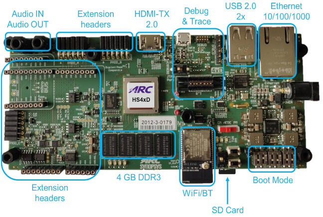
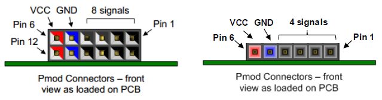
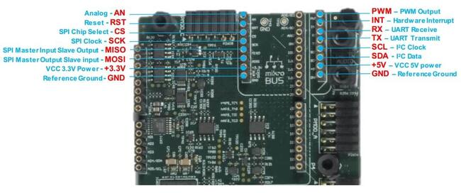
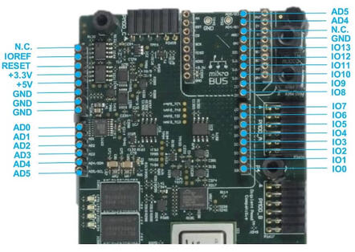

<!-- Copyright 2015-2026 Zephyr Project members and individual contributors. -->
<!-- SPDX-License-Identifier: Apache-2.0 -->
<!-- 中文翻译；编号、导航与译注为本地新增。 -->

<a id="hsdk4xd"></a>

# 第10章\_ARC HS4x／HS4xD开发套件（Development Kit）

原文：[官方页面](https://docs.zephyrproject.org/latest/boards/snps/hsdk4xd/doc/index.html)。读取日期：2026-10-16；来源摘要见[来源记录](../SOURCES.md)。

开发板概览（Board Overview）

<a id="id1"></a>

[](images/hsdk4xd.jpg)

ARC HS4x／HS4xD开发套件（Development Kit）

名称（Name）：

`hsdk4xd`

厂商（Vendor）：

[Synopsys, Inc.](https://docs.zephyrproject.org/latest/boards/index.html#vendor=snps)

状态（Status）：

维护中（Maintained）

架构（Architecture）：

[arc](https://docs.zephyrproject.org/latest/boards/index.html#arch=arc)

片上系统（SoC）：

[arc_hsdk4xd](https://docs.zephyrproject.org/latest/boards/index.html#soc=arc_hsdk4xd)

<a id="board-github-link"></a>

[浏览开发板源码（Browse Board Sources）](https://github.com/zephyrproject-rtos/zephyr/blob/main//boards/snps/hsdk4xd/doc/index.rst/../..)<a id="overview"></a>

## 概述（Overview）

ARC HS4x／HS4xD Development Kit是Synopsys HSDK的下一版，采用多核ARC HS4xD芯片，集成以太网、HDMI、Wi-Fi、Bluetooth、USB、SDIO、I2C、SPI、UART、I2S、ADC、PWM、GPIO及Think Silicon GPU。（[Synopsys HSDK开发板](P009_ARC_HS_Development_Kit.md#hsdk)）

板卡详情见ARC HS4x／HS4xD Development Kit（HSDK4xD）。（[ARC HS4x／HS4xD开发套件（HSDK4xD）](https://www.synopsys.com/dw/ipdir.php?ds=arc-hs-development-kit)）

<a id="hardware"></a>

## 硬件（Hardware）

ARC HSDK4xD具有24个通用GPIO，分为GPIO_SEL_0至GPIO_SEL_7八组，各组可配置为GPIO、UART、SPI、I2C或PWM等。通过CREG_GPIO_MUX寄存器配置，下面表格给出其位定义及各引脚详细配置。

<table>
<tr>
<td>位（Bit）</td>
<td>名称（Name）</td>
<td>访问权限（Access）</td>
<td>复位值（Reset Value）</td>
<td>说明（Description）</td>
</tr>
<tr>
<td>2:0</td>
<td><code>GPIO_SEL_0</code></td>
<td>RW</td>
<td>0x0</td>
<td>gpio[3:0]的复用选择</td>
</tr>
<tr>
<td>5:3</td>
<td>GPIO_SEL_1</td>
<td>RW</td>
<td>0x0</td>
<td>gpio[7:4]的复用选择</td>
</tr>
<tr>
<td>8:6</td>
<td>GPIO_SEL_2</td>
<td>RW</td>
<td>0x0</td>
<td>gpio[11:8]的复用选择</td>
</tr>
<tr>
<td>11:9</td>
<td>GPIO_SEL_3</td>
<td>RW</td>
<td>0x0</td>
<td>gpio[15:12]的复用选择</td>
</tr>
<tr>
<td>14:12</td>
<td>GPIO_SEL_4</td>
<td>RW</td>
<td>0x0</td>
<td>gpio[17:16]的复用选择</td>
</tr>
<tr>
<td>17:15</td>
<td>GPIO_SEL_5</td>
<td>RW</td>
<td>0x0</td>
<td>gpio[19:18]的复用选择</td>
</tr>
<tr>
<td>20:18</td>
<td>GPIO_SEL_6</td>
<td>RW</td>
<td>0x0</td>
<td>gpio[21:20]的复用选择</td>
</tr>
<tr>
<td>23:21</td>
<td><code>GPIO_SEL_7</code></td>
<td>RW</td>
<td>0x0</td>
<td>gpio[23:22]的复用选择</td>
</tr>
</table>

<table>
<tr>
<td>选择组（SELS）</td>
<td>GPIO引脚（GPIO Pins）</td>
<td>FUN0</td>
<td>FUN1</td>
<td>FUN2</td>
<td>FUN3</td>
<td>FUN4</td>
<td>FUN5</td>
<td>FUN6</td>
<td>FUN7</td>
</tr>
<tr>
<td rowspan="4">SEL0</td>
<td>0</td>
<td>gpio[0]</td>
<td>uart0_cts</td>
<td>spi1_cs[0]</td>
<td>gpio[0]</td>
<td>gpio[0]</td>
<td>pwm_ch[6]</td>
<td>pwm_ch[6]</td>
<td>pwm_ch[1]</td>
</tr>
<tr>
<td>1</td>
<td>gpio[1]</td>
<td>uart0_txd</td>
<td>spi1_mosi</td>
<td>gpio[1]</td>
<td>pwm_ch[0]</td>
<td>gpio[1]</td>
<td>pwm_ch[0]</td>
<td>pwm_ch[0]</td>
</tr>
<tr>
<td>2</td>
<td>gpio[2]</td>
<td>uart0_rxd</td>
<td>spi1 _miso</td>
<td>i2c1_scl</td>
<td>gpio[2]</td>
<td>gpio[2]</td>
<td>gpio[2]</td>
<td>gpio[2]</td>
</tr>
<tr>
<td>3</td>
<td>gpio[3]</td>
<td>uart0_rts</td>
<td>spi1_clk</td>
<td>i2c1_sda</td>
<td>gpio[3]</td>
<td>gpio[3]</td>
<td>gpio[3]</td>
<td>gpio[3]</td>
</tr>
<tr>
<td rowspan="4">SEL1</td>
<td>4</td>
<td>gpio[4]</td>
<td>uart1_cts</td>
<td>spi2_cs[0]</td>
<td>gpio[4]</td>
<td>gpio[4]</td>
<td>pwm_ch[4]</td>
<td>pwm_ch[4]</td>
<td>pwm_ch[3]</td>
</tr>
<tr>
<td>5</td>
<td>gpio[5]</td>
<td>uart1_txd</td>
<td>spi2_mosi</td>
<td>gpio[5]</td>
<td>pwm_ch[2]</td>
<td>gpio[5]</td>
<td>pwm_ch[2]</td>
<td>pwm_ch[2]</td>
</tr>
<tr>
<td>6</td>
<td>gpio[6]</td>
<td>uart1_rxd</td>
<td>spi2_miso</td>
<td>i2c2_scl</td>
<td>gpio[6]</td>
<td>gpio[6]</td>
<td>gpio[6]</td>
<td>gpio[6]</td>
</tr>
<tr>
<td>7</td>
<td>gpio[7]</td>
<td>uart1_rts</td>
<td>spi2_clk</td>
<td>i2c2_sda</td>
<td>gpio[7]</td>
<td>gpio[7]</td>
<td>gpio[7]</td>
<td>gpio[7]</td>
</tr>
<tr>
<td rowspan="4">SEL2</td>
<td>8</td>
<td>gpio[8]</td>
<td>uart2_cts</td>
<td>spi1_cs[1]</td>
<td>gpio[8]</td>
<td>gpio[8]</td>
<td>pwm_ch[2]</td>
<td>pwm_ch[2]</td>
<td>pwm_ch[5]</td>
</tr>
<tr>
<td>9</td>
<td>gpio[9]</td>
<td>uart2_txd</td>
<td>spi1_mosi</td>
<td>gpio[9]</td>
<td>pwm_ch[4]</td>
<td>gpio[9]</td>
<td>pwm_ch[4]</td>
<td>pwm_ch[4]</td>
</tr>
<tr>
<td>10</td>
<td>gpio[10]</td>
<td>uart2_rxd</td>
<td>spi1_miso</td>
<td>i2c1_scl</td>
<td>gpio[10]</td>
<td>gpio[10]</td>
<td>gpio[10]</td>
<td>gpio[10]</td>
</tr>
<tr>
<td>11</td>
<td>gpio[11]</td>
<td>uart2_rts</td>
<td>spi1_clk</td>
<td>i2c1_sda</td>
<td>gpio[11]</td>
<td>gpio[11]</td>
<td>gpio[11]</td>
<td>gpio[11]</td>
</tr>
<tr>
<td rowspan="4">SEL3</td>
<td>12</td>
<td>gpio[12]</td>
<td>uart0_cts</td>
<td>spi2_cs[1]</td>
<td>gpio[12]</td>
<td>gpio[12]</td>
<td>pwm_ch[0]</td>
<td>pwm_ch[0]</td>
<td>pwm_ch[7]</td>
</tr>
<tr>
<td>13</td>
<td>gpio[13]</td>
<td>uart0_txd</td>
<td>spi2_mosi</td>
<td>gpio[13]</td>
<td>pwm_ch[6]</td>
<td>gpio[13]</td>
<td>pwm_ch[6]</td>
<td>pwm_ch[6]</td>
</tr>
<tr>
<td>14</td>
<td>gpio[14]</td>
<td>uart0_rxd</td>
<td>spi2_miso</td>
<td>i2c2_scl</td>
<td>gpio[14]</td>
<td>gpio[14]</td>
<td>gpio[14]</td>
<td>gpio[14]</td>
</tr>
<tr>
<td>15</td>
<td>gpio[15]</td>
<td>uart0_rts</td>
<td>spi2_clk</td>
<td>i2c2_sda</td>
<td>gpio[15]</td>
<td>gpio[15]</td>
<td>gpio[15]</td>
<td>gpio[15]</td>
</tr>
<tr>
<td rowspan="2">SEL4</td>
<td>16</td>
<td>gpio[16]</td>
<td>uart1_txd</td>
<td>spi1_cs[2]</td>
<td>i2c1_scl</td>
<td>gpio[16]</td>
<td>pwm_fault_0</td>
<td>gpio[16]</td>
<td>pwm_fault_0</td>
</tr>
<tr>
<td>17</td>
<td>gpio[17]</td>
<td>uart1_rxd</td>
<td>spi1_mosi</td>
<td>i2c1_sda</td>
<td>pwm_ch[0]</td>
<td>pwm_ch[0]</td>
<td>pwm_ch[5]</td>
<td>pwm_ch[5]</td>
</tr>
<tr>
<td rowspan="2">SEL5</td>
<td>18</td>
<td>gpio[18]</td>
<td>uart2_txd</td>
<td>spi1_miso</td>
<td>i2c2_scl</td>
<td>gpio[18]</td>
<td>gpio[18]</td>
<td>gpio[18]</td>
<td>gpio[18]</td>
</tr>
<tr>
<td>19</td>
<td>gpio[19]</td>
<td>uart2_rxd</td>
<td>spi1_clk</td>
<td>i2c2_sda</td>
<td>gpio[19]</td>
<td>gpio[19]</td>
<td>gpio[19]</td>
<td>gpio[19]</td>
</tr>
<tr>
<td rowspan="2">SEL6</td>
<td>20</td>
<td>gpio[20]</td>
<td>uart0_txd</td>
<td>spi2_cs[2]</td>
<td>i2c1_scl</td>
<td>gpio[20]</td>
<td>pwm_fault_1</td>
<td>gpio[20]</td>
<td>pwm_fault_1</td>
</tr>
<tr>
<td>21</td>
<td>gpio[21]</td>
<td>uart0_rxd</td>
<td>spi2_mosi</td>
<td>i2c1_sda</td>
<td>pwm_ch[6]</td>
<td>pwm_ch[6]</td>
<td>pwm_ch[3]</td>
<td>pwm_ch[3]</td>
</tr>
<tr>
<td rowspan="2">SEL7</td>
<td>22</td>
<td>gpio[22]</td>
<td>uart2_txd</td>
<td>spi2_miso</td>
<td>i2c2_scl</td>
<td>gpio[22]</td>
<td>gpio[22]</td>
<td>gpio[22]</td>
<td>gpio[22]</td>
</tr>
<tr>
<td>23</td>
<td>gpio[23]</td>
<td>uart2_rxd</td>
<td>spi2_clk</td>
<td>i2c2_sda</td>
<td>gpio[23]</td>
<td>gpio[23]</td>
<td>gpio[23]</td>
<td>gpio[23]</td>
</tr>
</table>

<a id="digilent-pmod"></a>

### Digilent Pmod

ARC HSDK4xD具有两个12引脚Pmod连接器Pmod_A及Pmod_B，以及一个6引脚Pmod_C，可编程为GPIO、UART、SPI、I2C及PWM。下图标出引脚位置，后续章节按复用设置说明各引脚功能。



<a id="pmod-a-connector"></a>

#### Pmod_A连接器

下表列出Pmod_A连接器可复用协议的引脚分配，GPIO列为复位后默认分配。

<table>
<tr>
<td>引脚（Pin）</td>
<td>通用输入输出（GPIO）</td>
<td>通用异步收发器（UART）</td>
<td>串行外设接口（SPI）</td>
<td>集成电路间总线（I2C）</td>
<td>PWM_1</td>
<td>PWM_2</td>
</tr>
<tr>
<td>A1</td>
<td>gpio[8]</td>
<td>uart2_cts</td>
<td>spi1_cs[1]</td>
<td>gpio[8]</td>
<td>gpio[8]</td>
<td>pwm_ch[2]</td>
</tr>
<tr>
<td>A2</td>
<td>gpio[9]</td>
<td>uart2_txd</td>
<td>spi1_mosi</td>
<td>gpio[9]</td>
<td>pwm_ch[4]</td>
<td>gpio[9]</td>
</tr>
<tr>
<td>A3</td>
<td>gpio[10]</td>
<td>uart2_rxd</td>
<td>spi1_miso</td>
<td>i2c1_scl</td>
<td>gpio[10]</td>
<td>gpio[10]</td>
</tr>
<tr>
<td>A4</td>
<td>gpio[11]</td>
<td>uart2_rts</td>
<td>spi1_clk</td>
<td>i2c1_sda</td>
<td>gpio[11]</td>
<td>gpio[11]</td>
</tr>
<tr>
<td>A5</td>
<td>地（GND）</td>
<td>地（GND）</td>
<td>地（GND）</td>
<td>地（GND）</td>
<td>地（GND）</td>
<td>地（GND）</td>
</tr>
<tr>
<td>A6</td>
<td>3V3</td>
<td>3V3</td>
<td>3V3</td>
<td>3V3</td>
<td>3V3</td>
<td>3V3</td>
</tr>
<tr>
<td>A7</td>
<td>gpio[20]</td>
<td>gpio[20]</td>
<td>gpio[20]</td>
<td>gpio[20]</td>
<td>gpio[20]</td>
<td>gpio[20]</td>
</tr>
<tr>
<td>A8</td>
<td>gpio[21]</td>
<td>gpio[21]</td>
<td>gpio[21]</td>
<td>gpio[21]</td>
<td>gpio[21]</td>
<td>gpio[21]</td>
</tr>
<tr>
<td>A9</td>
<td>未连接（n.c.）</td>
<td>未连接（n.c.）</td>
<td>未连接（n.c.）</td>
<td>未连接（n.c.）</td>
<td>未连接（n.c.）</td>
<td>未连接（n.c.）</td>
</tr>
<tr>
<td>A10</td>
<td>未连接（n.c.）</td>
<td>未连接（n.c.）</td>
<td>未连接（n.c.）</td>
<td>未连接（n.c.）</td>
<td>未连接（n.c.）</td>
<td>未连接（n.c.）</td>
</tr>
<tr>
<td>A11</td>
<td>地（GND）</td>
<td>地（GND）</td>
<td>地（GND）</td>
<td>地（GND）</td>
<td>地（GND）</td>
<td>地（GND）</td>
</tr>
<tr>
<td>A12</td>
<td>3V3</td>
<td>3V3</td>
<td>3V3</td>
<td>3V3</td>
<td>3V3</td>
<td>3V3</td>
</tr>
</table>

<a id="pmod-b-connector"></a>

#### Pmod_B连接器

下表列出Pmod_B连接器可复用协议的引脚分配，GPIO列为复位后默认分配。

<table>
<tr>
<td>引脚（Pin）</td>
<td>通用输入输出（GPIO）</td>
<td>通用异步收发器（UART）</td>
<td>串行外设接口（SPI）</td>
<td>集成电路间总线（I2C）</td>
<td>PWM_1</td>
<td>PWM_2</td>
</tr>
<tr>
<td>B1</td>
<td>gpio[12]</td>
<td>uart0_cts</td>
<td>spi2_cs[1]</td>
<td>gpio[12]</td>
<td>gpio[12]</td>
<td>pwm_ch[0]</td>
</tr>
<tr>
<td>B2</td>
<td>gpio[13]</td>
<td>uart0_txd</td>
<td>spi2_mosi</td>
<td>gpio[13]</td>
<td>pwm_ch[6]</td>
<td>gpio[13]</td>
</tr>
<tr>
<td>B3</td>
<td>gpio[14]</td>
<td>uart0_rxd</td>
<td>spi2_miso</td>
<td>i2c2_scl</td>
<td>gpio[14]</td>
<td>gpio[14]</td>
</tr>
<tr>
<td>B4</td>
<td>gpio[15]</td>
<td>uart0_rts</td>
<td>spi2_clk</td>
<td>i2c2_sda</td>
<td>gpio[15]</td>
<td>gpio[15]</td>
</tr>
<tr>
<td>B5</td>
<td>地（GND）</td>
<td>地（GND）</td>
<td>地（GND）</td>
<td>地（GND）</td>
<td>地（GND）</td>
<td>地（GND）</td>
</tr>
<tr>
<td>B6</td>
<td>3V3</td>
<td>3V3</td>
<td>3V3</td>
<td>3V3</td>
<td>3V3</td>
<td>3V3</td>
</tr>
<tr>
<td>B7</td>
<td>gpio[22]</td>
<td>gpio[22]</td>
<td>gpio[22]</td>
<td>gpio[22]</td>
<td>gpio[22]</td>
<td>gpio[22]</td>
</tr>
<tr>
<td>B8</td>
<td>gpio[23]</td>
<td>gpio[23]</td>
<td>gpio[23]</td>
<td>gpio[23]</td>
<td>gpio[23]</td>
<td>gpio[23]</td>
</tr>
<tr>
<td>B9</td>
<td>未连接（n.c.）</td>
<td>未连接（n.c.）</td>
<td>未连接（n.c.）</td>
<td>未连接（n.c.）</td>
<td>未连接（n.c.）</td>
<td>未连接（n.c.）</td>
</tr>
<tr>
<td>B10</td>
<td>未连接（n.c.）</td>
<td>未连接（n.c.）</td>
<td>未连接（n.c.）</td>
<td>未连接（n.c.）</td>
<td>未连接（n.c.）</td>
<td>未连接（n.c.）</td>
</tr>
<tr>
<td>B11</td>
<td>地（GND）</td>
<td>地（GND）</td>
<td>地（GND）</td>
<td>地（GND）</td>
<td>地（GND）</td>
<td>地（GND）</td>
</tr>
<tr>
<td>B12</td>
<td>3V3</td>
<td>3V3</td>
<td>3V3</td>
<td>3V3</td>
<td>3V3</td>
<td>3V3</td>
</tr>
</table>

<a id="pmod-c-connector"></a>

#### Pmod_C连接器

下表列出Pmod_C连接器可复用协议的引脚分配，GPIO列为复位后默认分配。

<table>
<tr>
<td>引脚（Pin）</td>
<td>通用输入输出（GPIO）</td>
<td>通用异步收发器（UART）</td>
<td>串行外设接口（SPI）</td>
<td>集成电路间总线（I2C）</td>
<td>脉宽调制（PWM）</td>
</tr>
<tr>
<td>C1</td>
<td>gpio[16]</td>
<td>uart1_txd</td>
<td>spi1_cs[2]</td>
<td>i2c1_scl</td>
<td>gpio[16]</td>
</tr>
<tr>
<td>C2</td>
<td>gpio[17]</td>
<td>uart1_rxd</td>
<td>spi1_mosi</td>
<td>i2c1_sda</td>
<td>pwm_ch[0]</td>
</tr>
<tr>
<td>C3</td>
<td>gpio[18]</td>
<td>uart2_txd</td>
<td>spi1_miso</td>
<td>i2c2_scl</td>
<td>gpio[18]</td>
</tr>
<tr>
<td>C4</td>
<td>gpio[19]</td>
<td>uart2_rxd</td>
<td>spi1_clk</td>
<td>i2c2_sda</td>
<td>gpio[19]</td>
</tr>
<tr>
<td>C5</td>
<td>地（GND）</td>
<td>地（GND）</td>
<td>地（GND）</td>
<td>地（GND）</td>
<td>地（GND）</td>
</tr>
<tr>
<td>C6</td>
<td>3V3</td>
<td>3V3</td>
<td>3V3</td>
<td>3V3</td>
<td>3V3</td>
</tr>
</table>

<a id="mikrobus"></a>

### Mikrobus

ARC HSDK4xD配有一组MikroBUS排针，下图所示功能分配完全兼容MikroBUS标准，表格列出I/O复用器上的引脚分配。



<table>
<tr>
<td>引脚（Pin）</td>
<td>输入输出（I/O）</td>
<td>引脚（Pin）</td>
<td>输入输出（I/O）</td>
</tr>
<tr>
<td>模拟输入（AN）</td>
<td>ADC VIN6*</td>
<td>脉宽调制（PWM）</td>
<td>pwm_ch[0]</td>
</tr>
<tr>
<td>复位（RST）</td>
<td>GPX_Port0_bit1</td>
<td>中断（INT）</td>
<td>gpio[16]</td>
</tr>
<tr>
<td>片选（CS）</td>
<td>spi2_cs[1]</td>
<td>接收（RX）</td>
<td>uart2_rxd</td>
</tr>
<tr>
<td>串行时钟（SCK）</td>
<td>spi2_clk</td>
<td>发送（TX）</td>
<td>uart2_txd</td>
</tr>
<tr>
<td>主机输入从机输出（MISO）</td>
<td>spi2_miso</td>
<td>串行时钟线（SCL）</td>
<td>i2c2_scl</td>
</tr>
<tr>
<td>主机输出从机输入（MOSI）</td>
<td>spi2_mosi</td>
<td>串行数据线（SDA）</td>
<td>i2c2_sda</td>
</tr>
</table>

注意（Note）

ADC VIN6通过板载ADC提供，经SPI0、片选1读取。

<a id="arduino"></a>

### Arduino

ARC HSDK4xD提供Arduino扩展板接口，功能分配如下图。接口兼容Arduino UNO R3，但不支持5 V扩展板，IOREF固定为3.3 V，且不提供ICSP排针。多数扩展板不依赖该排针，因为其SPI主机接口也在IO10—IO13上提供。



下表列出I/O复用器的引脚分配。软件通过CREG_GPIO_MUX寄存器控制复用，见Pinmux章节；复位后全部端口配置为GPIO输入。

<table>
<tr>
<td>引脚（Pin）</td>
<td>I/O-1</td>
<td>I/O-2</td>
<td>I/O-3</td>
</tr>
<tr>
<td>AD0</td>
<td>ADC VIN0*</td>
<td>GPX_port0_bit2</td>
<td><ul><li></li></ul></td>
</tr>
<tr>
<td>AD1</td>
<td>ADC VIN1*</td>
<td>GPX_port0_bit3</td>
<td><ul><li></li></ul></td>
</tr>
<tr>
<td>AD2</td>
<td>ADC VIN2*</td>
<td>GPX_port0_bit4</td>
<td><ul><li></li></ul></td>
</tr>
<tr>
<td>AD3</td>
<td>ADC VIN3*</td>
<td>GPX_port0_bit5</td>
<td><ul><li></li></ul></td>
</tr>
<tr>
<td>AD4</td>
<td>ADC VIN4*</td>
<td>gpio[18]</td>
<td>i2c2_sda</td>
</tr>
<tr>
<td>AD5</td>
<td>ADC VIN5*</td>
<td>gpio[19]</td>
<td>i2c2_scl</td>
</tr>
<tr>
<td>IO0</td>
<td>gpio[23]</td>
<td>uart2_rxd</td>
<td><ul><li></li></ul></td>
</tr>
<tr>
<td>IO1</td>
<td>gpio[22]</td>
<td>uart2_txd</td>
<td><ul><li></li></ul></td>
</tr>
<tr>
<td>IO2</td>
<td>gpio[16]</td>
<td><ul><li></li></ul></td>
<td><ul><li></li></ul></td>
</tr>
<tr>
<td>IO3</td>
<td>gpio[17]</td>
<td>pwm_ch[5]</td>
<td><ul><li></li></ul></td>
</tr>
<tr>
<td>IO4</td>
<td>gpio[11]</td>
<td><ul><li></li></ul></td>
<td></td>
</tr>
<tr>
<td>IO5</td>
<td>gpio[9]</td>
<td>pwm_ch[4]</td>
<td><ul><li></li></ul></td>
</tr>
<tr>
<td>IO6</td>
<td>gpio[21]</td>
<td>pwm_ch[3]</td>
<td><ul><li></li></ul></td>
</tr>
<tr>
<td>IO7</td>
<td>gpio[20]</td>
<td><ul><li></li></ul></td>
<td><ul><li></li></ul></td>
</tr>
<tr>
<td>IO8</td>
<td>gpio[10]</td>
<td><ul><li></li></ul></td>
<td><ul><li></li></ul></td>
</tr>
<tr>
<td>IO9</td>
<td>gpio[8]</td>
<td>pwm_ch[2]</td>
<td><ul><li></li></ul></td>
</tr>
<tr>
<td><code>IO10</code></td>
<td>gpio[12]</td>
<td>pwm_ch[0]</td>
<td>spi2_cs[1]</td>
</tr>
<tr>
<td>IO11</td>
<td>gpio[13]</td>
<td>pwm_ch[6]</td>
<td>spi2_mosi</td>
</tr>
<tr>
<td>IO12</td>
<td>gpio[14]</td>
<td><ul><li></li></ul></td>
<td>spi2_miso</td>
</tr>
<tr>
<td><code>IO13</code></td>
<td>gpio[15]</td>
<td><ul><li></li></ul></td>
<td>spi2_clk</td>
</tr>
</table>

<a id="i-o-expander"></a>

### I/O扩展器（I/O Expander）

ARC HSDK4xD配有[Cypress CY8C9520A](https://www.cypress.com/file/37971/download) I/O扩展器，提供额外GPIO及板级控制信号，可通过板载I2C访问。Zephyr已提供基本驱动，相关I/O信号如下表。

<table>
<tr>
<td>引脚（Pins）</td>
<td>用途（Usage）</td>
</tr>
<tr>
<td>port0_bit0</td>
<td>RS9113 Bluetooth I2S接收使能，低电平有效</td>
</tr>
<tr>
<td>port0_bit1</td>
<td>MikroBUS复位，低电平有效</td>
</tr>
<tr>
<td>port0_bit2</td>
<td>Arduino AD0的GPIO</td>
</tr>
<tr>
<td>port0_bit3</td>
<td>Arduino AD1的GPIO</td>
</tr>
<tr>
<td>port0_bit4</td>
<td>Arduino AD2的GPIO</td>
</tr>
<tr>
<td>port0_bit5</td>
<td>Arduino AD3的GPIO</td>
</tr>
<tr>
<td>port1_bit4</td>
<td>板载用户LED0</td>
</tr>
<tr>
<td>port1_bit5</td>
<td>板载用户LED1</td>
</tr>
<tr>
<td>port1_bit6</td>
<td>板载用户LED2</td>
</tr>
<tr>
<td>port1_bit7</td>
<td>板载用户LED3</td>
</tr>
</table>

<a id="on-board-user-leds"></a>

### 板载用户LED（On-board User LEDs）

ARC HSDK4xD有四个高电平有效的用户LED，通过I/O扩展器引脚控制。

<table>
<tr>
<td>发光二极管（LEDs）</td>
<td>引脚（Pins）</td>
</tr>
<tr>
<td>LED0</td>
<td>GPX_port1_bit4</td>
</tr>
<tr>
<td>LED1</td>
<td>GPX_port1_bit5</td>
</tr>
<tr>
<td>LED2</td>
<td>GPX_port1_bit6</td>
</tr>
<tr>
<td>LED3</td>
<td>GPX_port1_bit7</td>
</tr>
</table>

硬件功能详情见DesignWare HS4x／HS4xD Development Kit网站。（[DesignWare HS4x／HS4xD开发套件网站](https://www.synopsys.com/dw/ipdir.php?ds=arc-hs-development-kit)）

<a id="programming-and-debugging"></a>

## 烧录与调试（Programming and Debugging）

`hsdk4xd`开发板支持下表所列的运行工具（Runners）及相关west命令。

<table>
<tr>
<th></th>
<th>烧录（flash）</th>
<th>调试（debug）</th>
<th>连接调试会话（attach）</th>
<th>实时传输（rtt）</th>
<th>调试服务器（debugserver）</th>
</tr>
<tr>
<td>mdb-hw</td>
<td>✅</td>
<td>✅</td>
<td></td>
<td></td>
<td></td>
</tr>
<tr>
<td><a href="https://docs.zephyrproject.org/latest/develop/flash_debug/host-tools.html#runner-openocd">openocd</a></td>
<td>✅（默认 / default）</td>
<td>✅（默认 / default）</td>
<td>✅</td>
<td>✅</td>
<td>✅</td>
</tr>
</table>

<a id="required-hardware-and-software"></a>

### 所需硬件及软件（Required Hardware and Software）

在HS4x／HS4xD开发套件上运行Zephyr RTOS应用还需要以下硬件及软件。


- Micro-USB线，提供USB-JTAG调试及USB-UART通信
- 套件随附通用开关电源适配器，将110—240 V交流转换为12 V直流，为开发板供电
- [Zephyr软件开发套件（SDK）](../toolchains/P002_ZephyrSDK.md#toolchain-zephyr-sdk)
- <a id="id5"></a>

  用于USB转UART的终端仿真软件，原文建议[PuTTY网站](https://www.putty.software)[注2](#id4)所提供的软件。
- <a id="id3"></a>

  可选Pmod、Arduino或Mikro模块，见[Digilent Pmod Modules](http://store.digilentinc.com/pmod-modules) [注1](#id2)，也可自行开发连接Pmod的接口。

<a id="set-up-the-arc-hs4x-hs4xd-development-kit"></a>

### 设置ARC HS4x／HS4xD开发套件

运行Zephyr前需正确设置ARC HS4x／HS4xD开发套件。


- 通过Digilent USB线将主机连接开发板。
- 将12 V直流电源连接开发板。

<a id="set-up-zephyr-software"></a>

### 设置Zephyr软件

<a id="building-sample-applications"></a>

### 构建示例应用（Building Sample Applications）

可尝试多种示例及演示，这里以[samples/hello_world](https://github.com/zephyrproject-rtos/zephyr/blob/main/samples/hello_world)中的[Hello World](../getting_started/P005_HelloWorld示例.md#hello_world)为例。（[示例应用及演示](https://docs.zephyrproject.org/latest/samples/index.html#samples)）

<a id="configuring"></a>

#### 配置（Configuring）

若示例没有prj.conf，可能需自行编写。随后通过menuconfig配置目标，选择hsdk4xd板级配置以启用对应Zephyr支持。

```text
# From the root of the zephyr repository
west build -b hsdk4xd samples/hello_world
west build -t menuconfig
```

<a id="building"></a>

#### 构建（Building）

可按常规方法构建应用，详情见“构建应用”，以下以[Hello World](../getting_started/P005_HelloWorld示例.md#hello_world)为例。（[构建应用（Building an Application）](../application/P001_应用开发.md#build-an-application)）

```text
# From the root of the zephyr repository
west build -b hsdk4xd samples/hello_world
```

<a id="connecting-serial-output"></a>

### 连接串口输出（Connecting Serial Output）

默认Zephyr HS4x／HS4xD开发套件镜像通过板上USB转UART输出串口日志，启用方法如下：


- 打开串口终端，例如Linux中的minicom、PuTTY或screen。
- 指定tty设备名，例如Linux中的/dev/ttyUSB0。
- 通信参数设为：

<table>
<tr>
<th>参数（Parameter）</th>
<th>值（Value）</th>
</tr>
<tr>
<td>波特率（Baud）：</td>
<td>115200</td>
</tr>
<tr>
<td>数据位（Data）：</td>
<td>8位数据位</td>
</tr>
<tr>
<td>奇偶校验（Parity）：</td>
<td>无（None）</td>
</tr>
<tr>
<td>停止位（Stop Bits）：</td>
<td>1</td>
</tr>
</table>

<a id="debugging"></a>

### 调试（Debugging）

原文说明Zephyr SDK 0.15.2及更新版本可直接调试并加载运行HS4x／HS4xD开发套件；这里保留原文版本门槛。

一种方式是通过常规Zephyr构建命令构建并调试应用。

```text
west build -b hsdk4xd <my app>
west debug
```

随后可按常规调试，设置断点，再输入c继续执行。

另一种方式是启动调试服务器：

```text
west build -b hsdk4xd <my app>
west debugserver
```

再打开第二个终端，在包含输出zephyr.elf的构建目录连接HS4x／HS4xD开发套件调试服务器。

```text
$ cd <my app>
$ $ZEPHYR_SDK_INSTALL_DIR/arc-zephyr-elf/arc-zephyr-elf-gdb zephyr.elf
(gdb) target remote localhost:3333
(gdb) load
(gdb) b main
(gdb) c
```

<a id="flashing"></a>

### 烧录（Flashing）

若只需将应用下载到HS4x／HS4xD开发套件的DDR并运行，可按常规方式操作。

```text
west build -b hsdk4xd <my app>
west flash
```

此命令通过OpenOCD及GDB将ELF加载到HS4x／HS4xD开发套件后立即运行；由于未写入闪存，断电后应用会丢失。

开发期间通常通过OpenOCD及GDB调试，程序经USB下载到代码及数据存储器，而非每次写入闪存。

HS4x／HS4xD开发套件也支持通过U-Boot加载Zephyr应用。U-Boot可从不同来源加载可执行文件并在目标平台运行。

HS4x／HS4xD开发套件的U-Boot实现还扩展了额外功能，便于管理此平台丰富的配置能力。

需要复位或上电后自动启动时，可按步骤将程序放到SD卡。

详情见Uboot-HS4x／HS4xD-Command-Reference命令参考。（[Uboot-HS4x/HS4xD-Command-Reference](https://github.com/foss-for-synopsys-dwc-arc-processors/linux/wiki/Uboot-HSDK-4xD-Command-Reference#launching-baremetal-application-on-hsdk-4xd)）

<a id="supported-peripheral"></a>

### 支持的外设（Supported Peripheral）

以下列表说明HS4x／HS4xD开发套件的外设支持状态：

<table>
<tr>
<td>外设（Peripheral）</td>
<td>支持状态（Support）</td>
</tr>
<tr>
<td>模数转换器（ADC）</td>
<td>否（No）</td>
</tr>
<tr>
<td>蓝牙（Bluetooth）</td>
<td>否（No）</td>
</tr>
<tr>
<td>以太网（Ethernet）</td>
<td>否（No）</td>
</tr>
<tr>
<td>通用输入输出（GPIO）</td>
<td>否（No）</td>
</tr>
<tr>
<td>图形处理器（GPU）</td>
<td>否（No）</td>
</tr>
<tr>
<td>高清多媒体接口（HDMI）</td>
<td>否（No）</td>
</tr>
<tr>
<td>集成电路间总线（I2C）</td>
<td>否（No）</td>
</tr>
<tr>
<td>集成电路间音频总线（I2S）</td>
<td>否（No）</td>
</tr>
<tr>
<td>脉宽调制（PWM）</td>
<td>否（No）</td>
</tr>
<tr>
<td>SD输入输出接口（SDIO）</td>
<td>否（No）</td>
</tr>
<tr>
<td>串行外设接口（SPI）</td>
<td>否（No）</td>
</tr>
<tr>
<td>通用异步收发器（UART）</td>
<td>是（Yes）</td>
</tr>
<tr>
<td>通用串行总线（USB）</td>
<td>否（No）</td>
</tr>
<tr>
<td>无线局域网（Wi-Fi）</td>
<td>否（No）</td>
</tr>
</table>

<a id="references"></a>

## 参考资料（References）

<a id="id2"></a>

〔[1](#id3)〕 [http://store.digilentinc.com/pmod-modules](http://store.digilentinc.com/pmod-modules)

<a id="id4"></a>

〔[2](#id5)〕 [https://www.putty.software](https://www.putty.software)

## 译注

HSDK4xD与HSDK的GPU及SoC不同；共用接口布局分别保留。OpenOCD／GDB加载DDR不持久，自动启动需按U-Boot说明准备SD卡。

## 原文外链核对

2026-10-16核对并重试以下原文外链时未能确认可访问性，保留原始目标，不将访问失败解释为原文内容有误。

- [pmod-modules](http://store.digilentinc.com/pmod-modules)：HTTP Error 403: Forbidden。
- [index.html](https://docs.zephyrproject.org/latest/samples/index.html#samples)：页面可访问，但未确认目标片段。
- [Uboot-HSDK-4xD-Command-Reference](https://github.com/foss-for-synopsys-dwc-arc-processors/linux/wiki/Uboot-HSDK-4xD-Command-Reference#launching-baremetal-application-on-hsdk-4xd)：页面可访问，但未确认目标片段。
- [ipdir.php?ds=arc-hs-development-kit](https://www.synopsys.com/dw/ipdir.php?ds=arc-hs-development-kit)：HTTP Error 403: Forbidden。

---

[上一章](P009_ARC_HS_Development_Kit.md) · [返回大纲](大纲.md) · [全站翻译进度](../PROGRESS.md) · [下一章](P011_Synopsys.md)
