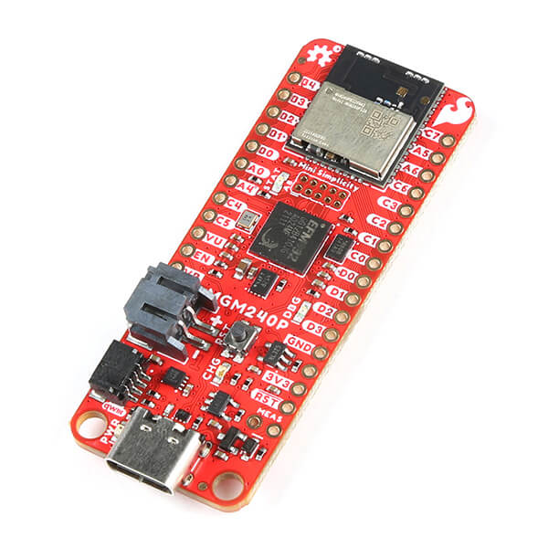

<!-- Copyright 2015-2026 Zephyr Project members and individual contributors. -->
<!-- SPDX-License-Identifier: Apache-2.0 -->
<!-- 中文翻译；编号、导航与译注为本地新增。 -->

<a id="sparkfun_thing_plus_matter_mgm240p"></a>

# 第25章\_Thing Plus Matter

原文：[官方页面](https://docs.zephyrproject.org/latest/boards/sparkfun/thing_plus_matter_mgm240p/doc/index.html)。读取日期：2026-10-16；来源摘要见[来源记录](../SOURCES.md)。

开发板概览（Board Overview）

<a id="id1"></a>

[](images/sparkfun_thing_plus_matter_mgm240p.jpg)

Thing Plus Matter

名称（Name）：

`sparkfun_thing_plus_matter_mgm240p`

厂商（Vendor）：

[SparkFun Electronics](https://docs.zephyrproject.org/latest/boards/index.html#vendor=sparkfun)

状态（Status）：

当前未积极维护（Not Actively Maintained）

架构（Architecture）：

[arm](https://docs.zephyrproject.org/latest/boards/index.html#arch=arm)

片上系统（SoC）：

[mgm240pb32vna](https://docs.zephyrproject.org/latest/boards/index.html#soc=mgm240pb32vna)

<a id="board-github-link"></a>

[浏览开发板源码（Browse Board Sources）](https://github.com/zephyrproject-rtos/zephyr/blob/main//boards/sparkfun/thing_plus_matter_mgm240p/doc/index.rst/../..)<a id="overview"></a>

## 概述（Overview）

MGM240P SparkFun Thing Plus Matter采用EFR32MG24系列无线SoC，基于Arm Cortex-M33F并具备低功耗能力；原文产品名在此拼作Think Plus。

<a id="hardware"></a>

## 硬件（Hardware）


- 基于Series 2 EFR32MG24 SoC
- CPU核：32位Arm Cortex-M33，39 MHz
- 闪存（Flash Memory）：1536 kB
- 随机存取存储器（RAM）：256 kB
- 支持Zigbee及OpenThread等多种802.15.4无线协议
- Bluetooth Low Energy 5.3
- 配有32 kHz低频外部振荡器（LFXO）及39 MHz高频外部振荡器（HFXO）晶体

EFR32MG24 SoC及相关板卡更多信息见以下文档；原文在此写作BRD2601B，与本页Thing Plus Matter板名不同。


- [EFR32MG24网站](https://www.silabs.com/wireless/zigbee/efr32mg24-series-2-socs)
- [EFR32MG24数据手册（Datasheet）](https://www.silabs.com/documents/public/data-sheets/efr32mg24-datasheet.pdf)
- [EFR32xG24参考手册（Reference Manual）](https://www.silabs.com/documents/public/reference-manuals/efr32xg24-rm.pdf)
- [MGM240P数据手册](https://cdn.sparkfun.com/assets/1/4/5/e/5/MGM240P-Datasheet.pdf)
- [MGM240P原理图](https://cdn.sparkfun.com/assets/0/f/8/4/9/Thing_Plus_MGM240P.pdf)

<a id="supported-features"></a>

### 支持的功能（Supported Features）

`sparkfun_thing_plus_matter_mgm240p`开发板支持下表所列的硬件功能。

片上／板载（On-Chip / On-Board）

功能集成在片上系统（SoC）内／位于开发板上。

2 / 2

分别表示已启用／已禁用的实例数。点击数量标签，可查看开发板或SoC设备树源码（DTS）中该功能的第一个实例。

`vnd,foo`

与此功能匹配的设备树绑定兼容字符串（Compatible String）；点击链接可查看绑定文档。

<a id="sparkfun_thing_plus_matter_mgm240p-hw-features"></a>

<a id="sparkfun_thing_plus_matter_mgm240p-sparkfun_thing_plus_matter_mgm240p/mgm240pb32vna-hw-features-section"></a>

#### `sparkfun_thing_plus_matter_mgm240p/mgm240pb32vna`目标（Target）

<a id="sparkfun_thing_plus_matter_mgm240p-sparkfun_thing_plus_matter_mgm240p/mgm240pb32vna-hw-features-panel"></a>

<a id="sparkfun_thing_plus_matter_mgm240p-sparkfun_thing_plus_matter_mgm240p/mgm240pb32vna-hw-features-memory"></a>

该开发板目标的片上存储容量：256 KiB RAM、1536 KiB Flash。

<a id="sparkfun_thing_plus_matter_mgm240p-sparkfun_thing_plus_matter_mgm240p/mgm240pb32vna-hw-features-table"></a>

<table>
<tr>
<th>类型（Type）</th>
<th>位置（Location）</th>
<th>说明（Description）</th>
<th>兼容字符串（Compatible）</th>
</tr>
<tr>
<td rowspan="1">中央处理器（CPU）</td>
<td>片上（On-Chip）</td>
<td>ARM Cortex-M33处理器（CPU）（<a href="https://github.com/zephyrproject-rtos/zephyr/blob/main/dts/arm/silabs/xg24/xg24.dtsi?plain=1#L169">已启用：1</a>）</td>
<td><a href="../cpu_arm_riscv_binding_reference/P022_arm_cortex-m33.md#std-dtcompatible-arm-cortex-m33"><code>arm,cortex-m33</code></a></td>
</tr>
<tr>
<td rowspan="1">模数转换器（ADC）</td>
<td>片上（On-Chip）</td>
<td>Silicon Labs Series 2增量式模数转换器（IADC）（<a href="https://github.com/zephyrproject-rtos/zephyr/blob/main/dts/arm/silabs/xg24/xg24.dtsi?plain=1#L592">已启用：1</a>）</td>
<td><a href="../hardware/P900_SiliconLabsIADC绑定.md#dtbinding-silabs-iadc"><code>silabs,iadc</code></a></td>
</tr>
<tr>
<td rowspan="1">蓝牙（Bluetooth）</td>
<td>片上（On-Chip）</td>
<td>Silicon Labs Series 2蓝牙主机控制器接口（Bluetooth HCI）（<a href="https://github.com/zephyrproject-rtos/zephyr/blob/main/dts/arm/silabs/xg24/efr32xg24.dtsi?plain=1#L31">已启用：1</a>）</td>
<td><a href="../bluetooth_vendor_hci_binding_reference/P015_silabs_bt-hci-efr32.md#std-dtcompatible-silabs-bt-hci-efr32"><code>silabs,bt-hci-efr32</code></a></td>
</tr>
<tr>
<td rowspan="9">时钟控制（Clock Control）</td>
<td>片上（On-Chip）</td>
<td>Silicon Labs Series 2时钟管理单元（CMU）（<a href="https://github.com/zephyrproject-rtos/zephyr/blob/main/dts/arm/silabs/xg24/xg24.dtsi?plain=1#L217">已启用：1</a>）</td>
<td><a href="../clock_renesas_rockchip_sifli_silabs_binding_reference/P029_silabs_series-clock.md#std-dtcompatible-silabs-series-clock"><code>silabs,series-clock</code></a></td>
</tr>
<tr>
<td>片上（On-Chip）</td>
<td>Silicon Labs CMU时钟输出（CLKOUT）（<a href="https://github.com/zephyrproject-rtos/zephyr/blob/main/dts/arm/silabs/xg24/xg24.dtsi?plain=1#L225">已禁用：1</a>）</td>
<td><a href="../clock_renesas_rockchip_sifli_silabs_binding_reference/P028_silabs_series-clock-output.md#std-dtcompatible-silabs-series-clock-output"><code>silabs,series-clock-output</code></a></td>
</tr>
<tr>
<td>片上（On-Chip）</td>
<td>Silicon Labs Series 2高频RC振荡器数字锁相环（HFRCODPLL）（<a href="https://github.com/zephyrproject-rtos/zephyr/blob/main/dts/arm/silabs/xg24/xg24.dtsi?plain=1#L249">已启用：1</a>）</td>
<td><a href="../clock_silabs_ti_xilinx_binding_reference/P004_silabs_series2-hfrcodpll.md#std-dtcompatible-silabs-series2-hfrcodpll"><code>silabs,series2-hfrcodpll</code></a></td>
</tr>
<tr>
<td>片上（On-Chip）</td>
<td>通用固定频率时钟提供者（Fixed-Rate Clock Provider）（<a href="https://github.com/zephyrproject-rtos/zephyr/blob/main/dts/arm/silabs/xg24/xg24.dtsi?plain=1#L258">已启用：3</a>）</td>
<td><a href="../hardware/P566_固定时钟绑定.md#dtbinding-fixed-clock"><code>fixed-clock</code></a></td>
</tr>
<tr>
<td>片上（On-Chip）</td>
<td>Silicon Labs Series 2低频外部晶体振荡器（LFXO）（<a href="https://github.com/zephyrproject-rtos/zephyr/blob/main/dts/arm/silabs/xg24/xg24.dtsi?plain=1#L266">已禁用：1</a>）</td>
<td><a href="../clock_silabs_ti_xilinx_binding_reference/P007_silabs_series2-lfxo.md#std-dtcompatible-silabs-series2-lfxo"><code>silabs,series2-lfxo</code></a></td>
</tr>
<tr>
<td>片上（On-Chip）</td>
<td>Silicon Labs Series 2低频RC振荡器（LFRCO）（<a href="https://github.com/zephyrproject-rtos/zephyr/blob/main/dts/arm/silabs/xg24/xg24.dtsi?plain=1#L280">已启用：1</a>）</td>
<td><a href="../clock_silabs_ti_xilinx_binding_reference/P006_silabs_series2-lfrco.md#std-dtcompatible-silabs-series2-lfrco"><code>silabs,series2-lfrco</code></a></td>
</tr>
<tr>
<td>片上（On-Chip）</td>
<td>Silicon Labs Series 2 EM2／EM3模式高频RC振荡器（HFRCOEM23）（<a href="https://github.com/zephyrproject-rtos/zephyr/blob/main/dts/arm/silabs/xg24/xg24.dtsi?plain=1#L660">已启用：1</a>）</td>
<td><a href="../clock_silabs_ti_xilinx_binding_reference/P005_silabs_series2-hfrcoem23.md#std-dtcompatible-silabs-series2-hfrcoem23"><code>silabs,series2-hfrcoem23</code></a></td>
</tr>
<tr>
<td>片上（On-Chip）</td>
<td>Silicon Labs Series 2高频外部晶体振荡器（HFXO）（<a href="https://github.com/zephyrproject-rtos/zephyr/blob/main/dts/arm/silabs/xg24/xg24.dtsi?plain=1#L670">已启用：1</a>）</td>
<td><a href="../clock_renesas_rockchip_sifli_silabs_binding_reference/P027_silabs_hfxo.md#std-dtcompatible-silabs-hfxo"><code>silabs,hfxo</code></a></td>
</tr>
<tr>
<td>片上（On-Chip）</td>
<td>通用固定比例时钟提供器（Fixed Factor Clock Provider）（<a href="https://github.com/zephyrproject-rtos/zephyr/blob/main/dts/arm/silabs/xg24/xg24.dtsi?plain=1#L26">已启用：22</a>）</td>
<td><a href="../timer_reference/P110_固定比例时钟绑定.md#dtbinding-fixed-factor-clock"><code>fixed-factor-clock</code></a></td>
</tr>
<tr>
<td rowspan="1">比较器（Comparator）</td>
<td>片上（On-Chip）</td>
<td>Silicon Labs Series 2模拟比较器（ACMP）（<a href="https://github.com/zephyrproject-rtos/zephyr/blob/main/dts/arm/silabs/xg24/xg24.dtsi?plain=1#L602">已禁用：2</a>）</td>
<td><a href="../hardware/P757_SiliconLabs模拟比较器绑定.md#dtbinding-silabs-acmp"><code>silabs,acmp</code></a></td>
</tr>
<tr>
<td rowspan="3">计数器（Counter）</td>
<td>片上（On-Chip）</td>
<td>Silicon Labs TIMER计数器（Counter）（<a href="https://github.com/zephyrproject-rtos/zephyr/blob/main/dts/arm/silabs/xg24/xg24.dtsi?plain=1#L404">已禁用：5</a>）</td>
<td><a href="../stm32_ti_xilinx_counter_binding_reference/P005_silabs_timer-counter.md#std-dtcompatible-silabs-timer-counter"><code>silabs,timer-counter</code></a></td>
</tr>
<tr>
<td>片上（On-Chip）</td>
<td>Silicon Labs Series 2备份实时时钟（BURTC）（<a href="https://github.com/zephyrproject-rtos/zephyr/blob/main/dts/arm/silabs/xg24/xg24.dtsi?plain=1#L513">已禁用：1</a>）</td>
<td><a href="../stm32_ti_xilinx_counter_binding_reference/P003_silabs_burtc-counter.md#std-dtcompatible-silabs-burtc-counter"><code>silabs,burtc-counter</code></a></td>
</tr>
<tr>
<td>片上（On-Chip）</td>
<td>Silicon Labs PROTIMER计数器（Counter）（<a href="https://github.com/zephyrproject-rtos/zephyr/blob/main/dts/arm/silabs/xg24/efr32xg24.dtsi?plain=1#L36">已启用：1</a>）</td>
<td><a href="../stm32_ti_xilinx_counter_binding_reference/P004_silabs_protimer.md#std-dtcompatible-silabs-protimer"><code>silabs,protimer</code></a></td>
</tr>
<tr>
<td rowspan="1">循环冗余校验（CRC）</td>
<td>片上（On-Chip）</td>
<td>Silabs通用循环冗余校验（CRC）（<a href="https://github.com/zephyrproject-rtos/zephyr/blob/main/dts/arm/silabs/xg24/xg24.dtsi?plain=1#L541">已启用：1</a>）</td>
<td><a href="../crc_clock_monitor_binding_reference/P010_silabs_gpcrc.md#std-dtcompatible-silabs-gpcrc"><code>silabs,gpcrc</code></a></td>
</tr>
<tr>
<td rowspan="1">密码学加速器（Cryptographic Accelerator）</td>
<td>片上（On-Chip）</td>
<td>Silicon Labs Series 2安全引擎邮箱（SE Mailbox）（<a href="https://github.com/zephyrproject-rtos/zephyr/blob/main/dts/arm/silabs/xg24/xg24.dtsi?plain=1#L724">已启用：1</a>）</td>
<td><a href="../crypto_secure_engine_st_ti_binding_reference/P012_silabs_gecko-semailbox.md#std-dtcompatible-silabs-gecko-semailbox"><code>silabs,gecko-semailbox</code></a></td>
</tr>
<tr>
<td rowspan="1">数模转换器（DAC）</td>
<td>片上（On-Chip）</td>
<td>Silicon Labs Series 2电压数模转换器（VDAC）（<a href="https://github.com/zephyrproject-rtos/zephyr/blob/main/dts/arm/silabs/xg24/xg24.dtsi?plain=1#L620">已禁用：2</a>）</td>
<td><a href="../hardware/P774_SiliconLabs电压数模转换器绑定.md#dtbinding-silabs-vdac"><code>silabs,vdac</code></a></td>
</tr>
<tr>
<td rowspan="2">调试（Debug）</td>
<td>片上（On-Chip）</td>
<td>Silicon Labs数据包跟踪接口（Packet Trace Interface）（<a href="https://github.com/zephyrproject-rtos/zephyr/blob/main/dts/arm/silabs/xg24/efr32xg24.dtsi?plain=1#L41">已禁用：1</a>）</td>
<td><a href="../debug_binding_reference/P006_Silicon_Labs数据包跟踪绑定.md#std-dtcompatible-silabs-pti"><code>silabs,pti</code></a></td>
</tr>
<tr>
<td>片上（On-Chip）</td>
<td>ARMv8仪器跟踪宏单元（Instrumentation Trace Macrocell）（<a href="https://github.com/zephyrproject-rtos/zephyr/blob/main/dts/arm/silabs/xg24/xg24.dtsi?plain=1#L181">已启用：1</a>）</td>
<td><a href="../debug_binding_reference/P002_ARMv8M_ITM调试绑定.md#std-dtcompatible-arm-armv8m-itm"><code>arm,armv8m-itm</code></a></td>
</tr>
<tr>
<td rowspan="1">直接存储器访问（DMA）</td>
<td>片上（On-Chip）</td>
<td>Silicon Labs Series 2链式直接存储器访问（LDMA）（<a href="https://github.com/zephyrproject-rtos/zephyr/blob/main/dts/arm/silabs/xg24/xg24.dtsi?plain=1#L381">已禁用：1</a>）</td>
<td><a href="../stm32_ti_xilinx_dma_binding_reference/P001_silabs_ldma.md#std-dtcompatible-silabs-ldma"><code>silabs,ldma</code></a></td>
</tr>
<tr>
<td rowspan="1">闪存控制器（Flash Controller）</td>
<td>片上（On-Chip）</td>
<td>Silicon Labs Series 2存储器系统控制器（MSC）（<a href="https://github.com/zephyrproject-rtos/zephyr/blob/main/dts/arm/silabs/xg24/xg24.dtsi?plain=1#L298">已启用：1</a>）</td>
<td><a href="../flash_renesas_st_ti_binding_reference/P007_silabs_series2-flash-controller.md#std-dtcompatible-silabs-series2-flash-controller"><code>silabs,series2-flash-controller</code></a></td>
</tr>
<tr>
<td rowspan="2">通用输入输出与接插件（GPIO &amp; Headers）</td>
<td>片上（On-Chip）</td>
<td>Silicon Labs Series 2通用输入输出外设（GPIO Peripheral）（<a href="https://github.com/zephyrproject-rtos/zephyr/blob/main/dts/arm/silabs/xg24/xg24.dtsi?plain=1#L317">已启用：1</a>）</td>
<td><a href="../gpio_silabs_st_connectors_binding_reference/P015_silabs_gpio.md#std-dtcompatible-silabs-gpio"><code>silabs,gpio</code></a></td>
</tr>
<tr>
<td>片上（On-Chip）</td>
<td>Silicon Labs Series 2 GPIO端口（Port）（<a href="https://github.com/zephyrproject-rtos/zephyr/blob/main/dts/arm/silabs/xg24/xg24.dtsi?plain=1#L327">已启用：4</a>）</td>
<td><a href="../gpio_silabs_st_connectors_binding_reference/P014_silabs_gpio-port.md#std-dtcompatible-silabs-gpio-port"><code>silabs,gpio-port</code></a></td>
</tr>
<tr>
<td rowspan="1">集成电路间总线（I2C）</td>
<td>片上（On-Chip）</td>
<td>Silicon Labs Series 2的I2C控制器（<a href="https://github.com/zephyrproject-rtos/zephyr/blob/main/dts/arm/silabs/xg24/xg24.dtsi?plain=1#L683">已启用：1</a>；<a href="https://github.com/zephyrproject-rtos/zephyr/blob/main/dts/arm/silabs/xg24/xg24.dtsi?plain=1#L522">已禁用：1</a>）</td>
<td><a href="../i2c_stm32_ti_mux_binding_reference/P005_silabs_i2c.md#std-dtcompatible-silabs-i2c"><code>silabs,i2c</code></a></td>
</tr>
<tr>
<td rowspan="1">低速率无线个域网（IEEE 802.15.4）</td>
<td>片上（On-Chip）</td>
<td>Silicon Labs EFR32 IEEE 802.15.4无线电（Radio）（<a href="https://github.com/zephyrproject-rtos/zephyr/blob/main/dts/arm/silabs/xg24/mgm24.dtsi?plain=1#L12">已启用：1</a>）</td>
<td><a href="../lora_ieee802154_binding_reference/P009_silabs_efr32-ieee802154.md#std-dtcompatible-silabs-efr32-ieee802154"><code>silabs,efr32-ieee802154</code></a></td>
</tr>
<tr>
<td rowspan="1">中断控制器（Interrupt Controller）</td>
<td>片上（On-Chip）</td>
<td>ARMv8-M嵌套向量中断控制器（NVIC / Nested Vectored Interrupt Controller）（<a href="https://github.com/zephyrproject-rtos/zephyr/blob/main/dts/arm/armv8-m.dtsi?plain=1#L13">已启用：1</a>）</td>
<td><a href="../arm_interrupt_timer_binding_reference/P003_ARMv8_M_NVIC.md#std-dtcompatible-arm-v8m-nvic"><code>arm,v8m-nvic</code></a></td>
</tr>
<tr>
<td rowspan="2">发光二极管（LED）</td>
<td>板载（On-Board）</td>
<td>一组由 GPIO 控制的 LED（GPIO-Controlled LEDs）（<a href="https://github.com/zephyrproject-rtos/zephyr/blob/main/boards/sparkfun/thing_plus_matter_mgm240p/sparkfun_thing_plus_matter_mgm240p.dts?plain=1#L40">已启用：1</a>）</td>
<td><a href="../hardware/P564_GPIO指示灯绑定.md#dtbinding-gpio-leds"><code>gpio-leds</code></a></td>
</tr>
<tr>
<td>板载（On-Board）</td>
<td>一组由脉宽调制（PWM）控制的LED（<a href="https://github.com/zephyrproject-rtos/zephyr/blob/main/boards/sparkfun/thing_plus_matter_mgm240p/sparkfun_thing_plus_matter_mgm240p.dts?plain=1#L48">已启用：1</a>）</td>
<td><a href="../hardware/P565_PWM指示灯绑定.md#dtbinding-pwm-leds"><code>pwm-leds</code></a></td>
</tr>
<tr>
<td rowspan="1">内存管理单元／内存保护单元（MMU / MPU）</td>
<td>片上（On-Chip）</td>
<td>ARMv8-M存储器保护单元（MPU / Memory Protection Unit）（<a href="https://github.com/zephyrproject-rtos/zephyr/blob/main/dts/arm/silabs/xg24/xg24.dtsi?plain=1#L186">已启用：1</a>）</td>
<td><a href="../memory_protection_binding_reference/P007_arm_armv8m-mpu.md#std-dtcompatible-arm-armv8m-mpu"><code>arm,armv8m-mpu</code></a></td>
</tr>
<tr>
<td rowspan="1">存储技术设备（MTD）</td>
<td>片上（On-Chip）</td>
<td>闪存（Flash）节点（<a href="https://github.com/zephyrproject-rtos/zephyr/blob/main/dts/arm/silabs/xg24/xg24.dtsi?plain=1#L308">已启用：1</a>）</td>
<td><a href="../mtd_nxp_st_ti_partition_binding_reference/P013_soc-nv-flash.md#std-dtcompatible-soc-nv-flash"><code>soc-nv-flash</code></a></td>
</tr>
<tr>
<td rowspan="1">网络（Networking）</td>
<td>片上（On-Chip）</td>
<td>Silicon Labs Series 2无线电接口（Radio Interface）（<a href="https://github.com/zephyrproject-rtos/zephyr/blob/main/dts/arm/silabs/xg24/efr32xg24.dtsi?plain=1#L11">已启用：1</a>）</td>
<td><a href="../network_radio_frontend_binding_reference/P014_silabs_series2-radio.md#std-dtcompatible-silabs-series2-radio"><code>silabs,series2-radio</code></a></td>
</tr>
<tr>
<td rowspan="1">引脚控制（Pin Control）</td>
<td>片上（On-Chip）</td>
<td>Silicon Labs Series 2 DBUS引脚控制器（Pin Controller）（<a href="https://github.com/zephyrproject-rtos/zephyr/blob/main/dts/arm/silabs/xg24/xg24.dtsi?plain=1#L368">已启用：1</a>）</td>
<td><a href="../pinctrl_renesas_silabs_binding_reference/P024_silabs_dbus-pinctrl.md#std-dtcompatible-silabs-dbus-pinctrl"><code>silabs,dbus-pinctrl</code></a></td>
</tr>
<tr>
<td rowspan="2">脉宽调制（PWM）</td>
<td>片上（On-Chip）</td>
<td>Silicon Labs TIMER脉宽调制（PWM）（<a href="https://github.com/zephyrproject-rtos/zephyr/blob/main/dts/arm/silabs/xg24/xg24.dtsi?plain=1#L409">已启用：1</a>；<a href="https://github.com/zephyrproject-rtos/zephyr/blob/main/dts/arm/silabs/xg24/xg24.dtsi?plain=1#L431">已禁用：4</a>）</td>
<td><a href="../pwm_stm32_ti_generic_binding_reference/P010_silabs_timer-pwm.md#std-dtcompatible-silabs-timer-pwm"><code>silabs,timer-pwm</code></a></td>
</tr>
<tr>
<td>片上（On-Chip）</td>
<td>Silicon Labs低能耗定时器脉宽调制（LETIMER PWM）（<a href="https://github.com/zephyrproject-rtos/zephyr/blob/main/dts/arm/silabs/xg24/xg24.dtsi?plain=1#L585">已禁用：1</a>）</td>
<td><a href="../pwm_stm32_ti_generic_binding_reference/P008_silabs_letimer-pwm.md#std-dtcompatible-silabs-letimer-pwm"><code>silabs,letimer-pwm</code></a></td>
</tr>
<tr>
<td rowspan="1">稳压器（Regulator）</td>
<td>片上（On-Chip）</td>
<td>Silicon Labs Series 2直流电压转换器（DC-DC Converter）（<a href="https://github.com/zephyrproject-rtos/zephyr/blob/main/dts/arm/silabs/xg24/xg24.dtsi?plain=1#L548">已启用：1</a>）</td>
<td><a href="../hardware/P657_SiliconLabs_Series2直流转换器绑定.md#dtbinding-silabs-series2-dcdc"><code>silabs,series2-dcdc</code></a></td>
</tr>
<tr>
<td rowspan="1">保持存储器（Retained Memory）</td>
<td>片上（On-Chip）</td>
<td>Silicon Labs Series 2备份RAM（BURAM）（<a href="https://github.com/zephyrproject-rtos/zephyr/blob/main/dts/arm/silabs/xg24/xg24.dtsi?plain=1#L534">已禁用：1</a>）</td>
<td><a href="../hardware/P629_SiliconLabs备份RAM绑定.md#dtbinding-silabs-buram"><code>silabs,buram</code></a></td>
</tr>
<tr>
<td rowspan="1">实时时钟（RTC）</td>
<td>片上（On-Chip）</td>
<td>Silicon Labs Series 2系统实时时钟（SYSRTC）（<a href="https://github.com/zephyrproject-rtos/zephyr/blob/main/dts/arm/silabs/xg24/xg24.dtsi?plain=1#L566">已启用：1</a>）</td>
<td><a href="../soc_rtc_binding_reference/P013_silabs_sysrtc.md#std-dtcompatible-silabs-sysrtc"><code>silabs,sysrtc</code></a></td>
</tr>
<tr>
<td rowspan="1">串行控制器（Serial Controller）</td>
<td>片上（On-Chip）</td>
<td>Silicon Labs Series 2通用同步／异步收发器（USART）（<a href="https://github.com/zephyrproject-rtos/zephyr/blob/main/dts/arm/silabs/xg24/xg24.dtsi?plain=1#L504">已启用：1</a>）</td>
<td><a href="../uart_silabs_stm32_ti_binding_reference/P010_silabs_usart-uart.md#std-dtcompatible-silabs-usart-uart"><code>silabs,usart-uart</code></a></td>
</tr>
<tr>
<td rowspan="1">串行外设接口（SPI）</td>
<td>片上（On-Chip）</td>
<td>Silicon Labs Series 2增强型通用同步／异步收发器（EUSART）（<a href="https://github.com/zephyrproject-rtos/zephyr/blob/main/dts/arm/silabs/xg24/xg24.dtsi?plain=1#L557">已启用：1</a>；<a href="https://github.com/zephyrproject-rtos/zephyr/blob/main/dts/arm/silabs/xg24/xg24.dtsi?plain=1#L715">已禁用：1</a>）</td>
<td><a href="../spi_stm32_ti_xilinx_binding_reference/P005_silabs_eusart-spi.md#std-dtcompatible-silabs-eusart-spi"><code>silabs,eusart-spi</code></a></td>
</tr>
<tr>
<td rowspan="1">静态随机存储器（SRAM）</td>
<td>片上（On-Chip）</td>
<td>通用片上静态随机存储器（SRAM）（<a href="https://github.com/zephyrproject-rtos/zephyr/blob/main/dts/arm/silabs/xg24/xg24.dtsi?plain=1#L733">已启用：1</a>）</td>
<td><a href="../hardware/P567_内存映射SRAM绑定.md#dtbinding-mmio-sram"><code>mmio-sram</code></a></td>
</tr>
<tr>
<td rowspan="3">定时器（Timer）</td>
<td>片上（On-Chip）</td>
<td>ARMv8-M系统节拍（System Tick）（<a href="https://github.com/zephyrproject-rtos/zephyr/blob/main/dts/arm/armv8-m.dtsi?plain=1#L21">已启用：1</a>）</td>
<td><a href="../arm_interrupt_timer_binding_reference/P007_ARMv8_M_SysTick.md#std-dtcompatible-arm-armv8m-systick"><code>arm,armv8m-systick</code></a></td>
</tr>
<tr>
<td>片上（On-Chip）</td>
<td>Silicon Labs定时器（TIMER）（<a href="https://github.com/zephyrproject-rtos/zephyr/blob/main/dts/arm/silabs/xg24/xg24.dtsi?plain=1#L394">已启用：1</a>；<a href="https://github.com/zephyrproject-rtos/zephyr/blob/main/dts/arm/silabs/xg24/xg24.dtsi?plain=1#L416">已禁用：4</a>）</td>
<td><a href="../stm32_ti_silabs_timer_binding_reference/P006_silabs_series2-timer.md#std-dtcompatible-silabs-series2-timer"><code>silabs,series2-timer</code></a></td>
</tr>
<tr>
<td>片上（On-Chip）</td>
<td>Silicon Labs低能耗定时器（LETIMER）（<a href="https://github.com/zephyrproject-rtos/zephyr/blob/main/dts/arm/silabs/xg24/xg24.dtsi?plain=1#L577">已禁用：1</a>）</td>
<td><a href="../stm32_ti_silabs_timer_binding_reference/P005_silabs_series2-letimer.md#std-dtcompatible-silabs-series2-letimer"><code>silabs,series2-letimer</code></a></td>
</tr>
<tr>
<td rowspan="1">看门狗（Watchdog）</td>
<td>片上（On-Chip）</td>
<td>Silicon Labs Series 0–2看门狗（WDOG）（<a href="https://github.com/zephyrproject-rtos/zephyr/blob/main/dts/arm/silabs/xg24/xg24.dtsi?plain=1#L695">已启用：1</a>；<a href="https://github.com/zephyrproject-rtos/zephyr/blob/main/dts/arm/silabs/xg24/xg24.dtsi?plain=1#L705">已禁用：1</a>）</td>
<td><a href="../realtek_renesas_silabs_watchdog_binding_reference/P011_silabs_gecko-wdog.md#std-dtcompatible-silabs-gecko-wdog"><code>silabs,gecko-wdog</code></a></td>
</tr>
</table>

<a id="connections-and-ios"></a>

### 连接与输入输出（Connections and IOs）

下表的“名称”（Name）列列出引脚名称。例如，PA2表示PORTA的2号引脚，与开发板数据手册及手册中的命名一致。

<table>
<tr>
<th>名称（Name）</th>
<th>功能（Function）</th>
<th>用途（Usage）</th>
</tr>
<tr>
<td>PA8</td>
<td>通用输入输出（GPIO）</td>
<td>LED0</td>
</tr>
<tr>
<td>PA5</td>
<td>USART0_TX</td>
<td>UART控制台发送：EFM_BC_TX、US0_TX</td>
</tr>
<tr>
<td>PA6</td>
<td>USART0_RX</td>
<td>UART控制台接收：EFM_BC_RX、US0_RX</td>
</tr>
</table>

默认配置位于[boards/sparkfun/thing_plus_matter_mgm240p/sparkfun_thing_plus_matter_mgm240p_defconfig](https://github.com/zephyrproject-rtos/zephyr/blob/main/boards/sparkfun/thing_plus_matter_mgm240p/sparkfun_thing_plus_matter_mgm240p_defconfig)。

<a id="system-clock"></a>

### 系统时钟（System Clock）

EFR32MG24 SoC配置为使用板上39 MHz外部振荡器。

<a id="serial-port"></a>

### 串口（Serial Port）

EFR32MG24具有一路USART及两路增强USART（EUSART）。USART0连接板级控制器，用作控制台。

<a id="programming-and-debugging"></a>

## 烧录与调试（Programming and Debugging）

`sparkfun_thing_plus_matter_mgm240p`开发板支持下表所列的运行工具（Runners）及相关west命令。

<table>
<tr>
<th></th>
<th>烧录（flash）</th>
<th>调试（debug）</th>
<th>连接调试会话（attach）</th>
<th>实时传输（rtt）</th>
<th>复位（reset）</th>
<th>调试服务器（debugserver）</th>
</tr>
<tr>
<td><a href="https://docs.zephyrproject.org/latest/develop/flash_debug/host-tools.html#runner-jlink">jlink</a></td>
<td>✅（默认 / default）</td>
<td>✅（默认 / default）</td>
<td>✅</td>
<td>✅</td>
<td>✅</td>
<td>✅</td>
</tr>
</table>

注意（Note）

原文要求首次使用套件前，在Simplicity Studio更新J-Link固件。

<a id="flashing"></a>

### 烧录（Flashing）

下面以[Hello World](../getting_started/P005_HelloWorld示例.md#hello_world)为例，构建Zephyr内核及应用：

```text
# From the root of the zephyr repository
west build -b sparkfun_thing_plus_matter_mgm240p samples/hello_world
```

通过USB端口将sparkfun_thing_plus_matter_mgm240p连接主机，应看到USB连接。

打开串口终端（如minicom或PuTTY），设置如下：


- 速率（Speed）：115200波特率
- 数据位（Data）：8位
- 奇偶校验（Parity）：无（None）
- 停止位（Stop Bits）：1位

复位开发板后，对应串口终端应显示以下消息：

```text
Hello World! _sparkfun_thing_plus_matter_mgm240p
```

<a id="bluetooth"></a>

### 蓝牙（Bluetooth）

使用BLE前，运行以下命令从SiLabs HAL仓库获取所需二进制文件（Binary Blobs）。

```text
west blobs fetch silabs
```

随后用以下命令构建Zephyr内核和蓝牙示例。本例使用[Observer](../bluetooth_samples/P003_蓝牙观察者.md#bluetooth_observer)观察者示例应用。

```text
# From the root of the zephyr repository
west build -b sparkfun_thing_plus_matter_mgm240p samples/bluetooth/observer
```

## 译注

Thing Plus Matter原文一处拼作Think Plus，一处提到BRD2601B，分别注明而不替换为其他板卡文档。首次J-Link固件更新及BLE二进制获取要求照原文保留。

## 原文外链核对

2026-10-16核对并重试以下原文外链时未能确认可访问性，保留原始目标，不将访问失败解释为原文内容有误。

- [efr32mg24-datasheet.pdf](https://www.silabs.com/documents/public/data-sheets/efr32mg24-datasheet.pdf)：HTTP Error 403: Forbidden。
- [efr32xg24-rm.pdf](https://www.silabs.com/documents/public/reference-manuals/efr32xg24-rm.pdf)：HTTP Error 403: Forbidden。
- [efr32mg24-series-2-socs](https://www.silabs.com/wireless/zigbee/efr32mg24-series-2-socs)：HTTP Error 403: Forbidden。

---

[上一章](P024_nRF9160_Thing_Plus.md) · [返回大纲](大纲.md) · [全站翻译进度](../PROGRESS.md)
