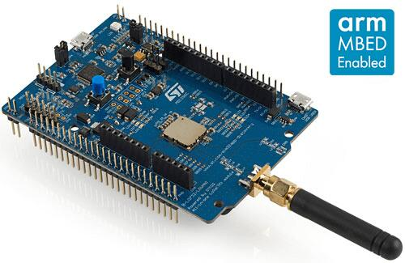

<!-- Copyright 2015-2026 Zephyr Project members and individual contributors. -->
<!-- SPDX-License-Identifier: Apache-2.0 -->
<!-- 中文翻译；编号、导航与译注为本地新增。 -->

<a id="b_l072z_lrwan1"></a>

# 第2章\_B-L072Z-LRWAN1探索套件（Discovery Kit）

原文：[官方页面](https://docs.zephyrproject.org/latest/boards/st/b_l072z_lrwan1/doc/index.html)。读取日期：2026-10-16；来源摘要见[来源记录](../SOURCES.md)。

开发板概览（Board Overview）

<a id="id1"></a>

[](images/b_l072z_lrwan1.jpg)

B-L072Z-LRWAN1探索套件（Discovery Kit）

名称（Name）：

`b_l072z_lrwan1`

厂商（Vendor）：

[意法半导体（STMicroelectronics）](https://docs.zephyrproject.org/latest/boards/index.html#vendor=st)

状态（Status）：

维护中（Maintained）

架构（Architecture）：

[arm](https://docs.zephyrproject.org/latest/boards/index.html#arch=arm)

片上系统（SoC）：

[stm32l072xx](https://docs.zephyrproject.org/latest/boards/index.html#soc=stm32l072xx)

<a id="board-github-link"></a>

[浏览开发板源码（Browse Board Sources）](https://github.com/zephyrproject-rtos/zephyr/blob/main//boards/st/b_l072z_lrwan1/doc/index.rst/../..)<a id="overview"></a>

## 概述（Overview）

本Discovery套件采用村田（Murata）的CMWX1ZZABZ-091一体式开放模块，模块包含STM32L072CZ及SX1276收发器。

此套件提供：


- 村田CMWX1ZZABZ-091 LoRa*／Sigfox*模块

  > - 内置基于Arm* Cortex*-M0+的超低功耗STM32L072CZ系列MCU，具有192 Kbytes Flash、20 Kbytes RAM及6 Kbytes EEPROM
  > - 频率范围860～930 MHz
  > - USB 2.0全速（FS）
  > - 4通道12位ADC及2个DAC
  > - 原文列出6位定时器、低功耗UART、I2C及SPI；定时器位宽按来源照录。
  > - 内置SX1276收发器
  > - 支持LoRa*、FSK、GFSK、MSK、GMSK及OOK调制，兼容Sigfox*
  > - 输出功率可选+14 dBm或+20 dBm
  > - 最大链路预算（Link Budget）157 dB
  > - 比特率可编程，最高300 kbit/s
  > - 高接收灵敏度，最低−137 dBm
  > - 高抗干扰前端，输入三阶截点（IIP3）为−12.5 dBm
  > - 阻塞抑制能力（Blocking Immunity）89 dB
  > - 低接收电流10 mA，寄存器保持电流200 nA
  > - 完全集成的频率合成器（Synthesizer），分辨率61 Hz
  > - 内置位同步器（Bit Synchronizer），用于时钟恢复
  > - 同步字识别（Sync Word Recognition）
  > - 前导码检测（Preamble Detection）
  > - 接收信号强度指示（RSSI）的动态范围超过127 dB
- SMA及U.FL射频接口连接器
- 随附50 Ω SMA射频天线
- 板载ST-LINK/V2-1，支持USB重新枚举（Re-Enumeration）
- USB ST-LINK功能：
- 开发板供电：

  > - 通过USB总线、外部VIN／3.3 V电源或电池供电
- 3节AAA电池座，用于独立运行
- 7个LED：

  > - 4个通用LED
  > - 1个5 V电源LED
  > - 1个ST-LINK通信LED
  > - 1个电源故障LED
  > - 2个按键：用户键及复位键
- Arduino* Uno V3连接器

更多信息见[B-L072Z-LRWAN1网站](https://www.st.com/en/evaluation-tools/b-l072z-lrwan1.html)。

<a id="hardware"></a>

## 硬件（Hardware）

STM32L072CZ SoC提供以下硬件IP：


- 超低功耗：待机模式（Standby）低至0.29 μA，运行模式为93 μA/MHz
- 内核：Arm* 32位Cortex*-M0+ CPU，最高32 MHz
- 时钟源（Clock Sources）：

  > - 1至32 MHz晶体振荡器
  > - 用于实时时钟（RTC）的32 kHz低速外部晶体振荡器（LSE）
  > - 内部16 MHz RC振荡器，出厂校准（Factory-Trimmed），精度±1%
  > - 内部低功耗37 kHz RC振荡器，精度±5%
  > - 内部多速率低功耗RC振荡器，65 kHz至4.2 MHz
- 带硬件日历、闹钟及校准功能的实时时钟（RTC）
- 最多24个电容感应通道，支持触摸键、线性及旋转触摸传感器
- 11个定时器：

  > - 两个16位定时器，各最多四通道
  > - 两个16位定时器，各最多两通道
  > - 一个16位超低功耗定时器
  > - 一个系统滴答定时器（SysTick）
  > - 一个实时时钟（RTC）
  > - 两个用于DAC的16位基本定时器
  > - 两个看门狗（Watchdogs），独立型／窗口型
- 最多84个高速I/O，多数耐受5 V
- 存储器（Memories）

  > - 最多192 KB闪存，两个存储体（Banks），支持边读边写（Read-While-Write）及专有代码读出保护
  > - 最多20 KB SRAM
  > - 面向静态存储器的外部存储器接口（External Memory Interface），支持SRAM、PSRAM、NOR和NAND存储器
- 丰富的模拟外设（Analog Peripherals），采用独立供电

  > - 一个12位ADC，1.14 MSPS
  > - 两个12位DAC
  > - 两个超低功耗比较器（Comparators）
- 11个通信接口

  > - USB 2.0全速设备，支持LPM及BCD
  > - 三路I2C快速增强模式（FM+），1 Mbit/s，支持SMBus/PMBus
  > - 四路USART，支持ISO 7816、LIN、IrDA及调制解调器（Modem）
  > - 六路SPI，其中四路SPI带Quad SPI，数量与表述依原文保留
- 七通道DMA控制器
- 真随机数发生器（True Random Number Generator）
- 循环冗余校验计算单元（CRC），96位唯一标识（Unique ID）
- 开发支持：SWD、JTAG及嵌入式跟踪宏单元（Embedded Trace Macrocell*）

STM32L072CZ的更多信息：


- [ST网站上的STM32L072CZ](https://www.st.com/en/microcontrollers/stm32l072cz.html)
- [STM32L0x2参考手册（Reference Manual）](https://www.st.com/resource/en/reference_manual/DM00108281.pdf)

<a id="supported-features"></a>

### 支持的功能（Supported Features）

`b_l072z_lrwan1`开发板支持下表所列的硬件功能。

片上／板载（On-Chip / On-Board）

功能集成在片上系统（SoC）内／位于开发板上。

2 / 2

分别表示已启用／已禁用的实例数。点击数量标签，可查看开发板或SoC设备树源码（DTS）中该功能的第一个实例。

`vnd,foo`

与此功能匹配的设备树绑定兼容字符串（Compatible String）；点击链接可查看绑定文档。

<a id="b_l072z_lrwan1-hw-features"></a>

<a id="b_l072z_lrwan1-b_l072z_lrwan1/stm32l072xx-hw-features-section"></a>

#### `b_l072z_lrwan1/stm32l072xx`目标（Target）

<a id="b_l072z_lrwan1-b_l072z_lrwan1/stm32l072xx-hw-features-panel"></a>

<a id="b_l072z_lrwan1-b_l072z_lrwan1/stm32l072xx-hw-features-memory"></a>

该开发板目标的片上存储容量：20 KiB RAM、192 KiB Flash。

<a id="b_l072z_lrwan1-b_l072z_lrwan1/stm32l072xx-hw-features-table"></a>

<table>
<tr>
<th>类型（Type）</th>
<th>位置（Location）</th>
<th>说明（Description）</th>
<th>兼容字符串（Compatible）</th>
</tr>
<tr>
<td rowspan="1">中央处理器（CPU）</td>
<td>片上（On-Chip）</td>
<td>ARM Cortex-M0+处理器（CPU）（<a href="https://github.com/zephyrproject-rtos/zephyr/blob/main/dts/arm/st/l0/stm32l0.dtsi?plain=1#L32">已启用：1</a>）</td>
<td><a href="../cpu_arm_riscv_binding_reference/P017_arm_cortex-m0+.md#std-dtcompatible-arm-cortex-m0"><code>arm,cortex-m0+</code></a></td>
</tr>
<tr>
<td rowspan="1">模数转换器（ADC）</td>
<td>片上（On-Chip）</td>
<td>STM32模数转换器（ADC）（<a href="https://github.com/zephyrproject-rtos/zephyr/blob/main/dts/arm/st/l0/stm32l0.dtsi?plain=1#L373">已禁用：1</a>）</td>
<td><a href="../hardware/P839_STM32模数转换器绑定.md#dtbinding-st-stm32-adc"><code>st,stm32-adc</code></a></td>
</tr>
<tr>
<td rowspan="8">时钟控制（Clock Control）</td>
<td>片上（On-Chip）</td>
<td>STM32复位和时钟控制器（RCC / Reset and Clock Controller）（<a href="https://github.com/zephyrproject-rtos/zephyr/blob/main/dts/arm/st/l0/stm32l0.dtsi?plain=1#L182">已启用：1</a>）</td>
<td><a href="../timer_reference/P126_STM32复位与时钟控制绑定.md#dtbinding-st-stm32-rcc"><code>st,stm32-rcc</code></a></td>
</tr>
<tr>
<td>片上（On-Chip）</td>
<td>STM32 外部高速时钟（HSE Clock）（<a href="https://github.com/zephyrproject-rtos/zephyr/blob/main/dts/arm/st/l0/stm32l0.dtsi?plain=1#L55">已禁用：1</a>）</td>
<td><a href="../timer_reference/P129_STM32高速外部时钟绑定.md#dtbinding-st-stm32-hse-clock"><code>st,stm32-hse-clock</code></a></td>
</tr>
<tr>
<td>片上（On-Chip）</td>
<td>STM32L0内部高速（HSI）时钟（<a href="https://github.com/zephyrproject-rtos/zephyr/blob/main/dts/arm/st/l0/stm32l0.dtsi?plain=1#L61">已启用：1</a>）</td>
<td><a href="../timer_reference/P147_STM32L0内部高速时钟绑定.md#dtbinding-st-stm32l0-hsi-clock"><code>st,stm32l0-hsi-clock</code></a></td>
</tr>
<tr>
<td>片上（On-Chip）</td>
<td>STM32L0/L1多速率内部时钟（Multi Speed Internal Clock）（<a href="https://github.com/zephyrproject-rtos/zephyr/blob/main/dts/arm/st/l0/stm32l0.dtsi?plain=1#L69">已禁用：1</a>）</td>
<td><a href="../timer_reference/P158_STM32L0多速内部时钟绑定.md#dtbinding-st-stm32l0-msi-clock"><code>st,stm32l0-msi-clock</code></a></td>
</tr>
<tr>
<td>片上（On-Chip）</td>
<td>STM32低速外部时钟（LSE Clock）（<a href="https://github.com/zephyrproject-rtos/zephyr/blob/main/dts/arm/st/l0/stm32l0.dtsi?plain=1#L76">已启用：1</a>）</td>
<td><a href="../timer_reference/P130_STM32低速外部时钟绑定.md#dtbinding-st-stm32-lse-clock"><code>st,stm32-lse-clock</code></a></td>
</tr>
<tr>
<td>片上（On-Chip）</td>
<td>通用固定频率时钟提供者（Fixed-Rate Clock Provider）（<a href="https://github.com/zephyrproject-rtos/zephyr/blob/main/dts/arm/st/l0/stm32l072.dtsi?plain=1#L15">已启用：1</a>；<a href="https://github.com/zephyrproject-rtos/zephyr/blob/main/dts/arm/st/l0/stm32l0.dtsi?plain=1#L84">已禁用：1</a>）</td>
<td><a href="../hardware/P566_固定时钟绑定.md#dtbinding-fixed-clock"><code>fixed-clock</code></a></td>
</tr>
<tr>
<td>片上（On-Chip）</td>
<td>STM32L0/L1主锁相环（Main PLL）（<a href="https://github.com/zephyrproject-rtos/zephyr/blob/main/dts/arm/st/l0/stm32l0.dtsi?plain=1#L91">已启用：1</a>）</td>
<td><a href="../timer_reference/P141_STM32L0锁相环时钟绑定.md#dtbinding-st-stm32l0-pll-clock"><code>st,stm32l0-pll-clock</code></a></td>
</tr>
<tr>
<td>片上（On-Chip）</td>
<td>STM32 微控制器时钟输出（Microcontroller Clock Output，MCO）（<a href="https://github.com/zephyrproject-rtos/zephyr/blob/main/dts/arm/st/l0/stm32l0.dtsi?plain=1#L99">已禁用：1</a>）</td>
<td><a href="../timer_reference/P134_STM32时钟输出绑定.md#dtbinding-st-stm32-clock-mco"><code>st,stm32-clock-mco</code></a></td>
</tr>
<tr>
<td rowspan="1">计数器（Counter）</td>
<td>片上（On-Chip）</td>
<td>STM32 计数器（Counters）（<a href="https://github.com/zephyrproject-rtos/zephyr/blob/main/dts/arm/st/l0/stm32l0.dtsi?plain=1#L326">已禁用：6</a>）</td>
<td><a href="../stm32_ti_xilinx_counter_binding_reference/P007_st_stm32-counter.md#std-dtcompatible-st-stm32-counter"><code>st,stm32-counter</code></a></td>
</tr>
<tr>
<td rowspan="1">循环冗余校验（CRC）</td>
<td>片上（On-Chip）</td>
<td>STM32 CRC 计算单元（Calculation Unit）（<a href="https://github.com/zephyrproject-rtos/zephyr/blob/main/dts/arm/st/l0/stm32l0.dtsi?plain=1#L411">已禁用：1</a>）</td>
<td><a href="../crc_clock_monitor_binding_reference/P011_st_stm32-crc.md#std-dtcompatible-st-stm32-crc"><code>st,stm32-crc</code></a></td>
</tr>
<tr>
<td rowspan="1">数模转换器（DAC）</td>
<td>片上（On-Chip）</td>
<td>STM32 系列数模转换器（DAC）（<a href="https://github.com/zephyrproject-rtos/zephyr/blob/main/dts/arm/st/l0/stm32l072.dtsi?plain=1#L54">已禁用：1</a>）</td>
<td><a href="../hardware/P760_STM32数模转换器绑定.md#dtbinding-st-stm32-dac"><code>st,stm32-dac</code></a></td>
</tr>
<tr>
<td rowspan="1">直接存储器访问（DMA）</td>
<td>片上（On-Chip）</td>
<td>STM32直接存储器访问控制器（DMA Controller，V2）（<a href="https://github.com/zephyrproject-rtos/zephyr/blob/main/dts/arm/st/l0/stm32l0.dtsi?plain=1#L397">已禁用：1</a>）</td>
<td><a href="../stm32_ti_xilinx_dma_binding_reference/P008_st_stm32-dma-v2.md#std-dtcompatible-st-stm32-dma-v2"><code>st,stm32-dma-v2</code></a></td>
</tr>
<tr>
<td rowspan="1">闪存控制器（Flash Controller）</td>
<td>片上（On-Chip）</td>
<td>STM32 系列闪存控制器（Flash Controller）（<a href="https://github.com/zephyrproject-rtos/zephyr/blob/main/dts/arm/st/l0/stm32l0.dtsi?plain=1#L124">已启用：1</a>）</td>
<td><a href="../flash_renesas_st_ti_binding_reference/P011_st_stm32-flash-controller.md#std-dtcompatible-st-stm32-flash-controller"><code>st,stm32-flash-controller</code></a></td>
</tr>
<tr>
<td rowspan="1">通用输入输出与接插件（GPIO &amp; Headers）</td>
<td>片上（On-Chip）</td>
<td>STM32 通用输入输出控制器（GPIO Controller）（<a href="https://github.com/zephyrproject-rtos/zephyr/blob/main/dts/arm/st/l0/stm32l0.dtsi?plain=1#L213">已启用：6</a>）</td>
<td><a href="../gpio_silabs_st_connectors_binding_reference/P029_st_stm32-gpio.md#std-dtcompatible-st-stm32-gpio"><code>st,stm32-gpio</code></a></td>
</tr>
<tr>
<td rowspan="1">集成电路间总线（I2C）</td>
<td>片上（On-Chip）</td>
<td>STM32 I2C V2 控制器（Controller）（<a href="https://github.com/zephyrproject-rtos/zephyr/blob/main/dts/arm/st/l0/stm32l0.dtsi?plain=1#L286">已启用：1</a>；<a href="https://github.com/zephyrproject-rtos/zephyr/blob/main/dts/arm/st/l0/stm32l071.dtsi?plain=1#L23">已禁用：2</a>）</td>
<td><a href="../i2c_stm32_ti_mux_binding_reference/P008_st_stm32-i2c-v2.md#std-dtcompatible-st-stm32-i2c-v2"><code>st,stm32-i2c-v2</code></a></td>
</tr>
<tr>
<td rowspan="1">输入（Input）</td>
<td>板载（On-Board）</td>
<td>一组绑定到 GPIO 的输入按键（GPIO-Bound Input Keys）（<a href="https://github.com/zephyrproject-rtos/zephyr/blob/main/boards/st/b_l072z_lrwan1/b_l072z_lrwan1.dts?plain=1#L47">已启用：1</a>）</td>
<td><a href="../hardware/P563_GPIO按键绑定.md#std-dtcompatible-gpio-keys"><code>gpio-keys</code></a></td>
</tr>
<tr>
<td rowspan="2">中断控制器（Interrupt Controller）</td>
<td>片上（On-Chip）</td>
<td>ARMv6-M嵌套向量中断控制器（NVIC / Nested Vectored Interrupt Controller）（<a href="https://github.com/zephyrproject-rtos/zephyr/blob/main/dts/arm/armv6-m.dtsi?plain=1#L13">已启用：1</a>）</td>
<td><a href="../arm_interrupt_timer_binding_reference/P001_ARMv6_M_NVIC.md#std-dtcompatible-arm-v6m-nvic"><code>arm,v6m-nvic</code></a></td>
</tr>
<tr>
<td>片上（On-Chip）</td>
<td>STM32 外部中断控制器（External Interrupt Controller）（<a href="https://github.com/zephyrproject-rtos/zephyr/blob/main/dts/arm/st/l0/stm32l0.dtsi?plain=1#L193">已启用：1</a>）</td>
<td><a href="../mcu_external_interrupt_binding_reference/P001_st_stm32-exti.md#std-dtcompatible-st-stm32-exti"><code>st,stm32-exti</code></a></td>
</tr>
<tr>
<td rowspan="1">发光二极管（LED）</td>
<td>板载（On-Board）</td>
<td>一组由 GPIO 控制的 LED（GPIO-Controlled LEDs）（<a href="https://github.com/zephyrproject-rtos/zephyr/blob/main/boards/st/b_l072z_lrwan1/b_l072z_lrwan1.dts?plain=1#L23">已启用：1</a>）</td>
<td><a href="../hardware/P564_GPIO指示灯绑定.md#dtbinding-gpio-leds"><code>gpio-leds</code></a></td>
</tr>
<tr>
<td rowspan="1">远距离无线通信（LoRa）</td>
<td>板载（On-Board）</td>
<td>Semtech SX1276 LoRa调制解调器（Modem）（<a href="https://github.com/zephyrproject-rtos/zephyr/blob/main/boards/st/b_l072z_lrwan1/b_l072z_lrwan1.dts?plain=1#L123">已启用：1</a>）</td>
<td><a href="../lora_ieee802154_binding_reference/P024_semtech_sx1276.md#std-dtcompatible-semtech-sx1276"><code>semtech,sx1276</code></a></td>
</tr>
<tr>
<td rowspan="1">存储器控制器（Memory Controller）</td>
<td>片上（On-Chip）</td>
<td>STM32 电池备份 RAM（Battery-Backed RAM）（<a href="https://github.com/zephyrproject-rtos/zephyr/blob/main/dts/arm/st/l0/stm32l0.dtsi?plain=1#L117">已禁用：1</a>）</td>
<td><a href="../memory_controller_sdram_psram_binding_reference/P010_st_stm32-bbram.md#std-dtcompatible-st-stm32-bbram"><code>st,stm32-bbram</code></a></td>
</tr>
<tr>
<td rowspan="2">存储技术设备（MTD）</td>
<td>片上（On-Chip）</td>
<td>STM32L0闪存（Flash Memory）（<a href="https://github.com/zephyrproject-rtos/zephyr/blob/main/dts/arm/st/l0/stm32l0.dtsi?plain=1#L133">已启用：1</a>）</td>
<td><a href="../mtd_nxp_st_ti_partition_binding_reference/P018_st_stm32l0-nv-flash.md#std-dtcompatible-st-stm32l0-nv-flash"><code>st,stm32l0-nv-flash</code></a></td>
</tr>
<tr>
<td>片上（On-Chip）</td>
<td>STM32片上电可擦除可编程只读存储器（EEPROM）（<a href="https://github.com/zephyrproject-rtos/zephyr/blob/main/dts/arm/st/l0/stm32l0.dtsi?plain=1#L406">已启用：1</a>）</td>
<td><a href="../mtd_nxp_st_ti_partition_binding_reference/P015_st_stm32-eeprom.md#std-dtcompatible-st-stm32-eeprom"><code>st,stm32-eeprom</code></a></td>
</tr>
<tr>
<td rowspan="1">非易失存储器（NVMEM）</td>
<td>片上（On-Chip）</td>
<td>非易失存储器固定布局（Fixed Layout for Non-Volatile Memory）（<a href="https://github.com/zephyrproject-rtos/zephyr/blob/main/dts/arm/st/l0/stm32l0.dtsi?plain=1#L156">已启用：1</a>）</td>
<td><a href="../memory_protection_binding_reference/P009_fixed-layout.md#std-dtcompatible-fixed-layout"><code>fixed-layout</code></a></td>
</tr>
<tr>
<td rowspan="1">一次性可编程存储器（OTP Memory）</td>
<td>片上（On-Chip）</td>
<td>STM32 嵌入式非易失一次性可编程存储器（NVM OTP）（<a href="https://github.com/zephyrproject-rtos/zephyr/blob/main/dts/arm/st/l0/stm32l0.dtsi?plain=1#L152">已启用：1</a>）</td>
<td><a href="../otp_binding_reference/P010_st_stm32-nvm-otp.md#std-dtcompatible-st-stm32-nvm-otp"><code>st,stm32-nvm-otp</code></a></td>
</tr>
<tr>
<td rowspan="1">物理层（PHY）</td>
<td>片上（On-Chip）</td>
<td>用于所有内置于 USB IP 的 USB 收发器（USB Transceivers）的绑定。（<a href="https://github.com/zephyrproject-rtos/zephyr/blob/main/dts/arm/st/l0/stm32l072.dtsi?plain=1#L49">已启用：1</a>）</td>
<td><a href="../phy_binding_reference/P008_usb-nop-xceiv.md#std-dtcompatible-usb-nop-xceiv"><code>usb-nop-xceiv</code></a></td>
</tr>
<tr>
<td rowspan="1">引脚控制（Pin Control）</td>
<td>片上（On-Chip）</td>
<td>STM32 引脚控制器（Pin Controller）（<a href="https://github.com/zephyrproject-rtos/zephyr/blob/main/dts/arm/st/l0/stm32l0.dtsi?plain=1#L206">已启用：1</a>）</td>
<td><a href="../pinctrl_stm32_ti_xilinx_binding_reference/P004_st_stm32-pinctrl.md#std-dtcompatible-st-stm32-pinctrl"><code>st,stm32-pinctrl</code></a></td>
</tr>
<tr>
<td rowspan="1">脉宽调制（PWM）</td>
<td>片上（On-Chip）</td>
<td>STM32 脉宽调制（PWM）（<a href="https://github.com/zephyrproject-rtos/zephyr/blob/main/dts/arm/st/l0/stm32l0.dtsi?plain=1#L320">已禁用：4</a>）</td>
<td><a href="../pwm_stm32_ti_generic_binding_reference/P011_st_stm32-pwm.md#std-dtcompatible-st-stm32-pwm"><code>st,stm32-pwm</code></a></td>
</tr>
<tr>
<td rowspan="1">复位控制器（Reset Controller）</td>
<td>片上（On-Chip）</td>
<td>STM32 复位与时钟控制器（Reset and Clock Control，RCC）（<a href="https://github.com/zephyrproject-rtos/zephyr/blob/main/dts/arm/st/l0/stm32l0.dtsi?plain=1#L187">已启用：1</a>）</td>
<td><a href="../reset_controller_binding_reference/P017_st_stm32-rcc-rctl.md#std-dtcompatible-st-stm32-rcc-rctl"><code>st,stm32-rcc-rctl</code></a></td>
</tr>
<tr>
<td rowspan="1">随机数生成器（RNG）</td>
<td>片上（On-Chip）</td>
<td>STM32 随机数生成器（Random Number Generator）（<a href="https://github.com/zephyrproject-rtos/zephyr/blob/main/dts/arm/st/l0/stm32l072.dtsi?plain=1#L40">已启用：1</a>）</td>
<td><a href="../soc_rng_binding_reference/P016_st_stm32-rng.md#std-dtcompatible-st-stm32-rng"><code>st,stm32-rng</code></a></td>
</tr>
<tr>
<td rowspan="1">实时时钟（RTC）</td>
<td>片上（On-Chip）</td>
<td>STM32 实时时钟（RTC）（<a href="https://github.com/zephyrproject-rtos/zephyr/blob/main/dts/arm/st/l0/stm32l0.dtsi?plain=1#L107">已启用：1</a>）</td>
<td><a href="../soc_rtc_binding_reference/P014_st_stm32-rtc.md#std-dtcompatible-st-stm32-rtc"><code>st,stm32-rtc</code></a></td>
</tr>
<tr>
<td rowspan="3">传感器（Sensors）</td>
<td>片上（On-Chip）</td>
<td>STM32 正交解码器（Quadrature Decoder）（<a href="https://github.com/zephyrproject-rtos/zephyr/blob/main/dts/arm/st/l0/stm32l0.dtsi?plain=1#L331">已禁用：2</a>）</td>
<td><a href="../sensor_st_lsm_stm32_binding_reference/P028_st_stm32-qdec.md#std-dtcompatible-st-stm32-qdec"><code>st,stm32-qdec</code></a></td>
</tr>
<tr>
<td>片上（On-Chip）</td>
<td>STM32 系列温度节点（TEMP），用于以两个温度点完成生产校准的传感器。（<a href="https://github.com/zephyrproject-rtos/zephyr/blob/main/dts/arm/st/l0/stm32l0.dtsi?plain=1#L420">已禁用：1</a>）</td>
<td><a href="../sensor_st_lsm_stm32_binding_reference/P029_st_stm32-temp-cal.md#std-dtcompatible-st-stm32-temp-cal"><code>st,stm32-temp-cal</code></a></td>
</tr>
<tr>
<td>片上（On-Chip）</td>
<td>STM32 参考电压（VREF+）（<a href="https://github.com/zephyrproject-rtos/zephyr/blob/main/dts/arm/st/l0/stm32l0.dtsi?plain=1#L431">已禁用：1</a>）</td>
<td><a href="../sensor_st_ti_power_capacitance_binding_reference/P003_st_stm32-vref.md#std-dtcompatible-st-stm32-vref"><code>st,stm32-vref</code></a></td>
</tr>
<tr>
<td rowspan="2">串行控制器（Serial Controller）</td>
<td>片上（On-Chip）</td>
<td>STM32 通用同步／异步收发器（USART）（<a href="https://github.com/zephyrproject-rtos/zephyr/blob/main/dts/arm/st/l0/stm32l0.dtsi?plain=1#L268">已启用：2</a>；<a href="https://github.com/zephyrproject-rtos/zephyr/blob/main/dts/arm/st/l0/stm32l071.dtsi?plain=1#L153">已禁用：2</a>）</td>
<td><a href="../uart_silabs_stm32_ti_binding_reference/P016_st_stm32-usart.md#std-dtcompatible-st-stm32-usart"><code>st,stm32-usart</code></a></td>
</tr>
<tr>
<td>片上（On-Chip）</td>
<td>STM32低功耗通用异步收发器（LPUART）（<a href="https://github.com/zephyrproject-rtos/zephyr/blob/main/dts/arm/st/l0/stm32l0.dtsi?plain=1#L277">已禁用：1</a>）</td>
<td><a href="../uart_silabs_stm32_ti_binding_reference/P014_st_stm32-lpuart.md#std-dtcompatible-st-stm32-lpuart"><code>st,stm32-lpuart</code></a></td>
</tr>
<tr>
<td rowspan="1">系统管理总线（SMbus）</td>
<td>片上（On-Chip）</td>
<td>STM32 系统管理总线控制器（SMBus Controller）（<a href="https://github.com/zephyrproject-rtos/zephyr/blob/main/dts/arm/st/l0/stm32l0.dtsi?plain=1#L439">已禁用：3</a>）</td>
<td><a href="../i3c_smbus_binding_reference/P013_st_stm32-smbus.md#std-dtcompatible-st-stm32-smbus"><code>st,stm32-smbus</code></a></td>
</tr>
<tr>
<td rowspan="1">串行外设接口（SPI）</td>
<td>片上（On-Chip）</td>
<td>STM32 串行外设接口控制器（SPI Controller）（<a href="https://github.com/zephyrproject-rtos/zephyr/blob/main/dts/arm/st/l0/stm32l0.dtsi?plain=1#L298">已启用：2</a>）</td>
<td><a href="../spi_stm32_ti_xilinx_binding_reference/P012_st_stm32-spi.md#std-dtcompatible-st-stm32-spi"><code>st,stm32-spi</code></a></td>
</tr>
<tr>
<td rowspan="3">定时器（Timer）</td>
<td>片上（On-Chip）</td>
<td>ARMv6-M系统节拍（System Tick）（<a href="https://github.com/zephyrproject-rtos/zephyr/blob/main/dts/arm/armv6-m.dtsi?plain=1#L21">已启用：1</a>）</td>
<td><a href="../arm_interrupt_timer_binding_reference/P005_ARMv6_M_SysTick.md#std-dtcompatible-arm-armv6m-systick"><code>arm,armv6m-systick</code></a></td>
</tr>
<tr>
<td>片上（On-Chip）</td>
<td>STM32 定时器（Timers）（<a href="https://github.com/zephyrproject-rtos/zephyr/blob/main/dts/arm/st/l0/stm32l0.dtsi?plain=1#L309">已禁用：6</a>）</td>
<td><a href="../stm32_ti_silabs_timer_binding_reference/P008_st_stm32-timers.md#std-dtcompatible-st-stm32-timers"><code>st,stm32-timers</code></a></td>
</tr>
<tr>
<td>片上（On-Chip）</td>
<td>STM32低功耗定时器（LPTIM）（<a href="https://github.com/zephyrproject-rtos/zephyr/blob/main/dts/arm/st/l0/stm32l0.dtsi?plain=1#L361">已禁用：1</a>）</td>
<td><a href="../stm32_ti_silabs_timer_binding_reference/P007_st_stm32-lptim.md#std-dtcompatible-st-stm32-lptim"><code>st,stm32-lptim</code></a></td>
</tr>
<tr>
<td rowspan="1">通用串行总线（USB）</td>
<td>片上（On-Chip）</td>
<td>STM32 USB控制器（Controller）（<a href="https://github.com/zephyrproject-rtos/zephyr/blob/main/dts/arm/st/l0/stm32l072.dtsi?plain=1#L26">已启用：1</a>）</td>
<td><a href="../usb_stm32_audio_binding_reference/P006_st_stm32-usb.md#std-dtcompatible-st-stm32-usb"><code>st,stm32-usb</code></a></td>
</tr>
<tr>
<td rowspan="2">看门狗（Watchdog）</td>
<td>片上（On-Chip）</td>
<td>STM32 看门狗（Watchdog）（<a href="https://github.com/zephyrproject-rtos/zephyr/blob/main/dts/arm/st/l0/stm32l0.dtsi?plain=1#L254">已禁用：1</a>）</td>
<td><a href="../stm32_ti_xilinx_watchdog_binding_reference/P001_st_stm32-watchdog.md#std-dtcompatible-st-stm32-watchdog"><code>st,stm32-watchdog</code></a></td>
</tr>
<tr>
<td>片上（On-Chip）</td>
<td>STM32 系统窗口看门狗（System Window Watchdog）（<a href="https://github.com/zephyrproject-rtos/zephyr/blob/main/dts/arm/st/l0/stm32l0.dtsi?plain=1#L260">已禁用：1</a>）</td>
<td><a href="../stm32_ti_xilinx_watchdog_binding_reference/P002_st_stm32-window-watchdog.md#std-dtcompatible-st-stm32-window-watchdog"><code>st,stm32-window-watchdog</code></a></td>
</tr>
</table>

<a id="connections-and-ios"></a>

### 连接与输入输出（Connections and IOs）

B-L072Z-LRWAN1 Discovery的GPIO控制器负责引脚复用、输入输出、上拉等功能。

<a id="available-pins"></a>

#### 可用引脚：

可用引脚的详细信息见[B-L072Z-LRWAN1网站](https://www.st.com/en/evaluation-tools/b-l072z-lrwan1.html)。

<a id="default-zephyr-peripheral-mapping"></a>

#### Zephyr 默认外设映射（Peripheral Mapping）：


- UART_1_TX/RX: PA9/PA10（Arduino串口）
- UART_2_TX/RX: PA2/PA3（ST-Link虚拟COM端口）
- SPI1 NSS/SCK/MISO/MOSI：PA15/PB3/PA6/PA7，连接Semtech SX1276 LoRa*收发器
- SPI2 NSS/SCK/MISO/MOSI: PB12/PB13/PB14/PB15（Arduino SPI接口）
- I2C1 SCL/SDA : PB8/PB9（Arduino I2C接口）

<a id="system-clock"></a>

#### 系统时钟（System Clock）

B-L072Z-LRWAN1 Discovery系统时钟为32 MHz。

<a id="serial-port"></a>

#### 串口（Serial Port）

B-L072Z-LRWAN1 Discovery有2路U(S)ART，Zephyr控制台分配给UART2，默认参数115200、8N1。

<a id="usb-device"></a>

#### USB 设备（USB Device）。

B-L072Z-LRWAN1 Discovery有1个USB设备控制器，但USB数据线默认未连接MCU。须短接焊桥SB15及SB16，才能将USB数据线接到MCU。

<a id="programming-and-debugging"></a>

## 烧录与调试（Programming and Debugging）

`b_l072z_lrwan1`开发板支持下表所列的运行工具（Runners）及相关west命令。

<table>
<tr>
<th></th>
<th>烧录（flash）</th>
<th>调试（debug）</th>
<th>复位（reset）</th>
<th>连接调试会话（attach）</th>
<th>实时传输（rtt）</th>
<th>调试服务器（debugserver）</th>
</tr>
<tr>
<td><a href="https://docs.zephyrproject.org/latest/develop/flash_debug/host-tools.html#runner-jlink">jlink</a></td>
<td>✅</td>
<td>✅</td>
<td>✅</td>
<td>✅</td>
<td>✅</td>
<td>✅</td>
</tr>
<tr>
<td><a href="https://docs.zephyrproject.org/latest/develop/flash_debug/host-tools.html#runner-openocd">openocd</a></td>
<td>✅</td>
<td>✅（默认 / default）</td>
<td></td>
<td>✅</td>
<td>✅</td>
<td>✅</td>
</tr>
<tr>
<td><a href="https://docs.zephyrproject.org/latest/develop/flash_debug/host-tools.html#runner-stm32cubeprogrammer">stm32cubeprogrammer</a></td>
<td>✅（默认 / default）</td>
<td></td>
<td></td>
<td></td>
<td></td>
<td></td>
</tr>
</table>

B-L072Z-LRWAN1 Discovery内置ST-LINK/V2-1调试工具接口。

b_l072z_lrwan1开发板的应用可按常规方式构建和烧录，详见“[构建应用（Building an Application）](../application/P001_应用开发.md#build-an-application)”与“[运行应用（Run an Application）](https://docs.zephyrproject.org/latest/develop/application/index.html#application-run)”。

<a id="flashing"></a>

### 烧录（Flashing）

此板默认通过west的[STM32CubeProgrammer](https://www.st.com/en/development-tools/stm32cubeprog.html)运行器（Runner）烧录，因此需要安装该工具。（[installation](https://docs.zephyrproject.org/latest/develop/flash_debug/host-tools.html#stm32cubeprog-flash-host-tools)）

也可通过`--runner`（或`-r`）选项选择OpenOCD或JLink烧录：

```text
$ west flash --runner openocd
$ west flash --runner jlink
```

<a id="flashing-an-application-to-b-l072z-lrwan1-discovery-board"></a>

#### 向B-L072Z-LRWAN1 Discovery烧录应用

下面以[Hello World](../getting_started/P005_HelloWorld示例.md#hello_world)应用为例。

通过USB及STLinkV2将B-L072Z-LRWAN1 Discovery连接主机，再运行主机串口程序连接开发板，例如：

```text
$ minicom -D /dev/ttyACM0
```

随后构建并烧录应用：

```text
# From the root of the zephyr repository
west build -b b_l072z_lrwan1 samples/hello_world
west flash
```

控制台上应显示以下消息：

```text
$ Hello World! arm
```

<a id="debugging"></a>

### 调试（Debugging）

可以按常规方式调试应用。下面以[Hello World](../getting_started/P005_HelloWorld示例.md#hello_world)应用为例。

```text
# From the root of the zephyr repository
west build -b b_l072z_lrwan1 samples/hello_world
west debug
```

## 译注

USB数据线默认未接MCU，须短接SB15及SB16；定时器规格原文写6位，未自行修订。

## 原文外链核对

2026-10-16核对并重试以下原文外链时未能确认可访问性，保留原始目标，不将访问失败解释为原文内容有误。

- [stm32cubeprog.html](https://www.st.com/en/development-tools/stm32cubeprog.html)：HTTP Error 567: Unknown Status。
- [b-l072z-lrwan1.html](https://www.st.com/en/evaluation-tools/b-l072z-lrwan1.html)：HTTP Error 567: Unknown Status。
- [stm32l072cz.html](https://www.st.com/en/microcontrollers/stm32l072cz.html)：HTTP Error 567: Unknown Status。
- [DM00108281.pdf](https://www.st.com/resource/en/reference_manual/DM00108281.pdf)：HTTP Error 567: Unknown Status。

---

[上一章](P001_B-G474E-DPOW1_Discovery.md) · [返回大纲](大纲.md) · [全站翻译进度](../PROGRESS.md) · [下一章](P003_B-L4S5I-IOT01A_Discovery_kit.md)
