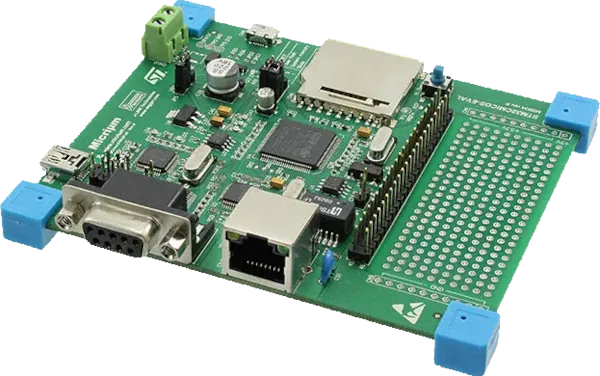

<!-- Copyright 2015-2026 Zephyr Project members and individual contributors. -->
<!-- SPDX-License-Identifier: Apache-2.0 -->
<!-- 中文翻译；编号、导航与译注为本地新增。 -->

<a id="stm32_micrium"></a>

# 第14章\_STM32-MICRIUM

原文：[官方页面](https://docs.zephyrproject.org/latest/boards/st/stm32_micrium/doc/index.html)。读取日期：2026-10-16；来源摘要见[来源记录](../SOURCES.md)。

开发板概览（Board Overview）

<a id="id1"></a>

[](images/stm32_micrium.webp)

STM32-MICRIUM

名称（Name）：

`stm32_micrium`

厂商（Vendor）：

[意法半导体（STMicroelectronics）](https://docs.zephyrproject.org/latest/boards/index.html#vendor=st)

状态（Status）：

维护中（Maintained）

架构（Architecture）：

[arm](https://docs.zephyrproject.org/latest/boards/index.html#arch=arm)

片上系统（SoC）：

[stm32f107xc](https://docs.zephyrproject.org/latest/boards/index.html#soc=stm32f107xc)

<a id="board-github-link"></a>

[浏览开发板源码（Browse Board Sources）](https://github.com/zephyrproject-rtos/zephyr/blob/main//boards/st/stm32_micrium/doc/index.rst/../..)<a id="overview"></a>

## 概述（Overview）

STM32-MICRIUM是STM32F107VCT6的开发平台，引出了该连接型STM32F107的以太网MAC、USB OTG全速、CAN、SD卡槽及RS-232接口，并内置SEGGER J-Link调试器。

<a id="id3"></a>

更多信息见[STM32-MICRIUM用户手册](https://web.archive.org/web/20170704164211/http://www.st.com/content/ccc/resource/technical/document/user_manual/9e/35/1b/4b/c3/3f/46/33/CD00246066.pdf/files/CD00246066.pdf/jcr:content/translations/en.CD00246066.pdf)[注1](#id2)。

<a id="hardware"></a>

## 硬件（Hardware）


- LQFP100封装的STM32F107VCT6微控制器
- Arm® 32位Cortex®-M3 CPU
- 256 KB Flash
- 64 KB SRAM
- 25 MHz晶体振荡器
- 用于RTC的32.768 kHz晶体振荡器
- 10/100以太网，TI DP83848CVV PHY使用MII模式
- USB OTG全速Micro-AB接口，配有STMPS2141 VBUS电源开关
- 1路CAN，带SN65HVD230收发器
- SD卡槽
- STLM75温度传感器
- DB-9 RS-232接口，带硬件流控（Hardware Flow Control）
- 3个用户LED：绿色、橙色及红色
- 46针扩展连接器及原型制作区
- 板载SEGGER J-Link，通过Mini-B USB提供JTAG及SWD
- 从J-Link USB连接器或5 V螺丝端子供电

<a id="id5"></a>

<a id="id7"></a>

微控制器详情见ST官网的STM32F107VC产品页[注2](#id4)及[STM32F105xx/107xx参考手册](https://www.st.com/resource/en/reference_manual/rm0008-stm32f101xx-stm32f102xx-stm32f103xx-stm32f105xx-and-stm32f107xx-advanced-armbased-32bit-mcus-stmicroelectronics.pdf)[注3](#id6)。（[STM32F107VC在ST官网的产品页](https://www.st.com/en/microcontrollers-microprocessors/stm32f107vc.html)）

<a id="supported-features"></a>

### 支持的功能（Supported Features）

`stm32_micrium`开发板支持下表所列的硬件功能。

片上／板载（On-Chip / On-Board）

功能集成在片上系统（SoC）内／位于开发板上。

2 / 2

分别表示已启用／已禁用的实例数。点击数量标签，可查看开发板或SoC设备树源码（DTS）中该功能的第一个实例。

`vnd,foo`

与此功能匹配的设备树绑定兼容字符串（Compatible String）；点击链接可查看绑定文档。

<a id="stm32_micrium-hw-features"></a>

<a id="stm32_micrium-stm32_micrium/stm32f107xc-hw-features-section"></a>

#### `stm32_micrium/stm32f107xc`目标（Target）

<a id="stm32_micrium-stm32_micrium/stm32f107xc-hw-features-panel"></a>

<a id="stm32_micrium-stm32_micrium/stm32f107xc-hw-features-memory"></a>

该开发板目标的片上存储容量：64 KiB RAM、256 KiB Flash。

<a id="stm32_micrium-stm32_micrium/stm32f107xc-hw-features-table"></a>

<table>
<tr>
<th>类型（Type）</th>
<th>位置（Location）</th>
<th>说明（Description）</th>
<th>兼容字符串（Compatible）</th>
</tr>
<tr>
<td rowspan="1">中央处理器（CPU）</td>
<td>片上（On-Chip）</td>
<td>ARM Cortex-M3处理器（CPU）（<a href="https://github.com/zephyrproject-rtos/zephyr/blob/main/dts/arm/st/f1/stm32f1.dtsi?plain=1#L32">已启用：1</a>）</td>
<td><a href="../cpu_arm_riscv_binding_reference/P021_arm_cortex-m3.md#std-dtcompatible-arm-cortex-m3"><code>arm,cortex-m3</code></a></td>
</tr>
<tr>
<td rowspan="1">模数转换器（ADC）</td>
<td>片上（On-Chip）</td>
<td>STM32F1模数转换器（ADC）（<a href="https://github.com/zephyrproject-rtos/zephyr/blob/main/dts/arm/st/f1/stm32f1.dtsi?plain=1#L354">已禁用：1</a>）</td>
<td><a href="../hardware/P840_STM32F1模数转换器绑定.md#dtbinding-st-stm32f1-adc"><code>st,stm32f1-adc</code></a></td>
</tr>
<tr>
<td rowspan="1">控制器局域网（CAN）</td>
<td>片上（On-Chip）</td>
<td>STM32 CAN 控制器（Controller）（<a href="https://github.com/zephyrproject-rtos/zephyr/blob/main/dts/arm/st/f1/stm32f105.dtsi?plain=1#L37">已启用：1</a>；<a href="https://github.com/zephyrproject-rtos/zephyr/blob/main/dts/arm/st/f1/stm32f105.dtsi?plain=1#L46">已禁用：1</a>）</td>
<td><a href="../can_nxp_renesas_stm32_ti_binding_reference/P011_st_stm32-bxcan.md#std-dtcompatible-st-stm32-bxcan"><code>st,stm32-bxcan</code></a></td>
</tr>
<tr>
<td rowspan="6">时钟控制（Clock Control）</td>
<td>片上（On-Chip）</td>
<td>STM32复位和时钟控制器（RCC / Reset and Clock Controller）（<a href="https://github.com/zephyrproject-rtos/zephyr/blob/main/dts/arm/st/f1/stm32f1.dtsi?plain=1#L127">已启用：1</a>）</td>
<td><a href="../timer_reference/P126_STM32复位与时钟控制绑定.md#dtbinding-st-stm32-rcc"><code>st,stm32-rcc</code></a></td>
</tr>
<tr>
<td>片上（On-Chip）</td>
<td>STM32 外部高速时钟（HSE Clock）（<a href="https://github.com/zephyrproject-rtos/zephyr/blob/main/dts/arm/st/f1/stm32f1.dtsi?plain=1#L64">已启用：1</a>）</td>
<td><a href="../timer_reference/P129_STM32高速外部时钟绑定.md#dtbinding-st-stm32-hse-clock"><code>st,stm32-hse-clock</code></a></td>
</tr>
<tr>
<td>片上（On-Chip）</td>
<td>通用固定频率时钟提供者（Fixed-Rate Clock Provider）（<a href="https://github.com/zephyrproject-rtos/zephyr/blob/main/dts/arm/st/f1/stm32f1.dtsi?plain=1#L77">已启用：1</a>；<a href="https://github.com/zephyrproject-rtos/zephyr/blob/main/dts/arm/st/f1/stm32f1.dtsi?plain=1#L70">已禁用：2</a>）</td>
<td><a href="../hardware/P566_固定时钟绑定.md#dtbinding-fixed-clock"><code>fixed-clock</code></a></td>
</tr>
<tr>
<td>片上（On-Chip）</td>
<td>STM32F105/F107主PLL（<a href="https://github.com/zephyrproject-rtos/zephyr/blob/main/dts/arm/st/f1/stm32f105.dtsi?plain=1#L14">已启用：1</a>）</td>
<td><a href="../timer_reference/P139_STM32F105锁相环时钟绑定.md#dtbinding-st-stm32f105-pll-clock"><code>st,stm32f105-pll-clock</code></a></td>
</tr>
<tr>
<td>片上（On-Chip）</td>
<td>STM32F105/F107第二锁相环（PLL2）（<a href="https://github.com/zephyrproject-rtos/zephyr/blob/main/dts/arm/st/f1/stm32f105.dtsi?plain=1#L20">已启用：1</a>）</td>
<td><a href="../timer_reference/P140_STM32F105第二锁相环绑定.md#dtbinding-st-stm32f105-pll2-clock"><code>st,stm32f105-pll2-clock</code></a></td>
</tr>
<tr>
<td>片上（On-Chip）</td>
<td>STM32F1微控制器时钟输出（MCO）（<a href="https://github.com/zephyrproject-rtos/zephyr/blob/main/dts/arm/st/f1/stm32f1.dtsi?plain=1#L99">已禁用：1</a>）</td>
<td><a href="../timer_reference/P135_STM32F1时钟输出绑定.md#dtbinding-st-stm32f1-clock-mco"><code>st,stm32f1-clock-mco</code></a></td>
</tr>
<tr>
<td rowspan="1">计数器（Counter）</td>
<td>片上（On-Chip）</td>
<td>STM32 计数器（Counters）（<a href="https://github.com/zephyrproject-rtos/zephyr/blob/main/dts/arm/st/f1/stm32f1.dtsi?plain=1#L273">已禁用：7</a>）</td>
<td><a href="../stm32_ti_xilinx_counter_binding_reference/P007_st_stm32-counter.md#std-dtcompatible-st-stm32-counter"><code>st,stm32-counter</code></a></td>
</tr>
<tr>
<td rowspan="1">数模转换器（DAC）</td>
<td>片上（On-Chip）</td>
<td>STM32 系列数模转换器（DAC）（<a href="https://github.com/zephyrproject-rtos/zephyr/blob/main/dts/arm/st/f1/stm32f105.dtsi?plain=1#L56">已禁用：1</a>）</td>
<td><a href="../hardware/P760_STM32数模转换器绑定.md#dtbinding-st-stm32-dac"><code>st,stm32-dac</code></a></td>
</tr>
<tr>
<td rowspan="1">直接存储器访问（DMA）</td>
<td>片上（On-Chip）</td>
<td>用于stm32F0、stm32F1和stm32L1片上系统（SoC）系列的STM32直接存储器访问控制器（DMA，V2bis）（<a href="https://github.com/zephyrproject-rtos/zephyr/blob/main/dts/arm/st/f1/stm32f1.dtsi?plain=1#L378">已禁用：2</a>）</td>
<td><a href="../stm32_ti_xilinx_dma_binding_reference/P009_st_stm32-dma-v2bis.md#std-dtcompatible-st-stm32-dma-v2bis"><code>st,stm32-dma-v2bis</code></a></td>
</tr>
<tr>
<td rowspan="4">以太网（Ethernet）</td>
<td>片上（On-Chip）</td>
<td>ST STM32 以太网媒体访问控制器（Ethernet MAC）（<a href="https://github.com/zephyrproject-rtos/zephyr/blob/main/dts/arm/st/f1/stm32f107.dtsi?plain=1#L22">已启用：1</a>）</td>
<td><a href="../ethernet_synopsys_st_xilinx_binding_reference/P009_st_stm32-ethernet.md#std-dtcompatible-st-stm32-ethernet"><code>st,stm32-ethernet</code></a></td>
</tr>
<tr>
<td>片上（On-Chip）</td>
<td>Synopsys DesignWare MAC 的管理数据输入输出控制器（MDIO Controller）（<a href="https://github.com/zephyrproject-rtos/zephyr/blob/main/dts/arm/st/f1/stm32f107.dtsi?plain=1#L41">已启用：1</a>）</td>
<td><a href="../ethernet_mdio_microchip_binding_reference/P010_snps_dwmac-mdio.md#std-dtcompatible-snps-dwmac-mdio"><code>snps,dwmac-mdio</code></a></td>
</tr>
<tr>
<td>板载（On-Board）</td>
<td>通用媒体独立接口物理层（MII PHY）（<a href="https://github.com/zephyrproject-rtos/zephyr/blob/main/boards/st/stm32_micrium/stm32_micrium.dts?plain=1#L162">已启用：1</a>）</td>
<td><a href="../ethernet_nxp_phy_binding_reference/P019_ethernet-phy.md#std-dtcompatible-ethernet-phy"><code>ethernet-phy</code></a></td>
</tr>
<tr>
<td>片上（On-Chip）</td>
<td>Synopsys DesignWare MAC 精确时间协议时钟（Precision Time Protocol，PTP Clock）（<a href="https://github.com/zephyrproject-rtos/zephyr/blob/main/dts/arm/st/f1/stm32f107.dtsi?plain=1#L48">已启用：1</a>）</td>
<td><a href="../ethernet_synopsys_st_xilinx_binding_reference/P006_snps_dwmac-ptp-clock.md#std-dtcompatible-snps-dwmac-ptp-clock"><code>snps,dwmac-ptp-clock</code></a></td>
</tr>
<tr>
<td rowspan="1">闪存控制器（Flash Controller）</td>
<td>片上（On-Chip）</td>
<td>STM32 系列闪存控制器（Flash Controller）（<a href="https://github.com/zephyrproject-rtos/zephyr/blob/main/dts/arm/st/f1/stm32f1.dtsi?plain=1#L107">已启用：1</a>）</td>
<td><a href="../flash_renesas_st_ti_binding_reference/P011_st_stm32-flash-controller.md#std-dtcompatible-st-stm32-flash-controller"><code>st,stm32-flash-controller</code></a></td>
</tr>
<tr>
<td rowspan="1">通用输入输出与接插件（GPIO &amp; Headers）</td>
<td>片上（On-Chip）</td>
<td>STM32 通用输入输出控制器（GPIO Controller）（<a href="https://github.com/zephyrproject-rtos/zephyr/blob/main/dts/arm/st/f1/stm32f1.dtsi?plain=1#L160">已启用：5</a>）</td>
<td><a href="../gpio_silabs_st_connectors_binding_reference/P029_st_stm32-gpio.md#std-dtcompatible-st-stm32-gpio"><code>st,stm32-gpio</code></a></td>
</tr>
<tr>
<td rowspan="1">集成电路间总线（I2C）</td>
<td>片上（On-Chip）</td>
<td>STM32 I2C V1 控制器（Controller）（<a href="https://github.com/zephyrproject-rtos/zephyr/blob/main/dts/arm/st/f1/stm32f1.dtsi?plain=1#L219">已启用：1</a>；<a href="https://github.com/zephyrproject-rtos/zephyr/blob/main/dts/arm/st/f1/stm32f105.dtsi?plain=1#L73">已禁用：1</a>）</td>
<td><a href="../i2c_stm32_ti_mux_binding_reference/P007_st_stm32-i2c-v1.md#std-dtcompatible-st-stm32-i2c-v1"><code>st,stm32-i2c-v1</code></a></td>
</tr>
<tr>
<td rowspan="2">中断控制器（Interrupt Controller）</td>
<td>片上（On-Chip）</td>
<td>ARMv7-M 嵌套向量中断控制器（Nested Vectored Interrupt Controller，NVIC）（<a href="https://github.com/zephyrproject-rtos/zephyr/blob/main/dts/arm/armv7-m.dtsi?plain=1#L13">已启用：1</a>）</td>
<td><a href="../arm_interrupt_timer_binding_reference/P002_ARMv7_M_NVIC.md#std-dtcompatible-arm-v7m-nvic"><code>arm,v7m-nvic</code></a></td>
</tr>
<tr>
<td>片上（On-Chip）</td>
<td>STM32 外部中断控制器（External Interrupt Controller）（<a href="https://github.com/zephyrproject-rtos/zephyr/blob/main/dts/arm/st/f1/stm32f1.dtsi?plain=1#L138">已启用：1</a>）</td>
<td><a href="../mcu_external_interrupt_binding_reference/P001_st_stm32-exti.md#std-dtcompatible-st-stm32-exti"><code>st,stm32-exti</code></a></td>
</tr>
<tr>
<td rowspan="1">发光二极管（LED）</td>
<td>板载（On-Board）</td>
<td>一组由 GPIO 控制的 LED（GPIO-Controlled LEDs）（<a href="https://github.com/zephyrproject-rtos/zephyr/blob/main/boards/st/stm32_micrium/stm32_micrium.dts?plain=1#L22">已启用：1</a>）</td>
<td><a href="../hardware/P564_GPIO指示灯绑定.md#dtbinding-gpio-leds"><code>gpio-leds</code></a></td>
</tr>
<tr>
<td rowspan="1">存储技术设备（MTD）</td>
<td>片上（On-Chip）</td>
<td>STM32闪存（Flash Memory）（<a href="https://github.com/zephyrproject-rtos/zephyr/blob/main/dts/arm/st/f1/stm32f1.dtsi?plain=1#L117">已启用：1</a>）</td>
<td><a href="../mtd_nxp_st_ti_partition_binding_reference/P016_st_stm32-nv-flash.md#std-dtcompatible-st-stm32-nv-flash"><code>st,stm32-nv-flash</code></a></td>
</tr>
<tr>
<td rowspan="1">物理层（PHY）</td>
<td>片上（On-Chip）</td>
<td>用于所有内置于 USB IP 的 USB 收发器（USB Transceivers）的绑定。（<a href="https://github.com/zephyrproject-rtos/zephyr/blob/main/dts/arm/st/f1/stm32f105.dtsi?plain=1#L231">已启用：1</a>）</td>
<td><a href="../phy_binding_reference/P008_usb-nop-xceiv.md#std-dtcompatible-usb-nop-xceiv"><code>usb-nop-xceiv</code></a></td>
</tr>
<tr>
<td rowspan="1">引脚控制（Pin Control）</td>
<td>片上（On-Chip）</td>
<td>STM32F1引脚控制器（Pin Controller）（<a href="https://github.com/zephyrproject-rtos/zephyr/blob/main/dts/arm/st/f1/stm32f1.dtsi?plain=1#L153">已启用：1</a>）</td>
<td><a href="../pinctrl_stm32_ti_xilinx_binding_reference/P005_st_stm32f1-pinctrl.md#std-dtcompatible-st-stm32f1-pinctrl"><code>st,stm32f1-pinctrl</code></a></td>
</tr>
<tr>
<td rowspan="2">电源管理（Power Management）</td>
<td>片上（On-Chip）</td>
<td>STM32 电源控制器（Power Controller）（<a href="https://github.com/zephyrproject-rtos/zephyr/blob/main/dts/arm/st/f1/stm32f1.dtsi?plain=1#L387">已启用：1</a>）</td>
<td><a href="../stm32_soc_power_binding_reference/P010_st_stm32-pwr.md#std-dtcompatible-st-stm32-pwr"><code>st,stm32-pwr</code></a></td>
</tr>
<tr>
<td>片上（On-Chip）</td>
<td>STM32F1 风格的唤醒引脚控制器（Wake-Up Pins Controller）（<a href="https://github.com/zephyrproject-rtos/zephyr/blob/main/dts/arm/st/f1/stm32f1.dtsi?plain=1#L391">已禁用：1</a>）</td>
<td><a href="../stm32_soc_power_binding_reference/P011_st_stm32f1-pwr-wkupctrl.md#std-dtcompatible-st-stm32f1-pwr-wkupctrl"><code>st,stm32f1-pwr-wkupctrl</code></a></td>
</tr>
<tr>
<td rowspan="1">脉宽调制（PWM）</td>
<td>片上（On-Chip）</td>
<td>STM32 脉宽调制（PWM）（<a href="https://github.com/zephyrproject-rtos/zephyr/blob/main/dts/arm/st/f1/stm32f1.dtsi?plain=1#L267">已禁用：5</a>）</td>
<td><a href="../pwm_stm32_ti_generic_binding_reference/P011_st_stm32-pwm.md#std-dtcompatible-st-stm32-pwm"><code>st,stm32-pwm</code></a></td>
</tr>
<tr>
<td rowspan="1">复位控制器（Reset Controller）</td>
<td>片上（On-Chip）</td>
<td>STM32 复位与时钟控制器（Reset and Clock Control，RCC）（<a href="https://github.com/zephyrproject-rtos/zephyr/blob/main/dts/arm/st/f1/stm32f1.dtsi?plain=1#L132">已启用：1</a>）</td>
<td><a href="../reset_controller_binding_reference/P017_st_stm32-rcc-rctl.md#std-dtcompatible-st-stm32-rcc-rctl"><code>st,stm32-rcc-rctl</code></a></td>
</tr>
<tr>
<td rowspan="1">实时时钟（RTC）</td>
<td>片上（On-Chip）</td>
<td>STM32 实时时钟（RTC）（<a href="https://github.com/zephyrproject-rtos/zephyr/blob/main/dts/arm/st/f1/stm32f1.dtsi?plain=1#L343">已禁用：1</a>）</td>
<td><a href="../soc_rtc_binding_reference/P014_st_stm32-rtc.md#std-dtcompatible-st-stm32-rtc"><code>st,stm32-rtc</code></a></td>
</tr>
<tr>
<td rowspan="3">传感器（Sensors）</td>
<td>板载（On-Board）</td>
<td>LM75双线接口数字温度传感器（<a href="https://github.com/zephyrproject-rtos/zephyr/blob/main/boards/st/stm32_micrium/stm32_micrium.dts?plain=1#L97">已启用：1</a>）</td>
<td><a href="../sensor_liteon_maxim_temperature_binding_reference/P009_lm75.md#std-dtcompatible-lm75"><code>lm75</code></a></td>
</tr>
<tr>
<td>片上（On-Chip）</td>
<td>STM32 正交解码器（Quadrature Decoder）（<a href="https://github.com/zephyrproject-rtos/zephyr/blob/main/dts/arm/st/f1/stm32f1.dtsi?plain=1#L278">已禁用：5</a>）</td>
<td><a href="../sensor_st_lsm_stm32_binding_reference/P028_st_stm32-qdec.md#std-dtcompatible-st-stm32-qdec"><code>st,stm32-qdec</code></a></td>
</tr>
<tr>
<td>片上（On-Chip）</td>
<td>STM32内部温度传感器（Internal Temperature Sensor）（<a href="https://github.com/zephyrproject-rtos/zephyr/blob/main/dts/arm/st/f1/stm32f1.dtsi?plain=1#L407">已禁用：1</a>）</td>
<td><a href="../sensor_st_lsm_stm32_binding_reference/P030_st_stm32-temp.md#std-dtcompatible-st-stm32-temp"><code>st,stm32-temp</code></a></td>
</tr>
<tr>
<td rowspan="2">串行控制器（Serial Controller）</td>
<td>片上（On-Chip）</td>
<td>STM32 通用同步／异步收发器（USART）（<a href="https://github.com/zephyrproject-rtos/zephyr/blob/main/dts/arm/st/f1/stm32f1.dtsi?plain=1#L210">已启用：1</a>；<a href="https://github.com/zephyrproject-rtos/zephyr/blob/main/dts/arm/st/f1/stm32f1.dtsi?plain=1#L201">已禁用：2</a>）</td>
<td><a href="../uart_silabs_stm32_ti_binding_reference/P016_st_stm32-usart.md#std-dtcompatible-st-stm32-usart"><code>st,stm32-usart</code></a></td>
</tr>
<tr>
<td>片上（On-Chip）</td>
<td>STM32 通用异步收发器（UART）（<a href="https://github.com/zephyrproject-rtos/zephyr/blob/main/dts/arm/st/f1/stm32f105.dtsi?plain=1#L114">已禁用：2</a>）</td>
<td><a href="../uart_silabs_stm32_ti_binding_reference/P015_st_stm32-uart.md#std-dtcompatible-st-stm32-uart"><code>st,stm32-uart</code></a></td>
</tr>
<tr>
<td rowspan="1">系统管理总线（SMbus）</td>
<td>片上（On-Chip）</td>
<td>STM32 系统管理总线控制器（SMBus Controller）（<a href="https://github.com/zephyrproject-rtos/zephyr/blob/main/dts/arm/st/f1/stm32f1.dtsi?plain=1#L416">已禁用：2</a>）</td>
<td><a href="../i3c_smbus_binding_reference/P013_st_stm32-smbus.md#std-dtcompatible-st-stm32-smbus"><code>st,stm32-smbus</code></a></td>
</tr>
<tr>
<td rowspan="1">串行外设接口（SPI）</td>
<td>片上（On-Chip）</td>
<td>STM32 串行外设接口控制器（SPI Controller）（<a href="https://github.com/zephyrproject-rtos/zephyr/blob/main/dts/arm/st/f1/stm32f1.dtsi?plain=1#L231">已启用：1</a>；<a href="https://github.com/zephyrproject-rtos/zephyr/blob/main/dts/arm/st/f1/stm32f105.dtsi?plain=1#L132">已禁用：2</a>）</td>
<td><a href="../spi_stm32_ti_xilinx_binding_reference/P012_st_stm32-spi.md#std-dtcompatible-st-stm32-spi"><code>st,stm32-spi</code></a></td>
</tr>
<tr>
<td rowspan="2">定时器（Timer）</td>
<td>片上（On-Chip）</td>
<td>ARMv7-M 系统节拍（System Tick）（<a href="https://github.com/zephyrproject-rtos/zephyr/blob/main/dts/arm/armv7-m.dtsi?plain=1#L21">已启用：1</a>）</td>
<td><a href="../arm_interrupt_timer_binding_reference/P006_ARMv7_M_SysTick.md#std-dtcompatible-arm-armv7m-systick"><code>arm,armv7m-systick</code></a></td>
</tr>
<tr>
<td>片上（On-Chip）</td>
<td>STM32 定时器（Timers）（<a href="https://github.com/zephyrproject-rtos/zephyr/blob/main/dts/arm/st/f1/stm32f1.dtsi?plain=1#L256">已禁用：7</a>）</td>
<td><a href="../stm32_ti_silabs_timer_binding_reference/P008_st_stm32-timers.md#std-dtcompatible-st-stm32-timers"><code>st,stm32-timers</code></a></td>
</tr>
<tr>
<td rowspan="1">通用串行总线（USB）</td>
<td>片上（On-Chip）</td>
<td>STM32 全速 USB OTG 控制器（OTGFS Controller）（<a href="https://github.com/zephyrproject-rtos/zephyr/blob/main/dts/arm/st/f1/stm32f105.dtsi?plain=1#L217">已启用：1</a>）</td>
<td><a href="../usb_stm32_audio_binding_reference/P004_st_stm32-otgfs.md#std-dtcompatible-st-stm32-otgfs"><code>st,stm32-otgfs</code></a></td>
</tr>
<tr>
<td rowspan="2">看门狗（Watchdog）</td>
<td>片上（On-Chip）</td>
<td>STM32 看门狗（Watchdog）（<a href="https://github.com/zephyrproject-rtos/zephyr/blob/main/dts/arm/st/f1/stm32f1.dtsi?plain=1#L242">已启用：1</a>）</td>
<td><a href="../stm32_ti_xilinx_watchdog_binding_reference/P001_st_stm32-watchdog.md#std-dtcompatible-st-stm32-watchdog"><code>st,stm32-watchdog</code></a></td>
</tr>
<tr>
<td>片上（On-Chip）</td>
<td>STM32 系统窗口看门狗（System Window Watchdog）（<a href="https://github.com/zephyrproject-rtos/zephyr/blob/main/dts/arm/st/f1/stm32f1.dtsi?plain=1#L248">已禁用：1</a>）</td>
<td><a href="../stm32_ti_xilinx_watchdog_binding_reference/P002_st_stm32-window-watchdog.md#std-dtcompatible-st-stm32-window-watchdog"><code>st,stm32-window-watchdog</code></a></td>
</tr>
</table>

<a id="default-zephyr-peripheral-mapping"></a>

#### Zephyr 默认外设映射（Peripheral Mapping）：


- USART2 TX/RX/RTS/CTS：PD5/PD6/PD4/PD3，连接RS-232接口CN7
- I2C1 SCL/SDA：PB6/PB7，STLM75地址0x48，OS/INT连接PB5
- SPI1 SCK/MISO/MOSI/CS：PA5/PA6/PA7/PA8，连接SD卡槽
- SD卡检测：PE6
- CAN1 RX/TX : PD0/PD1
- 以太网MII：PA0、PA1、PA3、PB8、PB10、PB11、PB12、PB13、PC2、PC3及PD8～PD12
- 以太网MDC/MDIO：PC1/PA2
- 以太网PHY中断：PE5
- USB OTG FS DM/DP/VBUS/ID : PA11/PA12/PA9/PA10
- 绿色LED LD1：PD13
- 橙色LED LD2：PD14
- 红色LED LD3：PD15

<a id="system-clock"></a>

#### 系统时钟（System Clock）

系统时钟由25 MHz晶体经PLL2及主PLL产生：HSE先除以5，在PLL2中乘以8得到40 MHz，再除以5并由主PLL乘以9，得到72 MHz系统时钟。OTG全速时钟为PLL VCO输出除以3，即48 MHz。RTC由32.768 kHz晶体驱动。

<a id="ethernet"></a>

#### 以太网（Ethernet）

DP83848 PHY的硬件绑带（Straps）将地址设为1，使用自己的25 MHz晶体，以MII模式连接MAC。

<a id="usb"></a>

#### 通用串行总线（USB）

不能从OTG连接器为开发板供电。PE1上的STMPS2141电源开关用于主机模式VBUS供电；Zephyr只使用设备模式，因此不驱动该开关。

<a id="can"></a>

#### 控制器局域网（CAN）

CAN总线位于CN3第28脚CAN_L及第30脚CAN_H，安装JP1可接入板载120 Ω终端电阻；默认未安装。

<a id="boot-options"></a>

#### 启动选项（Boot Options）

JP4（BOOT0）及JP3（BOOT1）选择启动源。默认JP4选择用户Flash，符合Zephyr要求。

<a id="programming-and-debugging"></a>

## 烧录与调试（Programming and Debugging）

`stm32_micrium`开发板支持下表所列的运行工具（Runners）及相关west命令。

<table>
<tr>
<th></th>
<th>烧录（flash）</th>
<th>调试（debug）</th>
<th>复位（reset）</th>
<th>连接调试会话（attach）</th>
<th>实时传输（rtt）</th>
<th>调试服务器（debugserver）</th>
</tr>
<tr>
<td><a href="https://docs.zephyrproject.org/latest/develop/flash_debug/host-tools.html#runner-jlink">jlink</a></td>
<td>✅（默认 / default）</td>
<td>✅（默认 / default）</td>
<td>✅</td>
<td>✅</td>
<td>✅</td>
<td>✅</td>
</tr>
</table>

板载SEGGER J-Link的SWDIO及SWCLK始终连接STM32F107VCT6，其余JTAG信号TDI、TDO、TRST经默认闭合的SB1～SB3焊桥连接，因此JTAG与SWD均可用。Zephyr运行工具使用SWD，不受这组焊桥开闭影响。JP2默认断开时使用板载探针，短接则断开板载探针，可在CN3连接外部JTAG/SWD探针。PA15、PB3、PB4由JTAG与CN3共享，若作GPIO，须断开SB1～SB3并通过pinctrl的swj-cfg属性禁用JTAG。

stm32_micrium开发板的应用可按常规方式构建和烧录，详见“[构建应用（Building an Application）](../application/P001_应用开发.md#build-an-application)”与“[运行应用（Run an Application）](https://docs.zephyrproject.org/latest/develop/application/index.html#application-run)”。

<a id="flashing"></a>

### 烧录（Flashing）

<a id="id9"></a>

默认运行工具为[J-Link](https://www.segger.com/products/debug-probes/j-link/)[注4](#id8)。将J-Link Mini-B接口CN5连接主机，JP5位于默认位置时也由此为板卡供电。

以下以[Blinky](../getting_started/P004_LED闪烁示例.md#blinky)应用为例。

```text
# From the root of the zephyr repository
west build -b stm32_micrium samples/basic/blinky
west flash
```

绿色LED应每秒闪烁。

<a id="debugging"></a>

### 调试（Debugging）

控制台位于RS-232接口CN7，波特率115200。RTS及CTS虽已连接USART2，但默认关闭硬件流控，以支持三线串口线；可通过以下覆盖启用流控：

```text
&usart2 {
    hw-flow-control;
};
```

可以按常规方式调试应用。下面以[Hello World](../getting_started/P005_HelloWorld示例.md#hello_world)应用为例。

```text
# From the root of the zephyr repository
west build -b stm32_micrium samples/hello_world
west debug
```

<a id="references"></a>

## 参考资料（References）

<a id="id2"></a>

〔[1](#id3)〕 [https://web.archive.org/web/20170704164211/http://www.st.com/content/ccc/resource/technical/document/user_manual/9e/35/1b/4b/c3/3f/46/33/CD00246066.pdf/files/CD00246066.pdf/jcr:content/translations/en.CD00246066.pdf](https://web.archive.org/web/20170704164211/http://www.st.com/content/ccc/resource/technical/document/user_manual/9e/35/1b/4b/c3/3f/46/33/CD00246066.pdf/files/CD00246066.pdf/jcr:content/translations/en.CD00246066.pdf)

<a id="id4"></a>

〔[2](#id5)〕 [https://www.st.com/en/microcontrollers-microprocessors/stm32f107vc.html](https://www.st.com/en/microcontrollers-microprocessors/stm32f107vc.html)

<a id="id6"></a>

〔[3](#id7)〕 [https://www.st.com/resource/en/reference_manual/rm0008-stm32f101xx-stm32f102xx-stm32f103xx-stm32f105xx-and-stm32f107xx-advanced-armbased-32bit-mcus-stmicroelectronics.pdf](https://www.st.com/resource/en/reference_manual/rm0008-stm32f101xx-stm32f102xx-stm32f103xx-stm32f105xx-and-stm32f107xx-advanced-armbased-32bit-mcus-stmicroelectronics.pdf)

<a id="id8"></a>

〔[4](#id9)〕 [https://www.segger.com/products/debug-probes/j-link/](https://www.segger.com/products/debug-probes/j-link/)

## 译注

JP2选择板载或外部探针，SB1～SB3及swj-cfg影响JTAG引脚复用；RS-232默认不启用硬件流控。OTG口不能为开发板供电。

## 原文外链核对

2026-10-16核对并重试以下原文外链时未能确认可访问性，保留原始目标，不将访问失败解释为原文内容有误。

- [en.CD00246066.pdf](https://web.archive.org/web/20170704164211/http://www.st.com/content/ccc/resource/technical/document/user_manual/9e/35/1b/4b/c3/3f/46/33/CD00246066.pdf/files/CD00246066.pdf/jcr:content/translations/en.CD00246066.pdf)：HTTP Error 429: Too Many Requests。
- [stm32f107vc.html](https://www.st.com/en/microcontrollers-microprocessors/stm32f107vc.html)：HTTP Error 567: Unknown Status。
- [rm0008-stm32f101xx-stm32f102xx-stm32f103xx-stm32f105xx-and-stm32f107xx-advanced-armbased-32bit-mcus-stmicroelectronics.pdf](https://www.st.com/resource/en/reference_manual/rm0008-stm32f101xx-stm32f102xx-stm32f103xx-stm32f105xx-and-stm32f107xx-advanced-armbased-32bit-mcus-stmicroelectronics.pdf)：HTTP Error 567: Unknown Status。

---

[上一章](P013_STM32373C_Evaluation.md) · [返回大纲](大纲.md) · [全站翻译进度](../PROGRESS.md) · [下一章](P015_STM32C0116-DK_Discovery_Kit.md)
