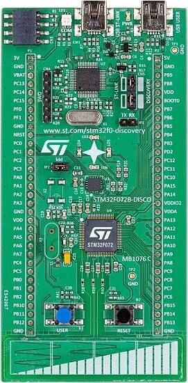

<!-- Copyright 2015-2026 Zephyr Project members and individual contributors. -->
<!-- SPDX-License-Identifier: Apache-2.0 -->
<!-- 中文翻译；编号、导航与译注为本地新增。 -->

<a id="stm32f072b_disco"></a>

# 第17章\_STM32F072B探索板（Discovery）

原文：[官方页面](https://docs.zephyrproject.org/latest/boards/st/stm32f072b_disco/doc/index.html)。读取日期：2026-10-16；来源摘要见[来源记录](../SOURCES.md)。

开发板概览（Board Overview）

<a id="id1"></a>

[](images/stm32f072b_disco.jpg)

STM32F072B探索板（Discovery）

名称（Name）：

`stm32f072b_disco`

厂商（Vendor）：

[意法半导体（STMicroelectronics）](https://docs.zephyrproject.org/latest/boards/index.html#vendor=st)

状态（Status）：

维护中（Maintained）

架构（Architecture）：

[arm](https://docs.zephyrproject.org/latest/boards/index.html#arch=arm)

片上系统（SoC）：

[stm32f072xb](https://docs.zephyrproject.org/latest/boards/index.html#soc=stm32f072xb)

<a id="board-github-link"></a>

[浏览开发板源码（Browse Board Sources）](https://github.com/zephyrproject-rtos/zephyr/blob/main//boards/st/stm32f072b_disco/doc/index.rst/../..)<a id="overview"></a>

## 概述（Overview）

STM32F072B-DISCO Discovery套件搭载基于Arm Cortex-M0的STM32F072RB MCU，提供初学者及有经验用户快速入门所需的功能，主要特点如下：


- STM32微控制器，LQFP64封装
- LQFP64 I/O扩展排针，便于连接原型板及探测信号
- 板载ST-LINK/V2调试器／编程器，带SWD连接器
- 通过USB总线或外部5 V电源供电
- 对外提供3 V及5 V应用电源
- 6个LED：


  - LD1红／绿灯，用于USB通信
  - LD2红灯，表示3.3 V电源接通
  - 4个用户LED：LD3橙色、LD4绿色、LD5红色及LD6蓝色
- 两个按键：USER及RESET
- 用户USB采用Mini-B连接器
- L3GD20：意法半导体MEMS运动传感器，三轴数字输出陀螺仪
- 1个线性触摸传感器或4个触摸键
- 射频EEPROM子板连接器

<a id="id3"></a>

更多信息见[STM32F072B-DISCO网站](https://www.st.com/en/evaluation-tools/32f072bdiscovery.html)[注1](#id2)。

<a id="hardware"></a>

## 硬件（Hardware）

STM32F072B-DISCO Discovery套件提供以下硬件组件：


- LQFP64封装的STM32F072RBTT6
- Arm 32位Cortex-M0 CPU
- CPU最高频率48 MHz
- VDD电压范围2.0–3.6 V
- 128 KB闪存（Flash）
- 16 KB静态随机存储器（SRAM）
- 支持外部中断（External Interrupt）的 GPIO。
- 39通道12位模数转换器（ADC）
- 12位数模转换器（D/A Converters）
- 实时时钟（RTC）
- 12个通用定时器（General Purpose Timers）
- 4 个 USART/UART。
- I2C接口（2路）
- 2路SPI
- 控制器局域网（CAN）
- USB 2.0全速接口（Full Speed）
- 直接存储器访问控制器（DMA Controller）。
- 24路电容感应通道，支持触摸键、线性及旋转触摸传感器

更多STM32F072RB信息见：


- <a id="id7"></a>

  ST官网的STM32F072RB产品页[注3](#id6)（[STM32F072RB在ST官网的产品页](https://www.st.com/en/microcontrollers/stm32f072rb.html)）
- <a id="id9"></a>

  [STM32F072xB参考手册](https://www.st.com/resource/en/reference_manual/dm00031936.pdf)[注4](#id8)

<a id="supported-features"></a>

### 支持的功能（Supported Features）

`stm32f072b_disco`开发板支持下表所列的硬件功能。

片上／板载（On-Chip / On-Board）

功能集成在片上系统（SoC）内／位于开发板上。

2 / 2

分别表示已启用／已禁用的实例数。点击数量标签，可查看开发板或SoC设备树源码（DTS）中该功能的第一个实例。

`vnd,foo`

与此功能匹配的设备树绑定兼容字符串（Compatible String）；点击链接可查看绑定文档。

<a id="stm32f072b_disco-hw-features"></a>

<a id="stm32f072b_disco-stm32f072b_disco/stm32f072xb-hw-features-section"></a>

#### `stm32f072b_disco/stm32f072xb`目标（Target）

<a id="stm32f072b_disco-stm32f072b_disco/stm32f072xb-hw-features-panel"></a>

<a id="stm32f072b_disco-stm32f072b_disco/stm32f072xb-hw-features-memory"></a>

该开发板目标的片上存储容量：16 KiB RAM、128 KiB Flash。

<a id="stm32f072b_disco-stm32f072b_disco/stm32f072xb-hw-features-table"></a>

<table>
<tr>
<th>类型（Type）</th>
<th>位置（Location）</th>
<th>说明（Description）</th>
<th>兼容字符串（Compatible）</th>
</tr>
<tr>
<td rowspan="1">中央处理器（CPU）</td>
<td>片上（On-Chip）</td>
<td>ARM Cortex-M0处理器（CPU）（<a href="https://github.com/zephyrproject-rtos/zephyr/blob/main/dts/arm/st/f0/stm32f0.dtsi?plain=1#L32">已启用：1</a>）</td>
<td><a href="../cpu_arm_riscv_binding_reference/P018_arm_cortex-m0.md#std-dtcompatible-arm-cortex-m0"><code>arm,cortex-m0</code></a></td>
</tr>
<tr>
<td rowspan="1">模数转换器（ADC）</td>
<td>片上（On-Chip）</td>
<td>STM32模数转换器（ADC）（<a href="https://github.com/zephyrproject-rtos/zephyr/blob/main/dts/arm/st/f0/stm32f0.dtsi?plain=1#L404">已禁用：1</a>）</td>
<td><a href="../hardware/P839_STM32模数转换器绑定.md#dtbinding-st-stm32-adc"><code>st,stm32-adc</code></a></td>
</tr>
<tr>
<td rowspan="1">控制器局域网（CAN）</td>
<td>片上（On-Chip）</td>
<td>STM32 CAN 控制器（Controller）（<a href="https://github.com/zephyrproject-rtos/zephyr/blob/main/dts/arm/st/f0/stm32f072.dtsi?plain=1#L13">已启用：1</a>）</td>
<td><a href="../can_nxp_renesas_stm32_ti_binding_reference/P011_st_stm32-bxcan.md#std-dtcompatible-st-stm32-bxcan"><code>st,stm32-bxcan</code></a></td>
</tr>
<tr>
<td rowspan="6">时钟控制（Clock Control）</td>
<td>片上（On-Chip）</td>
<td>STM32F0/G0复位与时钟控制器（RCC）（<a href="https://github.com/zephyrproject-rtos/zephyr/blob/main/dts/arm/st/f0/stm32f0.dtsi?plain=1#L144">已启用：1</a>）</td>
<td><a href="../timer_reference/P171_STM32F0复位与时钟控制绑定.md#dtbinding-st-stm32f0-rcc"><code>st,stm32f0-rcc</code></a></td>
</tr>
<tr>
<td>片上（On-Chip）</td>
<td>STM32 外部高速时钟（HSE Clock）（<a href="https://github.com/zephyrproject-rtos/zephyr/blob/main/dts/arm/st/f0/stm32f0.dtsi?plain=1#L45">已禁用：1</a>）</td>
<td><a href="../timer_reference/P129_STM32高速外部时钟绑定.md#dtbinding-st-stm32-hse-clock"><code>st,stm32-hse-clock</code></a></td>
</tr>
<tr>
<td>片上（On-Chip）</td>
<td>通用固定频率时钟提供者（Fixed-Rate Clock Provider）（<a href="https://github.com/zephyrproject-rtos/zephyr/blob/main/dts/arm/st/f0/stm32f0.dtsi?plain=1#L51">已启用：1</a>；<a href="https://github.com/zephyrproject-rtos/zephyr/blob/main/dts/arm/st/f0/stm32f0.dtsi?plain=1#L58">已禁用：3</a>）</td>
<td><a href="../hardware/P566_固定时钟绑定.md#dtbinding-fixed-clock"><code>fixed-clock</code></a></td>
</tr>
<tr>
<td>片上（On-Chip）</td>
<td>STM32低速外部时钟（LSE Clock）（<a href="https://github.com/zephyrproject-rtos/zephyr/blob/main/dts/arm/st/f0/stm32f0.dtsi?plain=1#L65">已禁用：1</a>）</td>
<td><a href="../timer_reference/P130_STM32低速外部时钟绑定.md#dtbinding-st-stm32-lse-clock"><code>st,stm32-lse-clock</code></a></td>
</tr>
<tr>
<td>片上（On-Chip）</td>
<td>STM32F0/F3主锁相环（Main PLL）（<a href="https://github.com/zephyrproject-rtos/zephyr/blob/main/dts/arm/st/f0/stm32f0.dtsi?plain=1#L80">已启用：1</a>）</td>
<td><a href="../timer_reference/P136_STM32F0锁相环时钟绑定.md#dtbinding-st-stm32f0-pll-clock"><code>st,stm32f0-pll-clock</code></a></td>
</tr>
<tr>
<td>片上（On-Chip）</td>
<td>STM32 微控制器时钟输出（Microcontroller Clock Output，MCO）（<a href="https://github.com/zephyrproject-rtos/zephyr/blob/main/dts/arm/st/f0/stm32f0.dtsi?plain=1#L88">已禁用：1</a>）</td>
<td><a href="../timer_reference/P134_STM32时钟输出绑定.md#dtbinding-st-stm32-clock-mco"><code>st,stm32-clock-mco</code></a></td>
</tr>
<tr>
<td rowspan="1">计数器（Counter）</td>
<td>片上（On-Chip）</td>
<td>STM32 计数器（Counters）（<a href="https://github.com/zephyrproject-rtos/zephyr/blob/main/dts/arm/st/f0/stm32f0.dtsi?plain=1#L294">已禁用：9</a>）</td>
<td><a href="../stm32_ti_xilinx_counter_binding_reference/P007_st_stm32-counter.md#std-dtcompatible-st-stm32-counter"><code>st,stm32-counter</code></a></td>
</tr>
<tr>
<td rowspan="1">循环冗余校验（CRC）</td>
<td>片上（On-Chip）</td>
<td>STM32 CRC 计算单元（Calculation Unit）（<a href="https://github.com/zephyrproject-rtos/zephyr/blob/main/dts/arm/st/f0/stm32f071.dtsi?plain=1#L91">已禁用：1</a>）</td>
<td><a href="../crc_clock_monitor_binding_reference/P011_st_stm32-crc.md#std-dtcompatible-st-stm32-crc"><code>st,stm32-crc</code></a></td>
</tr>
<tr>
<td rowspan="1">数模转换器（DAC）</td>
<td>片上（On-Chip）</td>
<td>STM32 系列数模转换器（DAC）（<a href="https://github.com/zephyrproject-rtos/zephyr/blob/main/dts/arm/st/f0/stm32f051.dtsi?plain=1#L85">已禁用：1</a>）</td>
<td><a href="../hardware/P760_STM32数模转换器绑定.md#dtbinding-st-stm32-dac"><code>st,stm32-dac</code></a></td>
</tr>
<tr>
<td rowspan="1">直接存储器访问（DMA）</td>
<td>片上（On-Chip）</td>
<td>用于stm32F0、stm32F1和stm32L1片上系统（SoC）系列的STM32直接存储器访问控制器（DMA，V2bis）（<a href="https://github.com/zephyrproject-rtos/zephyr/blob/main/dts/arm/st/f0/stm32f0.dtsi?plain=1#L428">已禁用：1</a>）</td>
<td><a href="../stm32_ti_xilinx_dma_binding_reference/P009_st_stm32-dma-v2bis.md#std-dtcompatible-st-stm32-dma-v2bis"><code>st,stm32-dma-v2bis</code></a></td>
</tr>
<tr>
<td rowspan="1">闪存控制器（Flash Controller）</td>
<td>片上（On-Chip）</td>
<td>STM32 系列闪存控制器（Flash Controller）（<a href="https://github.com/zephyrproject-rtos/zephyr/blob/main/dts/arm/st/f0/stm32f0.dtsi?plain=1#L96">已启用：1</a>）</td>
<td><a href="../flash_renesas_st_ti_binding_reference/P011_st_stm32-flash-controller.md#std-dtcompatible-st-stm32-flash-controller"><code>st,stm32-flash-controller</code></a></td>
</tr>
<tr>
<td rowspan="1">通用输入输出与接插件（GPIO &amp; Headers）</td>
<td>片上（On-Chip）</td>
<td>STM32 通用输入输出控制器（GPIO Controller）（<a href="https://github.com/zephyrproject-rtos/zephyr/blob/main/dts/arm/st/f0/stm32f0.dtsi?plain=1#L175">已启用：6</a>）</td>
<td><a href="../gpio_silabs_st_connectors_binding_reference/P029_st_stm32-gpio.md#std-dtcompatible-st-stm32-gpio"><code>st,stm32-gpio</code></a></td>
</tr>
<tr>
<td rowspan="1">集成电路间总线（I2C）</td>
<td>片上（On-Chip）</td>
<td>STM32 I2C V2 控制器（Controller）（<a href="https://github.com/zephyrproject-rtos/zephyr/blob/main/dts/arm/st/f0/stm32f0.dtsi?plain=1#L225">已启用：2</a>）</td>
<td><a href="../i2c_stm32_ti_mux_binding_reference/P008_st_stm32-i2c-v2.md#std-dtcompatible-st-stm32-i2c-v2"><code>st,stm32-i2c-v2</code></a></td>
</tr>
<tr>
<td rowspan="3">输入（Input）</td>
<td>片上（On-Chip）</td>
<td>STM32触摸感应控制器驱动（TSC；原文Tocuh拼写如此）（<a href="https://github.com/zephyrproject-rtos/zephyr/blob/main/dts/arm/st/f0/stm32f0.dtsi?plain=1#L437">已启用：1</a>）</td>
<td><a href="../input_touch_lvgl_gesture_binding_reference/P007_st_stm32-tsc.md#std-dtcompatible-st-stm32-tsc"><code>st,stm32-tsc</code></a></td>
</tr>
<tr>
<td>板载（On-Board）</td>
<td>STM32触摸感应控制器（Touch Sensing Controller，TSC）输入驱动（<a href="https://github.com/zephyrproject-rtos/zephyr/blob/main/boards/st/stm32f072b_disco/stm32f072b_disco.dts?plain=1#L169">已启用：3</a>）</td>
<td><a href="../input_touch_lvgl_gesture_binding_reference/P010_tsc-keys.md#std-dtcompatible-tsc-keys"><code>tsc-keys</code></a></td>
</tr>
<tr>
<td>板载（On-Board）</td>
<td>一组绑定到 GPIO 的输入按键（GPIO-Bound Input Keys）（<a href="https://github.com/zephyrproject-rtos/zephyr/blob/main/boards/st/stm32f072b_disco/stm32f072b_disco.dts?plain=1#L49">已启用：1</a>）</td>
<td><a href="../hardware/P563_GPIO按键绑定.md#std-dtcompatible-gpio-keys"><code>gpio-keys</code></a></td>
</tr>
<tr>
<td rowspan="2">中断控制器（Interrupt Controller）</td>
<td>片上（On-Chip）</td>
<td>ARMv6-M嵌套向量中断控制器（NVIC / Nested Vectored Interrupt Controller）（<a href="https://github.com/zephyrproject-rtos/zephyr/blob/main/dts/arm/armv6-m.dtsi?plain=1#L13">已启用：1</a>）</td>
<td><a href="../arm_interrupt_timer_binding_reference/P001_ARMv6_M_NVIC.md#std-dtcompatible-arm-v6m-nvic"><code>arm,v6m-nvic</code></a></td>
</tr>
<tr>
<td>片上（On-Chip）</td>
<td>STM32 外部中断控制器（External Interrupt Controller）（<a href="https://github.com/zephyrproject-rtos/zephyr/blob/main/dts/arm/st/f0/stm32f0.dtsi?plain=1#L155">已启用：1</a>）</td>
<td><a href="../mcu_external_interrupt_binding_reference/P001_st_stm32-exti.md#std-dtcompatible-st-stm32-exti"><code>st,stm32-exti</code></a></td>
</tr>
<tr>
<td rowspan="2">发光二极管（LED）</td>
<td>板载（On-Board）</td>
<td>一组由 GPIO 控制的 LED（GPIO-Controlled LEDs）（<a href="https://github.com/zephyrproject-rtos/zephyr/blob/main/boards/st/stm32f072b_disco/stm32f072b_disco.dts?plain=1#L25">已启用：1</a>）</td>
<td><a href="../hardware/P564_GPIO指示灯绑定.md#dtbinding-gpio-leds"><code>gpio-leds</code></a></td>
</tr>
<tr>
<td>板载（On-Board）</td>
<td>一组由脉宽调制（PWM）控制的LED（<a href="https://github.com/zephyrproject-rtos/zephyr/blob/main/boards/st/stm32f072b_disco/stm32f072b_disco.dts?plain=1#L59">已禁用：1</a>）</td>
<td><a href="../hardware/P565_PWM指示灯绑定.md#dtbinding-pwm-leds"><code>pwm-leds</code></a></td>
</tr>
<tr>
<td rowspan="1">存储器控制器（Memory Controller）</td>
<td>片上（On-Chip）</td>
<td>STM32 电池备份 RAM（Battery-Backed RAM）（<a href="https://github.com/zephyrproject-rtos/zephyr/blob/main/dts/arm/st/f0/stm32f031.dtsi?plain=1#L43">已禁用：1</a>）</td>
<td><a href="../memory_controller_sdram_psram_binding_reference/P010_st_stm32-bbram.md#std-dtcompatible-st-stm32-bbram"><code>st,stm32-bbram</code></a></td>
</tr>
<tr>
<td rowspan="1">存储技术设备（MTD）</td>
<td>片上（On-Chip）</td>
<td>STM32闪存（Flash Memory）（<a href="https://github.com/zephyrproject-rtos/zephyr/blob/main/dts/arm/st/f0/stm32f0.dtsi?plain=1#L106">已启用：1</a>）</td>
<td><a href="../mtd_nxp_st_ti_partition_binding_reference/P016_st_stm32-nv-flash.md#std-dtcompatible-st-stm32-nv-flash"><code>st,stm32-nv-flash</code></a></td>
</tr>
<tr>
<td rowspan="1">非易失存储器（NVMEM）</td>
<td>片上（On-Chip）</td>
<td>非易失存储器固定布局（Fixed Layout for Non-Volatile Memory）（<a href="https://github.com/zephyrproject-rtos/zephyr/blob/main/dts/arm/st/f0/stm32f0.dtsi?plain=1#L124">已启用：1</a>）</td>
<td><a href="../memory_protection_binding_reference/P009_fixed-layout.md#std-dtcompatible-fixed-layout"><code>fixed-layout</code></a></td>
</tr>
<tr>
<td rowspan="1">一次性可编程存储器（OTP Memory）</td>
<td>片上（On-Chip）</td>
<td>STM32 嵌入式非易失一次性可编程存储器（NVM OTP）（<a href="https://github.com/zephyrproject-rtos/zephyr/blob/main/dts/arm/st/f0/stm32f0.dtsi?plain=1#L120">已启用：1</a>）</td>
<td><a href="../otp_binding_reference/P010_st_stm32-nvm-otp.md#std-dtcompatible-st-stm32-nvm-otp"><code>st,stm32-nvm-otp</code></a></td>
</tr>
<tr>
<td rowspan="1">物理层（PHY）</td>
<td>片上（On-Chip）</td>
<td>用于所有内置于 USB IP 的 USB 收发器（USB Transceivers）的绑定。（<a href="https://github.com/zephyrproject-rtos/zephyr/blob/main/dts/arm/st/f0/stm32f072.dtsi?plain=1#L36">已启用：1</a>）</td>
<td><a href="../phy_binding_reference/P008_usb-nop-xceiv.md#std-dtcompatible-usb-nop-xceiv"><code>usb-nop-xceiv</code></a></td>
</tr>
<tr>
<td rowspan="1">引脚控制（Pin Control）</td>
<td>片上（On-Chip）</td>
<td>STM32 引脚控制器（Pin Controller）（<a href="https://github.com/zephyrproject-rtos/zephyr/blob/main/dts/arm/st/f0/stm32f0.dtsi?plain=1#L168">已启用：1</a>）</td>
<td><a href="../pinctrl_stm32_ti_xilinx_binding_reference/P004_st_stm32-pinctrl.md#std-dtcompatible-st-stm32-pinctrl"><code>st,stm32-pinctrl</code></a></td>
</tr>
<tr>
<td rowspan="1">脉宽调制（PWM）</td>
<td>片上（On-Chip）</td>
<td>STM32 脉宽调制（PWM）（<a href="https://github.com/zephyrproject-rtos/zephyr/blob/main/dts/arm/st/f0/stm32f0.dtsi?plain=1#L317">已启用：1</a>；<a href="https://github.com/zephyrproject-rtos/zephyr/blob/main/dts/arm/st/f0/stm32f0.dtsi?plain=1#L288">已禁用：6</a>）</td>
<td><a href="../pwm_stm32_ti_generic_binding_reference/P011_st_stm32-pwm.md#std-dtcompatible-st-stm32-pwm"><code>st,stm32-pwm</code></a></td>
</tr>
<tr>
<td rowspan="1">复位控制器（Reset Controller）</td>
<td>片上（On-Chip）</td>
<td>STM32 复位与时钟控制器（Reset and Clock Control，RCC）（<a href="https://github.com/zephyrproject-rtos/zephyr/blob/main/dts/arm/st/f0/stm32f0.dtsi?plain=1#L149">已启用：1</a>）</td>
<td><a href="../reset_controller_binding_reference/P017_st_stm32-rcc-rctl.md#std-dtcompatible-st-stm32-rcc-rctl"><code>st,stm32-rcc-rctl</code></a></td>
</tr>
<tr>
<td rowspan="1">实时时钟（RTC）</td>
<td>片上（On-Chip）</td>
<td>STM32 实时时钟（RTC）（<a href="https://github.com/zephyrproject-rtos/zephyr/blob/main/dts/arm/st/f0/stm32f0.dtsi?plain=1#L252">已禁用：1</a>）</td>
<td><a href="../soc_rtc_binding_reference/P014_st_stm32-rtc.md#std-dtcompatible-st-stm32-rtc"><code>st,stm32-rtc</code></a></td>
</tr>
<tr>
<td rowspan="4">传感器（Sensors）</td>
<td>片上（On-Chip）</td>
<td>STM32 正交解码器（Quadrature Decoder）（<a href="https://github.com/zephyrproject-rtos/zephyr/blob/main/dts/arm/st/f0/stm32f0.dtsi?plain=1#L299">已禁用：3</a>）</td>
<td><a href="../sensor_st_lsm_stm32_binding_reference/P028_st_stm32-qdec.md#std-dtcompatible-st-stm32-qdec"><code>st,stm32-qdec</code></a></td>
</tr>
<tr>
<td>片上（On-Chip）</td>
<td>STM32 参考电压（VREF+）（<a href="https://github.com/zephyrproject-rtos/zephyr/blob/main/dts/arm/st/f0/stm32f0.dtsi?plain=1#L448">已禁用：1</a>）</td>
<td><a href="../sensor_st_ti_power_capacitance_binding_reference/P003_st_stm32-vref.md#std-dtcompatible-st-stm32-vref"><code>st,stm32-vref</code></a></td>
</tr>
<tr>
<td>片上（On-Chip）</td>
<td>STM32 系列温度节点（TEMP），用于以两个温度点完成生产校准的传感器。（<a href="https://github.com/zephyrproject-rtos/zephyr/blob/main/dts/arm/st/f0/stm32f031.dtsi?plain=1#L63">已禁用：1</a>）</td>
<td><a href="../sensor_st_lsm_stm32_binding_reference/P029_st_stm32-temp-cal.md#std-dtcompatible-st-stm32-temp-cal"><code>st,stm32-temp-cal</code></a></td>
</tr>
<tr>
<td>片上（On-Chip）</td>
<td>STM32 电池电压（VBAT）（<a href="https://github.com/zephyrproject-rtos/zephyr/blob/main/dts/arm/st/f0/stm32f031.dtsi?plain=1#L75">已禁用：1</a>）</td>
<td><a href="../sensor_st_ti_power_capacitance_binding_reference/P001_st_stm32-vbat.md#std-dtcompatible-st-stm32-vbat"><code>st,stm32-vbat</code></a></td>
</tr>
<tr>
<td rowspan="1">串行控制器（Serial Controller）</td>
<td>片上（On-Chip）</td>
<td>STM32 通用同步／异步收发器（USART）（<a href="https://github.com/zephyrproject-rtos/zephyr/blob/main/dts/arm/st/f0/stm32f0.dtsi?plain=1#L216">已启用：1</a>；<a href="https://github.com/zephyrproject-rtos/zephyr/blob/main/dts/arm/st/f0/stm32f051.dtsi?plain=1#L13">已禁用：3</a>）</td>
<td><a href="../uart_silabs_stm32_ti_binding_reference/P016_st_stm32-usart.md#std-dtcompatible-st-stm32-usart"><code>st,stm32-usart</code></a></td>
</tr>
<tr>
<td rowspan="1">系统管理总线（SMbus）</td>
<td>片上（On-Chip）</td>
<td>STM32 系统管理总线控制器（SMBus Controller）（<a href="https://github.com/zephyrproject-rtos/zephyr/blob/main/dts/arm/st/f0/stm32f0.dtsi?plain=1#L456">已禁用：2</a>）</td>
<td><a href="../i3c_smbus_binding_reference/P013_st_stm32-smbus.md#std-dtcompatible-st-stm32-smbus"><code>st,stm32-smbus</code></a></td>
</tr>
<tr>
<td rowspan="1">串行外设接口（SPI）</td>
<td>片上（On-Chip）</td>
<td>带嵌入式接收和发送先进先出队列（Rx / Tx FIFOs）的STM32 SPI控制器（<a href="https://github.com/zephyrproject-rtos/zephyr/blob/main/dts/arm/st/f0/stm32f0.dtsi?plain=1#L241">已启用：1</a>；<a href="https://github.com/zephyrproject-rtos/zephyr/blob/main/dts/arm/st/f0/stm32f051.dtsi?plain=1#L34">已禁用：1</a>）</td>
<td><a href="../spi_stm32_ti_xilinx_binding_reference/P009_st_stm32-spi-fifo.md#std-dtcompatible-st-stm32-spi-fifo"><code>st,stm32-spi-fifo</code></a></td>
</tr>
<tr>
<td rowspan="2">定时器（Timer）</td>
<td>片上（On-Chip）</td>
<td>ARMv6-M系统节拍（System Tick）（<a href="https://github.com/zephyrproject-rtos/zephyr/blob/main/dts/arm/armv6-m.dtsi?plain=1#L21">已启用：1</a>）</td>
<td><a href="../arm_interrupt_timer_binding_reference/P005_ARMv6_M_SysTick.md#std-dtcompatible-arm-armv6m-systick"><code>arm,armv6m-systick</code></a></td>
</tr>
<tr>
<td>片上（On-Chip）</td>
<td>STM32 定时器（Timers）（<a href="https://github.com/zephyrproject-rtos/zephyr/blob/main/dts/arm/st/f0/stm32f0.dtsi?plain=1#L306">已启用：1</a>；<a href="https://github.com/zephyrproject-rtos/zephyr/blob/main/dts/arm/st/f0/stm32f0.dtsi?plain=1#L277">已禁用：8</a>）</td>
<td><a href="../stm32_ti_silabs_timer_binding_reference/P008_st_stm32-timers.md#std-dtcompatible-st-stm32-timers"><code>st,stm32-timers</code></a></td>
</tr>
<tr>
<td rowspan="1">通用串行总线（USB）</td>
<td>片上（On-Chip）</td>
<td>STM32 USB控制器（Controller）（<a href="https://github.com/zephyrproject-rtos/zephyr/blob/main/dts/arm/st/f0/stm32f072.dtsi?plain=1#L21">已禁用：1</a>）</td>
<td><a href="../usb_stm32_audio_binding_reference/P006_st_stm32-usb.md#std-dtcompatible-st-stm32-usb"><code>st,stm32-usb</code></a></td>
</tr>
<tr>
<td rowspan="2">看门狗（Watchdog）</td>
<td>片上（On-Chip）</td>
<td>STM32 看门狗（Watchdog）（<a href="https://github.com/zephyrproject-rtos/zephyr/blob/main/dts/arm/st/f0/stm32f0.dtsi?plain=1#L263">已启用：1</a>）</td>
<td><a href="../stm32_ti_xilinx_watchdog_binding_reference/P001_st_stm32-watchdog.md#std-dtcompatible-st-stm32-watchdog"><code>st,stm32-watchdog</code></a></td>
</tr>
<tr>
<td>片上（On-Chip）</td>
<td>STM32 系统窗口看门狗（System Window Watchdog）（<a href="https://github.com/zephyrproject-rtos/zephyr/blob/main/dts/arm/st/f0/stm32f0.dtsi?plain=1#L269">已禁用：1</a>）</td>
<td><a href="../stm32_ti_xilinx_watchdog_binding_reference/P002_st_stm32-window-watchdog.md#std-dtcompatible-st-stm32-window-watchdog"><code>st,stm32-window-watchdog</code></a></td>
</tr>
</table>

注意（Note）

<a id="id11"></a>

CAN功能需要CAN收发器，例如[SK Pang CAN扩展板](https://www.skpang.co.uk/products/can-bus-can-fd-breakout-board-5v-supply-and-5v-logic)[注5](#id10)。

<a id="pin-mapping"></a>

### 引脚映射（Pin Mapping）

STM32F072B-DISCO Discovery套件有6个GPIO控制器，负责引脚复用、输入输出、上拉等功能。

<a id="id5"></a>

更多细节见[STM32F072B-DISCO开发板用户手册](https://www.st.com/resource/en/user_manual/dm00099401.pdf)[注2](#id4)。

<a id="default-zephyr-peripheral-mapping"></a>

#### Zephyr 默认外设映射（Peripheral Mapping）：


- `UART_1_TX : PB6`
- `UART_1_RX : PB7`
- `I2C1_SCL : PB8`
- `I2C1_SDA : PB9`
- `I2C2_SCL : PB10`
- I2C2_SDA：PB11
- SPI1_SCK : PB3
- SPI1_MISO : PB4
- SPI1_MOSI : PB5
- USER_PB : PA0
- LD3 : PC6
- LD4 : PC8
- LD5 : PC9
- LD6 : PC7
- CAN接收（CAN_RX）：PB8
- `CAN_TX : PB9`

<a id="system-clock"></a>

### 系统时钟（System Clock）

STM32F072B-DISCO系统时钟可来自内部振荡器、外部振荡器或主PLL；原文默认由8 MHz内部振荡器驱动PLL，系统时钟为72 MHz。译注：72 MHz按来源保留，不视为本次验证的器件上限。

<a id="serial-port"></a>

### 串口（Serial Port）

STM32F072B-DISCO Discovery套件最多有4路UART，Zephyr控制台分配给UART1，默认参数115200、8N1。

<a id="programming-and-debugging"></a>

## 烧录与调试（Programming and Debugging）

`stm32f072b_disco`开发板支持下表所列的运行工具（Runners）及相关west命令。

<table>
<tr>
<th></th>
<th>烧录（flash）</th>
<th>调试（debug）</th>
<th>复位（reset）</th>
<th>连接调试会话（attach）</th>
<th>实时传输（rtt）</th>
<th>调试服务器（debugserver）</th>
</tr>
<tr>
<td><a href="https://docs.zephyrproject.org/latest/develop/flash_debug/host-tools.html#runner-jlink">jlink</a></td>
<td>✅</td>
<td>✅</td>
<td>✅</td>
<td>✅</td>
<td>✅</td>
<td>✅</td>
</tr>
<tr>
<td><a href="https://docs.zephyrproject.org/latest/develop/flash_debug/host-tools.html#runner-openocd">openocd</a></td>
<td>✅</td>
<td>✅（默认 / default）</td>
<td></td>
<td>✅</td>
<td>✅</td>
<td>✅</td>
</tr>
<tr>
<td><a href="https://docs.zephyrproject.org/latest/develop/flash_debug/host-tools.html#runner-stm32cubeprogrammer">stm32cubeprogrammer</a></td>
<td>✅（默认 / default）</td>
<td></td>
<td></td>
<td></td>
<td></td>
<td></td>
</tr>
</table>

STM32F072B-DISCO内置ST-LINK/V2调试工具接口。

stm32f072b_disco开发板的应用可按常规方式构建和烧录，详见“[构建应用（Building an Application）](../application/P001_应用开发.md#build-an-application)”与“[运行应用（Run an Application）](https://docs.zephyrproject.org/latest/develop/application/index.html#application-run)”。

<a id="flashing"></a>

### 烧录（Flashing）

<a id="id13"></a>

开发板配置为使用west的[STM32CubeProgrammer](https://www.st.com/en/development-tools/stm32cubeprog.html)运行工具[注6](#id12)烧录，因此必须安装该程序。（[installation](https://docs.zephyrproject.org/latest/develop/flash_debug/host-tools.html#stm32cubeprog-flash-host-tools)）

也可通过`--runner`（或`-r`）选项选择OpenOCD或JLink烧录：

```text
$ west flash --runner openocd
$ west flash --runner jlink
```

<a id="flashing-an-application-to-stm32f072b-disco"></a>

#### 向STM32F072B-DISCO烧录应用

先通过USB将STM32F072B-DISCO Discovery套件连接主机，再构建并烧录应用。

下面以[Hello World](../getting_started/P005_HelloWorld示例.md#hello_world)应用为例。

```text
# From the root of the zephyr repository
west build -b stm32f072b_disco samples/hello_world
west flash
```

运行主机串口程序连接开发板，需要TTL电平3.3 V串口适配器。

```text
$ minicom -D /dev/<tty device>
```

将<tty_device>替换为串口适配器所在端口，例如Linux中的/dev/ttyUSB0。

控制台上应显示以下消息：

```text
Hello World! arm
```

<a id="debugging"></a>

### 调试（Debugging）

可以按常规方式调试应用。下面以[Hello World](../getting_started/P005_HelloWorld示例.md#hello_world)应用为例。

```text
# From the root of the zephyr repository
west build -b stm32f072b_disco samples/hello_world
west debug
```

<a id="references"></a>

## 参考资料（References）

<a id="id2"></a>

〔[1](#id3)〕 [https://www.st.com/en/evaluation-tools/32f072bdiscovery.html](https://www.st.com/en/evaluation-tools/32f072bdiscovery.html)

<a id="id4"></a>

〔[2](#id5)〕 [https://www.st.com/resource/en/user_manual/dm00099401.pdf](https://www.st.com/resource/en/user_manual/dm00099401.pdf)

<a id="id6"></a>

〔[3](#id7)〕 [https://www.st.com/en/microcontrollers/stm32f072rb.html](https://www.st.com/en/microcontrollers/stm32f072rb.html)

<a id="id8"></a>

〔[4](#id9)〕 [https://www.st.com/resource/en/reference_manual/dm00031936.pdf](https://www.st.com/resource/en/reference_manual/dm00031936.pdf)

<a id="id10"></a>

〔[5](#id11)〕 [https://www.skpang.co.uk/products/can-bus-can-fd-breakout-board-5v-supply-and-5v-logic](https://www.skpang.co.uk/products/can-bus-can-fd-breakout-board-5v-supply-and-5v-logic)

<a id="id12"></a>

〔[6](#id13)〕 [https://www.st.com/en/development-tools/stm32cubeprog.html](https://www.st.com/en/development-tools/stm32cubeprog.html)

## 译注

默认PLL频率原文写72 MHz，未改写为已核实的芯片工作上限。TTL串口需3.3 V适配器。

## 原文外链核对

2026-10-16核对并重试以下原文外链时未能确认可访问性，保留原始目标，不将访问失败解释为原文内容有误。

- [can-bus-can-fd-breakout-board-5v-supply-and-5v-logic](https://www.skpang.co.uk/products/can-bus-can-fd-breakout-board-5v-supply-and-5v-logic)：HTTP Error 429: Too Many Requests。
- [stm32cubeprog.html](https://www.st.com/en/development-tools/stm32cubeprog.html)：HTTP Error 567: Unknown Status。
- [32f072bdiscovery.html](https://www.st.com/en/evaluation-tools/32f072bdiscovery.html)：HTTP Error 567: Unknown Status。
- [stm32f072rb.html](https://www.st.com/en/microcontrollers/stm32f072rb.html)：HTTP Error 567: Unknown Status。
- [dm00031936.pdf](https://www.st.com/resource/en/reference_manual/dm00031936.pdf)：HTTP Error 567: Unknown Status。
- [dm00099401.pdf](https://www.st.com/resource/en/user_manual/dm00099401.pdf)：HTTP Error 567: Unknown Status。

---

[上一章](P016_STM32F072_Evaluation.md) · [返回大纲](大纲.md) · [全站翻译进度](../PROGRESS.md) · [下一章](P018_STM32F0_Discovery.md)
