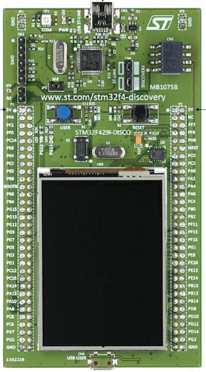

<!-- Copyright 2015-2026 Zephyr Project members and individual contributors. -->
<!-- SPDX-License-Identifier: Apache-2.0 -->
<!-- 中文翻译；编号、导航与译注为本地新增。 -->

<a id="stm32f429i_disc1"></a>

# 第23章\_STM32F429I探索板（Discovery）

原文：[官方页面](https://docs.zephyrproject.org/latest/boards/st/stm32f429i_disc1/doc/index.html)。读取日期：2026-10-16；来源摘要见[来源记录](../SOURCES.md)。

开发板概览（Board Overview）

<a id="id1"></a>

[](images/stm32f429i_disc1.jpg)

STM32F429I探索板（Discovery）

名称（Name）：

`stm32f429i_disc1`

厂商（Vendor）：

[意法半导体（STMicroelectronics）](https://docs.zephyrproject.org/latest/boards/index.html#vendor=st)

状态（Status）：

维护中（Maintained）

架构（Architecture）：

[arm](https://docs.zephyrproject.org/latest/boards/index.html#arch=arm)

片上系统（SoC）：

[stm32f429xx](https://docs.zephyrproject.org/latest/boards/index.html#soc=stm32f429xx)

<a id="board-github-link"></a>

[浏览开发板源码（Browse Board Sources）](https://github.com/zephyrproject-rtos/zephyr/blob/main//boards/st/stm32f429i_disc1/doc/index.rst/../..)<a id="overview"></a>

## 概述（Overview）

STM32F429I-DISC1 Discovery套件搭载基于Arm Cortex-M4的STM32F429ZI MCU，提供丰富连接能力及配置，主要特点如下：


- LQFP144封装的STM32微控制器
- 全部LQFP144 I/O引出到扩展排针，便于连接原型板及探测信号
- 板载ST-LINK/V2-B调试器／编程器，带SWD连接器
- 灵活的开发板供电方式：


  - ST-LINK/V2-B USB连接器
  - P1/P2扩展排针可接外部5 V或3 V电源
- 两个按键：USER及RESET
- USB OTG全速（FS），带Micro-AB接口
- 2.4英寸QVGA TFT LCD，采用RGB接口ILI9341控制器，配有电阻触摸屏
- 64 Mbit SDRAM
- I3G4250D：意法半导体MEMS三轴数字输出陀螺仪；MB1075 E版以前的板卡采用L3GD20
- 6个LED

  > - LD1红／绿灯，用于USB通信
  > - LD2红灯，表示3.3 V电源接通
  > - 2个用户LED：LD3绿色及LD4红色
  > - 2个USB OTG LED：LD5绿色表示VBUS，LD6红色表示过流OC

更多信息见[STM32F429I-DISC1网站](https://www.st.com/en/evaluation-tools/32f429idiscovery.html)。

<a id="hardware"></a>

## 硬件（Hardware）

STM32F429I-DISC1 Discovery套件提供以下硬件组件：


- LQFP144封装的STM32F429ZIT6
- 带浮点单元（FPU）的 ARM 32 位 Cortex-M4 CPU。
- CPU最高频率为180 MHz
- VDD电压范围1.8–3.6 V
- 2 MB闪存（Flash）
- 256 + 4 KB SRAM，包含64 Kbyte内核耦合存储器（Core Coupled Memory）
- 支持外部中断（External Interrupt）的 GPIO。
- 三个12位ADC，合计24个通道
- 两个12位数模转换器（D/A Converters）
- 实时时钟（RTC）
- 高级控制定时器（Advanced-Control Timer）。
- 17个通用定时器（General Purpose Timers）
- 两个看门狗定时器（Watchdog Timers）。
- USART/UART数量：4/4
- 3 个 I2C。
- 6路SPI
- SD输入输出接口（SDIO）
- 2路控制器局域网（CAN）
- USB 2.0 OTG全速（FS），带片上物理层（PHY）
- USB 2.0 OTG高速／全速（HS/FS），带专用DMA、片上全速PHY和ULPI接口
- 10/100以太网媒体访问控制器（Ethernet MAC），带专用DMA
- 8至14位并行摄像头接口（Parallel Camera）
- 循环冗余校验计算单元（CRC Calculation Unit）
- 真随机数发生器（True Random Number Generator）
- 直接存储器访问控制器（DMA Controller）。

STM32F429ZI的更多信息见：


- [STM32F429ZI在ST官网的产品页](https://www.st.com/en/microcontrollers/stm32f429-439.html)
- [STM32F429参考手册](https://www.st.com/content/ccc/resource/technical/document/reference_manual/3d/6d/5a/66/b4/99/40/d4/DM00031020.pdf/files/DM00031020.pdf/jcr:content/translations/en.DM00031020.pdf)

<a id="supported-features"></a>

### 支持的功能（Supported Features）

`stm32f429i_disc1`开发板支持下表所列的硬件功能。

片上／板载（On-Chip / On-Board）

功能集成在片上系统（SoC）内／位于开发板上。

2 / 2

分别表示已启用／已禁用的实例数。点击数量标签，可查看开发板或SoC设备树源码（DTS）中该功能的第一个实例。

`vnd,foo`

与此功能匹配的设备树绑定兼容字符串（Compatible String）；点击链接可查看绑定文档。

<a id="stm32f429i_disc1-hw-features"></a>

<a id="stm32f429i_disc1-stm32f429i_disc1/stm32f429xx-hw-features-section"></a>

#### `stm32f429i_disc1/stm32f429xx`目标（Target）

<a id="stm32f429i_disc1-stm32f429i_disc1/stm32f429xx-hw-features-panel"></a>

<a id="stm32f429i_disc1-stm32f429i_disc1/stm32f429xx-hw-features-memory"></a>

此开发板目标可用存储器：192 KiB RAM、2 MiB 闪存。

<a id="stm32f429i_disc1-stm32f429i_disc1/stm32f429xx-hw-features-table"></a>

<table>
<tr>
<th>类型（Type）</th>
<th>位置（Location）</th>
<th>说明（Description）</th>
<th>兼容字符串（Compatible）</th>
</tr>
<tr>
<td rowspan="1">中央处理器（CPU）</td>
<td>片上（On-Chip）</td>
<td>ARM Cortex-M4F 处理器（CPU）（<a href="https://github.com/zephyrproject-rtos/zephyr/blob/main/dts/arm/st/f4/stm32f4.dtsi?plain=1#L34">已启用：1</a>）</td>
<td><a href="../cpu_arm_riscv_binding_reference/P025_arm_cortex-m4f.md#std-dtcompatible-arm-cortex-m4f"><code>arm,cortex-m4f</code></a></td>
</tr>
<tr>
<td rowspan="1">模数转换器（ADC）</td>
<td>片上（On-Chip）</td>
<td>STM32F4 模数转换器（ADC）（<a href="https://github.com/zephyrproject-rtos/zephyr/blob/main/dts/arm/st/f4/stm32f4.dtsi?plain=1#L611">已禁用：1</a>）</td>
<td><a href="../hardware/P841_STM32F4模数转换器绑定.md#dtbinding-st-stm32f4-adc"><code>st,stm32f4-adc</code></a></td>
</tr>
<tr>
<td rowspan="1">控制器局域网（CAN）</td>
<td>片上（On-Chip）</td>
<td>STM32 CAN 控制器（Controller）（<a href="https://github.com/zephyrproject-rtos/zephyr/blob/main/dts/arm/st/f4/stm32f405.dtsi?plain=1#L223">已禁用：2</a>）</td>
<td><a href="../can_nxp_renesas_stm32_ti_binding_reference/P011_st_stm32-bxcan.md#std-dtcompatible-st-stm32-bxcan"><code>st,stm32-bxcan</code></a></td>
</tr>
<tr>
<td rowspan="5">时钟控制（Clock Control）</td>
<td>片上（On-Chip）</td>
<td>STM32F4 复位与时钟控制器（Reset and Clock Controller，RCC）（<a href="https://github.com/zephyrproject-rtos/zephyr/blob/main/dts/arm/st/f4/stm32f4.dtsi?plain=1#L178">已启用：1</a>）</td>
<td><a href="../timer_reference/P127_STM32F4复位与时钟控制绑定.md#dtbinding-st-stm32f4-rcc"><code>st,stm32f4-rcc</code></a></td>
</tr>
<tr>
<td>片上（On-Chip）</td>
<td>STM32 外部高速时钟（HSE Clock）（<a href="https://github.com/zephyrproject-rtos/zephyr/blob/main/dts/arm/st/f4/stm32f4.dtsi?plain=1#L63">已启用：1</a>）</td>
<td><a href="../timer_reference/P129_STM32高速外部时钟绑定.md#dtbinding-st-stm32-hse-clock"><code>st,stm32-hse-clock</code></a></td>
</tr>
<tr>
<td>片上（On-Chip）</td>
<td>通用固定频率时钟提供者（Fixed-Rate Clock Provider）（<a href="https://github.com/zephyrproject-rtos/zephyr/blob/main/dts/arm/st/f4/stm32f4.dtsi?plain=1#L83">已启用：1</a>；<a href="https://github.com/zephyrproject-rtos/zephyr/blob/main/dts/arm/st/f4/stm32f4.dtsi?plain=1#L69">已禁用：2</a>）</td>
<td><a href="../hardware/P566_固定时钟绑定.md#dtbinding-fixed-clock"><code>fixed-clock</code></a></td>
</tr>
<tr>
<td>片上（On-Chip）</td>
<td>STM32F2、STM32F4、STM32F7 的锁相环节点绑定（PLL Node Binding）（<a href="https://github.com/zephyrproject-rtos/zephyr/blob/main/dts/arm/st/f4/stm32f4.dtsi?plain=1#L90">已启用：2</a>；<a href="https://github.com/zephyrproject-rtos/zephyr/blob/main/dts/arm/st/f4/stm32f401.dtsi?plain=1#L11">已禁用：1</a>）</td>
<td><a href="../timer_reference/P128_STM32Fx锁相环时钟绑定.md#dtbinding-st-stm32fx-pll-clock"><code>st,stm32fx-pll-clock</code></a></td>
</tr>
<tr>
<td>片上（On-Chip）</td>
<td>STM32 微控制器时钟输出（Microcontroller Clock Output，MCO）（<a href="https://github.com/zephyrproject-rtos/zephyr/blob/main/dts/arm/st/f4/stm32f4.dtsi?plain=1#L98">已禁用：2</a>）</td>
<td><a href="../timer_reference/P134_STM32时钟输出绑定.md#dtbinding-st-stm32-clock-mco"><code>st,stm32-clock-mco</code></a></td>
</tr>
<tr>
<td rowspan="1">计数器（Counter）</td>
<td>片上（On-Chip）</td>
<td>STM32 计数器（Counters）（<a href="https://github.com/zephyrproject-rtos/zephyr/blob/main/dts/arm/st/f4/stm32f4.dtsi?plain=1#L396">已禁用：14</a>）</td>
<td><a href="../stm32_ti_xilinx_counter_binding_reference/P007_st_stm32-counter.md#std-dtcompatible-st-stm32-counter"><code>st,stm32-counter</code></a></td>
</tr>
<tr>
<td rowspan="1">数模转换器（DAC）</td>
<td>片上（On-Chip）</td>
<td>STM32 系列数模转换器（DAC）（<a href="https://github.com/zephyrproject-rtos/zephyr/blob/main/dts/arm/st/f4/stm32f405.dtsi?plain=1#L279">已禁用：1</a>）</td>
<td><a href="../hardware/P760_STM32数模转换器绑定.md#dtbinding-st-stm32-dac"><code>st,stm32-dac</code></a></td>
</tr>
<tr>
<td rowspan="3">显示（Display）</td>
<td>片上（On-Chip）</td>
<td>STM32 Chrom-ART 图形加速器（Accelerator，DMA2D）（<a href="https://github.com/zephyrproject-rtos/zephyr/blob/main/dts/arm/st/f4/stm32f427.dtsi?plain=1#L146">已启用：1</a>）</td>
<td><a href="../display_st_ultrachip_zephyr_binding_reference/P003_st_stm32-dma2d.md#std-dtcompatible-st-stm32-dma2d"><code>st,stm32-dma2d</code></a></td>
</tr>
<tr>
<td>片上（On-Chip）</td>
<td>STM32 LCD-TFT 显示控制器（Display Controller）（<a href="https://github.com/zephyrproject-rtos/zephyr/blob/main/dts/arm/st/f4/stm32f429.dtsi?plain=1#L22">已启用：1</a>）</td>
<td><a href="../display_st_ultrachip_zephyr_binding_reference/P004_st_stm32-ltdc.md#std-dtcompatible-st-stm32-ltdc"><code>st,stm32-ltdc</code></a></td>
</tr>
<tr>
<td>板载（On-Board）</td>
<td>奕力（Ilitek）ILI9341显示控制器，320 × 240（<a href="https://github.com/zephyrproject-rtos/zephyr/blob/main/boards/st/stm32f429i_disc1/stm32f429i_disc1.dts?plain=1#L72">已启用：1</a>）</td>
<td><a href="../display_ilitek_matrix_nxp_binding_reference/P004_ilitek_ili9341.md#std-dtcompatible-ilitek-ili9341"><code>ilitek,ili9341</code></a></td>
</tr>
<tr>
<td rowspan="1">直接存储器访问（DMA）</td>
<td>片上（On-Chip）</td>
<td>STM32 DMA 控制器（Controller，V1）（<a href="https://github.com/zephyrproject-rtos/zephyr/blob/main/dts/arm/st/f4/stm32f4.dtsi?plain=1#L636">已禁用：2</a>）</td>
<td><a href="../stm32_ti_xilinx_dma_binding_reference/P007_st_stm32-dma-v1.md#std-dtcompatible-st-stm32-dma-v1"><code>st,stm32-dma-v1</code></a></td>
</tr>
<tr>
<td rowspan="3">以太网（Ethernet）</td>
<td>片上（On-Chip）</td>
<td>ST STM32 以太网媒体访问控制器（Ethernet MAC）（<a href="https://github.com/zephyrproject-rtos/zephyr/blob/main/dts/arm/st/f4/stm32f407.dtsi?plain=1#L13">已禁用：1</a>）</td>
<td><a href="../ethernet_synopsys_st_xilinx_binding_reference/P009_st_stm32-ethernet.md#std-dtcompatible-st-stm32-ethernet"><code>st,stm32-ethernet</code></a></td>
</tr>
<tr>
<td>片上（On-Chip）</td>
<td>Synopsys DesignWare MAC 的管理数据输入输出控制器（MDIO Controller）（<a href="https://github.com/zephyrproject-rtos/zephyr/blob/main/dts/arm/st/f4/stm32f407.dtsi?plain=1#L27">已禁用：1</a>）</td>
<td><a href="../ethernet_mdio_microchip_binding_reference/P010_snps_dwmac-mdio.md#std-dtcompatible-snps-dwmac-mdio"><code>snps,dwmac-mdio</code></a></td>
</tr>
<tr>
<td>片上（On-Chip）</td>
<td>Synopsys DesignWare MAC 精确时间协议时钟（Precision Time Protocol，PTP Clock）（<a href="https://github.com/zephyrproject-rtos/zephyr/blob/main/dts/arm/st/f4/stm32f407.dtsi?plain=1#L34">已启用：1</a>）</td>
<td><a href="../ethernet_synopsys_st_xilinx_binding_reference/P006_snps_dwmac-ptp-clock.md#std-dtcompatible-snps-dwmac-ptp-clock"><code>snps,dwmac-ptp-clock</code></a></td>
</tr>
<tr>
<td rowspan="1">闪存控制器（Flash Controller）</td>
<td>片上（On-Chip）</td>
<td>STM32 系列闪存控制器（Flash Controller）（<a href="https://github.com/zephyrproject-rtos/zephyr/blob/main/dts/arm/st/f4/stm32f4.dtsi?plain=1#L112">已启用：1</a>）</td>
<td><a href="../flash_renesas_st_ti_binding_reference/P011_st_stm32-flash-controller.md#std-dtcompatible-st-stm32-flash-controller"><code>st,stm32-flash-controller</code></a></td>
</tr>
<tr>
<td rowspan="1">通用输入输出与接插件（GPIO &amp; Headers）</td>
<td>片上（On-Chip）</td>
<td>STM32 通用输入输出控制器（GPIO Controller）（<a href="https://github.com/zephyrproject-rtos/zephyr/blob/main/dts/arm/st/f4/stm32f4.dtsi?plain=1#L212">已启用：11</a>）</td>
<td><a href="../gpio_silabs_st_connectors_binding_reference/P029_st_stm32-gpio.md#std-dtcompatible-st-stm32-gpio"><code>st,stm32-gpio</code></a></td>
</tr>
<tr>
<td rowspan="1">集成电路间总线（I2C）</td>
<td>片上（On-Chip）</td>
<td>STM32 I2C V1 控制器（Controller）（<a href="https://github.com/zephyrproject-rtos/zephyr/blob/main/dts/arm/st/f4/stm32f4.dtsi?plain=1#L342">已启用：1</a>；<a href="https://github.com/zephyrproject-rtos/zephyr/blob/main/dts/arm/st/f4/stm32f4.dtsi?plain=1#L318">已禁用：2</a>）</td>
<td><a href="../i2c_stm32_ti_mux_binding_reference/P007_st_stm32-i2c-v1.md#std-dtcompatible-st-stm32-i2c-v1"><code>st,stm32-i2c-v1</code></a></td>
</tr>
<tr>
<td rowspan="2">集成电路间音频总线（I2S）</td>
<td>片上（On-Chip）</td>
<td>STM32 I2S 控制器（Controller）（<a href="https://github.com/zephyrproject-rtos/zephyr/blob/main/dts/arm/st/f4/stm32f401.dtsi?plain=1#L54">已禁用：2</a>）</td>
<td><a href="../i2s_binding_reference/P016_st_stm32-i2s.md#std-dtcompatible-st-stm32-i2s"><code>st,stm32-i2s</code></a></td>
</tr>
<tr>
<td>片上（On-Chip）</td>
<td>STM32 串行音频接口块控制器（SAI Block Controller）（<a href="https://github.com/zephyrproject-rtos/zephyr/blob/main/dts/arm/st/f4/stm32f427.dtsi?plain=1#L119">已禁用：1</a>）</td>
<td><a href="../i2s_binding_reference/P017_st_stm32-sai.md#std-dtcompatible-st-stm32-sai"><code>st,stm32-sai</code></a></td>
</tr>
<tr>
<td rowspan="2">输入（Input）</td>
<td>板载（On-Board）</td>
<td>STMPE811 I2C触摸屏控制器（<a href="https://github.com/zephyrproject-rtos/zephyr/blob/main/boards/st/stm32f429i_disc1/stm32f429i_disc1.dts?plain=1#L179">已启用：1</a>）</td>
<td><a href="../input_touch_lvgl_gesture_binding_reference/P008_st_stmpe811.md#std-dtcompatible-st-stmpe811"><code>st,stmpe811</code></a></td>
</tr>
<tr>
<td>板载（On-Board）</td>
<td>一组绑定到 GPIO 的输入按键（GPIO-Bound Input Keys）（<a href="https://github.com/zephyrproject-rtos/zephyr/blob/main/boards/st/stm32f429i_disc1/stm32f429i_disc1.dts?plain=1#L49">已启用：1</a>）</td>
<td><a href="../hardware/P563_GPIO按键绑定.md#std-dtcompatible-gpio-keys"><code>gpio-keys</code></a></td>
</tr>
<tr>
<td rowspan="2">中断控制器（Interrupt Controller）</td>
<td>片上（On-Chip）</td>
<td>ARMv7-M 嵌套向量中断控制器（Nested Vectored Interrupt Controller，NVIC）（<a href="https://github.com/zephyrproject-rtos/zephyr/blob/main/dts/arm/armv7-m.dtsi?plain=1#L13">已启用：1</a>）</td>
<td><a href="../arm_interrupt_timer_binding_reference/P002_ARMv7_M_NVIC.md#std-dtcompatible-arm-v7m-nvic"><code>arm,v7m-nvic</code></a></td>
</tr>
<tr>
<td>片上（On-Chip）</td>
<td>STM32 外部中断控制器（External Interrupt Controller）（<a href="https://github.com/zephyrproject-rtos/zephyr/blob/main/dts/arm/st/f4/stm32f4.dtsi?plain=1#L189">已启用：1</a>）</td>
<td><a href="../mcu_external_interrupt_binding_reference/P001_st_stm32-exti.md#std-dtcompatible-st-stm32-exti"><code>st,stm32-exti</code></a></td>
</tr>
<tr>
<td rowspan="1">发光二极管（LED）</td>
<td>板载（On-Board）</td>
<td>一组由 GPIO 控制的 LED（GPIO-Controlled LEDs）（<a href="https://github.com/zephyrproject-rtos/zephyr/blob/main/boards/st/stm32f429i_disc1/stm32f429i_disc1.dts?plain=1#L35">已启用：1</a>）</td>
<td><a href="../hardware/P564_GPIO指示灯绑定.md#dtbinding-gpio-leds"><code>gpio-leds</code></a></td>
</tr>
<tr>
<td rowspan="3">存储器控制器（Memory Controller）</td>
<td>片上（On-Chip）</td>
<td>STM32 电池备份 RAM（Battery-Backed RAM）（<a href="https://github.com/zephyrproject-rtos/zephyr/blob/main/dts/arm/st/f4/stm32f4.dtsi?plain=1#L604">已禁用：1</a>）</td>
<td><a href="../memory_controller_sdram_psram_binding_reference/P010_st_stm32-bbram.md#std-dtcompatible-st-stm32-bbram"><code>st,stm32-bbram</code></a></td>
</tr>
<tr>
<td>片上（On-Chip）</td>
<td>STM32 灵活存储器控制器（Flexible Memory Controller，FMC）（<a href="https://github.com/zephyrproject-rtos/zephyr/blob/main/dts/arm/st/f4/stm32f427.dtsi?plain=1#L105">已启用：1</a>）</td>
<td><a href="../memory_controller_sdram_psram_binding_reference/P013_st_stm32-fmc.md#std-dtcompatible-st-stm32-fmc"><code>st,stm32-fmc</code></a></td>
</tr>
<tr>
<td>片上（On-Chip）</td>
<td>STM32 灵活存储器控制器中的 SDRAM 控制器（SDRAM Controller）（<a href="https://github.com/zephyrproject-rtos/zephyr/blob/main/dts/arm/st/f4/stm32f427.dtsi?plain=1#L111">已启用：1</a>）</td>
<td><a href="../memory_controller_sdram_psram_binding_reference/P012_st_stm32-fmc-sdram.md#std-dtcompatible-st-stm32-fmc-sdram"><code>st,stm32-fmc-sdram</code></a></td>
</tr>
<tr>
<td rowspan="1">存储技术设备（MTD）</td>
<td>片上（On-Chip）</td>
<td>STM32F4 闪存（Flash Memory）（<a href="https://github.com/zephyrproject-rtos/zephyr/blob/main/dts/arm/st/f4/stm32f4.dtsi?plain=1#L121">已启用：1</a>）</td>
<td><a href="../mtd_nxp_st_ti_partition_binding_reference/P017_st_stm32f4-nv-flash.md#std-dtcompatible-st-stm32f4-nv-flash"><code>st,stm32f4-nv-flash</code></a></td>
</tr>
<tr>
<td rowspan="1">非易失存储器（NVMEM）</td>
<td>片上（On-Chip）</td>
<td>非易失存储器固定布局（Fixed Layout for Non-Volatile Memory）（<a href="https://github.com/zephyrproject-rtos/zephyr/blob/main/dts/arm/st/f4/stm32f4.dtsi?plain=1#L152">已启用：1</a>）</td>
<td><a href="../memory_protection_binding_reference/P009_fixed-layout.md#std-dtcompatible-fixed-layout"><code>fixed-layout</code></a></td>
</tr>
<tr>
<td rowspan="1">一次性可编程存储器（OTP Memory）</td>
<td>片上（On-Chip）</td>
<td>STM32 嵌入式非易失一次性可编程存储器（NVM OTP）（<a href="https://github.com/zephyrproject-rtos/zephyr/blob/main/dts/arm/st/f4/stm32f4.dtsi?plain=1#L148">已启用：1</a>；<a href="https://github.com/zephyrproject-rtos/zephyr/blob/main/dts/arm/st/f4/stm32f4.dtsi?plain=1#L131">已禁用：1</a>）</td>
<td><a href="../otp_binding_reference/P010_st_stm32-nvm-otp.md#std-dtcompatible-st-stm32-nvm-otp"><code>st,stm32-nvm-otp</code></a></td>
</tr>
<tr>
<td rowspan="1">物理层（PHY）</td>
<td>片上（On-Chip）</td>
<td>用于所有内置于 USB IP 的 USB 收发器（USB Transceivers）的绑定。（<a href="https://github.com/zephyrproject-rtos/zephyr/blob/main/dts/arm/st/f4/stm32f4.dtsi?plain=1#L711">已启用：2</a>）</td>
<td><a href="../phy_binding_reference/P008_usb-nop-xceiv.md#std-dtcompatible-usb-nop-xceiv"><code>usb-nop-xceiv</code></a></td>
</tr>
<tr>
<td rowspan="1">引脚控制（Pin Control）</td>
<td>片上（On-Chip）</td>
<td>STM32 引脚控制器（Pin Controller）（<a href="https://github.com/zephyrproject-rtos/zephyr/blob/main/dts/arm/st/f4/stm32f4.dtsi?plain=1#L205">已启用：1</a>）</td>
<td><a href="../pinctrl_stm32_ti_xilinx_binding_reference/P004_st_stm32-pinctrl.md#std-dtcompatible-st-stm32-pinctrl"><code>st,stm32-pinctrl</code></a></td>
</tr>
<tr>
<td rowspan="2">电源管理（Power Management）</td>
<td>片上（On-Chip）</td>
<td>STM32 电源控制器（Power Controller）（<a href="https://github.com/zephyrproject-rtos/zephyr/blob/main/dts/arm/st/f4/stm32f4.dtsi?plain=1#L665">已启用：1</a>）</td>
<td><a href="../stm32_soc_power_binding_reference/P010_st_stm32-pwr.md#std-dtcompatible-st-stm32-pwr"><code>st,stm32-pwr</code></a></td>
</tr>
<tr>
<td>片上（On-Chip）</td>
<td>STM32F1 风格的唤醒引脚控制器（Wake-Up Pins Controller）（<a href="https://github.com/zephyrproject-rtos/zephyr/blob/main/dts/arm/st/f4/stm32f4.dtsi?plain=1#L669">已禁用：1</a>）</td>
<td><a href="../stm32_soc_power_binding_reference/P011_st_stm32f1-pwr-wkupctrl.md#std-dtcompatible-st-stm32f1-pwr-wkupctrl"><code>st,stm32f1-pwr-wkupctrl</code></a></td>
</tr>
<tr>
<td rowspan="1">脉宽调制（PWM）</td>
<td>片上（On-Chip）</td>
<td>STM32 脉宽调制（PWM）（<a href="https://github.com/zephyrproject-rtos/zephyr/blob/main/dts/arm/st/f4/stm32f4.dtsi?plain=1#L390">已禁用：12</a>）</td>
<td><a href="../pwm_stm32_ti_generic_binding_reference/P011_st_stm32-pwm.md#std-dtcompatible-st-stm32-pwm"><code>st,stm32-pwm</code></a></td>
</tr>
<tr>
<td rowspan="1">复位控制器（Reset Controller）</td>
<td>片上（On-Chip）</td>
<td>STM32 复位与时钟控制器（Reset and Clock Control，RCC）（<a href="https://github.com/zephyrproject-rtos/zephyr/blob/main/dts/arm/st/f4/stm32f4.dtsi?plain=1#L183">已启用：1</a>）</td>
<td><a href="../reset_controller_binding_reference/P017_st_stm32-rcc-rctl.md#std-dtcompatible-st-stm32-rcc-rctl"><code>st,stm32-rcc-rctl</code></a></td>
</tr>
<tr>
<td rowspan="1">随机数生成器（RNG）</td>
<td>片上（On-Chip）</td>
<td>STM32 随机数生成器（Random Number Generator）（<a href="https://github.com/zephyrproject-rtos/zephyr/blob/main/dts/arm/st/f4/stm32f405.dtsi?plain=1#L243">已禁用：1</a>）</td>
<td><a href="../soc_rng_binding_reference/P016_st_stm32-rng.md#std-dtcompatible-st-stm32-rng"><code>st,stm32-rng</code></a></td>
</tr>
<tr>
<td rowspan="1">实时时钟（RTC）</td>
<td>片上（On-Chip）</td>
<td>STM32 实时时钟（RTC）（<a href="https://github.com/zephyrproject-rtos/zephyr/blob/main/dts/arm/st/f4/stm32f4.dtsi?plain=1#L593">已启用：1</a>）</td>
<td><a href="../soc_rtc_binding_reference/P014_st_stm32-rtc.md#std-dtcompatible-st-stm32-rtc"><code>st,stm32-rtc</code></a></td>
</tr>
<tr>
<td rowspan="1">SD 主机控制器（SDHC）</td>
<td>片上（On-Chip）</td>
<td>STM32 SDMMC 主机控制器（Host Controller）（<a href="https://github.com/zephyrproject-rtos/zephyr/blob/main/dts/arm/st/f4/stm32f4.dtsi?plain=1#L655">已禁用：1</a>）</td>
<td><a href="../sdhc_binding_reference/P019_st_stm32-sdmmc.md#std-dtcompatible-st-stm32-sdmmc"><code>st,stm32-sdmmc</code></a></td>
</tr>
<tr>
<td rowspan="4">传感器（Sensors）</td>
<td>片上（On-Chip）</td>
<td>STM32 正交解码器（Quadrature Decoder）（<a href="https://github.com/zephyrproject-rtos/zephyr/blob/main/dts/arm/st/f4/stm32f4.dtsi?plain=1#L401">已禁用：6</a>）</td>
<td><a href="../sensor_st_lsm_stm32_binding_reference/P028_st_stm32-qdec.md#std-dtcompatible-st-stm32-qdec"><code>st,stm32-qdec</code></a></td>
</tr>
<tr>
<td>片上（On-Chip）</td>
<td>STM32 系列温度节点（TEMP），用于以两个温度点完成生产校准的传感器。（<a href="https://github.com/zephyrproject-rtos/zephyr/blob/main/dts/arm/st/f4/stm32f4.dtsi?plain=1#L685">已禁用：1</a>）</td>
<td><a href="../sensor_st_lsm_stm32_binding_reference/P029_st_stm32-temp-cal.md#std-dtcompatible-st-stm32-temp-cal"><code>st,stm32-temp-cal</code></a></td>
</tr>
<tr>
<td>片上（On-Chip）</td>
<td>STM32 参考电压（VREF+）（<a href="https://github.com/zephyrproject-rtos/zephyr/blob/main/dts/arm/st/f4/stm32f4.dtsi?plain=1#L696">已禁用：1</a>）</td>
<td><a href="../sensor_st_ti_power_capacitance_binding_reference/P003_st_stm32-vref.md#std-dtcompatible-st-stm32-vref"><code>st,stm32-vref</code></a></td>
</tr>
<tr>
<td>片上（On-Chip）</td>
<td>STM32 电池电压（VBAT）（<a href="https://github.com/zephyrproject-rtos/zephyr/blob/main/dts/arm/st/f4/stm32f4.dtsi?plain=1#L704">已禁用：1</a>）</td>
<td><a href="../sensor_st_ti_power_capacitance_binding_reference/P001_st_stm32-vbat.md#std-dtcompatible-st-stm32-vbat"><code>st,stm32-vbat</code></a></td>
</tr>
<tr>
<td rowspan="2">串行控制器（Serial Controller）</td>
<td>片上（On-Chip）</td>
<td>STM32 通用同步／异步收发器（USART）（<a href="https://github.com/zephyrproject-rtos/zephyr/blob/main/dts/arm/st/f4/stm32f4.dtsi?plain=1#L291">已启用：1</a>；<a href="https://github.com/zephyrproject-rtos/zephyr/blob/main/dts/arm/st/f4/stm32f4.dtsi?plain=1#L300">已禁用：3</a>）</td>
<td><a href="../uart_silabs_stm32_ti_binding_reference/P016_st_stm32-usart.md#std-dtcompatible-st-stm32-usart"><code>st,stm32-usart</code></a></td>
</tr>
<tr>
<td>片上（On-Chip）</td>
<td>STM32 通用异步收发器（UART）（<a href="https://github.com/zephyrproject-rtos/zephyr/blob/main/dts/arm/st/f4/stm32f405.dtsi?plain=1#L59">已禁用：4</a>）</td>
<td><a href="../uart_silabs_stm32_ti_binding_reference/P015_st_stm32-uart.md#std-dtcompatible-st-stm32-uart"><code>st,stm32-uart</code></a></td>
</tr>
<tr>
<td rowspan="1">系统管理总线（SMbus）</td>
<td>片上（On-Chip）</td>
<td>STM32 系统管理总线控制器（SMBus Controller）（<a href="https://github.com/zephyrproject-rtos/zephyr/blob/main/dts/arm/st/f4/stm32f4.dtsi?plain=1#L716">已禁用：3</a>）</td>
<td><a href="../i3c_smbus_binding_reference/P013_st_stm32-smbus.md#std-dtcompatible-st-stm32-smbus"><code>st,stm32-smbus</code></a></td>
</tr>
<tr>
<td rowspan="1">串行外设接口（SPI）</td>
<td>片上（On-Chip）</td>
<td>STM32 串行外设接口控制器（SPI Controller）（<a href="https://github.com/zephyrproject-rtos/zephyr/blob/main/dts/arm/st/f4/stm32f427.dtsi?plain=1#L80">已启用：1</a>；<a href="https://github.com/zephyrproject-rtos/zephyr/blob/main/dts/arm/st/f4/stm32f4.dtsi?plain=1#L354">已禁用：5</a>）</td>
<td><a href="../spi_stm32_ti_xilinx_binding_reference/P012_st_stm32-spi.md#std-dtcompatible-st-stm32-spi"><code>st,stm32-spi</code></a></td>
</tr>
<tr>
<td rowspan="2">定时器（Timer）</td>
<td>片上（On-Chip）</td>
<td>ARMv7-M 系统节拍（System Tick）（<a href="https://github.com/zephyrproject-rtos/zephyr/blob/main/dts/arm/armv7-m.dtsi?plain=1#L21">已启用：1</a>）</td>
<td><a href="../arm_interrupt_timer_binding_reference/P006_ARMv7_M_SysTick.md#std-dtcompatible-arm-armv7m-systick"><code>arm,armv7m-systick</code></a></td>
</tr>
<tr>
<td>片上（On-Chip）</td>
<td>STM32 定时器（Timers）（<a href="https://github.com/zephyrproject-rtos/zephyr/blob/main/dts/arm/st/f4/stm32f4.dtsi?plain=1#L379">已禁用：14</a>）</td>
<td><a href="../stm32_ti_silabs_timer_binding_reference/P008_st_stm32-timers.md#std-dtcompatible-st-stm32-timers"><code>st,stm32-timers</code></a></td>
</tr>
<tr>
<td rowspan="2">通用串行总线（USB）</td>
<td>片上（On-Chip）</td>
<td>STM32 全速 USB OTG 控制器（OTGFS Controller）（<a href="https://github.com/zephyrproject-rtos/zephyr/blob/main/dts/arm/st/f4/stm32f4.dtsi?plain=1#L365">已禁用：1</a>）</td>
<td><a href="../usb_stm32_audio_binding_reference/P004_st_stm32-otgfs.md#std-dtcompatible-st-stm32-otgfs"><code>st,stm32-otgfs</code></a></td>
</tr>
<tr>
<td>片上（On-Chip）</td>
<td>STM32 高速 USB OTG 控制器（OTGHS Controller）（<a href="https://github.com/zephyrproject-rtos/zephyr/blob/main/dts/arm/st/f4/stm32f405.dtsi?plain=1#L209">已启用：1</a>）</td>
<td><a href="../usb_stm32_audio_binding_reference/P005_st_stm32-otghs.md#std-dtcompatible-st-stm32-otghs"><code>st,stm32-otghs</code></a></td>
</tr>
<tr>
<td rowspan="2">看门狗（Watchdog）</td>
<td>片上（On-Chip）</td>
<td>STM32 看门狗（Watchdog）（<a href="https://github.com/zephyrproject-rtos/zephyr/blob/main/dts/arm/st/f4/stm32f4.dtsi?plain=1#L277">已禁用：1</a>）</td>
<td><a href="../stm32_ti_xilinx_watchdog_binding_reference/P001_st_stm32-watchdog.md#std-dtcompatible-st-stm32-watchdog"><code>st,stm32-watchdog</code></a></td>
</tr>
<tr>
<td>片上（On-Chip）</td>
<td>STM32 系统窗口看门狗（System Window Watchdog）（<a href="https://github.com/zephyrproject-rtos/zephyr/blob/main/dts/arm/st/f4/stm32f4.dtsi?plain=1#L283">已禁用：1</a>）</td>
<td><a href="../stm32_ti_xilinx_watchdog_binding_reference/P002_st_stm32-window-watchdog.md#std-dtcompatible-st-stm32-window-watchdog"><code>st,stm32-window-watchdog</code></a></td>
</tr>
</table>

<a id="pin-mapping"></a>

### 引脚映射（Pin Mapping）

STM32F429I-DISC1 Discovery套件有8个GPIO控制器，负责引脚复用、输入输出、上拉等功能。

更多细节见[STM32F429I-DISC1开发板用户手册](https://www.st.com/resource/en/user_manual/um1670-discovery-kit-with-stm32f429zi-mcu-stmicroelectronics.pdf)。

<a id="default-zephyr-peripheral-mapping"></a>

#### Zephyr 默认外设映射（Peripheral Mapping）：


- UART_1_TX：PA9
- UART_1_RX：PA10
- USER_PB : PA0
- LD3 : PG13
- LD4 : PG14
- I2C_3_SCL : PA8
- `I2C_3_SDA : PC9`
- SPI_5_CS : PC2
- `SPI_5_SCK : PF7`
- `SPI_5_MISO : PF8`
- `SPI_5_MOSI : PF9`
- `OTG_HS_ID : PB12`
- `OTG_HS_DM : PB14`
- `OTG_HS_DP : PB15`

<a id="system-clock"></a>

### 系统时钟（System Clock）

STM32F429I-DISC1系统时钟可来自内部振荡器、外部振荡器或主PLL，默认以8 MHz高速外部时钟驱动PLL，产生168 MHz系统时钟。

<a id="serial-port"></a>

### 串口（Serial Port）

STM32F429I-DISC1 Discovery套件最多有8路UART，Zephyr控制台分配给UART1，默认通信参数115200、8N1。

<a id="usb-port"></a>

### USB端口（Port）

STM32F429I-DISC1 Discovery套件的Micro-AB接口支持USB全速。它连接片上OTG_HS外设，但没有高速PHY，因此只能以全速模式运行。开发板支持设备及主机OTG操作，原文说明目前Zephyr仅测试过设备模式。

<a id="programming-and-debugging"></a>

## 烧录与调试（Programming and Debugging）

`stm32f429i_disc1`开发板支持下表所列的运行工具（Runners）及相关west命令。

<table>
<tr>
<th></th>
<th>烧录（flash）</th>
<th>调试（debug）</th>
<th>复位（reset）</th>
<th>连接调试会话（attach）</th>
<th>实时传输（rtt）</th>
<th>调试服务器（debugserver）</th>
</tr>
<tr>
<td><a href="https://docs.zephyrproject.org/latest/develop/flash_debug/host-tools.html#runner-jlink">jlink</a></td>
<td>✅</td>
<td>✅</td>
<td>✅</td>
<td>✅</td>
<td>✅</td>
<td>✅</td>
</tr>
<tr>
<td><a href="https://docs.zephyrproject.org/latest/develop/flash_debug/host-tools.html#runner-openocd">openocd</a></td>
<td>✅</td>
<td>✅（默认 / default）</td>
<td></td>
<td>✅</td>
<td>✅</td>
<td>✅</td>
</tr>
<tr>
<td><a href="https://docs.zephyrproject.org/latest/develop/flash_debug/host-tools.html#runner-pyocd">pyocd</a></td>
<td>✅</td>
<td>✅</td>
<td>✅</td>
<td>✅</td>
<td>✅</td>
<td>✅</td>
</tr>
<tr>
<td><a href="https://docs.zephyrproject.org/latest/develop/flash_debug/host-tools.html#runner-stlink-gdbserver">stlink_gdbserver</a></td>
<td></td>
<td>✅</td>
<td></td>
<td>✅</td>
<td></td>
<td>✅</td>
</tr>
<tr>
<td><a href="https://docs.zephyrproject.org/latest/develop/flash_debug/host-tools.html#runner-stm32cubeprogrammer">stm32cubeprogrammer</a></td>
<td>✅（默认 / default）</td>
<td></td>
<td></td>
<td></td>
<td></td>
<td></td>
</tr>
</table>

STM32F429I-DISC1 Discovery套件内置ST-LINK/V2-B调试工具接口。其应用可按常规方式构建和烧录，详见“[构建应用（Building an Application）](../application/P001_应用开发.md#build-an-application)”与“[运行应用（Run an Application）](https://docs.zephyrproject.org/latest/develop/application/index.html#application-run)”。

<a id="flashing"></a>

### 烧录（Flashing）

此板默认通过west的[STM32CubeProgrammer](https://www.st.com/en/development-tools/stm32cubeprog.html)运行器（Runner）烧录，因此需要安装该工具。（[installation](https://docs.zephyrproject.org/latest/develop/flash_debug/host-tools.html#stm32cubeprog-flash-host-tools)）

也可以使用OpenOCD、J-Link或pyOCD，通过--runner或-r选项烧录开发板：

```text
$ west flash --runner openocd
$ west flash --runner jlink
$ west flash --runner pyocd
```

先通过USB将STM32F429I-DISC1 Discovery套件连接主机，再构建并烧录应用。

下面以[Hello World](../getting_started/P005_HelloWorld示例.md#hello_world)应用为例。

```text
# From the root of the zephyr repository
west build -b stm32f429i_disc1 samples/hello_world
west flash
```

运行主机串口程序连接开发板：

```text
$ minicom -D /dev/ttyACM0
```

随后按下黑色RESET复位键，应看到以下消息：

```text
Hello World! arm
```

<a id="debugging"></a>

### 调试（Debugging）

可以按常规方式调试应用。下面以[Hello World](../getting_started/P005_HelloWorld示例.md#hello_world)应用为例。

```text
# From the root of the zephyr repository
west build -b stm32f429i_disc1 samples/hello_world
west debug
```

## 译注

USB接OTG_HS外设但没有高速PHY，只支持全速；来源仅验证了Zephyr设备模式。

## 原文外链核对

2026-10-16核对并重试以下原文外链时未能确认可访问性，保留原始目标，不将访问失败解释为原文内容有误。

- [en.DM00031020.pdf](https://www.st.com/content/ccc/resource/technical/document/reference_manual/3d/6d/5a/66/b4/99/40/d4/DM00031020.pdf/files/DM00031020.pdf/jcr:content/translations/en.DM00031020.pdf)：HTTP Error 567: Unknown Status。
- [stm32cubeprog.html](https://www.st.com/en/development-tools/stm32cubeprog.html)：HTTP Error 567: Unknown Status。
- [32f429idiscovery.html](https://www.st.com/en/evaluation-tools/32f429idiscovery.html)：HTTP Error 567: Unknown Status。
- [stm32f429-439.html](https://www.st.com/en/microcontrollers/stm32f429-439.html)：HTTP Error 567: Unknown Status。
- [um1670-discovery-kit-with-stm32f429zi-mcu-stmicroelectronics.pdf](https://www.st.com/resource/en/user_manual/um1670-discovery-kit-with-stm32f429zi-mcu-stmicroelectronics.pdf)：HTTP Error 567: Unknown Status。

---

[上一章](P022_STM32F413H_Discovery.md) · [返回大纲](大纲.md) · [全站翻译进度](../PROGRESS.md) · [下一章](P024_STM32F469I_Discovery.md)
