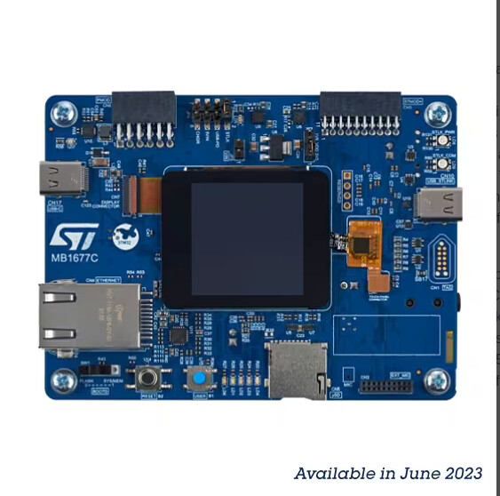

<!-- Copyright 2015-2026 Zephyr Project members and individual contributors. -->
<!-- SPDX-License-Identifier: Apache-2.0 -->
<!-- 中文翻译；编号、导航与译注为本地新增。 -->

<a id="stm32h573i_dk"></a>

# 第33章\_STM32H573I-DK探索板（Discovery）

原文：[官方页面](https://docs.zephyrproject.org/latest/boards/st/stm32h573i_dk/doc/index.html)。读取日期：2026-10-16；来源摘要见[来源记录](../SOURCES.md)。

开发板概览（Board Overview）

<a id="id3"></a>

[](images/stm32h573i_dk.jpg)

STM32H573I-DK探索板（Discovery）

名称（Name）：

`stm32h573i_dk`

厂商（Vendor）：

[意法半导体（STMicroelectronics）](https://docs.zephyrproject.org/latest/boards/index.html#vendor=st)

状态（Status）：

维护中（Maintained）

架构（Architecture）：

[arm](https://docs.zephyrproject.org/latest/boards/index.html#arch=arm)

片上系统（SoC）：

[stm32h573xx](https://docs.zephyrproject.org/latest/boards/index.html#soc=stm32h573xx)

<a id="board-github-link"></a>

[浏览开发板源码（Browse Board Sources）](https://github.com/zephyrproject-rtos/zephyr/blob/main//boards/st/stm32h573i_dk/doc/index.rst/../..)<a id="overview"></a>

## 概述（Overview）

STM32H573I-DK Discovery套件是STM32H573IIK3Q的完整演示及开发平台，该MCU采用Arm® Cortex®-M33内核并带TrustZone®，主要特点如下：


- 176针BGA封装STM32H573IIK3Q，具有2 Mbytes Flash及640 Kbytes SRAM
- 1.54英寸240×240像素TFT LCD，带LED背光及触摸面板
- USB Type-C主机及设备接口，带USB电力传输控制器
- 立体声SAI音频DAC，配有一个输入／输出音频插孔
- 意法半导体MEMS数字麦克风，带PDM接口
- Octo-SPI接口连接512 Mbit Octo-SPI NOR Flash，即旺宏MX25LM51245GXDI00
- 10/100 Mbit以太网
- microSD™存储卡
- Wi-Fi®附加板
- 板上连接器（Board Connectors）


  - STMod+扩展接口及扇出扩展板，提供兼容Wi-Fi、Grove及mikroBUS的连接器
  - Pmod扩展连接器
  - 音频MEMS子板扩展连接器
  - ARDUINO® Uno V3扩展连接器
- 灵活供电方式


  - ST-LINK
  - USB VBUS供电
  - 外部电源
- 板载STLINK-V3E调试器／编程器，支持USB重新枚举：


  - 大容量存储（Mass Storage）
  - 虚拟COM端口
  - 调试端口（Debug Port）
- 4个用户LED
- 用户按键和复位按键

更多信息见[STM32H573I-DK Discovery网站](https://www.st.com/en/evaluation-tools/stm32h573i-dk.html)。

<a id="hardware"></a>

## 硬件（Hardware）

STM32H573xx属于STM32H5高性能微控制器系列，基于Arm® Cortex®-M33 32位RISC内核，最高工作频率250 MHz。


- 内核：Arm® 32位Cortex®-M33 CPU，支持TrustZone®及FPU
- 性能基准（Performance Benchmark）：


  - 原文性能数值为375 DMPIS/MHz（Dhrystone 2.1），拼写及单位照录，未将其改作另一指标。
- 安全（Security）


  - Arm® TrustZone®，具有ARMv8-M主线安全扩展（Mainline Security Extension）
  - 最多8个可配置安全属性单元（SAU）区域
  - 识别TrustZone®且可设为安全属性的外设
  - 灵活的生命周期（Lifecycle）方案，支持安全调试认证
  - 预配置的不可变信任根（Immutable Root of Trust，ST-iROT）
  - 安全固件安装（Secure Firmware Installation，SFI）
  - 利用硬件唯一密钥（Hardware Unique Key，HUK）进行安全数据存储
  - 支持使用可信固件M（Trusted Firmware-M，TF-M）进行安全固件升级
  - 2个AES协处理器，其中1个抵抗差分功耗分析（DPA）
  - 抵抗DPA的公钥加速器（Public Key Accelerator）
  - Octo-SPI外部存储器即时解密（On-the-fly Decryption）
  - 哈希（HASH）硬件加速器
  - 符合NIST SP800-90B的真随机数发生器（TRNG）
  - 96位唯一标识（Unique ID）
  - 主动防篡改（Active Tampers）
  - 符合NIST SP800-90B的真随机数发生器（RNG）
- 时钟管理（Clock Management）：


  - 25 MHz高速外部（HSE）晶体振荡器
  - 用于实时时钟（RTC）的32 kHz低速外部晶体振荡器（LSE）
  - 内部64 MHz高速时钟（HSI），支持软件微调（Trimming）
  - 内部低功耗32 kHz RC振荡器（LSI），精度±5%
  - 内部4 MHz振荡器（CSI），支持软件微调
  - 内部48 MHz时钟（HSI48），带时钟恢复系统（Recovery System）
  - 三个锁相环（PLL），用于系统时钟、USB、音频和ADC
- 电源管理（Power Management）


  - 内置低压差稳压器（LDO），可配置三个输出范围，为数字电路供电
  - 内置开关模式电源（SMPS）降压转换器
- 带硬件日历、闹钟及校准功能的实时时钟（RTC）
- 最多139个高速I/O，多数耐受5 V；最多10个I/O具有独立供电，最低1.08 V
- 最多16个定时器及2个看门狗


  - 12个16位定时器
  - 两个32位定时器，最多四路输入捕获／输出比较／PWM（IC/OC/PWM），或脉冲计数器及正交增量编码器输入
  - 6个16位低功耗定时器，可在停止模式工作
  - 两个看门狗（Watchdogs）
  - 2个系统节拍（SysTick）定时器
- 存储器（Memories）


  - 最多2 MB Flash，双存储区，支持写入时读取
  - 1 Kbyte一次性可编程存储器（OTP）
  - 640 KB SRAM，其中64 KB支持硬件奇偶校验，320 Kbytes支持灵活ECC
  - 4 KB备份SRAM，可在最低功耗模式使用
  - 灵活外部存储控制器，数据总线最高16位，支持SRAM、PSRAM、铁电RAM（FRAM）、SDRAM／低功耗单数据率SDRAM、NOR及NAND
  - 1路OCTOSPI存储接口，支持即时解密（On-the-Fly Decryption）及串行PSRAM／NAND／NOR、HyperRAM／HyperFlash帧格式
  - 2路SD/SDIO/MMC接口
- 丰富的模拟外设（Analog Peripherals），采用独立供电


  - 2个12位ADC，12位模式最高5 MSPS
  - 2个12位数模转换器（DAC）
  - 一个数字温度传感器
- 34个通信接口


  - 1个USB Type-C／USB PD控制器
  - 一个USB 2.0全速主机与设备接口
  - 4路I2C Fast-mode Plus（FM+），支持SMBus／PMBus
  - 1路I3C
  - 12路U(S)ART，支持ISO 7816、LIN、IrDA及调制解调器控制
  - 1路低功耗UART（LP UART）
  - 6路SPI，其中3路与全双工I2S复用
  - 将5路USART配置为同步模式，可额外提供5路SPI
  - 2路串行音频接口（SAI）
  - 2路灵活数据速率CAN（FDCAN）
  - 1路SD/MMC（SDMMC）接口
  - 2个16通道DMA控制器
  - 1路8～14位摄像头接口
  - 1路HDMI消费者电子控制（CEC）
  - 1路带DMA控制器的以太网MAC接口；原文将Ethernet拼作Ethernel。
  - 1路16位并行从机同步接口（Parallel Slave Synchronous Interface）
- 坐标旋转数字计算（CORDIC），加速三角函数
- 滤波数学加速器（Filter Mathematical Accelerator，FMAC）
- 循环冗余校验计算单元（CRC Calculation Unit）
- 开发支持：串行线调试（SWD）、JTAG及嵌入式跟踪宏单元（Embedded Trace Macrocell™）

更多STM32H573信息见：


- [ST官网的STM32H573产品页](https://www.st.com/en/microcontrollers/stm32h573ii.html)
- [STM32H573参考手册](https://www.st.com/resource/en/reference_manual/rm0481-stm32h563h573-and-stm32h562-armbased-32bit-mcus-stmicroelectronics.pdf)

<a id="supported-features"></a>

### 支持的功能（Supported Features）

`stm32h573i_dk`开发板支持下表所列的硬件功能。

片上／板载（On-Chip / On-Board）

功能集成在片上系统（SoC）内／位于开发板上。

2 / 2

分别表示已启用／已禁用的实例数。点击数量标签，可查看开发板或SoC设备树源码（DTS）中该功能的第一个实例。

`vnd,foo`

与此功能匹配的设备树绑定兼容字符串（Compatible String）；点击链接可查看绑定文档。

<a id="stm32h573i_dk-hw-features"></a>

<a id="stm32h573i_dk-stm32h573i_dk/stm32h573xx-hw-features-section"></a>

#### `stm32h573i_dk/stm32h573xx`目标（Target）

<a id="stm32h573i_dk-stm32h573i_dk/stm32h573xx-hw-features-panel"></a>

<a id="stm32h573i_dk-stm32h573i_dk/stm32h573xx-hw-features-memory"></a>

该开发板目标的片上存储容量：256 KiB RAM、2 MiB Flash。

<a id="stm32h573i_dk-stm32h573i_dk/stm32h573xx-hw-features-table"></a>

<table>
<tr>
<th>类型（Type）</th>
<th>位置（Location）</th>
<th>说明（Description）</th>
<th>兼容字符串（Compatible）</th>
</tr>
<tr>
<td rowspan="1">中央处理器（CPU）</td>
<td>片上（On-Chip）</td>
<td>ARM Cortex-M33处理器（CPU）（<a href="https://github.com/zephyrproject-rtos/zephyr/blob/main/dts/arm/st/h5/stm32h5.dtsi?plain=1#L32">已启用：1</a>）</td>
<td><a href="../cpu_arm_riscv_binding_reference/P022_arm_cortex-m33.md#std-dtcompatible-arm-cortex-m33"><code>arm,cortex-m33</code></a></td>
</tr>
<tr>
<td rowspan="1">模数转换器（ADC）</td>
<td>片上（On-Chip）</td>
<td>STM32模数转换器（ADC）（<a href="https://github.com/zephyrproject-rtos/zephyr/blob/main/dts/arm/st/h5/stm32h5.dtsi?plain=1#L359">已启用：1</a>）</td>
<td><a href="../hardware/P839_STM32模数转换器绑定.md#dtbinding-st-stm32-adc"><code>st,stm32-adc</code></a></td>
</tr>
<tr>
<td rowspan="1">控制器局域网（CAN）</td>
<td>片上（On-Chip）</td>
<td>STM32 FDCAN灵活数据速率CAN控制器（CAN FD Controller）（<a href="https://github.com/zephyrproject-rtos/zephyr/blob/main/dts/arm/st/h5/stm32h5.dtsi?plain=1#L610">已启用：1</a>；<a href="https://github.com/zephyrproject-rtos/zephyr/blob/main/dts/arm/st/h5/stm32h563.dtsi?plain=1#L50">已禁用：1</a>）</td>
<td><a href="../can_nxp_renesas_stm32_ti_binding_reference/P012_st_stm32-fdcan.md#std-dtcompatible-st-stm32-fdcan"><code>st,stm32-fdcan</code></a></td>
</tr>
<tr>
<td rowspan="8">时钟控制（Clock Control）</td>
<td>片上（On-Chip）</td>
<td>STM32H5复位与时钟控制器（RCC）（<a href="https://github.com/zephyrproject-rtos/zephyr/blob/main/dts/arm/st/h5/stm32h5.dtsi?plain=1#L194">已启用：1</a>）</td>
<td><a href="../timer_reference/P167_STM32H5复位与时钟控制绑定.md#dtbinding-st-stm32h5-rcc"><code>st,stm32h5-rcc</code></a></td>
</tr>
<tr>
<td>片上（On-Chip）</td>
<td>STM32 外部高速时钟（HSE Clock）（<a href="https://github.com/zephyrproject-rtos/zephyr/blob/main/dts/arm/st/h5/stm32h5.dtsi?plain=1#L59">已启用：1</a>）</td>
<td><a href="../timer_reference/P129_STM32高速外部时钟绑定.md#dtbinding-st-stm32-hse-clock"><code>st,stm32-hse-clock</code></a></td>
</tr>
<tr>
<td>片上（On-Chip）</td>
<td>STM32高速内部时钟（HSI）（<a href="https://github.com/zephyrproject-rtos/zephyr/blob/main/dts/arm/st/h5/stm32h5.dtsi?plain=1#L65">已禁用：1</a>）</td>
<td><a href="../timer_reference/P146_STM32H7内部高速时钟绑定.md#dtbinding-st-stm32h7-hsi-clock"><code>st,stm32h7-hsi-clock</code></a></td>
</tr>
<tr>
<td>片上（On-Chip）</td>
<td>STM32内部48 MHz（HSI48）时钟（<a href="https://github.com/zephyrproject-rtos/zephyr/blob/main/dts/arm/st/h5/stm32h5.dtsi?plain=1#L73">已启用：1</a>）</td>
<td><a href="../timer_reference/P131_STM32内部48MHz时钟绑定.md#dtbinding-st-stm32-hsi48-clock"><code>st,stm32-hsi48-clock</code></a></td>
</tr>
<tr>
<td>片上（On-Chip）</td>
<td>通用固定频率时钟提供者（Fixed-Rate Clock Provider）（<a href="https://github.com/zephyrproject-rtos/zephyr/blob/main/dts/arm/st/h5/stm32h5.dtsi?plain=1#L80">已禁用：2</a>）</td>
<td><a href="../hardware/P566_固定时钟绑定.md#dtbinding-fixed-clock"><code>fixed-clock</code></a></td>
</tr>
<tr>
<td>片上（On-Chip）</td>
<td>STM32低速外部时钟（LSE Clock）（<a href="https://github.com/zephyrproject-rtos/zephyr/blob/main/dts/arm/st/h5/stm32h5.dtsi?plain=1#L87">已启用：1</a>）</td>
<td><a href="../timer_reference/P130_STM32低速外部时钟绑定.md#dtbinding-st-stm32-lse-clock"><code>st,stm32-lse-clock</code></a></td>
</tr>
<tr>
<td>片上（On-Chip）</td>
<td>STM32H5锁相环（PLL）（<a href="https://github.com/zephyrproject-rtos/zephyr/blob/main/dts/arm/st/h5/stm32h5.dtsi?plain=1#L102">已启用：1</a>；<a href="https://github.com/zephyrproject-rtos/zephyr/blob/main/dts/arm/st/h5/stm32h5.dtsi?plain=1#L108">已禁用：2</a>）</td>
<td><a href="../timer_reference/P153_STM32H5锁相环时钟绑定.md#dtbinding-st-stm32h5-pll-clock"><code>st,stm32h5-pll-clock</code></a></td>
</tr>
<tr>
<td>片上（On-Chip）</td>
<td>STM32 微控制器时钟输出（Microcontroller Clock Output，MCO）（<a href="https://github.com/zephyrproject-rtos/zephyr/blob/main/dts/arm/st/h5/stm32h5.dtsi?plain=1#L116">已禁用：2</a>）</td>
<td><a href="../timer_reference/P134_STM32时钟输出绑定.md#dtbinding-st-stm32-clock-mco"><code>st,stm32-clock-mco</code></a></td>
</tr>
<tr>
<td rowspan="1">计数器（Counter）</td>
<td>片上（On-Chip）</td>
<td>STM32 计数器（Counters）（<a href="https://github.com/zephyrproject-rtos/zephyr/blob/main/dts/arm/st/h5/stm32h5.dtsi?plain=1#L413">已禁用：14</a>）</td>
<td><a href="../stm32_ti_xilinx_counter_binding_reference/P007_st_stm32-counter.md#std-dtcompatible-st-stm32-counter"><code>st,stm32-counter</code></a></td>
</tr>
<tr>
<td rowspan="1">循环冗余校验（CRC）</td>
<td>片上（On-Chip）</td>
<td>STM32 CRC 计算单元（Calculation Unit）（<a href="https://github.com/zephyrproject-rtos/zephyr/blob/main/dts/arm/st/h5/stm32h5.dtsi?plain=1#L796">已启用：1</a>）</td>
<td><a href="../crc_clock_monitor_binding_reference/P011_st_stm32-crc.md#std-dtcompatible-st-stm32-crc"><code>st,stm32-crc</code></a></td>
</tr>
<tr>
<td rowspan="2">密码学加速器（Cryptographic Accelerator）</td>
<td>片上（On-Chip）</td>
<td>STM32哈希处理器（HASH Processor）（<a href="https://github.com/zephyrproject-rtos/zephyr/blob/main/dts/arm/st/h5/stm32h5.dtsi?plain=1#L622">已启用：1</a>）</td>
<td><a href="../crypto_secure_engine_st_ti_binding_reference/P017_st_stm32-hash.md#std-dtcompatible-st-stm32-hash"><code>st,stm32-hash</code></a></td>
</tr>
<tr>
<td>片上（On-Chip）</td>
<td>STM32高级加密标准加速器（AES Accelerator）（<a href="https://github.com/zephyrproject-rtos/zephyr/blob/main/dts/arm/st/h5/stm32h5_crypt.dtsi?plain=1#L9">已启用：1</a>）</td>
<td><a href="../crypto_secure_engine_st_ti_binding_reference/P015_st_stm32-aes.md#std-dtcompatible-st-stm32-aes"><code>st,stm32-aes</code></a></td>
</tr>
<tr>
<td rowspan="1">数模转换器（DAC）</td>
<td>片上（On-Chip）</td>
<td>STM32 系列数模转换器（DAC）（<a href="https://github.com/zephyrproject-rtos/zephyr/blob/main/dts/arm/st/h5/stm32h5.dtsi?plain=1#L351">已启用：1</a>）</td>
<td><a href="../hardware/P760_STM32数模转换器绑定.md#dtbinding-st-stm32-dac"><code>st,stm32-dac</code></a></td>
</tr>
<tr>
<td rowspan="1">显示（Display）</td>
<td>板载（On-Board）</td>
<td>Sitronix ST7789V显示控制器（Display Controller）（<a href="https://github.com/zephyrproject-rtos/zephyr/blob/main/boards/st/stm32h573i_dk/stm32h573i_dk-common.dtsi?plain=1#L124">已启用：1</a>）</td>
<td><a href="../display_sinowealth_sitronix_solomon_binding_reference/P011_sitronix_st7789v.md#std-dtcompatible-sitronix-st7789v"><code>sitronix,st7789v</code></a></td>
</tr>
<tr>
<td rowspan="1">直接存储器访问（DMA）</td>
<td>片上（On-Chip）</td>
<td>STM32U5直接存储器访问（DMA）控制器（<a href="https://github.com/zephyrproject-rtos/zephyr/blob/main/dts/arm/st/h5/stm32h5.dtsi?plain=1#L641">已启用：2</a>）</td>
<td><a href="../stm32_ti_xilinx_dma_binding_reference/P012_st_stm32u5-dma.md#std-dtcompatible-st-stm32u5-dma"><code>st,stm32u5-dma</code></a></td>
</tr>
<tr>
<td rowspan="4">以太网（Ethernet）</td>
<td>片上（On-Chip）</td>
<td>ST STM32 以太网媒体访问控制器（Ethernet MAC）（<a href="https://github.com/zephyrproject-rtos/zephyr/blob/main/dts/arm/st/h5/stm32h563.dtsi?plain=1#L23">已启用：1</a>）</td>
<td><a href="../ethernet_synopsys_st_xilinx_binding_reference/P010_st_stm32h5-ethernet.md#std-dtcompatible-st-stm32h5-ethernet"><code>st,stm32h5-ethernet</code></a></td>
</tr>
<tr>
<td>片上（On-Chip）</td>
<td>Synopsys DesignWare MAC 的管理数据输入输出控制器（MDIO Controller）（<a href="https://github.com/zephyrproject-rtos/zephyr/blob/main/dts/arm/st/h5/stm32h563.dtsi?plain=1#L38">已启用：1</a>）</td>
<td><a href="../ethernet_mdio_microchip_binding_reference/P010_snps_dwmac-mdio.md#std-dtcompatible-snps-dwmac-mdio"><code>snps,dwmac-mdio</code></a></td>
</tr>
<tr>
<td>板载（On-Board）</td>
<td>通用媒体独立接口物理层（MII PHY）（<a href="https://github.com/zephyrproject-rtos/zephyr/blob/main/boards/st/stm32h573i_dk/stm32h573i_dk-common.dtsi?plain=1#L283">已启用：1</a>）</td>
<td><a href="../ethernet_nxp_phy_binding_reference/P019_ethernet-phy.md#std-dtcompatible-ethernet-phy"><code>ethernet-phy</code></a></td>
</tr>
<tr>
<td>片上（On-Chip）</td>
<td>Synopsys DesignWare MAC 精确时间协议时钟（Precision Time Protocol，PTP Clock）（<a href="https://github.com/zephyrproject-rtos/zephyr/blob/main/dts/arm/st/h5/stm32h563.dtsi?plain=1#L45">已启用：1</a>）</td>
<td><a href="../ethernet_synopsys_st_xilinx_binding_reference/P006_snps_dwmac-ptp-clock.md#std-dtcompatible-snps-dwmac-ptp-clock"><code>snps,dwmac-ptp-clock</code></a></td>
</tr>
<tr>
<td rowspan="1">闪存控制器（Flash Controller）</td>
<td>片上（On-Chip）</td>
<td>STM32 系列闪存控制器（Flash Controller）（<a href="https://github.com/zephyrproject-rtos/zephyr/blob/main/dts/arm/st/h5/stm32h5.dtsi?plain=1#L130">已启用：1</a>）</td>
<td><a href="../flash_renesas_st_ti_binding_reference/P011_st_stm32-flash-controller.md#std-dtcompatible-st-stm32-flash-controller"><code>st,stm32-flash-controller</code></a></td>
</tr>
<tr>
<td rowspan="2">通用输入输出与接插件（GPIO &amp; Headers）</td>
<td>片上（On-Chip）</td>
<td>STM32 通用输入输出控制器（GPIO Controller）（<a href="https://github.com/zephyrproject-rtos/zephyr/blob/main/dts/arm/st/h5/stm32h5.dtsi?plain=1#L235">已启用：9</a>）</td>
<td><a href="../gpio_silabs_st_connectors_binding_reference/P029_st_stm32-gpio.md#std-dtcompatible-st-stm32-gpio"><code>st,stm32-gpio</code></a></td>
</tr>
<tr>
<td>板载（On-Board）</td>
<td>引出到Arduino Uno R3排针（Headers）的GPIO引脚（<a href="https://github.com/zephyrproject-rtos/zephyr/blob/main/boards/st/stm32h573i_dk/arduino_r3_connector.dtsi?plain=1#L10">已启用：1</a>）</td>
<td><a href="../gpio_adi_headers_ambiq_binding_reference/P023_arduino-header-r3.md#std-dtcompatible-arduino-header-r3"><code>arduino-header-r3</code></a></td>
</tr>
<tr>
<td rowspan="1">集成电路间总线（I2C）</td>
<td>片上（On-Chip）</td>
<td>STM32 I2C V2 控制器（Controller）（<a href="https://github.com/zephyrproject-rtos/zephyr/blob/main/dts/arm/st/h5/stm32h5.dtsi?plain=1#L518">已启用：3</a>；<a href="https://github.com/zephyrproject-rtos/zephyr/blob/main/dts/arm/st/h5/stm32h562.dtsi?plain=1#L265">已禁用：1</a>）</td>
<td><a href="../i2c_stm32_ti_mux_binding_reference/P008_st_stm32-i2c-v2.md#std-dtcompatible-st-stm32-i2c-v2"><code>st,stm32-i2c-v2</code></a></td>
</tr>
<tr>
<td rowspan="2">集成电路间音频总线（I2S）</td>
<td>片上（On-Chip）</td>
<td>STM32H7 I2S控制器（<a href="https://github.com/zephyrproject-rtos/zephyr/blob/main/dts/arm/st/h5/stm32h5.dtsi?plain=1#L663">已禁用：3</a>）</td>
<td><a href="../i2s_binding_reference/P018_st_stm32h7-i2s.md#std-dtcompatible-st-stm32h7-i2s"><code>st,stm32h7-i2s</code></a></td>
</tr>
<tr>
<td>片上（On-Chip）</td>
<td>STM32 串行音频接口块控制器（SAI Block Controller）（<a href="https://github.com/zephyrproject-rtos/zephyr/blob/main/dts/arm/st/h5/stm32h562.dtsi?plain=1#L128">已禁用：2</a>）</td>
<td><a href="../i2s_binding_reference/P017_st_stm32-sai.md#std-dtcompatible-st-stm32-sai"><code>st,stm32-sai</code></a></td>
</tr>
<tr>
<td rowspan="1">改进型集成电路间总线（I3C）</td>
<td>片上（On-Chip）</td>
<td>STM32H5 I3C控制器（<a href="https://github.com/zephyrproject-rtos/zephyr/blob/main/dts/arm/st/h5/stm32h5.dtsi?plain=1#L542">已禁用：2</a>）</td>
<td><a href="../i3c_smbus_binding_reference/P010_st_stm32-i3c.md#std-dtcompatible-st-stm32-i3c"><code>st,stm32-i3c</code></a></td>
</tr>
<tr>
<td rowspan="2">输入（Input）</td>
<td>板载（On-Board）</td>
<td>FT3267/FT5XX6/FT6XX6电容式触摸面板（Capacitive Touch Panels）（<a href="https://github.com/zephyrproject-rtos/zephyr/blob/main/boards/st/stm32h573i_dk/stm32h573i_dk-common.dtsi?plain=1#L213">已启用：1</a>）</td>
<td><a href="../input_adc_touch_matrix_binding_reference/P014_focaltech_ft5336.md#std-dtcompatible-focaltech-ft5336"><code>focaltech,ft5336</code></a></td>
</tr>
<tr>
<td>板载（On-Board）</td>
<td>一组绑定到 GPIO 的输入按键（GPIO-Bound Input Keys）（<a href="https://github.com/zephyrproject-rtos/zephyr/blob/main/boards/st/stm32h573i_dk/stm32h573i_dk-common.dtsi?plain=1#L54">已启用：1</a>）</td>
<td><a href="../hardware/P563_GPIO按键绑定.md#std-dtcompatible-gpio-keys"><code>gpio-keys</code></a></td>
</tr>
<tr>
<td rowspan="2">中断控制器（Interrupt Controller）</td>
<td>片上（On-Chip）</td>
<td>ARMv8-M嵌套向量中断控制器（NVIC / Nested Vectored Interrupt Controller）（<a href="https://github.com/zephyrproject-rtos/zephyr/blob/main/dts/arm/armv8-m.dtsi?plain=1#L13">已启用：1</a>）</td>
<td><a href="../arm_interrupt_timer_binding_reference/P003_ARMv8_M_NVIC.md#std-dtcompatible-arm-v8m-nvic"><code>arm,v8m-nvic</code></a></td>
</tr>
<tr>
<td>片上（On-Chip）</td>
<td>STM32G0 外部中断控制器（External Interrupt Controller）（<a href="https://github.com/zephyrproject-rtos/zephyr/blob/main/dts/arm/st/h5/stm32h5.dtsi?plain=1#L206">已启用：1</a>）</td>
<td><a href="../mcu_external_interrupt_binding_reference/P002_st_stm32g0-exti.md#std-dtcompatible-st-stm32g0-exti"><code>st,stm32g0-exti</code></a></td>
</tr>
<tr>
<td rowspan="1">发光二极管（LED）</td>
<td>板载（On-Board）</td>
<td>一组由 GPIO 控制的 LED（GPIO-Controlled LEDs）（<a href="https://github.com/zephyrproject-rtos/zephyr/blob/main/boards/st/stm32h573i_dk/stm32h573i_dk-common.dtsi?plain=1#L30">已启用：1</a>）</td>
<td><a href="../hardware/P564_GPIO指示灯绑定.md#dtbinding-gpio-leds"><code>gpio-leds</code></a></td>
</tr>
<tr>
<td rowspan="2">存储器控制器（Memory Controller）</td>
<td>片上（On-Chip）</td>
<td>STM32 灵活存储器控制器（Flexible Memory Controller，FMC）（<a href="https://github.com/zephyrproject-rtos/zephyr/blob/main/dts/arm/st/h5/stm32h562.dtsi?plain=1#L587">已启用：1</a>）</td>
<td><a href="../memory_controller_sdram_psram_binding_reference/P013_st_stm32-fmc.md#std-dtcompatible-st-stm32-fmc"><code>st,stm32-fmc</code></a></td>
</tr>
<tr>
<td>板载（On-Board）</td>
<td>STM32灵活存储器控制器（FMC / Flexible Memory Controller），用于NOR Flash、PSRAM和SRAM（<a href="https://github.com/zephyrproject-rtos/zephyr/blob/main/boards/st/stm32h573i_dk/stm32h573i_dk-common.dtsi?plain=1#L92">已启用：1</a>）</td>
<td><a href="../memory_controller_sdram_psram_binding_reference/P011_st_stm32-fmc-nor-psram.md#std-dtcompatible-st-stm32-fmc-nor-psram"><code>st,stm32-fmc-nor-psram</code></a></td>
</tr>
<tr>
<td rowspan="1">MIPI 显示总线接口（MIPI-DBI）</td>
<td>板载（On-Board）</td>
<td>STM32 FMC显示控制器（<a href="https://github.com/zephyrproject-rtos/zephyr/blob/main/boards/st/stm32h573i_dk/stm32h573i_dk-common.dtsi?plain=1#L116">已启用：1</a>）</td>
<td><a href="../mipi_dbi_dsi_binding_reference/P009_st_stm32-fmc-mipi-dbi.md#std-dtcompatible-st-stm32-fmc-mipi-dbi"><code>st,stm32-fmc-mipi-dbi</code></a></td>
</tr>
<tr>
<td rowspan="1">内存管理单元／内存保护单元（MMU / MPU）</td>
<td>片上（On-Chip）</td>
<td>ARMv8-M存储器保护单元（MPU / Memory Protection Unit）（<a href="https://github.com/zephyrproject-rtos/zephyr/blob/main/dts/arm/st/h5/stm32h5.dtsi?plain=1#L42">已启用：1</a>）</td>
<td><a href="../memory_protection_binding_reference/P007_arm_armv8m-mpu.md#std-dtcompatible-arm-armv8m-mpu"><code>arm,armv8m-mpu</code></a></td>
</tr>
<tr>
<td rowspan="2">多位串行外设接口（Multi-Bit SPI）</td>
<td>片上（On-Chip）</td>
<td>STM32 XSPI控制器（<a href="https://github.com/zephyrproject-rtos/zephyr/blob/main/dts/arm/st/h5/stm32h562.dtsi?plain=1#L328">已启用：1</a>）</td>
<td><a href="../mspi_binding_reference/P014_st_stm32-xspi-controller.md#std-dtcompatible-st-stm32-xspi-controller"><code>st,stm32-xspi-controller</code></a></td>
</tr>
<tr>
<td>板载（On-Board）</td>
<td>MSPI总线上的STM32存储器设备（<a href="https://github.com/zephyrproject-rtos/zephyr/blob/main/boards/st/stm32h573i_dk/stm32h573i_dk-common.dtsi?plain=1#L366">已启用：1</a>）</td>
<td><a href="../mspi_binding_reference/P010_st_nor-mspi.md#std-dtcompatible-st-nor"><code>st,nor</code></a></td>
</tr>
<tr>
<td rowspan="3">存储技术设备（MTD）</td>
<td>片上（On-Chip）</td>
<td>STM32闪存（Flash Memory）（<a href="https://github.com/zephyrproject-rtos/zephyr/blob/main/dts/arm/st/h5/stm32h5.dtsi?plain=1#L139">已启用：1</a>）</td>
<td><a href="../mtd_nxp_st_ti_partition_binding_reference/P016_st_stm32-nv-flash.md#std-dtcompatible-st-stm32-nv-flash"><code>st,stm32-nv-flash</code></a></td>
</tr>
<tr>
<td>板载（On-Board）</td>
<td>闪存（Flash）节点（<a href="https://github.com/zephyrproject-rtos/zephyr/blob/main/boards/st/stm32h573i_dk/stm32h573i_dk-common.dtsi?plain=1#L388">已启用：1</a>）</td>
<td><a href="../mtd_nxp_st_ti_partition_binding_reference/P013_soc-nv-flash.md#std-dtcompatible-soc-nv-flash"><code>soc-nv-flash</code></a></td>
</tr>
<tr>
<td>板载（On-Board）</td>
<td>闪存或其他非易失性存储器的固定分区（Fixed Partitions）（<a href="https://github.com/zephyrproject-rtos/zephyr/blob/main/boards/st/stm32h573i_dk/stm32h573i_dk.dts?plain=1#L56">已启用：1</a>）</td>
<td><a href="../hardware/P568_固定分区绑定.md#dtbinding-fixed-partitions"><code>fixed-partitions</code></a></td>
</tr>
<tr>
<td rowspan="1">非易失存储器（NVMEM）</td>
<td>片上（On-Chip）</td>
<td>非易失存储器固定布局（Fixed Layout for Non-Volatile Memory）（<a href="https://github.com/zephyrproject-rtos/zephyr/blob/main/dts/arm/st/h5/stm32h5.dtsi?plain=1#L160">已启用：1</a>）</td>
<td><a href="../memory_protection_binding_reference/P009_fixed-layout.md#std-dtcompatible-fixed-layout"><code>fixed-layout</code></a></td>
</tr>
<tr>
<td rowspan="1">一次性可编程存储器（OTP Memory）</td>
<td>片上（On-Chip）</td>
<td>STM32 嵌入式非易失一次性可编程存储器（NVM OTP）（<a href="https://github.com/zephyrproject-rtos/zephyr/blob/main/dts/arm/st/h5/stm32h5.dtsi?plain=1#L156">已启用：1</a>；<a href="https://github.com/zephyrproject-rtos/zephyr/blob/main/dts/arm/st/h5/stm32h5.dtsi?plain=1#L149">已禁用：1</a>）</td>
<td><a href="../otp_binding_reference/P010_st_stm32-nvm-otp.md#std-dtcompatible-st-stm32-nvm-otp"><code>st,stm32-nvm-otp</code></a></td>
</tr>
<tr>
<td rowspan="1">物理层（PHY）</td>
<td>片上（On-Chip）</td>
<td>用于所有内置于 USB IP 的 USB 收发器（USB Transceivers）的绑定。（<a href="https://github.com/zephyrproject-rtos/zephyr/blob/main/dts/arm/st/h5/stm32h5.dtsi?plain=1#L851">已启用：1</a>）</td>
<td><a href="../phy_binding_reference/P008_usb-nop-xceiv.md#std-dtcompatible-usb-nop-xceiv"><code>usb-nop-xceiv</code></a></td>
</tr>
<tr>
<td rowspan="1">引脚控制（Pin Control）</td>
<td>片上（On-Chip）</td>
<td>支持高速低电压（HSLV）的STM32引脚控制器（<a href="https://github.com/zephyrproject-rtos/zephyr/blob/main/dts/arm/st/h5/stm32h5.dtsi?plain=1#L228">已启用：1</a>）</td>
<td><a href="../pinctrl_stm32_ti_xilinx_binding_reference/P006_st_stm32h5-pinctrl.md#std-dtcompatible-st-stm32h5-pinctrl"><code>st,stm32h5-pinctrl</code></a></td>
</tr>
<tr>
<td rowspan="3">电源管理（Power Management）</td>
<td>片上（On-Chip）</td>
<td>STM32 电源控制器（Power Controller）（<a href="https://github.com/zephyrproject-rtos/zephyr/blob/main/dts/arm/st/h5/stm32h5.dtsi?plain=1#L742">已启用：1</a>）</td>
<td><a href="../stm32_soc_power_binding_reference/P010_st_stm32-pwr.md#std-dtcompatible-st-stm32-pwr"><code>st,stm32-pwr</code></a></td>
</tr>
<tr>
<td>片上（On-Chip）</td>
<td>STM32唤醒线控制器（Wake-up Lines Controller）（<a href="https://github.com/zephyrproject-rtos/zephyr/blob/main/dts/arm/st/h5/stm32h5.dtsi?plain=1#L746">已禁用：1</a>）</td>
<td><a href="../stm32_soc_power_binding_reference/P009_st_stm32-pwr-wkupctrl.md#std-dtcompatible-st-stm32-pwr-wkupctrl"><code>st,stm32-pwr-wkupctrl</code></a></td>
</tr>
<tr>
<td>片上（On-Chip）</td>
<td>STM32H5 I/O单元控制器（I/O Cell Controller）（<a href="https://github.com/zephyrproject-rtos/zephyr/blob/main/dts/arm/st/h5/stm32h5.dtsi?plain=1#L805">已禁用：1</a>）</td>
<td><a href="../stm32_soc_power_binding_reference/P013_st_stm32h5-iocell.md#std-dtcompatible-st-stm32h5-iocell"><code>st,stm32h5-iocell</code></a></td>
</tr>
<tr>
<td rowspan="1">脉宽调制（PWM）</td>
<td>片上（On-Chip）</td>
<td>STM32 脉宽调制（PWM）（<a href="https://github.com/zephyrproject-rtos/zephyr/blob/main/dts/arm/st/h5/stm32h5.dtsi?plain=1#L436">已启用：2</a>；<a href="https://github.com/zephyrproject-rtos/zephyr/blob/main/dts/arm/st/h5/stm32h5.dtsi?plain=1#L407">已禁用：10</a>）</td>
<td><a href="../pwm_stm32_ti_generic_binding_reference/P011_st_stm32-pwm.md#std-dtcompatible-st-stm32-pwm"><code>st,stm32-pwm</code></a></td>
</tr>
<tr>
<td rowspan="2">稳压器（Regulator）</td>
<td>片上（On-Chip）</td>
<td>STM32参考电压缓冲器稳压器（VREFBUF Regulator）（<a href="https://github.com/zephyrproject-rtos/zephyr/blob/main/dts/arm/st/h5/stm32h562.dtsi?plain=1#L594">已禁用：1</a>）</td>
<td><a href="../hardware/P638_STM32参考电压缓冲器绑定.md#dtbinding-st-stm32-vrefbuf"><code>st,stm32-vrefbuf</code></a></td>
</tr>
<tr>
<td>板载（On-Board）</td>
<td>固定电压稳压器（Fixed Voltage Regulators）（<a href="https://github.com/zephyrproject-rtos/zephyr/blob/main/boards/st/stm32h573i_dk/stm32h573i_dk-common.dtsi?plain=1#L64">已启用：1</a>）</td>
<td><a href="../hardware/P635_固定稳压器设备树绑定.md#dtbinding-regulator-fixed"><code>regulator-fixed</code></a></td>
</tr>
<tr>
<td rowspan="1">复位控制器（Reset Controller）</td>
<td>片上（On-Chip）</td>
<td>STM32 复位与时钟控制器（Reset and Clock Control，RCC）（<a href="https://github.com/zephyrproject-rtos/zephyr/blob/main/dts/arm/st/h5/stm32h5.dtsi?plain=1#L200">已启用：1</a>）</td>
<td><a href="../reset_controller_binding_reference/P017_st_stm32-rcc-rctl.md#std-dtcompatible-st-stm32-rcc-rctl"><code>st,stm32-rcc-rctl</code></a></td>
</tr>
<tr>
<td rowspan="1">随机数生成器（RNG）</td>
<td>片上（On-Chip）</td>
<td>STM32 随机数生成器（Random Number Generator）（<a href="https://github.com/zephyrproject-rtos/zephyr/blob/main/dts/arm/st/h5/stm32h5.dtsi?plain=1#L631">已启用：1</a>）</td>
<td><a href="../soc_rng_binding_reference/P016_st_stm32-rng.md#std-dtcompatible-st-stm32-rng"><code>st,stm32-rng</code></a></td>
</tr>
<tr>
<td rowspan="1">实时时钟（RTC）</td>
<td>片上（On-Chip）</td>
<td>STM32 实时时钟（RTC）（<a href="https://github.com/zephyrproject-rtos/zephyr/blob/main/dts/arm/st/h5/stm32h5.dtsi?plain=1#L386">已启用：1</a>）</td>
<td><a href="../soc_rtc_binding_reference/P014_st_stm32-rtc.md#std-dtcompatible-st-stm32-rtc"><code>st,stm32-rtc</code></a></td>
</tr>
<tr>
<td rowspan="1">SD 主机控制器（SDHC）</td>
<td>片上（On-Chip）</td>
<td>STM32 SDMMC 主机控制器（Host Controller）（<a href="https://github.com/zephyrproject-rtos/zephyr/blob/main/dts/arm/st/h5/stm32h562.dtsi?plain=1#L576">已启用：1</a>；<a href="https://github.com/zephyrproject-rtos/zephyr/blob/main/dts/arm/st/h5/stm32h563.dtsi?plain=1#L13">已禁用：1</a>）</td>
<td><a href="../sdhc_binding_reference/P019_st_stm32-sdmmc.md#std-dtcompatible-st-stm32-sdmmc"><code>st,stm32-sdmmc</code></a></td>
</tr>
<tr>
<td rowspan="6">传感器（Sensors）</td>
<td>片上（On-Chip）</td>
<td>STM32 正交解码器（Quadrature Decoder）（<a href="https://github.com/zephyrproject-rtos/zephyr/blob/main/dts/arm/st/h5/stm32h5.dtsi?plain=1#L419">已禁用：6</a>）</td>
<td><a href="../sensor_st_lsm_stm32_binding_reference/P028_st_stm32-qdec.md#std-dtcompatible-st-stm32-qdec"><code>st,stm32-qdec</code></a></td>
</tr>
<tr>
<td>片上（On-Chip）</td>
<td>STM32数字温度传感器（<a href="https://github.com/zephyrproject-rtos/zephyr/blob/main/dts/arm/st/h5/stm32h5.dtsi?plain=1#L733">已启用：1</a>）</td>
<td><a href="../sensor_st_lsm_stm32_binding_reference/P027_st_stm32-digi-temp.md#std-dtcompatible-st-stm32-digi-temp"><code>st,stm32-digi-temp</code></a></td>
</tr>
<tr>
<td>片上（On-Chip）</td>
<td>STM32 系列温度节点（TEMP），用于以两个温度点完成生产校准的传感器。（<a href="https://github.com/zephyrproject-rtos/zephyr/blob/main/dts/arm/st/h5/stm32h5.dtsi?plain=1#L818">已启用：1</a>）</td>
<td><a href="../sensor_st_lsm_stm32_binding_reference/P029_st_stm32-temp-cal.md#std-dtcompatible-st-stm32-temp-cal"><code>st,stm32-temp-cal</code></a></td>
</tr>
<tr>
<td>片上（On-Chip）</td>
<td>STM32 参考电压（VREF+）（<a href="https://github.com/zephyrproject-rtos/zephyr/blob/main/dts/arm/st/h5/stm32h5.dtsi?plain=1#L830">已启用：1</a>）</td>
<td><a href="../sensor_st_ti_power_capacitance_binding_reference/P003_st_stm32-vref.md#std-dtcompatible-st-stm32-vref"><code>st,stm32-vref</code></a></td>
</tr>
<tr>
<td>片上（On-Chip）</td>
<td>STM32 电池电压（VBAT）（<a href="https://github.com/zephyrproject-rtos/zephyr/blob/main/dts/arm/st/h5/stm32h5.dtsi?plain=1#L838">已启用：1</a>）</td>
<td><a href="../sensor_st_ti_power_capacitance_binding_reference/P001_st_stm32-vbat.md#std-dtcompatible-st-stm32-vbat"><code>st,stm32-vbat</code></a></td>
</tr>
<tr>
<td>片上（On-Chip）</td>
<td>STM32内核供电（Vddcore）（<a href="https://github.com/zephyrproject-rtos/zephyr/blob/main/dts/arm/st/h5/stm32h5.dtsi?plain=1#L845">已启用：1</a>）</td>
<td><a href="../sensor_st_ti_power_capacitance_binding_reference/P002_st_stm32-vddcore.md#std-dtcompatible-st-stm32-vddcore"><code>st,stm32-vddcore</code></a></td>
</tr>
<tr>
<td rowspan="3">串行控制器（Serial Controller）</td>
<td>片上（On-Chip）</td>
<td>STM32 通用同步／异步收发器（USART）（<a href="https://github.com/zephyrproject-rtos/zephyr/blob/main/dts/arm/st/h5/stm32h5.dtsi?plain=1#L300">已启用：2</a>；<a href="https://github.com/zephyrproject-rtos/zephyr/blob/main/dts/arm/st/h5/stm32h5.dtsi?plain=1#L309">已禁用：4</a>）</td>
<td><a href="../uart_silabs_stm32_ti_binding_reference/P016_st_stm32-usart.md#std-dtcompatible-st-stm32-usart"><code>st,stm32-usart</code></a></td>
</tr>
<tr>
<td>片上（On-Chip）</td>
<td>STM32低功耗通用异步收发器（LPUART）（<a href="https://github.com/zephyrproject-rtos/zephyr/blob/main/dts/arm/st/h5/stm32h5.dtsi?plain=1#L327">已禁用：1</a>）</td>
<td><a href="../uart_silabs_stm32_ti_binding_reference/P014_st_stm32-lpuart.md#std-dtcompatible-st-stm32-lpuart"><code>st,stm32-lpuart</code></a></td>
</tr>
<tr>
<td>片上（On-Chip）</td>
<td>STM32 通用异步收发器（UART）（<a href="https://github.com/zephyrproject-rtos/zephyr/blob/main/dts/arm/st/h5/stm32h562.dtsi?plain=1#L184">已禁用：6</a>）</td>
<td><a href="../uart_silabs_stm32_ti_binding_reference/P015_st_stm32-uart.md#std-dtcompatible-st-stm32-uart"><code>st,stm32-uart</code></a></td>
</tr>
<tr>
<td rowspan="1">系统管理总线（SMbus）</td>
<td>片上（On-Chip）</td>
<td>STM32 系统管理总线控制器（SMBus Controller）（<a href="https://github.com/zephyrproject-rtos/zephyr/blob/main/dts/arm/st/h5/stm32h5.dtsi?plain=1#L856">已禁用：4</a>）</td>
<td><a href="../i3c_smbus_binding_reference/P013_st_stm32-smbus.md#std-dtcompatible-st-stm32-smbus"><code>st,stm32-smbus</code></a></td>
</tr>
<tr>
<td rowspan="1">串行外设接口（SPI）</td>
<td>片上（On-Chip）</td>
<td>STM32H7 串行外设接口控制器（SPI Controller）（<a href="https://github.com/zephyrproject-rtos/zephyr/blob/main/dts/arm/st/h5/stm32h5.dtsi?plain=1#L582">已启用：1</a>；<a href="https://github.com/zephyrproject-rtos/zephyr/blob/main/dts/arm/st/h5/stm32h5.dtsi?plain=1#L568">已禁用：5</a>）</td>
<td><a href="../spi_stm32_ti_xilinx_binding_reference/P013_st_stm32h7-spi.md#std-dtcompatible-st-stm32h7-spi"><code>st,stm32h7-spi</code></a></td>
</tr>
<tr>
<td rowspan="1">USB Type-C 端口控制器（USB Type-C Port Controller）</td>
<td>片上（On-Chip）</td>
<td>STM32 USB Type-C／电力传输（Power Delivery）（<a href="https://github.com/zephyrproject-rtos/zephyr/blob/main/dts/arm/st/h5/stm32h5.dtsi?plain=1#L725">已禁用：1</a>）</td>
<td><a href="../usbc_tcpc_binding_reference/P005_st_stm32-ucpd.md#std-dtcompatible-st-stm32-ucpd"><code>st,stm32-ucpd</code></a></td>
</tr>
<tr>
<td rowspan="3">定时器（Timer）</td>
<td>片上（On-Chip）</td>
<td>ARMv8-M系统节拍（System Tick）（<a href="https://github.com/zephyrproject-rtos/zephyr/blob/main/dts/arm/armv8-m.dtsi?plain=1#L21">已启用：1</a>）</td>
<td><a href="../arm_interrupt_timer_binding_reference/P007_ARMv8_M_SysTick.md#std-dtcompatible-arm-armv8m-systick"><code>arm,armv8m-systick</code></a></td>
</tr>
<tr>
<td>片上（On-Chip）</td>
<td>STM32U5低功耗定时器（LPTIM）（<a href="https://github.com/zephyrproject-rtos/zephyr/blob/main/dts/arm/st/h5/stm32h5.dtsi?plain=1#L276">已禁用：6</a>）</td>
<td><a href="../stm32_ti_silabs_timer_binding_reference/P009_st_stm32u5-lptim.md#std-dtcompatible-st-stm32u5-lptim"><code>st,stm32u5-lptim</code></a></td>
</tr>
<tr>
<td>片上（On-Chip）</td>
<td>STM32 定时器（Timers）（<a href="https://github.com/zephyrproject-rtos/zephyr/blob/main/dts/arm/st/h5/stm32h5.dtsi?plain=1#L426">已启用：2</a>；<a href="https://github.com/zephyrproject-rtos/zephyr/blob/main/dts/arm/st/h5/stm32h5.dtsi?plain=1#L397">已禁用：12</a>）</td>
<td><a href="../stm32_ti_silabs_timer_binding_reference/P008_st_stm32-timers.md#std-dtcompatible-st-stm32-timers"><code>st,stm32-timers</code></a></td>
</tr>
<tr>
<td rowspan="1">通用串行总线（USB）</td>
<td>片上（On-Chip）</td>
<td>STM32 USB控制器（Controller）（<a href="https://github.com/zephyrproject-rtos/zephyr/blob/main/dts/arm/st/h5/stm32h5.dtsi?plain=1#L711">已启用：1</a>）</td>
<td><a href="../usb_stm32_audio_binding_reference/P006_st_stm32-usb.md#std-dtcompatible-st-stm32-usb"><code>st,stm32-usb</code></a></td>
</tr>
<tr>
<td rowspan="2">看门狗（Watchdog）</td>
<td>片上（On-Chip）</td>
<td>STM32 看门狗（Watchdog）（<a href="https://github.com/zephyrproject-rtos/zephyr/blob/main/dts/arm/st/h5/stm32h5.dtsi?plain=1#L336">已启用：1</a>）</td>
<td><a href="../stm32_ti_xilinx_watchdog_binding_reference/P001_st_stm32-watchdog.md#std-dtcompatible-st-stm32-watchdog"><code>st,stm32-watchdog</code></a></td>
</tr>
<tr>
<td>片上（On-Chip）</td>
<td>STM32 系统窗口看门狗（System Window Watchdog）（<a href="https://github.com/zephyrproject-rtos/zephyr/blob/main/dts/arm/st/h5/stm32h5.dtsi?plain=1#L343">已禁用：1</a>）</td>
<td><a href="../stm32_ti_xilinx_watchdog_binding_reference/P002_st_stm32-window-watchdog.md#std-dtcompatible-st-stm32-window-watchdog"><code>st,stm32-window-watchdog</code></a></td>
</tr>
</table>

<a id="stm32h573i_dk-stm32h573i_dk/stm32h573xx/ext_flash_app-hw-features-section"></a>

#### `stm32h573i_dk/stm32h573xx/ext_flash_app`目标（Target）

<a id="stm32h573i_dk-stm32h573i_dk/stm32h573xx/ext_flash_app-hw-features-panel"></a>

<a id="stm32h573i_dk-stm32h573i_dk/stm32h573xx/ext_flash_app-hw-features-memory"></a>

该开发板目标的片上存储容量：256 KiB RAM、64 MiB Flash。

<a id="stm32h573i_dk-stm32h573i_dk/stm32h573xx/ext_flash_app-hw-features-table"></a>

<table>
<tr>
<th>类型（Type）</th>
<th>位置（Location）</th>
<th>说明（Description）</th>
<th>兼容字符串（Compatible）</th>
</tr>
<tr>
<td rowspan="1">中央处理器（CPU）</td>
<td>片上（On-Chip）</td>
<td>ARM Cortex-M33处理器（CPU）（<a href="https://github.com/zephyrproject-rtos/zephyr/blob/main/dts/arm/st/h5/stm32h5.dtsi?plain=1#L32">已启用：1</a>）</td>
<td><a href="../cpu_arm_riscv_binding_reference/P022_arm_cortex-m33.md#std-dtcompatible-arm-cortex-m33"><code>arm,cortex-m33</code></a></td>
</tr>
<tr>
<td rowspan="1">模数转换器（ADC）</td>
<td>片上（On-Chip）</td>
<td>STM32模数转换器（ADC）（<a href="https://github.com/zephyrproject-rtos/zephyr/blob/main/dts/arm/st/h5/stm32h5.dtsi?plain=1#L359">已启用：1</a>）</td>
<td><a href="../hardware/P839_STM32模数转换器绑定.md#dtbinding-st-stm32-adc"><code>st,stm32-adc</code></a></td>
</tr>
<tr>
<td rowspan="1">控制器局域网（CAN）</td>
<td>片上（On-Chip）</td>
<td>STM32 FDCAN灵活数据速率CAN控制器（CAN FD Controller）（<a href="https://github.com/zephyrproject-rtos/zephyr/blob/main/dts/arm/st/h5/stm32h5.dtsi?plain=1#L610">已启用：1</a>；<a href="https://github.com/zephyrproject-rtos/zephyr/blob/main/dts/arm/st/h5/stm32h563.dtsi?plain=1#L50">已禁用：1</a>）</td>
<td><a href="../can_nxp_renesas_stm32_ti_binding_reference/P012_st_stm32-fdcan.md#std-dtcompatible-st-stm32-fdcan"><code>st,stm32-fdcan</code></a></td>
</tr>
<tr>
<td rowspan="8">时钟控制（Clock Control）</td>
<td>片上（On-Chip）</td>
<td>STM32H5复位与时钟控制器（RCC）（<a href="https://github.com/zephyrproject-rtos/zephyr/blob/main/dts/arm/st/h5/stm32h5.dtsi?plain=1#L194">已启用：1</a>）</td>
<td><a href="../timer_reference/P167_STM32H5复位与时钟控制绑定.md#dtbinding-st-stm32h5-rcc"><code>st,stm32h5-rcc</code></a></td>
</tr>
<tr>
<td>片上（On-Chip）</td>
<td>STM32 外部高速时钟（HSE Clock）（<a href="https://github.com/zephyrproject-rtos/zephyr/blob/main/dts/arm/st/h5/stm32h5.dtsi?plain=1#L59">已启用：1</a>）</td>
<td><a href="../timer_reference/P129_STM32高速外部时钟绑定.md#dtbinding-st-stm32-hse-clock"><code>st,stm32-hse-clock</code></a></td>
</tr>
<tr>
<td>片上（On-Chip）</td>
<td>STM32高速内部时钟（HSI）（<a href="https://github.com/zephyrproject-rtos/zephyr/blob/main/dts/arm/st/h5/stm32h5.dtsi?plain=1#L65">已禁用：1</a>）</td>
<td><a href="../timer_reference/P146_STM32H7内部高速时钟绑定.md#dtbinding-st-stm32h7-hsi-clock"><code>st,stm32h7-hsi-clock</code></a></td>
</tr>
<tr>
<td>片上（On-Chip）</td>
<td>STM32内部48 MHz（HSI48）时钟（<a href="https://github.com/zephyrproject-rtos/zephyr/blob/main/dts/arm/st/h5/stm32h5.dtsi?plain=1#L73">已启用：1</a>）</td>
<td><a href="../timer_reference/P131_STM32内部48MHz时钟绑定.md#dtbinding-st-stm32-hsi48-clock"><code>st,stm32-hsi48-clock</code></a></td>
</tr>
<tr>
<td>片上（On-Chip）</td>
<td>通用固定频率时钟提供者（Fixed-Rate Clock Provider）（<a href="https://github.com/zephyrproject-rtos/zephyr/blob/main/dts/arm/st/h5/stm32h5.dtsi?plain=1#L80">已禁用：2</a>）</td>
<td><a href="../hardware/P566_固定时钟绑定.md#dtbinding-fixed-clock"><code>fixed-clock</code></a></td>
</tr>
<tr>
<td>片上（On-Chip）</td>
<td>STM32低速外部时钟（LSE Clock）（<a href="https://github.com/zephyrproject-rtos/zephyr/blob/main/dts/arm/st/h5/stm32h5.dtsi?plain=1#L87">已启用：1</a>）</td>
<td><a href="../timer_reference/P130_STM32低速外部时钟绑定.md#dtbinding-st-stm32-lse-clock"><code>st,stm32-lse-clock</code></a></td>
</tr>
<tr>
<td>片上（On-Chip）</td>
<td>STM32H5锁相环（PLL）（<a href="https://github.com/zephyrproject-rtos/zephyr/blob/main/dts/arm/st/h5/stm32h5.dtsi?plain=1#L102">已启用：1</a>；<a href="https://github.com/zephyrproject-rtos/zephyr/blob/main/dts/arm/st/h5/stm32h5.dtsi?plain=1#L108">已禁用：2</a>）</td>
<td><a href="../timer_reference/P153_STM32H5锁相环时钟绑定.md#dtbinding-st-stm32h5-pll-clock"><code>st,stm32h5-pll-clock</code></a></td>
</tr>
<tr>
<td>片上（On-Chip）</td>
<td>STM32 微控制器时钟输出（Microcontroller Clock Output，MCO）（<a href="https://github.com/zephyrproject-rtos/zephyr/blob/main/dts/arm/st/h5/stm32h5.dtsi?plain=1#L116">已禁用：2</a>）</td>
<td><a href="../timer_reference/P134_STM32时钟输出绑定.md#dtbinding-st-stm32-clock-mco"><code>st,stm32-clock-mco</code></a></td>
</tr>
<tr>
<td rowspan="1">计数器（Counter）</td>
<td>片上（On-Chip）</td>
<td>STM32 计数器（Counters）（<a href="https://github.com/zephyrproject-rtos/zephyr/blob/main/dts/arm/st/h5/stm32h5.dtsi?plain=1#L413">已禁用：14</a>）</td>
<td><a href="../stm32_ti_xilinx_counter_binding_reference/P007_st_stm32-counter.md#std-dtcompatible-st-stm32-counter"><code>st,stm32-counter</code></a></td>
</tr>
<tr>
<td rowspan="1">循环冗余校验（CRC）</td>
<td>片上（On-Chip）</td>
<td>STM32 CRC 计算单元（Calculation Unit）（<a href="https://github.com/zephyrproject-rtos/zephyr/blob/main/dts/arm/st/h5/stm32h5.dtsi?plain=1#L796">已启用：1</a>）</td>
<td><a href="../crc_clock_monitor_binding_reference/P011_st_stm32-crc.md#std-dtcompatible-st-stm32-crc"><code>st,stm32-crc</code></a></td>
</tr>
<tr>
<td rowspan="2">密码学加速器（Cryptographic Accelerator）</td>
<td>片上（On-Chip）</td>
<td>STM32哈希处理器（HASH Processor）（<a href="https://github.com/zephyrproject-rtos/zephyr/blob/main/dts/arm/st/h5/stm32h5.dtsi?plain=1#L622">已禁用：1</a>）</td>
<td><a href="../crypto_secure_engine_st_ti_binding_reference/P017_st_stm32-hash.md#std-dtcompatible-st-stm32-hash"><code>st,stm32-hash</code></a></td>
</tr>
<tr>
<td>片上（On-Chip）</td>
<td>STM32高级加密标准加速器（AES Accelerator）（<a href="https://github.com/zephyrproject-rtos/zephyr/blob/main/dts/arm/st/h5/stm32h5_crypt.dtsi?plain=1#L9">已启用：1</a>）</td>
<td><a href="../crypto_secure_engine_st_ti_binding_reference/P015_st_stm32-aes.md#std-dtcompatible-st-stm32-aes"><code>st,stm32-aes</code></a></td>
</tr>
<tr>
<td rowspan="1">数模转换器（DAC）</td>
<td>片上（On-Chip）</td>
<td>STM32 系列数模转换器（DAC）（<a href="https://github.com/zephyrproject-rtos/zephyr/blob/main/dts/arm/st/h5/stm32h5.dtsi?plain=1#L351">已启用：1</a>）</td>
<td><a href="../hardware/P760_STM32数模转换器绑定.md#dtbinding-st-stm32-dac"><code>st,stm32-dac</code></a></td>
</tr>
<tr>
<td rowspan="1">显示（Display）</td>
<td>板载（On-Board）</td>
<td>Sitronix ST7789V显示控制器（Display Controller）（<a href="https://github.com/zephyrproject-rtos/zephyr/blob/main/boards/st/stm32h573i_dk/stm32h573i_dk-common.dtsi?plain=1#L124">已启用：1</a>）</td>
<td><a href="../display_sinowealth_sitronix_solomon_binding_reference/P011_sitronix_st7789v.md#std-dtcompatible-sitronix-st7789v"><code>sitronix,st7789v</code></a></td>
</tr>
<tr>
<td rowspan="1">直接存储器访问（DMA）</td>
<td>片上（On-Chip）</td>
<td>STM32U5直接存储器访问（DMA）控制器（<a href="https://github.com/zephyrproject-rtos/zephyr/blob/main/dts/arm/st/h5/stm32h5.dtsi?plain=1#L641">已启用：2</a>）</td>
<td><a href="../stm32_ti_xilinx_dma_binding_reference/P012_st_stm32u5-dma.md#std-dtcompatible-st-stm32u5-dma"><code>st,stm32u5-dma</code></a></td>
</tr>
<tr>
<td rowspan="4">以太网（Ethernet）</td>
<td>片上（On-Chip）</td>
<td>ST STM32 以太网媒体访问控制器（Ethernet MAC）（<a href="https://github.com/zephyrproject-rtos/zephyr/blob/main/dts/arm/st/h5/stm32h563.dtsi?plain=1#L23">已启用：1</a>）</td>
<td><a href="../ethernet_synopsys_st_xilinx_binding_reference/P010_st_stm32h5-ethernet.md#std-dtcompatible-st-stm32h5-ethernet"><code>st,stm32h5-ethernet</code></a></td>
</tr>
<tr>
<td>片上（On-Chip）</td>
<td>Synopsys DesignWare MAC 的管理数据输入输出控制器（MDIO Controller）（<a href="https://github.com/zephyrproject-rtos/zephyr/blob/main/dts/arm/st/h5/stm32h563.dtsi?plain=1#L38">已启用：1</a>）</td>
<td><a href="../ethernet_mdio_microchip_binding_reference/P010_snps_dwmac-mdio.md#std-dtcompatible-snps-dwmac-mdio"><code>snps,dwmac-mdio</code></a></td>
</tr>
<tr>
<td>板载（On-Board）</td>
<td>通用媒体独立接口物理层（MII PHY）（<a href="https://github.com/zephyrproject-rtos/zephyr/blob/main/boards/st/stm32h573i_dk/stm32h573i_dk-common.dtsi?plain=1#L283">已启用：1</a>）</td>
<td><a href="../ethernet_nxp_phy_binding_reference/P019_ethernet-phy.md#std-dtcompatible-ethernet-phy"><code>ethernet-phy</code></a></td>
</tr>
<tr>
<td>片上（On-Chip）</td>
<td>Synopsys DesignWare MAC 精确时间协议时钟（Precision Time Protocol，PTP Clock）（<a href="https://github.com/zephyrproject-rtos/zephyr/blob/main/dts/arm/st/h5/stm32h563.dtsi?plain=1#L45">已启用：1</a>）</td>
<td><a href="../ethernet_synopsys_st_xilinx_binding_reference/P006_snps_dwmac-ptp-clock.md#std-dtcompatible-snps-dwmac-ptp-clock"><code>snps,dwmac-ptp-clock</code></a></td>
</tr>
<tr>
<td rowspan="1">闪存控制器（Flash Controller）</td>
<td>片上（On-Chip）</td>
<td>STM32 系列闪存控制器（Flash Controller）（<a href="https://github.com/zephyrproject-rtos/zephyr/blob/main/dts/arm/st/h5/stm32h5.dtsi?plain=1#L130">已启用：1</a>）</td>
<td><a href="../flash_renesas_st_ti_binding_reference/P011_st_stm32-flash-controller.md#std-dtcompatible-st-stm32-flash-controller"><code>st,stm32-flash-controller</code></a></td>
</tr>
<tr>
<td rowspan="2">通用输入输出与接插件（GPIO &amp; Headers）</td>
<td>片上（On-Chip）</td>
<td>STM32 通用输入输出控制器（GPIO Controller）（<a href="https://github.com/zephyrproject-rtos/zephyr/blob/main/dts/arm/st/h5/stm32h5.dtsi?plain=1#L235">已启用：9</a>）</td>
<td><a href="../gpio_silabs_st_connectors_binding_reference/P029_st_stm32-gpio.md#std-dtcompatible-st-stm32-gpio"><code>st,stm32-gpio</code></a></td>
</tr>
<tr>
<td>板载（On-Board）</td>
<td>引出到Arduino Uno R3排针（Headers）的GPIO引脚（<a href="https://github.com/zephyrproject-rtos/zephyr/blob/main/boards/st/stm32h573i_dk/arduino_r3_connector.dtsi?plain=1#L10">已启用：1</a>）</td>
<td><a href="../gpio_adi_headers_ambiq_binding_reference/P023_arduino-header-r3.md#std-dtcompatible-arduino-header-r3"><code>arduino-header-r3</code></a></td>
</tr>
<tr>
<td rowspan="1">集成电路间总线（I2C）</td>
<td>片上（On-Chip）</td>
<td>STM32 I2C V2 控制器（Controller）（<a href="https://github.com/zephyrproject-rtos/zephyr/blob/main/dts/arm/st/h5/stm32h5.dtsi?plain=1#L518">已启用：3</a>；<a href="https://github.com/zephyrproject-rtos/zephyr/blob/main/dts/arm/st/h5/stm32h562.dtsi?plain=1#L265">已禁用：1</a>）</td>
<td><a href="../i2c_stm32_ti_mux_binding_reference/P008_st_stm32-i2c-v2.md#std-dtcompatible-st-stm32-i2c-v2"><code>st,stm32-i2c-v2</code></a></td>
</tr>
<tr>
<td rowspan="2">集成电路间音频总线（I2S）</td>
<td>片上（On-Chip）</td>
<td>STM32H7 I2S控制器（<a href="https://github.com/zephyrproject-rtos/zephyr/blob/main/dts/arm/st/h5/stm32h5.dtsi?plain=1#L663">已禁用：3</a>）</td>
<td><a href="../i2s_binding_reference/P018_st_stm32h7-i2s.md#std-dtcompatible-st-stm32h7-i2s"><code>st,stm32h7-i2s</code></a></td>
</tr>
<tr>
<td>片上（On-Chip）</td>
<td>STM32 串行音频接口块控制器（SAI Block Controller）（<a href="https://github.com/zephyrproject-rtos/zephyr/blob/main/dts/arm/st/h5/stm32h562.dtsi?plain=1#L128">已禁用：2</a>）</td>
<td><a href="../i2s_binding_reference/P017_st_stm32-sai.md#std-dtcompatible-st-stm32-sai"><code>st,stm32-sai</code></a></td>
</tr>
<tr>
<td rowspan="1">改进型集成电路间总线（I3C）</td>
<td>片上（On-Chip）</td>
<td>STM32H5 I3C控制器（<a href="https://github.com/zephyrproject-rtos/zephyr/blob/main/dts/arm/st/h5/stm32h5.dtsi?plain=1#L542">已禁用：2</a>）</td>
<td><a href="../i3c_smbus_binding_reference/P010_st_stm32-i3c.md#std-dtcompatible-st-stm32-i3c"><code>st,stm32-i3c</code></a></td>
</tr>
<tr>
<td rowspan="2">输入（Input）</td>
<td>板载（On-Board）</td>
<td>FT3267/FT5XX6/FT6XX6电容式触摸面板（Capacitive Touch Panels）（<a href="https://github.com/zephyrproject-rtos/zephyr/blob/main/boards/st/stm32h573i_dk/stm32h573i_dk-common.dtsi?plain=1#L213">已启用：1</a>）</td>
<td><a href="../input_adc_touch_matrix_binding_reference/P014_focaltech_ft5336.md#std-dtcompatible-focaltech-ft5336"><code>focaltech,ft5336</code></a></td>
</tr>
<tr>
<td>板载（On-Board）</td>
<td>一组绑定到 GPIO 的输入按键（GPIO-Bound Input Keys）（<a href="https://github.com/zephyrproject-rtos/zephyr/blob/main/boards/st/stm32h573i_dk/stm32h573i_dk-common.dtsi?plain=1#L54">已启用：1</a>）</td>
<td><a href="../hardware/P563_GPIO按键绑定.md#std-dtcompatible-gpio-keys"><code>gpio-keys</code></a></td>
</tr>
<tr>
<td rowspan="2">中断控制器（Interrupt Controller）</td>
<td>片上（On-Chip）</td>
<td>ARMv8-M嵌套向量中断控制器（NVIC / Nested Vectored Interrupt Controller）（<a href="https://github.com/zephyrproject-rtos/zephyr/blob/main/dts/arm/armv8-m.dtsi?plain=1#L13">已启用：1</a>）</td>
<td><a href="../arm_interrupt_timer_binding_reference/P003_ARMv8_M_NVIC.md#std-dtcompatible-arm-v8m-nvic"><code>arm,v8m-nvic</code></a></td>
</tr>
<tr>
<td>片上（On-Chip）</td>
<td>STM32G0 外部中断控制器（External Interrupt Controller）（<a href="https://github.com/zephyrproject-rtos/zephyr/blob/main/dts/arm/st/h5/stm32h5.dtsi?plain=1#L206">已启用：1</a>）</td>
<td><a href="../mcu_external_interrupt_binding_reference/P002_st_stm32g0-exti.md#std-dtcompatible-st-stm32g0-exti"><code>st,stm32g0-exti</code></a></td>
</tr>
<tr>
<td rowspan="1">发光二极管（LED）</td>
<td>板载（On-Board）</td>
<td>一组由 GPIO 控制的 LED（GPIO-Controlled LEDs）（<a href="https://github.com/zephyrproject-rtos/zephyr/blob/main/boards/st/stm32h573i_dk/stm32h573i_dk-common.dtsi?plain=1#L30">已启用：1</a>）</td>
<td><a href="../hardware/P564_GPIO指示灯绑定.md#dtbinding-gpio-leds"><code>gpio-leds</code></a></td>
</tr>
<tr>
<td rowspan="2">存储器控制器（Memory Controller）</td>
<td>片上（On-Chip）</td>
<td>STM32 灵活存储器控制器（Flexible Memory Controller，FMC）（<a href="https://github.com/zephyrproject-rtos/zephyr/blob/main/dts/arm/st/h5/stm32h562.dtsi?plain=1#L587">已启用：1</a>）</td>
<td><a href="../memory_controller_sdram_psram_binding_reference/P013_st_stm32-fmc.md#std-dtcompatible-st-stm32-fmc"><code>st,stm32-fmc</code></a></td>
</tr>
<tr>
<td>板载（On-Board）</td>
<td>STM32灵活存储器控制器（FMC / Flexible Memory Controller），用于NOR Flash、PSRAM和SRAM（<a href="https://github.com/zephyrproject-rtos/zephyr/blob/main/boards/st/stm32h573i_dk/stm32h573i_dk-common.dtsi?plain=1#L92">已启用：1</a>）</td>
<td><a href="../memory_controller_sdram_psram_binding_reference/P011_st_stm32-fmc-nor-psram.md#std-dtcompatible-st-stm32-fmc-nor-psram"><code>st,stm32-fmc-nor-psram</code></a></td>
</tr>
<tr>
<td rowspan="1">MIPI 显示总线接口（MIPI-DBI）</td>
<td>板载（On-Board）</td>
<td>STM32 FMC显示控制器（<a href="https://github.com/zephyrproject-rtos/zephyr/blob/main/boards/st/stm32h573i_dk/stm32h573i_dk-common.dtsi?plain=1#L116">已启用：1</a>）</td>
<td><a href="../mipi_dbi_dsi_binding_reference/P009_st_stm32-fmc-mipi-dbi.md#std-dtcompatible-st-stm32-fmc-mipi-dbi"><code>st,stm32-fmc-mipi-dbi</code></a></td>
</tr>
<tr>
<td rowspan="1">内存管理单元／内存保护单元（MMU / MPU）</td>
<td>片上（On-Chip）</td>
<td>ARMv8-M存储器保护单元（MPU / Memory Protection Unit）（<a href="https://github.com/zephyrproject-rtos/zephyr/blob/main/dts/arm/st/h5/stm32h5.dtsi?plain=1#L42">已启用：1</a>）</td>
<td><a href="../memory_protection_binding_reference/P007_arm_armv8m-mpu.md#std-dtcompatible-arm-armv8m-mpu"><code>arm,armv8m-mpu</code></a></td>
</tr>
<tr>
<td rowspan="2">多位串行外设接口（Multi-Bit SPI）</td>
<td>片上（On-Chip）</td>
<td>STM32 XSPI控制器（<a href="https://github.com/zephyrproject-rtos/zephyr/blob/main/dts/arm/st/h5/stm32h562.dtsi?plain=1#L328">已启用：1</a>）</td>
<td><a href="../mspi_binding_reference/P014_st_stm32-xspi-controller.md#std-dtcompatible-st-stm32-xspi-controller"><code>st,stm32-xspi-controller</code></a></td>
</tr>
<tr>
<td>板载（On-Board）</td>
<td>MSPI总线上的STM32存储器设备（<a href="https://github.com/zephyrproject-rtos/zephyr/blob/main/boards/st/stm32h573i_dk/stm32h573i_dk-common.dtsi?plain=1#L366">已启用：1</a>）</td>
<td><a href="../mspi_binding_reference/P010_st_nor-mspi.md#std-dtcompatible-st-nor"><code>st,nor</code></a></td>
</tr>
<tr>
<td rowspan="2">存储技术设备（MTD）</td>
<td>片上（On-Chip）</td>
<td>STM32闪存（Flash Memory）（<a href="https://github.com/zephyrproject-rtos/zephyr/blob/main/dts/arm/st/h5/stm32h5.dtsi?plain=1#L139">已启用：1</a>）</td>
<td><a href="../mtd_nxp_st_ti_partition_binding_reference/P016_st_stm32-nv-flash.md#std-dtcompatible-st-stm32-nv-flash"><code>st,stm32-nv-flash</code></a></td>
</tr>
<tr>
<td>板载（On-Board）</td>
<td>闪存（Flash）节点（<a href="https://github.com/zephyrproject-rtos/zephyr/blob/main/boards/st/stm32h573i_dk/stm32h573i_dk-common.dtsi?plain=1#L388">已启用：1</a>）</td>
<td><a href="../mtd_nxp_st_ti_partition_binding_reference/P013_soc-nv-flash.md#std-dtcompatible-soc-nv-flash"><code>soc-nv-flash</code></a></td>
</tr>
<tr>
<td rowspan="1">非易失存储器（NVMEM）</td>
<td>片上（On-Chip）</td>
<td>非易失存储器固定布局（Fixed Layout for Non-Volatile Memory）（<a href="https://github.com/zephyrproject-rtos/zephyr/blob/main/dts/arm/st/h5/stm32h5.dtsi?plain=1#L160">已启用：1</a>）</td>
<td><a href="../memory_protection_binding_reference/P009_fixed-layout.md#std-dtcompatible-fixed-layout"><code>fixed-layout</code></a></td>
</tr>
<tr>
<td rowspan="1">一次性可编程存储器（OTP Memory）</td>
<td>片上（On-Chip）</td>
<td>STM32 嵌入式非易失一次性可编程存储器（NVM OTP）（<a href="https://github.com/zephyrproject-rtos/zephyr/blob/main/dts/arm/st/h5/stm32h5.dtsi?plain=1#L156">已启用：1</a>；<a href="https://github.com/zephyrproject-rtos/zephyr/blob/main/dts/arm/st/h5/stm32h5.dtsi?plain=1#L149">已禁用：1</a>）</td>
<td><a href="../otp_binding_reference/P010_st_stm32-nvm-otp.md#std-dtcompatible-st-stm32-nvm-otp"><code>st,stm32-nvm-otp</code></a></td>
</tr>
<tr>
<td rowspan="1">物理层（PHY）</td>
<td>片上（On-Chip）</td>
<td>用于所有内置于 USB IP 的 USB 收发器（USB Transceivers）的绑定。（<a href="https://github.com/zephyrproject-rtos/zephyr/blob/main/dts/arm/st/h5/stm32h5.dtsi?plain=1#L851">已启用：1</a>）</td>
<td><a href="../phy_binding_reference/P008_usb-nop-xceiv.md#std-dtcompatible-usb-nop-xceiv"><code>usb-nop-xceiv</code></a></td>
</tr>
<tr>
<td rowspan="1">引脚控制（Pin Control）</td>
<td>片上（On-Chip）</td>
<td>支持高速低电压（HSLV）的STM32引脚控制器（<a href="https://github.com/zephyrproject-rtos/zephyr/blob/main/dts/arm/st/h5/stm32h5.dtsi?plain=1#L228">已启用：1</a>）</td>
<td><a href="../pinctrl_stm32_ti_xilinx_binding_reference/P006_st_stm32h5-pinctrl.md#std-dtcompatible-st-stm32h5-pinctrl"><code>st,stm32h5-pinctrl</code></a></td>
</tr>
<tr>
<td rowspan="3">电源管理（Power Management）</td>
<td>片上（On-Chip）</td>
<td>STM32 电源控制器（Power Controller）（<a href="https://github.com/zephyrproject-rtos/zephyr/blob/main/dts/arm/st/h5/stm32h5.dtsi?plain=1#L742">已启用：1</a>）</td>
<td><a href="../stm32_soc_power_binding_reference/P010_st_stm32-pwr.md#std-dtcompatible-st-stm32-pwr"><code>st,stm32-pwr</code></a></td>
</tr>
<tr>
<td>片上（On-Chip）</td>
<td>STM32唤醒线控制器（Wake-up Lines Controller）（<a href="https://github.com/zephyrproject-rtos/zephyr/blob/main/dts/arm/st/h5/stm32h5.dtsi?plain=1#L746">已禁用：1</a>）</td>
<td><a href="../stm32_soc_power_binding_reference/P009_st_stm32-pwr-wkupctrl.md#std-dtcompatible-st-stm32-pwr-wkupctrl"><code>st,stm32-pwr-wkupctrl</code></a></td>
</tr>
<tr>
<td>片上（On-Chip）</td>
<td>STM32H5 I/O单元控制器（I/O Cell Controller）（<a href="https://github.com/zephyrproject-rtos/zephyr/blob/main/dts/arm/st/h5/stm32h5.dtsi?plain=1#L805">已禁用：1</a>）</td>
<td><a href="../stm32_soc_power_binding_reference/P013_st_stm32h5-iocell.md#std-dtcompatible-st-stm32h5-iocell"><code>st,stm32h5-iocell</code></a></td>
</tr>
<tr>
<td rowspan="1">脉宽调制（PWM）</td>
<td>片上（On-Chip）</td>
<td>STM32 脉宽调制（PWM）（<a href="https://github.com/zephyrproject-rtos/zephyr/blob/main/dts/arm/st/h5/stm32h5.dtsi?plain=1#L436">已启用：2</a>；<a href="https://github.com/zephyrproject-rtos/zephyr/blob/main/dts/arm/st/h5/stm32h5.dtsi?plain=1#L407">已禁用：10</a>）</td>
<td><a href="../pwm_stm32_ti_generic_binding_reference/P011_st_stm32-pwm.md#std-dtcompatible-st-stm32-pwm"><code>st,stm32-pwm</code></a></td>
</tr>
<tr>
<td rowspan="2">稳压器（Regulator）</td>
<td>片上（On-Chip）</td>
<td>STM32参考电压缓冲器稳压器（VREFBUF Regulator）（<a href="https://github.com/zephyrproject-rtos/zephyr/blob/main/dts/arm/st/h5/stm32h562.dtsi?plain=1#L594">已禁用：1</a>）</td>
<td><a href="../hardware/P638_STM32参考电压缓冲器绑定.md#dtbinding-st-stm32-vrefbuf"><code>st,stm32-vrefbuf</code></a></td>
</tr>
<tr>
<td>板载（On-Board）</td>
<td>固定电压稳压器（Fixed Voltage Regulators）（<a href="https://github.com/zephyrproject-rtos/zephyr/blob/main/boards/st/stm32h573i_dk/stm32h573i_dk-common.dtsi?plain=1#L64">已启用：1</a>）</td>
<td><a href="../hardware/P635_固定稳压器设备树绑定.md#dtbinding-regulator-fixed"><code>regulator-fixed</code></a></td>
</tr>
<tr>
<td rowspan="1">复位控制器（Reset Controller）</td>
<td>片上（On-Chip）</td>
<td>STM32 复位与时钟控制器（Reset and Clock Control，RCC）（<a href="https://github.com/zephyrproject-rtos/zephyr/blob/main/dts/arm/st/h5/stm32h5.dtsi?plain=1#L200">已启用：1</a>）</td>
<td><a href="../reset_controller_binding_reference/P017_st_stm32-rcc-rctl.md#std-dtcompatible-st-stm32-rcc-rctl"><code>st,stm32-rcc-rctl</code></a></td>
</tr>
<tr>
<td rowspan="1">随机数生成器（RNG）</td>
<td>片上（On-Chip）</td>
<td>STM32 随机数生成器（Random Number Generator）（<a href="https://github.com/zephyrproject-rtos/zephyr/blob/main/dts/arm/st/h5/stm32h5.dtsi?plain=1#L631">已启用：1</a>）</td>
<td><a href="../soc_rng_binding_reference/P016_st_stm32-rng.md#std-dtcompatible-st-stm32-rng"><code>st,stm32-rng</code></a></td>
</tr>
<tr>
<td rowspan="1">实时时钟（RTC）</td>
<td>片上（On-Chip）</td>
<td>STM32 实时时钟（RTC）（<a href="https://github.com/zephyrproject-rtos/zephyr/blob/main/dts/arm/st/h5/stm32h5.dtsi?plain=1#L386">已启用：1</a>）</td>
<td><a href="../soc_rtc_binding_reference/P014_st_stm32-rtc.md#std-dtcompatible-st-stm32-rtc"><code>st,stm32-rtc</code></a></td>
</tr>
<tr>
<td rowspan="1">SD 主机控制器（SDHC）</td>
<td>片上（On-Chip）</td>
<td>STM32 SDMMC 主机控制器（Host Controller）（<a href="https://github.com/zephyrproject-rtos/zephyr/blob/main/dts/arm/st/h5/stm32h562.dtsi?plain=1#L576">已启用：1</a>；<a href="https://github.com/zephyrproject-rtos/zephyr/blob/main/dts/arm/st/h5/stm32h563.dtsi?plain=1#L13">已禁用：1</a>）</td>
<td><a href="../sdhc_binding_reference/P019_st_stm32-sdmmc.md#std-dtcompatible-st-stm32-sdmmc"><code>st,stm32-sdmmc</code></a></td>
</tr>
<tr>
<td rowspan="6">传感器（Sensors）</td>
<td>片上（On-Chip）</td>
<td>STM32 正交解码器（Quadrature Decoder）（<a href="https://github.com/zephyrproject-rtos/zephyr/blob/main/dts/arm/st/h5/stm32h5.dtsi?plain=1#L419">已禁用：6</a>）</td>
<td><a href="../sensor_st_lsm_stm32_binding_reference/P028_st_stm32-qdec.md#std-dtcompatible-st-stm32-qdec"><code>st,stm32-qdec</code></a></td>
</tr>
<tr>
<td>片上（On-Chip）</td>
<td>STM32数字温度传感器（<a href="https://github.com/zephyrproject-rtos/zephyr/blob/main/dts/arm/st/h5/stm32h5.dtsi?plain=1#L733">已启用：1</a>）</td>
<td><a href="../sensor_st_lsm_stm32_binding_reference/P027_st_stm32-digi-temp.md#std-dtcompatible-st-stm32-digi-temp"><code>st,stm32-digi-temp</code></a></td>
</tr>
<tr>
<td>片上（On-Chip）</td>
<td>STM32 系列温度节点（TEMP），用于以两个温度点完成生产校准的传感器。（<a href="https://github.com/zephyrproject-rtos/zephyr/blob/main/dts/arm/st/h5/stm32h5.dtsi?plain=1#L818">已启用：1</a>）</td>
<td><a href="../sensor_st_lsm_stm32_binding_reference/P029_st_stm32-temp-cal.md#std-dtcompatible-st-stm32-temp-cal"><code>st,stm32-temp-cal</code></a></td>
</tr>
<tr>
<td>片上（On-Chip）</td>
<td>STM32 参考电压（VREF+）（<a href="https://github.com/zephyrproject-rtos/zephyr/blob/main/dts/arm/st/h5/stm32h5.dtsi?plain=1#L830">已启用：1</a>）</td>
<td><a href="../sensor_st_ti_power_capacitance_binding_reference/P003_st_stm32-vref.md#std-dtcompatible-st-stm32-vref"><code>st,stm32-vref</code></a></td>
</tr>
<tr>
<td>片上（On-Chip）</td>
<td>STM32 电池电压（VBAT）（<a href="https://github.com/zephyrproject-rtos/zephyr/blob/main/dts/arm/st/h5/stm32h5.dtsi?plain=1#L838">已启用：1</a>）</td>
<td><a href="../sensor_st_ti_power_capacitance_binding_reference/P001_st_stm32-vbat.md#std-dtcompatible-st-stm32-vbat"><code>st,stm32-vbat</code></a></td>
</tr>
<tr>
<td>片上（On-Chip）</td>
<td>STM32内核供电（Vddcore）（<a href="https://github.com/zephyrproject-rtos/zephyr/blob/main/dts/arm/st/h5/stm32h5.dtsi?plain=1#L845">已启用：1</a>）</td>
<td><a href="../sensor_st_ti_power_capacitance_binding_reference/P002_st_stm32-vddcore.md#std-dtcompatible-st-stm32-vddcore"><code>st,stm32-vddcore</code></a></td>
</tr>
<tr>
<td rowspan="3">串行控制器（Serial Controller）</td>
<td>片上（On-Chip）</td>
<td>STM32 通用同步／异步收发器（USART）（<a href="https://github.com/zephyrproject-rtos/zephyr/blob/main/dts/arm/st/h5/stm32h5.dtsi?plain=1#L300">已启用：2</a>；<a href="https://github.com/zephyrproject-rtos/zephyr/blob/main/dts/arm/st/h5/stm32h5.dtsi?plain=1#L309">已禁用：4</a>）</td>
<td><a href="../uart_silabs_stm32_ti_binding_reference/P016_st_stm32-usart.md#std-dtcompatible-st-stm32-usart"><code>st,stm32-usart</code></a></td>
</tr>
<tr>
<td>片上（On-Chip）</td>
<td>STM32低功耗通用异步收发器（LPUART）（<a href="https://github.com/zephyrproject-rtos/zephyr/blob/main/dts/arm/st/h5/stm32h5.dtsi?plain=1#L327">已禁用：1</a>）</td>
<td><a href="../uart_silabs_stm32_ti_binding_reference/P014_st_stm32-lpuart.md#std-dtcompatible-st-stm32-lpuart"><code>st,stm32-lpuart</code></a></td>
</tr>
<tr>
<td>片上（On-Chip）</td>
<td>STM32 通用异步收发器（UART）（<a href="https://github.com/zephyrproject-rtos/zephyr/blob/main/dts/arm/st/h5/stm32h562.dtsi?plain=1#L184">已禁用：6</a>）</td>
<td><a href="../uart_silabs_stm32_ti_binding_reference/P015_st_stm32-uart.md#std-dtcompatible-st-stm32-uart"><code>st,stm32-uart</code></a></td>
</tr>
<tr>
<td rowspan="1">系统管理总线（SMbus）</td>
<td>片上（On-Chip）</td>
<td>STM32 系统管理总线控制器（SMBus Controller）（<a href="https://github.com/zephyrproject-rtos/zephyr/blob/main/dts/arm/st/h5/stm32h5.dtsi?plain=1#L856">已禁用：4</a>）</td>
<td><a href="../i3c_smbus_binding_reference/P013_st_stm32-smbus.md#std-dtcompatible-st-stm32-smbus"><code>st,stm32-smbus</code></a></td>
</tr>
<tr>
<td rowspan="1">串行外设接口（SPI）</td>
<td>片上（On-Chip）</td>
<td>STM32H7 串行外设接口控制器（SPI Controller）（<a href="https://github.com/zephyrproject-rtos/zephyr/blob/main/dts/arm/st/h5/stm32h5.dtsi?plain=1#L582">已启用：1</a>；<a href="https://github.com/zephyrproject-rtos/zephyr/blob/main/dts/arm/st/h5/stm32h5.dtsi?plain=1#L568">已禁用：5</a>）</td>
<td><a href="../spi_stm32_ti_xilinx_binding_reference/P013_st_stm32h7-spi.md#std-dtcompatible-st-stm32h7-spi"><code>st,stm32h7-spi</code></a></td>
</tr>
<tr>
<td rowspan="1">USB Type-C 端口控制器（USB Type-C Port Controller）</td>
<td>片上（On-Chip）</td>
<td>STM32 USB Type-C／电力传输（Power Delivery）（<a href="https://github.com/zephyrproject-rtos/zephyr/blob/main/dts/arm/st/h5/stm32h5.dtsi?plain=1#L725">已禁用：1</a>）</td>
<td><a href="../usbc_tcpc_binding_reference/P005_st_stm32-ucpd.md#std-dtcompatible-st-stm32-ucpd"><code>st,stm32-ucpd</code></a></td>
</tr>
<tr>
<td rowspan="3">定时器（Timer）</td>
<td>片上（On-Chip）</td>
<td>ARMv8-M系统节拍（System Tick）（<a href="https://github.com/zephyrproject-rtos/zephyr/blob/main/dts/arm/armv8-m.dtsi?plain=1#L21">已启用：1</a>）</td>
<td><a href="../arm_interrupt_timer_binding_reference/P007_ARMv8_M_SysTick.md#std-dtcompatible-arm-armv8m-systick"><code>arm,armv8m-systick</code></a></td>
</tr>
<tr>
<td>片上（On-Chip）</td>
<td>STM32U5低功耗定时器（LPTIM）（<a href="https://github.com/zephyrproject-rtos/zephyr/blob/main/dts/arm/st/h5/stm32h5.dtsi?plain=1#L276">已禁用：6</a>）</td>
<td><a href="../stm32_ti_silabs_timer_binding_reference/P009_st_stm32u5-lptim.md#std-dtcompatible-st-stm32u5-lptim"><code>st,stm32u5-lptim</code></a></td>
</tr>
<tr>
<td>片上（On-Chip）</td>
<td>STM32 定时器（Timers）（<a href="https://github.com/zephyrproject-rtos/zephyr/blob/main/dts/arm/st/h5/stm32h5.dtsi?plain=1#L426">已启用：2</a>；<a href="https://github.com/zephyrproject-rtos/zephyr/blob/main/dts/arm/st/h5/stm32h5.dtsi?plain=1#L397">已禁用：12</a>）</td>
<td><a href="../stm32_ti_silabs_timer_binding_reference/P008_st_stm32-timers.md#std-dtcompatible-st-stm32-timers"><code>st,stm32-timers</code></a></td>
</tr>
<tr>
<td rowspan="1">通用串行总线（USB）</td>
<td>片上（On-Chip）</td>
<td>STM32 USB控制器（Controller）（<a href="https://github.com/zephyrproject-rtos/zephyr/blob/main/dts/arm/st/h5/stm32h5.dtsi?plain=1#L711">已启用：1</a>）</td>
<td><a href="../usb_stm32_audio_binding_reference/P006_st_stm32-usb.md#std-dtcompatible-st-stm32-usb"><code>st,stm32-usb</code></a></td>
</tr>
<tr>
<td rowspan="2">看门狗（Watchdog）</td>
<td>片上（On-Chip）</td>
<td>STM32 看门狗（Watchdog）（<a href="https://github.com/zephyrproject-rtos/zephyr/blob/main/dts/arm/st/h5/stm32h5.dtsi?plain=1#L336">已启用：1</a>）</td>
<td><a href="../stm32_ti_xilinx_watchdog_binding_reference/P001_st_stm32-watchdog.md#std-dtcompatible-st-stm32-watchdog"><code>st,stm32-watchdog</code></a></td>
</tr>
<tr>
<td>片上（On-Chip）</td>
<td>STM32 系统窗口看门狗（System Window Watchdog）（<a href="https://github.com/zephyrproject-rtos/zephyr/blob/main/dts/arm/st/h5/stm32h5.dtsi?plain=1#L343">已禁用：1</a>）</td>
<td><a href="../stm32_ti_xilinx_watchdog_binding_reference/P002_st_stm32-window-watchdog.md#std-dtcompatible-st-stm32-window-watchdog"><code>st,stm32-window-watchdog</code></a></td>
</tr>
</table>

<a id="stm32h573i_dk-stm32h573i_dk/stm32h573xx/ns-hw-features-section"></a>

#### `stm32h573i_dk/stm32h573xx/ns`目标（Target）

<a id="stm32h573i_dk-stm32h573i_dk/stm32h573xx/ns-hw-features-panel"></a>

<a id="stm32h573i_dk-stm32h573i_dk/stm32h573xx/ns-hw-features-memory"></a>

此开发板目标可用存储器：192 KiB RAM、2 MiB 闪存。

<a id="stm32h573i_dk-stm32h573i_dk/stm32h573xx/ns-hw-features-table"></a>

<table>
<tr>
<th>类型（Type）</th>
<th>位置（Location）</th>
<th>说明（Description）</th>
<th>兼容字符串（Compatible）</th>
</tr>
<tr>
<td rowspan="1">中央处理器（CPU）</td>
<td>片上（On-Chip）</td>
<td>ARM Cortex-M33处理器（CPU）（<a href="https://github.com/zephyrproject-rtos/zephyr/blob/main/dts/arm/st/h5/stm32h5.dtsi?plain=1#L32">已启用：1</a>）</td>
<td><a href="../cpu_arm_riscv_binding_reference/P022_arm_cortex-m33.md#std-dtcompatible-arm-cortex-m33"><code>arm,cortex-m33</code></a></td>
</tr>
<tr>
<td rowspan="1">模数转换器（ADC）</td>
<td>片上（On-Chip）</td>
<td>STM32模数转换器（ADC）（<a href="https://github.com/zephyrproject-rtos/zephyr/blob/main/dts/arm/st/h5/stm32h5.dtsi?plain=1#L359">已启用：1</a>）</td>
<td><a href="../hardware/P839_STM32模数转换器绑定.md#dtbinding-st-stm32-adc"><code>st,stm32-adc</code></a></td>
</tr>
<tr>
<td rowspan="1">控制器局域网（CAN）</td>
<td>片上（On-Chip）</td>
<td>STM32 FDCAN灵活数据速率CAN控制器（CAN FD Controller）（<a href="https://github.com/zephyrproject-rtos/zephyr/blob/main/dts/arm/st/h5/stm32h5.dtsi?plain=1#L610">已启用：1</a>；<a href="https://github.com/zephyrproject-rtos/zephyr/blob/main/dts/arm/st/h5/stm32h563.dtsi?plain=1#L50">已禁用：1</a>）</td>
<td><a href="../can_nxp_renesas_stm32_ti_binding_reference/P012_st_stm32-fdcan.md#std-dtcompatible-st-stm32-fdcan"><code>st,stm32-fdcan</code></a></td>
</tr>
<tr>
<td rowspan="8">时钟控制（Clock Control）</td>
<td>片上（On-Chip）</td>
<td>STM32H5复位与时钟控制器（RCC）（<a href="https://github.com/zephyrproject-rtos/zephyr/blob/main/dts/arm/st/h5/stm32h5.dtsi?plain=1#L194">已启用：1</a>）</td>
<td><a href="../timer_reference/P167_STM32H5复位与时钟控制绑定.md#dtbinding-st-stm32h5-rcc"><code>st,stm32h5-rcc</code></a></td>
</tr>
<tr>
<td>片上（On-Chip）</td>
<td>STM32 外部高速时钟（HSE Clock）（<a href="https://github.com/zephyrproject-rtos/zephyr/blob/main/dts/arm/st/h5/stm32h5.dtsi?plain=1#L59">已启用：1</a>）</td>
<td><a href="../timer_reference/P129_STM32高速外部时钟绑定.md#dtbinding-st-stm32-hse-clock"><code>st,stm32-hse-clock</code></a></td>
</tr>
<tr>
<td>片上（On-Chip）</td>
<td>STM32高速内部时钟（HSI）（<a href="https://github.com/zephyrproject-rtos/zephyr/blob/main/dts/arm/st/h5/stm32h5.dtsi?plain=1#L65">已禁用：1</a>）</td>
<td><a href="../timer_reference/P146_STM32H7内部高速时钟绑定.md#dtbinding-st-stm32h7-hsi-clock"><code>st,stm32h7-hsi-clock</code></a></td>
</tr>
<tr>
<td>片上（On-Chip）</td>
<td>STM32内部48 MHz（HSI48）时钟（<a href="https://github.com/zephyrproject-rtos/zephyr/blob/main/dts/arm/st/h5/stm32h5.dtsi?plain=1#L73">已启用：1</a>）</td>
<td><a href="../timer_reference/P131_STM32内部48MHz时钟绑定.md#dtbinding-st-stm32-hsi48-clock"><code>st,stm32-hsi48-clock</code></a></td>
</tr>
<tr>
<td>片上（On-Chip）</td>
<td>通用固定频率时钟提供者（Fixed-Rate Clock Provider）（<a href="https://github.com/zephyrproject-rtos/zephyr/blob/main/dts/arm/st/h5/stm32h5.dtsi?plain=1#L80">已禁用：2</a>）</td>
<td><a href="../hardware/P566_固定时钟绑定.md#dtbinding-fixed-clock"><code>fixed-clock</code></a></td>
</tr>
<tr>
<td>片上（On-Chip）</td>
<td>STM32低速外部时钟（LSE Clock）（<a href="https://github.com/zephyrproject-rtos/zephyr/blob/main/dts/arm/st/h5/stm32h5.dtsi?plain=1#L87">已启用：1</a>）</td>
<td><a href="../timer_reference/P130_STM32低速外部时钟绑定.md#dtbinding-st-stm32-lse-clock"><code>st,stm32-lse-clock</code></a></td>
</tr>
<tr>
<td>片上（On-Chip）</td>
<td>STM32H5锁相环（PLL）（<a href="https://github.com/zephyrproject-rtos/zephyr/blob/main/dts/arm/st/h5/stm32h5.dtsi?plain=1#L102">已启用：1</a>；<a href="https://github.com/zephyrproject-rtos/zephyr/blob/main/dts/arm/st/h5/stm32h5.dtsi?plain=1#L108">已禁用：2</a>）</td>
<td><a href="../timer_reference/P153_STM32H5锁相环时钟绑定.md#dtbinding-st-stm32h5-pll-clock"><code>st,stm32h5-pll-clock</code></a></td>
</tr>
<tr>
<td>片上（On-Chip）</td>
<td>STM32 微控制器时钟输出（Microcontroller Clock Output，MCO）（<a href="https://github.com/zephyrproject-rtos/zephyr/blob/main/dts/arm/st/h5/stm32h5.dtsi?plain=1#L116">已禁用：2</a>）</td>
<td><a href="../timer_reference/P134_STM32时钟输出绑定.md#dtbinding-st-stm32-clock-mco"><code>st,stm32-clock-mco</code></a></td>
</tr>
<tr>
<td rowspan="1">计数器（Counter）</td>
<td>片上（On-Chip）</td>
<td>STM32 计数器（Counters）（<a href="https://github.com/zephyrproject-rtos/zephyr/blob/main/dts/arm/st/h5/stm32h5.dtsi?plain=1#L413">已禁用：14</a>）</td>
<td><a href="../stm32_ti_xilinx_counter_binding_reference/P007_st_stm32-counter.md#std-dtcompatible-st-stm32-counter"><code>st,stm32-counter</code></a></td>
</tr>
<tr>
<td rowspan="1">循环冗余校验（CRC）</td>
<td>片上（On-Chip）</td>
<td>STM32 CRC 计算单元（Calculation Unit）（<a href="https://github.com/zephyrproject-rtos/zephyr/blob/main/dts/arm/st/h5/stm32h5.dtsi?plain=1#L796">已启用：1</a>）</td>
<td><a href="../crc_clock_monitor_binding_reference/P011_st_stm32-crc.md#std-dtcompatible-st-stm32-crc"><code>st,stm32-crc</code></a></td>
</tr>
<tr>
<td rowspan="2">密码学加速器（Cryptographic Accelerator）</td>
<td>片上（On-Chip）</td>
<td>STM32哈希处理器（HASH Processor）（<a href="https://github.com/zephyrproject-rtos/zephyr/blob/main/dts/arm/st/h5/stm32h5.dtsi?plain=1#L622">已禁用：1</a>）</td>
<td><a href="../crypto_secure_engine_st_ti_binding_reference/P017_st_stm32-hash.md#std-dtcompatible-st-stm32-hash"><code>st,stm32-hash</code></a></td>
</tr>
<tr>
<td>片上（On-Chip）</td>
<td>STM32高级加密标准加速器（AES Accelerator）（<a href="https://github.com/zephyrproject-rtos/zephyr/blob/main/dts/arm/st/h5/stm32h5_crypt.dtsi?plain=1#L9">已启用：1</a>）</td>
<td><a href="../crypto_secure_engine_st_ti_binding_reference/P015_st_stm32-aes.md#std-dtcompatible-st-stm32-aes"><code>st,stm32-aes</code></a></td>
</tr>
<tr>
<td rowspan="1">数模转换器（DAC）</td>
<td>片上（On-Chip）</td>
<td>STM32 系列数模转换器（DAC）（<a href="https://github.com/zephyrproject-rtos/zephyr/blob/main/dts/arm/st/h5/stm32h5.dtsi?plain=1#L351">已启用：1</a>）</td>
<td><a href="../hardware/P760_STM32数模转换器绑定.md#dtbinding-st-stm32-dac"><code>st,stm32-dac</code></a></td>
</tr>
<tr>
<td rowspan="1">显示（Display）</td>
<td>板载（On-Board）</td>
<td>Sitronix ST7789V显示控制器（Display Controller）（<a href="https://github.com/zephyrproject-rtos/zephyr/blob/main/boards/st/stm32h573i_dk/stm32h573i_dk-common.dtsi?plain=1#L124">已启用：1</a>）</td>
<td><a href="../display_sinowealth_sitronix_solomon_binding_reference/P011_sitronix_st7789v.md#std-dtcompatible-sitronix-st7789v"><code>sitronix,st7789v</code></a></td>
</tr>
<tr>
<td rowspan="1">直接存储器访问（DMA）</td>
<td>片上（On-Chip）</td>
<td>STM32U5直接存储器访问（DMA）控制器（<a href="https://github.com/zephyrproject-rtos/zephyr/blob/main/dts/arm/st/h5/stm32h5.dtsi?plain=1#L641">已启用：2</a>）</td>
<td><a href="../stm32_ti_xilinx_dma_binding_reference/P012_st_stm32u5-dma.md#std-dtcompatible-st-stm32u5-dma"><code>st,stm32u5-dma</code></a></td>
</tr>
<tr>
<td rowspan="4">以太网（Ethernet）</td>
<td>片上（On-Chip）</td>
<td>ST STM32 以太网媒体访问控制器（Ethernet MAC）（<a href="https://github.com/zephyrproject-rtos/zephyr/blob/main/dts/arm/st/h5/stm32h563.dtsi?plain=1#L23">已启用：1</a>）</td>
<td><a href="../ethernet_synopsys_st_xilinx_binding_reference/P010_st_stm32h5-ethernet.md#std-dtcompatible-st-stm32h5-ethernet"><code>st,stm32h5-ethernet</code></a></td>
</tr>
<tr>
<td>片上（On-Chip）</td>
<td>Synopsys DesignWare MAC 的管理数据输入输出控制器（MDIO Controller）（<a href="https://github.com/zephyrproject-rtos/zephyr/blob/main/dts/arm/st/h5/stm32h563.dtsi?plain=1#L38">已启用：1</a>）</td>
<td><a href="../ethernet_mdio_microchip_binding_reference/P010_snps_dwmac-mdio.md#std-dtcompatible-snps-dwmac-mdio"><code>snps,dwmac-mdio</code></a></td>
</tr>
<tr>
<td>板载（On-Board）</td>
<td>通用媒体独立接口物理层（MII PHY）（<a href="https://github.com/zephyrproject-rtos/zephyr/blob/main/boards/st/stm32h573i_dk/stm32h573i_dk-common.dtsi?plain=1#L283">已启用：1</a>）</td>
<td><a href="../ethernet_nxp_phy_binding_reference/P019_ethernet-phy.md#std-dtcompatible-ethernet-phy"><code>ethernet-phy</code></a></td>
</tr>
<tr>
<td>片上（On-Chip）</td>
<td>Synopsys DesignWare MAC 精确时间协议时钟（Precision Time Protocol，PTP Clock）（<a href="https://github.com/zephyrproject-rtos/zephyr/blob/main/dts/arm/st/h5/stm32h563.dtsi?plain=1#L45">已启用：1</a>）</td>
<td><a href="../ethernet_synopsys_st_xilinx_binding_reference/P006_snps_dwmac-ptp-clock.md#std-dtcompatible-snps-dwmac-ptp-clock"><code>snps,dwmac-ptp-clock</code></a></td>
</tr>
<tr>
<td rowspan="1">闪存控制器（Flash Controller）</td>
<td>片上（On-Chip）</td>
<td>STM32 系列闪存控制器（Flash Controller）（<a href="https://github.com/zephyrproject-rtos/zephyr/blob/main/dts/arm/st/h5/stm32h5.dtsi?plain=1#L130">已启用：1</a>）</td>
<td><a href="../flash_renesas_st_ti_binding_reference/P011_st_stm32-flash-controller.md#std-dtcompatible-st-stm32-flash-controller"><code>st,stm32-flash-controller</code></a></td>
</tr>
<tr>
<td rowspan="2">通用输入输出与接插件（GPIO &amp; Headers）</td>
<td>片上（On-Chip）</td>
<td>STM32 通用输入输出控制器（GPIO Controller）（<a href="https://github.com/zephyrproject-rtos/zephyr/blob/main/dts/arm/st/h5/stm32h5.dtsi?plain=1#L235">已启用：9</a>）</td>
<td><a href="../gpio_silabs_st_connectors_binding_reference/P029_st_stm32-gpio.md#std-dtcompatible-st-stm32-gpio"><code>st,stm32-gpio</code></a></td>
</tr>
<tr>
<td>板载（On-Board）</td>
<td>引出到Arduino Uno R3排针（Headers）的GPIO引脚（<a href="https://github.com/zephyrproject-rtos/zephyr/blob/main/boards/st/stm32h573i_dk/arduino_r3_connector.dtsi?plain=1#L10">已启用：1</a>）</td>
<td><a href="../gpio_adi_headers_ambiq_binding_reference/P023_arduino-header-r3.md#std-dtcompatible-arduino-header-r3"><code>arduino-header-r3</code></a></td>
</tr>
<tr>
<td rowspan="1">集成电路间总线（I2C）</td>
<td>片上（On-Chip）</td>
<td>STM32 I2C V2 控制器（Controller）（<a href="https://github.com/zephyrproject-rtos/zephyr/blob/main/dts/arm/st/h5/stm32h5.dtsi?plain=1#L518">已启用：3</a>；<a href="https://github.com/zephyrproject-rtos/zephyr/blob/main/dts/arm/st/h5/stm32h562.dtsi?plain=1#L265">已禁用：1</a>）</td>
<td><a href="../i2c_stm32_ti_mux_binding_reference/P008_st_stm32-i2c-v2.md#std-dtcompatible-st-stm32-i2c-v2"><code>st,stm32-i2c-v2</code></a></td>
</tr>
<tr>
<td rowspan="2">集成电路间音频总线（I2S）</td>
<td>片上（On-Chip）</td>
<td>STM32H7 I2S控制器（<a href="https://github.com/zephyrproject-rtos/zephyr/blob/main/dts/arm/st/h5/stm32h5.dtsi?plain=1#L663">已禁用：3</a>）</td>
<td><a href="../i2s_binding_reference/P018_st_stm32h7-i2s.md#std-dtcompatible-st-stm32h7-i2s"><code>st,stm32h7-i2s</code></a></td>
</tr>
<tr>
<td>片上（On-Chip）</td>
<td>STM32 串行音频接口块控制器（SAI Block Controller）（<a href="https://github.com/zephyrproject-rtos/zephyr/blob/main/dts/arm/st/h5/stm32h562.dtsi?plain=1#L128">已禁用：2</a>）</td>
<td><a href="../i2s_binding_reference/P017_st_stm32-sai.md#std-dtcompatible-st-stm32-sai"><code>st,stm32-sai</code></a></td>
</tr>
<tr>
<td rowspan="1">改进型集成电路间总线（I3C）</td>
<td>片上（On-Chip）</td>
<td>STM32H5 I3C控制器（<a href="https://github.com/zephyrproject-rtos/zephyr/blob/main/dts/arm/st/h5/stm32h5.dtsi?plain=1#L542">已禁用：2</a>）</td>
<td><a href="../i3c_smbus_binding_reference/P010_st_stm32-i3c.md#std-dtcompatible-st-stm32-i3c"><code>st,stm32-i3c</code></a></td>
</tr>
<tr>
<td rowspan="2">输入（Input）</td>
<td>板载（On-Board）</td>
<td>FT3267/FT5XX6/FT6XX6电容式触摸面板（Capacitive Touch Panels）（<a href="https://github.com/zephyrproject-rtos/zephyr/blob/main/boards/st/stm32h573i_dk/stm32h573i_dk-common.dtsi?plain=1#L213">已启用：1</a>）</td>
<td><a href="../input_adc_touch_matrix_binding_reference/P014_focaltech_ft5336.md#std-dtcompatible-focaltech-ft5336"><code>focaltech,ft5336</code></a></td>
</tr>
<tr>
<td>板载（On-Board）</td>
<td>一组绑定到 GPIO 的输入按键（GPIO-Bound Input Keys）（<a href="https://github.com/zephyrproject-rtos/zephyr/blob/main/boards/st/stm32h573i_dk/stm32h573i_dk-common.dtsi?plain=1#L54">已启用：1</a>）</td>
<td><a href="../hardware/P563_GPIO按键绑定.md#std-dtcompatible-gpio-keys"><code>gpio-keys</code></a></td>
</tr>
<tr>
<td rowspan="2">中断控制器（Interrupt Controller）</td>
<td>片上（On-Chip）</td>
<td>ARMv8-M嵌套向量中断控制器（NVIC / Nested Vectored Interrupt Controller）（<a href="https://github.com/zephyrproject-rtos/zephyr/blob/main/dts/arm/armv8-m.dtsi?plain=1#L13">已启用：1</a>）</td>
<td><a href="../arm_interrupt_timer_binding_reference/P003_ARMv8_M_NVIC.md#std-dtcompatible-arm-v8m-nvic"><code>arm,v8m-nvic</code></a></td>
</tr>
<tr>
<td>片上（On-Chip）</td>
<td>STM32G0 外部中断控制器（External Interrupt Controller）（<a href="https://github.com/zephyrproject-rtos/zephyr/blob/main/dts/arm/st/h5/stm32h5.dtsi?plain=1#L206">已启用：1</a>）</td>
<td><a href="../mcu_external_interrupt_binding_reference/P002_st_stm32g0-exti.md#std-dtcompatible-st-stm32g0-exti"><code>st,stm32g0-exti</code></a></td>
</tr>
<tr>
<td rowspan="1">发光二极管（LED）</td>
<td>板载（On-Board）</td>
<td>一组由 GPIO 控制的 LED（GPIO-Controlled LEDs）（<a href="https://github.com/zephyrproject-rtos/zephyr/blob/main/boards/st/stm32h573i_dk/stm32h573i_dk-common.dtsi?plain=1#L30">已启用：1</a>）</td>
<td><a href="../hardware/P564_GPIO指示灯绑定.md#dtbinding-gpio-leds"><code>gpio-leds</code></a></td>
</tr>
<tr>
<td rowspan="2">存储器控制器（Memory Controller）</td>
<td>片上（On-Chip）</td>
<td>STM32 灵活存储器控制器（Flexible Memory Controller，FMC）（<a href="https://github.com/zephyrproject-rtos/zephyr/blob/main/dts/arm/st/h5/stm32h562.dtsi?plain=1#L587">已启用：1</a>）</td>
<td><a href="../memory_controller_sdram_psram_binding_reference/P013_st_stm32-fmc.md#std-dtcompatible-st-stm32-fmc"><code>st,stm32-fmc</code></a></td>
</tr>
<tr>
<td>板载（On-Board）</td>
<td>STM32灵活存储器控制器（FMC / Flexible Memory Controller），用于NOR Flash、PSRAM和SRAM（<a href="https://github.com/zephyrproject-rtos/zephyr/blob/main/boards/st/stm32h573i_dk/stm32h573i_dk-common.dtsi?plain=1#L92">已启用：1</a>）</td>
<td><a href="../memory_controller_sdram_psram_binding_reference/P011_st_stm32-fmc-nor-psram.md#std-dtcompatible-st-stm32-fmc-nor-psram"><code>st,stm32-fmc-nor-psram</code></a></td>
</tr>
<tr>
<td rowspan="1">MIPI 显示总线接口（MIPI-DBI）</td>
<td>板载（On-Board）</td>
<td>STM32 FMC显示控制器（<a href="https://github.com/zephyrproject-rtos/zephyr/blob/main/boards/st/stm32h573i_dk/stm32h573i_dk-common.dtsi?plain=1#L116">已启用：1</a>）</td>
<td><a href="../mipi_dbi_dsi_binding_reference/P009_st_stm32-fmc-mipi-dbi.md#std-dtcompatible-st-stm32-fmc-mipi-dbi"><code>st,stm32-fmc-mipi-dbi</code></a></td>
</tr>
<tr>
<td rowspan="1">内存管理单元／内存保护单元（MMU / MPU）</td>
<td>片上（On-Chip）</td>
<td>ARMv8-M存储器保护单元（MPU / Memory Protection Unit）（<a href="https://github.com/zephyrproject-rtos/zephyr/blob/main/dts/arm/st/h5/stm32h5.dtsi?plain=1#L42">已启用：1</a>）</td>
<td><a href="../memory_protection_binding_reference/P007_arm_armv8m-mpu.md#std-dtcompatible-arm-armv8m-mpu"><code>arm,armv8m-mpu</code></a></td>
</tr>
<tr>
<td rowspan="2">多位串行外设接口（Multi-Bit SPI）</td>
<td>片上（On-Chip）</td>
<td>STM32 XSPI控制器（<a href="https://github.com/zephyrproject-rtos/zephyr/blob/main/dts/arm/st/h5/stm32h562.dtsi?plain=1#L328">已启用：1</a>）</td>
<td><a href="../mspi_binding_reference/P014_st_stm32-xspi-controller.md#std-dtcompatible-st-stm32-xspi-controller"><code>st,stm32-xspi-controller</code></a></td>
</tr>
<tr>
<td>板载（On-Board）</td>
<td>MSPI总线上的STM32存储器设备（<a href="https://github.com/zephyrproject-rtos/zephyr/blob/main/boards/st/stm32h573i_dk/stm32h573i_dk-common.dtsi?plain=1#L366">已启用：1</a>）</td>
<td><a href="../mspi_binding_reference/P010_st_nor-mspi.md#std-dtcompatible-st-nor"><code>st,nor</code></a></td>
</tr>
<tr>
<td rowspan="3">存储技术设备（MTD）</td>
<td>片上（On-Chip）</td>
<td>STM32闪存（Flash Memory）（<a href="https://github.com/zephyrproject-rtos/zephyr/blob/main/dts/arm/st/h5/stm32h5.dtsi?plain=1#L139">已启用：1</a>）</td>
<td><a href="../mtd_nxp_st_ti_partition_binding_reference/P016_st_stm32-nv-flash.md#std-dtcompatible-st-stm32-nv-flash"><code>st,stm32-nv-flash</code></a></td>
</tr>
<tr>
<td>板载（On-Board）</td>
<td>闪存（Flash）节点（<a href="https://github.com/zephyrproject-rtos/zephyr/blob/main/boards/st/stm32h573i_dk/stm32h573i_dk-common.dtsi?plain=1#L388">已启用：1</a>）</td>
<td><a href="../mtd_nxp_st_ti_partition_binding_reference/P013_soc-nv-flash.md#std-dtcompatible-soc-nv-flash"><code>soc-nv-flash</code></a></td>
</tr>
<tr>
<td>板载（On-Board）</td>
<td>闪存或其他非易失性存储器的固定分区（Fixed Partitions）（<a href="https://github.com/zephyrproject-rtos/zephyr/blob/main/boards/st/stm32h573i_dk/stm32h573i_dk_stm32h573xx_ns.dts?plain=1#L98">已启用：1</a>）</td>
<td><a href="../hardware/P568_固定分区绑定.md#dtbinding-fixed-partitions"><code>fixed-partitions</code></a></td>
</tr>
<tr>
<td rowspan="1">非易失存储器（NVMEM）</td>
<td>片上（On-Chip）</td>
<td>非易失存储器固定布局（Fixed Layout for Non-Volatile Memory）（<a href="https://github.com/zephyrproject-rtos/zephyr/blob/main/dts/arm/st/h5/stm32h5.dtsi?plain=1#L160">已启用：1</a>）</td>
<td><a href="../memory_protection_binding_reference/P009_fixed-layout.md#std-dtcompatible-fixed-layout"><code>fixed-layout</code></a></td>
</tr>
<tr>
<td rowspan="1">一次性可编程存储器（OTP Memory）</td>
<td>片上（On-Chip）</td>
<td>STM32 嵌入式非易失一次性可编程存储器（NVM OTP）（<a href="https://github.com/zephyrproject-rtos/zephyr/blob/main/dts/arm/st/h5/stm32h5.dtsi?plain=1#L156">已启用：1</a>；<a href="https://github.com/zephyrproject-rtos/zephyr/blob/main/dts/arm/st/h5/stm32h5.dtsi?plain=1#L149">已禁用：1</a>）</td>
<td><a href="../otp_binding_reference/P010_st_stm32-nvm-otp.md#std-dtcompatible-st-stm32-nvm-otp"><code>st,stm32-nvm-otp</code></a></td>
</tr>
<tr>
<td rowspan="1">物理层（PHY）</td>
<td>片上（On-Chip）</td>
<td>用于所有内置于 USB IP 的 USB 收发器（USB Transceivers）的绑定。（<a href="https://github.com/zephyrproject-rtos/zephyr/blob/main/dts/arm/st/h5/stm32h5.dtsi?plain=1#L851">已启用：1</a>）</td>
<td><a href="../phy_binding_reference/P008_usb-nop-xceiv.md#std-dtcompatible-usb-nop-xceiv"><code>usb-nop-xceiv</code></a></td>
</tr>
<tr>
<td rowspan="1">引脚控制（Pin Control）</td>
<td>片上（On-Chip）</td>
<td>支持高速低电压（HSLV）的STM32引脚控制器（<a href="https://github.com/zephyrproject-rtos/zephyr/blob/main/dts/arm/st/h5/stm32h5.dtsi?plain=1#L228">已启用：1</a>）</td>
<td><a href="../pinctrl_stm32_ti_xilinx_binding_reference/P006_st_stm32h5-pinctrl.md#std-dtcompatible-st-stm32h5-pinctrl"><code>st,stm32h5-pinctrl</code></a></td>
</tr>
<tr>
<td rowspan="3">电源管理（Power Management）</td>
<td>片上（On-Chip）</td>
<td>STM32 电源控制器（Power Controller）（<a href="https://github.com/zephyrproject-rtos/zephyr/blob/main/dts/arm/st/h5/stm32h5.dtsi?plain=1#L742">已启用：1</a>）</td>
<td><a href="../stm32_soc_power_binding_reference/P010_st_stm32-pwr.md#std-dtcompatible-st-stm32-pwr"><code>st,stm32-pwr</code></a></td>
</tr>
<tr>
<td>片上（On-Chip）</td>
<td>STM32唤醒线控制器（Wake-up Lines Controller）（<a href="https://github.com/zephyrproject-rtos/zephyr/blob/main/dts/arm/st/h5/stm32h5.dtsi?plain=1#L746">已禁用：1</a>）</td>
<td><a href="../stm32_soc_power_binding_reference/P009_st_stm32-pwr-wkupctrl.md#std-dtcompatible-st-stm32-pwr-wkupctrl"><code>st,stm32-pwr-wkupctrl</code></a></td>
</tr>
<tr>
<td>片上（On-Chip）</td>
<td>STM32H5 I/O单元控制器（I/O Cell Controller）（<a href="https://github.com/zephyrproject-rtos/zephyr/blob/main/dts/arm/st/h5/stm32h5.dtsi?plain=1#L805">已禁用：1</a>）</td>
<td><a href="../stm32_soc_power_binding_reference/P013_st_stm32h5-iocell.md#std-dtcompatible-st-stm32h5-iocell"><code>st,stm32h5-iocell</code></a></td>
</tr>
<tr>
<td rowspan="1">脉宽调制（PWM）</td>
<td>片上（On-Chip）</td>
<td>STM32 脉宽调制（PWM）（<a href="https://github.com/zephyrproject-rtos/zephyr/blob/main/dts/arm/st/h5/stm32h5.dtsi?plain=1#L436">已启用：2</a>；<a href="https://github.com/zephyrproject-rtos/zephyr/blob/main/dts/arm/st/h5/stm32h5.dtsi?plain=1#L407">已禁用：10</a>）</td>
<td><a href="../pwm_stm32_ti_generic_binding_reference/P011_st_stm32-pwm.md#std-dtcompatible-st-stm32-pwm"><code>st,stm32-pwm</code></a></td>
</tr>
<tr>
<td rowspan="2">稳压器（Regulator）</td>
<td>片上（On-Chip）</td>
<td>STM32参考电压缓冲器稳压器（VREFBUF Regulator）（<a href="https://github.com/zephyrproject-rtos/zephyr/blob/main/dts/arm/st/h5/stm32h562.dtsi?plain=1#L594">已禁用：1</a>）</td>
<td><a href="../hardware/P638_STM32参考电压缓冲器绑定.md#dtbinding-st-stm32-vrefbuf"><code>st,stm32-vrefbuf</code></a></td>
</tr>
<tr>
<td>板载（On-Board）</td>
<td>固定电压稳压器（Fixed Voltage Regulators）（<a href="https://github.com/zephyrproject-rtos/zephyr/blob/main/boards/st/stm32h573i_dk/stm32h573i_dk-common.dtsi?plain=1#L64">已启用：1</a>）</td>
<td><a href="../hardware/P635_固定稳压器设备树绑定.md#dtbinding-regulator-fixed"><code>regulator-fixed</code></a></td>
</tr>
<tr>
<td rowspan="1">复位控制器（Reset Controller）</td>
<td>片上（On-Chip）</td>
<td>STM32 复位与时钟控制器（Reset and Clock Control，RCC）（<a href="https://github.com/zephyrproject-rtos/zephyr/blob/main/dts/arm/st/h5/stm32h5.dtsi?plain=1#L200">已启用：1</a>）</td>
<td><a href="../reset_controller_binding_reference/P017_st_stm32-rcc-rctl.md#std-dtcompatible-st-stm32-rcc-rctl"><code>st,stm32-rcc-rctl</code></a></td>
</tr>
<tr>
<td rowspan="1">随机数生成器（RNG）</td>
<td>片上（On-Chip）</td>
<td>STM32 随机数生成器（Random Number Generator）（<a href="https://github.com/zephyrproject-rtos/zephyr/blob/main/dts/arm/st/h5/stm32h5.dtsi?plain=1#L631">已禁用：1</a>）</td>
<td><a href="../soc_rng_binding_reference/P016_st_stm32-rng.md#std-dtcompatible-st-stm32-rng"><code>st,stm32-rng</code></a></td>
</tr>
<tr>
<td rowspan="1">实时时钟（RTC）</td>
<td>片上（On-Chip）</td>
<td>STM32 实时时钟（RTC）（<a href="https://github.com/zephyrproject-rtos/zephyr/blob/main/dts/arm/st/h5/stm32h5.dtsi?plain=1#L386">已启用：1</a>）</td>
<td><a href="../soc_rtc_binding_reference/P014_st_stm32-rtc.md#std-dtcompatible-st-stm32-rtc"><code>st,stm32-rtc</code></a></td>
</tr>
<tr>
<td rowspan="1">SD 主机控制器（SDHC）</td>
<td>片上（On-Chip）</td>
<td>STM32 SDMMC 主机控制器（Host Controller）（<a href="https://github.com/zephyrproject-rtos/zephyr/blob/main/dts/arm/st/h5/stm32h562.dtsi?plain=1#L576">已启用：1</a>；<a href="https://github.com/zephyrproject-rtos/zephyr/blob/main/dts/arm/st/h5/stm32h563.dtsi?plain=1#L13">已禁用：1</a>）</td>
<td><a href="../sdhc_binding_reference/P019_st_stm32-sdmmc.md#std-dtcompatible-st-stm32-sdmmc"><code>st,stm32-sdmmc</code></a></td>
</tr>
<tr>
<td rowspan="6">传感器（Sensors）</td>
<td>片上（On-Chip）</td>
<td>STM32 正交解码器（Quadrature Decoder）（<a href="https://github.com/zephyrproject-rtos/zephyr/blob/main/dts/arm/st/h5/stm32h5.dtsi?plain=1#L419">已禁用：6</a>）</td>
<td><a href="../sensor_st_lsm_stm32_binding_reference/P028_st_stm32-qdec.md#std-dtcompatible-st-stm32-qdec"><code>st,stm32-qdec</code></a></td>
</tr>
<tr>
<td>片上（On-Chip）</td>
<td>STM32数字温度传感器（<a href="https://github.com/zephyrproject-rtos/zephyr/blob/main/dts/arm/st/h5/stm32h5.dtsi?plain=1#L733">已启用：1</a>）</td>
<td><a href="../sensor_st_lsm_stm32_binding_reference/P027_st_stm32-digi-temp.md#std-dtcompatible-st-stm32-digi-temp"><code>st,stm32-digi-temp</code></a></td>
</tr>
<tr>
<td>片上（On-Chip）</td>
<td>STM32 系列温度节点（TEMP），用于以两个温度点完成生产校准的传感器。（<a href="https://github.com/zephyrproject-rtos/zephyr/blob/main/dts/arm/st/h5/stm32h5.dtsi?plain=1#L818">已启用：1</a>）</td>
<td><a href="../sensor_st_lsm_stm32_binding_reference/P029_st_stm32-temp-cal.md#std-dtcompatible-st-stm32-temp-cal"><code>st,stm32-temp-cal</code></a></td>
</tr>
<tr>
<td>片上（On-Chip）</td>
<td>STM32 参考电压（VREF+）（<a href="https://github.com/zephyrproject-rtos/zephyr/blob/main/dts/arm/st/h5/stm32h5.dtsi?plain=1#L830">已启用：1</a>）</td>
<td><a href="../sensor_st_ti_power_capacitance_binding_reference/P003_st_stm32-vref.md#std-dtcompatible-st-stm32-vref"><code>st,stm32-vref</code></a></td>
</tr>
<tr>
<td>片上（On-Chip）</td>
<td>STM32 电池电压（VBAT）（<a href="https://github.com/zephyrproject-rtos/zephyr/blob/main/dts/arm/st/h5/stm32h5.dtsi?plain=1#L838">已启用：1</a>）</td>
<td><a href="../sensor_st_ti_power_capacitance_binding_reference/P001_st_stm32-vbat.md#std-dtcompatible-st-stm32-vbat"><code>st,stm32-vbat</code></a></td>
</tr>
<tr>
<td>片上（On-Chip）</td>
<td>STM32内核供电（Vddcore）（<a href="https://github.com/zephyrproject-rtos/zephyr/blob/main/dts/arm/st/h5/stm32h5.dtsi?plain=1#L845">已启用：1</a>）</td>
<td><a href="../sensor_st_ti_power_capacitance_binding_reference/P002_st_stm32-vddcore.md#std-dtcompatible-st-stm32-vddcore"><code>st,stm32-vddcore</code></a></td>
</tr>
<tr>
<td rowspan="3">串行控制器（Serial Controller）</td>
<td>片上（On-Chip）</td>
<td>STM32 通用同步／异步收发器（USART）（<a href="https://github.com/zephyrproject-rtos/zephyr/blob/main/dts/arm/st/h5/stm32h5.dtsi?plain=1#L300">已启用：2</a>；<a href="https://github.com/zephyrproject-rtos/zephyr/blob/main/dts/arm/st/h5/stm32h5.dtsi?plain=1#L309">已禁用：4</a>）</td>
<td><a href="../uart_silabs_stm32_ti_binding_reference/P016_st_stm32-usart.md#std-dtcompatible-st-stm32-usart"><code>st,stm32-usart</code></a></td>
</tr>
<tr>
<td>片上（On-Chip）</td>
<td>STM32低功耗通用异步收发器（LPUART）（<a href="https://github.com/zephyrproject-rtos/zephyr/blob/main/dts/arm/st/h5/stm32h5.dtsi?plain=1#L327">已禁用：1</a>）</td>
<td><a href="../uart_silabs_stm32_ti_binding_reference/P014_st_stm32-lpuart.md#std-dtcompatible-st-stm32-lpuart"><code>st,stm32-lpuart</code></a></td>
</tr>
<tr>
<td>片上（On-Chip）</td>
<td>STM32 通用异步收发器（UART）（<a href="https://github.com/zephyrproject-rtos/zephyr/blob/main/dts/arm/st/h5/stm32h562.dtsi?plain=1#L184">已禁用：6</a>）</td>
<td><a href="../uart_silabs_stm32_ti_binding_reference/P015_st_stm32-uart.md#std-dtcompatible-st-stm32-uart"><code>st,stm32-uart</code></a></td>
</tr>
<tr>
<td rowspan="1">系统管理总线（SMbus）</td>
<td>片上（On-Chip）</td>
<td>STM32 系统管理总线控制器（SMBus Controller）（<a href="https://github.com/zephyrproject-rtos/zephyr/blob/main/dts/arm/st/h5/stm32h5.dtsi?plain=1#L856">已禁用：4</a>）</td>
<td><a href="../i3c_smbus_binding_reference/P013_st_stm32-smbus.md#std-dtcompatible-st-stm32-smbus"><code>st,stm32-smbus</code></a></td>
</tr>
<tr>
<td rowspan="1">串行外设接口（SPI）</td>
<td>片上（On-Chip）</td>
<td>STM32H7 串行外设接口控制器（SPI Controller）（<a href="https://github.com/zephyrproject-rtos/zephyr/blob/main/dts/arm/st/h5/stm32h5.dtsi?plain=1#L582">已启用：1</a>；<a href="https://github.com/zephyrproject-rtos/zephyr/blob/main/dts/arm/st/h5/stm32h5.dtsi?plain=1#L568">已禁用：5</a>）</td>
<td><a href="../spi_stm32_ti_xilinx_binding_reference/P013_st_stm32h7-spi.md#std-dtcompatible-st-stm32h7-spi"><code>st,stm32h7-spi</code></a></td>
</tr>
<tr>
<td rowspan="1">USB Type-C 端口控制器（USB Type-C Port Controller）</td>
<td>片上（On-Chip）</td>
<td>STM32 USB Type-C／电力传输（Power Delivery）（<a href="https://github.com/zephyrproject-rtos/zephyr/blob/main/dts/arm/st/h5/stm32h5.dtsi?plain=1#L725">已禁用：1</a>）</td>
<td><a href="../usbc_tcpc_binding_reference/P005_st_stm32-ucpd.md#std-dtcompatible-st-stm32-ucpd"><code>st,stm32-ucpd</code></a></td>
</tr>
<tr>
<td rowspan="3">定时器（Timer）</td>
<td>片上（On-Chip）</td>
<td>ARMv8-M系统节拍（System Tick）（<a href="https://github.com/zephyrproject-rtos/zephyr/blob/main/dts/arm/armv8-m.dtsi?plain=1#L21">已启用：1</a>）</td>
<td><a href="../arm_interrupt_timer_binding_reference/P007_ARMv8_M_SysTick.md#std-dtcompatible-arm-armv8m-systick"><code>arm,armv8m-systick</code></a></td>
</tr>
<tr>
<td>片上（On-Chip）</td>
<td>STM32U5低功耗定时器（LPTIM）（<a href="https://github.com/zephyrproject-rtos/zephyr/blob/main/dts/arm/st/h5/stm32h5.dtsi?plain=1#L276">已禁用：6</a>）</td>
<td><a href="../stm32_ti_silabs_timer_binding_reference/P009_st_stm32u5-lptim.md#std-dtcompatible-st-stm32u5-lptim"><code>st,stm32u5-lptim</code></a></td>
</tr>
<tr>
<td>片上（On-Chip）</td>
<td>STM32 定时器（Timers）（<a href="https://github.com/zephyrproject-rtos/zephyr/blob/main/dts/arm/st/h5/stm32h5.dtsi?plain=1#L426">已启用：2</a>；<a href="https://github.com/zephyrproject-rtos/zephyr/blob/main/dts/arm/st/h5/stm32h5.dtsi?plain=1#L397">已禁用：12</a>）</td>
<td><a href="../stm32_ti_silabs_timer_binding_reference/P008_st_stm32-timers.md#std-dtcompatible-st-stm32-timers"><code>st,stm32-timers</code></a></td>
</tr>
<tr>
<td rowspan="1">通用串行总线（USB）</td>
<td>片上（On-Chip）</td>
<td>STM32 USB控制器（Controller）（<a href="https://github.com/zephyrproject-rtos/zephyr/blob/main/dts/arm/st/h5/stm32h5.dtsi?plain=1#L711">已启用：1</a>）</td>
<td><a href="../usb_stm32_audio_binding_reference/P006_st_stm32-usb.md#std-dtcompatible-st-stm32-usb"><code>st,stm32-usb</code></a></td>
</tr>
<tr>
<td rowspan="2">看门狗（Watchdog）</td>
<td>片上（On-Chip）</td>
<td>STM32 看门狗（Watchdog）（<a href="https://github.com/zephyrproject-rtos/zephyr/blob/main/dts/arm/st/h5/stm32h5.dtsi?plain=1#L336">已启用：1</a>）</td>
<td><a href="../stm32_ti_xilinx_watchdog_binding_reference/P001_st_stm32-watchdog.md#std-dtcompatible-st-stm32-watchdog"><code>st,stm32-watchdog</code></a></td>
</tr>
<tr>
<td>片上（On-Chip）</td>
<td>STM32 系统窗口看门狗（System Window Watchdog）（<a href="https://github.com/zephyrproject-rtos/zephyr/blob/main/dts/arm/st/h5/stm32h5.dtsi?plain=1#L343">已禁用：1</a>）</td>
<td><a href="../stm32_ti_xilinx_watchdog_binding_reference/P002_st_stm32-window-watchdog.md#std-dtcompatible-st-stm32-window-watchdog"><code>st,stm32-window-watchdog</code></a></td>
</tr>
</table>

<a id="zephyr-board-options"></a>

### Zephyr开发板选项（Board Options）

STM32H573采用Cortex-M33架构，Zephyr支持构建安全及非安全固件。

`BOARD`选项汇总如下：

<table>
<tr>
<th>开发板目标（BOARD）</th>
<th>说明（Description）</th>
</tr>
<tr>
<td><code>stm32h573i_dk</code></td>
<td>构建关闭TrustZone、运行于内部Flash的固件</td>
</tr>
<tr>
<td><code>stm32h573i_dk/stm32h573xx/ext_flash_app</code></td>
<td>构建关闭TrustZone、运行于外部Flash的固件</td>
</tr>
<tr>
<td><code>stm32h573i_dk/stm32h573xx/ns</code></td>
<td>构建运行于内部Flash的非安全固件</td>
</tr>
</table>

以下以[TF-M进程间通信（IPC）示例](../intercore_reference/P191_TFM的IPC服务示例.md#tfm_ipc)说明如何构建Zephyr非安全配置：

```text
# From the root of the zephyr repository
west build -b stm32h573i_dk/stm32h573xx/ns samples/tfm_integration/tfm_ipc
```

构建完成后，在烧录前须先运行生成的脚本，它会设置平台选项字节（Option Bytes）并擦除平台，其中包括设置TZEN选项字节。

> ```text
> $ ./build/tfm/api_ns/regression.sh
> $ west flash
> ```

在板上运行过TF-M示例后，需要使用[STM32CubeProgrammer](https://www.st.com/en/development-tools/stm32cubeprog.html)恢复为关闭TrustZone的状态，才能运行普通的无TrustZone及TF-M二进制。例如，器件处于Open产品状态时，可再次运行生成的regression.sh关闭写保护，然后使用STM32_Programmer_CLI关闭TZEN：

> ```text
> $ ./build/tfm/api_ns/regression.sh
> $ STM32_Programmer_CLI -c port=swd -ob TZEN=0xC3
> ```

<a id="connections-and-ios"></a>

### 连接与输入输出（Connections and IOs）

STM32H573I-DK Discovery有9个GPIO控制器，负责引脚复用、输入输出、上拉等功能。

更多细节见[STM32H573I-DK Discovery开发板用户手册](https://www.st.com/resource/en/user_manual/um3143-discovery-kit-with-stm32h573ii-mcu-stmicroelectronics.pdf)。

<a id="default-zephyr-peripheral-mapping"></a>

#### Zephyr 默认外设映射（Peripheral Mapping）：


- USART1 TX/RX：PA9/PA10，虚拟COM端口VCP
- USART3 TX/RX：PB11/PB10，Arduino USART3；引脚顺序按原文保留
- `USER_PB : PC13`
- 绿色LED LD1：PI9
- DAC1通道1输出：PA4
- ADC1通道6输入：PF12

<a id="system-clock"></a>

#### 系统时钟（System Clock）

STM32H573I-DK系统时钟可来自内部振荡器、外部振荡器或主PLL，默认以25 MHz外部振荡器HSE驱动PLL，产生240 MHz系统时钟。

<a id="serial-port"></a>

#### 串口（Serial Port）

STM32H573I-DK Discovery有3路U(S)ART，Zephyr控制台分配给USART1，默认参数115200、8N1。

<a id="tft-lcd-screen-and-touch-panel"></a>

#### TFT LCD屏幕及触摸面板

STM32H573I-DK Discovery支持TFT LCD及触摸面板，可使用LVGL基础示例测试：（[LVGL基础示例（Basic Sample）](../hardware/P183_LVGL基础示例.md#lvgl)）

```text
# From the root of the zephyr repository
west build -b stm32h573i_dk samples/subsys/display/lvgl
```

<a id="programming-and-debugging"></a>

## 烧录与调试（Programming and Debugging）

`stm32h573i_dk`开发板支持下表所列的运行工具（Runners）及相关west命令。

<table>
<tr>
<th></th>
<th>烧录（flash）</th>
<th>调试（debug）</th>
<th>连接调试会话（attach）</th>
<th>调试服务器（debugserver）</th>
<th>实时传输（rtt）</th>
<th>复位（reset）</th>
</tr>
<tr>
<td><a href="https://docs.zephyrproject.org/latest/develop/flash_debug/host-tools.html#runner-openocd">openocd</a></td>
<td>✅</td>
<td>✅</td>
<td>✅</td>
<td>✅</td>
<td>✅</td>
<td></td>
</tr>
<tr>
<td>probe-rs</td>
<td>✅</td>
<td>✅</td>
<td></td>
<td>✅</td>
<td>✅</td>
<td></td>
</tr>
<tr>
<td><a href="https://docs.zephyrproject.org/latest/develop/flash_debug/host-tools.html#runner-pyocd">pyocd</a></td>
<td>✅</td>
<td>✅（默认 / default）</td>
<td>✅</td>
<td>✅</td>
<td>✅</td>
<td>✅</td>
</tr>
<tr>
<td><a href="https://docs.zephyrproject.org/latest/develop/flash_debug/host-tools.html#runner-stlink-gdbserver">stlink_gdbserver</a></td>
<td></td>
<td>✅</td>
<td>✅</td>
<td>✅</td>
<td></td>
<td></td>
</tr>
<tr>
<td><a href="https://docs.zephyrproject.org/latest/develop/flash_debug/host-tools.html#runner-stm32cubeprogrammer">stm32cubeprogrammer</a></td>
<td>✅（默认 / default）</td>
<td></td>
<td></td>
<td></td>
<td></td>
<td></td>
</tr>
</table>

STM32H573I-DK Discovery内置ST-LINK/V3E调试工具接口。

stm32h573i_dk开发板的应用可按常规方式构建和烧录，详见“[构建应用（Building an Application）](../application/P001_应用开发.md#build-an-application)”与“[运行应用（Run an Application）](https://docs.zephyrproject.org/latest/develop/application/index.html#application-run)”。

<a id="openocd-support"></a>

### OpenOCD支持（OpenOCD Support）

原文说明当时上游OpenOCD尚未支持STM32H5，可查看其官方GitHub镜像。使用时需克隆STMicroelectronics定制的OpenOCD仓库，并按README编译；随后在[boards/st/stm32h573i_dk/board.cmake](https://github.com/zephyrproject-rtos/zephyr/blob/main/boards/st/stm32h573i_dk/board.cmake)中、包含公共openocd.board.cmake之前，设置OPENOCD及OPENOCD_DEFAULT_PATH，分别指向程序及脚本目录：（[OpenOCD官方GitHub镜像](https://github.com/openocd-org/openocd/)；[STMicroelectronics OpenOCD GitHub仓库](https://github.com/STMicroelectronics/OpenOCD/tree/openocd-cubeide-r6)）

> ```text
> set(OPENOCD "<path_to_openocd_repo>/src/openocd" CACHE FILEPATH "" FORCE)
> set(OPENOCD_DEFAULT_PATH <path_to_opneocd_repo>/tcl)
> include(${ZEPHYR_BASE}/boards/common/openocd.board.cmake)
> ```

<a id="flashing"></a>

### 烧录（Flashing）

此板默认通过west的[STM32CubeProgrammer](https://www.st.com/en/development-tools/stm32cubeprog.html)运行器（Runner）烧录，因此需要安装该工具。（[installation](https://docs.zephyrproject.org/latest/develop/flash_debug/host-tools.html#stm32cubeprog-flash-host-tools)）

也可使用OpenOCD或pyOCD，通过--runner或-r选项烧录开发板：

```text
$ west flash --runner openocd
$ west flash --runner pyocd
```

使用pyOCD时，须执行以下命令安装额外的目标信息：

```text
$ pyocd pack --update
$ pyocd pack --install stm32h5
```

<a id="application-in-soc-flash"></a>

### 应用位于片上闪存（SoC Flash）

通过USB将STM32H573I-DK Discovery连接主机，再构建并烧录应用。下面以[Hello World](../getting_started/P005_HelloWorld示例.md#hello_world)为例。

运行主机串口程序，连接Nucleo开发板：

```text
$ minicom -D /dev/ttyACM0
```

随后构建并烧录应用。

```text
# From the root of the zephyr repository
west build -b stm32h573i_dk samples/hello_world
west flash
```

控制台上应显示以下消息：

```text
Hello World! stm32h573i_dk
```

<a id="debugging"></a>

#### 调试（Debugging）

在等待OpenOCD支持期间，可使用pyOCD调试；须先通过以下命令启用pack支持：

```text
$ pyocd pack --update
$ pyocd pack --install stm32h5
```

安装完成后即可按常规方式调试应用，下面以[Hello World](../getting_started/P005_HelloWorld示例.md#hello_world)为例。

```text
# From the root of the zephyr repository
west build -b stm32h573i_dk samples/hello_world
west debug
```

<a id="application-in-external-flash"></a>

### 应用位于外部闪存（External Flash）

开发板有外部NOR，可将较大的用户应用存放于其中并就地运行。这时需要MCUboot启动加载器链式加载（Chainload）应用；专门的ext_flash_app开发板变体用于此场景。

系统构建（Sysbuild）可构建及烧录外部闪存应用所需的全部镜像。（[系统构建（Sysbuild / System Build）](../sysbuild/P001_系统构建.md#sysbuild)）

以下示例启用Sysbuild构建[Hello World](../getting_started/P005_HelloWorld示例.md#hello_world)：

```text
# From the root of the zephyr repository
west build -b stm32h573i_dk/stm32h573xx/ext_flash_app --sysbuild samples/hello_world
```

Sysbuild默认生成MCUboot及用户应用镜像。

更多信息见系统构建（Sysbuild）文档。（[系统构建（Sysbuild / System Build）](../sysbuild/P001_系统构建.md#sysbuild)）

<a id="id1"></a>

#### 烧录（Flashing）

运行以下命令烧录MCUboot及用户应用两个镜像：

```text
west flash
```

主机串口程序应显示以下消息：

```text
*** Booting MCUboot v2.2.0-192-g96576b341ee1 ***
*** Using Zephyr OS build v4.3.0-rc2-37-g6cc7bdb58a92 ***
I: Starting bootloader
I: Image index: 0, Swap type: none
I: Image index: 0, Swap type: none
I: Primary image: magic=unset, swap_type=0x1, copy_done=0x3, image_ok=0x3
I: Secondary image: magic=unset, swap_type=0x1, copy_done=0x3, image_ok=0x3
I: Boot source: none
I: Image index: 0, Swap type: none
I: Image index: 0, Swap type: none
I: Image index: 0, Swap type: none
I: Image index: 0, Swap type: none
I: Bootloader chainload address offset: 0x0
I: Image version: v0.0.0
I: Jumping to the first image slot
*** Booting Zephyr OS build v4.3.0-rc2-37-g6cc7bdb58a92 ***
Hello World! stm32h573i_dk/stm32h573xx/ext_flash_app
```

后续构建若只需烧录用户应用，使用：

```text
west flash --domain hello_world
```

默认使用MCUboot偏移交换模式（Swap-using-offset）。各运行模式及应用升级方式见[MCUboot设计文档](https://docs.mcuboot.com/design.html)；外部闪存镜像安全保护见MCUboot加密文档。（[MCUboot加密（Encryption）](https://docs.mcuboot.com/encrypted_images.html)）

<a id="id2"></a>

#### 调试（Debugging）

可通过west和GDB调试外部闪存中的应用。

烧录MCUboot及应用后执行：

```text
west debugserver
```

再打开另一终端，记得激活Zephyr环境，执行：

```text
west attach
```

默认加载用户应用的符号；若要调试MCUboot应用，请运行：

```text
west attach --domain mcuboot
```

## 译注

原文USART3 TX/RX对应PB11/PB10，顺序照录。OpenOCD支持状态属于来源快照；外部Flash应用使用ext_flash_app及MCUboot。

## 原文外链核对

2026-10-16核对并重试以下原文外链时未能确认可访问性，保留原始目标，不将访问失败解释为原文内容有误。

- [stm32cubeprog.html](https://www.st.com/en/development-tools/stm32cubeprog.html)：HTTP Error 567: Unknown Status。
- [stm32h573i-dk.html](https://www.st.com/en/evaluation-tools/stm32h573i-dk.html)：HTTP Error 567: Unknown Status。
- [stm32h573ii.html](https://www.st.com/en/microcontrollers/stm32h573ii.html)：HTTP Error 567: Unknown Status。
- [rm0481-stm32h563h573-and-stm32h562-armbased-32bit-mcus-stmicroelectronics.pdf](https://www.st.com/resource/en/reference_manual/rm0481-stm32h563h573-and-stm32h562-armbased-32bit-mcus-stmicroelectronics.pdf)：HTTP Error 567: Unknown Status。
- [um3143-discovery-kit-with-stm32h573ii-mcu-stmicroelectronics.pdf](https://www.st.com/resource/en/user_manual/um3143-discovery-kit-with-stm32h573ii-mcu-stmicroelectronics.pdf)：HTTP Error 567: Unknown Status。

---

[上一章](P032_STM32G081B_Evaluation.md) · [返回大纲](大纲.md) · [全站翻译进度](../PROGRESS.md) · [下一章](P034_STM32H5F5J-DK_Discovery.md)
