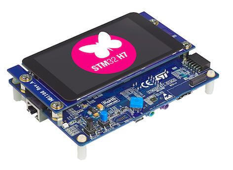
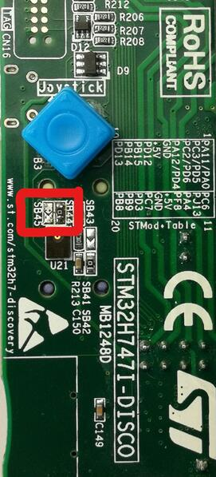
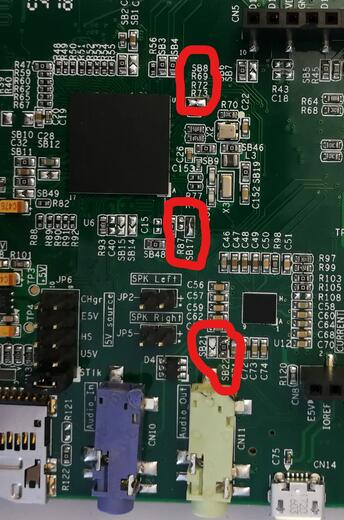

<!-- Copyright 2015-2026 Zephyr Project members and individual contributors. -->
<!-- SPDX-License-Identifier: Apache-2.0 -->
<!-- 中文翻译；编号、导航与译注为本地新增。 -->

<a id="stm32h747i_disco"></a>

# 第37章\_STM32H747I探索板（Discovery）

原文：[官方页面](https://docs.zephyrproject.org/latest/boards/st/stm32h747i_disco/doc/index.html)。读取日期：2026-10-16；来源摘要见[来源记录](../SOURCES.md)。

开发板概览（Board Overview）

<a id="id1"></a>

[](images/stm32h747i_disco.jpg)

STM32H747I探索板（Discovery）

名称（Name）：

`stm32h747i_disco`

厂商（Vendor）：

[意法半导体（STMicroelectronics）](https://docs.zephyrproject.org/latest/boards/index.html#vendor=st)

状态（Status）：

维护中（Maintained）

架构（Architecture）：

[arm](https://docs.zephyrproject.org/latest/boards/index.html#arch=arm)

片上系统（SoC）：

[stm32h747xx](https://docs.zephyrproject.org/latest/boards/index.html#soc=stm32h747xx)

<a id="board-github-link"></a>

[浏览开发板源码（Browse Board Sources）](https://github.com/zephyrproject-rtos/zephyr/blob/main//boards/st/stm32h747i_disco/doc/index.rst/../..)<a id="overview"></a>

## 概述（Overview）

本Discovery套件利用音频、多传感器、图形、安全、视频及高速连接功能支持多种应用。

开发板采用STM32H747XI片上系统（SoC），包含高性能数字信号处理（DSP）能力、Arm Cortex-M7 + Cortex-M4双核MCU、2 MB闪存、1 MB RAM、480 MHz CPU、ART加速器、一级缓存（L1 Cache）、外部存储器接口、丰富外设、开关模式电源（SMPS）及MIPI显示串行接口（MIPI-DSI）。

此外，开发板还提供：


- 板载ST-LINK/V3E，支持USB重新枚举
- USB ST-LINK功能：虚拟COM端口、大容量存储及调试端口
- 灵活供电方式：


  - ST-LINK USB VBUS、USB OTG高速连接器或外部电源
- 4英寸电容触摸LCD模块，带MIPI® DSI接口
- 符合IEEE 802.3-2002的以太网（Ethernet）
- USB OTG高速
- 立体声扬声器输出
- 意法半导体MEMS数字麦克风
- 2个512 Mbit Quad-SPI NOR Flash
- 256 Mbit SDRAM
- 4个彩色用户LED
- 用户及复位按键；原文数量写1
- 四向摇杆，带选择按键
- Arduino Uno V3连接器

开发板信息见[STM32H747I-DISCO网站](https://www.st.com/en/evaluation-tools/stm32h747i-disco.html)；STM32H747XIH6的更多信息见：


- [ST网站上的STM32H747XI（www.st.com）](https://www.st.com/content/st_com/en/products/microcontrollers-microprocessors/stm32-32-bit-arm-cortex-mcus/stm32-high-performance-mcus/stm32h7-series/stm32h747-757/stm32h747xi.html)
- [STM32H747xx参考手册（Reference Manual）](https://www.st.com/resource/en/reference_manual/dm00176879.pdf)
- [STM32H747xx数据手册（Datasheet）](https://www.st.com/resource/en/datasheet/stm32h747xi.pdf)

<a id="supported-features"></a>

### 支持的功能（Supported Features）

`stm32h747i_disco`开发板支持下表所列的硬件功能。

片上／板载（On-Chip / On-Board）

功能集成在片上系统（SoC）内／位于开发板上。

2 / 2

分别表示已启用／已禁用的实例数。点击数量标签，可查看开发板或SoC设备树源码（DTS）中该功能的第一个实例。

`vnd,foo`

与此功能匹配的设备树绑定兼容字符串（Compatible String）；点击链接可查看绑定文档。

<a id="stm32h747i_disco-hw-features"></a>

<a id="stm32h747i_disco-stm32h747i_disco/stm32h747xx/m4-hw-features-section"></a>

#### `stm32h747i_disco/stm32h747xx/m4`目标（Target）

<a id="stm32h747i_disco-stm32h747i_disco/stm32h747xx/m4-hw-features-panel"></a>

<a id="stm32h747i_disco-stm32h747i_disco/stm32h747xx/m4-hw-features-memory"></a>

该开发板目标的片上存储容量：128 KiB RAM、1 MiB Flash。

<a id="stm32h747i_disco-stm32h747i_disco/stm32h747xx/m4-hw-features-table"></a>

<table>
<tr>
<th>类型（Type）</th>
<th>位置（Location）</th>
<th>说明（Description）</th>
<th>兼容字符串（Compatible）</th>
</tr>
<tr>
<td rowspan="1">中央处理器（CPU）</td>
<td>片上（On-Chip）</td>
<td>ARM Cortex-M4F 处理器（CPU）（<a href="https://github.com/zephyrproject-rtos/zephyr/blob/main/dts/arm/st/h7/stm32h7_dualcore.dtsi?plain=1#L11">已启用：1</a>）</td>
<td><a href="../cpu_arm_riscv_binding_reference/P025_arm_cortex-m4f.md#std-dtcompatible-arm-cortex-m4f"><code>arm,cortex-m4f</code></a></td>
</tr>
<tr>
<td rowspan="1">模数转换器（ADC）</td>
<td>片上（On-Chip）</td>
<td>STM32模数转换器（ADC）（<a href="https://github.com/zephyrproject-rtos/zephyr/blob/main/dts/arm/st/h7/stm32h7.dtsi?plain=1#L1046">已禁用：2</a>）</td>
<td><a href="../hardware/P839_STM32模数转换器绑定.md#dtbinding-st-stm32-adc"><code>st,stm32-adc</code></a></td>
</tr>
<tr>
<td rowspan="2">音频（Audio）</td>
<td>片上（On-Chip）</td>
<td>意法半导体（STMicroelectronics）Σ-Δ调制器数字滤波器模块（DFSDM）（<a href="https://github.com/zephyrproject-rtos/zephyr/blob/main/dts/arm/st/h7/stm32h7.dtsi?plain=1#L994">已禁用：1</a>）</td>
<td><a href="../audio_stm32_ti_wolfson_binding_reference/P002_st_stm32-dfsdm.md#std-dtcompatible-st-stm32-dfsdm"><code>st,stm32-dfsdm</code></a></td>
</tr>
<tr>
<td>片上（On-Chip）</td>
<td>意法半导体（STMicroelectronics）DFSDM数字麦克风（DMIC）（<a href="https://github.com/zephyrproject-rtos/zephyr/blob/main/dts/arm/st/h7/stm32h7.dtsi?plain=1#L1005">已禁用：4</a>）</td>
<td><a href="../audio_stm32_ti_wolfson_binding_reference/P001_st_stm32-dfsdm-dmic.md#std-dtcompatible-st-stm32-dfsdm-dmic"><code>st,stm32-dfsdm-dmic</code></a></td>
</tr>
<tr>
<td rowspan="1">控制器局域网（CAN）</td>
<td>片上（On-Chip）</td>
<td>STM32H7系列及兼容器件的FDCAN CAN FD控制器（<a href="https://github.com/zephyrproject-rtos/zephyr/blob/main/dts/arm/st/h7/stm32h7.dtsi?plain=1#L614">已禁用：2</a>）</td>
<td><a href="../can_nxp_renesas_stm32_ti_binding_reference/P013_st_stm32h7-fdcan.md#std-dtcompatible-st-stm32h7-fdcan"><code>st,stm32h7-fdcan</code></a></td>
</tr>
<tr>
<td rowspan="8">时钟控制（Clock Control）</td>
<td>片上（On-Chip）</td>
<td>STM32H7复位与时钟控制器（RCC / Reset and Clock Controller）（<a href="https://github.com/zephyrproject-rtos/zephyr/blob/main/dts/arm/st/h7/stm32h7.dtsi?plain=1#L205">已启用：1</a>）</td>
<td><a href="../timer_reference/P168_STM32H7复位与时钟控制绑定.md#dtbinding-st-stm32h7-rcc"><code>st,stm32h7-rcc</code></a></td>
</tr>
<tr>
<td>片上（On-Chip）</td>
<td>STM32 外部高速时钟（HSE Clock）（<a href="https://github.com/zephyrproject-rtos/zephyr/blob/main/dts/arm/st/h7/stm32h7.dtsi?plain=1#L75">已禁用：1</a>）</td>
<td><a href="../timer_reference/P129_STM32高速外部时钟绑定.md#dtbinding-st-stm32-hse-clock"><code>st,stm32-hse-clock</code></a></td>
</tr>
<tr>
<td>片上（On-Chip）</td>
<td>STM32高速内部时钟（HSI）（<a href="https://github.com/zephyrproject-rtos/zephyr/blob/main/dts/arm/st/h7/stm32h7.dtsi?plain=1#L82">已禁用：1</a>）</td>
<td><a href="../timer_reference/P146_STM32H7内部高速时钟绑定.md#dtbinding-st-stm32h7-hsi-clock"><code>st,stm32h7-hsi-clock</code></a></td>
</tr>
<tr>
<td>片上（On-Chip）</td>
<td>通用固定频率时钟提供者（Fixed-Rate Clock Provider）（<a href="https://github.com/zephyrproject-rtos/zephyr/blob/main/dts/arm/st/h7/stm32h7.dtsi?plain=1#L90">已禁用：3</a>）</td>
<td><a href="../hardware/P566_固定时钟绑定.md#dtbinding-fixed-clock"><code>fixed-clock</code></a></td>
</tr>
<tr>
<td>片上（On-Chip）</td>
<td>STM32低速外部时钟（LSE Clock）（<a href="https://github.com/zephyrproject-rtos/zephyr/blob/main/dts/arm/st/h7/stm32h7.dtsi?plain=1#L104">已禁用：1</a>）</td>
<td><a href="../timer_reference/P130_STM32低速外部时钟绑定.md#dtbinding-st-stm32-lse-clock"><code>st,stm32-lse-clock</code></a></td>
</tr>
<tr>
<td>片上（On-Chip）</td>
<td>STM32H7主锁相环（Main PLL）（<a href="https://github.com/zephyrproject-rtos/zephyr/blob/main/dts/arm/st/h7/stm32h7.dtsi?plain=1#L119">已禁用：3</a>）</td>
<td><a href="../timer_reference/P154_STM32H7锁相环时钟绑定.md#dtbinding-st-stm32h7-pll-clock"><code>st,stm32h7-pll-clock</code></a></td>
</tr>
<tr>
<td>片上（On-Chip）</td>
<td>STM32 时钟多路复用器（Clock Multiplexer）（<a href="https://github.com/zephyrproject-rtos/zephyr/blob/main/dts/arm/st/h7/stm32h7.dtsi?plain=1#L140">已禁用：1</a>）</td>
<td><a href="../timer_reference/P133_STM32时钟多路复用绑定.md#dtbinding-st-stm32-clock-mux"><code>st,stm32-clock-mux</code></a></td>
</tr>
<tr>
<td>片上（On-Chip）</td>
<td>STM32 微控制器时钟输出（Microcontroller Clock Output，MCO）（<a href="https://github.com/zephyrproject-rtos/zephyr/blob/main/dts/arm/st/h7/stm32h7.dtsi?plain=1#L148">已禁用：2</a>）</td>
<td><a href="../timer_reference/P134_STM32时钟输出绑定.md#dtbinding-st-stm32-clock-mco"><code>st,stm32-clock-mco</code></a></td>
</tr>
<tr>
<td rowspan="1">比较器（Comparator）</td>
<td>片上（On-Chip）</td>
<td>STM32H7系列比较器（Comparator）（<a href="https://github.com/zephyrproject-rtos/zephyr/blob/main/dts/arm/st/h7/stm32h7.dtsi?plain=1#L1314">已禁用：2</a>）</td>
<td><a href="../hardware/P741_STM32H7比较器绑定.md#dtbinding-st-stm32h7-comp"><code>st,stm32h7-comp</code></a></td>
</tr>
<tr>
<td rowspan="1">计数器（Counter）</td>
<td>片上（On-Chip）</td>
<td>STM32 计数器（Counters）（<a href="https://github.com/zephyrproject-rtos/zephyr/blob/main/dts/arm/st/h7/stm32h7.dtsi?plain=1#L653">已禁用：14</a>）</td>
<td><a href="../stm32_ti_xilinx_counter_binding_reference/P007_st_stm32-counter.md#std-dtcompatible-st-stm32-counter"><code>st,stm32-counter</code></a></td>
</tr>
<tr>
<td rowspan="1">循环冗余校验（CRC）</td>
<td>片上（On-Chip）</td>
<td>STM32 CRC 计算单元（Calculation Unit）（<a href="https://github.com/zephyrproject-rtos/zephyr/blob/main/dts/arm/st/h7/stm32h7.dtsi?plain=1#L1332">已禁用：1</a>）</td>
<td><a href="../crc_clock_monitor_binding_reference/P011_st_stm32-crc.md#std-dtcompatible-st-stm32-crc"><code>st,stm32-crc</code></a></td>
</tr>
<tr>
<td rowspan="1">数模转换器（DAC）</td>
<td>片上（On-Chip）</td>
<td>STM32 系列数模转换器（DAC）（<a href="https://github.com/zephyrproject-rtos/zephyr/blob/main/dts/arm/st/h7/stm32h7.dtsi?plain=1#L1107">已禁用：1</a>）</td>
<td><a href="../hardware/P760_STM32数模转换器绑定.md#dtbinding-st-stm32-dac"><code>st,stm32-dac</code></a></td>
</tr>
<tr>
<td rowspan="2">显示（Display）</td>
<td>片上（On-Chip）</td>
<td>STM32 Chrom-ART 图形加速器（Accelerator，DMA2D）（<a href="https://github.com/zephyrproject-rtos/zephyr/blob/main/dts/arm/st/h7/stm32h7.dtsi?plain=1#L1349">已禁用：1</a>）</td>
<td><a href="../display_st_ultrachip_zephyr_binding_reference/P003_st_stm32-dma2d.md#std-dtcompatible-st-stm32-dma2d"><code>st,stm32-dma2d</code></a></td>
</tr>
<tr>
<td>片上（On-Chip）</td>
<td>STM32 LCD-TFT 显示控制器（Display Controller）（<a href="https://github.com/zephyrproject-rtos/zephyr/blob/main/dts/arm/st/h7/stm32h745.dtsi?plain=1#L44">已禁用：1</a>）</td>
<td><a href="../display_st_ultrachip_zephyr_binding_reference/P004_st_stm32-ltdc.md#std-dtcompatible-st-stm32-ltdc"><code>st,stm32-ltdc</code></a></td>
</tr>
<tr>
<td rowspan="3">直接存储器访问（DMA）</td>
<td>片上（On-Chip）</td>
<td>STM32 DMA 控制器（Controller，V1）（<a href="https://github.com/zephyrproject-rtos/zephyr/blob/main/dts/arm/st/h7/stm32h7.dtsi?plain=1#L1115">已禁用：2</a>）</td>
<td><a href="../stm32_ti_xilinx_dma_binding_reference/P007_st_stm32-dma-v1.md#std-dtcompatible-st-stm32-dma-v1"><code>st,stm32-dma-v1</code></a></td>
</tr>
<tr>
<td>片上（On-Chip）</td>
<td>STM32基本DMA控制器（BDMA）（<a href="https://github.com/zephyrproject-rtos/zephyr/blob/main/dts/arm/st/h7/stm32h7.dtsi?plain=1#L1141">已禁用：1</a>）</td>
<td><a href="../stm32_ti_xilinx_dma_binding_reference/P006_st_stm32-bdma.md#std-dtcompatible-st-stm32-bdma"><code>st,stm32-bdma</code></a></td>
</tr>
<tr>
<td>片上（On-Chip）</td>
<td>STM32 DMA 多路复用控制器（DMAMUX Controller）（<a href="https://github.com/zephyrproject-rtos/zephyr/blob/main/dts/arm/st/h7/stm32h7.dtsi?plain=1#L1154">已禁用：2</a>）</td>
<td><a href="../stm32_ti_xilinx_dma_binding_reference/P011_st_stm32-dmamux.md#std-dtcompatible-st-stm32-dmamux"><code>st,stm32-dmamux</code></a></td>
</tr>
<tr>
<td rowspan="3">以太网（Ethernet）</td>
<td>片上（On-Chip）</td>
<td>ST STM32 以太网媒体访问控制器（Ethernet MAC）（<a href="https://github.com/zephyrproject-rtos/zephyr/blob/main/dts/arm/st/h7/stm32h7.dtsi?plain=1#L1215">已禁用：1</a>）</td>
<td><a href="../ethernet_synopsys_st_xilinx_binding_reference/P011_st_stm32h7-ethernet.md#std-dtcompatible-st-stm32h7-ethernet"><code>st,stm32h7-ethernet</code></a></td>
</tr>
<tr>
<td>片上（On-Chip）</td>
<td>Synopsys DesignWare MAC 的管理数据输入输出控制器（MDIO Controller）（<a href="https://github.com/zephyrproject-rtos/zephyr/blob/main/dts/arm/st/h7/stm32h7.dtsi?plain=1#L1229">已禁用：1</a>）</td>
<td><a href="../ethernet_mdio_microchip_binding_reference/P010_snps_dwmac-mdio.md#std-dtcompatible-snps-dwmac-mdio"><code>snps,dwmac-mdio</code></a></td>
</tr>
<tr>
<td>片上（On-Chip）</td>
<td>Synopsys DesignWare MAC 精确时间协议时钟（Precision Time Protocol，PTP Clock）（<a href="https://github.com/zephyrproject-rtos/zephyr/blob/main/dts/arm/st/h7/stm32h7.dtsi?plain=1#L1236">已启用：1</a>）</td>
<td><a href="../ethernet_synopsys_st_xilinx_binding_reference/P006_snps_dwmac-ptp-clock.md#std-dtcompatible-snps-dwmac-ptp-clock"><code>snps,dwmac-ptp-clock</code></a></td>
</tr>
<tr>
<td rowspan="1">闪存控制器（Flash Controller）</td>
<td>片上（On-Chip）</td>
<td>STM32 系列闪存控制器（Flash Controller）（<a href="https://github.com/zephyrproject-rtos/zephyr/blob/main/dts/arm/st/h7/stm32h7.dtsi?plain=1#L162">已启用：1</a>）</td>
<td><a href="../flash_renesas_st_ti_binding_reference/P011_st_stm32-flash-controller.md#std-dtcompatible-st-stm32-flash-controller"><code>st,stm32-flash-controller</code></a></td>
</tr>
<tr>
<td rowspan="5">通用输入输出与接插件（GPIO &amp; Headers）</td>
<td>片上（On-Chip）</td>
<td>STM32 通用输入输出控制器（GPIO Controller）（<a href="https://github.com/zephyrproject-rtos/zephyr/blob/main/dts/arm/st/h7/stm32h7.dtsi?plain=1#L248">已启用：11</a>）</td>
<td><a href="../gpio_silabs_st_connectors_binding_reference/P029_st_stm32-gpio.md#std-dtcompatible-st-stm32-gpio"><code>st,stm32-gpio</code></a></td>
</tr>
<tr>
<td>板载（On-Board）</td>
<td>引出到Arduino Uno R3排针（Headers）的GPIO引脚（<a href="https://github.com/zephyrproject-rtos/zephyr/blob/main/boards/st/stm32h747i_disco/arduino_r3_connector.dtsi?plain=1#L10">已启用：1</a>）</td>
<td><a href="../gpio_adi_headers_ambiq_binding_reference/P023_arduino-header-r3.md#std-dtcompatible-arduino-header-r3"><code>arduino-header-r3</code></a></td>
</tr>
<tr>
<td>板载（On-Board）</td>
<td>引出到Digilent Pmod接口的GPIO引脚（<a href="https://github.com/zephyrproject-rtos/zephyr/blob/main/boards/st/stm32h747i_disco/pmod_connector.dtsi?plain=1#L8">已启用：1</a>）</td>
<td><a href="../gpio_connectors_bflb_esp_binding_reference/P015_digilent_pmod.md#std-dtcompatible-digilent-pmod"><code>digilent,pmod</code></a></td>
</tr>
<tr>
<td>板载（On-Board）</td>
<td>GPIO引出至用作DSI LCD连接器的QSH-030-01-F-D-A接口（<a href="https://github.com/zephyrproject-rtos/zephyr/blob/main/boards/st/stm32h747i_disco/stm32h747i_disco.dtsi?plain=1#L88">已启用：1</a>）</td>
<td><a href="../gpio_silabs_st_connectors_binding_reference/P025_st_dsi-lcd-qsh-030-connector.md#std-dtcompatible-st-dsi-lcd-qsh-030-connector"><code>st,dsi-lcd-qsh-030-connector</code></a></td>
</tr>
<tr>
<td>板载（On-Board）</td>
<td>GPIO引出至B-CAMS-OMV的30针ZIF连接器CN5（<a href="https://github.com/zephyrproject-rtos/zephyr/blob/main/boards/st/stm32h747i_disco/stm32h747i_disco.dtsi?plain=1#L106">已启用：1</a>）</td>
<td><a href="../gpio_silabs_st_connectors_binding_reference/P026_st_dvp-cam-zif-30-connector.md#std-dtcompatible-st-dvp-cam-zif-30-connector"><code>st,dvp-cam-zif-30-connector</code></a></td>
</tr>
<tr>
<td rowspan="1">集成电路间总线（I2C）</td>
<td>片上（On-Chip）</td>
<td>STM32 I2C V2 控制器（Controller）（<a href="https://github.com/zephyrproject-rtos/zephyr/blob/main/dts/arm/st/h7/stm32h7.dtsi?plain=1#L443">已禁用：4</a>）</td>
<td><a href="../i2c_stm32_ti_mux_binding_reference/P008_st_stm32-i2c-v2.md#std-dtcompatible-st-stm32-i2c-v2"><code>st,stm32-i2c-v2</code></a></td>
</tr>
<tr>
<td rowspan="2">集成电路间音频总线（I2S）</td>
<td>片上（On-Chip）</td>
<td>STM32H7 I2S控制器（<a href="https://github.com/zephyrproject-rtos/zephyr/blob/main/dts/arm/st/h7/stm32h7.dtsi?plain=1#L572">已禁用：3</a>）</td>
<td><a href="../i2s_binding_reference/P018_st_stm32h7-i2s.md#std-dtcompatible-st-stm32h7-i2s"><code>st,stm32h7-i2s</code></a></td>
</tr>
<tr>
<td>片上（On-Chip）</td>
<td>STM32 串行音频接口块控制器（SAI Block Controller）（<a href="https://github.com/zephyrproject-rtos/zephyr/blob/main/dts/arm/st/h7/stm32h7.dtsi?plain=1#L1286">已禁用：2</a>）</td>
<td><a href="../i2s_binding_reference/P017_st_stm32-sai.md#std-dtcompatible-st-stm32-sai"><code>st,stm32-sai</code></a></td>
</tr>
<tr>
<td rowspan="1">输入（Input）</td>
<td>板载（On-Board）</td>
<td>一组绑定到 GPIO 的输入按键（GPIO-Bound Input Keys）（<a href="https://github.com/zephyrproject-rtos/zephyr/blob/main/boards/st/stm32h747i_disco/stm32h747i_disco.dtsi?plain=1#L41">已启用：1</a>）</td>
<td><a href="../hardware/P563_GPIO按键绑定.md#std-dtcompatible-gpio-keys"><code>gpio-keys</code></a></td>
</tr>
<tr>
<td rowspan="2">中断控制器（Interrupt Controller）</td>
<td>片上（On-Chip）</td>
<td>ARMv7-M 嵌套向量中断控制器（Nested Vectored Interrupt Controller，NVIC）（<a href="https://github.com/zephyrproject-rtos/zephyr/blob/main/dts/arm/armv7-m.dtsi?plain=1#L13">已启用：1</a>）</td>
<td><a href="../arm_interrupt_timer_binding_reference/P002_ARMv7_M_NVIC.md#std-dtcompatible-arm-v7m-nvic"><code>arm,v7m-nvic</code></a></td>
</tr>
<tr>
<td>片上（On-Chip）</td>
<td>STM32 外部中断控制器（External Interrupt Controller）（<a href="https://github.com/zephyrproject-rtos/zephyr/blob/main/dts/arm/st/h7/stm32h7.dtsi?plain=1#L225">已启用：1</a>）</td>
<td><a href="../mcu_external_interrupt_binding_reference/P001_st_stm32-exti.md#std-dtcompatible-st-stm32-exti"><code>st,stm32-exti</code></a></td>
</tr>
<tr>
<td rowspan="1">处理器间消息（IPM）</td>
<td>片上（On-Chip）</td>
<td>STM32硬件信号量邮箱（HSEM Mailbox）（<a href="https://github.com/zephyrproject-rtos/zephyr/blob/main/dts/arm/st/h7/stm32h7_dualcore.dtsi?plain=1#L27">已启用：1</a>）</td>
<td><a href="../intercore_reference/P074_STM32硬件信号量IPM绑定.md#dtbinding-st-stm32-hsem-mailbox"><code>st,stm32-hsem-mailbox</code></a></td>
</tr>
<tr>
<td rowspan="1">发光二极管（LED）</td>
<td>板载（On-Board）</td>
<td>一组由 GPIO 控制的 LED（GPIO-Controlled LEDs）（<a href="https://github.com/zephyrproject-rtos/zephyr/blob/main/boards/st/stm32h747i_disco/stm32h747i_disco.dtsi?plain=1#L13">已启用：1</a>）</td>
<td><a href="../hardware/P564_GPIO指示灯绑定.md#dtbinding-gpio-leds"><code>gpio-leds</code></a></td>
</tr>
<tr>
<td rowspan="3">存储器控制器（Memory Controller）</td>
<td>片上（On-Chip）</td>
<td>STM32 电池备份 RAM（Battery-Backed RAM）（<a href="https://github.com/zephyrproject-rtos/zephyr/blob/main/dts/arm/st/h7/stm32h745.dtsi?plain=1#L83">已禁用：1</a>）</td>
<td><a href="../memory_controller_sdram_psram_binding_reference/P010_st_stm32-bbram.md#std-dtcompatible-st-stm32-bbram"><code>st,stm32-bbram</code></a></td>
</tr>
<tr>
<td>片上（On-Chip）</td>
<td>STM32H7灵活存储器控制器（FMC / Flexible Memory Controller）（<a href="https://github.com/zephyrproject-rtos/zephyr/blob/main/dts/arm/st/h7/stm32h7.dtsi?plain=1#L1241">已禁用：1</a>）</td>
<td><a href="../memory_controller_sdram_psram_binding_reference/P016_st_stm32h7-fmc.md#std-dtcompatible-st-stm32h7-fmc"><code>st,stm32h7-fmc</code></a></td>
</tr>
<tr>
<td>片上（On-Chip）</td>
<td>STM32 灵活存储器控制器中的 SDRAM 控制器（SDRAM Controller）（<a href="https://github.com/zephyrproject-rtos/zephyr/blob/main/dts/arm/st/h7/stm32h7.dtsi?plain=1#L1247">已禁用：1</a>）</td>
<td><a href="../memory_controller_sdram_psram_binding_reference/P012_st_stm32-fmc-sdram.md#std-dtcompatible-st-stm32-fmc-sdram"><code>st,stm32-fmc-sdram</code></a></td>
</tr>
<tr>
<td rowspan="1">MIPI 显示串行接口（MIPI-DSI）</td>
<td>片上（On-Chip）</td>
<td>STM32 MIPI显示串行接口（DSI）主机（<a href="https://github.com/zephyrproject-rtos/zephyr/blob/main/dts/arm/st/h7/stm32h747.dtsi?plain=1#L14">已禁用：1</a>）</td>
<td><a href="../mipi_dbi_dsi_binding_reference/P018_st_stm32-mipi-dsi.md#std-dtcompatible-st-stm32-mipi-dsi"><code>st,stm32-mipi-dsi</code></a></td>
</tr>
<tr>
<td rowspan="1">存储技术设备（MTD）</td>
<td>片上（On-Chip）</td>
<td>STM32闪存（Flash Memory）（<a href="https://github.com/zephyrproject-rtos/zephyr/blob/main/dts/arm/st/h7/stm32h745.dtsi?plain=1#L25">已启用：1</a>）</td>
<td><a href="../mtd_nxp_st_ti_partition_binding_reference/P016_st_stm32-nv-flash.md#std-dtcompatible-st-stm32-nv-flash"><code>st,stm32-nv-flash</code></a></td>
</tr>
<tr>
<td rowspan="1">非易失存储器（NVMEM）</td>
<td>片上（On-Chip）</td>
<td>非易失存储器固定布局（Fixed Layout for Non-Volatile Memory）（<a href="https://github.com/zephyrproject-rtos/zephyr/blob/main/dts/arm/st/h7/stm32h7.dtsi?plain=1#L179">已启用：1</a>）</td>
<td><a href="../memory_protection_binding_reference/P009_fixed-layout.md#std-dtcompatible-fixed-layout"><code>fixed-layout</code></a></td>
</tr>
<tr>
<td rowspan="1">一次性可编程存储器（OTP Memory）</td>
<td>片上（On-Chip）</td>
<td>STM32 嵌入式非易失一次性可编程存储器（NVM OTP）（<a href="https://github.com/zephyrproject-rtos/zephyr/blob/main/dts/arm/st/h7/stm32h7.dtsi?plain=1#L175">已启用：1</a>）</td>
<td><a href="../otp_binding_reference/P010_st_stm32-nvm-otp.md#std-dtcompatible-st-stm32-nvm-otp"><code>st,stm32-nvm-otp</code></a></td>
</tr>
<tr>
<td rowspan="1">物理层（PHY）</td>
<td>片上（On-Chip）</td>
<td>用于所有内置于 USB IP 的 USB 收发器（USB Transceivers）的绑定。（<a href="https://github.com/zephyrproject-rtos/zephyr/blob/main/dts/arm/st/h7/stm32h745.dtsi?plain=1#L175">已启用：1</a>）</td>
<td><a href="../phy_binding_reference/P008_usb-nop-xceiv.md#std-dtcompatible-usb-nop-xceiv"><code>usb-nop-xceiv</code></a></td>
</tr>
<tr>
<td rowspan="1">引脚控制（Pin Control）</td>
<td>片上（On-Chip）</td>
<td>STM32 引脚控制器（Pin Controller）（<a href="https://github.com/zephyrproject-rtos/zephyr/blob/main/dts/arm/st/h7/stm32h7.dtsi?plain=1#L241">已启用：1</a>）</td>
<td><a href="../pinctrl_stm32_ti_xilinx_binding_reference/P004_st_stm32-pinctrl.md#std-dtcompatible-st-stm32-pinctrl"><code>st,stm32-pinctrl</code></a></td>
</tr>
<tr>
<td rowspan="1">电源管理（Power Management）</td>
<td>片上（On-Chip）</td>
<td>STM32H7电源控制器（Power Controller）（<a href="https://github.com/zephyrproject-rtos/zephyr/blob/main/dts/arm/st/h7/stm32h7.dtsi?plain=1#L216">已启用：1</a>）</td>
<td><a href="../stm32_soc_power_binding_reference/P014_st_stm32h7-pwr.md#std-dtcompatible-st-stm32h7-pwr"><code>st,stm32h7-pwr</code></a></td>
</tr>
<tr>
<td rowspan="1">脉宽调制（PWM）</td>
<td>片上（On-Chip）</td>
<td>STM32 脉宽调制（PWM）（<a href="https://github.com/zephyrproject-rtos/zephyr/blob/main/dts/arm/st/h7/stm32h7.dtsi?plain=1#L647">已禁用：12</a>）</td>
<td><a href="../pwm_stm32_ti_generic_binding_reference/P011_st_stm32-pwm.md#std-dtcompatible-st-stm32-pwm"><code>st,stm32-pwm</code></a></td>
</tr>
<tr>
<td rowspan="1">四线串行外设接口（QSPI）</td>
<td>片上（On-Chip）</td>
<td>STM32 四线串行外设接口控制器（QSPI Controller）（<a href="https://github.com/zephyrproject-rtos/zephyr/blob/main/dts/arm/st/h7/stm32h7.dtsi?plain=1#L1263">已禁用：1</a>）</td>
<td><a href="../qspi_ospi_xspi_binding_reference/P011_st_stm32-qspi.md#std-dtcompatible-st-stm32-qspi"><code>st,stm32-qspi</code></a></td>
</tr>
<tr>
<td rowspan="1">稳压器（Regulator）</td>
<td>片上（On-Chip）</td>
<td>STM32参考电压缓冲器稳压器（VREFBUF Regulator）（<a href="https://github.com/zephyrproject-rtos/zephyr/blob/main/dts/arm/st/h7/stm32h7.dtsi?plain=1#L1340">已禁用：1</a>）</td>
<td><a href="../hardware/P638_STM32参考电压缓冲器绑定.md#dtbinding-st-stm32-vrefbuf"><code>st,stm32-vrefbuf</code></a></td>
</tr>
<tr>
<td rowspan="1">复位控制器（Reset Controller）</td>
<td>片上（On-Chip）</td>
<td>STM32 复位与时钟控制器（Reset and Clock Control，RCC）（<a href="https://github.com/zephyrproject-rtos/zephyr/blob/main/dts/arm/st/h7/stm32h7.dtsi?plain=1#L210">已启用：1</a>）</td>
<td><a href="../reset_controller_binding_reference/P017_st_stm32-rcc-rctl.md#std-dtcompatible-st-stm32-rcc-rctl"><code>st,stm32-rcc-rctl</code></a></td>
</tr>
<tr>
<td rowspan="1">随机数生成器（RNG）</td>
<td>片上（On-Chip）</td>
<td>STM32 随机数生成器（Random Number Generator）（<a href="https://github.com/zephyrproject-rtos/zephyr/blob/main/dts/arm/st/h7/stm32h7.dtsi?plain=1#L1186">已禁用：1</a>）</td>
<td><a href="../soc_rng_binding_reference/P016_st_stm32-rng.md#std-dtcompatible-st-stm32-rng"><code>st,stm32-rng</code></a></td>
</tr>
<tr>
<td rowspan="1">实时时钟（RTC）</td>
<td>片上（On-Chip）</td>
<td>STM32 实时时钟（RTC）（<a href="https://github.com/zephyrproject-rtos/zephyr/blob/main/dts/arm/st/h7/stm32h7.dtsi?plain=1#L432">已禁用：1</a>）</td>
<td><a href="../soc_rtc_binding_reference/P014_st_stm32-rtc.md#std-dtcompatible-st-stm32-rtc"><code>st,stm32-rtc</code></a></td>
</tr>
<tr>
<td rowspan="1">SD 主机控制器（SDHC）</td>
<td>片上（On-Chip）</td>
<td>STM32 SDMMC 主机控制器（Host Controller）（<a href="https://github.com/zephyrproject-rtos/zephyr/blob/main/dts/arm/st/h7/stm32h7.dtsi?plain=1#L1194">已禁用：2</a>）</td>
<td><a href="../sdhc_binding_reference/P019_st_stm32-sdmmc.md#std-dtcompatible-st-stm32-sdmmc"><code>st,stm32-sdmmc</code></a></td>
</tr>
<tr>
<td rowspan="4">传感器（Sensors）</td>
<td>片上（On-Chip）</td>
<td>STM32 正交解码器（Quadrature Decoder）（<a href="https://github.com/zephyrproject-rtos/zephyr/blob/main/dts/arm/st/h7/stm32h7.dtsi?plain=1#L658">已禁用：6</a>）</td>
<td><a href="../sensor_st_lsm_stm32_binding_reference/P028_st_stm32-qdec.md#std-dtcompatible-st-stm32-qdec"><code>st,stm32-qdec</code></a></td>
</tr>
<tr>
<td>片上（On-Chip）</td>
<td>STM32 系列温度节点（TEMP），用于以两个温度点完成生产校准的传感器。（<a href="https://github.com/zephyrproject-rtos/zephyr/blob/main/dts/arm/st/h7/stm32h7.dtsi?plain=1#L1357">已禁用：1</a>）</td>
<td><a href="../sensor_st_lsm_stm32_binding_reference/P029_st_stm32-temp-cal.md#std-dtcompatible-st-stm32-temp-cal"><code>st,stm32-temp-cal</code></a></td>
</tr>
<tr>
<td>片上（On-Chip）</td>
<td>STM32 电池电压（VBAT）（<a href="https://github.com/zephyrproject-rtos/zephyr/blob/main/dts/arm/st/h7/stm32h7.dtsi?plain=1#L1369">已禁用：1</a>）</td>
<td><a href="../sensor_st_ti_power_capacitance_binding_reference/P001_st_stm32-vbat.md#std-dtcompatible-st-stm32-vbat"><code>st,stm32-vbat</code></a></td>
</tr>
<tr>
<td>片上（On-Chip）</td>
<td>STM32 参考电压（VREF+）（<a href="https://github.com/zephyrproject-rtos/zephyr/blob/main/dts/arm/st/h7/stm32h7.dtsi?plain=1#L1375">已禁用：1</a>）</td>
<td><a href="../sensor_st_ti_power_capacitance_binding_reference/P003_st_stm32-vref.md#std-dtcompatible-st-stm32-vref"><code>st,stm32-vref</code></a></td>
</tr>
<tr>
<td rowspan="3">串行控制器（Serial Controller）</td>
<td>片上（On-Chip）</td>
<td>STM32 通用同步／异步收发器（USART）（<a href="https://github.com/zephyrproject-rtos/zephyr/blob/main/dts/arm/st/h7/stm32h7.dtsi?plain=1#L351">已禁用：4</a>）</td>
<td><a href="../uart_silabs_stm32_ti_binding_reference/P016_st_stm32-usart.md#std-dtcompatible-st-stm32-usart"><code>st,stm32-usart</code></a></td>
</tr>
<tr>
<td>片上（On-Chip）</td>
<td>STM32 通用异步收发器（UART）（<a href="https://github.com/zephyrproject-rtos/zephyr/blob/main/dts/arm/st/h7/stm32h7.dtsi?plain=1#L414">已启用：1</a>；<a href="https://github.com/zephyrproject-rtos/zephyr/blob/main/dts/arm/st/h7/stm32h7.dtsi?plain=1#L378">已禁用：3</a>）</td>
<td><a href="../uart_silabs_stm32_ti_binding_reference/P015_st_stm32-uart.md#std-dtcompatible-st-stm32-uart"><code>st,stm32-uart</code></a></td>
</tr>
<tr>
<td>片上（On-Chip）</td>
<td>STM32低功耗通用异步收发器（LPUART）（<a href="https://github.com/zephyrproject-rtos/zephyr/blob/main/dts/arm/st/h7/stm32h7.dtsi?plain=1#L423">已禁用：1</a>）</td>
<td><a href="../uart_silabs_stm32_ti_binding_reference/P014_st_stm32-lpuart.md#std-dtcompatible-st-stm32-lpuart"><code>st,stm32-lpuart</code></a></td>
</tr>
<tr>
<td rowspan="1">系统管理总线（SMbus）</td>
<td>片上（On-Chip）</td>
<td>STM32 系统管理总线控制器（SMBus Controller）（<a href="https://github.com/zephyrproject-rtos/zephyr/blob/main/dts/arm/st/h7/stm32h7.dtsi?plain=1#L1383">已禁用：4</a>）</td>
<td><a href="../i3c_smbus_binding_reference/P013_st_stm32-smbus.md#std-dtcompatible-st-stm32-smbus"><code>st,stm32-smbus</code></a></td>
</tr>
<tr>
<td rowspan="1">串行外设接口（SPI）</td>
<td>片上（On-Chip）</td>
<td>STM32H7 串行外设接口控制器（SPI Controller）（<a href="https://github.com/zephyrproject-rtos/zephyr/blob/main/dts/arm/st/h7/stm32h7.dtsi?plain=1#L491">已禁用：6</a>）</td>
<td><a href="../spi_stm32_ti_xilinx_binding_reference/P013_st_stm32h7-spi.md#std-dtcompatible-st-stm32h7-spi"><code>st,stm32h7-spi</code></a></td>
</tr>
<tr>
<td rowspan="3">定时器（Timer）</td>
<td>片上（On-Chip）</td>
<td>ARMv7-M 系统节拍（System Tick）（<a href="https://github.com/zephyrproject-rtos/zephyr/blob/main/dts/arm/armv7-m.dtsi?plain=1#L21">已启用：1</a>）</td>
<td><a href="../arm_interrupt_timer_binding_reference/P006_ARMv7_M_SysTick.md#std-dtcompatible-arm-armv7m-systick"><code>arm,armv7m-systick</code></a></td>
</tr>
<tr>
<td>片上（On-Chip）</td>
<td>STM32 定时器（Timers）（<a href="https://github.com/zephyrproject-rtos/zephyr/blob/main/dts/arm/st/h7/stm32h7.dtsi?plain=1#L636">已禁用：14</a>）</td>
<td><a href="../stm32_ti_silabs_timer_binding_reference/P008_st_stm32-timers.md#std-dtcompatible-st-stm32-timers"><code>st,stm32-timers</code></a></td>
</tr>
<tr>
<td>片上（On-Chip）</td>
<td>STM32低功耗定时器（LPTIM）（<a href="https://github.com/zephyrproject-rtos/zephyr/blob/main/dts/arm/st/h7/stm32h7.dtsi?plain=1#L982">已禁用：1</a>）</td>
<td><a href="../stm32_ti_silabs_timer_binding_reference/P007_st_stm32-lptim.md#std-dtcompatible-st-stm32-lptim"><code>st,stm32-lptim</code></a></td>
</tr>
<tr>
<td rowspan="2">通用串行总线（USB）</td>
<td>片上（On-Chip）</td>
<td>STM32 高速 USB OTG 控制器（OTGHS Controller）（<a href="https://github.com/zephyrproject-rtos/zephyr/blob/main/dts/arm/st/h7/stm32h745.dtsi?plain=1#L54">已禁用：1</a>）</td>
<td><a href="../usb_stm32_audio_binding_reference/P005_st_stm32-otghs.md#std-dtcompatible-st-stm32-otghs"><code>st,stm32-otghs</code></a></td>
</tr>
<tr>
<td>片上（On-Chip）</td>
<td>STM32 全速 USB OTG 控制器（OTGFS Controller）（<a href="https://github.com/zephyrproject-rtos/zephyr/blob/main/dts/arm/st/h7/stm32h745.dtsi?plain=1#L68">已禁用：1</a>）</td>
<td><a href="../usb_stm32_audio_binding_reference/P004_st_stm32-otgfs.md#std-dtcompatible-st-stm32-otgfs"><code>st,stm32-otgfs</code></a></td>
</tr>
<tr>
<td rowspan="2">视频（Video）</td>
<td>片上（On-Chip）</td>
<td>STM32数字摄像头接口（DCMI）（<a href="https://github.com/zephyrproject-rtos/zephyr/blob/main/dts/arm/st/h7/stm32h7.dtsi?plain=1#L1273">已禁用：1</a>）</td>
<td><a href="../video_st_sony_emulation_binding_reference/P004_st_stm32-dcmi.md#std-dtcompatible-st-stm32-dcmi"><code>st,stm32-dcmi</code></a></td>
</tr>
<tr>
<td>片上（On-Chip）</td>
<td>STM32 JPEG硬件编解码器（HW Codec）（<a href="https://github.com/zephyrproject-rtos/zephyr/blob/main/dts/arm/st/h7/stm32h745.dtsi?plain=1#L90">已禁用：1</a>）</td>
<td><a href="../video_st_sony_emulation_binding_reference/P006_st_stm32-jpeg.md#std-dtcompatible-st-stm32-jpeg"><code>st,stm32-jpeg</code></a></td>
</tr>
<tr>
<td rowspan="2">看门狗（Watchdog）</td>
<td>片上（On-Chip）</td>
<td>STM32 看门狗（Watchdog）（<a href="https://github.com/zephyrproject-rtos/zephyr/blob/main/dts/arm/st/h7/stm32h7.dtsi?plain=1#L337">已禁用：1</a>）</td>
<td><a href="../stm32_ti_xilinx_watchdog_binding_reference/P001_st_stm32-watchdog.md#std-dtcompatible-st-stm32-watchdog"><code>st,stm32-watchdog</code></a></td>
</tr>
<tr>
<td>片上（On-Chip）</td>
<td>STM32 系统窗口看门狗（System Window Watchdog）（<a href="https://github.com/zephyrproject-rtos/zephyr/blob/main/dts/arm/st/h7/stm32h7.dtsi?plain=1#L343">已禁用：1</a>）</td>
<td><a href="../stm32_ti_xilinx_watchdog_binding_reference/P002_st_stm32-window-watchdog.md#std-dtcompatible-st-stm32-window-watchdog"><code>st,stm32-window-watchdog</code></a></td>
</tr>
</table>

<a id="stm32h747i_disco-stm32h747i_disco/stm32h747xx/m7-hw-features-section"></a>

#### `stm32h747i_disco/stm32h747xx/m7`目标（Target）

<a id="stm32h747i_disco-stm32h747i_disco/stm32h747xx/m7-hw-features-panel"></a>

<a id="stm32h747i_disco-stm32h747i_disco/stm32h747xx/m7-hw-features-memory"></a>

该开发板目标的片上存储容量：512 KiB RAM、1 MiB Flash。

<a id="stm32h747i_disco-stm32h747i_disco/stm32h747xx/m7-hw-features-table"></a>

<table>
<tr>
<th>类型（Type）</th>
<th>位置（Location）</th>
<th>说明（Description）</th>
<th>兼容字符串（Compatible）</th>
</tr>
<tr>
<td rowspan="1">中央处理器（CPU）</td>
<td>片上（On-Chip）</td>
<td>ARM Cortex-M7处理器（CPU）（<a href="https://github.com/zephyrproject-rtos/zephyr/blob/main/dts/arm/st/h7/stm32h7.dtsi?plain=1#L38">已启用：1</a>）</td>
<td><a href="../cpu_cortex_xtensa_binding_reference/P005_arm_cortex-m7.md#std-dtcompatible-arm-cortex-m7"><code>arm,cortex-m7</code></a></td>
</tr>
<tr>
<td rowspan="1">模数转换器（ADC）</td>
<td>片上（On-Chip）</td>
<td>STM32模数转换器（ADC）（<a href="https://github.com/zephyrproject-rtos/zephyr/blob/main/dts/arm/st/h7/stm32h7.dtsi?plain=1#L1046">已禁用：2</a>）</td>
<td><a href="../hardware/P839_STM32模数转换器绑定.md#dtbinding-st-stm32-adc"><code>st,stm32-adc</code></a></td>
</tr>
<tr>
<td rowspan="2">音频（Audio）</td>
<td>片上（On-Chip）</td>
<td>意法半导体（STMicroelectronics）Σ-Δ调制器数字滤波器模块（DFSDM）（<a href="https://github.com/zephyrproject-rtos/zephyr/blob/main/dts/arm/st/h7/stm32h7.dtsi?plain=1#L994">已禁用：1</a>）</td>
<td><a href="../audio_stm32_ti_wolfson_binding_reference/P002_st_stm32-dfsdm.md#std-dtcompatible-st-stm32-dfsdm"><code>st,stm32-dfsdm</code></a></td>
</tr>
<tr>
<td>片上（On-Chip）</td>
<td>意法半导体（STMicroelectronics）DFSDM数字麦克风（DMIC）（<a href="https://github.com/zephyrproject-rtos/zephyr/blob/main/dts/arm/st/h7/stm32h7.dtsi?plain=1#L1005">已禁用：4</a>）</td>
<td><a href="../audio_stm32_ti_wolfson_binding_reference/P001_st_stm32-dfsdm-dmic.md#std-dtcompatible-st-stm32-dfsdm-dmic"><code>st,stm32-dfsdm-dmic</code></a></td>
</tr>
<tr>
<td rowspan="1">控制器局域网（CAN）</td>
<td>片上（On-Chip）</td>
<td>STM32H7系列及兼容器件的FDCAN CAN FD控制器（<a href="https://github.com/zephyrproject-rtos/zephyr/blob/main/dts/arm/st/h7/stm32h7.dtsi?plain=1#L614">已禁用：2</a>）</td>
<td><a href="../can_nxp_renesas_stm32_ti_binding_reference/P013_st_stm32h7-fdcan.md#std-dtcompatible-st-stm32h7-fdcan"><code>st,stm32h7-fdcan</code></a></td>
</tr>
<tr>
<td rowspan="8">时钟控制（Clock Control）</td>
<td>片上（On-Chip）</td>
<td>STM32H7复位与时钟控制器（RCC / Reset and Clock Controller）（<a href="https://github.com/zephyrproject-rtos/zephyr/blob/main/dts/arm/st/h7/stm32h7.dtsi?plain=1#L205">已启用：1</a>）</td>
<td><a href="../timer_reference/P168_STM32H7复位与时钟控制绑定.md#dtbinding-st-stm32h7-rcc"><code>st,stm32h7-rcc</code></a></td>
</tr>
<tr>
<td>片上（On-Chip）</td>
<td>STM32 外部高速时钟（HSE Clock）（<a href="https://github.com/zephyrproject-rtos/zephyr/blob/main/dts/arm/st/h7/stm32h7.dtsi?plain=1#L75">已启用：1</a>）</td>
<td><a href="../timer_reference/P129_STM32高速外部时钟绑定.md#dtbinding-st-stm32-hse-clock"><code>st,stm32-hse-clock</code></a></td>
</tr>
<tr>
<td>片上（On-Chip）</td>
<td>STM32高速内部时钟（HSI）（<a href="https://github.com/zephyrproject-rtos/zephyr/blob/main/dts/arm/st/h7/stm32h7.dtsi?plain=1#L82">已禁用：1</a>）</td>
<td><a href="../timer_reference/P146_STM32H7内部高速时钟绑定.md#dtbinding-st-stm32h7-hsi-clock"><code>st,stm32h7-hsi-clock</code></a></td>
</tr>
<tr>
<td>片上（On-Chip）</td>
<td>通用固定频率时钟提供者（Fixed-Rate Clock Provider）（<a href="https://github.com/zephyrproject-rtos/zephyr/blob/main/dts/arm/st/h7/stm32h7.dtsi?plain=1#L90">已启用：1</a>；<a href="https://github.com/zephyrproject-rtos/zephyr/blob/main/dts/arm/st/h7/stm32h7.dtsi?plain=1#L97">已禁用：2</a>）</td>
<td><a href="../hardware/P566_固定时钟绑定.md#dtbinding-fixed-clock"><code>fixed-clock</code></a></td>
</tr>
<tr>
<td>片上（On-Chip）</td>
<td>STM32低速外部时钟（LSE Clock）（<a href="https://github.com/zephyrproject-rtos/zephyr/blob/main/dts/arm/st/h7/stm32h7.dtsi?plain=1#L104">已禁用：1</a>）</td>
<td><a href="../timer_reference/P130_STM32低速外部时钟绑定.md#dtbinding-st-stm32-lse-clock"><code>st,stm32-lse-clock</code></a></td>
</tr>
<tr>
<td>片上（On-Chip）</td>
<td>STM32H7主锁相环（Main PLL）（<a href="https://github.com/zephyrproject-rtos/zephyr/blob/main/dts/arm/st/h7/stm32h7.dtsi?plain=1#L119">已启用：2</a>；<a href="https://github.com/zephyrproject-rtos/zephyr/blob/main/dts/arm/st/h7/stm32h7.dtsi?plain=1#L133">已禁用：1</a>）</td>
<td><a href="../timer_reference/P154_STM32H7锁相环时钟绑定.md#dtbinding-st-stm32h7-pll-clock"><code>st,stm32h7-pll-clock</code></a></td>
</tr>
<tr>
<td>片上（On-Chip）</td>
<td>STM32 时钟多路复用器（Clock Multiplexer）（<a href="https://github.com/zephyrproject-rtos/zephyr/blob/main/dts/arm/st/h7/stm32h7.dtsi?plain=1#L140">已禁用：1</a>）</td>
<td><a href="../timer_reference/P133_STM32时钟多路复用绑定.md#dtbinding-st-stm32-clock-mux"><code>st,stm32-clock-mux</code></a></td>
</tr>
<tr>
<td>片上（On-Chip）</td>
<td>STM32 微控制器时钟输出（Microcontroller Clock Output，MCO）（<a href="https://github.com/zephyrproject-rtos/zephyr/blob/main/dts/arm/st/h7/stm32h7.dtsi?plain=1#L148">已禁用：2</a>）</td>
<td><a href="../timer_reference/P134_STM32时钟输出绑定.md#dtbinding-st-stm32-clock-mco"><code>st,stm32-clock-mco</code></a></td>
</tr>
<tr>
<td rowspan="1">比较器（Comparator）</td>
<td>片上（On-Chip）</td>
<td>STM32H7系列比较器（Comparator）（<a href="https://github.com/zephyrproject-rtos/zephyr/blob/main/dts/arm/st/h7/stm32h7.dtsi?plain=1#L1314">已禁用：2</a>）</td>
<td><a href="../hardware/P741_STM32H7比较器绑定.md#dtbinding-st-stm32h7-comp"><code>st,stm32h7-comp</code></a></td>
</tr>
<tr>
<td rowspan="1">计数器（Counter）</td>
<td>片上（On-Chip）</td>
<td>STM32 计数器（Counters）（<a href="https://github.com/zephyrproject-rtos/zephyr/blob/main/dts/arm/st/h7/stm32h7.dtsi?plain=1#L653">已禁用：14</a>）</td>
<td><a href="../stm32_ti_xilinx_counter_binding_reference/P007_st_stm32-counter.md#std-dtcompatible-st-stm32-counter"><code>st,stm32-counter</code></a></td>
</tr>
<tr>
<td rowspan="1">循环冗余校验（CRC）</td>
<td>片上（On-Chip）</td>
<td>STM32 CRC 计算单元（Calculation Unit）（<a href="https://github.com/zephyrproject-rtos/zephyr/blob/main/dts/arm/st/h7/stm32h7.dtsi?plain=1#L1332">已禁用：1</a>）</td>
<td><a href="../crc_clock_monitor_binding_reference/P011_st_stm32-crc.md#std-dtcompatible-st-stm32-crc"><code>st,stm32-crc</code></a></td>
</tr>
<tr>
<td rowspan="1">数模转换器（DAC）</td>
<td>片上（On-Chip）</td>
<td>STM32 系列数模转换器（DAC）（<a href="https://github.com/zephyrproject-rtos/zephyr/blob/main/dts/arm/st/h7/stm32h7.dtsi?plain=1#L1107">已禁用：1</a>）</td>
<td><a href="../hardware/P760_STM32数模转换器绑定.md#dtbinding-st-stm32-dac"><code>st,stm32-dac</code></a></td>
</tr>
<tr>
<td rowspan="2">显示（Display）</td>
<td>片上（On-Chip）</td>
<td>STM32 Chrom-ART 图形加速器（Accelerator，DMA2D）（<a href="https://github.com/zephyrproject-rtos/zephyr/blob/main/dts/arm/st/h7/stm32h7.dtsi?plain=1#L1349">已禁用：1</a>）</td>
<td><a href="../display_st_ultrachip_zephyr_binding_reference/P003_st_stm32-dma2d.md#std-dtcompatible-st-stm32-dma2d"><code>st,stm32-dma2d</code></a></td>
</tr>
<tr>
<td>片上（On-Chip）</td>
<td>STM32 LCD-TFT 显示控制器（Display Controller）（<a href="https://github.com/zephyrproject-rtos/zephyr/blob/main/dts/arm/st/h7/stm32h745.dtsi?plain=1#L44">已禁用：1</a>）</td>
<td><a href="../display_st_ultrachip_zephyr_binding_reference/P004_st_stm32-ltdc.md#std-dtcompatible-st-stm32-ltdc"><code>st,stm32-ltdc</code></a></td>
</tr>
<tr>
<td rowspan="3">直接存储器访问（DMA）</td>
<td>片上（On-Chip）</td>
<td>STM32 DMA 控制器（Controller，V1）（<a href="https://github.com/zephyrproject-rtos/zephyr/blob/main/dts/arm/st/h7/stm32h7.dtsi?plain=1#L1115">已启用：2</a>）</td>
<td><a href="../stm32_ti_xilinx_dma_binding_reference/P007_st_stm32-dma-v1.md#std-dtcompatible-st-stm32-dma-v1"><code>st,stm32-dma-v1</code></a></td>
</tr>
<tr>
<td>片上（On-Chip）</td>
<td>STM32基本DMA控制器（BDMA）（<a href="https://github.com/zephyrproject-rtos/zephyr/blob/main/dts/arm/st/h7/stm32h7.dtsi?plain=1#L1141">已禁用：1</a>）</td>
<td><a href="../stm32_ti_xilinx_dma_binding_reference/P006_st_stm32-bdma.md#std-dtcompatible-st-stm32-bdma"><code>st,stm32-bdma</code></a></td>
</tr>
<tr>
<td>片上（On-Chip）</td>
<td>STM32 DMA 多路复用控制器（DMAMUX Controller）（<a href="https://github.com/zephyrproject-rtos/zephyr/blob/main/dts/arm/st/h7/stm32h7.dtsi?plain=1#L1154">已启用：2</a>）</td>
<td><a href="../stm32_ti_xilinx_dma_binding_reference/P011_st_stm32-dmamux.md#std-dtcompatible-st-stm32-dmamux"><code>st,stm32-dmamux</code></a></td>
</tr>
<tr>
<td rowspan="4">以太网（Ethernet）</td>
<td>片上（On-Chip）</td>
<td>ST STM32 以太网媒体访问控制器（Ethernet MAC）（<a href="https://github.com/zephyrproject-rtos/zephyr/blob/main/dts/arm/st/h7/stm32h7.dtsi?plain=1#L1215">已启用：1</a>）</td>
<td><a href="../ethernet_synopsys_st_xilinx_binding_reference/P011_st_stm32h7-ethernet.md#std-dtcompatible-st-stm32h7-ethernet"><code>st,stm32h7-ethernet</code></a></td>
</tr>
<tr>
<td>片上（On-Chip）</td>
<td>Synopsys DesignWare MAC 的管理数据输入输出控制器（MDIO Controller）（<a href="https://github.com/zephyrproject-rtos/zephyr/blob/main/dts/arm/st/h7/stm32h7.dtsi?plain=1#L1229">已启用：1</a>）</td>
<td><a href="../ethernet_mdio_microchip_binding_reference/P010_snps_dwmac-mdio.md#std-dtcompatible-snps-dwmac-mdio"><code>snps,dwmac-mdio</code></a></td>
</tr>
<tr>
<td>板载（On-Board）</td>
<td>通用媒体独立接口物理层（MII PHY）（<a href="https://github.com/zephyrproject-rtos/zephyr/blob/main/boards/st/stm32h747i_disco/stm32h747i_disco_stm32h747xx_m7.dts?plain=1#L158">已启用：1</a>）</td>
<td><a href="../ethernet_nxp_phy_binding_reference/P019_ethernet-phy.md#std-dtcompatible-ethernet-phy"><code>ethernet-phy</code></a></td>
</tr>
<tr>
<td>片上（On-Chip）</td>
<td>Synopsys DesignWare MAC 精确时间协议时钟（Precision Time Protocol，PTP Clock）（<a href="https://github.com/zephyrproject-rtos/zephyr/blob/main/dts/arm/st/h7/stm32h7.dtsi?plain=1#L1236">已启用：1</a>）</td>
<td><a href="../ethernet_synopsys_st_xilinx_binding_reference/P006_snps_dwmac-ptp-clock.md#std-dtcompatible-snps-dwmac-ptp-clock"><code>snps,dwmac-ptp-clock</code></a></td>
</tr>
<tr>
<td rowspan="2">闪存控制器（Flash Controller）</td>
<td>片上（On-Chip）</td>
<td>STM32 系列闪存控制器（Flash Controller）（<a href="https://github.com/zephyrproject-rtos/zephyr/blob/main/dts/arm/st/h7/stm32h7.dtsi?plain=1#L162">已启用：1</a>）</td>
<td><a href="../flash_renesas_st_ti_binding_reference/P011_st_stm32-flash-controller.md#std-dtcompatible-st-stm32-flash-controller"><code>st,stm32-flash-controller</code></a></td>
</tr>
<tr>
<td>板载（On-Board）</td>
<td>支持JEDEC公共闪存接口（CFI）的STM32四线SPI闪存控制器（QSPI Flash Controller）（<a href="https://github.com/zephyrproject-rtos/zephyr/blob/main/boards/st/stm32h747i_disco/stm32h747i_disco_stm32h747xx_m7.dts?plain=1#L258">已启用：2</a>）</td>
<td><a href="../flash_renesas_st_ti_binding_reference/P013_st_stm32-qspi-nor.md#std-dtcompatible-st-stm32-qspi-nor"><code>st,stm32-qspi-nor</code></a></td>
</tr>
<tr>
<td rowspan="5">通用输入输出与接插件（GPIO &amp; Headers）</td>
<td>片上（On-Chip）</td>
<td>STM32 通用输入输出控制器（GPIO Controller）（<a href="https://github.com/zephyrproject-rtos/zephyr/blob/main/dts/arm/st/h7/stm32h7.dtsi?plain=1#L248">已启用：11</a>）</td>
<td><a href="../gpio_silabs_st_connectors_binding_reference/P029_st_stm32-gpio.md#std-dtcompatible-st-stm32-gpio"><code>st,stm32-gpio</code></a></td>
</tr>
<tr>
<td>板载（On-Board）</td>
<td>引出到Arduino Uno R3排针（Headers）的GPIO引脚（<a href="https://github.com/zephyrproject-rtos/zephyr/blob/main/boards/st/stm32h747i_disco/arduino_r3_connector.dtsi?plain=1#L10">已启用：1</a>）</td>
<td><a href="../gpio_adi_headers_ambiq_binding_reference/P023_arduino-header-r3.md#std-dtcompatible-arduino-header-r3"><code>arduino-header-r3</code></a></td>
</tr>
<tr>
<td>板载（On-Board）</td>
<td>引出到Digilent Pmod接口的GPIO引脚（<a href="https://github.com/zephyrproject-rtos/zephyr/blob/main/boards/st/stm32h747i_disco/pmod_connector.dtsi?plain=1#L8">已启用：1</a>）</td>
<td><a href="../gpio_connectors_bflb_esp_binding_reference/P015_digilent_pmod.md#std-dtcompatible-digilent-pmod"><code>digilent,pmod</code></a></td>
</tr>
<tr>
<td>板载（On-Board）</td>
<td>GPIO引出至用作DSI LCD连接器的QSH-030-01-F-D-A接口（<a href="https://github.com/zephyrproject-rtos/zephyr/blob/main/boards/st/stm32h747i_disco/stm32h747i_disco.dtsi?plain=1#L88">已启用：1</a>）</td>
<td><a href="../gpio_silabs_st_connectors_binding_reference/P025_st_dsi-lcd-qsh-030-connector.md#std-dtcompatible-st-dsi-lcd-qsh-030-connector"><code>st,dsi-lcd-qsh-030-connector</code></a></td>
</tr>
<tr>
<td>板载（On-Board）</td>
<td>GPIO引出至B-CAMS-OMV的30针ZIF连接器CN5（<a href="https://github.com/zephyrproject-rtos/zephyr/blob/main/boards/st/stm32h747i_disco/stm32h747i_disco.dtsi?plain=1#L106">已启用：1</a>）</td>
<td><a href="../gpio_silabs_st_connectors_binding_reference/P026_st_dvp-cam-zif-30-connector.md#std-dtcompatible-st-dvp-cam-zif-30-connector"><code>st,dvp-cam-zif-30-connector</code></a></td>
</tr>
<tr>
<td rowspan="1">集成电路间总线（I2C）</td>
<td>片上（On-Chip）</td>
<td>STM32 I2C V2 控制器（Controller）（<a href="https://github.com/zephyrproject-rtos/zephyr/blob/main/dts/arm/st/h7/stm32h7.dtsi?plain=1#L479">已启用：1</a>；<a href="https://github.com/zephyrproject-rtos/zephyr/blob/main/dts/arm/st/h7/stm32h7.dtsi?plain=1#L443">已禁用：3</a>）</td>
<td><a href="../i2c_stm32_ti_mux_binding_reference/P008_st_stm32-i2c-v2.md#std-dtcompatible-st-stm32-i2c-v2"><code>st,stm32-i2c-v2</code></a></td>
</tr>
<tr>
<td rowspan="2">集成电路间音频总线（I2S）</td>
<td>片上（On-Chip）</td>
<td>STM32H7 I2S控制器（<a href="https://github.com/zephyrproject-rtos/zephyr/blob/main/dts/arm/st/h7/stm32h7.dtsi?plain=1#L572">已禁用：3</a>）</td>
<td><a href="../i2s_binding_reference/P018_st_stm32h7-i2s.md#std-dtcompatible-st-stm32h7-i2s"><code>st,stm32h7-i2s</code></a></td>
</tr>
<tr>
<td>片上（On-Chip）</td>
<td>STM32 串行音频接口块控制器（SAI Block Controller）（<a href="https://github.com/zephyrproject-rtos/zephyr/blob/main/dts/arm/st/h7/stm32h7.dtsi?plain=1#L1286">已禁用：2</a>）</td>
<td><a href="../i2s_binding_reference/P017_st_stm32-sai.md#std-dtcompatible-st-stm32-sai"><code>st,stm32-sai</code></a></td>
</tr>
<tr>
<td rowspan="1">输入（Input）</td>
<td>板载（On-Board）</td>
<td>一组绑定到 GPIO 的输入按键（GPIO-Bound Input Keys）（<a href="https://github.com/zephyrproject-rtos/zephyr/blob/main/boards/st/stm32h747i_disco/stm32h747i_disco.dtsi?plain=1#L41">已启用：1</a>）</td>
<td><a href="../hardware/P563_GPIO按键绑定.md#std-dtcompatible-gpio-keys"><code>gpio-keys</code></a></td>
</tr>
<tr>
<td rowspan="2">中断控制器（Interrupt Controller）</td>
<td>片上（On-Chip）</td>
<td>ARMv7-M 嵌套向量中断控制器（Nested Vectored Interrupt Controller，NVIC）（<a href="https://github.com/zephyrproject-rtos/zephyr/blob/main/dts/arm/armv7-m.dtsi?plain=1#L13">已启用：1</a>）</td>
<td><a href="../arm_interrupt_timer_binding_reference/P002_ARMv7_M_NVIC.md#std-dtcompatible-arm-v7m-nvic"><code>arm,v7m-nvic</code></a></td>
</tr>
<tr>
<td>片上（On-Chip）</td>
<td>STM32 外部中断控制器（External Interrupt Controller）（<a href="https://github.com/zephyrproject-rtos/zephyr/blob/main/dts/arm/st/h7/stm32h7.dtsi?plain=1#L225">已启用：1</a>）</td>
<td><a href="../mcu_external_interrupt_binding_reference/P001_st_stm32-exti.md#std-dtcompatible-st-stm32-exti"><code>st,stm32-exti</code></a></td>
</tr>
<tr>
<td rowspan="1">处理器间消息（IPM）</td>
<td>片上（On-Chip）</td>
<td>STM32硬件信号量邮箱（HSEM Mailbox）（<a href="https://github.com/zephyrproject-rtos/zephyr/blob/main/dts/arm/st/h7/stm32h7_dualcore.dtsi?plain=1#L27">已启用：1</a>）</td>
<td><a href="../intercore_reference/P074_STM32硬件信号量IPM绑定.md#dtbinding-st-stm32-hsem-mailbox"><code>st,stm32-hsem-mailbox</code></a></td>
</tr>
<tr>
<td rowspan="1">发光二极管（LED）</td>
<td>板载（On-Board）</td>
<td>一组由 GPIO 控制的 LED（GPIO-Controlled LEDs）（<a href="https://github.com/zephyrproject-rtos/zephyr/blob/main/boards/st/stm32h747i_disco/stm32h747i_disco.dtsi?plain=1#L13">已启用：1</a>）</td>
<td><a href="../hardware/P564_GPIO指示灯绑定.md#dtbinding-gpio-leds"><code>gpio-leds</code></a></td>
</tr>
<tr>
<td rowspan="3">存储器控制器（Memory Controller）</td>
<td>片上（On-Chip）</td>
<td>STM32 电池备份 RAM（Battery-Backed RAM）（<a href="https://github.com/zephyrproject-rtos/zephyr/blob/main/dts/arm/st/h7/stm32h745.dtsi?plain=1#L83">已禁用：1</a>）</td>
<td><a href="../memory_controller_sdram_psram_binding_reference/P010_st_stm32-bbram.md#std-dtcompatible-st-stm32-bbram"><code>st,stm32-bbram</code></a></td>
</tr>
<tr>
<td>片上（On-Chip）</td>
<td>STM32H7灵活存储器控制器（FMC / Flexible Memory Controller）（<a href="https://github.com/zephyrproject-rtos/zephyr/blob/main/dts/arm/st/h7/stm32h7.dtsi?plain=1#L1241">已启用：1</a>）</td>
<td><a href="../memory_controller_sdram_psram_binding_reference/P016_st_stm32h7-fmc.md#std-dtcompatible-st-stm32h7-fmc"><code>st,stm32h7-fmc</code></a></td>
</tr>
<tr>
<td>片上（On-Chip）</td>
<td>STM32 灵活存储器控制器中的 SDRAM 控制器（SDRAM Controller）（<a href="https://github.com/zephyrproject-rtos/zephyr/blob/main/dts/arm/st/h7/stm32h7.dtsi?plain=1#L1247">已启用：1</a>）</td>
<td><a href="../memory_controller_sdram_psram_binding_reference/P012_st_stm32-fmc-sdram.md#std-dtcompatible-st-stm32-fmc-sdram"><code>st,stm32-fmc-sdram</code></a></td>
</tr>
<tr>
<td rowspan="1">MIPI 显示串行接口（MIPI-DSI）</td>
<td>片上（On-Chip）</td>
<td>STM32 MIPI显示串行接口（DSI）主机（<a href="https://github.com/zephyrproject-rtos/zephyr/blob/main/dts/arm/st/h7/stm32h747.dtsi?plain=1#L14">已禁用：1</a>）</td>
<td><a href="../mipi_dbi_dsi_binding_reference/P018_st_stm32-mipi-dsi.md#std-dtcompatible-st-stm32-mipi-dsi"><code>st,stm32-mipi-dsi</code></a></td>
</tr>
<tr>
<td rowspan="1">内存管理单元／内存保护单元（MMU / MPU）</td>
<td>片上（On-Chip）</td>
<td>ARMv7-M存储器保护单元（MPU / Memory Protection Unit）（<a href="https://github.com/zephyrproject-rtos/zephyr/blob/main/dts/arm/st/h7/stm32h7.dtsi?plain=1#L45">已启用：1</a>）</td>
<td><a href="../memory_protection_binding_reference/P005_arm_armv7m-mpu.md#std-dtcompatible-arm-armv7m-mpu"><code>arm,armv7m-mpu</code></a></td>
</tr>
<tr>
<td rowspan="2">存储技术设备（MTD）</td>
<td>片上（On-Chip）</td>
<td>STM32闪存（Flash Memory）（<a href="https://github.com/zephyrproject-rtos/zephyr/blob/main/dts/arm/st/h7/stm32h745.dtsi?plain=1#L15">已启用：1</a>）</td>
<td><a href="../mtd_nxp_st_ti_partition_binding_reference/P016_st_stm32-nv-flash.md#std-dtcompatible-st-stm32-nv-flash"><code>st,stm32-nv-flash</code></a></td>
</tr>
<tr>
<td>板载（On-Board）</td>
<td>闪存或其他非易失性存储器的固定分区（Fixed Partitions）（<a href="https://github.com/zephyrproject-rtos/zephyr/blob/main/boards/st/stm32h747i_disco/stm32h747i_disco_stm32h747xx_m7.dts?plain=1#L268">已启用：1</a>）</td>
<td><a href="../hardware/P568_固定分区绑定.md#dtbinding-fixed-partitions"><code>fixed-partitions</code></a></td>
</tr>
<tr>
<td rowspan="1">非易失存储器（NVMEM）</td>
<td>片上（On-Chip）</td>
<td>非易失存储器固定布局（Fixed Layout for Non-Volatile Memory）（<a href="https://github.com/zephyrproject-rtos/zephyr/blob/main/dts/arm/st/h7/stm32h7.dtsi?plain=1#L179">已启用：1</a>）</td>
<td><a href="../memory_protection_binding_reference/P009_fixed-layout.md#std-dtcompatible-fixed-layout"><code>fixed-layout</code></a></td>
</tr>
<tr>
<td rowspan="1">一次性可编程存储器（OTP Memory）</td>
<td>片上（On-Chip）</td>
<td>STM32 嵌入式非易失一次性可编程存储器（NVM OTP）（<a href="https://github.com/zephyrproject-rtos/zephyr/blob/main/dts/arm/st/h7/stm32h7.dtsi?plain=1#L175">已启用：1</a>）</td>
<td><a href="../otp_binding_reference/P010_st_stm32-nvm-otp.md#std-dtcompatible-st-stm32-nvm-otp"><code>st,stm32-nvm-otp</code></a></td>
</tr>
<tr>
<td rowspan="2">物理层（PHY）</td>
<td>片上（On-Chip）</td>
<td>用于所有内置于 USB IP 的 USB 收发器（USB Transceivers）的绑定。（<a href="https://github.com/zephyrproject-rtos/zephyr/blob/main/dts/arm/st/h7/stm32h745.dtsi?plain=1#L175">已启用：1</a>）</td>
<td><a href="../phy_binding_reference/P008_usb-nop-xceiv.md#std-dtcompatible-usb-nop-xceiv"><code>usb-nop-xceiv</code></a></td>
</tr>
<tr>
<td>板载（On-Board）</td>
<td>此绑定（Binding）适用于所有作为外部ULPI物理层（PHY）的USB收发器（Transceivers）（<a href="https://github.com/zephyrproject-rtos/zephyr/blob/main/boards/st/stm32h747i_disco/stm32h747i_disco_stm32h747xx_m7.dts?plain=1#L58">已启用：1</a>）</td>
<td><a href="../phy_binding_reference/P009_usb-ulpi-phy.md#std-dtcompatible-usb-ulpi-phy"><code>usb-ulpi-phy</code></a></td>
</tr>
<tr>
<td rowspan="1">引脚控制（Pin Control）</td>
<td>片上（On-Chip）</td>
<td>STM32 引脚控制器（Pin Controller）（<a href="https://github.com/zephyrproject-rtos/zephyr/blob/main/dts/arm/st/h7/stm32h7.dtsi?plain=1#L241">已启用：1</a>）</td>
<td><a href="../pinctrl_stm32_ti_xilinx_binding_reference/P004_st_stm32-pinctrl.md#std-dtcompatible-st-stm32-pinctrl"><code>st,stm32-pinctrl</code></a></td>
</tr>
<tr>
<td rowspan="1">电源管理（Power Management）</td>
<td>片上（On-Chip）</td>
<td>STM32H7电源控制器（Power Controller）（<a href="https://github.com/zephyrproject-rtos/zephyr/blob/main/dts/arm/st/h7/stm32h7.dtsi?plain=1#L216">已启用：1</a>）</td>
<td><a href="../stm32_soc_power_binding_reference/P014_st_stm32h7-pwr.md#std-dtcompatible-st-stm32h7-pwr"><code>st,stm32h7-pwr</code></a></td>
</tr>
<tr>
<td rowspan="1">脉宽调制（PWM）</td>
<td>片上（On-Chip）</td>
<td>STM32 脉宽调制（PWM）（<a href="https://github.com/zephyrproject-rtos/zephyr/blob/main/dts/arm/st/h7/stm32h7.dtsi?plain=1#L647">已禁用：12</a>）</td>
<td><a href="../pwm_stm32_ti_generic_binding_reference/P011_st_stm32-pwm.md#std-dtcompatible-st-stm32-pwm"><code>st,stm32-pwm</code></a></td>
</tr>
<tr>
<td rowspan="1">四线串行外设接口（QSPI）</td>
<td>片上（On-Chip）</td>
<td>STM32 四线串行外设接口控制器（QSPI Controller）（<a href="https://github.com/zephyrproject-rtos/zephyr/blob/main/dts/arm/st/h7/stm32h7.dtsi?plain=1#L1263">已启用：1</a>）</td>
<td><a href="../qspi_ospi_xspi_binding_reference/P011_st_stm32-qspi.md#std-dtcompatible-st-stm32-qspi"><code>st,stm32-qspi</code></a></td>
</tr>
<tr>
<td rowspan="1">稳压器（Regulator）</td>
<td>片上（On-Chip）</td>
<td>STM32参考电压缓冲器稳压器（VREFBUF Regulator）（<a href="https://github.com/zephyrproject-rtos/zephyr/blob/main/dts/arm/st/h7/stm32h7.dtsi?plain=1#L1340">已禁用：1</a>）</td>
<td><a href="../hardware/P638_STM32参考电压缓冲器绑定.md#dtbinding-st-stm32-vrefbuf"><code>st,stm32-vrefbuf</code></a></td>
</tr>
<tr>
<td rowspan="1">复位控制器（Reset Controller）</td>
<td>片上（On-Chip）</td>
<td>STM32 复位与时钟控制器（Reset and Clock Control，RCC）（<a href="https://github.com/zephyrproject-rtos/zephyr/blob/main/dts/arm/st/h7/stm32h7.dtsi?plain=1#L210">已启用：1</a>）</td>
<td><a href="../reset_controller_binding_reference/P017_st_stm32-rcc-rctl.md#std-dtcompatible-st-stm32-rcc-rctl"><code>st,stm32-rcc-rctl</code></a></td>
</tr>
<tr>
<td rowspan="1">随机数生成器（RNG）</td>
<td>片上（On-Chip）</td>
<td>STM32 随机数生成器（Random Number Generator）（<a href="https://github.com/zephyrproject-rtos/zephyr/blob/main/dts/arm/st/h7/stm32h7.dtsi?plain=1#L1186">已启用：1</a>）</td>
<td><a href="../soc_rng_binding_reference/P016_st_stm32-rng.md#std-dtcompatible-st-stm32-rng"><code>st,stm32-rng</code></a></td>
</tr>
<tr>
<td rowspan="1">实时时钟（RTC）</td>
<td>片上（On-Chip）</td>
<td>STM32 实时时钟（RTC）（<a href="https://github.com/zephyrproject-rtos/zephyr/blob/main/dts/arm/st/h7/stm32h7.dtsi?plain=1#L432">已禁用：1</a>）</td>
<td><a href="../soc_rtc_binding_reference/P014_st_stm32-rtc.md#std-dtcompatible-st-stm32-rtc"><code>st,stm32-rtc</code></a></td>
</tr>
<tr>
<td rowspan="1">SD 主机控制器（SDHC）</td>
<td>片上（On-Chip）</td>
<td>STM32 SDMMC 主机控制器（Host Controller）（<a href="https://github.com/zephyrproject-rtos/zephyr/blob/main/dts/arm/st/h7/stm32h7.dtsi?plain=1#L1194">已启用：1</a>；<a href="https://github.com/zephyrproject-rtos/zephyr/blob/main/dts/arm/st/h7/stm32h7.dtsi?plain=1#L1205">已禁用：1</a>）</td>
<td><a href="../sdhc_binding_reference/P019_st_stm32-sdmmc.md#std-dtcompatible-st-stm32-sdmmc"><code>st,stm32-sdmmc</code></a></td>
</tr>
<tr>
<td rowspan="4">传感器（Sensors）</td>
<td>片上（On-Chip）</td>
<td>STM32 正交解码器（Quadrature Decoder）（<a href="https://github.com/zephyrproject-rtos/zephyr/blob/main/dts/arm/st/h7/stm32h7.dtsi?plain=1#L658">已禁用：6</a>）</td>
<td><a href="../sensor_st_lsm_stm32_binding_reference/P028_st_stm32-qdec.md#std-dtcompatible-st-stm32-qdec"><code>st,stm32-qdec</code></a></td>
</tr>
<tr>
<td>片上（On-Chip）</td>
<td>STM32 系列温度节点（TEMP），用于以两个温度点完成生产校准的传感器。（<a href="https://github.com/zephyrproject-rtos/zephyr/blob/main/dts/arm/st/h7/stm32h7.dtsi?plain=1#L1357">已禁用：1</a>）</td>
<td><a href="../sensor_st_lsm_stm32_binding_reference/P029_st_stm32-temp-cal.md#std-dtcompatible-st-stm32-temp-cal"><code>st,stm32-temp-cal</code></a></td>
</tr>
<tr>
<td>片上（On-Chip）</td>
<td>STM32 电池电压（VBAT）（<a href="https://github.com/zephyrproject-rtos/zephyr/blob/main/dts/arm/st/h7/stm32h7.dtsi?plain=1#L1369">已禁用：1</a>）</td>
<td><a href="../sensor_st_ti_power_capacitance_binding_reference/P001_st_stm32-vbat.md#std-dtcompatible-st-stm32-vbat"><code>st,stm32-vbat</code></a></td>
</tr>
<tr>
<td>片上（On-Chip）</td>
<td>STM32 参考电压（VREF+）（<a href="https://github.com/zephyrproject-rtos/zephyr/blob/main/dts/arm/st/h7/stm32h7.dtsi?plain=1#L1375">已禁用：1</a>）</td>
<td><a href="../sensor_st_ti_power_capacitance_binding_reference/P003_st_stm32-vref.md#std-dtcompatible-st-stm32-vref"><code>st,stm32-vref</code></a></td>
</tr>
<tr>
<td rowspan="3">串行控制器（Serial Controller）</td>
<td>片上（On-Chip）</td>
<td>STM32 通用同步／异步收发器（USART）（<a href="https://github.com/zephyrproject-rtos/zephyr/blob/main/dts/arm/st/h7/stm32h7.dtsi?plain=1#L351">已启用：1</a>；<a href="https://github.com/zephyrproject-rtos/zephyr/blob/main/dts/arm/st/h7/stm32h7.dtsi?plain=1#L360">已禁用：3</a>）</td>
<td><a href="../uart_silabs_stm32_ti_binding_reference/P016_st_stm32-usart.md#std-dtcompatible-st-stm32-usart"><code>st,stm32-usart</code></a></td>
</tr>
<tr>
<td>片上（On-Chip）</td>
<td>STM32 通用异步收发器（UART）（<a href="https://github.com/zephyrproject-rtos/zephyr/blob/main/dts/arm/st/h7/stm32h7.dtsi?plain=1#L378">已禁用：4</a>）</td>
<td><a href="../uart_silabs_stm32_ti_binding_reference/P015_st_stm32-uart.md#std-dtcompatible-st-stm32-uart"><code>st,stm32-uart</code></a></td>
</tr>
<tr>
<td>片上（On-Chip）</td>
<td>STM32低功耗通用异步收发器（LPUART）（<a href="https://github.com/zephyrproject-rtos/zephyr/blob/main/dts/arm/st/h7/stm32h7.dtsi?plain=1#L423">已禁用：1</a>）</td>
<td><a href="../uart_silabs_stm32_ti_binding_reference/P014_st_stm32-lpuart.md#std-dtcompatible-st-stm32-lpuart"><code>st,stm32-lpuart</code></a></td>
</tr>
<tr>
<td rowspan="1">系统管理总线（SMbus）</td>
<td>片上（On-Chip）</td>
<td>STM32 系统管理总线控制器（SMBus Controller）（<a href="https://github.com/zephyrproject-rtos/zephyr/blob/main/dts/arm/st/h7/stm32h7.dtsi?plain=1#L1383">已禁用：4</a>）</td>
<td><a href="../i3c_smbus_binding_reference/P013_st_stm32-smbus.md#std-dtcompatible-st-stm32-smbus"><code>st,stm32-smbus</code></a></td>
</tr>
<tr>
<td rowspan="1">串行外设接口（SPI）</td>
<td>片上（On-Chip）</td>
<td>STM32H7 串行外设接口控制器（SPI Controller）（<a href="https://github.com/zephyrproject-rtos/zephyr/blob/main/dts/arm/st/h7/stm32h7.dtsi?plain=1#L546">已启用：1</a>；<a href="https://github.com/zephyrproject-rtos/zephyr/blob/main/dts/arm/st/h7/stm32h7.dtsi?plain=1#L491">已禁用：5</a>）</td>
<td><a href="../spi_stm32_ti_xilinx_binding_reference/P013_st_stm32h7-spi.md#std-dtcompatible-st-stm32h7-spi"><code>st,stm32h7-spi</code></a></td>
</tr>
<tr>
<td rowspan="3">定时器（Timer）</td>
<td>片上（On-Chip）</td>
<td>ARMv7-M 系统节拍（System Tick）（<a href="https://github.com/zephyrproject-rtos/zephyr/blob/main/dts/arm/armv7-m.dtsi?plain=1#L21">已启用：1</a>）</td>
<td><a href="../arm_interrupt_timer_binding_reference/P006_ARMv7_M_SysTick.md#std-dtcompatible-arm-armv7m-systick"><code>arm,armv7m-systick</code></a></td>
</tr>
<tr>
<td>片上（On-Chip）</td>
<td>STM32 定时器（Timers）（<a href="https://github.com/zephyrproject-rtos/zephyr/blob/main/dts/arm/st/h7/stm32h7.dtsi?plain=1#L636">已禁用：14</a>）</td>
<td><a href="../stm32_ti_silabs_timer_binding_reference/P008_st_stm32-timers.md#std-dtcompatible-st-stm32-timers"><code>st,stm32-timers</code></a></td>
</tr>
<tr>
<td>片上（On-Chip）</td>
<td>STM32低功耗定时器（LPTIM）（<a href="https://github.com/zephyrproject-rtos/zephyr/blob/main/dts/arm/st/h7/stm32h7.dtsi?plain=1#L982">已禁用：1</a>）</td>
<td><a href="../stm32_ti_silabs_timer_binding_reference/P007_st_stm32-lptim.md#std-dtcompatible-st-stm32-lptim"><code>st,stm32-lptim</code></a></td>
</tr>
<tr>
<td rowspan="2">通用串行总线（USB）</td>
<td>片上（On-Chip）</td>
<td>STM32 高速 USB OTG 控制器（OTGHS Controller）（<a href="https://github.com/zephyrproject-rtos/zephyr/blob/main/dts/arm/st/h7/stm32h745.dtsi?plain=1#L54">已启用：1</a>）</td>
<td><a href="../usb_stm32_audio_binding_reference/P005_st_stm32-otghs.md#std-dtcompatible-st-stm32-otghs"><code>st,stm32-otghs</code></a></td>
</tr>
<tr>
<td>片上（On-Chip）</td>
<td>STM32 全速 USB OTG 控制器（OTGFS Controller）（<a href="https://github.com/zephyrproject-rtos/zephyr/blob/main/dts/arm/st/h7/stm32h745.dtsi?plain=1#L68">已禁用：1</a>）</td>
<td><a href="../usb_stm32_audio_binding_reference/P004_st_stm32-otgfs.md#std-dtcompatible-st-stm32-otgfs"><code>st,stm32-otgfs</code></a></td>
</tr>
<tr>
<td rowspan="2">视频（Video）</td>
<td>片上（On-Chip）</td>
<td>STM32数字摄像头接口（DCMI）（<a href="https://github.com/zephyrproject-rtos/zephyr/blob/main/dts/arm/st/h7/stm32h7.dtsi?plain=1#L1273">已禁用：1</a>）</td>
<td><a href="../video_st_sony_emulation_binding_reference/P004_st_stm32-dcmi.md#std-dtcompatible-st-stm32-dcmi"><code>st,stm32-dcmi</code></a></td>
</tr>
<tr>
<td>片上（On-Chip）</td>
<td>STM32 JPEG硬件编解码器（HW Codec）（<a href="https://github.com/zephyrproject-rtos/zephyr/blob/main/dts/arm/st/h7/stm32h745.dtsi?plain=1#L90">已启用：1</a>）</td>
<td><a href="../video_st_sony_emulation_binding_reference/P006_st_stm32-jpeg.md#std-dtcompatible-st-stm32-jpeg"><code>st,stm32-jpeg</code></a></td>
</tr>
<tr>
<td rowspan="2">看门狗（Watchdog）</td>
<td>片上（On-Chip）</td>
<td>STM32 看门狗（Watchdog）（<a href="https://github.com/zephyrproject-rtos/zephyr/blob/main/dts/arm/st/h7/stm32h7.dtsi?plain=1#L337">已禁用：1</a>）</td>
<td><a href="../stm32_ti_xilinx_watchdog_binding_reference/P001_st_stm32-watchdog.md#std-dtcompatible-st-stm32-watchdog"><code>st,stm32-watchdog</code></a></td>
</tr>
<tr>
<td>片上（On-Chip）</td>
<td>STM32 系统窗口看门狗（System Window Watchdog）（<a href="https://github.com/zephyrproject-rtos/zephyr/blob/main/dts/arm/st/h7/stm32h7.dtsi?plain=1#L343">已禁用：1</a>）</td>
<td><a href="../stm32_ti_xilinx_watchdog_binding_reference/P002_st_stm32-window-watchdog.md#std-dtcompatible-st-stm32-window-watchdog"><code>st,stm32-window-watchdog</code></a></td>
</tr>
</table>

<a id="pin-mapping"></a>

### 引脚映射（Pin Mapping）

STM32H747I Discovery套件有9个GPIO控制器，负责引脚复用、输入输出、上拉等功能。

更多细节见[STM32H747I-DISCO网站](https://www.st.com/en/evaluation-tools/stm32h747i-disco.html)。

<a id="default-zephyr-peripheral-mapping"></a>

#### Zephyr 默认外设映射（Peripheral Mapping）：


- UART_1 TX/RX : PA9/PA10（ST-Link虚拟COM端口）
- UART8 TX/RX：PJ8/PJ9，Arduino串口
- SPI5 NSS/SCK/MISO/MOSI：PK1/PK0/PJ11/PJ10，Arduino SPI
- SDMMC_1 D0/D1/D2/D3/CK/CMD: PC8/PC9/PC10/PC11/PC12/PD2
- LD1 : PI12
- LD2 : PI13
- LD3 : PI14
- LD4 : PI15
- 唤醒键W-UP：PC13
- 摇杆中键J-CENTER：PK2
- 摇杆下键J-DOWN：PK3
- 摇杆左键J-LEFT：PK4
- 摇杆右键J-RIGHT：PK5
- 摇杆上键J-UP：PK6

<a id="system-clock"></a>

### 系统时钟（System Clock）

STM32H747I系统时钟可来自内部振荡器、外部振荡器或主PLL。默认CPU1 Cortex-M7由PLL驱动，系统时钟400 MHz；CPU2 Cortex-M4为200 MHz。PLL输入为25 MHz高速外部时钟。

<a id="serial-port"></a>

### 串口（Serial Port）

STM32H747I Discovery最多有8路UART。默认将USART1及UART8分配给CPU1，Zephyr控制台使用UART1，经板载ST-LINK/V3.0虚拟COM接口输出，默认通信参数115200、8N1。

<a id="ethernet"></a>

### 以太网（Ethernet）

来源声明：本节大部分取自mbed博客文章“DISCO_H747I以太网改装（DISCO_H747I Modifications for Ethernet）”。原作者已允许使用图片及其使本板以太网正常工作所需的硬件修改经验。（[DISCO_H747I以太网硬件改装](https://os.mbed.com/teams/ST/wiki/DISCO_H747I-modifications-for-Ethernet)）

要使用以太网，须进行以下硬件修改：


- 断开SB21、SB45及R87
- 闭合SB22、SB44、SB17及SB8

以下两张图标出了开发板所需修改：





<a id="display"></a>

### 显示（Display）

STM32H747I Discovery有专用DSI LCD连接器CN15，可安装MB1166（B-LCD40-DSI1）显示扩展板。在构建命令中添加st_b_lcd40_dsi1_mb1166或st_b_lcd40_dsi1_mb1166_a09扩展板（Shield）即可启用Zephyr显示支持，例如：

```text
# From the root of the zephyr repository
west build -b stm32h747i_disco/stm32h747xx/m7 --shield st_b_lcd40_dsi1_mb1166 samples/drivers/display
west flash
```

注意（Note）

该扩展板有不同硬件版本。MB1166-A09采用NT35510面板控制器，构建时SHIELD必须设为st_b_lcd40_dsi1_mb1166_a09；较早版本采用OTM8009a，应使用无后缀名称st_b_lcd40_dsi1_mb1166。版本印在下方两个安装孔下的贴纸上，格式为MB1166-Axx。

<a id="resources-sharing"></a>

### 资源共享（Resources Sharing）

STM32H747片上系统的双核特性要求在两个内核之间共享硬件资源，主要通过以下三种方式实现：


- 编译（Compilation）：只有M7内核可访问时钟配置；M4内核只能启用或停用总线时钟。
- 编译前静态分配（Static Pre-Compilation Assignment）：UART等外设在编译前通过设备树分配，必须确保同一外设不会同时分配给两个内核。
- 运行时保护（Run Time Protection）：两个内核可能在运行时访问中断控制器和GPIO配置，通过硬件信号量（Hardware Semaphore）保护访问，以避免潜在的并发访问问题。

<a id="programming-and-debugging"></a>

## 烧录与调试（Programming and Debugging）

`stm32h747i_disco`开发板支持下表所列的运行工具（Runners）及相关west命令。

<table>
<tr>
<th></th>
<th>烧录（flash）</th>
<th>调试（debug）</th>
<th>复位（reset）</th>
<th>连接调试会话（attach）</th>
<th>实时传输（rtt）</th>
<th>调试服务器（debugserver）</th>
</tr>
<tr>
<td><a href="https://docs.zephyrproject.org/latest/develop/flash_debug/host-tools.html#runner-jlink">jlink</a></td>
<td>✅</td>
<td>✅</td>
<td>✅</td>
<td>✅</td>
<td>✅</td>
<td>✅</td>
</tr>
<tr>
<td><a href="https://docs.zephyrproject.org/latest/develop/flash_debug/host-tools.html#runner-openocd">openocd</a></td>
<td>✅</td>
<td>✅（默认 / default）</td>
<td></td>
<td>✅</td>
<td>✅</td>
<td>✅</td>
</tr>
<tr>
<td><a href="https://docs.zephyrproject.org/latest/develop/flash_debug/host-tools.html#runner-stm32cubeprogrammer">stm32cubeprogrammer</a></td>
<td>✅（默认 / default）</td>
<td></td>
<td></td>
<td></td>
<td></td>
<td></td>
</tr>
</table>

STM32H747I-DISCO内置ST-LINK/V3调试工具接口。

STM32H747I-DISCO应用应按内核分别构建，目标选stm32h747i_disco/stm32h747xx/m7或stm32h747i_disco/stm32h747xx/m4，更多信息见“构建应用”。（[构建应用（Building an Application）](../application/P001_应用开发.md#build-an-application)）

注意（Note）

检查板载ST-LINK V3是否使用最新固件，可使用[STM32CubeProgrammer](https://www.st.com/en/development-tools/stm32cubeprog.html)更新。

注意（Note）

使用OpenOCD时，烧录偶尔可能失败，需要用STM32CubeProgrammer等工具擦除Flash后重试。原文说明本板OpenOCD调试目前仅支持Cortex-M7，不支持Cortex-M4。

<a id="flashing"></a>

### 烧录（Flashing）

烧录操作取决于目标内核及SoC选项字节（Option Bytes）的配置。

开发板配置为使用west的[STM32CubeProgrammer](https://www.st.com/en/development-tools/stm32cubeprog.html)运行工具（Runner）烧录两个内核，因此必须先安装STM32CubeProgrammer；目标内核会自动识别。（[installation](https://docs.zephyrproject.org/latest/develop/flash_debug/host-tools.html#stm32cubeprog-flash-host-tools)）

也可通过`--runner`（或`-r`）选项选择OpenOCD或JLink烧录：

```text
$ west flash --runner openocd
$ west flash --runner jlink
```

原文建议使用[STM32CubeProgrammer](https://www.st.com/en/development-tools/stm32cubeprog.html)检查及更新选项字节。

默认情况下：

> - CPU1 Cortex-M7启动地址原文设为0x80000000，选项字节BOOT_CM7_ADD0；地址照录。
> - CPU2 Cortex-M4启动地址原文设为0x81000000，选项字节BOOT_CM4_ADD0；地址照录。

开发板出厂默认上电启动CM7及CM4，即BCM7与BCM4均选中。也可修改选项字节，让CM7先独立启动，初始化时钟后再唤醒CM4；驱动会自动处理这两种选项字节配置。

Zephyr的Flash配置已匹配这些默认设置。

<a id="flashing-an-application-to-stm32h747i-m7-core"></a>

#### 将应用烧录到STM32H747I M7内核（Core）

先通过USB将STM32H747I Discovery套件连接主机，再构建并烧录应用。

下面以[Hello World](../getting_started/P005_HelloWorld示例.md#hello_world)应用为例。

```text
# From the root of the zephyr repository
west build -b stm32h747i_disco/stm32h747xx/m7 samples/hello_world
west flash
```

运行主机串口程序连接开发板：

```text
$ minicom -D /dev/ttyACM0
```

控制台上应显示以下消息：

```text
Hello World! stm32h747i_disco
```

注意（Note）

原文指出有时烧录会失败，需要擦除Flash后才能恢复，例如使用STM32CubeProgrammer擦除。

同样，也可以为M4目标构建和烧录示例，但需要注意资源共享，例如控制台使用的UART端口。

以下以M4内核上的[Blinky](../getting_started/P004_LED闪烁示例.md#blinky)应用为例。

```text
# From the root of the zephyr repository
west build -b stm32h747i_disco/stm32h747xx/m4 samples/basic/blinky
west flash
```

<a id="debugging"></a>

### 调试（Debugging）

Cortex-M7侧应用可按常规方式调试，以下以[Hello World](../getting_started/P005_HelloWorld示例.md#hello_world)为例。

```text
# From the root of the zephyr repository
west build -b stm32h747i_disco/stm32h747xx/m7 samples/hello_world
west debug
```

原文记载目前无法用west调试Cortex-M4侧Zephyr应用，可用[STM32CubeIDE](https://www.st.com/en/development-tools/stm32cubeide.html)作为替代方法。

## 译注

保留以太网焊桥改装原图及作者授权说明。MB1166-A09采用NT35510，旧版采用OTM8009a；原文M7/M4启动地址为0x80000000及0x81000000，须与器件选项字节配置核对。

## 原文外链核对

2026-10-16核对并重试以下原文外链时未能确认可访问性，保留原始目标，不将访问失败解释为原文内容有误。

- [stm32h747xi.html](https://www.st.com/content/st_com/en/products/microcontrollers-microprocessors/stm32-32-bit-arm-cortex-mcus/stm32-high-performance-mcus/stm32h7-series/stm32h747-757/stm32h747xi.html)：HTTP Error 567: Unknown Status。
- [stm32cubeide.html](https://www.st.com/en/development-tools/stm32cubeide.html)：HTTP Error 567: Unknown Status。
- [stm32cubeprog.html](https://www.st.com/en/development-tools/stm32cubeprog.html)：HTTP Error 567: Unknown Status。
- [stm32h747i-disco.html](https://www.st.com/en/evaluation-tools/stm32h747i-disco.html)：HTTP Error 567: Unknown Status。
- [stm32h747xi.pdf](https://www.st.com/resource/en/datasheet/stm32h747xi.pdf)：HTTP Error 567: Unknown Status。
- [dm00176879.pdf](https://www.st.com/resource/en/reference_manual/dm00176879.pdf)：HTTP Error 567: Unknown Status。

---

[上一章](P036_STM32H745I_Discovery.md) · [返回大纲](大纲.md) · [全站翻译进度](../PROGRESS.md) · [下一章](P038_STM32H750B_Discovery_Kit.md)
