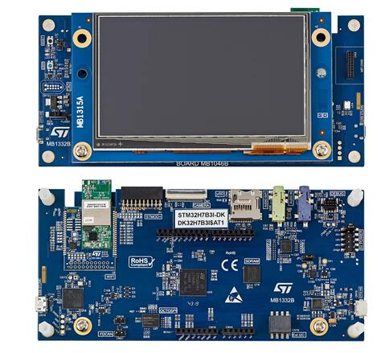

<!-- Copyright 2015-2026 Zephyr Project members and individual contributors. -->
<!-- SPDX-License-Identifier: Apache-2.0 -->
<!-- 中文翻译；编号、导航与译注为本地新增。 -->

<a id="stm32h7b3i_dk"></a>

# 第40章\_STM32H7B3I探索套件（Discovery Kit）

原文：[官方页面](https://docs.zephyrproject.org/latest/boards/st/stm32h7b3i_dk/doc/index.html)。读取日期：2026-10-16；来源摘要见[来源记录](../SOURCES.md)。

开发板概览（Board Overview）

<a id="id3"></a>

[](images/stm32h7b3i_dk.jpg)

STM32H7B3I探索套件（Discovery Kit）

名称（Name）：

`stm32h7b3i_dk`

厂商（Vendor）：

[意法半导体（STMicroelectronics）](https://docs.zephyrproject.org/latest/boards/index.html#vendor=st)

状态（Status）：

维护中（Maintained）

架构（Architecture）：

[arm](https://docs.zephyrproject.org/latest/boards/index.html#arch=arm)

片上系统（SoC）：

[stm32h7b3xxq](https://docs.zephyrproject.org/latest/boards/index.html#soc=stm32h7b3xxq)

<a id="board-github-link"></a>

[浏览开发板源码（Browse Board Sources）](https://github.com/zephyrproject-rtos/zephyr/blob/main//boards/st/stm32h7b3i_dk/doc/index.rst/../..)<a id="overview"></a>

## 概述（Overview）

STM32H7B3I-DK Discovery套件是基于Arm Cortex-M7的STM32H7B3LIH6QU完整演示及开发平台。

STM32H7B3I-DK可作为应用移植到最终产品前的参考设计，从而简化应用开发。

板载丰富硬件可评估几乎全部外设，包括USB OTG高速、microSD、USART、FDCAN、带输入输出插孔的立体声音频DAC、摄像头、SDRAM、Octo-SPI Flash，以及RGB接口LCD和电容触摸面板，辅助应用开发。Arduino Uno V3连接器便于连接特定应用的扩展板或子板。

主要特点包括：


- BGA225封装STM32H7B3LIH6Q，具有2 Mbytes Flash及1.4 Mbyte RAM
- 4.3英寸480×272像素彩色TFT LCD模块，带RGB接口及电容触摸面板
- 符合802.11 b/g/n的Wi-Fi模块
- USB OTG高速
- 音频编解码器（Codec）
- 512 Mbit Octo-SPI NOR Flash
- 128 Mbit SDRAM
- 2个用户LED
- 用户及复位按键
- 扇出子板（Fanout Daughterboard）
- 一路灵活数据速率CAN（FDCAN）
- 板上连接器（Board Connectors）


  - 8位摄像头接口
  - USB Micro-AB接口
  - 立体声耳机插孔，带模拟麦克风输入
  - 外部扬声器音频插孔
  - MicroSD卡
  - TAG-Connect 10针焊盘
  - STDC14焊盘上的Arm Cortex 10针调试连接器，间距1.27 mm
  - ARDUINO® Uno V3扩展连接器
  - STMod+扩展连接器
  - 音频子板扩展连接器
  - 外部I2C扩展连接器
- 灵活供电方式：


  - ST-LINK USB VBUS、USB OTG高速连接器或外部电源
- 板载STLINK-V3E调试器／编程器，支持USB重新枚举

更多信息见[STM32H7B3I-DK网站](https://www.st.com/en/evaluation-tools/stm32h7b3i-dk.html)。

<a id="hardware"></a>

## 硬件（Hardware）

STM32H7B3I Discovery套件提供以下硬件组件：


- BGA225封装的STM32H7B3LIH6Q
- 带浮点单元（FPU）的ARM® 32位Cortex®-M7 CPU
- CPU最高频率280 MHz
- VDD电压范围1.62–3.6 V
- 2 MB闪存（Flash）
- 约1.4 Mbytes静态随机存储器（SRAM）
- 2个32位定时器
- 15个16位定时器
- 6路SPI
- 4路I2C
- 4路I2S
- 5路USART
- 5路UART
- 1路全速及高速USB OTG
- 2路CAN FD
- 2路串行音频接口（SAI）
- 1路SPDIF接收接口（SPDIFRX）
- 1路HDMI-CEC
- 2路支持即时解密（On-the-fly Decryption）的Octo-SPI存储器接口
- 1路8～14位摄像头接口
- 8／16位并行同步从机输入输出接口（PSSI）
- 最多168个GPIO，支持外部中断
- 2个16位ADC，24个通道，速率3.6 MSPS
- 1个12位单通道DAC及1个12位双通道DAC
- 真随机数发生器（RNG / True Random Number Generator）
- 5个DMA控制器
- 支持XGA分辨率的LCD-TFT控制器
- Chrom-ART图形硬件加速器（DMA2D）
- 硬件JPEG编解码器（Codec）
- Chrom-GRC™图形存储器管理单元（GFXMMU）

更多STM32H7B3信息见：


- [ST官网的STM32H7A3/7B3产品页](https://www.st.com/en/microcontrollers-microprocessors/stm32h7a3-7b3.html)
- [STM32H7A3/7B3/7B0参考手册](https://www.st.com/resource/en/reference_manual/rm0455-stm32h7a37b3-and-stm32h7b0-value-line-advanced-armbased-32bit-mcus-stmicroelectronics.pdf)
- [STM32H7B3xI数据手册](https://www.st.com/resource/en/datasheet/stm32h7b3ai.pdf)

<a id="supported-features"></a>

### 支持的功能（Supported Features）

`stm32h7b3i_dk`开发板支持下表所列的硬件功能。

片上／板载（On-Chip / On-Board）

功能集成在片上系统（SoC）内／位于开发板上。

2 / 2

分别表示已启用／已禁用的实例数。点击数量标签，可查看开发板或SoC设备树源码（DTS）中该功能的第一个实例。

`vnd,foo`

与此功能匹配的设备树绑定兼容字符串（Compatible String）；点击链接可查看绑定文档。

<a id="stm32h7b3i_dk-hw-features"></a>

<a id="stm32h7b3i_dk-stm32h7b3i_dk/stm32h7b3xxq-hw-features-section"></a>

#### `stm32h7b3i_dk/stm32h7b3xxq`目标（Target）

<a id="stm32h7b3i_dk-stm32h7b3i_dk/stm32h7b3xxq-hw-features-panel"></a>

<a id="stm32h7b3i_dk-stm32h7b3i_dk/stm32h7b3xxq-hw-features-memory"></a>

该开发板目标的片上存储容量：256 KiB RAM、2 MiB Flash。

<a id="stm32h7b3i_dk-stm32h7b3i_dk/stm32h7b3xxq-hw-features-table"></a>

<table>
<tr>
<th>类型（Type）</th>
<th>位置（Location）</th>
<th>说明（Description）</th>
<th>兼容字符串（Compatible）</th>
</tr>
<tr>
<td rowspan="1">中央处理器（CPU）</td>
<td>片上（On-Chip）</td>
<td>ARM Cortex-M7处理器（CPU）（<a href="https://github.com/zephyrproject-rtos/zephyr/blob/main/dts/arm/st/h7/stm32h7.dtsi?plain=1#L38">已启用：1</a>）</td>
<td><a href="../cpu_cortex_xtensa_binding_reference/P005_arm_cortex-m7.md#std-dtcompatible-arm-cortex-m7"><code>arm,cortex-m7</code></a></td>
</tr>
<tr>
<td rowspan="1">模数转换器（ADC）</td>
<td>片上（On-Chip）</td>
<td>STM32模数转换器（ADC）（<a href="https://github.com/zephyrproject-rtos/zephyr/blob/main/dts/arm/st/h7/stm32h7.dtsi?plain=1#L1046">已禁用：2</a>）</td>
<td><a href="../hardware/P839_STM32模数转换器绑定.md#dtbinding-st-stm32-adc"><code>st,stm32-adc</code></a></td>
</tr>
<tr>
<td rowspan="2">音频（Audio）</td>
<td>片上（On-Chip）</td>
<td>意法半导体（STMicroelectronics）Σ-Δ调制器数字滤波器模块（DFSDM）（<a href="https://github.com/zephyrproject-rtos/zephyr/blob/main/dts/arm/st/h7/stm32h7.dtsi?plain=1#L994">已禁用：1</a>）</td>
<td><a href="../audio_stm32_ti_wolfson_binding_reference/P002_st_stm32-dfsdm.md#std-dtcompatible-st-stm32-dfsdm"><code>st,stm32-dfsdm</code></a></td>
</tr>
<tr>
<td>片上（On-Chip）</td>
<td>意法半导体（STMicroelectronics）DFSDM数字麦克风（DMIC）（<a href="https://github.com/zephyrproject-rtos/zephyr/blob/main/dts/arm/st/h7/stm32h7.dtsi?plain=1#L1005">已禁用：8</a>）</td>
<td><a href="../audio_stm32_ti_wolfson_binding_reference/P001_st_stm32-dfsdm-dmic.md#std-dtcompatible-st-stm32-dfsdm-dmic"><code>st,stm32-dfsdm-dmic</code></a></td>
</tr>
<tr>
<td rowspan="1">控制器局域网（CAN）</td>
<td>片上（On-Chip）</td>
<td>STM32H7系列及兼容器件的FDCAN CAN FD控制器（<a href="https://github.com/zephyrproject-rtos/zephyr/blob/main/dts/arm/st/h7/stm32h7.dtsi?plain=1#L614">已启用：1</a>；<a href="https://github.com/zephyrproject-rtos/zephyr/blob/main/dts/arm/st/h7/stm32h7.dtsi?plain=1#L625">已禁用：1</a>）</td>
<td><a href="../can_nxp_renesas_stm32_ti_binding_reference/P013_st_stm32h7-fdcan.md#std-dtcompatible-st-stm32h7-fdcan"><code>st,stm32h7-fdcan</code></a></td>
</tr>
<tr>
<td rowspan="8">时钟控制（Clock Control）</td>
<td>片上（On-Chip）</td>
<td>STM32H7复位与时钟控制器（RCC / Reset and Clock Controller）（<a href="https://github.com/zephyrproject-rtos/zephyr/blob/main/dts/arm/st/h7/stm32h7.dtsi?plain=1#L205">已启用：1</a>）</td>
<td><a href="../timer_reference/P168_STM32H7复位与时钟控制绑定.md#dtbinding-st-stm32h7-rcc"><code>st,stm32h7-rcc</code></a></td>
</tr>
<tr>
<td>片上（On-Chip）</td>
<td>STM32 外部高速时钟（HSE Clock）（<a href="https://github.com/zephyrproject-rtos/zephyr/blob/main/dts/arm/st/h7/stm32h7.dtsi?plain=1#L75">已启用：1</a>）</td>
<td><a href="../timer_reference/P129_STM32高速外部时钟绑定.md#dtbinding-st-stm32-hse-clock"><code>st,stm32-hse-clock</code></a></td>
</tr>
<tr>
<td>片上（On-Chip）</td>
<td>STM32高速内部时钟（HSI）（<a href="https://github.com/zephyrproject-rtos/zephyr/blob/main/dts/arm/st/h7/stm32h7.dtsi?plain=1#L82">已禁用：1</a>）</td>
<td><a href="../timer_reference/P146_STM32H7内部高速时钟绑定.md#dtbinding-st-stm32h7-hsi-clock"><code>st,stm32h7-hsi-clock</code></a></td>
</tr>
<tr>
<td>片上（On-Chip）</td>
<td>通用固定频率时钟提供者（Fixed-Rate Clock Provider）（<a href="https://github.com/zephyrproject-rtos/zephyr/blob/main/dts/arm/st/h7/stm32h7.dtsi?plain=1#L90">已启用：1</a>；<a href="https://github.com/zephyrproject-rtos/zephyr/blob/main/dts/arm/st/h7/stm32h7.dtsi?plain=1#L97">已禁用：2</a>）</td>
<td><a href="../hardware/P566_固定时钟绑定.md#dtbinding-fixed-clock"><code>fixed-clock</code></a></td>
</tr>
<tr>
<td>片上（On-Chip）</td>
<td>STM32低速外部时钟（LSE Clock）（<a href="https://github.com/zephyrproject-rtos/zephyr/blob/main/dts/arm/st/h7/stm32h7.dtsi?plain=1#L104">已禁用：1</a>）</td>
<td><a href="../timer_reference/P130_STM32低速外部时钟绑定.md#dtbinding-st-stm32-lse-clock"><code>st,stm32-lse-clock</code></a></td>
</tr>
<tr>
<td>片上（On-Chip）</td>
<td>STM32H7主锁相环（Main PLL）（<a href="https://github.com/zephyrproject-rtos/zephyr/blob/main/dts/arm/st/h7/stm32h7.dtsi?plain=1#L119">已启用：2</a>；<a href="https://github.com/zephyrproject-rtos/zephyr/blob/main/dts/arm/st/h7/stm32h7.dtsi?plain=1#L126">已禁用：1</a>）</td>
<td><a href="../timer_reference/P154_STM32H7锁相环时钟绑定.md#dtbinding-st-stm32h7-pll-clock"><code>st,stm32h7-pll-clock</code></a></td>
</tr>
<tr>
<td>片上（On-Chip）</td>
<td>STM32 时钟多路复用器（Clock Multiplexer）（<a href="https://github.com/zephyrproject-rtos/zephyr/blob/main/dts/arm/st/h7/stm32h7.dtsi?plain=1#L140">已禁用：1</a>）</td>
<td><a href="../timer_reference/P133_STM32时钟多路复用绑定.md#dtbinding-st-stm32-clock-mux"><code>st,stm32-clock-mux</code></a></td>
</tr>
<tr>
<td>片上（On-Chip）</td>
<td>STM32 微控制器时钟输出（Microcontroller Clock Output，MCO）（<a href="https://github.com/zephyrproject-rtos/zephyr/blob/main/dts/arm/st/h7/stm32h7.dtsi?plain=1#L148">已禁用：2</a>）</td>
<td><a href="../timer_reference/P134_STM32时钟输出绑定.md#dtbinding-st-stm32-clock-mco"><code>st,stm32-clock-mco</code></a></td>
</tr>
<tr>
<td rowspan="1">比较器（Comparator）</td>
<td>片上（On-Chip）</td>
<td>STM32H7系列比较器（Comparator）（<a href="https://github.com/zephyrproject-rtos/zephyr/blob/main/dts/arm/st/h7/stm32h7.dtsi?plain=1#L1314">已禁用：2</a>）</td>
<td><a href="../hardware/P741_STM32H7比较器绑定.md#dtbinding-st-stm32h7-comp"><code>st,stm32h7-comp</code></a></td>
</tr>
<tr>
<td rowspan="1">计数器（Counter）</td>
<td>片上（On-Chip）</td>
<td>STM32 计数器（Counters）（<a href="https://github.com/zephyrproject-rtos/zephyr/blob/main/dts/arm/st/h7/stm32h7.dtsi?plain=1#L653">已禁用：14</a>）</td>
<td><a href="../stm32_ti_xilinx_counter_binding_reference/P007_st_stm32-counter.md#std-dtcompatible-st-stm32-counter"><code>st,stm32-counter</code></a></td>
</tr>
<tr>
<td rowspan="1">循环冗余校验（CRC）</td>
<td>片上（On-Chip）</td>
<td>STM32 CRC 计算单元（Calculation Unit）（<a href="https://github.com/zephyrproject-rtos/zephyr/blob/main/dts/arm/st/h7/stm32h7a3.dtsi?plain=1#L155">已禁用：1</a>）</td>
<td><a href="../crc_clock_monitor_binding_reference/P011_st_stm32-crc.md#std-dtcompatible-st-stm32-crc"><code>st,stm32-crc</code></a></td>
</tr>
<tr>
<td rowspan="2">密码学加速器（Cryptographic Accelerator）</td>
<td>片上（On-Chip）</td>
<td>STM32密码加速器（Cryptographic Accelerator）（<a href="https://github.com/zephyrproject-rtos/zephyr/blob/main/dts/arm/st/h7/stm32h7b0.dtsi?plain=1#L17">已禁用：1</a>）</td>
<td><a href="../crypto_secure_engine_st_ti_binding_reference/P016_st_stm32-cryp.md#std-dtcompatible-st-stm32-cryp"><code>st,stm32-cryp</code></a></td>
</tr>
<tr>
<td>片上（On-Chip）</td>
<td>STM32哈希处理器（HASH Processor）（<a href="https://github.com/zephyrproject-rtos/zephyr/blob/main/dts/arm/st/h7/stm32h7b0.dtsi?plain=1#L28">已禁用：1</a>）</td>
<td><a href="../crypto_secure_engine_st_ti_binding_reference/P017_st_stm32-hash.md#std-dtcompatible-st-stm32-hash"><code>st,stm32-hash</code></a></td>
</tr>
<tr>
<td rowspan="1">数模转换器（DAC）</td>
<td>片上（On-Chip）</td>
<td>STM32 系列数模转换器（DAC）（<a href="https://github.com/zephyrproject-rtos/zephyr/blob/main/dts/arm/st/h7/stm32h7.dtsi?plain=1#L1107">已禁用：1</a>）</td>
<td><a href="../hardware/P760_STM32数模转换器绑定.md#dtbinding-st-stm32-dac"><code>st,stm32-dac</code></a></td>
</tr>
<tr>
<td rowspan="2">显示（Display）</td>
<td>片上（On-Chip）</td>
<td>STM32 Chrom-ART 图形加速器（Accelerator，DMA2D）（<a href="https://github.com/zephyrproject-rtos/zephyr/blob/main/dts/arm/st/h7/stm32h7.dtsi?plain=1#L1349">已禁用：1</a>）</td>
<td><a href="../display_st_ultrachip_zephyr_binding_reference/P003_st_stm32-dma2d.md#std-dtcompatible-st-stm32-dma2d"><code>st,stm32-dma2d</code></a></td>
</tr>
<tr>
<td>片上（On-Chip）</td>
<td>STM32 LCD-TFT 显示控制器（Display Controller）（<a href="https://github.com/zephyrproject-rtos/zephyr/blob/main/dts/arm/st/h7/stm32h7a3.dtsi?plain=1#L92">已启用：1</a>）</td>
<td><a href="../display_st_ultrachip_zephyr_binding_reference/P004_st_stm32-ltdc.md#std-dtcompatible-st-stm32-ltdc"><code>st,stm32-ltdc</code></a></td>
</tr>
<tr>
<td rowspan="3">直接存储器访问（DMA）</td>
<td>片上（On-Chip）</td>
<td>STM32 DMA 控制器（Controller，V1）（<a href="https://github.com/zephyrproject-rtos/zephyr/blob/main/dts/arm/st/h7/stm32h7.dtsi?plain=1#L1115">已禁用：2</a>）</td>
<td><a href="../stm32_ti_xilinx_dma_binding_reference/P007_st_stm32-dma-v1.md#std-dtcompatible-st-stm32-dma-v1"><code>st,stm32-dma-v1</code></a></td>
</tr>
<tr>
<td>片上（On-Chip）</td>
<td>STM32基本DMA控制器（BDMA）（<a href="https://github.com/zephyrproject-rtos/zephyr/blob/main/dts/arm/st/h7/stm32h7.dtsi?plain=1#L1141">已禁用：1</a>）</td>
<td><a href="../stm32_ti_xilinx_dma_binding_reference/P006_st_stm32-bdma.md#std-dtcompatible-st-stm32-bdma"><code>st,stm32-bdma</code></a></td>
</tr>
<tr>
<td>片上（On-Chip）</td>
<td>STM32 DMA 多路复用控制器（DMAMUX Controller）（<a href="https://github.com/zephyrproject-rtos/zephyr/blob/main/dts/arm/st/h7/stm32h7.dtsi?plain=1#L1154">已禁用：2</a>）</td>
<td><a href="../stm32_ti_xilinx_dma_binding_reference/P011_st_stm32-dmamux.md#std-dtcompatible-st-stm32-dmamux"><code>st,stm32-dmamux</code></a></td>
</tr>
<tr>
<td rowspan="3">以太网（Ethernet）</td>
<td>片上（On-Chip）</td>
<td>ST STM32 以太网媒体访问控制器（Ethernet MAC）（<a href="https://github.com/zephyrproject-rtos/zephyr/blob/main/dts/arm/st/h7/stm32h7.dtsi?plain=1#L1215">已禁用：1</a>）</td>
<td><a href="../ethernet_synopsys_st_xilinx_binding_reference/P011_st_stm32h7-ethernet.md#std-dtcompatible-st-stm32h7-ethernet"><code>st,stm32h7-ethernet</code></a></td>
</tr>
<tr>
<td>片上（On-Chip）</td>
<td>Synopsys DesignWare MAC 的管理数据输入输出控制器（MDIO Controller）（<a href="https://github.com/zephyrproject-rtos/zephyr/blob/main/dts/arm/st/h7/stm32h7.dtsi?plain=1#L1229">已禁用：1</a>）</td>
<td><a href="../ethernet_mdio_microchip_binding_reference/P010_snps_dwmac-mdio.md#std-dtcompatible-snps-dwmac-mdio"><code>snps,dwmac-mdio</code></a></td>
</tr>
<tr>
<td>片上（On-Chip）</td>
<td>Synopsys DesignWare MAC 精确时间协议时钟（Precision Time Protocol，PTP Clock）（<a href="https://github.com/zephyrproject-rtos/zephyr/blob/main/dts/arm/st/h7/stm32h7.dtsi?plain=1#L1236">已启用：1</a>）</td>
<td><a href="../ethernet_synopsys_st_xilinx_binding_reference/P006_snps_dwmac-ptp-clock.md#std-dtcompatible-snps-dwmac-ptp-clock"><code>snps,dwmac-ptp-clock</code></a></td>
</tr>
<tr>
<td rowspan="1">闪存控制器（Flash Controller）</td>
<td>片上（On-Chip）</td>
<td>STM32 系列闪存控制器（Flash Controller）（<a href="https://github.com/zephyrproject-rtos/zephyr/blob/main/dts/arm/st/h7/stm32h7.dtsi?plain=1#L162">已启用：1</a>）</td>
<td><a href="../flash_renesas_st_ti_binding_reference/P011_st_stm32-flash-controller.md#std-dtcompatible-st-stm32-flash-controller"><code>st,stm32-flash-controller</code></a></td>
</tr>
<tr>
<td rowspan="3">通用输入输出与接插件（GPIO &amp; Headers）</td>
<td>片上（On-Chip）</td>
<td>STM32 通用输入输出控制器（GPIO Controller）（<a href="https://github.com/zephyrproject-rtos/zephyr/blob/main/dts/arm/st/h7/stm32h7.dtsi?plain=1#L248">已启用：11</a>）</td>
<td><a href="../gpio_silabs_st_connectors_binding_reference/P029_st_stm32-gpio.md#std-dtcompatible-st-stm32-gpio"><code>st,stm32-gpio</code></a></td>
</tr>
<tr>
<td>板载（On-Board）</td>
<td>引出到Arduino Uno R3排针（Headers）的GPIO引脚（<a href="https://github.com/zephyrproject-rtos/zephyr/blob/main/boards/st/stm32h7b3i_dk/arduino_r3_connector.dtsi?plain=1#L10">已启用：1</a>）</td>
<td><a href="../gpio_adi_headers_ambiq_binding_reference/P023_arduino-header-r3.md#std-dtcompatible-arduino-header-r3"><code>arduino-header-r3</code></a></td>
</tr>
<tr>
<td>板载（On-Board）</td>
<td>GPIO引出至B-CAMS-OMV的30针ZIF连接器CN5（<a href="https://github.com/zephyrproject-rtos/zephyr/blob/main/boards/st/stm32h7b3i_dk/stm32h7b3i_dk.dts?plain=1#L75">已启用：1</a>）</td>
<td><a href="../gpio_silabs_st_connectors_binding_reference/P026_st_dvp-cam-zif-30-connector.md#std-dtcompatible-st-dvp-cam-zif-30-connector"><code>st,dvp-cam-zif-30-connector</code></a></td>
</tr>
<tr>
<td rowspan="1">集成电路间总线（I2C）</td>
<td>片上（On-Chip）</td>
<td>STM32 I2C V2 控制器（Controller）（<a href="https://github.com/zephyrproject-rtos/zephyr/blob/main/dts/arm/st/h7/stm32h7.dtsi?plain=1#L479">已启用：1</a>；<a href="https://github.com/zephyrproject-rtos/zephyr/blob/main/dts/arm/st/h7/stm32h7.dtsi?plain=1#L443">已禁用：3</a>）</td>
<td><a href="../i2c_stm32_ti_mux_binding_reference/P008_st_stm32-i2c-v2.md#std-dtcompatible-st-stm32-i2c-v2"><code>st,stm32-i2c-v2</code></a></td>
</tr>
<tr>
<td rowspan="2">集成电路间音频总线（I2S）</td>
<td>片上（On-Chip）</td>
<td>STM32H7 I2S控制器（<a href="https://github.com/zephyrproject-rtos/zephyr/blob/main/dts/arm/st/h7/stm32h7.dtsi?plain=1#L572">已禁用：4</a>）</td>
<td><a href="../i2s_binding_reference/P018_st_stm32h7-i2s.md#std-dtcompatible-st-stm32h7-i2s"><code>st,stm32h7-i2s</code></a></td>
</tr>
<tr>
<td>片上（On-Chip）</td>
<td>STM32 串行音频接口块控制器（SAI Block Controller）（<a href="https://github.com/zephyrproject-rtos/zephyr/blob/main/dts/arm/st/h7/stm32h7.dtsi?plain=1#L1286">已禁用：2</a>）</td>
<td><a href="../i2s_binding_reference/P017_st_stm32-sai.md#std-dtcompatible-st-stm32-sai"><code>st,stm32-sai</code></a></td>
</tr>
<tr>
<td rowspan="2">输入（Input）</td>
<td>板载（On-Board）</td>
<td>FT3267/FT5XX6/FT6XX6电容式触摸面板（Capacitive Touch Panels）（<a href="https://github.com/zephyrproject-rtos/zephyr/blob/main/boards/st/stm32h7b3i_dk/stm32h7b3i_dk.dts?plain=1#L173">已启用：1</a>）</td>
<td><a href="../input_adc_touch_matrix_binding_reference/P014_focaltech_ft5336.md#std-dtcompatible-focaltech-ft5336"><code>focaltech,ft5336</code></a></td>
</tr>
<tr>
<td>板载（On-Board）</td>
<td>一组绑定到 GPIO 的输入按键（GPIO-Bound Input Keys）（<a href="https://github.com/zephyrproject-rtos/zephyr/blob/main/boards/st/stm32h7b3i_dk/stm32h7b3i_dk.dts?plain=1#L42">已启用：1</a>）</td>
<td><a href="../hardware/P563_GPIO按键绑定.md#std-dtcompatible-gpio-keys"><code>gpio-keys</code></a></td>
</tr>
<tr>
<td rowspan="2">中断控制器（Interrupt Controller）</td>
<td>片上（On-Chip）</td>
<td>ARMv7-M 嵌套向量中断控制器（Nested Vectored Interrupt Controller，NVIC）（<a href="https://github.com/zephyrproject-rtos/zephyr/blob/main/dts/arm/armv7-m.dtsi?plain=1#L13">已启用：1</a>）</td>
<td><a href="../arm_interrupt_timer_binding_reference/P002_ARMv7_M_NVIC.md#std-dtcompatible-arm-v7m-nvic"><code>arm,v7m-nvic</code></a></td>
</tr>
<tr>
<td>片上（On-Chip）</td>
<td>STM32 外部中断控制器（External Interrupt Controller）（<a href="https://github.com/zephyrproject-rtos/zephyr/blob/main/dts/arm/st/h7/stm32h7.dtsi?plain=1#L225">已启用：1</a>）</td>
<td><a href="../mcu_external_interrupt_binding_reference/P001_st_stm32-exti.md#std-dtcompatible-st-stm32-exti"><code>st,stm32-exti</code></a></td>
</tr>
<tr>
<td rowspan="1">发光二极管（LED）</td>
<td>板载（On-Board）</td>
<td>一组由 GPIO 控制的 LED（GPIO-Controlled LEDs）（<a href="https://github.com/zephyrproject-rtos/zephyr/blob/main/boards/st/stm32h7b3i_dk/stm32h7b3i_dk.dts?plain=1#L28">已启用：1</a>）</td>
<td><a href="../hardware/P564_GPIO指示灯绑定.md#dtbinding-gpio-leds"><code>gpio-leds</code></a></td>
</tr>
<tr>
<td rowspan="2">存储器控制器（Memory Controller）</td>
<td>片上（On-Chip）</td>
<td>STM32H7灵活存储器控制器（FMC / Flexible Memory Controller）（<a href="https://github.com/zephyrproject-rtos/zephyr/blob/main/dts/arm/st/h7/stm32h7.dtsi?plain=1#L1241">已启用：1</a>）</td>
<td><a href="../memory_controller_sdram_psram_binding_reference/P016_st_stm32h7-fmc.md#std-dtcompatible-st-stm32h7-fmc"><code>st,stm32h7-fmc</code></a></td>
</tr>
<tr>
<td>片上（On-Chip）</td>
<td>STM32 灵活存储器控制器中的 SDRAM 控制器（SDRAM Controller）（<a href="https://github.com/zephyrproject-rtos/zephyr/blob/main/dts/arm/st/h7/stm32h7.dtsi?plain=1#L1247">已启用：1</a>）</td>
<td><a href="../memory_controller_sdram_psram_binding_reference/P012_st_stm32-fmc-sdram.md#std-dtcompatible-st-stm32-fmc-sdram"><code>st,stm32-fmc-sdram</code></a></td>
</tr>
<tr>
<td rowspan="1">内存管理单元／内存保护单元（MMU / MPU）</td>
<td>片上（On-Chip）</td>
<td>ARMv7-M存储器保护单元（MPU / Memory Protection Unit）（<a href="https://github.com/zephyrproject-rtos/zephyr/blob/main/dts/arm/st/h7/stm32h7.dtsi?plain=1#L45">已启用：1</a>）</td>
<td><a href="../memory_protection_binding_reference/P005_arm_armv7m-mpu.md#std-dtcompatible-arm-armv7m-mpu"><code>arm,armv7m-mpu</code></a></td>
</tr>
<tr>
<td rowspan="1">多位串行外设接口（Multi-Bit SPI）</td>
<td>片上（On-Chip）</td>
<td>STM32八线SPI控制器（OSPI）（<a href="https://github.com/zephyrproject-rtos/zephyr/blob/main/dts/arm/st/h7/stm32h7.dtsi?plain=1#L1263">已启用：1</a>）</td>
<td><a href="../mspi_binding_reference/P012_st_stm32-ospi-controller.md#std-dtcompatible-st-stm32-ospi-controller"><code>st,stm32-ospi-controller</code></a></td>
</tr>
<tr>
<td rowspan="3">存储技术设备（MTD）</td>
<td>片上（On-Chip）</td>
<td>STM32闪存（Flash Memory）（<a href="https://github.com/zephyrproject-rtos/zephyr/blob/main/dts/arm/st/h7/stm32h7a3.dtsi?plain=1#L23">已启用：1</a>）</td>
<td><a href="../mtd_nxp_st_ti_partition_binding_reference/P016_st_stm32-nv-flash.md#std-dtcompatible-st-stm32-nv-flash"><code>st,stm32-nv-flash</code></a></td>
</tr>
<tr>
<td>板载（On-Board）</td>
<td>Macronix MX25U系列SPI NOR闪存（<a href="https://github.com/zephyrproject-rtos/zephyr/blob/main/boards/st/stm32h7b3i_dk/stm32h7b3i_dk.dts?plain=1#L301">已启用：1</a>）</td>
<td><a href="../mtd_microchip_nordic_nxp_binding_reference/P007_mxicy_mx25u-mspi.md#std-dtcompatible-mxicy-mx25u"><code>mxicy,mx25u</code></a></td>
</tr>
<tr>
<td>板载（On-Board）</td>
<td>闪存或其他非易失性存储器的固定分区（Fixed Partitions）（<a href="https://github.com/zephyrproject-rtos/zephyr/blob/main/boards/st/stm32h7b3i_dk/stm32h7b3i_dk.dts?plain=1#L318">已启用：1</a>）</td>
<td><a href="../hardware/P568_固定分区绑定.md#dtbinding-fixed-partitions"><code>fixed-partitions</code></a></td>
</tr>
<tr>
<td rowspan="1">非易失存储器（NVMEM）</td>
<td>片上（On-Chip）</td>
<td>非易失存储器固定布局（Fixed Layout for Non-Volatile Memory）（<a href="https://github.com/zephyrproject-rtos/zephyr/blob/main/dts/arm/st/h7/stm32h7a3.dtsi?plain=1#L44">已启用：1</a>）</td>
<td><a href="../memory_protection_binding_reference/P009_fixed-layout.md#std-dtcompatible-fixed-layout"><code>fixed-layout</code></a></td>
</tr>
<tr>
<td rowspan="1">八线串行外设接口（OCTOSPI）</td>
<td>片上（On-Chip）</td>
<td>STM32八线SPI控制器（OSPI Controller）（<a href="https://github.com/zephyrproject-rtos/zephyr/blob/main/dts/arm/st/h7/stm32h7a3.dtsi?plain=1#L114">已禁用：1</a>）</td>
<td><a href="../qspi_ospi_xspi_binding_reference/P002_st_stm32-ospi.md#std-dtcompatible-st-stm32-ospi"><code>st,stm32-ospi</code></a></td>
</tr>
<tr>
<td rowspan="1">一次性可编程存储器（OTP Memory）</td>
<td>片上（On-Chip）</td>
<td>STM32 嵌入式非易失一次性可编程存储器（NVM OTP）（<a href="https://github.com/zephyrproject-rtos/zephyr/blob/main/dts/arm/st/h7/stm32h7a3.dtsi?plain=1#L40">已启用：1</a>）</td>
<td><a href="../otp_binding_reference/P010_st_stm32-nvm-otp.md#std-dtcompatible-st-stm32-nvm-otp"><code>st,stm32-nvm-otp</code></a></td>
</tr>
<tr>
<td rowspan="2">物理层（PHY）</td>
<td>片上（On-Chip）</td>
<td>用于所有内置于 USB IP 的 USB 收发器（USB Transceivers）的绑定。（<a href="https://github.com/zephyrproject-rtos/zephyr/blob/main/dts/arm/st/h7/stm32h7a3.dtsi?plain=1#L295">已启用：1</a>）</td>
<td><a href="../phy_binding_reference/P008_usb-nop-xceiv.md#std-dtcompatible-usb-nop-xceiv"><code>usb-nop-xceiv</code></a></td>
</tr>
<tr>
<td>板载（On-Board）</td>
<td>由简单GPIO控制的CAN收发器（Transceiver）（<a href="https://github.com/zephyrproject-rtos/zephyr/blob/main/boards/st/stm32h7b3i_dk/stm32h7b3i_dk.dts?plain=1#L68">已启用：1</a>）</td>
<td><a href="../phy_binding_reference/P001_can-transceiver-gpio.md#std-dtcompatible-can-transceiver-gpio"><code>can-transceiver-gpio</code></a></td>
</tr>
<tr>
<td rowspan="1">引脚控制（Pin Control）</td>
<td>片上（On-Chip）</td>
<td>STM32 引脚控制器（Pin Controller）（<a href="https://github.com/zephyrproject-rtos/zephyr/blob/main/dts/arm/st/h7/stm32h7.dtsi?plain=1#L241">已启用：1</a>）</td>
<td><a href="../pinctrl_stm32_ti_xilinx_binding_reference/P004_st_stm32-pinctrl.md#std-dtcompatible-st-stm32-pinctrl"><code>st,stm32-pinctrl</code></a></td>
</tr>
<tr>
<td rowspan="1">电源管理（Power Management）</td>
<td>片上（On-Chip）</td>
<td>STM32H7电源控制器（Power Controller）（<a href="https://github.com/zephyrproject-rtos/zephyr/blob/main/dts/arm/st/h7/stm32h7.dtsi?plain=1#L216">已启用：1</a>）</td>
<td><a href="../stm32_soc_power_binding_reference/P014_st_stm32h7-pwr.md#std-dtcompatible-st-stm32h7-pwr"><code>st,stm32h7-pwr</code></a></td>
</tr>
<tr>
<td rowspan="1">脉宽调制（PWM）</td>
<td>片上（On-Chip）</td>
<td>STM32 脉宽调制（PWM）（<a href="https://github.com/zephyrproject-rtos/zephyr/blob/main/dts/arm/st/h7/stm32h7.dtsi?plain=1#L647">已禁用：12</a>）</td>
<td><a href="../pwm_stm32_ti_generic_binding_reference/P011_st_stm32-pwm.md#std-dtcompatible-st-stm32-pwm"><code>st,stm32-pwm</code></a></td>
</tr>
<tr>
<td rowspan="1">稳压器（Regulator）</td>
<td>片上（On-Chip）</td>
<td>STM32参考电压缓冲器稳压器（VREFBUF Regulator）（<a href="https://github.com/zephyrproject-rtos/zephyr/blob/main/dts/arm/st/h7/stm32h7.dtsi?plain=1#L1340">已禁用：1</a>）</td>
<td><a href="../hardware/P638_STM32参考电压缓冲器绑定.md#dtbinding-st-stm32-vrefbuf"><code>st,stm32-vrefbuf</code></a></td>
</tr>
<tr>
<td rowspan="1">复位控制器（Reset Controller）</td>
<td>片上（On-Chip）</td>
<td>STM32 复位与时钟控制器（Reset and Clock Control，RCC）（<a href="https://github.com/zephyrproject-rtos/zephyr/blob/main/dts/arm/st/h7/stm32h7.dtsi?plain=1#L210">已启用：1</a>）</td>
<td><a href="../reset_controller_binding_reference/P017_st_stm32-rcc-rctl.md#std-dtcompatible-st-stm32-rcc-rctl"><code>st,stm32-rcc-rctl</code></a></td>
</tr>
<tr>
<td rowspan="1">随机数生成器（RNG）</td>
<td>片上（On-Chip）</td>
<td>STM32 随机数生成器（Random Number Generator）（<a href="https://github.com/zephyrproject-rtos/zephyr/blob/main/dts/arm/st/h7/stm32h7.dtsi?plain=1#L1186">已禁用：1</a>）</td>
<td><a href="../soc_rng_binding_reference/P016_st_stm32-rng.md#std-dtcompatible-st-stm32-rng"><code>st,stm32-rng</code></a></td>
</tr>
<tr>
<td rowspan="1">实时时钟（RTC）</td>
<td>片上（On-Chip）</td>
<td>STM32 实时时钟（RTC）（<a href="https://github.com/zephyrproject-rtos/zephyr/blob/main/dts/arm/st/h7/stm32h7.dtsi?plain=1#L432">已禁用：1</a>）</td>
<td><a href="../soc_rtc_binding_reference/P014_st_stm32-rtc.md#std-dtcompatible-st-stm32-rtc"><code>st,stm32-rtc</code></a></td>
</tr>
<tr>
<td rowspan="1">SD 主机控制器（SDHC）</td>
<td>片上（On-Chip）</td>
<td>STM32 SDMMC 主机控制器（Host Controller）（<a href="https://github.com/zephyrproject-rtos/zephyr/blob/main/dts/arm/st/h7/stm32h7.dtsi?plain=1#L1194">已启用：1</a>；<a href="https://github.com/zephyrproject-rtos/zephyr/blob/main/dts/arm/st/h7/stm32h7.dtsi?plain=1#L1205">已禁用：1</a>）</td>
<td><a href="../sdhc_binding_reference/P019_st_stm32-sdmmc.md#std-dtcompatible-st-stm32-sdmmc"><code>st,stm32-sdmmc</code></a></td>
</tr>
<tr>
<td rowspan="5">传感器（Sensors）</td>
<td>片上（On-Chip）</td>
<td>STM32 正交解码器（Quadrature Decoder）（<a href="https://github.com/zephyrproject-rtos/zephyr/blob/main/dts/arm/st/h7/stm32h7.dtsi?plain=1#L658">已禁用：6</a>）</td>
<td><a href="../sensor_st_lsm_stm32_binding_reference/P028_st_stm32-qdec.md#std-dtcompatible-st-stm32-qdec"><code>st,stm32-qdec</code></a></td>
</tr>
<tr>
<td>片上（On-Chip）</td>
<td>STM32数字温度传感器（<a href="https://github.com/zephyrproject-rtos/zephyr/blob/main/dts/arm/st/h7/stm32h7a3.dtsi?plain=1#L146">已禁用：1</a>）</td>
<td><a href="../sensor_st_lsm_stm32_binding_reference/P027_st_stm32-digi-temp.md#std-dtcompatible-st-stm32-digi-temp"><code>st,stm32-digi-temp</code></a></td>
</tr>
<tr>
<td>片上（On-Chip）</td>
<td>STM32 系列温度节点（TEMP），用于以两个温度点完成生产校准的传感器。（<a href="https://github.com/zephyrproject-rtos/zephyr/blob/main/dts/arm/st/h7/stm32h7.dtsi?plain=1#L1357">已禁用：1</a>）</td>
<td><a href="../sensor_st_lsm_stm32_binding_reference/P029_st_stm32-temp-cal.md#std-dtcompatible-st-stm32-temp-cal"><code>st,stm32-temp-cal</code></a></td>
</tr>
<tr>
<td>片上（On-Chip）</td>
<td>STM32 电池电压（VBAT）（<a href="https://github.com/zephyrproject-rtos/zephyr/blob/main/dts/arm/st/h7/stm32h7.dtsi?plain=1#L1369">已禁用：1</a>）</td>
<td><a href="../sensor_st_ti_power_capacitance_binding_reference/P001_st_stm32-vbat.md#std-dtcompatible-st-stm32-vbat"><code>st,stm32-vbat</code></a></td>
</tr>
<tr>
<td>片上（On-Chip）</td>
<td>STM32 参考电压（VREF+）（<a href="https://github.com/zephyrproject-rtos/zephyr/blob/main/dts/arm/st/h7/stm32h7.dtsi?plain=1#L1375">已禁用：1</a>）</td>
<td><a href="../sensor_st_ti_power_capacitance_binding_reference/P003_st_stm32-vref.md#std-dtcompatible-st-stm32-vref"><code>st,stm32-vref</code></a></td>
</tr>
<tr>
<td rowspan="3">串行控制器（Serial Controller）</td>
<td>片上（On-Chip）</td>
<td>STM32 通用同步／异步收发器（USART）（<a href="https://github.com/zephyrproject-rtos/zephyr/blob/main/dts/arm/st/h7/stm32h7.dtsi?plain=1#L351">已启用：1</a>；<a href="https://github.com/zephyrproject-rtos/zephyr/blob/main/dts/arm/st/h7/stm32h7.dtsi?plain=1#L360">已禁用：3</a>）</td>
<td><a href="../uart_silabs_stm32_ti_binding_reference/P016_st_stm32-usart.md#std-dtcompatible-st-stm32-usart"><code>st,stm32-usart</code></a></td>
</tr>
<tr>
<td>片上（On-Chip）</td>
<td>STM32 通用异步收发器（UART）（<a href="https://github.com/zephyrproject-rtos/zephyr/blob/main/dts/arm/st/h7/stm32h7.dtsi?plain=1#L378">已启用：1</a>；<a href="https://github.com/zephyrproject-rtos/zephyr/blob/main/dts/arm/st/h7/stm32h7.dtsi?plain=1#L387">已禁用：3</a>）</td>
<td><a href="../uart_silabs_stm32_ti_binding_reference/P015_st_stm32-uart.md#std-dtcompatible-st-stm32-uart"><code>st,stm32-uart</code></a></td>
</tr>
<tr>
<td>片上（On-Chip）</td>
<td>STM32低功耗通用异步收发器（LPUART）（<a href="https://github.com/zephyrproject-rtos/zephyr/blob/main/dts/arm/st/h7/stm32h7.dtsi?plain=1#L423">已禁用：1</a>）</td>
<td><a href="../uart_silabs_stm32_ti_binding_reference/P014_st_stm32-lpuart.md#std-dtcompatible-st-stm32-lpuart"><code>st,stm32-lpuart</code></a></td>
</tr>
<tr>
<td rowspan="1">系统管理总线（SMbus）</td>
<td>片上（On-Chip）</td>
<td>STM32 系统管理总线控制器（SMBus Controller）（<a href="https://github.com/zephyrproject-rtos/zephyr/blob/main/dts/arm/st/h7/stm32h7.dtsi?plain=1#L1383">已禁用：4</a>）</td>
<td><a href="../i3c_smbus_binding_reference/P013_st_stm32-smbus.md#std-dtcompatible-st-stm32-smbus"><code>st,stm32-smbus</code></a></td>
</tr>
<tr>
<td rowspan="1">串行外设接口（SPI）</td>
<td>片上（On-Chip）</td>
<td>STM32H7 串行外设接口控制器（SPI Controller）（<a href="https://github.com/zephyrproject-rtos/zephyr/blob/main/dts/arm/st/h7/stm32h7.dtsi?plain=1#L505">已启用：1</a>；<a href="https://github.com/zephyrproject-rtos/zephyr/blob/main/dts/arm/st/h7/stm32h7.dtsi?plain=1#L491">已禁用：5</a>）</td>
<td><a href="../spi_stm32_ti_xilinx_binding_reference/P013_st_stm32h7-spi.md#std-dtcompatible-st-stm32h7-spi"><code>st,stm32h7-spi</code></a></td>
</tr>
<tr>
<td rowspan="3">定时器（Timer）</td>
<td>片上（On-Chip）</td>
<td>ARMv7-M 系统节拍（System Tick）（<a href="https://github.com/zephyrproject-rtos/zephyr/blob/main/dts/arm/armv7-m.dtsi?plain=1#L21">已启用：1</a>）</td>
<td><a href="../arm_interrupt_timer_binding_reference/P006_ARMv7_M_SysTick.md#std-dtcompatible-arm-armv7m-systick"><code>arm,armv7m-systick</code></a></td>
</tr>
<tr>
<td>片上（On-Chip）</td>
<td>STM32 定时器（Timers）（<a href="https://github.com/zephyrproject-rtos/zephyr/blob/main/dts/arm/st/h7/stm32h7.dtsi?plain=1#L636">已禁用：14</a>）</td>
<td><a href="../stm32_ti_silabs_timer_binding_reference/P008_st_stm32-timers.md#std-dtcompatible-st-stm32-timers"><code>st,stm32-timers</code></a></td>
</tr>
<tr>
<td>片上（On-Chip）</td>
<td>STM32低功耗定时器（LPTIM）（<a href="https://github.com/zephyrproject-rtos/zephyr/blob/main/dts/arm/st/h7/stm32h7.dtsi?plain=1#L982">已禁用：1</a>）</td>
<td><a href="../stm32_ti_silabs_timer_binding_reference/P007_st_stm32-lptim.md#std-dtcompatible-st-stm32-lptim"><code>st,stm32-lptim</code></a></td>
</tr>
<tr>
<td rowspan="1">通用串行总线（USB）</td>
<td>片上（On-Chip）</td>
<td>STM32 高速 USB OTG 控制器（OTGHS Controller）（<a href="https://github.com/zephyrproject-rtos/zephyr/blob/main/dts/arm/st/h7/stm32h7a3.dtsi?plain=1#L78">已禁用：1</a>）</td>
<td><a href="../usb_stm32_audio_binding_reference/P005_st_stm32-otghs.md#std-dtcompatible-st-stm32-otghs"><code>st,stm32-otghs</code></a></td>
</tr>
<tr>
<td rowspan="2">视频（Video）</td>
<td>片上（On-Chip）</td>
<td>STM32数字摄像头接口（DCMI）（<a href="https://github.com/zephyrproject-rtos/zephyr/blob/main/dts/arm/st/h7/stm32h7.dtsi?plain=1#L1273">已禁用：1</a>）</td>
<td><a href="../video_st_sony_emulation_binding_reference/P004_st_stm32-dcmi.md#std-dtcompatible-st-stm32-dcmi"><code>st,stm32-dcmi</code></a></td>
</tr>
<tr>
<td>片上（On-Chip）</td>
<td>STM32 JPEG硬件编解码器（HW Codec）（<a href="https://github.com/zephyrproject-rtos/zephyr/blob/main/dts/arm/st/h7/stm32h7a3.dtsi?plain=1#L163">已启用：1</a>）</td>
<td><a href="../video_st_sony_emulation_binding_reference/P006_st_stm32-jpeg.md#std-dtcompatible-st-stm32-jpeg"><code>st,stm32-jpeg</code></a></td>
</tr>
<tr>
<td rowspan="2">看门狗（Watchdog）</td>
<td>片上（On-Chip）</td>
<td>STM32 看门狗（Watchdog）（<a href="https://github.com/zephyrproject-rtos/zephyr/blob/main/dts/arm/st/h7/stm32h7.dtsi?plain=1#L337">已禁用：1</a>）</td>
<td><a href="../stm32_ti_xilinx_watchdog_binding_reference/P001_st_stm32-watchdog.md#std-dtcompatible-st-stm32-watchdog"><code>st,stm32-watchdog</code></a></td>
</tr>
<tr>
<td>片上（On-Chip）</td>
<td>STM32 系统窗口看门狗（System Window Watchdog）（<a href="https://github.com/zephyrproject-rtos/zephyr/blob/main/dts/arm/st/h7/stm32h7.dtsi?plain=1#L343">已禁用：1</a>）</td>
<td><a href="../stm32_ti_xilinx_watchdog_binding_reference/P002_st_stm32-window-watchdog.md#std-dtcompatible-st-stm32-window-watchdog"><code>st,stm32-window-watchdog</code></a></td>
</tr>
</table>

<a id="pin-mapping"></a>

### 引脚映射（Pin Mapping）

STM32H7B3I Discovery有11个GPIO控制器，负责引脚复用、输入输出、上拉等功能。

更多细节见[STM32H7B3I-DK开发板用户手册](https://www.st.com/resource/en/user_manual/um2569-discovery-kit-with-stm32h7b3li-mcu-stmicroelectronics.pdf)。

<a id="default-zephyr-peripheral-mapping"></a>

#### Zephyr 默认外设映射（Peripheral Mapping）：

STM32H7B3I Discovery套件带Arduino Uno V3连接器，配置如下：


- UART_1 TX/RX : PA9/PA10（ST-Link虚拟COM端口）
- UART4 TX/RX：PH13/PH14，Arduino串口
- I2C4 SCL/SDA：PD12/PD13，Arduino I2C及FT5336触摸屏，中断引脚PH2
- SPI2 SCK/MISO/MOSI/NSS：PA12/PB14/PB15/PI0，Arduino SPI
- LD1 : PG11
- LD2 : PG2
- `USER_PB : PC13`
- SDMMC D0/D1/D2/D3/CK/CMD/卡检测CD：PC8/PC9/PC10/PC11/PC12/PD2/PI8
- <a id="id1"></a>

  CAN FD RX/TX/唤醒WAKE [注1](#id2)：PA11/PA12/PH8
- FMC SDRAM接口：

  > - D0-D15 : PD14/PD15/PD0/PD1/PE7/PE8/PE9/PE10/PE11/PE12/PE13/PE14/PE15/PD8/PD9/PD10
  > - A0-A11 : PF0/PF1/PF2/PF3/PF4/PF5/PF12/PF13/PF14/PF15/PG0/PG1
  > - A14/A15 : PG4/PG5
  > - SDNRAS/SDNCAS : PF11/PG15
  > - NBL0/NBL1 : PE0/PE1
  > - SDCLK/SDNWE/SDCKE1/SDNE1 : PG8/PH5/PH7/PH6
- LCD-TFT显示控制器（LTDC）：

  > - R0-R7 : PI15/PJ0/PJ1/PJ2/PJ3/PJ4/PJ5/PJ6
  > - G0-G7 : PJ7/PJ8/PJ9/PJ10/PJ11/PK0/PK1/PK2
  > - B0-B7 : PJ12/PJ13/PJ14/PJ15/PK3/PK4/PK5/PK6
  > - DE/CLK/HSYNC/VSYNC : PK7/PI14/PI12/PI13

<a id="system-clock"></a>

### 系统时钟（System Clock）

STM32H7B3I系统时钟可来自内部振荡器、外部振荡器或主PLL，默认以24 MHz高速外部时钟驱动PLL，产生280 MHz系统时钟。

<a id="serial-port"></a>

### 串口（Serial Port）

STM32H7B3I Discovery最多有10路UART，Zephyr控制台分配给UART1，连接板载STLINK-V3E虚拟COM接口，默认通信参数115200、8N1。

<a id="programming-and-debugging"></a>

## 烧录与调试（Programming and Debugging）

`stm32h7b3i_dk`开发板支持下表所列的运行工具（Runners）及相关west命令。

<table>
<tr>
<th></th>
<th>烧录（flash）</th>
<th>调试（debug）</th>
<th>复位（reset）</th>
<th>连接调试会话（attach）</th>
<th>实时传输（rtt）</th>
<th>调试服务器（debugserver）</th>
</tr>
<tr>
<td><a href="https://docs.zephyrproject.org/latest/develop/flash_debug/host-tools.html#runner-jlink">jlink</a></td>
<td>✅</td>
<td>✅</td>
<td>✅</td>
<td>✅</td>
<td>✅</td>
<td>✅</td>
</tr>
<tr>
<td><a href="https://docs.zephyrproject.org/latest/develop/flash_debug/host-tools.html#runner-openocd">openocd</a></td>
<td>✅</td>
<td>✅（默认 / default）</td>
<td></td>
<td>✅</td>
<td>✅</td>
<td>✅</td>
</tr>
<tr>
<td><a href="https://docs.zephyrproject.org/latest/develop/flash_debug/host-tools.html#runner-stm32cubeprogrammer">stm32cubeprogrammer</a></td>
<td>✅（默认 / default）</td>
<td></td>
<td></td>
<td></td>
<td></td>
<td></td>
</tr>
</table>

STM32H7B3I Discovery内置STLINK-V3E调试工具接口。

stm32h7b3i_dk开发板的应用可按常规方式构建和烧录，详见“[构建应用（Building an Application）](../application/P001_应用开发.md#build-an-application)”与“[运行应用（Run an Application）](https://docs.zephyrproject.org/latest/develop/application/index.html#application-run)”。

<a id="flashing"></a>

### 烧录（Flashing）

此板默认通过west的[STM32CubeProgrammer](https://www.st.com/en/development-tools/stm32cubeprog.html)运行器（Runner）烧录，因此需要安装该工具。（[installation](https://docs.zephyrproject.org/latest/develop/flash_debug/host-tools.html#stm32cubeprog-flash-host-tools)）

也可通过`--runner`（或`-r`）选项选择OpenOCD或JLink烧录：

```text
$ west flash --runner openocd
$ west flash --runner jlink
```

烧录可能取决于SoC选项字节配置，可使用[STM32CubeProgrammer](https://www.st.com/en/development-tools/stm32cubeprog.html)检查并更新。

<a id="flashing-an-application-to-stm32h7b3i"></a>

#### 向STM32H7B3I烧录应用

先通过USB将STM32H7B3I Discovery套件连接主机，再构建并烧录应用。

下面以[Hello World](../getting_started/P005_HelloWorld示例.md#hello_world)应用为例。

```text
# From the root of the zephyr repository
west build -b stm32h7b3i_dk samples/hello_world
west flash
```

运行主机串口程序连接开发板：

```text
$ minicom -D /dev/ttyACM0
```

控制台上应显示以下消息：

```text
Hello World! arm
```

<a id="debugging"></a>

### 调试（Debugging）

可以按常规方式调试应用。下面以[Hello World](../getting_started/P005_HelloWorld示例.md#hello_world)应用为例。

```text
# From the root of the zephyr repository
west build -b stm32h7b3i_dk samples/hello_world
west debug
```

<a id="id2"></a>

〔[1](#id1)〕 使用CAN须闭合焊桥SB3、SB4及SB5。CAN FD引脚与STMOD+连接器P1共用；若使用该连接器，应检查STM32H7B3I_DK原理图，确认没有引脚冲突。（[STM32H7B3I_DK开发板原理图](https://www.st.com/resource/en/schematic_pack/mb1332-h7b3i-c02_schematic.pdf)）

## 译注

CAN需要闭合SB3、SB4、SB5，其引脚与STMOD+共用。

## 原文外链核对

2026-10-16核对并重试以下原文外链时未能确认可访问性，保留原始目标，不将访问失败解释为原文内容有误。

- [stm32cubeprog.html](https://www.st.com/en/development-tools/stm32cubeprog.html)：HTTP Error 567: Unknown Status。
- [stm32h7b3i-dk.html](https://www.st.com/en/evaluation-tools/stm32h7b3i-dk.html)：HTTP Error 567: Unknown Status。
- [stm32h7a3-7b3.html](https://www.st.com/en/microcontrollers-microprocessors/stm32h7a3-7b3.html)：HTTP Error 567: Unknown Status。
- [stm32h7b3ai.pdf](https://www.st.com/resource/en/datasheet/stm32h7b3ai.pdf)：HTTP Error 567: Unknown Status。
- [rm0455-stm32h7a37b3-and-stm32h7b0-value-line-advanced-armbased-32bit-mcus-stmicroelectronics.pdf](https://www.st.com/resource/en/reference_manual/rm0455-stm32h7a37b3-and-stm32h7b0-value-line-advanced-armbased-32bit-mcus-stmicroelectronics.pdf)：HTTP Error 567: Unknown Status。
- [mb1332-h7b3i-c02_schematic.pdf](https://www.st.com/resource/en/schematic_pack/mb1332-h7b3i-c02_schematic.pdf)：HTTP Error 567: Unknown Status。
- [um2569-discovery-kit-with-stm32h7b3li-mcu-stmicroelectronics.pdf](https://www.st.com/resource/en/user_manual/um2569-discovery-kit-with-stm32h7b3li-mcu-stmicroelectronics.pdf)：HTTP Error 567: Unknown Status。

---

[上一章](P039_STM32H757I_Eval.md) · [返回大纲](大纲.md) · [全站翻译进度](../PROGRESS.md) · [下一章](P041_STM32H7S78-DK_Discovery.md)
