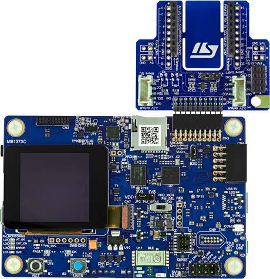

<!-- Copyright 2015-2026 Zephyr Project members and individual contributors. -->
<!-- SPDX-License-Identifier: Apache-2.0 -->
<!-- 中文翻译；编号、导航与译注为本地新增。 -->

<a id="stm32l562e_dk"></a>

# 第46章\_STM32L562E-DK探索板（Discovery）

原文：[官方页面](https://docs.zephyrproject.org/latest/boards/st/stm32l562e_dk/doc/index.html)。读取日期：2026-10-16；来源摘要见[来源记录](../SOURCES.md)。

开发板概览（Board Overview）

<a id="id1"></a>

[](images/stm32l562e_dk.jpg)

STM32L562E-DK探索板（Discovery）

名称（Name）：

`stm32l562e_dk`

厂商（Vendor）：

[意法半导体（STMicroelectronics）](https://docs.zephyrproject.org/latest/boards/index.html#vendor=st)

状态（Status）：

维护中（Maintained）

架构（Architecture）：

[arm](https://docs.zephyrproject.org/latest/boards/index.html#arch=arm)

片上系统（SoC）：

[stm32l562xx](https://docs.zephyrproject.org/latest/boards/index.html#soc=stm32l562xx)

<a id="board-github-link"></a>

[浏览开发板源码（Browse Board Sources）](https://github.com/zephyrproject-rtos/zephyr/blob/main//boards/st/stm32l562e_dk/doc/index.rst/../..)<a id="overview"></a>

## 概述（Overview）

STM32L562E-DK Discovery套件是STM32L562QEI6QU的完整演示及开发平台，该MCU采用Arm Cortex-M33并带TrustZone，主要特点如下：


- BGA132封装STM32L562QEI6QU，具有512 Kbytes Flash及256 Kbytes SRAM
- 1.54英寸240×240像素、262K色TFT LCD模块，带并行接口及触控面板
- USB Type-C®全速受电端设备（Sink Device FS）
- 板载能量测量仪，电流测量范围300 nA～150 mA，带专用USB接口
- SAI音频编解码器（CODEC）
- MEMS数字麦克风
- 512 Mbit八线SPI（Octal-SPI）Flash
- Bluetooth® 4.1低功耗模块
- iNEMO三轴加速度计及三轴陀螺仪
- 板上连接器（Board Connectors）


  - STMod+扩展接口及扇出扩展板，提供兼容Wi-Fi、Grove及mikroBUS的连接器
  - Pmod扩展连接器
  - 音频MEMS子板扩展连接器
  - ARDUINO® Uno V3扩展连接器
- 灵活供电方式


  - ST-LINK
  - USB VBUS供电
  - 外部电源
- 板载STLINK-V3E调试器／编程器，支持USB重新枚举：


  - 大容量存储（Mass Storage）
  - 虚拟COM端口
  - 调试端口（Debug Port）
- 2个用户LED
- 用户按键和复位按键

更多信息见[STM32L562E-DK Discovery网站](https://www.st.com/en/evaluation-tools/stm32l562e-dk.html)。

<a id="hardware"></a>

## 硬件（Hardware）

STM32L562xx属于STM32L5超低功耗微控制器系列，基于Arm Cortex-M33 32位RISC内核，最高工作频率110 MHz。


- 支持FlexPowerControl的超低功耗设计：待机电流最低108 nA，运行模式62 µA/MHz
- 内核：Arm® 32位Cortex®-M33 CPU，支持TrustZone®及FPU
- 性能基准（Performance Benchmark）：


  - 原文性能指标为1.5 DMPIS/MHz（Drystone 2.1），拼写照录
  - 442 CoreMark®，4.02 CoreMark®/MHz
- 安全（Security）


  - Arm® TrustZone®，I/O、存储器及外设可配置安全属性
  - 灵活的生命周期方案，支持读出保护（Readout Protection，RDP）
  - 通过唯一启动入口及隐藏保护区域（HDP）建立信任根
  - 通过内置根安全服务（Root Secure Services）进行安全固件安装
  - 支持使用TF-M进行安全固件更新
  - AES协处理器
  - 公钥加速器（Public Key Accelerator）
  - Octo-SPI外部存储器即时解密（On-the-fly Decryption）
  - 哈希（HASH）硬件加速器
  - 主动防篡改，防护温度、电压及频率攻击
  - 符合NIST SP800-90B的真随机数发生器
  - 96位唯一标识（Unique ID）
  - 用于用户数据的512字节一次性可编程存储器（OTP）
- 时钟管理（Clock Management）：


  - 4–48 MHz晶体振荡器（Crystal Oscillator）
  - 用于实时时钟（RTC）的32 kHz低速外部晶体振荡器（LSE）
  - 内部16 MHz RC振荡器，出厂校准（Factory-Trimmed），精度±1%
  - 内部低功耗32 kHz RC振荡器，精度±5%
  - 内部多速率100 kHz至48 MHz振荡器，由LSE自动校准，精度优于±0.25%
  - 三个锁相环（PLL），用于系统时钟、USB、音频和ADC
- 电源管理（Power Management）


  - 内置低压差稳压器（LDO），可配置三个输出范围，为数字电路供电
  - 内置开关模式电源（SMPS）降压转换器
  - 支持外部SMPS
- 带硬件日历、闹钟及校准功能的实时时钟（RTC）
- 最多114个高速I/O，多数耐受5 V；最多14个I/O具有独立供电，最低1.08 V
- 最多22路电容感应通道，支持触摸按键、线性及旋转触摸传感器
- 最多16个定时器及2个看门狗


  - 两个16位高级电机控制定时器（Advanced Motor-Control）
  - 通用定时器：2个32位及5个16位
  - 两个16位基本定时器（Basic Timers）
  - 3个16位低功耗定时器，可在停止模式工作
  - 两个看门狗（Watchdogs）
  - 2个系统节拍（SysTick）定时器
- 存储器（Memories）


  - 原文写最多512 MB Flash，双存储区，支持写入时读取。译注：容量单位照录，未改写为KB。
  - 原文写512 KB SRAM，其中64 KB支持硬件奇偶校验。
  - 外部静态存储器接口，支持SRAM、PSRAM、NOR、NAND及FRAM
  - 八线SPI存储器接口（OCTOSPI）
- 丰富的模拟外设（Analog Peripherals），采用独立供电


  - 三个12位、5 MSPS模数转换器（ADC），硬件过采样（Oversampling）后最高16位，功耗200 μA/MSPS
  - 两个12位数模转换器（DAC），支持低功耗采样保持（Sample and Hold）
  - 两个运算放大器（Operational Amplifiers），内置可编程增益放大器（PGA）
  - 两个超低功耗比较器（Comparators）
  - 四个用于Σ-Δ调制器（Sigma Delta Modulator）的数字滤波器（Digital Filters）
- 19个通信接口


  - USB Type-C／USB电力传输控制器
  - USB 2.0全速无晶体方案，支持LPM及BCD
  - 两个串行音频接口（SAI）
  - 4路I2C FM+（1 Mbit/s），支持SMBus/PMBus
  - 六路USART，支持ISO 7816、LIN、IrDA和调制解调器（Modem）
  - 3路SPI，将USART及OCTOSPI设为SPI模式时合计7路
  - 1路灵活数据速率CAN（FDCAN）
  - 1路SDMMC接口
  - 2个14通道DMA控制器
- 循环冗余校验计算单元（CRC Calculation Unit）
- 开发支持：串行线调试（SWD）、JTAG及嵌入式跟踪宏单元（Embedded Trace Macrocell™）

更多STM32L562QE信息见：


- [ST官网的STM32L562QE产品页](https://www.st.com/en/microcontrollers/stm32l562qe.html)
- [STM32L562参考手册](https://www.st.com/resource/en/reference_manual/DM00346336.pdf)

<a id="supported-features"></a>

### 支持的功能（Supported Features）

`stm32l562e_dk`开发板支持下表所列的硬件功能。

片上／板载（On-Chip / On-Board）

功能集成在片上系统（SoC）内／位于开发板上。

2 / 2

分别表示已启用／已禁用的实例数。点击数量标签，可查看开发板或SoC设备树源码（DTS）中该功能的第一个实例。

`vnd,foo`

与此功能匹配的设备树绑定兼容字符串（Compatible String）；点击链接可查看绑定文档。

<a id="stm32l562e_dk-hw-features"></a>

<a id="stm32l562e_dk-stm32l562e_dk/stm32l562xx-hw-features-section"></a>

#### `stm32l562e_dk/stm32l562xx`目标（Target）

<a id="stm32l562e_dk-stm32l562e_dk/stm32l562xx-hw-features-panel"></a>

<a id="stm32l562e_dk-stm32l562e_dk/stm32l562xx-hw-features-memory"></a>

该开发板目标的片上存储容量：192 KiB RAM、512 KiB Flash。

<a id="stm32l562e_dk-stm32l562e_dk/stm32l562xx-hw-features-table"></a>

<table>
<tr>
<th>类型（Type）</th>
<th>位置（Location）</th>
<th>说明（Description）</th>
<th>兼容字符串（Compatible）</th>
</tr>
<tr>
<td rowspan="1">中央处理器（CPU）</td>
<td>片上（On-Chip）</td>
<td>ARM Cortex-M33处理器（CPU）（<a href="https://github.com/zephyrproject-rtos/zephyr/blob/main/dts/arm/st/l5/stm32l5.dtsi?plain=1#L35">已启用：1</a>）</td>
<td><a href="../cpu_arm_riscv_binding_reference/P022_arm_cortex-m33.md#std-dtcompatible-arm-cortex-m33"><code>arm,cortex-m33</code></a></td>
</tr>
<tr>
<td rowspan="1">模数转换器（ADC）</td>
<td>片上（On-Chip）</td>
<td>STM32模数转换器（ADC）（<a href="https://github.com/zephyrproject-rtos/zephyr/blob/main/dts/arm/st/l5/stm32l5.dtsi?plain=1#L779">已启用：1</a>）</td>
<td><a href="../hardware/P839_STM32模数转换器绑定.md#dtbinding-st-stm32-adc"><code>st,stm32-adc</code></a></td>
</tr>
<tr>
<td rowspan="2">音频（Audio）</td>
<td>片上（On-Chip）</td>
<td>意法半导体（STMicroelectronics）Σ-Δ调制器数字滤波器模块（DFSDM）（<a href="https://github.com/zephyrproject-rtos/zephyr/blob/main/dts/arm/st/l5/stm32l5.dtsi?plain=1#L916">已禁用：1</a>）</td>
<td><a href="../audio_stm32_ti_wolfson_binding_reference/P002_st_stm32-dfsdm.md#std-dtcompatible-st-stm32-dfsdm"><code>st,stm32-dfsdm</code></a></td>
</tr>
<tr>
<td>片上（On-Chip）</td>
<td>意法半导体（STMicroelectronics）DFSDM数字麦克风（DMIC）（<a href="https://github.com/zephyrproject-rtos/zephyr/blob/main/dts/arm/st/l5/stm32l5.dtsi?plain=1#L927">已禁用：4</a>）</td>
<td><a href="../audio_stm32_ti_wolfson_binding_reference/P001_st_stm32-dfsdm-dmic.md#std-dtcompatible-st-stm32-dfsdm-dmic"><code>st,stm32-dfsdm-dmic</code></a></td>
</tr>
<tr>
<td rowspan="1">蓝牙（Bluetooth）</td>
<td>板载（On-Board）</td>
<td>意法半导体SPI协议V1，兼容BlueNRG-MS器件（<a href="https://github.com/zephyrproject-rtos/zephyr/blob/main/boards/st/stm32l562e_dk/stm32l562e_dk-common.dtsi?plain=1#L207">已启用：1</a>）</td>
<td><a href="../bluetooth_st_transport_binding_reference/P002_st_hci-spi-v1.md#std-dtcompatible-st-hci-spi-v1"><code>st,hci-spi-v1</code></a></td>
</tr>
<tr>
<td rowspan="1">控制器局域网（CAN）</td>
<td>片上（On-Chip）</td>
<td>STM32 FDCAN灵活数据速率CAN控制器（CAN FD Controller）（<a href="https://github.com/zephyrproject-rtos/zephyr/blob/main/dts/arm/st/l5/stm32l5.dtsi?plain=1#L812">已禁用：1</a>）</td>
<td><a href="../can_nxp_renesas_stm32_ti_binding_reference/P012_st_stm32-fdcan.md#std-dtcompatible-st-stm32-fdcan"><code>st,stm32-fdcan</code></a></td>
</tr>
<tr>
<td rowspan="6">时钟控制（Clock Control）</td>
<td>片上（On-Chip）</td>
<td>STM32复位和时钟控制器（RCC / Reset and Clock Controller）（<a href="https://github.com/zephyrproject-rtos/zephyr/blob/main/dts/arm/st/l5/stm32l5.dtsi?plain=1#L197">已启用：1</a>）</td>
<td><a href="../timer_reference/P126_STM32复位与时钟控制绑定.md#dtbinding-st-stm32-rcc"><code>st,stm32-rcc</code></a></td>
</tr>
<tr>
<td>片上（On-Chip）</td>
<td>STM32 外部高速时钟（HSE Clock）（<a href="https://github.com/zephyrproject-rtos/zephyr/blob/main/dts/arm/st/l5/stm32l5.dtsi?plain=1#L80">已禁用：1</a>）</td>
<td><a href="../timer_reference/P129_STM32高速外部时钟绑定.md#dtbinding-st-stm32-hse-clock"><code>st,stm32-hse-clock</code></a></td>
</tr>
<tr>
<td>片上（On-Chip）</td>
<td>通用固定频率时钟提供者（Fixed-Rate Clock Provider）（<a href="https://github.com/zephyrproject-rtos/zephyr/blob/main/dts/arm/st/l5/stm32l5.dtsi?plain=1#L93">已启用：1</a>；<a href="https://github.com/zephyrproject-rtos/zephyr/blob/main/dts/arm/st/l5/stm32l5.dtsi?plain=1#L86">已禁用：2</a>）</td>
<td><a href="../hardware/P566_固定时钟绑定.md#dtbinding-fixed-clock"><code>fixed-clock</code></a></td>
</tr>
<tr>
<td>片上（On-Chip）</td>
<td>STM32多速内部时钟（MSI Clock）（<a href="https://github.com/zephyrproject-rtos/zephyr/blob/main/dts/arm/st/l5/stm32l5.dtsi?plain=1#L100">已启用：1</a>）</td>
<td><a href="../timer_reference/P132_STM32多速内部时钟绑定.md#dtbinding-st-stm32-msi-clock"><code>st,stm32-msi-clock</code></a></td>
</tr>
<tr>
<td>片上（On-Chip）</td>
<td>STM32低速外部时钟（LSE Clock）（<a href="https://github.com/zephyrproject-rtos/zephyr/blob/main/dts/arm/st/l5/stm32l5.dtsi?plain=1#L107">已启用：1</a>）</td>
<td><a href="../timer_reference/P130_STM32低速外部时钟绑定.md#dtbinding-st-stm32-lse-clock"><code>st,stm32-lse-clock</code></a></td>
</tr>
<tr>
<td>片上（On-Chip）</td>
<td>STM32L4与L5器件的锁相环节点绑定（PLL Node Binding）（<a href="https://github.com/zephyrproject-rtos/zephyr/blob/main/dts/arm/st/l5/stm32l5.dtsi?plain=1#L122">已启用：1</a>；<a href="https://github.com/zephyrproject-rtos/zephyr/blob/main/dts/arm/st/l5/stm32l5.dtsi?plain=1#L128">已禁用：1</a>）</td>
<td><a href="../timer_reference/P148_STM32L4锁相环时钟绑定.md#dtbinding-st-stm32l4-pll-clock"><code>st,stm32l4-pll-clock</code></a></td>
</tr>
<tr>
<td rowspan="1">计数器（Counter）</td>
<td>片上（On-Chip）</td>
<td>STM32 计数器（Counters）（<a href="https://github.com/zephyrproject-rtos/zephyr/blob/main/dts/arm/st/l5/stm32l5.dtsi?plain=1#L553">已禁用：9</a>）</td>
<td><a href="../stm32_ti_xilinx_counter_binding_reference/P007_st_stm32-counter.md#std-dtcompatible-st-stm32-counter"><code>st,stm32-counter</code></a></td>
</tr>
<tr>
<td rowspan="1">循环冗余校验（CRC）</td>
<td>片上（On-Chip）</td>
<td>STM32 CRC 计算单元（Calculation Unit）（<a href="https://github.com/zephyrproject-rtos/zephyr/blob/main/dts/arm/st/l5/stm32l5.dtsi?plain=1#L908">已启用：1</a>）</td>
<td><a href="../crc_clock_monitor_binding_reference/P011_st_stm32-crc.md#std-dtcompatible-st-stm32-crc"><code>st,stm32-crc</code></a></td>
</tr>
<tr>
<td rowspan="2">密码学加速器（Cryptographic Accelerator）</td>
<td>片上（On-Chip）</td>
<td>STM32哈希处理器（HASH Processor）（<a href="https://github.com/zephyrproject-rtos/zephyr/blob/main/dts/arm/st/l5/stm32l5.dtsi?plain=1#L516">已启用：1</a>）</td>
<td><a href="../crypto_secure_engine_st_ti_binding_reference/P017_st_stm32-hash.md#std-dtcompatible-st-stm32-hash"><code>st,stm32-hash</code></a></td>
</tr>
<tr>
<td>片上（On-Chip）</td>
<td>STM32高级加密标准加速器（AES Accelerator）（<a href="https://github.com/zephyrproject-rtos/zephyr/blob/main/dts/arm/st/l5/stm32l562.dtsi?plain=1#L13">已启用：1</a>）</td>
<td><a href="../crypto_secure_engine_st_ti_binding_reference/P015_st_stm32-aes.md#std-dtcompatible-st-stm32-aes"><code>st,stm32-aes</code></a></td>
</tr>
<tr>
<td rowspan="1">数模转换器（DAC）</td>
<td>片上（On-Chip）</td>
<td>STM32 系列数模转换器（DAC）（<a href="https://github.com/zephyrproject-rtos/zephyr/blob/main/dts/arm/st/l5/stm32l5.dtsi?plain=1#L463">已启用：1</a>）</td>
<td><a href="../hardware/P760_STM32数模转换器绑定.md#dtbinding-st-stm32-dac"><code>st,stm32-dac</code></a></td>
</tr>
<tr>
<td rowspan="1">显示（Display）</td>
<td>板载（On-Board）</td>
<td>Sitronix ST7789V显示控制器（Display Controller）（<a href="https://github.com/zephyrproject-rtos/zephyr/blob/main/boards/st/stm32l562e_dk/stm32l562e_dk-common.dtsi?plain=1#L94">已启用：1</a>）</td>
<td><a href="../display_sinowealth_sitronix_solomon_binding_reference/P011_sitronix_st7789v.md#std-dtcompatible-sitronix-st7789v"><code>sitronix,st7789v</code></a></td>
</tr>
<tr>
<td rowspan="2">直接存储器访问（DMA）</td>
<td>片上（On-Chip）</td>
<td>STM32直接存储器访问控制器（DMA Controller，V2）（<a href="https://github.com/zephyrproject-rtos/zephyr/blob/main/dts/arm/st/l5/stm32l5.dtsi?plain=1#L384">已启用：2</a>）</td>
<td><a href="../stm32_ti_xilinx_dma_binding_reference/P008_st_stm32-dma-v2.md#std-dtcompatible-st-stm32-dma-v2"><code>st,stm32-dma-v2</code></a></td>
</tr>
<tr>
<td>片上（On-Chip）</td>
<td>STM32 DMA 多路复用控制器（DMAMUX Controller）（<a href="https://github.com/zephyrproject-rtos/zephyr/blob/main/dts/arm/st/l5/stm32l5.dtsi?plain=1#L406">已启用：1</a>）</td>
<td><a href="../stm32_ti_xilinx_dma_binding_reference/P011_st_stm32-dmamux.md#std-dtcompatible-st-stm32-dmamux"><code>st,stm32-dmamux</code></a></td>
</tr>
<tr>
<td rowspan="1">闪存控制器（Flash Controller）</td>
<td>片上（On-Chip）</td>
<td>STM32 系列闪存控制器（Flash Controller）（<a href="https://github.com/zephyrproject-rtos/zephyr/blob/main/dts/arm/st/l5/stm32l5.dtsi?plain=1#L136">已启用：1</a>）</td>
<td><a href="../flash_renesas_st_ti_binding_reference/P011_st_stm32-flash-controller.md#std-dtcompatible-st-stm32-flash-controller"><code>st,stm32-flash-controller</code></a></td>
</tr>
<tr>
<td rowspan="2">通用输入输出与接插件（GPIO &amp; Headers）</td>
<td>片上（On-Chip）</td>
<td>STM32 通用输入输出控制器（GPIO Controller）（<a href="https://github.com/zephyrproject-rtos/zephyr/blob/main/dts/arm/st/l5/stm32l5.dtsi?plain=1#L239">已启用：8</a>）</td>
<td><a href="../gpio_silabs_st_connectors_binding_reference/P029_st_stm32-gpio.md#std-dtcompatible-st-stm32-gpio"><code>st,stm32-gpio</code></a></td>
</tr>
<tr>
<td>板载（On-Board）</td>
<td>引出到Arduino Uno R3排针（Headers）的GPIO引脚（<a href="https://github.com/zephyrproject-rtos/zephyr/blob/main/boards/st/stm32l562e_dk/arduino_r3_connector.dtsi?plain=1#L10">已启用：1</a>）</td>
<td><a href="../gpio_adi_headers_ambiq_binding_reference/P023_arduino-header-r3.md#std-dtcompatible-arduino-header-r3"><code>arduino-header-r3</code></a></td>
</tr>
<tr>
<td rowspan="1">集成电路间总线（I2C）</td>
<td>片上（On-Chip）</td>
<td>STM32 I2C V2 控制器（Controller）（<a href="https://github.com/zephyrproject-rtos/zephyr/blob/main/dts/arm/st/l5/stm32l5.dtsi?plain=1#L418">已启用：1</a>；<a href="https://github.com/zephyrproject-rtos/zephyr/blob/main/dts/arm/st/l5/stm32l5.dtsi?plain=1#L430">已禁用：1</a>）</td>
<td><a href="../i2c_stm32_ti_mux_binding_reference/P008_st_stm32-i2c-v2.md#std-dtcompatible-st-stm32-i2c-v2"><code>st,stm32-i2c-v2</code></a></td>
</tr>
<tr>
<td rowspan="1">集成电路间音频总线（I2S）</td>
<td>片上（On-Chip）</td>
<td>STM32 串行音频接口块控制器（SAI Block Controller）（<a href="https://github.com/zephyrproject-rtos/zephyr/blob/main/dts/arm/st/l5/stm32l5.dtsi?plain=1#L852">已禁用：2</a>）</td>
<td><a href="../i2s_binding_reference/P017_st_stm32-sai.md#std-dtcompatible-st-stm32-sai"><code>st,stm32-sai</code></a></td>
</tr>
<tr>
<td rowspan="2">输入（Input）</td>
<td>板载（On-Board）</td>
<td>FT3267/FT5XX6/FT6XX6电容式触摸面板（Capacitive Touch Panels）（<a href="https://github.com/zephyrproject-rtos/zephyr/blob/main/boards/st/stm32l562e_dk/stm32l562e_dk-common.dtsi?plain=1#L190">已启用：1</a>）</td>
<td><a href="../input_adc_touch_matrix_binding_reference/P014_focaltech_ft5336.md#std-dtcompatible-focaltech-ft5336"><code>focaltech,ft5336</code></a></td>
</tr>
<tr>
<td>板载（On-Board）</td>
<td>一组绑定到 GPIO 的输入按键（GPIO-Bound Input Keys）（<a href="https://github.com/zephyrproject-rtos/zephyr/blob/main/boards/st/stm32l562e_dk/stm32l562e_dk-common.dtsi?plain=1#L30">已启用：1</a>）</td>
<td><a href="../hardware/P563_GPIO按键绑定.md#std-dtcompatible-gpio-keys"><code>gpio-keys</code></a></td>
</tr>
<tr>
<td rowspan="2">中断控制器（Interrupt Controller）</td>
<td>片上（On-Chip）</td>
<td>ARMv8-M嵌套向量中断控制器（NVIC / Nested Vectored Interrupt Controller）（<a href="https://github.com/zephyrproject-rtos/zephyr/blob/main/dts/arm/armv8-m.dtsi?plain=1#L13">已启用：1</a>）</td>
<td><a href="../arm_interrupt_timer_binding_reference/P003_ARMv8_M_NVIC.md#std-dtcompatible-arm-v8m-nvic"><code>arm,v8m-nvic</code></a></td>
</tr>
<tr>
<td>片上（On-Chip）</td>
<td>STM32G0 外部中断控制器（External Interrupt Controller）（<a href="https://github.com/zephyrproject-rtos/zephyr/blob/main/dts/arm/st/l5/stm32l5.dtsi?plain=1#L210">已启用：1</a>）</td>
<td><a href="../mcu_external_interrupt_binding_reference/P002_st_stm32g0-exti.md#std-dtcompatible-st-stm32g0-exti"><code>st,stm32g0-exti</code></a></td>
</tr>
<tr>
<td rowspan="1">发光二极管（LED）</td>
<td>板载（On-Board）</td>
<td>一组由 GPIO 控制的 LED（GPIO-Controlled LEDs）（<a href="https://github.com/zephyrproject-rtos/zephyr/blob/main/boards/st/stm32l562e_dk/stm32l562e_dk-common.dtsi?plain=1#L16">已启用：1</a>）</td>
<td><a href="../hardware/P564_GPIO指示灯绑定.md#dtbinding-gpio-leds"><code>gpio-leds</code></a></td>
</tr>
<tr>
<td rowspan="2">存储器控制器（Memory Controller）</td>
<td>片上（On-Chip）</td>
<td>STM32 灵活存储器控制器（Flexible Memory Controller，FMC）（<a href="https://github.com/zephyrproject-rtos/zephyr/blob/main/dts/arm/st/l5/stm32l5.dtsi?plain=1#L845">已启用：1</a>）</td>
<td><a href="../memory_controller_sdram_psram_binding_reference/P013_st_stm32-fmc.md#std-dtcompatible-st-stm32-fmc"><code>st,stm32-fmc</code></a></td>
</tr>
<tr>
<td>板载（On-Board）</td>
<td>STM32灵活存储器控制器（FMC / Flexible Memory Controller），用于NOR Flash、PSRAM和SRAM（<a href="https://github.com/zephyrproject-rtos/zephyr/blob/main/boards/st/stm32l562e_dk/stm32l562e_dk-common.dtsi?plain=1#L62">已启用：1</a>）</td>
<td><a href="../memory_controller_sdram_psram_binding_reference/P011_st_stm32-fmc-nor-psram.md#std-dtcompatible-st-stm32-fmc-nor-psram"><code>st,stm32-fmc-nor-psram</code></a></td>
</tr>
<tr>
<td rowspan="1">MIPI 显示总线接口（MIPI-DBI）</td>
<td>板载（On-Board）</td>
<td>STM32 FMC显示控制器（<a href="https://github.com/zephyrproject-rtos/zephyr/blob/main/boards/st/stm32l562e_dk/stm32l562e_dk-common.dtsi?plain=1#L86">已启用：1</a>）</td>
<td><a href="../mipi_dbi_dsi_binding_reference/P009_st_stm32-fmc-mipi-dbi.md#std-dtcompatible-st-stm32-fmc-mipi-dbi"><code>st,stm32-fmc-mipi-dbi</code></a></td>
</tr>
<tr>
<td rowspan="1">内存管理单元／内存保护单元（MMU / MPU）</td>
<td>片上（On-Chip）</td>
<td>ARMv8-M存储器保护单元（MPU / Memory Protection Unit）（<a href="https://github.com/zephyrproject-rtos/zephyr/blob/main/dts/arm/st/l5/stm32l5.dtsi?plain=1#L44">已启用：1</a>）</td>
<td><a href="../memory_protection_binding_reference/P007_arm_armv8m-mpu.md#std-dtcompatible-arm-armv8m-mpu"><code>arm,armv8m-mpu</code></a></td>
</tr>
<tr>
<td rowspan="2">多位串行外设接口（Multi-Bit SPI）</td>
<td>片上（On-Chip）</td>
<td>STM32八线SPI控制器（OSPI）（<a href="https://github.com/zephyrproject-rtos/zephyr/blob/main/dts/arm/st/l5/stm32l5.dtsi?plain=1#L493">已启用：1</a>）</td>
<td><a href="../mspi_binding_reference/P012_st_stm32-ospi-controller.md#std-dtcompatible-st-stm32-ospi-controller"><code>st,stm32-ospi-controller</code></a></td>
</tr>
<tr>
<td>板载（On-Board）</td>
<td>MSPI总线上的STM32存储器设备（<a href="https://github.com/zephyrproject-rtos/zephyr/blob/main/boards/st/stm32l562e_dk/stm32l562e_dk-common.dtsi?plain=1#L242">已启用：1</a>）</td>
<td><a href="../mspi_binding_reference/P010_st_nor-mspi.md#std-dtcompatible-st-nor"><code>st,nor</code></a></td>
</tr>
<tr>
<td rowspan="3">存储技术设备（MTD）</td>
<td>片上（On-Chip）</td>
<td>STM32闪存（Flash Memory）（<a href="https://github.com/zephyrproject-rtos/zephyr/blob/main/dts/arm/st/l5/stm32l5.dtsi?plain=1#L146">已启用：1</a>）</td>
<td><a href="../mtd_nxp_st_ti_partition_binding_reference/P016_st_stm32-nv-flash.md#std-dtcompatible-st-stm32-nv-flash"><code>st,stm32-nv-flash</code></a></td>
</tr>
<tr>
<td>板载（On-Board）</td>
<td>闪存（Flash）节点（<a href="https://github.com/zephyrproject-rtos/zephyr/blob/main/boards/st/stm32l562e_dk/stm32l562e_dk-common.dtsi?plain=1#L263">已启用：1</a>）</td>
<td><a href="../mtd_nxp_st_ti_partition_binding_reference/P013_soc-nv-flash.md#std-dtcompatible-soc-nv-flash"><code>soc-nv-flash</code></a></td>
</tr>
<tr>
<td>板载（On-Board）</td>
<td>闪存或其他非易失性存储器的固定分区（Fixed Partitions）（<a href="https://github.com/zephyrproject-rtos/zephyr/blob/main/boards/st/stm32l562e_dk/stm32l562e_dk.dts?plain=1#L81">已启用：1</a>）</td>
<td><a href="../hardware/P568_固定分区绑定.md#dtbinding-fixed-partitions"><code>fixed-partitions</code></a></td>
</tr>
<tr>
<td rowspan="1">非易失存储器（NVMEM）</td>
<td>片上（On-Chip）</td>
<td>非易失存储器固定布局（Fixed Layout for Non-Volatile Memory）（<a href="https://github.com/zephyrproject-rtos/zephyr/blob/main/dts/arm/st/l5/stm32l5.dtsi?plain=1#L171">已启用：1</a>）</td>
<td><a href="../memory_protection_binding_reference/P009_fixed-layout.md#std-dtcompatible-fixed-layout"><code>fixed-layout</code></a></td>
</tr>
<tr>
<td rowspan="1">一次性可编程存储器（OTP Memory）</td>
<td>片上（On-Chip）</td>
<td>STM32 嵌入式非易失一次性可编程存储器（NVM OTP）（<a href="https://github.com/zephyrproject-rtos/zephyr/blob/main/dts/arm/st/l5/stm32l5.dtsi?plain=1#L167">已启用：1</a>；<a href="https://github.com/zephyrproject-rtos/zephyr/blob/main/dts/arm/st/l5/stm32l5.dtsi?plain=1#L160">已禁用：1</a>）</td>
<td><a href="../otp_binding_reference/P010_st_stm32-nvm-otp.md#std-dtcompatible-st-stm32-nvm-otp"><code>st,stm32-nvm-otp</code></a></td>
</tr>
<tr>
<td rowspan="1">物理层（PHY）</td>
<td>片上（On-Chip）</td>
<td>用于所有内置于 USB IP 的 USB 收发器（USB Transceivers）的绑定。（<a href="https://github.com/zephyrproject-rtos/zephyr/blob/main/dts/arm/st/l5/stm32l5.dtsi?plain=1#L995">已启用：1</a>）</td>
<td><a href="../phy_binding_reference/P008_usb-nop-xceiv.md#std-dtcompatible-usb-nop-xceiv"><code>usb-nop-xceiv</code></a></td>
</tr>
<tr>
<td rowspan="1">引脚控制（Pin Control）</td>
<td>片上（On-Chip）</td>
<td>STM32 引脚控制器（Pin Controller）（<a href="https://github.com/zephyrproject-rtos/zephyr/blob/main/dts/arm/st/l5/stm32l5.dtsi?plain=1#L232">已启用：1</a>）</td>
<td><a href="../pinctrl_stm32_ti_xilinx_binding_reference/P004_st_stm32-pinctrl.md#std-dtcompatible-st-stm32-pinctrl"><code>st,stm32-pinctrl</code></a></td>
</tr>
<tr>
<td rowspan="1">脉宽调制（PWM）</td>
<td>片上（On-Chip）</td>
<td>STM32 脉宽调制（PWM）（<a href="https://github.com/zephyrproject-rtos/zephyr/blob/main/dts/arm/st/l5/stm32l5.dtsi?plain=1#L576">已启用：1</a>；<a href="https://github.com/zephyrproject-rtos/zephyr/blob/main/dts/arm/st/l5/stm32l5.dtsi?plain=1#L547">已禁用：8</a>）</td>
<td><a href="../pwm_stm32_ti_generic_binding_reference/P011_st_stm32-pwm.md#std-dtcompatible-st-stm32-pwm"><code>st,stm32-pwm</code></a></td>
</tr>
<tr>
<td rowspan="1">复位控制器（Reset Controller）</td>
<td>片上（On-Chip）</td>
<td>STM32 复位与时钟控制器（Reset and Clock Control，RCC）（<a href="https://github.com/zephyrproject-rtos/zephyr/blob/main/dts/arm/st/l5/stm32l5.dtsi?plain=1#L204">已启用：1</a>）</td>
<td><a href="../reset_controller_binding_reference/P017_st_stm32-rcc-rctl.md#std-dtcompatible-st-stm32-rcc-rctl"><code>st,stm32-rcc-rctl</code></a></td>
</tr>
<tr>
<td rowspan="1">随机数生成器（RNG）</td>
<td>片上（On-Chip）</td>
<td>STM32 随机数生成器（Random Number Generator）（<a href="https://github.com/zephyrproject-rtos/zephyr/blob/main/dts/arm/st/l5/stm32l5.dtsi?plain=1#L505">已启用：1</a>）</td>
<td><a href="../soc_rng_binding_reference/P016_st_stm32-rng.md#std-dtcompatible-st-stm32-rng"><code>st,stm32-rng</code></a></td>
</tr>
<tr>
<td rowspan="1">实时时钟（RTC）</td>
<td>片上（On-Chip）</td>
<td>STM32 实时时钟（RTC）（<a href="https://github.com/zephyrproject-rtos/zephyr/blob/main/dts/arm/st/l5/stm32l5.dtsi?plain=1#L525">已禁用：1</a>）</td>
<td><a href="../soc_rtc_binding_reference/P014_st_stm32-rtc.md#std-dtcompatible-st-stm32-rtc"><code>st,stm32-rtc</code></a></td>
</tr>
<tr>
<td rowspan="1">SD 主机控制器（SDHC）</td>
<td>片上（On-Chip）</td>
<td>STM32 SDMMC 主机控制器（Host Controller）（<a href="https://github.com/zephyrproject-rtos/zephyr/blob/main/dts/arm/st/l5/stm32l5.dtsi?plain=1#L453">已启用：1</a>）</td>
<td><a href="../sdhc_binding_reference/P019_st_stm32-sdmmc.md#std-dtcompatible-st-stm32-sdmmc"><code>st,stm32-sdmmc</code></a></td>
</tr>
<tr>
<td rowspan="5">传感器（Sensors）</td>
<td>板载（On-Board）</td>
<td>通过I2C总线访问的意法半导体LSM6DSO六轴惯性测量单元（IMU / Inertial Measurement Unit）（<a href="https://github.com/zephyrproject-rtos/zephyr/blob/main/boards/st/stm32l562e_dk/stm32l562e_dk-common.dtsi?plain=1#L184">已启用：1</a>）</td>
<td><a href="../compatible_binding_reference/P091_st_lsm6dso.md#std-dtcompatible-st-lsm6dso"><code>st,lsm6dso</code></a></td>
</tr>
<tr>
<td>片上（On-Chip）</td>
<td>STM32 正交解码器（Quadrature Decoder）（<a href="https://github.com/zephyrproject-rtos/zephyr/blob/main/dts/arm/st/l5/stm32l5.dtsi?plain=1#L558">已禁用：6</a>）</td>
<td><a href="../sensor_st_lsm_stm32_binding_reference/P028_st_stm32-qdec.md#std-dtcompatible-st-stm32-qdec"><code>st,stm32-qdec</code></a></td>
</tr>
<tr>
<td>片上（On-Chip）</td>
<td>STM32 系列温度节点（TEMP），用于以两个温度点完成生产校准的传感器。（<a href="https://github.com/zephyrproject-rtos/zephyr/blob/main/dts/arm/st/l5/stm32l5.dtsi?plain=1#L969">已启用：1</a>）</td>
<td><a href="../sensor_st_lsm_stm32_binding_reference/P029_st_stm32-temp-cal.md#std-dtcompatible-st-stm32-temp-cal"><code>st,stm32-temp-cal</code></a></td>
</tr>
<tr>
<td>片上（On-Chip）</td>
<td>STM32 参考电压（VREF+）（<a href="https://github.com/zephyrproject-rtos/zephyr/blob/main/dts/arm/st/l5/stm32l5.dtsi?plain=1#L980">已启用：1</a>）</td>
<td><a href="../sensor_st_ti_power_capacitance_binding_reference/P003_st_stm32-vref.md#std-dtcompatible-st-stm32-vref"><code>st,stm32-vref</code></a></td>
</tr>
<tr>
<td>片上（On-Chip）</td>
<td>STM32 电池电压（VBAT）（<a href="https://github.com/zephyrproject-rtos/zephyr/blob/main/dts/arm/st/l5/stm32l5.dtsi?plain=1#L988">已启用：1</a>）</td>
<td><a href="../sensor_st_ti_power_capacitance_binding_reference/P001_st_stm32-vbat.md#std-dtcompatible-st-stm32-vbat"><code>st,stm32-vbat</code></a></td>
</tr>
<tr>
<td rowspan="3">串行控制器（Serial Controller）</td>
<td>片上（On-Chip）</td>
<td>STM32 通用同步／异步收发器（USART）（<a href="https://github.com/zephyrproject-rtos/zephyr/blob/main/dts/arm/st/l5/stm32l5.dtsi?plain=1#L318">已启用：2</a>；<a href="https://github.com/zephyrproject-rtos/zephyr/blob/main/dts/arm/st/l5/stm32l5.dtsi?plain=1#L327">已禁用：1</a>）</td>
<td><a href="../uart_silabs_stm32_ti_binding_reference/P016_st_stm32-usart.md#std-dtcompatible-st-stm32-usart"><code>st,stm32-usart</code></a></td>
</tr>
<tr>
<td>片上（On-Chip）</td>
<td>STM32 通用异步收发器（UART）（<a href="https://github.com/zephyrproject-rtos/zephyr/blob/main/dts/arm/st/l5/stm32l5.dtsi?plain=1#L345">已禁用：2</a>）</td>
<td><a href="../uart_silabs_stm32_ti_binding_reference/P015_st_stm32-uart.md#std-dtcompatible-st-stm32-uart"><code>st,stm32-uart</code></a></td>
</tr>
<tr>
<td>片上（On-Chip）</td>
<td>STM32低功耗通用异步收发器（LPUART）（<a href="https://github.com/zephyrproject-rtos/zephyr/blob/main/dts/arm/st/l5/stm32l5.dtsi?plain=1#L363">已禁用：1</a>）</td>
<td><a href="../uart_silabs_stm32_ti_binding_reference/P014_st_stm32-lpuart.md#std-dtcompatible-st-stm32-lpuart"><code>st,stm32-lpuart</code></a></td>
</tr>
<tr>
<td rowspan="1">系统管理总线（SMbus）</td>
<td>片上（On-Chip）</td>
<td>STM32 系统管理总线控制器（SMBus Controller）（<a href="https://github.com/zephyrproject-rtos/zephyr/blob/main/dts/arm/st/l5/stm32l5.dtsi?plain=1#L1000">已禁用：2</a>）</td>
<td><a href="../i3c_smbus_binding_reference/P013_st_stm32-smbus.md#std-dtcompatible-st-stm32-smbus"><code>st,stm32-smbus</code></a></td>
</tr>
<tr>
<td rowspan="1">串行外设接口（SPI）</td>
<td>片上（On-Chip）</td>
<td>带嵌入式接收和发送先进先出队列（Rx / Tx FIFOs）的STM32 SPI控制器（<a href="https://github.com/zephyrproject-rtos/zephyr/blob/main/dts/arm/st/l5/stm32l5.dtsi?plain=1#L442">已启用：2</a>；<a href="https://github.com/zephyrproject-rtos/zephyr/blob/main/dts/arm/st/l5/stm32l5.dtsi?plain=1#L471">已禁用：1</a>）</td>
<td><a href="../spi_stm32_ti_xilinx_binding_reference/P009_st_stm32-spi-fifo.md#std-dtcompatible-st-stm32-spi-fifo"><code>st,stm32-spi-fifo</code></a></td>
</tr>
<tr>
<td rowspan="1">USB Type-C 端口控制器（USB Type-C Port Controller）</td>
<td>片上（On-Chip）</td>
<td>STM32 USB Type-C／电力传输（Power Delivery）（<a href="https://github.com/zephyrproject-rtos/zephyr/blob/main/dts/arm/st/l5/stm32l5.dtsi?plain=1#L837">已禁用：1</a>）</td>
<td><a href="../usbc_tcpc_binding_reference/P005_st_stm32-ucpd.md#std-dtcompatible-st-stm32-ucpd"><code>st,stm32-ucpd</code></a></td>
</tr>
<tr>
<td rowspan="3">定时器（Timer）</td>
<td>片上（On-Chip）</td>
<td>ARMv8-M系统节拍（System Tick）（<a href="https://github.com/zephyrproject-rtos/zephyr/blob/main/dts/arm/armv8-m.dtsi?plain=1#L21">已启用：1</a>）</td>
<td><a href="../arm_interrupt_timer_binding_reference/P007_ARMv8_M_SysTick.md#std-dtcompatible-arm-armv8m-systick"><code>arm,armv8m-systick</code></a></td>
</tr>
<tr>
<td>片上（On-Chip）</td>
<td>STM32低功耗定时器（LPTIM）（<a href="https://github.com/zephyrproject-rtos/zephyr/blob/main/dts/arm/st/l5/stm32l5.dtsi?plain=1#L372">已启用：1</a>）</td>
<td><a href="../stm32_ti_silabs_timer_binding_reference/P007_st_stm32-lptim.md#std-dtcompatible-st-stm32-lptim"><code>st,stm32-lptim</code></a></td>
</tr>
<tr>
<td>片上（On-Chip）</td>
<td>STM32 定时器（Timers）（<a href="https://github.com/zephyrproject-rtos/zephyr/blob/main/dts/arm/st/l5/stm32l5.dtsi?plain=1#L565">已启用：1</a>；<a href="https://github.com/zephyrproject-rtos/zephyr/blob/main/dts/arm/st/l5/stm32l5.dtsi?plain=1#L536">已禁用：8</a>）</td>
<td><a href="../stm32_ti_silabs_timer_binding_reference/P008_st_stm32-timers.md#std-dtcompatible-st-stm32-timers"><code>st,stm32-timers</code></a></td>
</tr>
<tr>
<td rowspan="1">通用串行总线（USB）</td>
<td>片上（On-Chip）</td>
<td>STM32 USB控制器（Controller）（<a href="https://github.com/zephyrproject-rtos/zephyr/blob/main/dts/arm/st/l5/stm32l5.dtsi?plain=1#L823">已启用：1</a>）</td>
<td><a href="../usb_stm32_audio_binding_reference/P006_st_stm32-usb.md#std-dtcompatible-st-stm32-usb"><code>st,stm32-usb</code></a></td>
</tr>
<tr>
<td rowspan="2">看门狗（Watchdog）</td>
<td>片上（On-Chip）</td>
<td>STM32 看门狗（Watchdog）（<a href="https://github.com/zephyrproject-rtos/zephyr/blob/main/dts/arm/st/l5/stm32l5.dtsi?plain=1#L304">已启用：1</a>）</td>
<td><a href="../stm32_ti_xilinx_watchdog_binding_reference/P001_st_stm32-watchdog.md#std-dtcompatible-st-stm32-watchdog"><code>st,stm32-watchdog</code></a></td>
</tr>
<tr>
<td>片上（On-Chip）</td>
<td>STM32 系统窗口看门狗（System Window Watchdog）（<a href="https://github.com/zephyrproject-rtos/zephyr/blob/main/dts/arm/st/l5/stm32l5.dtsi?plain=1#L310">已禁用：1</a>）</td>
<td><a href="../stm32_ti_xilinx_watchdog_binding_reference/P002_st_stm32-window-watchdog.md#std-dtcompatible-st-stm32-window-watchdog"><code>st,stm32-window-watchdog</code></a></td>
</tr>
</table>

<a id="stm32l562e_dk-stm32l562e_dk/stm32l562xx/ext_flash_app-hw-features-section"></a>

#### `stm32l562e_dk/stm32l562xx/ext_flash_app`目标（Target）

<a id="stm32l562e_dk-stm32l562e_dk/stm32l562xx/ext_flash_app-hw-features-panel"></a>

<a id="stm32l562e_dk-stm32l562e_dk/stm32l562xx/ext_flash_app-hw-features-memory"></a>

该开发板目标的片上存储容量：192 KiB RAM、64 MiB Flash。

<a id="stm32l562e_dk-stm32l562e_dk/stm32l562xx/ext_flash_app-hw-features-table"></a>

<table>
<tr>
<th>类型（Type）</th>
<th>位置（Location）</th>
<th>说明（Description）</th>
<th>兼容字符串（Compatible）</th>
</tr>
<tr>
<td rowspan="1">中央处理器（CPU）</td>
<td>片上（On-Chip）</td>
<td>ARM Cortex-M33处理器（CPU）（<a href="https://github.com/zephyrproject-rtos/zephyr/blob/main/dts/arm/st/l5/stm32l5.dtsi?plain=1#L35">已启用：1</a>）</td>
<td><a href="../cpu_arm_riscv_binding_reference/P022_arm_cortex-m33.md#std-dtcompatible-arm-cortex-m33"><code>arm,cortex-m33</code></a></td>
</tr>
<tr>
<td rowspan="1">模数转换器（ADC）</td>
<td>片上（On-Chip）</td>
<td>STM32模数转换器（ADC）（<a href="https://github.com/zephyrproject-rtos/zephyr/blob/main/dts/arm/st/l5/stm32l5.dtsi?plain=1#L779">已启用：1</a>）</td>
<td><a href="../hardware/P839_STM32模数转换器绑定.md#dtbinding-st-stm32-adc"><code>st,stm32-adc</code></a></td>
</tr>
<tr>
<td rowspan="2">音频（Audio）</td>
<td>片上（On-Chip）</td>
<td>意法半导体（STMicroelectronics）Σ-Δ调制器数字滤波器模块（DFSDM）（<a href="https://github.com/zephyrproject-rtos/zephyr/blob/main/dts/arm/st/l5/stm32l5.dtsi?plain=1#L916">已禁用：1</a>）</td>
<td><a href="../audio_stm32_ti_wolfson_binding_reference/P002_st_stm32-dfsdm.md#std-dtcompatible-st-stm32-dfsdm"><code>st,stm32-dfsdm</code></a></td>
</tr>
<tr>
<td>片上（On-Chip）</td>
<td>意法半导体（STMicroelectronics）DFSDM数字麦克风（DMIC）（<a href="https://github.com/zephyrproject-rtos/zephyr/blob/main/dts/arm/st/l5/stm32l5.dtsi?plain=1#L927">已禁用：4</a>）</td>
<td><a href="../audio_stm32_ti_wolfson_binding_reference/P001_st_stm32-dfsdm-dmic.md#std-dtcompatible-st-stm32-dfsdm-dmic"><code>st,stm32-dfsdm-dmic</code></a></td>
</tr>
<tr>
<td rowspan="1">蓝牙（Bluetooth）</td>
<td>板载（On-Board）</td>
<td>意法半导体SPI协议V1，兼容BlueNRG-MS器件（<a href="https://github.com/zephyrproject-rtos/zephyr/blob/main/boards/st/stm32l562e_dk/stm32l562e_dk-common.dtsi?plain=1#L207">已启用：1</a>）</td>
<td><a href="../bluetooth_st_transport_binding_reference/P002_st_hci-spi-v1.md#std-dtcompatible-st-hci-spi-v1"><code>st,hci-spi-v1</code></a></td>
</tr>
<tr>
<td rowspan="1">控制器局域网（CAN）</td>
<td>片上（On-Chip）</td>
<td>STM32 FDCAN灵活数据速率CAN控制器（CAN FD Controller）（<a href="https://github.com/zephyrproject-rtos/zephyr/blob/main/dts/arm/st/l5/stm32l5.dtsi?plain=1#L812">已禁用：1</a>）</td>
<td><a href="../can_nxp_renesas_stm32_ti_binding_reference/P012_st_stm32-fdcan.md#std-dtcompatible-st-stm32-fdcan"><code>st,stm32-fdcan</code></a></td>
</tr>
<tr>
<td rowspan="6">时钟控制（Clock Control）</td>
<td>片上（On-Chip）</td>
<td>STM32复位和时钟控制器（RCC / Reset and Clock Controller）（<a href="https://github.com/zephyrproject-rtos/zephyr/blob/main/dts/arm/st/l5/stm32l5.dtsi?plain=1#L197">已启用：1</a>）</td>
<td><a href="../timer_reference/P126_STM32复位与时钟控制绑定.md#dtbinding-st-stm32-rcc"><code>st,stm32-rcc</code></a></td>
</tr>
<tr>
<td>片上（On-Chip）</td>
<td>STM32 外部高速时钟（HSE Clock）（<a href="https://github.com/zephyrproject-rtos/zephyr/blob/main/dts/arm/st/l5/stm32l5.dtsi?plain=1#L80">已禁用：1</a>）</td>
<td><a href="../timer_reference/P129_STM32高速外部时钟绑定.md#dtbinding-st-stm32-hse-clock"><code>st,stm32-hse-clock</code></a></td>
</tr>
<tr>
<td>片上（On-Chip）</td>
<td>通用固定频率时钟提供者（Fixed-Rate Clock Provider）（<a href="https://github.com/zephyrproject-rtos/zephyr/blob/main/dts/arm/st/l5/stm32l5.dtsi?plain=1#L93">已启用：1</a>；<a href="https://github.com/zephyrproject-rtos/zephyr/blob/main/dts/arm/st/l5/stm32l5.dtsi?plain=1#L86">已禁用：2</a>）</td>
<td><a href="../hardware/P566_固定时钟绑定.md#dtbinding-fixed-clock"><code>fixed-clock</code></a></td>
</tr>
<tr>
<td>片上（On-Chip）</td>
<td>STM32多速内部时钟（MSI Clock）（<a href="https://github.com/zephyrproject-rtos/zephyr/blob/main/dts/arm/st/l5/stm32l5.dtsi?plain=1#L100">已启用：1</a>）</td>
<td><a href="../timer_reference/P132_STM32多速内部时钟绑定.md#dtbinding-st-stm32-msi-clock"><code>st,stm32-msi-clock</code></a></td>
</tr>
<tr>
<td>片上（On-Chip）</td>
<td>STM32低速外部时钟（LSE Clock）（<a href="https://github.com/zephyrproject-rtos/zephyr/blob/main/dts/arm/st/l5/stm32l5.dtsi?plain=1#L107">已启用：1</a>）</td>
<td><a href="../timer_reference/P130_STM32低速外部时钟绑定.md#dtbinding-st-stm32-lse-clock"><code>st,stm32-lse-clock</code></a></td>
</tr>
<tr>
<td>片上（On-Chip）</td>
<td>STM32L4与L5器件的锁相环节点绑定（PLL Node Binding）（<a href="https://github.com/zephyrproject-rtos/zephyr/blob/main/dts/arm/st/l5/stm32l5.dtsi?plain=1#L122">已启用：1</a>；<a href="https://github.com/zephyrproject-rtos/zephyr/blob/main/dts/arm/st/l5/stm32l5.dtsi?plain=1#L128">已禁用：1</a>）</td>
<td><a href="../timer_reference/P148_STM32L4锁相环时钟绑定.md#dtbinding-st-stm32l4-pll-clock"><code>st,stm32l4-pll-clock</code></a></td>
</tr>
<tr>
<td rowspan="1">计数器（Counter）</td>
<td>片上（On-Chip）</td>
<td>STM32 计数器（Counters）（<a href="https://github.com/zephyrproject-rtos/zephyr/blob/main/dts/arm/st/l5/stm32l5.dtsi?plain=1#L553">已禁用：9</a>）</td>
<td><a href="../stm32_ti_xilinx_counter_binding_reference/P007_st_stm32-counter.md#std-dtcompatible-st-stm32-counter"><code>st,stm32-counter</code></a></td>
</tr>
<tr>
<td rowspan="1">循环冗余校验（CRC）</td>
<td>片上（On-Chip）</td>
<td>STM32 CRC 计算单元（Calculation Unit）（<a href="https://github.com/zephyrproject-rtos/zephyr/blob/main/dts/arm/st/l5/stm32l5.dtsi?plain=1#L908">已启用：1</a>）</td>
<td><a href="../crc_clock_monitor_binding_reference/P011_st_stm32-crc.md#std-dtcompatible-st-stm32-crc"><code>st,stm32-crc</code></a></td>
</tr>
<tr>
<td rowspan="2">密码学加速器（Cryptographic Accelerator）</td>
<td>片上（On-Chip）</td>
<td>STM32哈希处理器（HASH Processor）（<a href="https://github.com/zephyrproject-rtos/zephyr/blob/main/dts/arm/st/l5/stm32l5.dtsi?plain=1#L516">已禁用：1</a>）</td>
<td><a href="../crypto_secure_engine_st_ti_binding_reference/P017_st_stm32-hash.md#std-dtcompatible-st-stm32-hash"><code>st,stm32-hash</code></a></td>
</tr>
<tr>
<td>片上（On-Chip）</td>
<td>STM32高级加密标准加速器（AES Accelerator）（<a href="https://github.com/zephyrproject-rtos/zephyr/blob/main/dts/arm/st/l5/stm32l562.dtsi?plain=1#L13">已禁用：1</a>）</td>
<td><a href="../crypto_secure_engine_st_ti_binding_reference/P015_st_stm32-aes.md#std-dtcompatible-st-stm32-aes"><code>st,stm32-aes</code></a></td>
</tr>
<tr>
<td rowspan="1">数模转换器（DAC）</td>
<td>片上（On-Chip）</td>
<td>STM32 系列数模转换器（DAC）（<a href="https://github.com/zephyrproject-rtos/zephyr/blob/main/dts/arm/st/l5/stm32l5.dtsi?plain=1#L463">已启用：1</a>）</td>
<td><a href="../hardware/P760_STM32数模转换器绑定.md#dtbinding-st-stm32-dac"><code>st,stm32-dac</code></a></td>
</tr>
<tr>
<td rowspan="1">显示（Display）</td>
<td>板载（On-Board）</td>
<td>Sitronix ST7789V显示控制器（Display Controller）（<a href="https://github.com/zephyrproject-rtos/zephyr/blob/main/boards/st/stm32l562e_dk/stm32l562e_dk-common.dtsi?plain=1#L94">已启用：1</a>）</td>
<td><a href="../display_sinowealth_sitronix_solomon_binding_reference/P011_sitronix_st7789v.md#std-dtcompatible-sitronix-st7789v"><code>sitronix,st7789v</code></a></td>
</tr>
<tr>
<td rowspan="2">直接存储器访问（DMA）</td>
<td>片上（On-Chip）</td>
<td>STM32直接存储器访问控制器（DMA Controller，V2）（<a href="https://github.com/zephyrproject-rtos/zephyr/blob/main/dts/arm/st/l5/stm32l5.dtsi?plain=1#L384">已启用：2</a>）</td>
<td><a href="../stm32_ti_xilinx_dma_binding_reference/P008_st_stm32-dma-v2.md#std-dtcompatible-st-stm32-dma-v2"><code>st,stm32-dma-v2</code></a></td>
</tr>
<tr>
<td>片上（On-Chip）</td>
<td>STM32 DMA 多路复用控制器（DMAMUX Controller）（<a href="https://github.com/zephyrproject-rtos/zephyr/blob/main/dts/arm/st/l5/stm32l5.dtsi?plain=1#L406">已启用：1</a>）</td>
<td><a href="../stm32_ti_xilinx_dma_binding_reference/P011_st_stm32-dmamux.md#std-dtcompatible-st-stm32-dmamux"><code>st,stm32-dmamux</code></a></td>
</tr>
<tr>
<td rowspan="1">闪存控制器（Flash Controller）</td>
<td>片上（On-Chip）</td>
<td>STM32 系列闪存控制器（Flash Controller）（<a href="https://github.com/zephyrproject-rtos/zephyr/blob/main/dts/arm/st/l5/stm32l5.dtsi?plain=1#L136">已启用：1</a>）</td>
<td><a href="../flash_renesas_st_ti_binding_reference/P011_st_stm32-flash-controller.md#std-dtcompatible-st-stm32-flash-controller"><code>st,stm32-flash-controller</code></a></td>
</tr>
<tr>
<td rowspan="2">通用输入输出与接插件（GPIO &amp; Headers）</td>
<td>片上（On-Chip）</td>
<td>STM32 通用输入输出控制器（GPIO Controller）（<a href="https://github.com/zephyrproject-rtos/zephyr/blob/main/dts/arm/st/l5/stm32l5.dtsi?plain=1#L239">已启用：8</a>）</td>
<td><a href="../gpio_silabs_st_connectors_binding_reference/P029_st_stm32-gpio.md#std-dtcompatible-st-stm32-gpio"><code>st,stm32-gpio</code></a></td>
</tr>
<tr>
<td>板载（On-Board）</td>
<td>引出到Arduino Uno R3排针（Headers）的GPIO引脚（<a href="https://github.com/zephyrproject-rtos/zephyr/blob/main/boards/st/stm32l562e_dk/arduino_r3_connector.dtsi?plain=1#L10">已启用：1</a>）</td>
<td><a href="../gpio_adi_headers_ambiq_binding_reference/P023_arduino-header-r3.md#std-dtcompatible-arduino-header-r3"><code>arduino-header-r3</code></a></td>
</tr>
<tr>
<td rowspan="1">集成电路间总线（I2C）</td>
<td>片上（On-Chip）</td>
<td>STM32 I2C V2 控制器（Controller）（<a href="https://github.com/zephyrproject-rtos/zephyr/blob/main/dts/arm/st/l5/stm32l5.dtsi?plain=1#L418">已启用：1</a>；<a href="https://github.com/zephyrproject-rtos/zephyr/blob/main/dts/arm/st/l5/stm32l5.dtsi?plain=1#L430">已禁用：1</a>）</td>
<td><a href="../i2c_stm32_ti_mux_binding_reference/P008_st_stm32-i2c-v2.md#std-dtcompatible-st-stm32-i2c-v2"><code>st,stm32-i2c-v2</code></a></td>
</tr>
<tr>
<td rowspan="1">集成电路间音频总线（I2S）</td>
<td>片上（On-Chip）</td>
<td>STM32 串行音频接口块控制器（SAI Block Controller）（<a href="https://github.com/zephyrproject-rtos/zephyr/blob/main/dts/arm/st/l5/stm32l5.dtsi?plain=1#L852">已禁用：2</a>）</td>
<td><a href="../i2s_binding_reference/P017_st_stm32-sai.md#std-dtcompatible-st-stm32-sai"><code>st,stm32-sai</code></a></td>
</tr>
<tr>
<td rowspan="2">输入（Input）</td>
<td>板载（On-Board）</td>
<td>FT3267/FT5XX6/FT6XX6电容式触摸面板（Capacitive Touch Panels）（<a href="https://github.com/zephyrproject-rtos/zephyr/blob/main/boards/st/stm32l562e_dk/stm32l562e_dk-common.dtsi?plain=1#L190">已启用：1</a>）</td>
<td><a href="../input_adc_touch_matrix_binding_reference/P014_focaltech_ft5336.md#std-dtcompatible-focaltech-ft5336"><code>focaltech,ft5336</code></a></td>
</tr>
<tr>
<td>板载（On-Board）</td>
<td>一组绑定到 GPIO 的输入按键（GPIO-Bound Input Keys）（<a href="https://github.com/zephyrproject-rtos/zephyr/blob/main/boards/st/stm32l562e_dk/stm32l562e_dk-common.dtsi?plain=1#L30">已启用：1</a>）</td>
<td><a href="../hardware/P563_GPIO按键绑定.md#std-dtcompatible-gpio-keys"><code>gpio-keys</code></a></td>
</tr>
<tr>
<td rowspan="2">中断控制器（Interrupt Controller）</td>
<td>片上（On-Chip）</td>
<td>ARMv8-M嵌套向量中断控制器（NVIC / Nested Vectored Interrupt Controller）（<a href="https://github.com/zephyrproject-rtos/zephyr/blob/main/dts/arm/armv8-m.dtsi?plain=1#L13">已启用：1</a>）</td>
<td><a href="../arm_interrupt_timer_binding_reference/P003_ARMv8_M_NVIC.md#std-dtcompatible-arm-v8m-nvic"><code>arm,v8m-nvic</code></a></td>
</tr>
<tr>
<td>片上（On-Chip）</td>
<td>STM32G0 外部中断控制器（External Interrupt Controller）（<a href="https://github.com/zephyrproject-rtos/zephyr/blob/main/dts/arm/st/l5/stm32l5.dtsi?plain=1#L210">已启用：1</a>）</td>
<td><a href="../mcu_external_interrupt_binding_reference/P002_st_stm32g0-exti.md#std-dtcompatible-st-stm32g0-exti"><code>st,stm32g0-exti</code></a></td>
</tr>
<tr>
<td rowspan="1">发光二极管（LED）</td>
<td>板载（On-Board）</td>
<td>一组由 GPIO 控制的 LED（GPIO-Controlled LEDs）（<a href="https://github.com/zephyrproject-rtos/zephyr/blob/main/boards/st/stm32l562e_dk/stm32l562e_dk-common.dtsi?plain=1#L16">已启用：1</a>）</td>
<td><a href="../hardware/P564_GPIO指示灯绑定.md#dtbinding-gpio-leds"><code>gpio-leds</code></a></td>
</tr>
<tr>
<td rowspan="2">存储器控制器（Memory Controller）</td>
<td>片上（On-Chip）</td>
<td>STM32 灵活存储器控制器（Flexible Memory Controller，FMC）（<a href="https://github.com/zephyrproject-rtos/zephyr/blob/main/dts/arm/st/l5/stm32l5.dtsi?plain=1#L845">已启用：1</a>）</td>
<td><a href="../memory_controller_sdram_psram_binding_reference/P013_st_stm32-fmc.md#std-dtcompatible-st-stm32-fmc"><code>st,stm32-fmc</code></a></td>
</tr>
<tr>
<td>板载（On-Board）</td>
<td>STM32灵活存储器控制器（FMC / Flexible Memory Controller），用于NOR Flash、PSRAM和SRAM（<a href="https://github.com/zephyrproject-rtos/zephyr/blob/main/boards/st/stm32l562e_dk/stm32l562e_dk-common.dtsi?plain=1#L62">已启用：1</a>）</td>
<td><a href="../memory_controller_sdram_psram_binding_reference/P011_st_stm32-fmc-nor-psram.md#std-dtcompatible-st-stm32-fmc-nor-psram"><code>st,stm32-fmc-nor-psram</code></a></td>
</tr>
<tr>
<td rowspan="1">MIPI 显示总线接口（MIPI-DBI）</td>
<td>板载（On-Board）</td>
<td>STM32 FMC显示控制器（<a href="https://github.com/zephyrproject-rtos/zephyr/blob/main/boards/st/stm32l562e_dk/stm32l562e_dk-common.dtsi?plain=1#L86">已启用：1</a>）</td>
<td><a href="../mipi_dbi_dsi_binding_reference/P009_st_stm32-fmc-mipi-dbi.md#std-dtcompatible-st-stm32-fmc-mipi-dbi"><code>st,stm32-fmc-mipi-dbi</code></a></td>
</tr>
<tr>
<td rowspan="1">内存管理单元／内存保护单元（MMU / MPU）</td>
<td>片上（On-Chip）</td>
<td>ARMv8-M存储器保护单元（MPU / Memory Protection Unit）（<a href="https://github.com/zephyrproject-rtos/zephyr/blob/main/dts/arm/st/l5/stm32l5.dtsi?plain=1#L44">已启用：1</a>）</td>
<td><a href="../memory_protection_binding_reference/P007_arm_armv8m-mpu.md#std-dtcompatible-arm-armv8m-mpu"><code>arm,armv8m-mpu</code></a></td>
</tr>
<tr>
<td rowspan="2">多位串行外设接口（Multi-Bit SPI）</td>
<td>片上（On-Chip）</td>
<td>STM32八线SPI控制器（OSPI）（<a href="https://github.com/zephyrproject-rtos/zephyr/blob/main/dts/arm/st/l5/stm32l5.dtsi?plain=1#L493">已启用：1</a>）</td>
<td><a href="../mspi_binding_reference/P012_st_stm32-ospi-controller.md#std-dtcompatible-st-stm32-ospi-controller"><code>st,stm32-ospi-controller</code></a></td>
</tr>
<tr>
<td>板载（On-Board）</td>
<td>MSPI总线上的STM32存储器设备（<a href="https://github.com/zephyrproject-rtos/zephyr/blob/main/boards/st/stm32l562e_dk/stm32l562e_dk-common.dtsi?plain=1#L242">已启用：1</a>）</td>
<td><a href="../mspi_binding_reference/P010_st_nor-mspi.md#std-dtcompatible-st-nor"><code>st,nor</code></a></td>
</tr>
<tr>
<td rowspan="2">存储技术设备（MTD）</td>
<td>片上（On-Chip）</td>
<td>STM32闪存（Flash Memory）（<a href="https://github.com/zephyrproject-rtos/zephyr/blob/main/dts/arm/st/l5/stm32l5.dtsi?plain=1#L146">已启用：1</a>）</td>
<td><a href="../mtd_nxp_st_ti_partition_binding_reference/P016_st_stm32-nv-flash.md#std-dtcompatible-st-stm32-nv-flash"><code>st,stm32-nv-flash</code></a></td>
</tr>
<tr>
<td>板载（On-Board）</td>
<td>闪存（Flash）节点（<a href="https://github.com/zephyrproject-rtos/zephyr/blob/main/boards/st/stm32l562e_dk/stm32l562e_dk-common.dtsi?plain=1#L263">已启用：1</a>）</td>
<td><a href="../mtd_nxp_st_ti_partition_binding_reference/P013_soc-nv-flash.md#std-dtcompatible-soc-nv-flash"><code>soc-nv-flash</code></a></td>
</tr>
<tr>
<td rowspan="1">非易失存储器（NVMEM）</td>
<td>片上（On-Chip）</td>
<td>非易失存储器固定布局（Fixed Layout for Non-Volatile Memory）（<a href="https://github.com/zephyrproject-rtos/zephyr/blob/main/dts/arm/st/l5/stm32l5.dtsi?plain=1#L171">已启用：1</a>）</td>
<td><a href="../memory_protection_binding_reference/P009_fixed-layout.md#std-dtcompatible-fixed-layout"><code>fixed-layout</code></a></td>
</tr>
<tr>
<td rowspan="1">一次性可编程存储器（OTP Memory）</td>
<td>片上（On-Chip）</td>
<td>STM32 嵌入式非易失一次性可编程存储器（NVM OTP）（<a href="https://github.com/zephyrproject-rtos/zephyr/blob/main/dts/arm/st/l5/stm32l5.dtsi?plain=1#L167">已启用：1</a>；<a href="https://github.com/zephyrproject-rtos/zephyr/blob/main/dts/arm/st/l5/stm32l5.dtsi?plain=1#L160">已禁用：1</a>）</td>
<td><a href="../otp_binding_reference/P010_st_stm32-nvm-otp.md#std-dtcompatible-st-stm32-nvm-otp"><code>st,stm32-nvm-otp</code></a></td>
</tr>
<tr>
<td rowspan="1">物理层（PHY）</td>
<td>片上（On-Chip）</td>
<td>用于所有内置于 USB IP 的 USB 收发器（USB Transceivers）的绑定。（<a href="https://github.com/zephyrproject-rtos/zephyr/blob/main/dts/arm/st/l5/stm32l5.dtsi?plain=1#L995">已启用：1</a>）</td>
<td><a href="../phy_binding_reference/P008_usb-nop-xceiv.md#std-dtcompatible-usb-nop-xceiv"><code>usb-nop-xceiv</code></a></td>
</tr>
<tr>
<td rowspan="1">引脚控制（Pin Control）</td>
<td>片上（On-Chip）</td>
<td>STM32 引脚控制器（Pin Controller）（<a href="https://github.com/zephyrproject-rtos/zephyr/blob/main/dts/arm/st/l5/stm32l5.dtsi?plain=1#L232">已启用：1</a>）</td>
<td><a href="../pinctrl_stm32_ti_xilinx_binding_reference/P004_st_stm32-pinctrl.md#std-dtcompatible-st-stm32-pinctrl"><code>st,stm32-pinctrl</code></a></td>
</tr>
<tr>
<td rowspan="1">脉宽调制（PWM）</td>
<td>片上（On-Chip）</td>
<td>STM32 脉宽调制（PWM）（<a href="https://github.com/zephyrproject-rtos/zephyr/blob/main/dts/arm/st/l5/stm32l5.dtsi?plain=1#L576">已启用：1</a>；<a href="https://github.com/zephyrproject-rtos/zephyr/blob/main/dts/arm/st/l5/stm32l5.dtsi?plain=1#L547">已禁用：8</a>）</td>
<td><a href="../pwm_stm32_ti_generic_binding_reference/P011_st_stm32-pwm.md#std-dtcompatible-st-stm32-pwm"><code>st,stm32-pwm</code></a></td>
</tr>
<tr>
<td rowspan="1">复位控制器（Reset Controller）</td>
<td>片上（On-Chip）</td>
<td>STM32 复位与时钟控制器（Reset and Clock Control，RCC）（<a href="https://github.com/zephyrproject-rtos/zephyr/blob/main/dts/arm/st/l5/stm32l5.dtsi?plain=1#L204">已启用：1</a>）</td>
<td><a href="../reset_controller_binding_reference/P017_st_stm32-rcc-rctl.md#std-dtcompatible-st-stm32-rcc-rctl"><code>st,stm32-rcc-rctl</code></a></td>
</tr>
<tr>
<td rowspan="1">随机数生成器（RNG）</td>
<td>片上（On-Chip）</td>
<td>STM32 随机数生成器（Random Number Generator）（<a href="https://github.com/zephyrproject-rtos/zephyr/blob/main/dts/arm/st/l5/stm32l5.dtsi?plain=1#L505">已禁用：1</a>）</td>
<td><a href="../soc_rng_binding_reference/P016_st_stm32-rng.md#std-dtcompatible-st-stm32-rng"><code>st,stm32-rng</code></a></td>
</tr>
<tr>
<td rowspan="1">实时时钟（RTC）</td>
<td>片上（On-Chip）</td>
<td>STM32 实时时钟（RTC）（<a href="https://github.com/zephyrproject-rtos/zephyr/blob/main/dts/arm/st/l5/stm32l5.dtsi?plain=1#L525">已禁用：1</a>）</td>
<td><a href="../soc_rtc_binding_reference/P014_st_stm32-rtc.md#std-dtcompatible-st-stm32-rtc"><code>st,stm32-rtc</code></a></td>
</tr>
<tr>
<td rowspan="1">SD 主机控制器（SDHC）</td>
<td>片上（On-Chip）</td>
<td>STM32 SDMMC 主机控制器（Host Controller）（<a href="https://github.com/zephyrproject-rtos/zephyr/blob/main/dts/arm/st/l5/stm32l5.dtsi?plain=1#L453">已启用：1</a>）</td>
<td><a href="../sdhc_binding_reference/P019_st_stm32-sdmmc.md#std-dtcompatible-st-stm32-sdmmc"><code>st,stm32-sdmmc</code></a></td>
</tr>
<tr>
<td rowspan="5">传感器（Sensors）</td>
<td>板载（On-Board）</td>
<td>通过I2C总线访问的意法半导体LSM6DSO六轴惯性测量单元（IMU / Inertial Measurement Unit）（<a href="https://github.com/zephyrproject-rtos/zephyr/blob/main/boards/st/stm32l562e_dk/stm32l562e_dk-common.dtsi?plain=1#L184">已启用：1</a>）</td>
<td><a href="../compatible_binding_reference/P091_st_lsm6dso.md#std-dtcompatible-st-lsm6dso"><code>st,lsm6dso</code></a></td>
</tr>
<tr>
<td>片上（On-Chip）</td>
<td>STM32 正交解码器（Quadrature Decoder）（<a href="https://github.com/zephyrproject-rtos/zephyr/blob/main/dts/arm/st/l5/stm32l5.dtsi?plain=1#L558">已禁用：6</a>）</td>
<td><a href="../sensor_st_lsm_stm32_binding_reference/P028_st_stm32-qdec.md#std-dtcompatible-st-stm32-qdec"><code>st,stm32-qdec</code></a></td>
</tr>
<tr>
<td>片上（On-Chip）</td>
<td>STM32 系列温度节点（TEMP），用于以两个温度点完成生产校准的传感器。（<a href="https://github.com/zephyrproject-rtos/zephyr/blob/main/dts/arm/st/l5/stm32l5.dtsi?plain=1#L969">已启用：1</a>）</td>
<td><a href="../sensor_st_lsm_stm32_binding_reference/P029_st_stm32-temp-cal.md#std-dtcompatible-st-stm32-temp-cal"><code>st,stm32-temp-cal</code></a></td>
</tr>
<tr>
<td>片上（On-Chip）</td>
<td>STM32 参考电压（VREF+）（<a href="https://github.com/zephyrproject-rtos/zephyr/blob/main/dts/arm/st/l5/stm32l5.dtsi?plain=1#L980">已启用：1</a>）</td>
<td><a href="../sensor_st_ti_power_capacitance_binding_reference/P003_st_stm32-vref.md#std-dtcompatible-st-stm32-vref"><code>st,stm32-vref</code></a></td>
</tr>
<tr>
<td>片上（On-Chip）</td>
<td>STM32 电池电压（VBAT）（<a href="https://github.com/zephyrproject-rtos/zephyr/blob/main/dts/arm/st/l5/stm32l5.dtsi?plain=1#L988">已启用：1</a>）</td>
<td><a href="../sensor_st_ti_power_capacitance_binding_reference/P001_st_stm32-vbat.md#std-dtcompatible-st-stm32-vbat"><code>st,stm32-vbat</code></a></td>
</tr>
<tr>
<td rowspan="3">串行控制器（Serial Controller）</td>
<td>片上（On-Chip）</td>
<td>STM32 通用同步／异步收发器（USART）（<a href="https://github.com/zephyrproject-rtos/zephyr/blob/main/dts/arm/st/l5/stm32l5.dtsi?plain=1#L318">已启用：2</a>；<a href="https://github.com/zephyrproject-rtos/zephyr/blob/main/dts/arm/st/l5/stm32l5.dtsi?plain=1#L327">已禁用：1</a>）</td>
<td><a href="../uart_silabs_stm32_ti_binding_reference/P016_st_stm32-usart.md#std-dtcompatible-st-stm32-usart"><code>st,stm32-usart</code></a></td>
</tr>
<tr>
<td>片上（On-Chip）</td>
<td>STM32 通用异步收发器（UART）（<a href="https://github.com/zephyrproject-rtos/zephyr/blob/main/dts/arm/st/l5/stm32l5.dtsi?plain=1#L345">已禁用：2</a>）</td>
<td><a href="../uart_silabs_stm32_ti_binding_reference/P015_st_stm32-uart.md#std-dtcompatible-st-stm32-uart"><code>st,stm32-uart</code></a></td>
</tr>
<tr>
<td>片上（On-Chip）</td>
<td>STM32低功耗通用异步收发器（LPUART）（<a href="https://github.com/zephyrproject-rtos/zephyr/blob/main/dts/arm/st/l5/stm32l5.dtsi?plain=1#L363">已禁用：1</a>）</td>
<td><a href="../uart_silabs_stm32_ti_binding_reference/P014_st_stm32-lpuart.md#std-dtcompatible-st-stm32-lpuart"><code>st,stm32-lpuart</code></a></td>
</tr>
<tr>
<td rowspan="1">系统管理总线（SMbus）</td>
<td>片上（On-Chip）</td>
<td>STM32 系统管理总线控制器（SMBus Controller）（<a href="https://github.com/zephyrproject-rtos/zephyr/blob/main/dts/arm/st/l5/stm32l5.dtsi?plain=1#L1000">已禁用：2</a>）</td>
<td><a href="../i3c_smbus_binding_reference/P013_st_stm32-smbus.md#std-dtcompatible-st-stm32-smbus"><code>st,stm32-smbus</code></a></td>
</tr>
<tr>
<td rowspan="1">串行外设接口（SPI）</td>
<td>片上（On-Chip）</td>
<td>带嵌入式接收和发送先进先出队列（Rx / Tx FIFOs）的STM32 SPI控制器（<a href="https://github.com/zephyrproject-rtos/zephyr/blob/main/dts/arm/st/l5/stm32l5.dtsi?plain=1#L442">已启用：2</a>；<a href="https://github.com/zephyrproject-rtos/zephyr/blob/main/dts/arm/st/l5/stm32l5.dtsi?plain=1#L471">已禁用：1</a>）</td>
<td><a href="../spi_stm32_ti_xilinx_binding_reference/P009_st_stm32-spi-fifo.md#std-dtcompatible-st-stm32-spi-fifo"><code>st,stm32-spi-fifo</code></a></td>
</tr>
<tr>
<td rowspan="1">USB Type-C 端口控制器（USB Type-C Port Controller）</td>
<td>片上（On-Chip）</td>
<td>STM32 USB Type-C／电力传输（Power Delivery）（<a href="https://github.com/zephyrproject-rtos/zephyr/blob/main/dts/arm/st/l5/stm32l5.dtsi?plain=1#L837">已禁用：1</a>）</td>
<td><a href="../usbc_tcpc_binding_reference/P005_st_stm32-ucpd.md#std-dtcompatible-st-stm32-ucpd"><code>st,stm32-ucpd</code></a></td>
</tr>
<tr>
<td rowspan="3">定时器（Timer）</td>
<td>片上（On-Chip）</td>
<td>ARMv8-M系统节拍（System Tick）（<a href="https://github.com/zephyrproject-rtos/zephyr/blob/main/dts/arm/armv8-m.dtsi?plain=1#L21">已启用：1</a>）</td>
<td><a href="../arm_interrupt_timer_binding_reference/P007_ARMv8_M_SysTick.md#std-dtcompatible-arm-armv8m-systick"><code>arm,armv8m-systick</code></a></td>
</tr>
<tr>
<td>片上（On-Chip）</td>
<td>STM32低功耗定时器（LPTIM）（<a href="https://github.com/zephyrproject-rtos/zephyr/blob/main/dts/arm/st/l5/stm32l5.dtsi?plain=1#L372">已启用：1</a>）</td>
<td><a href="../stm32_ti_silabs_timer_binding_reference/P007_st_stm32-lptim.md#std-dtcompatible-st-stm32-lptim"><code>st,stm32-lptim</code></a></td>
</tr>
<tr>
<td>片上（On-Chip）</td>
<td>STM32 定时器（Timers）（<a href="https://github.com/zephyrproject-rtos/zephyr/blob/main/dts/arm/st/l5/stm32l5.dtsi?plain=1#L565">已启用：1</a>；<a href="https://github.com/zephyrproject-rtos/zephyr/blob/main/dts/arm/st/l5/stm32l5.dtsi?plain=1#L536">已禁用：8</a>）</td>
<td><a href="../stm32_ti_silabs_timer_binding_reference/P008_st_stm32-timers.md#std-dtcompatible-st-stm32-timers"><code>st,stm32-timers</code></a></td>
</tr>
<tr>
<td rowspan="1">通用串行总线（USB）</td>
<td>片上（On-Chip）</td>
<td>STM32 USB控制器（Controller）（<a href="https://github.com/zephyrproject-rtos/zephyr/blob/main/dts/arm/st/l5/stm32l5.dtsi?plain=1#L823">已启用：1</a>）</td>
<td><a href="../usb_stm32_audio_binding_reference/P006_st_stm32-usb.md#std-dtcompatible-st-stm32-usb"><code>st,stm32-usb</code></a></td>
</tr>
<tr>
<td rowspan="2">看门狗（Watchdog）</td>
<td>片上（On-Chip）</td>
<td>STM32 看门狗（Watchdog）（<a href="https://github.com/zephyrproject-rtos/zephyr/blob/main/dts/arm/st/l5/stm32l5.dtsi?plain=1#L304">已禁用：1</a>）</td>
<td><a href="../stm32_ti_xilinx_watchdog_binding_reference/P001_st_stm32-watchdog.md#std-dtcompatible-st-stm32-watchdog"><code>st,stm32-watchdog</code></a></td>
</tr>
<tr>
<td>片上（On-Chip）</td>
<td>STM32 系统窗口看门狗（System Window Watchdog）（<a href="https://github.com/zephyrproject-rtos/zephyr/blob/main/dts/arm/st/l5/stm32l5.dtsi?plain=1#L310">已禁用：1</a>）</td>
<td><a href="../stm32_ti_xilinx_watchdog_binding_reference/P002_st_stm32-window-watchdog.md#std-dtcompatible-st-stm32-window-watchdog"><code>st,stm32-window-watchdog</code></a></td>
</tr>
</table>

<a id="stm32l562e_dk-stm32l562e_dk/stm32l562xx/ns-hw-features-section"></a>

#### `stm32l562e_dk/stm32l562xx/ns`目标（Target）

<a id="stm32l562e_dk-stm32l562e_dk/stm32l562xx/ns-hw-features-panel"></a>

<a id="stm32l562e_dk-stm32l562e_dk/stm32l562xx/ns-hw-features-memory"></a>

该开发板目标的片上存储容量：128 KiB RAM、512 KiB Flash。

<a id="stm32l562e_dk-stm32l562e_dk/stm32l562xx/ns-hw-features-table"></a>

<table>
<tr>
<th>类型（Type）</th>
<th>位置（Location）</th>
<th>说明（Description）</th>
<th>兼容字符串（Compatible）</th>
</tr>
<tr>
<td rowspan="1">中央处理器（CPU）</td>
<td>片上（On-Chip）</td>
<td>ARM Cortex-M33处理器（CPU）（<a href="https://github.com/zephyrproject-rtos/zephyr/blob/main/dts/arm/st/l5/stm32l5.dtsi?plain=1#L35">已启用：1</a>）</td>
<td><a href="../cpu_arm_riscv_binding_reference/P022_arm_cortex-m33.md#std-dtcompatible-arm-cortex-m33"><code>arm,cortex-m33</code></a></td>
</tr>
<tr>
<td rowspan="1">模数转换器（ADC）</td>
<td>片上（On-Chip）</td>
<td>STM32模数转换器（ADC）（<a href="https://github.com/zephyrproject-rtos/zephyr/blob/main/dts/arm/st/l5/stm32l5.dtsi?plain=1#L779">已启用：1</a>）</td>
<td><a href="../hardware/P839_STM32模数转换器绑定.md#dtbinding-st-stm32-adc"><code>st,stm32-adc</code></a></td>
</tr>
<tr>
<td rowspan="2">音频（Audio）</td>
<td>片上（On-Chip）</td>
<td>意法半导体（STMicroelectronics）Σ-Δ调制器数字滤波器模块（DFSDM）（<a href="https://github.com/zephyrproject-rtos/zephyr/blob/main/dts/arm/st/l5/stm32l5.dtsi?plain=1#L916">已禁用：1</a>）</td>
<td><a href="../audio_stm32_ti_wolfson_binding_reference/P002_st_stm32-dfsdm.md#std-dtcompatible-st-stm32-dfsdm"><code>st,stm32-dfsdm</code></a></td>
</tr>
<tr>
<td>片上（On-Chip）</td>
<td>意法半导体（STMicroelectronics）DFSDM数字麦克风（DMIC）（<a href="https://github.com/zephyrproject-rtos/zephyr/blob/main/dts/arm/st/l5/stm32l5.dtsi?plain=1#L927">已禁用：4</a>）</td>
<td><a href="../audio_stm32_ti_wolfson_binding_reference/P001_st_stm32-dfsdm-dmic.md#std-dtcompatible-st-stm32-dfsdm-dmic"><code>st,stm32-dfsdm-dmic</code></a></td>
</tr>
<tr>
<td rowspan="1">蓝牙（Bluetooth）</td>
<td>板载（On-Board）</td>
<td>意法半导体SPI协议V1，兼容BlueNRG-MS器件（<a href="https://github.com/zephyrproject-rtos/zephyr/blob/main/boards/st/stm32l562e_dk/stm32l562e_dk-common.dtsi?plain=1#L207">已启用：1</a>）</td>
<td><a href="../bluetooth_st_transport_binding_reference/P002_st_hci-spi-v1.md#std-dtcompatible-st-hci-spi-v1"><code>st,hci-spi-v1</code></a></td>
</tr>
<tr>
<td rowspan="1">控制器局域网（CAN）</td>
<td>片上（On-Chip）</td>
<td>STM32 FDCAN灵活数据速率CAN控制器（CAN FD Controller）（<a href="https://github.com/zephyrproject-rtos/zephyr/blob/main/dts/arm/st/l5/stm32l5.dtsi?plain=1#L812">已禁用：1</a>）</td>
<td><a href="../can_nxp_renesas_stm32_ti_binding_reference/P012_st_stm32-fdcan.md#std-dtcompatible-st-stm32-fdcan"><code>st,stm32-fdcan</code></a></td>
</tr>
<tr>
<td rowspan="6">时钟控制（Clock Control）</td>
<td>片上（On-Chip）</td>
<td>STM32复位和时钟控制器（RCC / Reset and Clock Controller）（<a href="https://github.com/zephyrproject-rtos/zephyr/blob/main/dts/arm/st/l5/stm32l5.dtsi?plain=1#L197">已启用：1</a>）</td>
<td><a href="../timer_reference/P126_STM32复位与时钟控制绑定.md#dtbinding-st-stm32-rcc"><code>st,stm32-rcc</code></a></td>
</tr>
<tr>
<td>片上（On-Chip）</td>
<td>STM32 外部高速时钟（HSE Clock）（<a href="https://github.com/zephyrproject-rtos/zephyr/blob/main/dts/arm/st/l5/stm32l5.dtsi?plain=1#L80">已禁用：1</a>）</td>
<td><a href="../timer_reference/P129_STM32高速外部时钟绑定.md#dtbinding-st-stm32-hse-clock"><code>st,stm32-hse-clock</code></a></td>
</tr>
<tr>
<td>片上（On-Chip）</td>
<td>通用固定频率时钟提供者（Fixed-Rate Clock Provider）（<a href="https://github.com/zephyrproject-rtos/zephyr/blob/main/dts/arm/st/l5/stm32l5.dtsi?plain=1#L93">已启用：1</a>；<a href="https://github.com/zephyrproject-rtos/zephyr/blob/main/dts/arm/st/l5/stm32l5.dtsi?plain=1#L86">已禁用：2</a>）</td>
<td><a href="../hardware/P566_固定时钟绑定.md#dtbinding-fixed-clock"><code>fixed-clock</code></a></td>
</tr>
<tr>
<td>片上（On-Chip）</td>
<td>STM32多速内部时钟（MSI Clock）（<a href="https://github.com/zephyrproject-rtos/zephyr/blob/main/dts/arm/st/l5/stm32l5.dtsi?plain=1#L100">已启用：1</a>）</td>
<td><a href="../timer_reference/P132_STM32多速内部时钟绑定.md#dtbinding-st-stm32-msi-clock"><code>st,stm32-msi-clock</code></a></td>
</tr>
<tr>
<td>片上（On-Chip）</td>
<td>STM32低速外部时钟（LSE Clock）（<a href="https://github.com/zephyrproject-rtos/zephyr/blob/main/dts/arm/st/l5/stm32l5.dtsi?plain=1#L107">已启用：1</a>）</td>
<td><a href="../timer_reference/P130_STM32低速外部时钟绑定.md#dtbinding-st-stm32-lse-clock"><code>st,stm32-lse-clock</code></a></td>
</tr>
<tr>
<td>片上（On-Chip）</td>
<td>STM32L4与L5器件的锁相环节点绑定（PLL Node Binding）（<a href="https://github.com/zephyrproject-rtos/zephyr/blob/main/dts/arm/st/l5/stm32l5.dtsi?plain=1#L122">已启用：1</a>；<a href="https://github.com/zephyrproject-rtos/zephyr/blob/main/dts/arm/st/l5/stm32l5.dtsi?plain=1#L128">已禁用：1</a>）</td>
<td><a href="../timer_reference/P148_STM32L4锁相环时钟绑定.md#dtbinding-st-stm32l4-pll-clock"><code>st,stm32l4-pll-clock</code></a></td>
</tr>
<tr>
<td rowspan="1">计数器（Counter）</td>
<td>片上（On-Chip）</td>
<td>STM32 计数器（Counters）（<a href="https://github.com/zephyrproject-rtos/zephyr/blob/main/dts/arm/st/l5/stm32l5.dtsi?plain=1#L553">已禁用：9</a>）</td>
<td><a href="../stm32_ti_xilinx_counter_binding_reference/P007_st_stm32-counter.md#std-dtcompatible-st-stm32-counter"><code>st,stm32-counter</code></a></td>
</tr>
<tr>
<td rowspan="1">循环冗余校验（CRC）</td>
<td>片上（On-Chip）</td>
<td>STM32 CRC 计算单元（Calculation Unit）（<a href="https://github.com/zephyrproject-rtos/zephyr/blob/main/dts/arm/st/l5/stm32l5.dtsi?plain=1#L908">已启用：1</a>）</td>
<td><a href="../crc_clock_monitor_binding_reference/P011_st_stm32-crc.md#std-dtcompatible-st-stm32-crc"><code>st,stm32-crc</code></a></td>
</tr>
<tr>
<td rowspan="2">密码学加速器（Cryptographic Accelerator）</td>
<td>片上（On-Chip）</td>
<td>STM32哈希处理器（HASH Processor）（<a href="https://github.com/zephyrproject-rtos/zephyr/blob/main/dts/arm/st/l5/stm32l5.dtsi?plain=1#L516">已禁用：1</a>）</td>
<td><a href="../crypto_secure_engine_st_ti_binding_reference/P017_st_stm32-hash.md#std-dtcompatible-st-stm32-hash"><code>st,stm32-hash</code></a></td>
</tr>
<tr>
<td>片上（On-Chip）</td>
<td>STM32高级加密标准加速器（AES Accelerator）（<a href="https://github.com/zephyrproject-rtos/zephyr/blob/main/dts/arm/st/l5/stm32l562.dtsi?plain=1#L13">已禁用：1</a>）</td>
<td><a href="../crypto_secure_engine_st_ti_binding_reference/P015_st_stm32-aes.md#std-dtcompatible-st-stm32-aes"><code>st,stm32-aes</code></a></td>
</tr>
<tr>
<td rowspan="1">数模转换器（DAC）</td>
<td>片上（On-Chip）</td>
<td>STM32 系列数模转换器（DAC）（<a href="https://github.com/zephyrproject-rtos/zephyr/blob/main/dts/arm/st/l5/stm32l5.dtsi?plain=1#L463">已启用：1</a>）</td>
<td><a href="../hardware/P760_STM32数模转换器绑定.md#dtbinding-st-stm32-dac"><code>st,stm32-dac</code></a></td>
</tr>
<tr>
<td rowspan="1">显示（Display）</td>
<td>板载（On-Board）</td>
<td>Sitronix ST7789V显示控制器（Display Controller）（<a href="https://github.com/zephyrproject-rtos/zephyr/blob/main/boards/st/stm32l562e_dk/stm32l562e_dk-common.dtsi?plain=1#L94">已启用：1</a>）</td>
<td><a href="../display_sinowealth_sitronix_solomon_binding_reference/P011_sitronix_st7789v.md#std-dtcompatible-sitronix-st7789v"><code>sitronix,st7789v</code></a></td>
</tr>
<tr>
<td rowspan="2">直接存储器访问（DMA）</td>
<td>片上（On-Chip）</td>
<td>STM32直接存储器访问控制器（DMA Controller，V2）（<a href="https://github.com/zephyrproject-rtos/zephyr/blob/main/dts/arm/st/l5/stm32l5.dtsi?plain=1#L384">已启用：2</a>）</td>
<td><a href="../stm32_ti_xilinx_dma_binding_reference/P008_st_stm32-dma-v2.md#std-dtcompatible-st-stm32-dma-v2"><code>st,stm32-dma-v2</code></a></td>
</tr>
<tr>
<td>片上（On-Chip）</td>
<td>STM32 DMA 多路复用控制器（DMAMUX Controller）（<a href="https://github.com/zephyrproject-rtos/zephyr/blob/main/dts/arm/st/l5/stm32l5.dtsi?plain=1#L406">已启用：1</a>）</td>
<td><a href="../stm32_ti_xilinx_dma_binding_reference/P011_st_stm32-dmamux.md#std-dtcompatible-st-stm32-dmamux"><code>st,stm32-dmamux</code></a></td>
</tr>
<tr>
<td rowspan="1">闪存控制器（Flash Controller）</td>
<td>片上（On-Chip）</td>
<td>STM32 系列闪存控制器（Flash Controller）（<a href="https://github.com/zephyrproject-rtos/zephyr/blob/main/dts/arm/st/l5/stm32l5.dtsi?plain=1#L136">已启用：1</a>）</td>
<td><a href="../flash_renesas_st_ti_binding_reference/P011_st_stm32-flash-controller.md#std-dtcompatible-st-stm32-flash-controller"><code>st,stm32-flash-controller</code></a></td>
</tr>
<tr>
<td rowspan="2">通用输入输出与接插件（GPIO &amp; Headers）</td>
<td>片上（On-Chip）</td>
<td>STM32 通用输入输出控制器（GPIO Controller）（<a href="https://github.com/zephyrproject-rtos/zephyr/blob/main/dts/arm/st/l5/stm32l5.dtsi?plain=1#L239">已启用：8</a>）</td>
<td><a href="../gpio_silabs_st_connectors_binding_reference/P029_st_stm32-gpio.md#std-dtcompatible-st-stm32-gpio"><code>st,stm32-gpio</code></a></td>
</tr>
<tr>
<td>板载（On-Board）</td>
<td>引出到Arduino Uno R3排针（Headers）的GPIO引脚（<a href="https://github.com/zephyrproject-rtos/zephyr/blob/main/boards/st/stm32l562e_dk/arduino_r3_connector.dtsi?plain=1#L10">已启用：1</a>）</td>
<td><a href="../gpio_adi_headers_ambiq_binding_reference/P023_arduino-header-r3.md#std-dtcompatible-arduino-header-r3"><code>arduino-header-r3</code></a></td>
</tr>
<tr>
<td rowspan="1">集成电路间总线（I2C）</td>
<td>片上（On-Chip）</td>
<td>STM32 I2C V2 控制器（Controller）（<a href="https://github.com/zephyrproject-rtos/zephyr/blob/main/dts/arm/st/l5/stm32l5.dtsi?plain=1#L418">已启用：1</a>；<a href="https://github.com/zephyrproject-rtos/zephyr/blob/main/dts/arm/st/l5/stm32l5.dtsi?plain=1#L430">已禁用：1</a>）</td>
<td><a href="../i2c_stm32_ti_mux_binding_reference/P008_st_stm32-i2c-v2.md#std-dtcompatible-st-stm32-i2c-v2"><code>st,stm32-i2c-v2</code></a></td>
</tr>
<tr>
<td rowspan="1">集成电路间音频总线（I2S）</td>
<td>片上（On-Chip）</td>
<td>STM32 串行音频接口块控制器（SAI Block Controller）（<a href="https://github.com/zephyrproject-rtos/zephyr/blob/main/dts/arm/st/l5/stm32l5.dtsi?plain=1#L852">已禁用：2</a>）</td>
<td><a href="../i2s_binding_reference/P017_st_stm32-sai.md#std-dtcompatible-st-stm32-sai"><code>st,stm32-sai</code></a></td>
</tr>
<tr>
<td rowspan="2">输入（Input）</td>
<td>板载（On-Board）</td>
<td>FT3267/FT5XX6/FT6XX6电容式触摸面板（Capacitive Touch Panels）（<a href="https://github.com/zephyrproject-rtos/zephyr/blob/main/boards/st/stm32l562e_dk/stm32l562e_dk-common.dtsi?plain=1#L190">已启用：1</a>）</td>
<td><a href="../input_adc_touch_matrix_binding_reference/P014_focaltech_ft5336.md#std-dtcompatible-focaltech-ft5336"><code>focaltech,ft5336</code></a></td>
</tr>
<tr>
<td>板载（On-Board）</td>
<td>一组绑定到 GPIO 的输入按键（GPIO-Bound Input Keys）（<a href="https://github.com/zephyrproject-rtos/zephyr/blob/main/boards/st/stm32l562e_dk/stm32l562e_dk-common.dtsi?plain=1#L30">已启用：1</a>）</td>
<td><a href="../hardware/P563_GPIO按键绑定.md#std-dtcompatible-gpio-keys"><code>gpio-keys</code></a></td>
</tr>
<tr>
<td rowspan="2">中断控制器（Interrupt Controller）</td>
<td>片上（On-Chip）</td>
<td>ARMv8-M嵌套向量中断控制器（NVIC / Nested Vectored Interrupt Controller）（<a href="https://github.com/zephyrproject-rtos/zephyr/blob/main/dts/arm/armv8-m.dtsi?plain=1#L13">已启用：1</a>）</td>
<td><a href="../arm_interrupt_timer_binding_reference/P003_ARMv8_M_NVIC.md#std-dtcompatible-arm-v8m-nvic"><code>arm,v8m-nvic</code></a></td>
</tr>
<tr>
<td>片上（On-Chip）</td>
<td>STM32G0 外部中断控制器（External Interrupt Controller）（<a href="https://github.com/zephyrproject-rtos/zephyr/blob/main/dts/arm/st/l5/stm32l5.dtsi?plain=1#L210">已启用：1</a>）</td>
<td><a href="../mcu_external_interrupt_binding_reference/P002_st_stm32g0-exti.md#std-dtcompatible-st-stm32g0-exti"><code>st,stm32g0-exti</code></a></td>
</tr>
<tr>
<td rowspan="1">发光二极管（LED）</td>
<td>板载（On-Board）</td>
<td>一组由 GPIO 控制的 LED（GPIO-Controlled LEDs）（<a href="https://github.com/zephyrproject-rtos/zephyr/blob/main/boards/st/stm32l562e_dk/stm32l562e_dk-common.dtsi?plain=1#L16">已启用：1</a>）</td>
<td><a href="../hardware/P564_GPIO指示灯绑定.md#dtbinding-gpio-leds"><code>gpio-leds</code></a></td>
</tr>
<tr>
<td rowspan="2">存储器控制器（Memory Controller）</td>
<td>片上（On-Chip）</td>
<td>STM32 灵活存储器控制器（Flexible Memory Controller，FMC）（<a href="https://github.com/zephyrproject-rtos/zephyr/blob/main/dts/arm/st/l5/stm32l5.dtsi?plain=1#L845">已启用：1</a>）</td>
<td><a href="../memory_controller_sdram_psram_binding_reference/P013_st_stm32-fmc.md#std-dtcompatible-st-stm32-fmc"><code>st,stm32-fmc</code></a></td>
</tr>
<tr>
<td>板载（On-Board）</td>
<td>STM32灵活存储器控制器（FMC / Flexible Memory Controller），用于NOR Flash、PSRAM和SRAM（<a href="https://github.com/zephyrproject-rtos/zephyr/blob/main/boards/st/stm32l562e_dk/stm32l562e_dk-common.dtsi?plain=1#L62">已启用：1</a>）</td>
<td><a href="../memory_controller_sdram_psram_binding_reference/P011_st_stm32-fmc-nor-psram.md#std-dtcompatible-st-stm32-fmc-nor-psram"><code>st,stm32-fmc-nor-psram</code></a></td>
</tr>
<tr>
<td rowspan="1">MIPI 显示总线接口（MIPI-DBI）</td>
<td>板载（On-Board）</td>
<td>STM32 FMC显示控制器（<a href="https://github.com/zephyrproject-rtos/zephyr/blob/main/boards/st/stm32l562e_dk/stm32l562e_dk-common.dtsi?plain=1#L86">已启用：1</a>）</td>
<td><a href="../mipi_dbi_dsi_binding_reference/P009_st_stm32-fmc-mipi-dbi.md#std-dtcompatible-st-stm32-fmc-mipi-dbi"><code>st,stm32-fmc-mipi-dbi</code></a></td>
</tr>
<tr>
<td rowspan="1">内存管理单元／内存保护单元（MMU / MPU）</td>
<td>片上（On-Chip）</td>
<td>ARMv8-M存储器保护单元（MPU / Memory Protection Unit）（<a href="https://github.com/zephyrproject-rtos/zephyr/blob/main/dts/arm/st/l5/stm32l5.dtsi?plain=1#L44">已启用：1</a>）</td>
<td><a href="../memory_protection_binding_reference/P007_arm_armv8m-mpu.md#std-dtcompatible-arm-armv8m-mpu"><code>arm,armv8m-mpu</code></a></td>
</tr>
<tr>
<td rowspan="2">多位串行外设接口（Multi-Bit SPI）</td>
<td>片上（On-Chip）</td>
<td>STM32八线SPI控制器（OSPI）（<a href="https://github.com/zephyrproject-rtos/zephyr/blob/main/dts/arm/st/l5/stm32l5.dtsi?plain=1#L493">已启用：1</a>）</td>
<td><a href="../mspi_binding_reference/P012_st_stm32-ospi-controller.md#std-dtcompatible-st-stm32-ospi-controller"><code>st,stm32-ospi-controller</code></a></td>
</tr>
<tr>
<td>板载（On-Board）</td>
<td>MSPI总线上的STM32存储器设备（<a href="https://github.com/zephyrproject-rtos/zephyr/blob/main/boards/st/stm32l562e_dk/stm32l562e_dk-common.dtsi?plain=1#L242">已启用：1</a>）</td>
<td><a href="../mspi_binding_reference/P010_st_nor-mspi.md#std-dtcompatible-st-nor"><code>st,nor</code></a></td>
</tr>
<tr>
<td rowspan="3">存储技术设备（MTD）</td>
<td>片上（On-Chip）</td>
<td>STM32闪存（Flash Memory）（<a href="https://github.com/zephyrproject-rtos/zephyr/blob/main/dts/arm/st/l5/stm32l5.dtsi?plain=1#L146">已启用：1</a>）</td>
<td><a href="../mtd_nxp_st_ti_partition_binding_reference/P016_st_stm32-nv-flash.md#std-dtcompatible-st-stm32-nv-flash"><code>st,stm32-nv-flash</code></a></td>
</tr>
<tr>
<td>板载（On-Board）</td>
<td>闪存（Flash）节点（<a href="https://github.com/zephyrproject-rtos/zephyr/blob/main/boards/st/stm32l562e_dk/stm32l562e_dk-common.dtsi?plain=1#L263">已启用：1</a>）</td>
<td><a href="../mtd_nxp_st_ti_partition_binding_reference/P013_soc-nv-flash.md#std-dtcompatible-soc-nv-flash"><code>soc-nv-flash</code></a></td>
</tr>
<tr>
<td>板载（On-Board）</td>
<td>闪存或其他非易失性存储器的固定分区（Fixed Partitions）（<a href="https://github.com/zephyrproject-rtos/zephyr/blob/main/boards/st/stm32l562e_dk/stm32l562e_dk_stm32l562xx_ns.dts?plain=1#L98">已启用：1</a>）</td>
<td><a href="../hardware/P568_固定分区绑定.md#dtbinding-fixed-partitions"><code>fixed-partitions</code></a></td>
</tr>
<tr>
<td rowspan="1">非易失存储器（NVMEM）</td>
<td>片上（On-Chip）</td>
<td>非易失存储器固定布局（Fixed Layout for Non-Volatile Memory）（<a href="https://github.com/zephyrproject-rtos/zephyr/blob/main/dts/arm/st/l5/stm32l5.dtsi?plain=1#L171">已启用：1</a>）</td>
<td><a href="../memory_protection_binding_reference/P009_fixed-layout.md#std-dtcompatible-fixed-layout"><code>fixed-layout</code></a></td>
</tr>
<tr>
<td rowspan="1">一次性可编程存储器（OTP Memory）</td>
<td>片上（On-Chip）</td>
<td>STM32 嵌入式非易失一次性可编程存储器（NVM OTP）（<a href="https://github.com/zephyrproject-rtos/zephyr/blob/main/dts/arm/st/l5/stm32l5.dtsi?plain=1#L167">已启用：1</a>；<a href="https://github.com/zephyrproject-rtos/zephyr/blob/main/dts/arm/st/l5/stm32l5.dtsi?plain=1#L160">已禁用：1</a>）</td>
<td><a href="../otp_binding_reference/P010_st_stm32-nvm-otp.md#std-dtcompatible-st-stm32-nvm-otp"><code>st,stm32-nvm-otp</code></a></td>
</tr>
<tr>
<td rowspan="1">物理层（PHY）</td>
<td>片上（On-Chip）</td>
<td>用于所有内置于 USB IP 的 USB 收发器（USB Transceivers）的绑定。（<a href="https://github.com/zephyrproject-rtos/zephyr/blob/main/dts/arm/st/l5/stm32l5.dtsi?plain=1#L995">已启用：1</a>）</td>
<td><a href="../phy_binding_reference/P008_usb-nop-xceiv.md#std-dtcompatible-usb-nop-xceiv"><code>usb-nop-xceiv</code></a></td>
</tr>
<tr>
<td rowspan="1">引脚控制（Pin Control）</td>
<td>片上（On-Chip）</td>
<td>STM32 引脚控制器（Pin Controller）（<a href="https://github.com/zephyrproject-rtos/zephyr/blob/main/dts/arm/st/l5/stm32l5.dtsi?plain=1#L232">已启用：1</a>）</td>
<td><a href="../pinctrl_stm32_ti_xilinx_binding_reference/P004_st_stm32-pinctrl.md#std-dtcompatible-st-stm32-pinctrl"><code>st,stm32-pinctrl</code></a></td>
</tr>
<tr>
<td rowspan="1">脉宽调制（PWM）</td>
<td>片上（On-Chip）</td>
<td>STM32 脉宽调制（PWM）（<a href="https://github.com/zephyrproject-rtos/zephyr/blob/main/dts/arm/st/l5/stm32l5.dtsi?plain=1#L576">已启用：1</a>；<a href="https://github.com/zephyrproject-rtos/zephyr/blob/main/dts/arm/st/l5/stm32l5.dtsi?plain=1#L547">已禁用：8</a>）</td>
<td><a href="../pwm_stm32_ti_generic_binding_reference/P011_st_stm32-pwm.md#std-dtcompatible-st-stm32-pwm"><code>st,stm32-pwm</code></a></td>
</tr>
<tr>
<td rowspan="1">复位控制器（Reset Controller）</td>
<td>片上（On-Chip）</td>
<td>STM32 复位与时钟控制器（Reset and Clock Control，RCC）（<a href="https://github.com/zephyrproject-rtos/zephyr/blob/main/dts/arm/st/l5/stm32l5.dtsi?plain=1#L204">已启用：1</a>）</td>
<td><a href="../reset_controller_binding_reference/P017_st_stm32-rcc-rctl.md#std-dtcompatible-st-stm32-rcc-rctl"><code>st,stm32-rcc-rctl</code></a></td>
</tr>
<tr>
<td rowspan="1">随机数生成器（RNG）</td>
<td>片上（On-Chip）</td>
<td>STM32 随机数生成器（Random Number Generator）（<a href="https://github.com/zephyrproject-rtos/zephyr/blob/main/dts/arm/st/l5/stm32l5.dtsi?plain=1#L505">已禁用：1</a>）</td>
<td><a href="../soc_rng_binding_reference/P016_st_stm32-rng.md#std-dtcompatible-st-stm32-rng"><code>st,stm32-rng</code></a></td>
</tr>
<tr>
<td rowspan="1">实时时钟（RTC）</td>
<td>片上（On-Chip）</td>
<td>STM32 实时时钟（RTC）（<a href="https://github.com/zephyrproject-rtos/zephyr/blob/main/dts/arm/st/l5/stm32l5.dtsi?plain=1#L525">已启用：1</a>）</td>
<td><a href="../soc_rtc_binding_reference/P014_st_stm32-rtc.md#std-dtcompatible-st-stm32-rtc"><code>st,stm32-rtc</code></a></td>
</tr>
<tr>
<td rowspan="1">SD 主机控制器（SDHC）</td>
<td>片上（On-Chip）</td>
<td>STM32 SDMMC 主机控制器（Host Controller）（<a href="https://github.com/zephyrproject-rtos/zephyr/blob/main/dts/arm/st/l5/stm32l5.dtsi?plain=1#L453">已启用：1</a>）</td>
<td><a href="../sdhc_binding_reference/P019_st_stm32-sdmmc.md#std-dtcompatible-st-stm32-sdmmc"><code>st,stm32-sdmmc</code></a></td>
</tr>
<tr>
<td rowspan="5">传感器（Sensors）</td>
<td>板载（On-Board）</td>
<td>通过I2C总线访问的意法半导体LSM6DSO六轴惯性测量单元（IMU / Inertial Measurement Unit）（<a href="https://github.com/zephyrproject-rtos/zephyr/blob/main/boards/st/stm32l562e_dk/stm32l562e_dk-common.dtsi?plain=1#L184">已启用：1</a>）</td>
<td><a href="../compatible_binding_reference/P091_st_lsm6dso.md#std-dtcompatible-st-lsm6dso"><code>st,lsm6dso</code></a></td>
</tr>
<tr>
<td>片上（On-Chip）</td>
<td>STM32 正交解码器（Quadrature Decoder）（<a href="https://github.com/zephyrproject-rtos/zephyr/blob/main/dts/arm/st/l5/stm32l5.dtsi?plain=1#L558">已禁用：6</a>）</td>
<td><a href="../sensor_st_lsm_stm32_binding_reference/P028_st_stm32-qdec.md#std-dtcompatible-st-stm32-qdec"><code>st,stm32-qdec</code></a></td>
</tr>
<tr>
<td>片上（On-Chip）</td>
<td>STM32 系列温度节点（TEMP），用于以两个温度点完成生产校准的传感器。（<a href="https://github.com/zephyrproject-rtos/zephyr/blob/main/dts/arm/st/l5/stm32l5.dtsi?plain=1#L969">已启用：1</a>）</td>
<td><a href="../sensor_st_lsm_stm32_binding_reference/P029_st_stm32-temp-cal.md#std-dtcompatible-st-stm32-temp-cal"><code>st,stm32-temp-cal</code></a></td>
</tr>
<tr>
<td>片上（On-Chip）</td>
<td>STM32 参考电压（VREF+）（<a href="https://github.com/zephyrproject-rtos/zephyr/blob/main/dts/arm/st/l5/stm32l5.dtsi?plain=1#L980">已启用：1</a>）</td>
<td><a href="../sensor_st_ti_power_capacitance_binding_reference/P003_st_stm32-vref.md#std-dtcompatible-st-stm32-vref"><code>st,stm32-vref</code></a></td>
</tr>
<tr>
<td>片上（On-Chip）</td>
<td>STM32 电池电压（VBAT）（<a href="https://github.com/zephyrproject-rtos/zephyr/blob/main/dts/arm/st/l5/stm32l5.dtsi?plain=1#L988">已启用：1</a>）</td>
<td><a href="../sensor_st_ti_power_capacitance_binding_reference/P001_st_stm32-vbat.md#std-dtcompatible-st-stm32-vbat"><code>st,stm32-vbat</code></a></td>
</tr>
<tr>
<td rowspan="3">串行控制器（Serial Controller）</td>
<td>片上（On-Chip）</td>
<td>STM32 通用同步／异步收发器（USART）（<a href="https://github.com/zephyrproject-rtos/zephyr/blob/main/dts/arm/st/l5/stm32l5.dtsi?plain=1#L318">已启用：2</a>；<a href="https://github.com/zephyrproject-rtos/zephyr/blob/main/dts/arm/st/l5/stm32l5.dtsi?plain=1#L327">已禁用：1</a>）</td>
<td><a href="../uart_silabs_stm32_ti_binding_reference/P016_st_stm32-usart.md#std-dtcompatible-st-stm32-usart"><code>st,stm32-usart</code></a></td>
</tr>
<tr>
<td>片上（On-Chip）</td>
<td>STM32 通用异步收发器（UART）（<a href="https://github.com/zephyrproject-rtos/zephyr/blob/main/dts/arm/st/l5/stm32l5.dtsi?plain=1#L345">已禁用：2</a>）</td>
<td><a href="../uart_silabs_stm32_ti_binding_reference/P015_st_stm32-uart.md#std-dtcompatible-st-stm32-uart"><code>st,stm32-uart</code></a></td>
</tr>
<tr>
<td>片上（On-Chip）</td>
<td>STM32低功耗通用异步收发器（LPUART）（<a href="https://github.com/zephyrproject-rtos/zephyr/blob/main/dts/arm/st/l5/stm32l5.dtsi?plain=1#L363">已禁用：1</a>）</td>
<td><a href="../uart_silabs_stm32_ti_binding_reference/P014_st_stm32-lpuart.md#std-dtcompatible-st-stm32-lpuart"><code>st,stm32-lpuart</code></a></td>
</tr>
<tr>
<td rowspan="1">系统管理总线（SMbus）</td>
<td>片上（On-Chip）</td>
<td>STM32 系统管理总线控制器（SMBus Controller）（<a href="https://github.com/zephyrproject-rtos/zephyr/blob/main/dts/arm/st/l5/stm32l5.dtsi?plain=1#L1000">已禁用：2</a>）</td>
<td><a href="../i3c_smbus_binding_reference/P013_st_stm32-smbus.md#std-dtcompatible-st-stm32-smbus"><code>st,stm32-smbus</code></a></td>
</tr>
<tr>
<td rowspan="1">串行外设接口（SPI）</td>
<td>片上（On-Chip）</td>
<td>带嵌入式接收和发送先进先出队列（Rx / Tx FIFOs）的STM32 SPI控制器（<a href="https://github.com/zephyrproject-rtos/zephyr/blob/main/dts/arm/st/l5/stm32l5.dtsi?plain=1#L442">已启用：2</a>；<a href="https://github.com/zephyrproject-rtos/zephyr/blob/main/dts/arm/st/l5/stm32l5.dtsi?plain=1#L471">已禁用：1</a>）</td>
<td><a href="../spi_stm32_ti_xilinx_binding_reference/P009_st_stm32-spi-fifo.md#std-dtcompatible-st-stm32-spi-fifo"><code>st,stm32-spi-fifo</code></a></td>
</tr>
<tr>
<td rowspan="1">USB Type-C 端口控制器（USB Type-C Port Controller）</td>
<td>片上（On-Chip）</td>
<td>STM32 USB Type-C／电力传输（Power Delivery）（<a href="https://github.com/zephyrproject-rtos/zephyr/blob/main/dts/arm/st/l5/stm32l5.dtsi?plain=1#L837">已禁用：1</a>）</td>
<td><a href="../usbc_tcpc_binding_reference/P005_st_stm32-ucpd.md#std-dtcompatible-st-stm32-ucpd"><code>st,stm32-ucpd</code></a></td>
</tr>
<tr>
<td rowspan="3">定时器（Timer）</td>
<td>片上（On-Chip）</td>
<td>ARMv8-M系统节拍（System Tick）（<a href="https://github.com/zephyrproject-rtos/zephyr/blob/main/dts/arm/armv8-m.dtsi?plain=1#L21">已启用：1</a>）</td>
<td><a href="../arm_interrupt_timer_binding_reference/P007_ARMv8_M_SysTick.md#std-dtcompatible-arm-armv8m-systick"><code>arm,armv8m-systick</code></a></td>
</tr>
<tr>
<td>片上（On-Chip）</td>
<td>STM32低功耗定时器（LPTIM）（<a href="https://github.com/zephyrproject-rtos/zephyr/blob/main/dts/arm/st/l5/stm32l5.dtsi?plain=1#L372">已启用：1</a>）</td>
<td><a href="../stm32_ti_silabs_timer_binding_reference/P007_st_stm32-lptim.md#std-dtcompatible-st-stm32-lptim"><code>st,stm32-lptim</code></a></td>
</tr>
<tr>
<td>片上（On-Chip）</td>
<td>STM32 定时器（Timers）（<a href="https://github.com/zephyrproject-rtos/zephyr/blob/main/dts/arm/st/l5/stm32l5.dtsi?plain=1#L565">已启用：1</a>；<a href="https://github.com/zephyrproject-rtos/zephyr/blob/main/dts/arm/st/l5/stm32l5.dtsi?plain=1#L536">已禁用：8</a>）</td>
<td><a href="../stm32_ti_silabs_timer_binding_reference/P008_st_stm32-timers.md#std-dtcompatible-st-stm32-timers"><code>st,stm32-timers</code></a></td>
</tr>
<tr>
<td rowspan="1">通用串行总线（USB）</td>
<td>片上（On-Chip）</td>
<td>STM32 USB控制器（Controller）（<a href="https://github.com/zephyrproject-rtos/zephyr/blob/main/dts/arm/st/l5/stm32l5.dtsi?plain=1#L823">已启用：1</a>）</td>
<td><a href="../usb_stm32_audio_binding_reference/P006_st_stm32-usb.md#std-dtcompatible-st-stm32-usb"><code>st,stm32-usb</code></a></td>
</tr>
<tr>
<td rowspan="2">看门狗（Watchdog）</td>
<td>片上（On-Chip）</td>
<td>STM32 看门狗（Watchdog）（<a href="https://github.com/zephyrproject-rtos/zephyr/blob/main/dts/arm/st/l5/stm32l5.dtsi?plain=1#L304">已禁用：1</a>）</td>
<td><a href="../stm32_ti_xilinx_watchdog_binding_reference/P001_st_stm32-watchdog.md#std-dtcompatible-st-stm32-watchdog"><code>st,stm32-watchdog</code></a></td>
</tr>
<tr>
<td>片上（On-Chip）</td>
<td>STM32 系统窗口看门狗（System Window Watchdog）（<a href="https://github.com/zephyrproject-rtos/zephyr/blob/main/dts/arm/st/l5/stm32l5.dtsi?plain=1#L310">已禁用：1</a>）</td>
<td><a href="../stm32_ti_xilinx_watchdog_binding_reference/P002_st_stm32-window-watchdog.md#std-dtcompatible-st-stm32-window-watchdog"><code>st,stm32-window-watchdog</code></a></td>
</tr>
</table>

<a id="zephyr-board-options"></a>

### Zephyr开发板选项（Board Options）

STM32L562e采用Cortex-M33架构，Zephyr支持构建安全及非安全固件。

`BOARD`选项汇总如下：

<table>
<tr>
<th>开发板目标（BOARD）</th>
<th>说明（Description）</th>
</tr>
<tr>
<td><code>stm32l562e_dk</code></td>
<td>用于构建禁用TrustZone的固件（Trust Zone Disabled）</td>
</tr>
<tr>
<td><code>stm32l562e_dk/stm32l562xx/ns</code></td>
<td>构建非安全固件（Non-Secure）</td>
</tr>
</table>

以下以[TF-M进程间通信（IPC）示例](../intercore_reference/P191_TFM的IPC服务示例.md#tfm_ipc)说明如何构建Zephyr非安全配置：

> ```text
> $ west build -b stm32l562e_dk/stm32l562xx/ns samples/tfm_integration/tfm_ipc/
> ```

构建完成后，烧录前须运行生成的脚本，以设置平台选项字节并擦除平台，其中会设置TZEN选项位。

> ```text
> $ ./build/tfm/api_ns/regression.sh
> $ west flash
> ```

在板上运行TF-M示例后，须再次执行./build/tfm/api_ns/regression.sh，清除安全选项并恢复平台常规状态，才能运行普通的非TF-M二进制文件。即使如此，TZEN仍保持置位；若要完全关闭，需要使用[STM32CubeProgrammer](https://www.st.com/en/development-tools/stm32cubeprog.html)。

<a id="connections-and-ios"></a>

### 连接与输入输出（Connections and IOs）

STM32L562E-DK Discovery有8个GPIO控制器，负责引脚复用、输入输出、上拉等功能。

更多细节见[STM32L562E-DK Discovery开发板用户手册](https://www.st.com/resource/en/user_manual/dm00635554.pdf)。

<a id="default-zephyr-peripheral-mapping"></a>

#### Zephyr 默认外设映射（Peripheral Mapping）：


- `USART_1 TX/RX : PA9/PA10`
- USART_3 TX/RX : PC10/PC11
- I2C_1 SCL/SDA : PB6/PB7
- SPI1 SCK/MISO/MOSI：PG2/PG3/PG4，蓝牙SPI总线
- SPI3 NSS/SCK/MISO/MOSI：PE0/PG9/PB4/PB5，Arduino SPI
- `USER_PB : PC13`
- LD10 : PG12
- `PWM_2_CH1 : PA0`
- DAC1 : PA4
- ADC1 : PC4

<a id="system-clock"></a>

#### 系统时钟（System Clock）

STM32L562E-DK系统时钟可来自内部振荡器、外部振荡器或主PLL，默认以4 MHz中速内部振荡器驱动PLL，产生110 MHz系统时钟。

<a id="serial-port"></a>

#### 串口（Serial Port）

STM32L562E-DK Discovery有6路U(S)ART，Zephyr控制台分配给USART1，默认参数115200、8N1。

<a id="tft-lcd-screen-and-touch-panel"></a>

#### TFT LCD屏幕及触摸面板

STM32L562E-DK Discovery支持TFT LCD及触摸面板，可使用LVGL基础示例测试：（[LVGL基础示例（Basic Sample）](../hardware/P183_LVGL基础示例.md#lvgl)）

```text
# From the root of the zephyr repository
west build -b stm32l562e_dk samples/subsys/display/lvgl
```

<a id="programming-and-debugging"></a>

## 烧录与调试（Programming and Debugging）

`stm32l562e_dk`开发板支持下表所列的运行工具（Runners）及相关west命令。

<table>
<tr>
<th></th>
<th>烧录（flash）</th>
<th>调试（debug）</th>
<th>复位（reset）</th>
<th>连接调试会话（attach）</th>
<th>实时传输（rtt）</th>
<th>调试服务器（debugserver）</th>
</tr>
<tr>
<td><a href="https://docs.zephyrproject.org/latest/develop/flash_debug/host-tools.html#runner-jlink">jlink</a></td>
<td>✅</td>
<td>✅</td>
<td>✅</td>
<td>✅</td>
<td>✅</td>
<td>✅</td>
</tr>
<tr>
<td><a href="https://docs.zephyrproject.org/latest/develop/flash_debug/host-tools.html#runner-openocd">openocd</a></td>
<td>✅</td>
<td>✅</td>
<td></td>
<td>✅</td>
<td>✅</td>
<td>✅</td>
</tr>
<tr>
<td><a href="https://docs.zephyrproject.org/latest/develop/flash_debug/host-tools.html#runner-pyocd">pyocd</a></td>
<td>✅</td>
<td>✅（默认 / default）</td>
<td>✅</td>
<td>✅</td>
<td>✅</td>
<td>✅</td>
</tr>
<tr>
<td><a href="https://docs.zephyrproject.org/latest/develop/flash_debug/host-tools.html#runner-stm32cubeprogrammer">stm32cubeprogrammer</a></td>
<td>✅（默认 / default）</td>
<td></td>
<td></td>
<td></td>
<td></td>
<td></td>
</tr>
</table>

STM32L562E-DK Discovery内置ST-LINK/V3E调试工具接口。

stm32l562e_dk开发板的应用可按常规方式构建和烧录，详见“[构建应用（Building an Application）](../application/P001_应用开发.md#build-an-application)”与“[运行应用（Run an Application）](https://docs.zephyrproject.org/latest/develop/application/index.html#application-run)”。

<a id="flashing"></a>

### 烧录（Flashing）

此板默认通过west的[STM32CubeProgrammer](https://www.st.com/en/development-tools/stm32cubeprog.html)运行器（Runner）烧录，因此需要安装该工具。（[installation](https://docs.zephyrproject.org/latest/develop/flash_debug/host-tools.html#stm32cubeprog-flash-host-tools)）

也可使用OpenOCD，通过--runner或-r选项烧录开发板：

```text
$ west flash --runner openocd
```

也可通过以下pyOCD命令添加pack支持，以启用pyOCD：

```text
$ pyocd pack --update
$ pyocd pack --install stm32l562qe
```

<a id="flashing-an-application-to-stm32l562e-dk-discovery"></a>

#### 向STM32L562E-DK Discovery烧录应用

通过USB将STM32L562E-DK Discovery连接主机，再构建并烧录应用，下面以[Hello World](../getting_started/P005_HelloWorld示例.md#hello_world)为例。

运行主机串口程序，连接Nucleo开发板：

```text
$ minicom -D /dev/ttyACM0
```

随后构建并烧录应用。

```text
# From the root of the zephyr repository
west build -b stm32l562e_dk samples/hello_world
west flash
```

控制台上应显示以下消息：

```text
Hello World! stm32l562e_dk
```

<a id="debugging"></a>

### 调试（Debugging）

可以按常规方式调试应用。下面以[Hello World](../getting_started/P005_HelloWorld示例.md#hello_world)应用为例。

```text
# From the root of the zephyr repository
west build -b stm32l562e_dk samples/hello_world
west debug
```

## 原文外链核对

2026-10-16核对并重试以下原文外链时未能确认可访问性，保留原始目标，不将访问失败解释为原文内容有误。

- [stm32cubeprog.html](https://www.st.com/en/development-tools/stm32cubeprog.html)：HTTP Error 567: Unknown Status。
- [stm32l562e-dk.html](https://www.st.com/en/evaluation-tools/stm32l562e-dk.html)：HTTP Error 567: Unknown Status。
- [stm32l562qe.html](https://www.st.com/en/microcontrollers/stm32l562qe.html)：HTTP Error 567: Unknown Status。
- [DM00346336.pdf](https://www.st.com/resource/en/reference_manual/DM00346336.pdf)：HTTP Error 567: Unknown Status。
- [dm00635554.pdf](https://www.st.com/resource/en/user_manual/dm00635554.pdf)：HTTP Error 567: Unknown Status。

---

[上一章](P045_STM32L4R9I_Discovery.md) · [返回大纲](大纲.md) · [全站翻译进度](../PROGRESS.md) · [下一章](P047_STM32MP135F-DK_Discovery.md)
