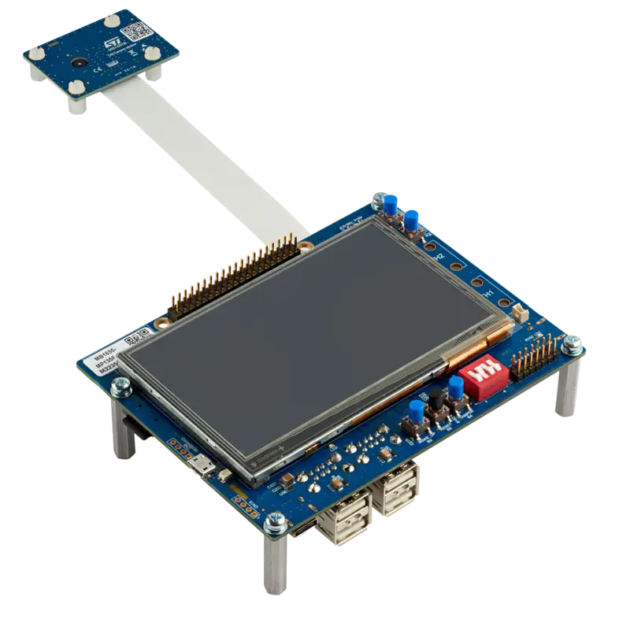

<!-- Copyright 2015-2026 Zephyr Project members and individual contributors. -->
<!-- SPDX-License-Identifier: Apache-2.0 -->
<!-- 中文翻译；编号、导航与译注为本地新增。 -->

<a id="stm32mp135f_dk"></a>

# 第47章\_STM32MP135F-DK探索板（Discovery）

原文：[官方页面](https://docs.zephyrproject.org/latest/boards/st/stm32mp135f_dk/doc/index.html)。读取日期：2026-10-16；来源摘要见[来源记录](../SOURCES.md)。

开发板概览（Board Overview）

<a id="id1"></a>

[](images/stm32mp135f_dk.webp)

STM32MP135F-DK探索板（Discovery）

名称（Name）：

`stm32mp135f_dk`

厂商（Vendor）：

[意法半导体（STMicroelectronics）](https://docs.zephyrproject.org/latest/boards/index.html#vendor=st)

状态（Status）：

维护中（Maintained）

架构（Architecture）：

[arm](https://docs.zephyrproject.org/latest/boards/index.html#arch=arm)

片上系统（SoC）：

[stm32mp135fxx](https://docs.zephyrproject.org/latest/boards/index.html#soc=stm32mp135fxx)

<a id="board-github-link"></a>

[浏览开发板源码（Browse Board Sources）](https://github.com/zephyrproject-rtos/zephyr/blob/main//boards/st/stm32mp135f_dk/doc/index.rst/../..)<a id="overview"></a>

## 概述（Overview）

STM32MP135 Discovery套件STM32MP135F-DK利用1 GHz STM32MP135微处理器，帮助用户使用Zephyr RTOS开发应用。

套件内置ST-LINK调试工具、LED、按键、2个10/100 Mbit/s以太网RMII连接器、1个USB Type-C连接器、4个USB主机Type-A连接器及1个microSD连接器。

另提供GPIO扩展连接器，可连接第三方扩展板，扩展套件功能。

套件还配有LCD及触摸面板、Wi-Fi、Bluetooth低功耗功能，以及200万像素CMOS摄像头模块。

也提供安全启动（Secure Boot）及密码功能。

Zephyr移植为运行于Cortex-A7内核。


- TFBGA320封装STM32MP135FAF7，采用1 GHz Arm Cortex-A7 32位处理器
- 意法半导体电源管理芯片STPMIC1
- 4 Gbit DDR3L，16位，533 MHz
- 4.3英寸480×272像素LCD模块，带电容触摸面板及RGB接口
- 随附UXGA 200万像素CMOS摄像头模块，带MIPI CSI-2／SMIA CCP2解串器
- Wi-Fi 802.11 b/g/n
- Bluetooth低功耗4.1
- 2路符合IEEE-802.3u的10/100 Mbit/s以太网RMII，其中1路支持网络唤醒（WoL）
- 4端口USB主机集线器
- 基于STM32G0的USB Type-C双角色端口（DRP）
- 4个用户LED
- 4个按键：2个用户键、防篡改键及复位键
- 1个唤醒按键
- 开发板连接器（Board Connectors）：


  - 双数据通道MIPI CSI-2摄像头模块扩展接口
  - 2个以太网RJ45接口
  - 4个USB Type-A接口
  - USB Micro-B接口
  - USB Type-C®接口
  - microSD™卡座
  - GPIO扩展
  - 5 V／3 A USB Type-C电源输入，不含充电器
  - VBAT备份电源
- 板载电流测量
- 板载STLINK-V3E调试器／编程器，支持USB重新枚举：


  - 大容量存储（Mass Storage）
  - 虚拟COM端口
  - 调试端口（Debug Port）

<a id="id3"></a>

更多信息见[STM32P135 Discovery网站](https://www.st.com/en/evaluation-tools/stm32mp135f-dk.html)[注1](#id2)；原文名称缺少M，照录。

<a id="hardware"></a>

## 硬件（Hardware）

STM32MP135F_DK硬件的更多信息见：


- <a id="id16"></a>

  [STM32MP135F_DK硬件说明](https://wiki.stmicroelectronics.cn/stm32mpu/wiki/STM32MP135x-DK_-_hardware_description)[注7](#id15)

STM32MP135F微处理器的更多信息见以下资料；原文此处写STM32P135F。


- <a id="id7"></a>

  ST官网的STM32MP135F产品页[注3](#id6)（[STM32MP135F在ST官网的产品页](https://www.st.com/content/st_com/en/products/microcontrollers-microprocessors/stm32-arm-cortex-mpus/stm32mp1-series/stm32mp135/stm32mp135f.html)）
- <a id="id9"></a>

  [STM32MP135F参考手册](https://www.st.com/resource/en/reference_manual/DM00670465-.pdf)[注4](#id8)

<a id="supported-features"></a>

### 支持的功能（Supported Features）

`stm32mp135f_dk`开发板支持下表所列的硬件功能。

片上／板载（On-Chip / On-Board）

功能集成在片上系统（SoC）内／位于开发板上。

2 / 2

分别表示已启用／已禁用的实例数。点击数量标签，可查看开发板或SoC设备树源码（DTS）中该功能的第一个实例。

`vnd,foo`

与此功能匹配的设备树绑定兼容字符串（Compatible String）；点击链接可查看绑定文档。

<a id="stm32mp135f_dk-hw-features"></a>

<a id="stm32mp135f_dk-stm32mp135f_dk/stm32mp135fxx-hw-features-section"></a>

#### `stm32mp135f_dk/stm32mp135fxx`目标（Target）

<a id="stm32mp135f_dk-stm32mp135f_dk/stm32mp135fxx-hw-features-panel"></a>

<a id="stm32mp135f_dk-stm32mp135f_dk/stm32mp135fxx-hw-features-memory"></a>

该开发板目标的片上存储容量：256 MiB RAM、256 MiB Flash。

<a id="stm32mp135f_dk-stm32mp135f_dk/stm32mp135fxx-hw-features-table"></a>

<table>
<tr>
<th>类型（Type）</th>
<th>位置（Location）</th>
<th>说明（Description）</th>
<th>兼容字符串（Compatible）</th>
</tr>
<tr>
<td rowspan="1">中央处理器（CPU）</td>
<td>片上（On-Chip）</td>
<td>Arm Cortex-A7 CPU（<a href="https://github.com/zephyrproject-rtos/zephyr/blob/main/dts/arm/st/mp13/stm32mp13.dtsi?plain=1#L29">已启用：1</a>）</td>
<td><a href="../cpu_arm_riscv_binding_reference/P011_arm_cortex-a7.md#std-dtcompatible-arm-cortex-a7"><code>arm,cortex-a7</code></a></td>
</tr>
<tr>
<td rowspan="1">控制器局域网（CAN）</td>
<td>片上（On-Chip）</td>
<td>STM32H7系列及兼容器件的FDCAN CAN FD控制器（<a href="https://github.com/zephyrproject-rtos/zephyr/blob/main/dts/arm/st/mp13/stm32mp133.dtsi?plain=1#L45">已禁用：2</a>）</td>
<td><a href="../can_nxp_renesas_stm32_ti_binding_reference/P013_st_stm32h7-fdcan.md#std-dtcompatible-st-stm32h7-fdcan"><code>st,stm32h7-fdcan</code></a></td>
</tr>
<tr>
<td rowspan="5">时钟控制（Clock Control）</td>
<td>片上（On-Chip）</td>
<td>STM32复位和时钟控制器（RCC / Reset and Clock Controller）（<a href="https://github.com/zephyrproject-rtos/zephyr/blob/main/dts/arm/st/mp13/stm32mp13.dtsi?plain=1#L137">已启用：1</a>）</td>
<td><a href="../timer_reference/P126_STM32复位与时钟控制绑定.md#dtbinding-st-stm32-rcc"><code>st,stm32-rcc</code></a></td>
</tr>
<tr>
<td>片上（On-Chip）</td>
<td>STM32 微控制器时钟输出（Microcontroller Clock Output，MCO）（<a href="https://github.com/zephyrproject-rtos/zephyr/blob/main/dts/arm/st/mp13/stm32mp13.dtsi?plain=1#L37">已禁用：2</a>）</td>
<td><a href="../timer_reference/P134_STM32时钟输出绑定.md#dtbinding-st-stm32-clock-mco"><code>st,stm32-clock-mco</code></a></td>
</tr>
<tr>
<td>片上（On-Chip）</td>
<td>通用固定频率时钟提供者（Fixed-Rate Clock Provider）（<a href="https://github.com/zephyrproject-rtos/zephyr/blob/main/dts/arm/st/mp13/stm32mp13.dtsi?plain=1#L891">已启用：3</a>；<a href="https://github.com/zephyrproject-rtos/zephyr/blob/main/dts/arm/st/mp13/stm32mp13.dtsi?plain=1#L910">已禁用：1</a>）</td>
<td><a href="../hardware/P566_固定时钟绑定.md#dtbinding-fixed-clock"><code>fixed-clock</code></a></td>
</tr>
<tr>
<td>片上（On-Chip）</td>
<td>STM32MP13 CPU时钟，描述CPU的armv7定时器多路复用器（<a href="https://github.com/zephyrproject-rtos/zephyr/blob/main/dts/arm/st/mp13/stm32mp13.dtsi?plain=1#L917">已启用：1</a>）</td>
<td><a href="../timer_reference/P177_STM32MP13处理器时钟多路选择绑定.md#dtbinding-st-stm32mp13-cpu-clock-mux"><code>st,stm32mp13-cpu-clock-mux</code></a></td>
</tr>
<tr>
<td>片上（On-Chip）</td>
<td>STM32MP13器件的PLL节点绑定（<a href="https://github.com/zephyrproject-rtos/zephyr/blob/main/dts/arm/st/mp13/stm32mp13.dtsi?plain=1#L923">已启用：3</a>；<a href="https://github.com/zephyrproject-rtos/zephyr/blob/main/dts/arm/st/mp13/stm32mp13.dtsi?plain=1#L935">已禁用：1</a>）</td>
<td><a href="../timer_reference/P156_STM32MP13锁相环时钟绑定.md#dtbinding-st-stm32mp13-pll-clock"><code>st,stm32mp13-pll-clock</code></a></td>
</tr>
<tr>
<td rowspan="1">计数器（Counter）</td>
<td>片上（On-Chip）</td>
<td>STM32 计数器（Counters）（<a href="https://github.com/zephyrproject-rtos/zephyr/blob/main/dts/arm/st/mp13/stm32mp13.dtsi?plain=1#L462">已禁用：14</a>）</td>
<td><a href="../stm32_ti_xilinx_counter_binding_reference/P007_st_stm32-counter.md#std-dtcompatible-st-stm32-counter"><code>st,stm32-counter</code></a></td>
</tr>
<tr>
<td rowspan="1">循环冗余校验（CRC）</td>
<td>片上（On-Chip）</td>
<td>STM32 CRC 计算单元（Calculation Unit）（<a href="https://github.com/zephyrproject-rtos/zephyr/blob/main/dts/arm/st/mp13/stm32mp13.dtsi?plain=1#L826">已禁用：1</a>）</td>
<td><a href="../crc_clock_monitor_binding_reference/P011_st_stm32-crc.md#std-dtcompatible-st-stm32-crc"><code>st,stm32-crc</code></a></td>
</tr>
<tr>
<td rowspan="1">密码学加速器（Cryptographic Accelerator）</td>
<td>片上（On-Chip）</td>
<td>STM32哈希处理器（HASH Processor）（<a href="https://github.com/zephyrproject-rtos/zephyr/blob/main/dts/arm/st/mp13/stm32mp13_crypt.dtsi?plain=1#L9">已启用：1</a>）</td>
<td><a href="../crypto_secure_engine_st_ti_binding_reference/P017_st_stm32-hash.md#std-dtcompatible-st-stm32-hash"><code>st,stm32-hash</code></a></td>
</tr>
<tr>
<td rowspan="1">显示（Display）</td>
<td>片上（On-Chip）</td>
<td>STM32 LCD-TFT 显示控制器（Display Controller）（<a href="https://github.com/zephyrproject-rtos/zephyr/blob/main/dts/arm/st/mp13/stm32mp135.dtsi?plain=1#L35">已启用：1</a>）</td>
<td><a href="../display_st_ultrachip_zephyr_binding_reference/P004_st_stm32-ltdc.md#std-dtcompatible-st-stm32-ltdc"><code>st,stm32-ltdc</code></a></td>
</tr>
<tr>
<td rowspan="2">直接存储器访问（DMA）</td>
<td>片上（On-Chip）</td>
<td>STM32 DMA 控制器（Controller，V1）（<a href="https://github.com/zephyrproject-rtos/zephyr/blob/main/dts/arm/st/mp13/stm32mp13.dtsi?plain=1#L263">已启用：2</a>）</td>
<td><a href="../stm32_ti_xilinx_dma_binding_reference/P007_st_stm32-dma-v1.md#std-dtcompatible-st-stm32-dma-v1"><code>st,stm32-dma-v1</code></a></td>
</tr>
<tr>
<td>片上（On-Chip）</td>
<td>STM32 DMA 多路复用控制器（DMAMUX Controller）（<a href="https://github.com/zephyrproject-rtos/zephyr/blob/main/dts/arm/st/mp13/stm32mp13.dtsi?plain=1#L301">已启用：1</a>）</td>
<td><a href="../stm32_ti_xilinx_dma_binding_reference/P011_st_stm32-dmamux.md#std-dtcompatible-st-stm32-dmamux"><code>st,stm32-dmamux</code></a></td>
</tr>
<tr>
<td rowspan="4">以太网（Ethernet）</td>
<td>片上（On-Chip）</td>
<td>ST STM32 以太网媒体访问控制器（Ethernet MAC）（<a href="https://github.com/zephyrproject-rtos/zephyr/blob/main/dts/arm/st/mp13/stm32mp13.dtsi?plain=1#L794">已启用：2</a>）</td>
<td><a href="../ethernet_synopsys_st_xilinx_binding_reference/P012_st_stm32mp13-ethernet.md#std-dtcompatible-st-stm32mp13-ethernet"><code>st,stm32mp13-ethernet</code></a></td>
</tr>
<tr>
<td>片上（On-Chip）</td>
<td>Synopsys DesignWare MAC 的管理数据输入输出控制器（MDIO Controller）（<a href="https://github.com/zephyrproject-rtos/zephyr/blob/main/dts/arm/st/mp13/stm32mp13.dtsi?plain=1#L813">已启用：2</a>）</td>
<td><a href="../ethernet_mdio_microchip_binding_reference/P010_snps_dwmac-mdio.md#std-dtcompatible-snps-dwmac-mdio"><code>snps,dwmac-mdio</code></a></td>
</tr>
<tr>
<td>板载（On-Board）</td>
<td>单端口以太网物理层（PHY），带RMII 10/100收发器（Transceiver）（<a href="https://github.com/zephyrproject-rtos/zephyr/blob/main/boards/st/stm32mp135f_dk/stm32mp135f_dk.dts?plain=1#L341">已启用：2</a>）</td>
<td><a href="../ethernet_phy_renesas_rockchip_binding_reference/P003_microchip_lan8742.md#std-dtcompatible-microchip-lan8742"><code>microchip,lan8742</code></a></td>
</tr>
<tr>
<td>片上（On-Chip）</td>
<td>Synopsys DesignWare MAC 精确时间协议时钟（Precision Time Protocol，PTP Clock）（<a href="https://github.com/zephyrproject-rtos/zephyr/blob/main/dts/arm/st/mp13/stm32mp13.dtsi?plain=1#L820">已启用：2</a>）</td>
<td><a href="../ethernet_synopsys_st_xilinx_binding_reference/P006_snps_dwmac-ptp-clock.md#std-dtcompatible-snps-dwmac-ptp-clock"><code>snps,dwmac-ptp-clock</code></a></td>
</tr>
<tr>
<td rowspan="3">通用输入输出与接插件（GPIO &amp; Headers）</td>
<td>片上（On-Chip）</td>
<td>STM32 通用输入输出控制器（GPIO Controller）（<a href="https://github.com/zephyrproject-rtos/zephyr/blob/main/dts/arm/st/mp13/stm32mp13.dtsi?plain=1#L156">已启用：9</a>）</td>
<td><a href="../gpio_silabs_st_connectors_binding_reference/P029_st_stm32-gpio.md#std-dtcompatible-st-stm32-gpio"><code>st,stm32-gpio</code></a></td>
</tr>
<tr>
<td>板载（On-Board）</td>
<td>Microchip MCP23017 I2C GPIO扩展器（<a href="https://github.com/zephyrproject-rtos/zephyr/blob/main/boards/st/stm32mp135f_dk/stm32mp135f_dk.dts?plain=1#L182">已启用：1</a>）</td>
<td><a href="../gpio_infineon_intel_ite_microchip_binding_reference/P023_microchip_mcp23017.md#std-dtcompatible-microchip-mcp23017"><code>microchip,mcp23017</code></a></td>
</tr>
<tr>
<td>板载（On-Board）</td>
<td>引出到Raspberry Pi CSI摄像头连接器的GPIO引脚（<a href="https://github.com/zephyrproject-rtos/zephyr/blob/main/boards/st/stm32mp135f_dk/stm32mp135f_dk.dts?plain=1#L69">已启用：1</a>）</td>
<td><a href="../gpio_raspberrypi_renesas_binding_reference/P004_raspberrypi_csi-connector.md#std-dtcompatible-raspberrypi-csi-connector"><code>raspberrypi,csi-connector</code></a></td>
</tr>
<tr>
<td rowspan="1">集成电路间总线（I2C）</td>
<td>片上（On-Chip）</td>
<td>STM32 I2C V2 控制器（Controller）（<a href="https://github.com/zephyrproject-rtos/zephyr/blob/main/dts/arm/st/mp13/stm32mp13.dtsi?plain=1#L377">已启用：3</a>；<a href="https://github.com/zephyrproject-rtos/zephyr/blob/main/dts/arm/st/mp13/stm32mp13.dtsi?plain=1#L390">已禁用：2</a>）</td>
<td><a href="../i2c_stm32_ti_mux_binding_reference/P008_st_stm32-i2c-v2.md#std-dtcompatible-st-stm32-i2c-v2"><code>st,stm32-i2c-v2</code></a></td>
</tr>
<tr>
<td rowspan="2">输入（Input）</td>
<td>板载（On-Board）</td>
<td>GT9xx／GT9xxx电容式触摸面板（Capacitive Touch Panels）（<a href="https://github.com/zephyrproject-rtos/zephyr/blob/main/boards/st/stm32mp135f_dk/stm32mp135f_dk.dts?plain=1#L237">已启用：1</a>）</td>
<td><a href="../input_adc_touch_matrix_binding_reference/P017_goodix_gt911.md#std-dtcompatible-goodix-gt911"><code>goodix,gt911</code></a></td>
</tr>
<tr>
<td>板载（On-Board）</td>
<td>一组绑定到 GPIO 的输入按键（GPIO-Bound Input Keys）（<a href="https://github.com/zephyrproject-rtos/zephyr/blob/main/boards/st/stm32mp135f_dk/stm32mp135f_dk.dts?plain=1#L29">已启用：1</a>）</td>
<td><a href="../hardware/P563_GPIO按键绑定.md#std-dtcompatible-gpio-keys"><code>gpio-keys</code></a></td>
</tr>
<tr>
<td rowspan="2">中断控制器（Interrupt Controller）</td>
<td>片上（On-Chip）</td>
<td>STM32G0 外部中断控制器（External Interrupt Controller）（<a href="https://github.com/zephyrproject-rtos/zephyr/blob/main/dts/arm/st/mp13/stm32mp13.dtsi?plain=1#L229">已启用：1</a>）</td>
<td><a href="../mcu_external_interrupt_binding_reference/P002_st_stm32g0-exti.md#std-dtcompatible-st-stm32g0-exti"><code>st,stm32g0-exti</code></a></td>
</tr>
<tr>
<td>片上（On-Chip）</td>
<td>ARM通用中断控制器（GIC）v2（<a href="https://github.com/zephyrproject-rtos/zephyr/blob/main/dts/arm/st/mp13/stm32mp13.dtsi?plain=1#L869">已启用：1</a>）</td>
<td><a href="../interrupt_fabric_binding_reference/P003_arm_gic-v2.md#std-dtcompatible-arm-gic-v2"><code>arm,gic-v2</code></a></td>
</tr>
<tr>
<td rowspan="1">发光二极管（LED）</td>
<td>板载（On-Board）</td>
<td>一组由 GPIO 控制的 LED（GPIO-Controlled LEDs）（<a href="https://github.com/zephyrproject-rtos/zephyr/blob/main/boards/st/stm32mp135f_dk/stm32mp135f_dk.dts?plain=1#L39">已启用：1</a>）</td>
<td><a href="../hardware/P564_GPIO指示灯绑定.md#dtbinding-gpio-leds"><code>gpio-leds</code></a></td>
</tr>
<tr>
<td rowspan="1">非易失存储器（NVMEM）</td>
<td>片上（On-Chip）</td>
<td>非易失存储器固定布局（Fixed Layout for Non-Volatile Memory）（<a href="https://github.com/zephyrproject-rtos/zephyr/blob/main/dts/arm/st/mp13/stm32mp13.dtsi?plain=1#L840">已启用：1</a>）</td>
<td><a href="../memory_protection_binding_reference/P009_fixed-layout.md#std-dtcompatible-fixed-layout"><code>fixed-layout</code></a></td>
</tr>
<tr>
<td rowspan="1">一次性可编程存储器（OTP Memory）</td>
<td>片上（On-Chip）</td>
<td>STM32启动与安全控制（Boot and Security Control，BSEC）（<a href="https://github.com/zephyrproject-rtos/zephyr/blob/main/dts/arm/st/mp13/stm32mp13.dtsi?plain=1#L834">已启用：1</a>）</td>
<td><a href="../otp_binding_reference/P009_st_stm32-bsec.md#std-dtcompatible-st-stm32-bsec"><code>st,stm32-bsec</code></a></td>
</tr>
<tr>
<td rowspan="1">引脚控制（Pin Control）</td>
<td>片上（On-Chip）</td>
<td>STM32 引脚控制器（Pin Controller）（<a href="https://github.com/zephyrproject-rtos/zephyr/blob/main/dts/arm/st/mp13/stm32mp13.dtsi?plain=1#L149">已启用：1</a>）</td>
<td><a href="../pinctrl_stm32_ti_xilinx_binding_reference/P004_st_stm32-pinctrl.md#std-dtcompatible-st-stm32-pinctrl"><code>st,stm32-pinctrl</code></a></td>
</tr>
<tr>
<td rowspan="1">脉宽调制（PWM）</td>
<td>片上（On-Chip）</td>
<td>STM32 脉宽调制（PWM）（<a href="https://github.com/zephyrproject-rtos/zephyr/blob/main/dts/arm/st/mp13/stm32mp13.dtsi?plain=1#L456">已禁用：12</a>）</td>
<td><a href="../pwm_stm32_ti_generic_binding_reference/P011_st_stm32-pwm.md#std-dtcompatible-st-stm32-pwm"><code>st,stm32-pwm</code></a></td>
</tr>
<tr>
<td rowspan="1">复位控制器（Reset Controller）</td>
<td>片上（On-Chip）</td>
<td>STM32 复位与时钟控制器（Reset and Clock Control，RCC）（<a href="https://github.com/zephyrproject-rtos/zephyr/blob/main/dts/arm/st/mp13/stm32mp13.dtsi?plain=1#L142">已启用：1</a>）</td>
<td><a href="../reset_controller_binding_reference/P017_st_stm32-rcc-rctl.md#std-dtcompatible-st-stm32-rcc-rctl"><code>st,stm32-rcc-rctl</code></a></td>
</tr>
<tr>
<td rowspan="1">实时时钟（RTC）</td>
<td>片上（On-Chip）</td>
<td>STM32 实时时钟（RTC）（<a href="https://github.com/zephyrproject-rtos/zephyr/blob/main/dts/arm/st/mp13/stm32mp13.dtsi?plain=1#L858">已启用：1</a>）</td>
<td><a href="../soc_rtc_binding_reference/P014_st_stm32-rtc.md#std-dtcompatible-st-stm32-rtc"><code>st,stm32-rtc</code></a></td>
</tr>
<tr>
<td rowspan="1">传感器（Sensors）</td>
<td>片上（On-Chip）</td>
<td>STM32 正交解码器（Quadrature Decoder）（<a href="https://github.com/zephyrproject-rtos/zephyr/blob/main/dts/arm/st/mp13/stm32mp13.dtsi?plain=1#L467">已禁用：6</a>）</td>
<td><a href="../sensor_st_lsm_stm32_binding_reference/P028_st_stm32-qdec.md#std-dtcompatible-st-stm32-qdec"><code>st,stm32-qdec</code></a></td>
</tr>
<tr>
<td rowspan="1">串行控制器（Serial Controller）</td>
<td>片上（On-Chip）</td>
<td>STM32 通用异步收发器（UART）（<a href="https://github.com/zephyrproject-rtos/zephyr/blob/main/dts/arm/st/mp13/stm32mp13.dtsi?plain=1#L92">已启用：1</a>；<a href="https://github.com/zephyrproject-rtos/zephyr/blob/main/dts/arm/st/mp13/stm32mp13.dtsi?plain=1#L65">已禁用：7</a>）</td>
<td><a href="../uart_silabs_stm32_ti_binding_reference/P015_st_stm32-uart.md#std-dtcompatible-st-stm32-uart"><code>st,stm32-uart</code></a></td>
</tr>
<tr>
<td rowspan="1">串行外设接口（SPI）</td>
<td>片上（On-Chip）</td>
<td>STM32H7 串行外设接口控制器（SPI Controller）（<a href="https://github.com/zephyrproject-rtos/zephyr/blob/main/dts/arm/st/mp13/stm32mp13.dtsi?plain=1#L364">已启用：1</a>；<a href="https://github.com/zephyrproject-rtos/zephyr/blob/main/dts/arm/st/mp13/stm32mp13.dtsi?plain=1#L312">已禁用：4</a>）</td>
<td><a href="../spi_stm32_ti_xilinx_binding_reference/P013_st_stm32h7-spi.md#std-dtcompatible-st-stm32h7-spi"><code>st,stm32h7-spi</code></a></td>
</tr>
<tr>
<td rowspan="2">定时器（Timer）</td>
<td>片上（On-Chip）</td>
<td>STM32 定时器（Timers）（<a href="https://github.com/zephyrproject-rtos/zephyr/blob/main/dts/arm/st/mp13/stm32mp13.dtsi?plain=1#L442">已禁用：14</a>）</td>
<td><a href="../stm32_ti_silabs_timer_binding_reference/P008_st_stm32-timers.md#std-dtcompatible-st-stm32-timers"><code>st,stm32-timers</code></a></td>
</tr>
<tr>
<td>片上（On-Chip）</td>
<td>每个内核独立的ARM架构定时器（Architected Timer）（<a href="https://github.com/zephyrproject-rtos/zephyr/blob/main/dts/arm/st/mp13/stm32mp13.dtsi?plain=1#L948">已启用：1</a>）</td>
<td><a href="../arm_interrupt_timer_binding_reference/P010_ARMv8架构定时器.md#std-dtcompatible-arm-armv8-timer"><code>arm,armv8-timer</code></a></td>
</tr>
<tr>
<td rowspan="2">视频（Video）</td>
<td>板载（On-Board）</td>
<td>MIPID02 CSI转DVP接口桥接器（<a href="https://github.com/zephyrproject-rtos/zephyr/blob/main/boards/st/stm32mp135f_dk/stm32mp135f_dk.dts?plain=1#L206">已启用：1</a>）</td>
<td><a href="../video_st_sony_emulation_binding_reference/P003_st_mipid02.md#std-dtcompatible-st-mipid02"><code>st,mipid02</code></a></td>
</tr>
<tr>
<td>片上（On-Chip）</td>
<td>STM32数字摄像头接口像素处理器（DCMIPP）（<a href="https://github.com/zephyrproject-rtos/zephyr/blob/main/dts/arm/st/mp13/stm32mp135.dtsi?plain=1#L14">已禁用：1</a>）</td>
<td><a href="../video_st_sony_emulation_binding_reference/P005_st_stm32-dcmipp.md#std-dtcompatible-st-stm32-dcmipp"><code>st,stm32-dcmipp</code></a></td>
</tr>
</table>

<a id="connections-and-ios"></a>

### 连接与输入输出（Connections and IOs）

<a id="id5"></a>

STM32MP135F-DK Discovery原理图见：[STM32MP135F Discovery开发板原理图](https://www.st.com/resource/en/schematic_pack/mb1635-mp135f-e02-schematic.pdf)[注2](#id4)。

<a id="default-zephyr-peripheral-mapping"></a>

#### Zephyr 默认外设映射（Peripheral Mapping）：


- USART4 TX/RX：PD6/PD8，UART控制台
- 用户按键USER_BUTTON：PA13
- LED_3：PA14
- LED_4：PA13

<a id="system-clock"></a>

#### 系统时钟（System Clock）

Cortex-A7内核配置为最高1 GHz时钟。

<a id="memory-mapping"></a>

#### 存储器映射（Memory Mapping）

<table>
<tr>
<th>区域（Region）</th>
<th>地址（Address）</th>
<th>大小（Size）</th>
</tr>
<tr>
<td>SYSRAM</td>
<td>0x2FFE0000-0x2FFFFFFF</td>
<td>128KB</td>
</tr>
<tr>
<td>SRAM 1</td>
<td>0x30000000-0x30003FFF</td>
<td>16KB</td>
</tr>
<tr>
<td>SRAM 2</td>
<td>0x30004000-0x30005FFF</td>
<td>8KB</td>
</tr>
<tr>
<td>SRAM 3</td>
<td>0x30006000-0x30007FFF</td>
<td>8KB</td>
</tr>
<tr>
<td>双倍数据率存储器（DDR）</td>
<td>0xC0000000-0xDFFFFFFF</td>
<td>512 MB</td>
</tr>
</table>

<a id="programming-and-debugging"></a>

## 烧录与调试（Programming and Debugging）

`stm32mp135f_dk`开发板支持下表所列的运行工具（Runners）及相关west命令。

<table>
<tr>
<th></th>
<th>烧录（flash）</th>
<th>调试（debug）</th>
<th>连接调试会话（attach）</th>
<th>实时传输（rtt）</th>
<th>调试服务器（debugserver）</th>
</tr>
<tr>
<td><a href="https://docs.zephyrproject.org/latest/develop/flash_debug/host-tools.html#runner-openocd">openocd</a></td>
<td>✅（默认 / default）</td>
<td>✅（默认 / default）</td>
<td>✅</td>
<td>✅</td>
<td>✅</td>
</tr>
</table>

<a id="prerequisite"></a>

### 前提条件（Prerequisite）

加载Zephyr示例前，必须初始化STM32MP135的DDR控制器。

<a id="id14"></a>

一种方式是将Zephyr可执行文件及DDR初始化脚本写入板上SD卡。首先需[安装STM32CubeProgrammer](https://docs.zephyrproject.org/latest/develop/flash_debug/host-tools.html#stm32cubeprog-flash-host-tools)，并下载[STM32CubeMP13软件包](https://github.com/STMicroelectronics/STM32CubeMP13)[注6](#id13)。

<a id="signature-and-flashing"></a>

### 签名及烧录（Signature and Flashing）

构建Zephyr工程后，使用Stm32ImageAddHeader.py及以下命令为二进制文件签名：

```text
python3 ${Path_to_STM32CubeMP13}/Utilities/ImageHeader/Python3/Stm32ImageAddHeader.py ${Path_to_build_dir}/zephyr/zephyr.bin ${STM32CubeMP13}/Projects/STM32MP135C-DK/External_Loader/Prebuild_Binaries/SD_Ext_Loader/zephyr_Signed.bin -bt 10 -la C0000000 -ep C0000000
```

其中-bt指定启动类型，-la指定加载地址，-ep指定可执行文件入口点；此处入口点与加载地址相同。

然后将[boards/st/stm32mp135f_dk/support/Zephyr.tsv](https://github.com/zephyrproject-rtos/zephyr/blob/main/boards/st/stm32mp135f_dk/support/Zephyr.tsv)复制到${Path_to_STM32CubeMP13}/Projects/STM32MP135C-DK/External_Loader/Prebuild_Binaries/SD_Ext_Loader/。

最后在Cube Programmer中选择Zephyr.tsv，使用以下命令烧录SD卡：

```text
${Path_to_STM32cube_Programmer}/bin/STM32_Programmer.sh -c port=${ConnectedPort} p=even br=115200 -d ${Path_to_STM32CubeMP13}/Projects/STM32MP135C-DK/External_Loader/Prebuild_Binaries/SD_Ext_Loader/Zephyr.tsv
```

注意（Note）

<a id="id11"></a>

也可参考“[如何将STM32Cube软件包安装到microSD卡](https://wiki.st.com/stm32mpu/wiki/How_to_load_and_start_STM32CubeMP13_applications_via_microSD_card)”[注5](#id10)，将示例写入SD卡。

<a id="debugging"></a>

### 调试（Debugging）

可以使用OpenOCD及GDB调试应用。


- 构建示例：

  ```text
  # From the root of the zephyr repository
  west build -b stm32mp135f_dk samples/hello_world
  ```
- <a id="id12"></a>

  按照“[如何将STM32Cube软件包安装到microSD卡](https://wiki.st.com/stm32mpu/wiki/How_to_load_and_start_STM32CubeMP13_applications_via_microSD_card)”[注5](#id10)烧录SD卡。
- 从SD卡运行应用
- 附加到目标：

  ```text
  west attach
  ```

注意（Note）

本板目前不支持GDB的run命令。

<a id="references"></a>

## 参考资料（References）

<a id="id2"></a>

〔[1](#id3)〕 [https://www.st.com/en/evaluation-tools/stm32mp135f-dk.html](https://www.st.com/en/evaluation-tools/stm32mp135f-dk.html)

<a id="id4"></a>

〔[2](#id5)〕 [https://www.st.com/resource/en/schematic_pack/mb1635-mp135f-e02-schematic.pdf](https://www.st.com/resource/en/schematic_pack/mb1635-mp135f-e02-schematic.pdf)

<a id="id6"></a>

〔[3](#id7)〕 [https://www.st.com/content/st_com/en/products/microcontrollers-microprocessors/stm32-arm-cortex-mpus/stm32mp1-series/stm32mp135/stm32mp135f.html](https://www.st.com/content/st_com/en/products/microcontrollers-microprocessors/stm32-arm-cortex-mpus/stm32mp1-series/stm32mp135/stm32mp135f.html)

<a id="id8"></a>

〔[4](#id9)〕 [https://www.st.com/resource/en/reference_manual/DM00670465-.pdf](https://www.st.com/resource/en/reference_manual/DM00670465-.pdf)

<a id="id10"></a>

〔5〕 ([1](#id11),[2](#id12)) [https://wiki.st.com/stm32mpu/wiki/How_to_load_and_start_STM32CubeMP13_applications_via_microSD_card](https://wiki.st.com/stm32mpu/wiki/How_to_load_and_start_STM32CubeMP13_applications_via_microSD_card)

<a id="id13"></a>

〔[6](#id14)〕 [https://github.com/STMicroelectronics/STM32CubeMP13](https://github.com/STMicroelectronics/STM32CubeMP13)

<a id="id15"></a>

〔[7](#id16)〕 [https://wiki.stmicroelectronics.cn/stm32mpu/wiki/STM32MP135x-DK_-_hardware_description](https://wiki.stmicroelectronics.cn/stm32mpu/wiki/STM32MP135x-DK_-_hardware_description)

## 译注

Zephyr直接运行于A7。先初始化DDR，再签名并写入SD卡；原文STM32P135拼写及PA13同时列为按键和LED的映射保留。

## 原文外链核对

2026-10-16核对并重试以下原文外链时未能确认可访问性，保留原始目标，不将访问失败解释为原文内容有误。

- [How_to_load_and_start_STM32CubeMP13_applications_via_microSD_card](https://wiki.st.com/stm32mpu/wiki/How_to_load_and_start_STM32CubeMP13_applications_via_microSD_card)：The read operation timed out。
- [STM32MP135x-DK_-_hardware_description](https://wiki.stmicroelectronics.cn/stm32mpu/wiki/STM32MP135x-DK_-_hardware_description)：HTTP Error 567: Unknown Status。
- [stm32mp135f.html](https://www.st.com/content/st_com/en/products/microcontrollers-microprocessors/stm32-arm-cortex-mpus/stm32mp1-series/stm32mp135/stm32mp135f.html)：HTTP Error 567: Unknown Status。
- [stm32mp135f-dk.html](https://www.st.com/en/evaluation-tools/stm32mp135f-dk.html)：HTTP Error 567: Unknown Status。
- [DM00670465-.pdf](https://www.st.com/resource/en/reference_manual/DM00670465-.pdf)：HTTP Error 567: Unknown Status。
- [mb1635-mp135f-e02-schematic.pdf](https://www.st.com/resource/en/schematic_pack/mb1635-mp135f-e02-schematic.pdf)：HTTP Error 567: Unknown Status。

---

[上一章](P046_STM32L562E-DK_Discovery.md) · [返回大纲](大纲.md) · [全站翻译进度](../PROGRESS.md) · [下一章](P048_STM32MP157x-DK2_Discovery.md)
