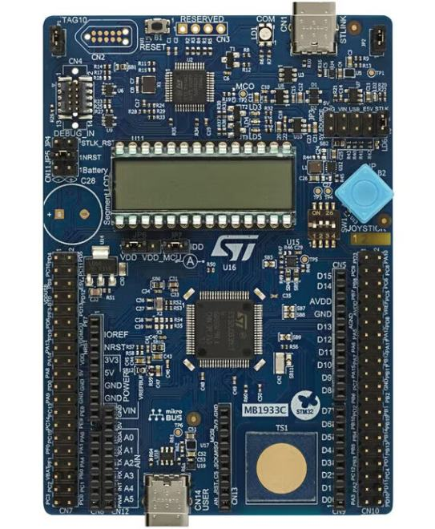

<!-- Copyright 2015-2026 Zephyr Project members and individual contributors. -->
<!-- SPDX-License-Identifier: Apache-2.0 -->
<!-- 中文翻译；编号、导航与译注为本地新增。 -->

<a id="stm32u083c_dk"></a>

# 第53章\_STM32U083C-DK

原文：[官方页面](https://docs.zephyrproject.org/latest/boards/st/stm32u083c_dk/doc/index.html)。读取日期：2026-10-16；来源摘要见[来源记录](../SOURCES.md)。

开发板概览（Board Overview）

<a id="id1"></a>

[](images/stm32u083c_dk.jpg)

STM32U083C-DK

名称（Name）：

`stm32u083c_dk`

厂商（Vendor）：

[意法半导体（STMicroelectronics）](https://docs.zephyrproject.org/latest/boards/index.html#vendor=st)

状态（Status）：

维护中（Maintained）

架构（Architecture）：

[arm](https://docs.zephyrproject.org/latest/boards/index.html#arch=arm)

片上系统（SoC）：

[stm32u083xx](https://docs.zephyrproject.org/latest/boards/index.html#soc=stm32u083xx)

<a id="board-github-link"></a>

[浏览开发板源码（Browse Board Sources）](https://github.com/zephyrproject-rtos/zephyr/blob/main//boards/st/stm32u083c_dk/doc/index.rst/../..)<a id="overview"></a>

## 概述（Overview）

STM32U083C_DK搭载基于Arm Cortex-M0+的STM32U083MC MCU，可按性能及功耗需求选择组合，以经济灵活的方式验证新概念及制作原型，主要特点如下：


- LQFP80封装超低功耗STM32U083MC，采用Arm Cortex-M0+内核，具有256 Kbytes Flash及40 Kbytes SRAM
- 开发板连接器（Board Connectors）：


  - ST-LINK USB Type-C连接器
  - 用户USB设备接口，采用Type-C连接器
  - mikroBUS连接器
  - MIPI调试输入连接器，即STDC14焊盘上的Arm Cortex 10针、1.27 mm间距调试连接器
  - 扩展连接器可访问全部STM32 I/O
  - 专用VBAT连接器支持电池供电
- 灵活供电方式：


  - ST-LINK USB VBUS、USB连接器或外部电源
- 4×24段LCD
- 3个用户LED
- 复位按键（Reset Push-Button）
- 用户摇杆
- 触摸键（Touchkey）
- 温度传感器（Temperature Sensor）。

更多信息见[STM32U083_DK网站](https://www.st.com/en/evaluation-tools/stm32u083c-dk.html)。

<a id="hardware"></a>

## 硬件（Hardware）

STM32U083xC属于STM32U0超低功耗微控制器系列，基于Arm® Cortex®-M0+ 32位RISC内核，最高工作频率56 MHz。


- 采用ST先进专利技术
- 支持FlexPowerControl的超低功耗设计：


  - 供电电压1.71～3.6 V
  - 工作温度范围−40 °C至+85／125 °C
  - VBAT模式130 nA，为RTC及9个32位备份寄存器供电
  - 关断模式16 nA，6个唤醒引脚
  - 未开启RTC的待机模式（Standby Mode）30 nA，6个唤醒引脚
  - 开启RTC的待机模式160 nA
  - 开启RTC的Stop 2模式825 nA
  - 未开启RTC的Stop 2模式695 nA
  - 从停止模式唤醒：原文写“4 µA”，单位为电流，照录并提示疑点。
  - LDO运行模式电流52 µA/MHz
  - 欠压复位（Brownout Reset）
- 处理器核（Core）：


  - 32位Arm® Cortex®-M0+ CPU，最高56 MHz
- 自适应实时加速器（ART Accelerator）：


  - 1 Kbyte指令缓存，支持从Flash零等待执行
- 基准测试（Benchmarks）：


  - 1.13 DMIPS/MHz，原文基准名称拼作Drystone 2.1
  - 134 CoreMark®，56 MHz时2.4 CoreMark/MHz
  - ULPMark™-CP分数：407
  - ULPMark™-PP分数：143
  - ULPMark™-CM分数：19.7
- 存储器（Memories）：


  - 256 Kbyte单存储区Flash，支持专有代码读出保护
  - 40 Kbyte SRAM，支持硬件奇偶校验
- 通用输入输出（GPIO）：


  - 最多69个高速I/O，多数耐受5 V
- 时钟管理（Clock Management）：


  - 4–48 MHz晶体振荡器（Crystal Oscillator）
  - 用于实时时钟（RTC）的32 kHz低速外部晶体振荡器（LSE）
  - 内部16 MHz RC振荡器，出厂校准（Factory-Trimmed），精度±1%
  - 内部低功耗32 kHz RC振荡器，精度±5%
  - 内部多速率100 kHz至48 MHz振荡器，由LSE自动校准，精度优于±0.25%
  - 内部48 MHz时钟，带时钟恢复（Clock Recovery）
  - 用于系统时钟、USB及ADC的PLL
- 安全（Security）：


  - 用户代码保护（Customer Code Protection）
  - 稳健读出保护（RDP）：3个保护等级，支持基于128位密码（PSWD）的保护回退（Regression）
  - 硬件保护功能（Hardware Protection，HDP）
  - 安全启动（Secure Boot）
  - AES硬件加密加速器，支持128／256位密钥
  - 真随机数生成，原文状态为NIST SP 800-90B认证候选
  - 原文状态为Arm® PSA Level 1及SESIP Level 3认证候选
  - 5个被动防篡改引脚（Passive Anti-tamper Pins）
  - 96位唯一标识（Unique ID）
- 最多10个定时器、2个看门狗及RTC：


  - 1个16位高级电机控制定时器、1个32位及3个16位通用定时器、2个16位基本定时器、3个可在停止模式工作的16位低功耗定时器、2个看门狗及SysTick定时器
  - RTC，带硬件日历、闹钟及校准
- 最多20个通信外设：


  - 1个USB 2.0全速无晶体方案，支持LPM及BCD
  - 7路USART/LPUART，支持SPI、ISO 7816、LIN、IrDA及调制解调器
  - 4路I2C，支持快速模式及快速模式增强，最高1 Mbit/s
  - 3路SPI，另有4路USART可配置为SPI模式
  - 红外定时器（IRTIM，Infrared Interface）
- 丰富的模拟外设，具有独立供电：


  - 1个12位ADC，转换时间0.4 µs，通过硬件过采样可达16位
  - 1路12位DAC输出，支持低功耗采样保持
  - 1个通用运算放大器，内置PGA，可变增益最高16倍
  - 两个超低功耗比较器（Comparators）
- LCD驱动器：8×48或4×52段，带升压转换器
- 通用输入输出：最多69个高速I/O，多数耐受5 V
- 符合ECOPACK2的封装

更多STM32U083MC信息见：


- [ST官网的STM32U083MC产品页](https://www.st.com/en/microcontrollers-microprocessors/stm32u083mc)
- [STM32U083参考手册（Reference Manual）](https://www.st.com/resource/en/reference_manual/rm0503-stm32u0-series-advanced-armbased-32bit-mcus-stmicroelectronics.pdf)

<a id="supported-features"></a>

### 支持的功能（Supported Features）

`stm32u083c_dk`开发板支持下表所列的硬件功能。

片上／板载（On-Chip / On-Board）

功能集成在片上系统（SoC）内／位于开发板上。

2 / 2

分别表示已启用／已禁用的实例数。点击数量标签，可查看开发板或SoC设备树源码（DTS）中该功能的第一个实例。

`vnd,foo`

与此功能匹配的设备树绑定兼容字符串（Compatible String）；点击链接可查看绑定文档。

<a id="stm32u083c_dk-hw-features"></a>

<a id="stm32u083c_dk-stm32u083c_dk/stm32u083xx-hw-features-section"></a>

#### `stm32u083c_dk/stm32u083xx`目标（Target）

<a id="stm32u083c_dk-stm32u083c_dk/stm32u083xx-hw-features-panel"></a>

<a id="stm32u083c_dk-stm32u083c_dk/stm32u083xx-hw-features-memory"></a>

该开发板目标的片上存储容量：32 KiB RAM、256 KiB Flash。

<a id="stm32u083c_dk-stm32u083c_dk/stm32u083xx-hw-features-table"></a>

<table>
<tr>
<th>类型（Type）</th>
<th>位置（Location）</th>
<th>说明（Description）</th>
<th>兼容字符串（Compatible）</th>
</tr>
<tr>
<td rowspan="1">中央处理器（CPU）</td>
<td>片上（On-Chip）</td>
<td>ARM Cortex-M0+处理器（CPU）（<a href="https://github.com/zephyrproject-rtos/zephyr/blob/main/dts/arm/st/u0/stm32u0.dtsi?plain=1#L32">已启用：1</a>）</td>
<td><a href="../cpu_arm_riscv_binding_reference/P017_arm_cortex-m0+.md#std-dtcompatible-arm-cortex-m0"><code>arm,cortex-m0+</code></a></td>
</tr>
<tr>
<td rowspan="1">模数转换器（ADC）</td>
<td>片上（On-Chip）</td>
<td>STM32模数转换器（ADC）（<a href="https://github.com/zephyrproject-rtos/zephyr/blob/main/dts/arm/st/u0/stm32u0.dtsi?plain=1#L371">已启用：1</a>）</td>
<td><a href="../hardware/P839_STM32模数转换器绑定.md#dtbinding-st-stm32-adc"><code>st,stm32-adc</code></a></td>
</tr>
<tr>
<td rowspan="8">时钟控制（Clock Control）</td>
<td>片上（On-Chip）</td>
<td>STM32F0/G0复位与时钟控制器（RCC）（<a href="https://github.com/zephyrproject-rtos/zephyr/blob/main/dts/arm/st/u0/stm32u0.dtsi?plain=1#L176">已启用：1</a>）</td>
<td><a href="../timer_reference/P171_STM32F0复位与时钟控制绑定.md#dtbinding-st-stm32f0-rcc"><code>st,stm32f0-rcc</code></a></td>
</tr>
<tr>
<td>片上（On-Chip）</td>
<td>STM32 外部高速时钟（HSE Clock）（<a href="https://github.com/zephyrproject-rtos/zephyr/blob/main/dts/arm/st/u0/stm32u0.dtsi?plain=1#L70">已禁用：1</a>）</td>
<td><a href="../timer_reference/P129_STM32高速外部时钟绑定.md#dtbinding-st-stm32-hse-clock"><code>st,stm32-hse-clock</code></a></td>
</tr>
<tr>
<td>片上（On-Chip）</td>
<td>通用固定频率时钟提供者（Fixed-Rate Clock Provider）（<a href="https://github.com/zephyrproject-rtos/zephyr/blob/main/dts/arm/st/u0/stm32u0.dtsi?plain=1#L76">已启用：1</a>；<a href="https://github.com/zephyrproject-rtos/zephyr/blob/main/dts/arm/st/u0/stm32u0.dtsi?plain=1#L98">已禁用：1</a>）</td>
<td><a href="../hardware/P566_固定时钟绑定.md#dtbinding-fixed-clock"><code>fixed-clock</code></a></td>
</tr>
<tr>
<td>片上（On-Chip）</td>
<td>STM32多速内部时钟（MSI Clock）（<a href="https://github.com/zephyrproject-rtos/zephyr/blob/main/dts/arm/st/u0/stm32u0.dtsi?plain=1#L83">已禁用：1</a>）</td>
<td><a href="../timer_reference/P132_STM32多速内部时钟绑定.md#dtbinding-st-stm32-msi-clock"><code>st,stm32-msi-clock</code></a></td>
</tr>
<tr>
<td>片上（On-Chip）</td>
<td>STM32低速外部时钟（LSE Clock）（<a href="https://github.com/zephyrproject-rtos/zephyr/blob/main/dts/arm/st/u0/stm32u0.dtsi?plain=1#L90">已禁用：1</a>）</td>
<td><a href="../timer_reference/P130_STM32低速外部时钟绑定.md#dtbinding-st-stm32-lse-clock"><code>st,stm32-lse-clock</code></a></td>
</tr>
<tr>
<td>片上（On-Chip）</td>
<td>STM32U0主锁相环（PLL）（<a href="https://github.com/zephyrproject-rtos/zephyr/blob/main/dts/arm/st/u0/stm32u0.dtsi?plain=1#L105">已启用：1</a>）</td>
<td><a href="../timer_reference/P149_STM32U0锁相环时钟绑定.md#dtbinding-st-stm32u0-pll-clock"><code>st,stm32u0-pll-clock</code></a></td>
</tr>
<tr>
<td>片上（On-Chip）</td>
<td>STM32 时钟多路复用器（Clock Multiplexer）（<a href="https://github.com/zephyrproject-rtos/zephyr/blob/main/dts/arm/st/u0/stm32u0.dtsi?plain=1#L111">已启用：1</a>）</td>
<td><a href="../timer_reference/P133_STM32时钟多路复用绑定.md#dtbinding-st-stm32-clock-mux"><code>st,stm32-clock-mux</code></a></td>
</tr>
<tr>
<td>片上（On-Chip）</td>
<td>STM32内部48 MHz（HSI48）时钟（<a href="https://github.com/zephyrproject-rtos/zephyr/blob/main/dts/arm/st/u0/stm32u073.dtsi?plain=1#L78">已启用：1</a>）</td>
<td><a href="../timer_reference/P131_STM32内部48MHz时钟绑定.md#dtbinding-st-stm32-hsi48-clock"><code>st,stm32-hsi48-clock</code></a></td>
</tr>
<tr>
<td rowspan="1">计数器（Counter）</td>
<td>片上（On-Chip）</td>
<td>STM32 计数器（Counters）（<a href="https://github.com/zephyrproject-rtos/zephyr/blob/main/dts/arm/st/u0/stm32u0.dtsi?plain=1#L543">已禁用：7</a>）</td>
<td><a href="../stm32_ti_xilinx_counter_binding_reference/P007_st_stm32-counter.md#std-dtcompatible-st-stm32-counter"><code>st,stm32-counter</code></a></td>
</tr>
<tr>
<td rowspan="1">循环冗余校验（CRC）</td>
<td>片上（On-Chip）</td>
<td>STM32 CRC 计算单元（Calculation Unit）（<a href="https://github.com/zephyrproject-rtos/zephyr/blob/main/dts/arm/st/u0/stm32u0.dtsi?plain=1#L727">已启用：1</a>）</td>
<td><a href="../crc_clock_monitor_binding_reference/P011_st_stm32-crc.md#std-dtcompatible-st-stm32-crc"><code>st,stm32-crc</code></a></td>
</tr>
<tr>
<td rowspan="1">密码学加速器（Cryptographic Accelerator）</td>
<td>片上（On-Chip）</td>
<td>STM32高级加密标准加速器（AES Accelerator）（<a href="https://github.com/zephyrproject-rtos/zephyr/blob/main/dts/arm/st/u0/stm32u0.dtsi?plain=1#L505">已启用：1</a>）</td>
<td><a href="../crypto_secure_engine_st_ti_binding_reference/P015_st_stm32-aes.md#std-dtcompatible-st-stm32-aes"><code>st,stm32-aes</code></a></td>
</tr>
<tr>
<td rowspan="1">数模转换器（DAC）</td>
<td>片上（On-Chip）</td>
<td>STM32 系列数模转换器（DAC）（<a href="https://github.com/zephyrproject-rtos/zephyr/blob/main/dts/arm/st/u0/stm32u0.dtsi?plain=1#L395">已启用：1</a>）</td>
<td><a href="../hardware/P760_STM32数模转换器绑定.md#dtbinding-st-stm32-dac"><code>st,stm32-dac</code></a></td>
</tr>
<tr>
<td rowspan="2">直接存储器访问（DMA）</td>
<td>片上（On-Chip）</td>
<td>STM32直接存储器访问控制器（DMA Controller，V2）（<a href="https://github.com/zephyrproject-rtos/zephyr/blob/main/dts/arm/st/u0/stm32u0.dtsi?plain=1#L439">已禁用：2</a>）</td>
<td><a href="../stm32_ti_xilinx_dma_binding_reference/P008_st_stm32-dma-v2.md#std-dtcompatible-st-stm32-dma-v2"><code>st,stm32-dma-v2</code></a></td>
</tr>
<tr>
<td>片上（On-Chip）</td>
<td>STM32 DMA 多路复用控制器（DMAMUX Controller）（<a href="https://github.com/zephyrproject-rtos/zephyr/blob/main/dts/arm/st/u0/stm32u0.dtsi?plain=1#L450">已禁用：1</a>）</td>
<td><a href="../stm32_ti_xilinx_dma_binding_reference/P011_st_stm32-dmamux.md#std-dtcompatible-st-stm32-dmamux"><code>st,stm32-dmamux</code></a></td>
</tr>
<tr>
<td rowspan="1">闪存控制器（Flash Controller）</td>
<td>片上（On-Chip）</td>
<td>STM32 系列闪存控制器（Flash Controller）（<a href="https://github.com/zephyrproject-rtos/zephyr/blob/main/dts/arm/st/u0/stm32u0.dtsi?plain=1#L120">已启用：1</a>）</td>
<td><a href="../flash_renesas_st_ti_binding_reference/P011_st_stm32-flash-controller.md#std-dtcompatible-st-stm32-flash-controller"><code>st,stm32-flash-controller</code></a></td>
</tr>
<tr>
<td rowspan="2">通用输入输出与接插件（GPIO &amp; Headers）</td>
<td>片上（On-Chip）</td>
<td>STM32 通用输入输出控制器（GPIO Controller）（<a href="https://github.com/zephyrproject-rtos/zephyr/blob/main/dts/arm/st/u0/stm32u0.dtsi?plain=1#L208">已启用：6</a>）</td>
<td><a href="../gpio_silabs_st_connectors_binding_reference/P029_st_stm32-gpio.md#std-dtcompatible-st-stm32-gpio"><code>st,stm32-gpio</code></a></td>
</tr>
<tr>
<td>板载（On-Board）</td>
<td>引出到Arduino Uno R3排针（Headers）的GPIO引脚（<a href="https://github.com/zephyrproject-rtos/zephyr/blob/main/boards/st/stm32u083c_dk/arduino_r3_connector.dtsi?plain=1#L10">已启用：1</a>）</td>
<td><a href="../gpio_adi_headers_ambiq_binding_reference/P023_arduino-header-r3.md#std-dtcompatible-arduino-header-r3"><code>arduino-header-r3</code></a></td>
</tr>
<tr>
<td rowspan="1">集成电路间总线（I2C）</td>
<td>片上（On-Chip）</td>
<td>STM32 I2C V2 控制器（Controller）（<a href="https://github.com/zephyrproject-rtos/zephyr/blob/main/dts/arm/st/u0/stm32u0.dtsi?plain=1#L403">已启用：2</a>；<a href="https://github.com/zephyrproject-rtos/zephyr/blob/main/dts/arm/st/u0/stm32u0.dtsi?plain=1#L427">已禁用：2</a>）</td>
<td><a href="../i2c_stm32_ti_mux_binding_reference/P008_st_stm32-i2c-v2.md#std-dtcompatible-st-stm32-i2c-v2"><code>st,stm32-i2c-v2</code></a></td>
</tr>
<tr>
<td rowspan="2">输入（Input）</td>
<td>片上（On-Chip）</td>
<td>STM32触摸感应控制器驱动（TSC；原文Tocuh拼写如此）（<a href="https://github.com/zephyrproject-rtos/zephyr/blob/main/dts/arm/st/u0/stm32u0.dtsi?plain=1#L717">已启用：1</a>）</td>
<td><a href="../input_touch_lvgl_gesture_binding_reference/P007_st_stm32-tsc.md#std-dtcompatible-st-stm32-tsc"><code>st,stm32-tsc</code></a></td>
</tr>
<tr>
<td>板载（On-Board）</td>
<td>STM32触摸感应控制器（Touch Sensing Controller，TSC）输入驱动（<a href="https://github.com/zephyrproject-rtos/zephyr/blob/main/boards/st/stm32u083c_dk/stm32u083c_dk.dts?plain=1#L194">已启用：1</a>）</td>
<td><a href="../input_touch_lvgl_gesture_binding_reference/P010_tsc-keys.md#std-dtcompatible-tsc-keys"><code>tsc-keys</code></a></td>
</tr>
<tr>
<td rowspan="2">中断控制器（Interrupt Controller）</td>
<td>片上（On-Chip）</td>
<td>ARMv6-M嵌套向量中断控制器（NVIC / Nested Vectored Interrupt Controller）（<a href="https://github.com/zephyrproject-rtos/zephyr/blob/main/dts/arm/armv6-m.dtsi?plain=1#L13">已启用：1</a>）</td>
<td><a href="../arm_interrupt_timer_binding_reference/P001_ARMv6_M_NVIC.md#std-dtcompatible-arm-v6m-nvic"><code>arm,v6m-nvic</code></a></td>
</tr>
<tr>
<td>片上（On-Chip）</td>
<td>STM32G0 外部中断控制器（External Interrupt Controller）（<a href="https://github.com/zephyrproject-rtos/zephyr/blob/main/dts/arm/st/u0/stm32u0.dtsi?plain=1#L188">已启用：1</a>）</td>
<td><a href="../mcu_external_interrupt_binding_reference/P002_st_stm32g0-exti.md#std-dtcompatible-st-stm32g0-exti"><code>st,stm32g0-exti</code></a></td>
</tr>
<tr>
<td rowspan="1">发光二极管（LED）</td>
<td>板载（On-Board）</td>
<td>一组由 GPIO 控制的 LED（GPIO-Controlled LEDs）（<a href="https://github.com/zephyrproject-rtos/zephyr/blob/main/boards/st/stm32u083c_dk/stm32u083c_dk.dts?plain=1#L28">已启用：1</a>）</td>
<td><a href="../hardware/P564_GPIO指示灯绑定.md#dtbinding-gpio-leds"><code>gpio-leds</code></a></td>
</tr>
<tr>
<td rowspan="1">存储技术设备（MTD）</td>
<td>片上（On-Chip）</td>
<td>STM32闪存（Flash Memory）（<a href="https://github.com/zephyrproject-rtos/zephyr/blob/main/dts/arm/st/u0/stm32u0.dtsi?plain=1#L129">已启用：1</a>）</td>
<td><a href="../mtd_nxp_st_ti_partition_binding_reference/P016_st_stm32-nv-flash.md#std-dtcompatible-st-stm32-nv-flash"><code>st,stm32-nv-flash</code></a></td>
</tr>
<tr>
<td rowspan="1">非易失存储器（NVMEM）</td>
<td>片上（On-Chip）</td>
<td>非易失存储器固定布局（Fixed Layout for Non-Volatile Memory）（<a href="https://github.com/zephyrproject-rtos/zephyr/blob/main/dts/arm/st/u0/stm32u0.dtsi?plain=1#L150">已启用：1</a>）</td>
<td><a href="../memory_protection_binding_reference/P009_fixed-layout.md#std-dtcompatible-fixed-layout"><code>fixed-layout</code></a></td>
</tr>
<tr>
<td rowspan="1">一次性可编程存储器（OTP Memory）</td>
<td>片上（On-Chip）</td>
<td>STM32 嵌入式非易失一次性可编程存储器（NVM OTP）（<a href="https://github.com/zephyrproject-rtos/zephyr/blob/main/dts/arm/st/u0/stm32u0.dtsi?plain=1#L146">已启用：1</a>；<a href="https://github.com/zephyrproject-rtos/zephyr/blob/main/dts/arm/st/u0/stm32u0.dtsi?plain=1#L139">已禁用：1</a>）</td>
<td><a href="../otp_binding_reference/P010_st_stm32-nvm-otp.md#std-dtcompatible-st-stm32-nvm-otp"><code>st,stm32-nvm-otp</code></a></td>
</tr>
<tr>
<td rowspan="1">物理层（PHY）</td>
<td>片上（On-Chip）</td>
<td>用于所有内置于 USB IP 的 USB 收发器（USB Transceivers）的绑定。（<a href="https://github.com/zephyrproject-rtos/zephyr/blob/main/dts/arm/st/u0/stm32u073.dtsi?plain=1#L96">已启用：1</a>）</td>
<td><a href="../phy_binding_reference/P008_usb-nop-xceiv.md#std-dtcompatible-usb-nop-xceiv"><code>usb-nop-xceiv</code></a></td>
</tr>
<tr>
<td rowspan="1">引脚控制（Pin Control）</td>
<td>片上（On-Chip）</td>
<td>STM32 引脚控制器（Pin Controller）（<a href="https://github.com/zephyrproject-rtos/zephyr/blob/main/dts/arm/st/u0/stm32u0.dtsi?plain=1#L201">已启用：1</a>）</td>
<td><a href="../pinctrl_stm32_ti_xilinx_binding_reference/P004_st_stm32-pinctrl.md#std-dtcompatible-st-stm32-pinctrl"><code>st,stm32-pinctrl</code></a></td>
</tr>
<tr>
<td rowspan="2">电源管理（Power Management）</td>
<td>片上（On-Chip）</td>
<td>STM32 电源控制器（Power Controller）（<a href="https://github.com/zephyrproject-rtos/zephyr/blob/main/dts/arm/st/u0/stm32u0.dtsi?plain=1#L257">已启用：1</a>）</td>
<td><a href="../stm32_soc_power_binding_reference/P010_st_stm32-pwr.md#std-dtcompatible-st-stm32-pwr"><code>st,stm32-pwr</code></a></td>
</tr>
<tr>
<td>片上（On-Chip）</td>
<td>STM32唤醒线控制器（Wake-up Lines Controller）（<a href="https://github.com/zephyrproject-rtos/zephyr/blob/main/dts/arm/st/u0/stm32u0.dtsi?plain=1#L261">已禁用：1</a>）</td>
<td><a href="../stm32_soc_power_binding_reference/P009_st_stm32-pwr-wkupctrl.md#std-dtcompatible-st-stm32-pwr-wkupctrl"><code>st,stm32-pwr-wkupctrl</code></a></td>
</tr>
<tr>
<td rowspan="1">脉宽调制（PWM）</td>
<td>片上（On-Chip）</td>
<td>STM32 脉宽调制（PWM）（<a href="https://github.com/zephyrproject-rtos/zephyr/blob/main/dts/arm/st/u0/stm32u0.dtsi?plain=1#L537">已启用：2</a>；<a href="https://github.com/zephyrproject-rtos/zephyr/blob/main/dts/arm/st/u0/stm32u0.dtsi?plain=1#L595">已禁用：3</a>）</td>
<td><a href="../pwm_stm32_ti_generic_binding_reference/P011_st_stm32-pwm.md#std-dtcompatible-st-stm32-pwm"><code>st,stm32-pwm</code></a></td>
</tr>
<tr>
<td rowspan="1">复位控制器（Reset Controller）</td>
<td>片上（On-Chip）</td>
<td>STM32 复位与时钟控制器（Reset and Clock Control，RCC）（<a href="https://github.com/zephyrproject-rtos/zephyr/blob/main/dts/arm/st/u0/stm32u0.dtsi?plain=1#L182">已启用：1</a>）</td>
<td><a href="../reset_controller_binding_reference/P017_st_stm32-rcc-rctl.md#std-dtcompatible-st-stm32-rcc-rctl"><code>st,stm32-rcc-rctl</code></a></td>
</tr>
<tr>
<td rowspan="1">随机数生成器（RNG）</td>
<td>片上（On-Chip）</td>
<td>STM32 随机数生成器（Random Number Generator）（<a href="https://github.com/zephyrproject-rtos/zephyr/blob/main/dts/arm/st/u0/stm32u0.dtsi?plain=1#L494">已启用：1</a>）</td>
<td><a href="../soc_rng_binding_reference/P016_st_stm32-rng.md#std-dtcompatible-st-stm32-rng"><code>st,stm32-rng</code></a></td>
</tr>
<tr>
<td rowspan="1">实时时钟（RTC）</td>
<td>片上（On-Chip）</td>
<td>STM32 实时时钟（RTC）（<a href="https://github.com/zephyrproject-rtos/zephyr/blob/main/dts/arm/st/u0/stm32u0.dtsi?plain=1#L515">已禁用：1</a>）</td>
<td><a href="../soc_rtc_binding_reference/P014_st_stm32-rtc.md#std-dtcompatible-st-stm32-rtc"><code>st,stm32-rtc</code></a></td>
</tr>
<tr>
<td rowspan="2">传感器（Sensors）</td>
<td>板载（On-Board）</td>
<td>通过I2C连接的意法半导体STTS22H温度传感器。在.dts或.dtsi文件中设置sampling-rate属性时，可包含stts22h.h并使用其中的宏。（<a href="https://github.com/zephyrproject-rtos/zephyr/blob/main/boards/st/stm32u083c_dk/stm32u083c_dk.dts?plain=1#L118">已启用：1</a>）</td>
<td><a href="../sensor_st_ti_power_capacitance_binding_reference/P005_st_stts22h-i2c.md#std-dtcompatible-st-stts22h"><code>st,stts22h</code></a></td>
</tr>
<tr>
<td>片上（On-Chip）</td>
<td>STM32 正交解码器（Quadrature Decoder）（<a href="https://github.com/zephyrproject-rtos/zephyr/blob/main/dts/arm/st/u0/stm32u0.dtsi?plain=1#L548">已禁用：3</a>）</td>
<td><a href="../sensor_st_lsm_stm32_binding_reference/P028_st_stm32-qdec.md#std-dtcompatible-st-stm32-qdec"><code>st,stm32-qdec</code></a></td>
</tr>
<tr>
<td rowspan="2">串行控制器（Serial Controller）</td>
<td>片上（On-Chip）</td>
<td>STM32 通用同步／异步收发器（USART）（<a href="https://github.com/zephyrproject-rtos/zephyr/blob/main/dts/arm/st/u0/stm32u0.dtsi?plain=1#L311">已启用：2</a>；<a href="https://github.com/zephyrproject-rtos/zephyr/blob/main/dts/arm/st/u0/stm32u0.dtsi?plain=1#L302">已禁用：2</a>）</td>
<td><a href="../uart_silabs_stm32_ti_binding_reference/P016_st_stm32-usart.md#std-dtcompatible-st-stm32-usart"><code>st,stm32-usart</code></a></td>
</tr>
<tr>
<td>片上（On-Chip）</td>
<td>STM32低功耗通用异步收发器（LPUART）（<a href="https://github.com/zephyrproject-rtos/zephyr/blob/main/dts/arm/st/u0/stm32u0.dtsi?plain=1#L338">已禁用：3</a>）</td>
<td><a href="../uart_silabs_stm32_ti_binding_reference/P014_st_stm32-lpuart.md#std-dtcompatible-st-stm32-lpuart"><code>st,stm32-lpuart</code></a></td>
</tr>
<tr>
<td rowspan="1">串行外设接口（SPI）</td>
<td>片上（On-Chip）</td>
<td>带嵌入式接收和发送先进先出队列（Rx / Tx FIFOs）的STM32 SPI控制器（<a href="https://github.com/zephyrproject-rtos/zephyr/blob/main/dts/arm/st/u0/stm32u0.dtsi?plain=1#L483">已启用：1</a>；<a href="https://github.com/zephyrproject-rtos/zephyr/blob/main/dts/arm/st/u0/stm32u0.dtsi?plain=1#L461">已禁用：2</a>）</td>
<td><a href="../spi_stm32_ti_xilinx_binding_reference/P009_st_stm32-spi-fifo.md#std-dtcompatible-st-stm32-spi-fifo"><code>st,stm32-spi-fifo</code></a></td>
</tr>
<tr>
<td rowspan="3">定时器（Timer）</td>
<td>片上（On-Chip）</td>
<td>ARMv6-M系统节拍（System Tick）（<a href="https://github.com/zephyrproject-rtos/zephyr/blob/main/dts/arm/armv6-m.dtsi?plain=1#L21">已启用：1</a>）</td>
<td><a href="../arm_interrupt_timer_binding_reference/P005_ARMv6_M_SysTick.md#std-dtcompatible-arm-armv6m-systick"><code>arm,armv6m-systick</code></a></td>
</tr>
<tr>
<td>片上（On-Chip）</td>
<td>STM32 定时器（Timers）（<a href="https://github.com/zephyrproject-rtos/zephyr/blob/main/dts/arm/st/u0/stm32u0.dtsi?plain=1#L526">已启用：2</a>；<a href="https://github.com/zephyrproject-rtos/zephyr/blob/main/dts/arm/st/u0/stm32u0.dtsi?plain=1#L584">已禁用：5</a>）</td>
<td><a href="../stm32_ti_silabs_timer_binding_reference/P008_st_stm32-timers.md#std-dtcompatible-st-stm32-timers"><code>st,stm32-timers</code></a></td>
</tr>
<tr>
<td>片上（On-Chip）</td>
<td>STM32U5低功耗定时器（LPTIM）（<a href="https://github.com/zephyrproject-rtos/zephyr/blob/main/dts/arm/st/u0/stm32u0.dtsi?plain=1#L705">已启用：1</a>；<a href="https://github.com/zephyrproject-rtos/zephyr/blob/main/dts/arm/st/u0/stm32u0.dtsi?plain=1#L693">已禁用：2</a>）</td>
<td><a href="../stm32_ti_silabs_timer_binding_reference/P009_st_stm32u5-lptim.md#std-dtcompatible-st-stm32u5-lptim"><code>st,stm32u5-lptim</code></a></td>
</tr>
<tr>
<td rowspan="1">通用串行总线（USB）</td>
<td>片上（On-Chip）</td>
<td>STM32 USB控制器（Controller）（<a href="https://github.com/zephyrproject-rtos/zephyr/blob/main/dts/arm/st/u0/stm32u073.dtsi?plain=1#L52">已启用：1</a>）</td>
<td><a href="../usb_stm32_audio_binding_reference/P006_st_stm32-usb.md#std-dtcompatible-st-stm32-usb"><code>st,stm32-usb</code></a></td>
</tr>
<tr>
<td rowspan="2">看门狗（Watchdog）</td>
<td>片上（On-Chip）</td>
<td>STM32 看门狗（Watchdog）（<a href="https://github.com/zephyrproject-rtos/zephyr/blob/main/dts/arm/st/u0/stm32u0.dtsi?plain=1#L356">已禁用：1</a>）</td>
<td><a href="../stm32_ti_xilinx_watchdog_binding_reference/P001_st_stm32-watchdog.md#std-dtcompatible-st-stm32-watchdog"><code>st,stm32-watchdog</code></a></td>
</tr>
<tr>
<td>片上（On-Chip）</td>
<td>STM32 系统窗口看门狗（System Window Watchdog）（<a href="https://github.com/zephyrproject-rtos/zephyr/blob/main/dts/arm/st/u0/stm32u0.dtsi?plain=1#L363">已禁用：1</a>）</td>
<td><a href="../stm32_ti_xilinx_watchdog_binding_reference/P002_st_stm32-window-watchdog.md#std-dtcompatible-st-stm32-window-watchdog"><code>st,stm32-window-watchdog</code></a></td>
</tr>
</table>

<a id="connections-and-ios"></a>

### 连接与输入输出（Connections and IOs）

STM32U083C_DK有10个GPIO控制器，负责引脚复用、输入输出、上拉等功能。

更多细节见[STM32U083MC用户手册](https://www.st.com/resource/en/user_manual/um3292-discovery-kit-with-STM32U083MC-MCU.pdf)。

<a id="default-zephyr-peripheral-mapping"></a>

#### Zephyr 默认外设映射（Peripheral Mapping）：


- ADC1_IN8 : PA4
- `I2C1_SCL : PB8`
- `I2C1_SDA : PB9`
- LPUART_1_TX : PG7
- LPUART_1_RX : PG8
- `SPI1_NSS : PA4`
- `SPI1_SCK : PA5`
- `SPI1_MISO : PA6`
- `SPI1_MOSI : PA7`
- SPI1_CS : PA15
- `UART_2_TX : PA2`
- `UART_2_RX : PA3`

<a id="system-clock"></a>

#### 系统时钟（System Clock）

STM32U083C_DK系统时钟可来自内部振荡器、外部振荡器或主PLL，默认以4 MHz中速内部振荡器驱动PLL，产生48 MHz系统时钟。

<a id="serial-port"></a>

#### 串口（Serial Port）

STM32U083C_DK有7路U(S)ART，Zephyr控制台分配给USART2，默认参数115200、8N1。

<a id="programming-and-debugging"></a>

## 烧录与调试（Programming and Debugging）

`stm32u083c_dk`开发板支持下表所列的运行工具（Runners）及相关west命令。

<table>
<tr>
<th></th>
<th>烧录（flash）</th>
<th>调试（debug）</th>
<th>复位（reset）</th>
<th>连接调试会话（attach）</th>
<th>实时传输（rtt）</th>
<th>调试服务器（debugserver）</th>
</tr>
<tr>
<td><a href="https://docs.zephyrproject.org/latest/develop/flash_debug/host-tools.html#runner-jlink">jlink</a></td>
<td>✅</td>
<td>✅</td>
<td>✅</td>
<td>✅</td>
<td>✅</td>
<td>✅</td>
</tr>
<tr>
<td><a href="https://docs.zephyrproject.org/latest/develop/flash_debug/host-tools.html#runner-pyocd">pyocd</a></td>
<td>✅</td>
<td>✅（默认 / default）</td>
<td>✅</td>
<td>✅</td>
<td>✅</td>
<td>✅</td>
</tr>
<tr>
<td><a href="https://docs.zephyrproject.org/latest/develop/flash_debug/host-tools.html#runner-stm32cubeprogrammer">stm32cubeprogrammer</a></td>
<td>✅（默认 / default）</td>
<td></td>
<td></td>
<td></td>
<td></td>
<td></td>
</tr>
</table>

STM32U083C_DK内置ST-LINK/V3调试工具接口，可用多种工具烧录开发板。

<a id="flashing"></a>

### 烧录（Flashing）

此板默认通过west的[STM32CubeProgrammer](https://www.st.com/en/development-tools/stm32cubeprog.html)运行器（Runner）烧录，因此需要安装该工具。（[installation](https://docs.zephyrproject.org/latest/develop/flash_debug/host-tools.html#stm32cubeprog-flash-host-tools)）

也可以使用J-Link或pyOCD，通过--runner或-r选项烧录开发板：

```text
$ west flash --runner pyocd
$ west flash --runner jlink
```

pyOCD需要安装额外的目标信息，可执行以下命令。

```text
$ pyocd pack --update
$ pyocd pack --install stm32u0
```

<a id="flashing-an-application-to-stm32u083c-dk"></a>

#### 向STM32U083C_DK烧录应用

通过USB将STM32U083C_DK连接主机，再构建并烧录应用，下面以[Hello World](../getting_started/P005_HelloWorld示例.md#hello_world)为例。

运行主机串口程序，连接Nucleo开发板：

```text
$ minicom -D /dev/ttyACM0
```

随后构建并烧录应用。

```text
# From the root of the zephyr repository
west build -b stm32u083c_dk samples/hello_world
west flash
```

控制台上应显示以下消息：

```text
Hello World! stm32u083c_dk/stm32u083xx
```

<a id="debugging"></a>

### 调试（Debugging）

原文指出本板默认烧录工具为OpenOCD，可按常规方式使用，以下以[Blinky](../getting_started/P004_LED闪烁示例.md#blinky)为例。

```text
# From the root of the zephyr repository
west build -b nucleo_u083rc samples/basic/blinky
west debug
```

注意：检查build/tfm目录，确保系统提供脚本所需的命令，例如readlink；用于初始化的STM32_Programmer_CLI也必须在PATH中。

## 原文外链核对

2026-10-16核对并重试以下原文外链时未能确认可访问性，保留原始目标，不将访问失败解释为原文内容有误。

- [stm32cubeprog.html](https://www.st.com/en/development-tools/stm32cubeprog.html)：HTTP Error 567: Unknown Status。
- [stm32u083c-dk.html](https://www.st.com/en/evaluation-tools/stm32u083c-dk.html)：HTTP Error 567: Unknown Status。
- [stm32u083mc](https://www.st.com/en/microcontrollers-microprocessors/stm32u083mc)：HTTP Error 567: Unknown Status。
- [rm0503-stm32u0-series-advanced-armbased-32bit-mcus-stmicroelectronics.pdf](https://www.st.com/resource/en/reference_manual/rm0503-stm32u0-series-advanced-armbased-32bit-mcus-stmicroelectronics.pdf)：HTTP Error 567: Unknown Status。
- [um3292-discovery-kit-with-STM32U083MC-MCU.pdf](https://www.st.com/resource/en/user_manual/um3292-discovery-kit-with-STM32U083MC-MCU.pdf)：HTTP Error 567: Unknown Status。

---

[上一章](P052_STM32N6570-DK.md) · [返回大纲](大纲.md) · [全站翻译进度](../PROGRESS.md) · [下一章](P054_STM32U5A9J_Discovery_Kit.md)
