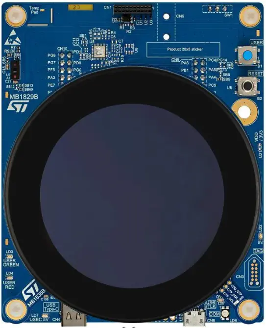

<!-- Copyright 2015-2026 Zephyr Project members and individual contributors. -->
<!-- SPDX-License-Identifier: Apache-2.0 -->
<!-- 中文翻译；编号、导航与译注为本地新增。 -->

<a id="stm32u5g9j_dk1"></a>

# 第55章\_STM32U5G9J探索套件1（Discovery Kit 1）

原文：[官方页面](https://docs.zephyrproject.org/latest/boards/st/stm32u5g9j_dk1/doc/index.html)。读取日期：2026-10-16；来源摘要见[来源记录](../SOURCES.md)。

开发板概览（Board Overview）

<a id="id1"></a>

[](images/stm32u5g9j_dk1.webp)

STM32U5G9J探索套件1（Discovery Kit 1）

名称（Name）：

`stm32u5g9j_dk1`

厂商（Vendor）：

[意法半导体（STMicroelectronics）](https://docs.zephyrproject.org/latest/boards/index.html#vendor=st)

状态（Status）：

维护中（Maintained）

架构（Architecture）：

[arm](https://docs.zephyrproject.org/latest/boards/index.html#arch=arm)

片上系统（SoC）：

[stm32u5g9xx](https://docs.zephyrproject.org/latest/boards/index.html#soc=stm32u5g9xx)

<a id="board-github-link"></a>

[浏览开发板源码（Browse Board Sources）](https://github.com/zephyrproject-rtos/zephyr/blob/main//boards/st/stm32u5g9j_dk1/doc/index.rst/../..)<a id="overview"></a>

## 概述（Overview）

STM32U5G9J-DK1是STM32U5G9NJH6Q的完整演示及开发平台，该MCU采用带Arm TrustZone的Cortex-M33内核。

套件利用超低功耗功能、3 Mbytes内置SRAM、4 Mbytes内置Flash及丰富图形功能，帮助用户制作高能效原型，并通过2.5D NeoChrom加速器、Chrom-ART加速器及Chrom-GRC MMU实现优化的图形渲染。

板载丰富硬件便于评估外设，包括2.47英寸RGB 480×480像素TFT圆形LCD及MIPI DSI接口、电容触摸面板、USB Type-C高速接口、Octo-SPI Flash、十六线SPI PSRAM、eMMC Flash、飞行时间及手势检测传感器、温度传感器、20针音频MEMS接口。另有2组2.54 mm间距双排灵活扩展连接器，便于连接特定应用子板制作原型，可访问USART、LPUART、2路SPI、SAI、3路I2C、SDMMC、ADC、定时器及GPIO。

STM32U5G9J-DK1集成STLINK-V3E在线调试器／编程器及USB虚拟COM桥接，并配套STM32CubeU5 MCU软件包，提供完整STM32 HAL库及多种软件。

开发板信息见[STM32U5G9J-DK1网站](https://www.st.com/en/evaluation-tools/stm32u5g9j-dk1.html)。原文随后写STM32U5A9NJH6Q，以下产品链接为STM32U5G9NJ，型号差异保留。


- [ST官网的STM32U5G9NJ产品页](https://www.st.com/en/microcontrollers-microprocessors/stm32u5g9nj.html)
- [STM32U5系列参考手册](https://www.st.com/resource/en/reference_manual/rm0456-stm32u5-series-armbased-32bit-mcus-stmicroelectronics.pdf)
- [STM32U5Gxxx数据手册](https://www.st.com/resource/en/datasheet/stm32u5g9nj.pdf)

<a id="supported-features"></a>

### 支持的功能（Supported Features）

`stm32u5g9j_dk1`开发板支持下表所列的硬件功能。

片上／板载（On-Chip / On-Board）

功能集成在片上系统（SoC）内／位于开发板上。

2 / 2

分别表示已启用／已禁用的实例数。点击数量标签，可查看开发板或SoC设备树源码（DTS）中该功能的第一个实例。

`vnd,foo`

与此功能匹配的设备树绑定兼容字符串（Compatible String）；点击链接可查看绑定文档。

<a id="stm32u5g9j_dk1-hw-features"></a>

<a id="stm32u5g9j_dk1-stm32u5g9j_dk1/stm32u5g9xx-hw-features-section"></a>

#### `stm32u5g9j_dk1/stm32u5g9xx`目标（Target）

<a id="stm32u5g9j_dk1-stm32u5g9j_dk1/stm32u5g9xx-hw-features-panel"></a>

<a id="stm32u5g9j_dk1-stm32u5g9j_dk1/stm32u5g9xx-hw-features-memory"></a>

该开发板目标的片上存储容量：3008 KiB RAM、4 MiB Flash。

<a id="stm32u5g9j_dk1-stm32u5g9j_dk1/stm32u5g9xx-hw-features-table"></a>

<table>
<tr>
<th>类型（Type）</th>
<th>位置（Location）</th>
<th>说明（Description）</th>
<th>兼容字符串（Compatible）</th>
</tr>
<tr>
<td rowspan="1">中央处理器（CPU）</td>
<td>片上（On-Chip）</td>
<td>ARM Cortex-M33处理器（CPU）（<a href="https://github.com/zephyrproject-rtos/zephyr/blob/main/dts/arm/st/u5/stm32u5.dtsi?plain=1#L36">已启用：1</a>）</td>
<td><a href="../cpu_arm_riscv_binding_reference/P022_arm_cortex-m33.md#std-dtcompatible-arm-cortex-m33"><code>arm,cortex-m33</code></a></td>
</tr>
<tr>
<td rowspan="1">模数转换器（ADC）</td>
<td>片上（On-Chip）</td>
<td>STM32模数转换器（ADC）（<a href="https://github.com/zephyrproject-rtos/zephyr/blob/main/dts/arm/st/u5/stm32u5.dtsi?plain=1#L897">已启用：2</a>）</td>
<td><a href="../hardware/P839_STM32模数转换器绑定.md#dtbinding-st-stm32-adc"><code>st,stm32-adc</code></a></td>
</tr>
<tr>
<td rowspan="1">音频（Audio）</td>
<td>片上（On-Chip）</td>
<td>STM32多功能数字滤波器（MDF）（<a href="https://github.com/zephyrproject-rtos/zephyr/blob/main/dts/arm/st/u5/stm32u595.dtsi?plain=1#L116">已禁用：1</a>）</td>
<td><a href="../audio_stm32_ti_wolfson_binding_reference/P003_st_stm32-mdf.md#std-dtcompatible-st-stm32-mdf"><code>st,stm32-mdf</code></a></td>
</tr>
<tr>
<td rowspan="1">控制器局域网（CAN）</td>
<td>片上（On-Chip）</td>
<td>STM32 FDCAN灵活数据速率CAN控制器（CAN FD Controller）（<a href="https://github.com/zephyrproject-rtos/zephyr/blob/main/dts/arm/st/u5/stm32u5.dtsi?plain=1#L952">已禁用：1</a>）</td>
<td><a href="../can_nxp_renesas_stm32_ti_binding_reference/P012_st_stm32-fdcan.md#std-dtcompatible-st-stm32-fdcan"><code>st,stm32-fdcan</code></a></td>
</tr>
<tr>
<td rowspan="7">时钟控制（Clock Control）</td>
<td>片上（On-Chip）</td>
<td>STM32U5复位与时钟控制器（RCC / Reset and Clock Controller）（<a href="https://github.com/zephyrproject-rtos/zephyr/blob/main/dts/arm/st/u5/stm32u5.dtsi?plain=1#L230">已启用：1</a>）</td>
<td><a href="../timer_reference/P170_STM32U5复位与时钟控制绑定.md#dtbinding-st-stm32u5-rcc"><code>st,stm32u5-rcc</code></a></td>
</tr>
<tr>
<td>片上（On-Chip）</td>
<td>STM32 外部高速时钟（HSE Clock）（<a href="https://github.com/zephyrproject-rtos/zephyr/blob/main/dts/arm/st/u5/stm32u5.dtsi?plain=1#L90">已启用：1</a>）</td>
<td><a href="../timer_reference/P129_STM32高速外部时钟绑定.md#dtbinding-st-stm32-hse-clock"><code>st,stm32-hse-clock</code></a></td>
</tr>
<tr>
<td>片上（On-Chip）</td>
<td>通用固定频率时钟提供者（Fixed-Rate Clock Provider）（<a href="https://github.com/zephyrproject-rtos/zephyr/blob/main/dts/arm/st/u5/stm32u5.dtsi?plain=1#L103">已启用：1</a>；<a href="https://github.com/zephyrproject-rtos/zephyr/blob/main/dts/arm/st/u5/stm32u5.dtsi?plain=1#L96">已禁用：3</a>）</td>
<td><a href="../hardware/P566_固定时钟绑定.md#dtbinding-fixed-clock"><code>fixed-clock</code></a></td>
</tr>
<tr>
<td>片上（On-Chip）</td>
<td>STM32U5多速率内部时钟（Multi Speed Internal Clock）（<a href="https://github.com/zephyrproject-rtos/zephyr/blob/main/dts/arm/st/u5/stm32u5.dtsi?plain=1#L110">已启用：1</a>；<a href="https://github.com/zephyrproject-rtos/zephyr/blob/main/dts/arm/st/u5/stm32u5.dtsi?plain=1#L117">已禁用：1</a>）</td>
<td><a href="../timer_reference/P160_STM32U5多速内部时钟绑定.md#dtbinding-st-stm32u5-msi-clock"><code>st,stm32u5-msi-clock</code></a></td>
</tr>
<tr>
<td>片上（On-Chip）</td>
<td>STM32低速外部时钟（LSE Clock）（<a href="https://github.com/zephyrproject-rtos/zephyr/blob/main/dts/arm/st/u5/stm32u5.dtsi?plain=1#L124">已启用：1</a>）</td>
<td><a href="../timer_reference/P130_STM32低速外部时钟绑定.md#dtbinding-st-stm32-lse-clock"><code>st,stm32-lse-clock</code></a></td>
</tr>
<tr>
<td>片上（On-Chip）</td>
<td>STM32U5锁相环（PLL）（<a href="https://github.com/zephyrproject-rtos/zephyr/blob/main/dts/arm/st/u5/stm32u5.dtsi?plain=1#L146">已启用：1</a>；<a href="https://github.com/zephyrproject-rtos/zephyr/blob/main/dts/arm/st/u5/stm32u5.dtsi?plain=1#L152">已禁用：2</a>）</td>
<td><a href="../timer_reference/P150_STM32U5锁相环时钟绑定.md#dtbinding-st-stm32u5-pll-clock"><code>st,stm32u5-pll-clock</code></a></td>
</tr>
<tr>
<td>片上（On-Chip）</td>
<td>STM32 微控制器时钟输出（Microcontroller Clock Output，MCO）（<a href="https://github.com/zephyrproject-rtos/zephyr/blob/main/dts/arm/st/u5/stm32u5.dtsi?plain=1#L166">已禁用：1</a>）</td>
<td><a href="../timer_reference/P134_STM32时钟输出绑定.md#dtbinding-st-stm32-clock-mco"><code>st,stm32-clock-mco</code></a></td>
</tr>
<tr>
<td rowspan="1">计数器（Counter）</td>
<td>片上（On-Chip）</td>
<td>STM32 计数器（Counters）（<a href="https://github.com/zephyrproject-rtos/zephyr/blob/main/dts/arm/st/u5/stm32u5.dtsi?plain=1#L586">已禁用：11</a>）</td>
<td><a href="../stm32_ti_xilinx_counter_binding_reference/P007_st_stm32-counter.md#std-dtcompatible-st-stm32-counter"><code>st,stm32-counter</code></a></td>
</tr>
<tr>
<td rowspan="1">循环冗余校验（CRC）</td>
<td>片上（On-Chip）</td>
<td>STM32 CRC 计算单元（Calculation Unit）（<a href="https://github.com/zephyrproject-rtos/zephyr/blob/main/dts/arm/st/u5/stm32u5.dtsi?plain=1#L1070">已禁用：1</a>）</td>
<td><a href="../crc_clock_monitor_binding_reference/P011_st_stm32-crc.md#std-dtcompatible-st-stm32-crc"><code>st,stm32-crc</code></a></td>
</tr>
<tr>
<td rowspan="2">密码学加速器（Cryptographic Accelerator）</td>
<td>片上（On-Chip）</td>
<td>STM32哈希处理器（HASH Processor）（<a href="https://github.com/zephyrproject-rtos/zephyr/blob/main/dts/arm/st/u5/stm32u5.dtsi?plain=1#L975">已禁用：1</a>）</td>
<td><a href="../crypto_secure_engine_st_ti_binding_reference/P017_st_stm32-hash.md#std-dtcompatible-st-stm32-hash"><code>st,stm32-hash</code></a></td>
</tr>
<tr>
<td>片上（On-Chip）</td>
<td>STM32高级加密标准加速器（AES Accelerator）（<a href="https://github.com/zephyrproject-rtos/zephyr/blob/main/dts/arm/st/u5/stm32u5_crypt.dtsi?plain=1#L9">已禁用：1</a>）</td>
<td><a href="../crypto_secure_engine_st_ti_binding_reference/P015_st_stm32-aes.md#std-dtcompatible-st-stm32-aes"><code>st,stm32-aes</code></a></td>
</tr>
<tr>
<td rowspan="1">数模转换器（DAC）</td>
<td>片上（On-Chip）</td>
<td>STM32 系列数模转换器（DAC）（<a href="https://github.com/zephyrproject-rtos/zephyr/blob/main/dts/arm/st/u5/stm32u5.dtsi?plain=1#L889">已禁用：1</a>）</td>
<td><a href="../hardware/P760_STM32数模转换器绑定.md#dtbinding-st-stm32-dac"><code>st,stm32-dac</code></a></td>
</tr>
<tr>
<td rowspan="3">显示（Display）</td>
<td>片上（On-Chip）</td>
<td>STM32 NeoChrom-GPU2D加速器（<a href="https://github.com/zephyrproject-rtos/zephyr/blob/main/dts/arm/st/u5/stm32u5.dtsi?plain=1#L1078">已禁用：1</a>）</td>
<td><a href="../display_st_ultrachip_zephyr_binding_reference/P002_st_neochrom-gpu2d.md#std-dtcompatible-st-neochrom-gpu2d"><code>st,neochrom-gpu2d</code></a></td>
</tr>
<tr>
<td>片上（On-Chip）</td>
<td>STM32 Chrom-ART 图形加速器（Accelerator，DMA2D）（<a href="https://github.com/zephyrproject-rtos/zephyr/blob/main/dts/arm/st/u5/stm32u595.dtsi?plain=1#L164">已禁用：1</a>）</td>
<td><a href="../display_st_ultrachip_zephyr_binding_reference/P003_st_stm32-dma2d.md#std-dtcompatible-st-stm32-dma2d"><code>st,stm32-dma2d</code></a></td>
</tr>
<tr>
<td>片上（On-Chip）</td>
<td>STM32 LCD-TFT 显示控制器（Display Controller）（<a href="https://github.com/zephyrproject-rtos/zephyr/blob/main/dts/arm/st/u5/stm32u599.dtsi?plain=1#L18">已禁用：1</a>）</td>
<td><a href="../display_st_ultrachip_zephyr_binding_reference/P004_st_stm32-ltdc.md#std-dtcompatible-st-stm32-ltdc"><code>st,stm32-ltdc</code></a></td>
</tr>
<tr>
<td rowspan="1">直接存储器访问（DMA）</td>
<td>片上（On-Chip）</td>
<td>STM32U5直接存储器访问（DMA）控制器（<a href="https://github.com/zephyrproject-rtos/zephyr/blob/main/dts/arm/st/u5/stm32u5.dtsi?plain=1#L963">已禁用：1</a>）</td>
<td><a href="../stm32_ti_xilinx_dma_binding_reference/P012_st_stm32u5-dma.md#std-dtcompatible-st-stm32u5-dma"><code>st,stm32u5-dma</code></a></td>
</tr>
<tr>
<td rowspan="1">闪存控制器（Flash Controller）</td>
<td>片上（On-Chip）</td>
<td>STM32 系列闪存控制器（Flash Controller）（<a href="https://github.com/zephyrproject-rtos/zephyr/blob/main/dts/arm/st/u5/stm32u5.dtsi?plain=1#L174">已启用：1</a>）</td>
<td><a href="../flash_renesas_st_ti_binding_reference/P011_st_stm32-flash-controller.md#std-dtcompatible-st-stm32-flash-controller"><code>st,stm32-flash-controller</code></a></td>
</tr>
<tr>
<td rowspan="3">通用输入输出与接插件（GPIO &amp; Headers）</td>
<td>片上（On-Chip）</td>
<td>STM32 通用输入输出控制器（GPIO Controller）（<a href="https://github.com/zephyrproject-rtos/zephyr/blob/main/dts/arm/st/u5/stm32u5.dtsi?plain=1#L271">已启用：10</a>）</td>
<td><a href="../gpio_silabs_st_connectors_binding_reference/P029_st_stm32-gpio.md#std-dtcompatible-st-stm32-gpio"><code>st,stm32-gpio</code></a></td>
</tr>
<tr>
<td>片上（On-Chip）</td>
<td>串行线／JTAG连接器（Serial Wire–JTAG Connector）（<a href="https://github.com/zephyrproject-rtos/zephyr/blob/main/dts/arm/st/u5/stm32u5.dtsi?plain=1#L1089">已启用：1</a>）</td>
<td><a href="../gpio_ti_xilinx_sdl_binding_reference/P006_swj-connector.md#std-dtcompatible-swj-connector"><code>swj-connector</code></a></td>
</tr>
<tr>
<td>板载（On-Board）</td>
<td>GPIO引出至用作DSI LCD连接器的QSH-030-01-F-D-A接口（<a href="https://github.com/zephyrproject-rtos/zephyr/blob/main/boards/st/stm32u5g9j_dk1/stm32u5g9j_dk1.dts?plain=1#L60">已启用：1</a>）</td>
<td><a href="../gpio_silabs_st_connectors_binding_reference/P025_st_dsi-lcd-qsh-030-connector.md#std-dtcompatible-st-dsi-lcd-qsh-030-connector"><code>st,dsi-lcd-qsh-030-connector</code></a></td>
</tr>
<tr>
<td rowspan="1">集成电路间总线（I2C）</td>
<td>片上（On-Chip）</td>
<td>STM32 I2C V2 控制器（Controller）（<a href="https://github.com/zephyrproject-rtos/zephyr/blob/main/dts/arm/st/u5/stm32u5.dtsi?plain=1#L436">已启用：5</a>；<a href="https://github.com/zephyrproject-rtos/zephyr/blob/main/dts/arm/st/u5/stm32u5.dtsi?plain=1#L472">已禁用：1</a>）</td>
<td><a href="../i2c_stm32_ti_mux_binding_reference/P008_st_stm32-i2c-v2.md#std-dtcompatible-st-stm32-i2c-v2"><code>st,stm32-i2c-v2</code></a></td>
</tr>
<tr>
<td rowspan="1">集成电路间音频总线（I2S）</td>
<td>片上（On-Chip）</td>
<td>STM32 串行音频接口块控制器（SAI Block Controller）（<a href="https://github.com/zephyrproject-rtos/zephyr/blob/main/dts/arm/st/u5/stm32u5.dtsi?plain=1#L542">已禁用：2</a>）</td>
<td><a href="../i2s_binding_reference/P017_st_stm32-sai.md#std-dtcompatible-st-stm32-sai"><code>st,stm32-sai</code></a></td>
</tr>
<tr>
<td rowspan="1">输入（Input）</td>
<td>板载（On-Board）</td>
<td>一组绑定到 GPIO 的输入按键（GPIO-Bound Input Keys）（<a href="https://github.com/zephyrproject-rtos/zephyr/blob/main/boards/st/stm32u5g9j_dk1/stm32u5g9j_dk1.dts?plain=1#L38">已启用：1</a>）</td>
<td><a href="../hardware/P563_GPIO按键绑定.md#std-dtcompatible-gpio-keys"><code>gpio-keys</code></a></td>
</tr>
<tr>
<td rowspan="2">中断控制器（Interrupt Controller）</td>
<td>片上（On-Chip）</td>
<td>ARMv8-M嵌套向量中断控制器（NVIC / Nested Vectored Interrupt Controller）（<a href="https://github.com/zephyrproject-rtos/zephyr/blob/main/dts/arm/armv8-m.dtsi?plain=1#L13">已启用：1</a>）</td>
<td><a href="../arm_interrupt_timer_binding_reference/P003_ARMv8_M_NVIC.md#std-dtcompatible-arm-v8m-nvic"><code>arm,v8m-nvic</code></a></td>
</tr>
<tr>
<td>片上（On-Chip）</td>
<td>STM32G0 外部中断控制器（External Interrupt Controller）（<a href="https://github.com/zephyrproject-rtos/zephyr/blob/main/dts/arm/st/u5/stm32u5.dtsi?plain=1#L242">已启用：1</a>）</td>
<td><a href="../mcu_external_interrupt_binding_reference/P002_st_stm32g0-exti.md#std-dtcompatible-st-stm32g0-exti"><code>st,stm32g0-exti</code></a></td>
</tr>
<tr>
<td rowspan="1">发光二极管（LED）</td>
<td>板载（On-Board）</td>
<td>一组由 GPIO 控制的 LED（GPIO-Controlled LEDs）（<a href="https://github.com/zephyrproject-rtos/zephyr/blob/main/boards/st/stm32u5g9j_dk1/stm32u5g9j_dk1.dts?plain=1#L24">已启用：1</a>）</td>
<td><a href="../hardware/P564_GPIO指示灯绑定.md#dtbinding-gpio-leds"><code>gpio-leds</code></a></td>
</tr>
<tr>
<td rowspan="2">存储器控制器（Memory Controller）</td>
<td>片上（On-Chip）</td>
<td>STM32 灵活存储器控制器（Flexible Memory Controller，FMC）（<a href="https://github.com/zephyrproject-rtos/zephyr/blob/main/dts/arm/st/u5/stm32u5_extra.dtsi?plain=1#L56">已禁用：1</a>）</td>
<td><a href="../memory_controller_sdram_psram_binding_reference/P013_st_stm32-fmc.md#std-dtcompatible-st-stm32-fmc"><code>st,stm32-fmc</code></a></td>
</tr>
<tr>
<td>片上（On-Chip）</td>
<td>STM32灵活存储器控制器（FMC / Flexible Memory Controller），用于NOR Flash、PSRAM和SRAM（<a href="https://github.com/zephyrproject-rtos/zephyr/blob/main/dts/arm/st/u5/stm32u5_extra.dtsi?plain=1#L62">已禁用：1</a>）</td>
<td><a href="../memory_controller_sdram_psram_binding_reference/P011_st_stm32-fmc-nor-psram.md#std-dtcompatible-st-stm32-fmc-nor-psram"><code>st,stm32-fmc-nor-psram</code></a></td>
</tr>
<tr>
<td rowspan="1">MIPI 显示串行接口（MIPI-DSI）</td>
<td>片上（On-Chip）</td>
<td>STM32U5系列MIPI DSI控制器（<a href="https://github.com/zephyrproject-rtos/zephyr/blob/main/dts/arm/st/u5/stm32u599.dtsi?plain=1#L28">已禁用：1</a>）</td>
<td><a href="../mipi_dbi_dsi_binding_reference/P019_st_stm32u5-mipi-dsi.md#std-dtcompatible-st-stm32u5-mipi-dsi"><code>st,stm32u5-mipi-dsi</code></a></td>
</tr>
<tr>
<td rowspan="1">内存管理单元／内存保护单元（MMU / MPU）</td>
<td>片上（On-Chip）</td>
<td>ARMv8-M存储器保护单元（MPU / Memory Protection Unit）（<a href="https://github.com/zephyrproject-rtos/zephyr/blob/main/dts/arm/st/u5/stm32u5.dtsi?plain=1#L46">已启用：1</a>）</td>
<td><a href="../memory_protection_binding_reference/P007_arm_armv8m-mpu.md#std-dtcompatible-arm-armv8m-mpu"><code>arm,armv8m-mpu</code></a></td>
</tr>
<tr>
<td rowspan="1">存储技术设备（MTD）</td>
<td>片上（On-Chip）</td>
<td>STM32闪存（Flash Memory）（<a href="https://github.com/zephyrproject-rtos/zephyr/blob/main/dts/arm/st/u5/stm32u5.dtsi?plain=1#L183">已启用：1</a>）</td>
<td><a href="../mtd_nxp_st_ti_partition_binding_reference/P016_st_stm32-nv-flash.md#std-dtcompatible-st-stm32-nv-flash"><code>st,stm32-nv-flash</code></a></td>
</tr>
<tr>
<td rowspan="1">非易失存储器（NVMEM）</td>
<td>片上（On-Chip）</td>
<td>非易失存储器固定布局（Fixed Layout for Non-Volatile Memory）（<a href="https://github.com/zephyrproject-rtos/zephyr/blob/main/dts/arm/st/u5/stm32u5.dtsi?plain=1#L204">已启用：1</a>）</td>
<td><a href="../memory_protection_binding_reference/P009_fixed-layout.md#std-dtcompatible-fixed-layout"><code>fixed-layout</code></a></td>
</tr>
<tr>
<td rowspan="1">八线串行外设接口（OCTOSPI）</td>
<td>片上（On-Chip）</td>
<td>STM32八线SPI控制器（OSPI Controller）（<a href="https://github.com/zephyrproject-rtos/zephyr/blob/main/dts/arm/st/u5/stm32u5.dtsi?plain=1#L836">已禁用：2</a>）</td>
<td><a href="../qspi_ospi_xspi_binding_reference/P002_st_stm32-ospi.md#std-dtcompatible-st-stm32-ospi"><code>st,stm32-ospi</code></a></td>
</tr>
<tr>
<td rowspan="1">一次性可编程存储器（OTP Memory）</td>
<td>片上（On-Chip）</td>
<td>STM32 嵌入式非易失一次性可编程存储器（NVM OTP）（<a href="https://github.com/zephyrproject-rtos/zephyr/blob/main/dts/arm/st/u5/stm32u5.dtsi?plain=1#L200">已启用：1</a>；<a href="https://github.com/zephyrproject-rtos/zephyr/blob/main/dts/arm/st/u5/stm32u5.dtsi?plain=1#L193">已禁用：1</a>）</td>
<td><a href="../otp_binding_reference/P010_st_stm32-nvm-otp.md#std-dtcompatible-st-stm32-nvm-otp"><code>st,stm32-nvm-otp</code></a></td>
</tr>
<tr>
<td rowspan="1">物理层（PHY）</td>
<td>片上（On-Chip）</td>
<td>STM32U5 OTG高速物理层（HS PHY）（<a href="https://github.com/zephyrproject-rtos/zephyr/blob/main/dts/arm/st/u5/stm32u5_usbotg_hs.dtsi?plain=1#L26">已启用：1</a>）</td>
<td><a href="../phy_binding_reference/P007_st_stm32u5-otghs-phy.md#std-dtcompatible-st-stm32u5-otghs-phy"><code>st,stm32u5-otghs-phy</code></a></td>
</tr>
<tr>
<td rowspan="1">引脚控制（Pin Control）</td>
<td>片上（On-Chip）</td>
<td>STM32 引脚控制器（Pin Controller）（<a href="https://github.com/zephyrproject-rtos/zephyr/blob/main/dts/arm/st/u5/stm32u5.dtsi?plain=1#L264">已启用：1</a>）</td>
<td><a href="../pinctrl_stm32_ti_xilinx_binding_reference/P004_st_stm32-pinctrl.md#std-dtcompatible-st-stm32-pinctrl"><code>st,stm32-pinctrl</code></a></td>
</tr>
<tr>
<td rowspan="2">电源管理（Power Management）</td>
<td>片上（On-Chip）</td>
<td>STM32U5电源控制器（Power Controller）（<a href="https://github.com/zephyrproject-rtos/zephyr/blob/main/dts/arm/st/u5/stm32u5.dtsi?plain=1#L992">已启用：1</a>）</td>
<td><a href="../stm32_soc_power_binding_reference/P016_st_stm32u5-pwr.md#std-dtcompatible-st-stm32u5-pwr"><code>st,stm32u5-pwr</code></a></td>
</tr>
<tr>
<td>片上（On-Chip）</td>
<td>STM32唤醒线控制器（Wake-up Lines Controller）（<a href="https://github.com/zephyrproject-rtos/zephyr/blob/main/dts/arm/st/u5/stm32u5.dtsi?plain=1#L1003">已禁用：1</a>）</td>
<td><a href="../stm32_soc_power_binding_reference/P009_st_stm32-pwr-wkupctrl.md#std-dtcompatible-st-stm32-pwr-wkupctrl"><code>st,stm32-pwr-wkupctrl</code></a></td>
</tr>
<tr>
<td rowspan="1">脉宽调制（PWM）</td>
<td>片上（On-Chip）</td>
<td>STM32 脉宽调制（PWM）（<a href="https://github.com/zephyrproject-rtos/zephyr/blob/main/dts/arm/st/u5/stm32u5.dtsi?plain=1#L580">已启用：2</a>；<a href="https://github.com/zephyrproject-rtos/zephyr/blob/main/dts/arm/st/u5/stm32u5.dtsi?plain=1#L636">已禁用：7</a>）</td>
<td><a href="../pwm_stm32_ti_generic_binding_reference/P011_st_stm32-pwm.md#std-dtcompatible-st-stm32-pwm"><code>st,stm32-pwm</code></a></td>
</tr>
<tr>
<td rowspan="1">稳压器（Regulator）</td>
<td>片上（On-Chip）</td>
<td>STM32参考电压缓冲器稳压器（VREFBUF Regulator）（<a href="https://github.com/zephyrproject-rtos/zephyr/blob/main/dts/arm/st/u5/stm32u5.dtsi?plain=1#L983">已禁用：1</a>）</td>
<td><a href="../hardware/P638_STM32参考电压缓冲器绑定.md#dtbinding-st-stm32-vrefbuf"><code>st,stm32-vrefbuf</code></a></td>
</tr>
<tr>
<td rowspan="1">复位控制器（Reset Controller）</td>
<td>片上（On-Chip）</td>
<td>STM32 复位与时钟控制器（Reset and Clock Control，RCC）（<a href="https://github.com/zephyrproject-rtos/zephyr/blob/main/dts/arm/st/u5/stm32u5.dtsi?plain=1#L236">已启用：1</a>）</td>
<td><a href="../reset_controller_binding_reference/P017_st_stm32-rcc-rctl.md#std-dtcompatible-st-stm32-rcc-rctl"><code>st,stm32-rcc-rctl</code></a></td>
</tr>
<tr>
<td rowspan="1">随机数生成器（RNG）</td>
<td>片上（On-Chip）</td>
<td>STM32 随机数生成器（Random Number Generator）（<a href="https://github.com/zephyrproject-rtos/zephyr/blob/main/dts/arm/st/u5/stm32u5.dtsi?plain=1#L862">已启用：1</a>）</td>
<td><a href="../soc_rng_binding_reference/P016_st_stm32-rng.md#std-dtcompatible-st-stm32-rng"><code>st,stm32-rng</code></a></td>
</tr>
<tr>
<td rowspan="1">实时时钟（RTC）</td>
<td>片上（On-Chip）</td>
<td>STM32 实时时钟（RTC）（<a href="https://github.com/zephyrproject-rtos/zephyr/blob/main/dts/arm/st/u5/stm32u5.dtsi?plain=1#L532">已启用：1</a>）</td>
<td><a href="../soc_rtc_binding_reference/P014_st_stm32-rtc.md#std-dtcompatible-st-stm32-rtc"><code>st,stm32-rtc</code></a></td>
</tr>
<tr>
<td rowspan="1">SD 主机控制器（SDHC）</td>
<td>片上（On-Chip）</td>
<td>STM32 SDMMC 主机控制器（Host Controller）（<a href="https://github.com/zephyrproject-rtos/zephyr/blob/main/dts/arm/st/u5/stm32u5.dtsi?plain=1#L879">已启用：1</a>；<a href="https://github.com/zephyrproject-rtos/zephyr/blob/main/dts/arm/st/u5/stm32u5_extra.dtsi?plain=1#L46">已禁用：1</a>）</td>
<td><a href="../sdhc_binding_reference/P019_st_stm32-sdmmc.md#std-dtcompatible-st-stm32-sdmmc"><code>st,stm32-sdmmc</code></a></td>
</tr>
<tr>
<td rowspan="5">传感器（Sensors）</td>
<td>板载（On-Board）</td>
<td>通过I2C连接的意法半导体STTS22H温度传感器。在.dts或.dtsi文件中设置sampling-rate属性时，可包含stts22h.h并使用其中的宏。（<a href="https://github.com/zephyrproject-rtos/zephyr/blob/main/boards/st/stm32u5g9j_dk1/stm32u5g9j_dk1.dts?plain=1#L158">已启用：1</a>）</td>
<td><a href="../sensor_st_ti_power_capacitance_binding_reference/P005_st_stts22h-i2c.md#std-dtcompatible-st-stts22h"><code>st,stts22h</code></a></td>
</tr>
<tr>
<td>片上（On-Chip）</td>
<td>STM32 正交解码器（Quadrature Decoder）（<a href="https://github.com/zephyrproject-rtos/zephyr/blob/main/dts/arm/st/u5/stm32u5.dtsi?plain=1#L591">已禁用：6</a>）</td>
<td><a href="../sensor_st_lsm_stm32_binding_reference/P028_st_stm32-qdec.md#std-dtcompatible-st-stm32-qdec"><code>st,stm32-qdec</code></a></td>
</tr>
<tr>
<td>片上（On-Chip）</td>
<td>STM32 系列温度节点（TEMP），用于以两个温度点完成生产校准的传感器。（<a href="https://github.com/zephyrproject-rtos/zephyr/blob/main/dts/arm/st/u5/stm32u5.dtsi?plain=1#L1099">已启用：1</a>）</td>
<td><a href="../sensor_st_lsm_stm32_binding_reference/P029_st_stm32-temp-cal.md#std-dtcompatible-st-stm32-temp-cal"><code>st,stm32-temp-cal</code></a></td>
</tr>
<tr>
<td>片上（On-Chip）</td>
<td>STM32 参考电压（VREF+）（<a href="https://github.com/zephyrproject-rtos/zephyr/blob/main/dts/arm/st/u5/stm32u5.dtsi?plain=1#L1111">已启用：1</a>；<a href="https://github.com/zephyrproject-rtos/zephyr/blob/main/dts/arm/st/u5/stm32u5.dtsi?plain=1#L1120">已禁用：1</a>）</td>
<td><a href="../sensor_st_ti_power_capacitance_binding_reference/P003_st_stm32-vref.md#std-dtcompatible-st-stm32-vref"><code>st,stm32-vref</code></a></td>
</tr>
<tr>
<td>片上（On-Chip）</td>
<td>STM32 电池电压（VBAT）（<a href="https://github.com/zephyrproject-rtos/zephyr/blob/main/dts/arm/st/u5/stm32u5.dtsi?plain=1#L1136">已启用：1</a>；<a href="https://github.com/zephyrproject-rtos/zephyr/blob/main/dts/arm/st/u5/stm32u5.dtsi?plain=1#L1129">已禁用：1</a>）</td>
<td><a href="../sensor_st_ti_power_capacitance_binding_reference/P001_st_stm32-vbat.md#std-dtcompatible-st-stm32-vbat"><code>st,stm32-vbat</code></a></td>
</tr>
<tr>
<td rowspan="3">串行控制器（Serial Controller）</td>
<td>片上（On-Chip）</td>
<td>STM32 通用同步／异步收发器（USART）（<a href="https://github.com/zephyrproject-rtos/zephyr/blob/main/dts/arm/st/u5/stm32u5.dtsi?plain=1#L352">已启用：2</a>；<a href="https://github.com/zephyrproject-rtos/zephyr/blob/main/dts/arm/st/u5/stm32u5_extra.dtsi?plain=1#L19">已禁用：2</a>）</td>
<td><a href="../uart_silabs_stm32_ti_binding_reference/P016_st_stm32-usart.md#std-dtcompatible-st-stm32-usart"><code>st,stm32-usart</code></a></td>
</tr>
<tr>
<td>片上（On-Chip）</td>
<td>STM32 通用异步收发器（UART）（<a href="https://github.com/zephyrproject-rtos/zephyr/blob/main/dts/arm/st/u5/stm32u5.dtsi?plain=1#L370">已禁用：2</a>）</td>
<td><a href="../uart_silabs_stm32_ti_binding_reference/P015_st_stm32-uart.md#std-dtcompatible-st-stm32-uart"><code>st,stm32-uart</code></a></td>
</tr>
<tr>
<td>片上（On-Chip）</td>
<td>STM32低功耗通用异步收发器（LPUART）（<a href="https://github.com/zephyrproject-rtos/zephyr/blob/main/dts/arm/st/u5/stm32u5.dtsi?plain=1#L388">已启用：1</a>）</td>
<td><a href="../uart_silabs_stm32_ti_binding_reference/P014_st_stm32-lpuart.md#std-dtcompatible-st-stm32-lpuart"><code>st,stm32-lpuart</code></a></td>
</tr>
<tr>
<td rowspan="1">系统管理总线（SMbus）</td>
<td>片上（On-Chip）</td>
<td>STM32 系统管理总线控制器（SMBus Controller）（<a href="https://github.com/zephyrproject-rtos/zephyr/blob/main/dts/arm/st/u5/stm32u5.dtsi?plain=1#L1143">已禁用：6</a>）</td>
<td><a href="../i3c_smbus_binding_reference/P013_st_stm32-smbus.md#std-dtcompatible-st-stm32-smbus"><code>st,stm32-smbus</code></a></td>
</tr>
<tr>
<td rowspan="1">串行外设接口（SPI）</td>
<td>片上（On-Chip）</td>
<td>STM32H7 串行外设接口控制器（SPI Controller）（<a href="https://github.com/zephyrproject-rtos/zephyr/blob/main/dts/arm/st/u5/stm32u5.dtsi?plain=1#L410">已启用：2</a>；<a href="https://github.com/zephyrproject-rtos/zephyr/blob/main/dts/arm/st/u5/stm32u5.dtsi?plain=1#L397">已禁用：1</a>）</td>
<td><a href="../spi_stm32_ti_xilinx_binding_reference/P013_st_stm32h7-spi.md#std-dtcompatible-st-stm32h7-spi"><code>st,stm32h7-spi</code></a></td>
</tr>
<tr>
<td rowspan="1">USB Type-C 端口控制器（USB Type-C Port Controller）</td>
<td>片上（On-Chip）</td>
<td>STM32 USB Type-C／电力传输（Power Delivery）（<a href="https://github.com/zephyrproject-rtos/zephyr/blob/main/dts/arm/st/u5/stm32u5_extra.dtsi?plain=1#L83">已禁用：1</a>）</td>
<td><a href="../usbc_tcpc_binding_reference/P005_st_stm32-ucpd.md#std-dtcompatible-st-stm32-ucpd"><code>st,stm32-ucpd</code></a></td>
</tr>
<tr>
<td rowspan="3">定时器（Timer）</td>
<td>片上（On-Chip）</td>
<td>ARMv8-M系统节拍（System Tick）（<a href="https://github.com/zephyrproject-rtos/zephyr/blob/main/dts/arm/armv8-m.dtsi?plain=1#L21">已启用：1</a>）</td>
<td><a href="../arm_interrupt_timer_binding_reference/P007_ARMv8_M_SysTick.md#std-dtcompatible-arm-armv8m-systick"><code>arm,armv8m-systick</code></a></td>
</tr>
<tr>
<td>片上（On-Chip）</td>
<td>STM32U5低功耗定时器（LPTIM）（<a href="https://github.com/zephyrproject-rtos/zephyr/blob/main/dts/arm/st/u5/stm32u5.dtsi?plain=1#L484">已禁用：4</a>）</td>
<td><a href="../stm32_ti_silabs_timer_binding_reference/P009_st_stm32u5-lptim.md#std-dtcompatible-st-stm32u5-lptim"><code>st,stm32u5-lptim</code></a></td>
</tr>
<tr>
<td>片上（On-Chip）</td>
<td>STM32 定时器（Timers）（<a href="https://github.com/zephyrproject-rtos/zephyr/blob/main/dts/arm/st/u5/stm32u5.dtsi?plain=1#L570">已启用：2</a>；<a href="https://github.com/zephyrproject-rtos/zephyr/blob/main/dts/arm/st/u5/stm32u5.dtsi?plain=1#L626">已禁用：9</a>）</td>
<td><a href="../stm32_ti_silabs_timer_binding_reference/P008_st_stm32-timers.md#std-dtcompatible-st-stm32-timers"><code>st,stm32-timers</code></a></td>
</tr>
<tr>
<td rowspan="1">通用串行总线（USB）</td>
<td>片上（On-Chip）</td>
<td>STM32 高速 USB OTG 控制器（OTGHS Controller）（<a href="https://github.com/zephyrproject-rtos/zephyr/blob/main/dts/arm/st/u5/stm32u5_usbotg_hs.dtsi?plain=1#L12">已启用：1</a>）</td>
<td><a href="../usb_stm32_audio_binding_reference/P005_st_stm32-otghs.md#std-dtcompatible-st-stm32-otghs"><code>st,stm32-otghs</code></a></td>
</tr>
<tr>
<td rowspan="1">视频（Video）</td>
<td>片上（On-Chip）</td>
<td>STM32 JPEG硬件编解码器（HW Codec）（<a href="https://github.com/zephyrproject-rtos/zephyr/blob/main/dts/arm/st/u5/stm32u5f9.dtsi?plain=1#L19">已启用：1</a>）</td>
<td><a href="../video_st_sony_emulation_binding_reference/P006_st_stm32-jpeg.md#std-dtcompatible-st-stm32-jpeg"><code>st,stm32-jpeg</code></a></td>
</tr>
<tr>
<td rowspan="2">看门狗（Watchdog）</td>
<td>片上（On-Chip）</td>
<td>STM32 看门狗（Watchdog）（<a href="https://github.com/zephyrproject-rtos/zephyr/blob/main/dts/arm/st/u5/stm32u5.dtsi?plain=1#L328">已启用：1</a>）</td>
<td><a href="../stm32_ti_xilinx_watchdog_binding_reference/P001_st_stm32-watchdog.md#std-dtcompatible-st-stm32-watchdog"><code>st,stm32-watchdog</code></a></td>
</tr>
<tr>
<td>片上（On-Chip）</td>
<td>STM32 系统窗口看门狗（System Window Watchdog）（<a href="https://github.com/zephyrproject-rtos/zephyr/blob/main/dts/arm/st/u5/stm32u5.dtsi?plain=1#L335">已禁用：1</a>）</td>
<td><a href="../stm32_ti_xilinx_watchdog_binding_reference/P002_st_stm32-window-watchdog.md#std-dtcompatible-st-stm32-window-watchdog"><code>st,stm32-window-watchdog</code></a></td>
</tr>
<tr>
<td rowspan="1">扩展串行外设接口（xSPI）</td>
<td>片上（On-Chip）</td>
<td>STM32扩展SPI（XSPI）控制器（<a href="https://github.com/zephyrproject-rtos/zephyr/blob/main/dts/arm/st/u5/stm32u599.dtsi?plain=1#L42">已禁用：1</a>）</td>
<td><a href="../qspi_ospi_xspi_binding_reference/P016_st_stm32-xspi.md#std-dtcompatible-st-stm32-xspi"><code>st,stm32-xspi</code></a></td>
</tr>
</table>

<a id="pin-mapping"></a>

### 引脚映射（Pin Mapping）

更多细节见[STM32U5G9J-DK1开发板用户手册](https://www.st.com/resource/en/user_manual/um2967-discovery-kits-with-stm32u5x9nj-mcus-stmicroelectronics.pdf)。

<a id="default-zephyr-peripheral-mapping"></a>

#### Zephyr 默认外设映射（Peripheral Mapping）：


- USART1 TX/RX：PA9/PA10，ST-Link虚拟COM端口
- 绿色LED LD3：PE0
- 红色LED LD4：PE1
- 用户按键：PC13
- `USART_3 TX/RX : PB10/PB11`
- LPUART_1 TX/RX : PG7/PG8
- I2C1 SCL/SDA : PG14/PG13
- `I2C2 SCL/SDA : PF1/PF0`
- I2C6 SCL/SDA : PD1/PD0
- SPI2 SCK/MISO/MOSI/CS : PB13/PD3/PD4/PB12
- SPI3 SCK/MISO/MOSI/CS : PG9/PG10/PG11/PG15
- ADC1：通道5为PA0，通道14为PC5
- ADC2：通道9为PA4
- ADC4：通道5为PF14

<a id="system-clock"></a>

### 系统时钟（System Clock）

STM32U5G9J-DK1使用16 MHz晶体HSE及32.768 kHz晶体LSE作为时钟参考；LCD的DSI接口及USB高速接口必须使用HSE，不能用HSI替代。

<a id="serial-port"></a>

### 串口（Serial Port）

STM32U5G9J Discovery最多有4路USART、2路UART及1路LPUART。Zephyr控制台分配给USART1，经板载ST-LINK/V3.0虚拟COM接口输出，默认通信参数115200、8N1。

<a id="programming-and-debugging"></a>

## 烧录与调试（Programming and Debugging）

`stm32u5g9j_dk1`开发板支持下表所列的运行工具（Runners）及相关west命令。

<table>
<tr>
<th></th>
<th>烧录（flash）</th>
<th>调试（debug）</th>
<th>连接调试会话（attach）</th>
<th>实时传输（rtt）</th>
<th>调试服务器（debugserver）</th>
</tr>
<tr>
<td><a href="https://docs.zephyrproject.org/latest/develop/flash_debug/host-tools.html#runner-openocd">openocd</a></td>
<td>✅</td>
<td>✅（默认 / default）</td>
<td>✅</td>
<td>✅</td>
<td>✅</td>
</tr>
<tr>
<td><a href="https://docs.zephyrproject.org/latest/develop/flash_debug/host-tools.html#runner-stm32cubeprogrammer">stm32cubeprogrammer</a></td>
<td>✅（默认 / default）</td>
<td></td>
<td></td>
<td></td>
<td></td>
</tr>
</table>

STM32U5G9J Discovery内置ST-LINK/V3调试接口，可用多种工具烧录及调试开发板。

<a id="flashing"></a>

### 烧录（Flashing）

此板默认通过west的[STM32CubeProgrammer](https://www.st.com/en/development-tools/stm32cubeprog.html)运行器（Runner）烧录，因此需要安装该工具。（[installation](https://docs.zephyrproject.org/latest/develop/flash_debug/host-tools.html#stm32cubeprog-flash-host-tools)）

也可使用OpenOCD，通过--runner或-r选项烧录开发板：

```text
$ west flash --runner openocd
```

<a id="flashing-an-application-to-stm32u5g9j-dk"></a>

#### 向STM32U5G9J_DK烧录应用

通过USB将STM32U5G9J Discovery连接主机，再运行主机串口程序连接开发板，例如：

```text
$ minicom -D /dev/ttyACM0 -b 115200
```

随后按通常方式构建和烧录。以下以[Hello World](../getting_started/P005_HelloWorld示例.md#hello_world)应用为例。

```text
# From the root of the zephyr repository
west build -b stm32u5g9j_dk1 samples/hello_world
west flash
```

控制台上应显示以下消息：

```text
Hello World! stm32u5g9j_dk1
```

<a id="debugging"></a>

### 调试（Debugging）

本板默认调试器为OpenOCD，可按常规方式使用west debug，下面以[Blinky](../getting_started/P004_LED闪烁示例.md#blinky)应用为例。

```text
# From the root of the zephyr repository
west build -b stm32u5g9j_dk1 samples/basic/blinky
west debug
```

<a id="using-the-st-lcd-dsi-mb1835-shield"></a>

## 使用ST LCD DSI MB1835扩展板（Shield）

[ST LCD DSI MB1835](https://docs.zephyrproject.org/latest/boards/shields/st_lcd_dsi_mb1835/doc/index.html#st-lcd-dsi-mb1835)通过MIPI DSI及I2C为本板提供480×480圆形LCD及电容触摸功能，可使用“[绘制触摸事件（Draw Touch Events）](../interaction/P015_触摸事件绘制示例.md#draw_touch_events)”示例同时测试显示与触摸：

```text
# From the root of the zephyr repository
west build -b stm32u5g9j_dk1 --shield st_lcd_dsi_mb1835 samples/subsys/input/draw_touch_events
west flash
```

详情见[ST LCD DSI MB1835](https://docs.zephyrproject.org/latest/boards/shields/st_lcd_dsi_mb1835/doc/index.html#st-lcd-dsi-mb1835)扩展板文档。

## 译注

参考段原文误写U5A9，实际页面为U5G9；MB1835显示屏示例及原图保留。

## 原文外链核对

2026-10-16核对并重试以下原文外链时未能确认可访问性，保留原始目标，不将访问失败解释为原文内容有误。

- [stm32cubeprog.html](https://www.st.com/en/development-tools/stm32cubeprog.html)：HTTP Error 567: Unknown Status。
- [stm32u5g9j-dk1.html](https://www.st.com/en/evaluation-tools/stm32u5g9j-dk1.html)：HTTP Error 567: Unknown Status。
- [stm32u5g9nj.html](https://www.st.com/en/microcontrollers-microprocessors/stm32u5g9nj.html)：HTTP Error 567: Unknown Status。
- [stm32u5g9nj.pdf](https://www.st.com/resource/en/datasheet/stm32u5g9nj.pdf)：HTTP Error 567: Unknown Status。
- [rm0456-stm32u5-series-armbased-32bit-mcus-stmicroelectronics.pdf](https://www.st.com/resource/en/reference_manual/rm0456-stm32u5-series-armbased-32bit-mcus-stmicroelectronics.pdf)：HTTP Error 567: Unknown Status。
- [um2967-discovery-kits-with-stm32u5x9nj-mcus-stmicroelectronics.pdf](https://www.st.com/resource/en/user_manual/um2967-discovery-kits-with-stm32u5x9nj-mcus-stmicroelectronics.pdf)：HTTP Error 567: Unknown Status。

---

[上一章](P054_STM32U5A9J_Discovery_Kit.md) · [返回大纲](大纲.md) · [全站翻译进度](../PROGRESS.md) · [下一章](P056_STM32U5G9J_Discovery_Kit.md)
