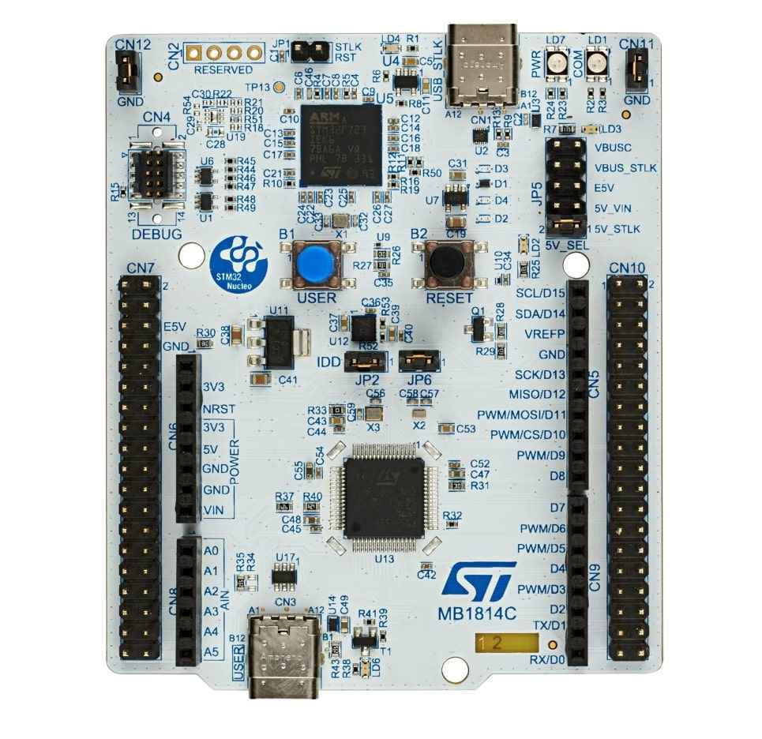

<!-- Copyright 2015-2026 Zephyr Project members and individual contributors. -->
<!-- SPDX-License-Identifier: Apache-2.0 -->
<!-- 中文翻译；编号、导航与译注为本地新增。 -->

<a id="nucleo_h533re"></a>

# 第41章\_Nucleo H533RE开发板

原文：[官方页面](https://docs.zephyrproject.org/latest/boards/st/nucleo_h533re/doc/index.html)。读取日期：2026-10-16；来源摘要见[来源记录](../SOURCES.md)。

开发板概览（Board Overview）

<a id="id1"></a>

[](images/nucleo_h533re.jpg)

Nucleo H533RE开发板

名称（Name）：

`nucleo_h533re`

厂商（Vendor）：

[意法半导体（STMicroelectronics）](https://docs.zephyrproject.org/latest/boards/index.html#vendor=st)

状态（Status）：

维护中（Maintained）

架构（Architecture）：

[arm](https://docs.zephyrproject.org/latest/boards/index.html#arch=arm)

片上系统（SoC）：

[stm32h533xx](https://docs.zephyrproject.org/latest/boards/index.html#soc=stm32h533xx)

<a id="board-github-link"></a>

[浏览开发板源码（Browse Board Sources）](https://github.com/zephyrproject-rtos/zephyr/blob/main//boards/st/nucleo_h533re/doc/index.rst/../..)<a id="overview"></a>

## 概述（Overview）

Nucleo H533RE是一款经济的开发平台，面向STMicroelectronics基于Arm® Cortex®-M33内核、带TrustZone®的STM32H533RET6微控制器，主要特点如下：


- LQFP64封装的STM32H533RE微控制器，具有512 Kbytes Flash及272 Kbytes SRAM
- 开发板连接器（Board Connectors）：


  - USB Type-C®全速受电端设备（Sink Device FS）
  - ST Zio扩展连接器，包含Arduino Uno V3接口：CN5、CN6、CN8及CN9
  - ST morpho扩展连接器：CN7及CN10
- 灵活的开发板供电方式：

  > - ST-Link USB接口提供5V_USB_STLK
  > - VIN经CN6第8脚或CN7第24脚提供。原文额定值为“7 - 12V, 0.8”，后一个数值未注明单位。
  > - ST morpho连接器CN7第6脚提供ESV，原文额定值为“5V, O.5A”，保留其标识与拼写。
  > - USB充电器经ST-LINK USB接口提供VBUS_STLK
  > - 用户USB连接器提供VBUSC（5 V、0.5 A）
  > - CN6第4脚或CN7第16脚提供3V3_EXT（3.3 V、1.3 A）
- 板载ST-LINK/V3EC调试器／编程器


  - 大容量存储（Mass Storage）
  - 虚拟COM端口
  - 调试端口（Debug Port）
- 1个与ARDUINO® Uno V3共用的用户LED
- 两个按键：USER及RESET
- 32.768 kHz晶体振荡器（Crystal Oscillator）

更多开发板信息见[NUCLEO_H533RE网站](https://www.st.com/en/evaluation-tools/nucleo-h533re)。

<a id="hardware"></a>

## 硬件（Hardware）

STM32H533xx属于STM32H5高性能微控制器系列，基于Arm® Cortex®-M33 32位RISC内核，最高工作频率250 MHz。


- 内核：Arm® 32位Cortex®-M33 CPU，支持TrustZone®及FPU
- 性能基准（Performance Benchmark）：


  - 原文性能数值为375 DMPIS/MHz（Dhrystone 2.1），拼写及单位照录，未将其改作另一指标。
- 安全（Security）


  - Arm® TrustZone®，具有Armv8-M主线安全扩展（Mainline Security Extension）
  - 最多8个可配置安全属性单元（SAU）区域
  - 识别TrustZone®且可设为安全属性的外设
  - 灵活的生命周期（Life Cycle）方案，支持安全调试认证（Secure Debug Authentication）
  - 以SESIP3及PSA Level 3认证保证为目标
  - 预配置的不可变信任根（Immutable Root of Trust，ST-iROT）
  - 安全固件安装（Secure Firmware Installation，SFI）
  - 通过唯一启动入口与安全隐藏保护区域（Hide Protection，HDP）建立信任根
  - 利用硬件唯一密钥（Hardware Unique Key，HUK）进行安全数据存储
  - 支持使用可信固件M（Trusted Firmware-M，TF-M）进行安全固件升级
  - 2个AES协处理器，其中1个抵抗差分功耗分析（DPA）
  - 抵抗DPA的公钥加速器（Public Key Accelerator）
  - Octo-SPI外部存储器即时解密（On-the-fly Decryption）
  - 哈希（HASH）硬件加速器
  - 符合NIST SP800-90B的真随机数发生器（TRNG）
  - 96位唯一标识（Unique ID）
  - 主动防篡改（Active Tampers）
- 时钟管理（Clock Management）：


  - 24 MHz高速外部（HSE）晶体振荡器
  - 用于实时时钟（RTC）的32 kHz低速外部晶体振荡器（LSE）
  - 内部64 MHz高速时钟（HSI），支持软件微调（Trimming）
  - 内部低功耗32 kHz RC振荡器（LSI），精度±5%
  - 内部4 MHz振荡器（CSI），支持软件微调
  - 内部48 MHz时钟（HSI48），带时钟恢复系统（Recovery System）
  - 三个锁相环（PLL），用于系统时钟、USB、音频和ADC
- 电源管理（Power Management）


  - 内置低压差稳压器（LDO），可配置三个输出范围，为数字电路供电
  - 内置开关模式电源（SMPS）降压转换器
- 带硬件日历、闹钟及校准功能的实时时钟（RTC）
- 最多112个高速I/O，多数耐受5 V；最多10个I/O具有独立供电，最低1.08 V
- 最多16个定时器及2个看门狗


  - 8个16位定时器
  - 两个32位定时器，最多四路输入捕获／输出比较／PWM（IC/OC/PWM），或脉冲计数器及正交增量编码器输入
  - 2个16位低功耗定时器，可在停止模式（Stop Mode）工作
  - 两个看门狗（Watchdogs）
  - 2个系统节拍（SysTick）定时器
- 存储器（Memories）


  - 最多512 Kbytes Flash，双存储区，支持写入时读取（Read-while-write）
  - 1 Kbyte一次性可编程存储器（OTP）
  - 272 Kbytes SRAM，其中80 Kbyte SRAM2支持纠错码（ECC）
  - 2 Kbytes备份SRAM，在最低功耗模式仍可用
  - 灵活外部存储器控制器（FMC），数据总线最多16位，支持SRAM、PSRAM、FRAM及NOR/NAND存储器
  - 1路OCTOSPI存储接口，支持即时解密（On-the-Fly Decryption）及串行PSRAM／NAND／NOR、HyperRAM／HyperFlash帧格式
  - 1路SD／SDIO／MMC接口
- 丰富的模拟外设（Analog Peripherals），采用独立供电


  - 2个12位ADC，12位模式最高5 MSPS
  - 1个12位双通道DAC
  - 一个数字温度传感器
  - 电压参考缓冲器（Voltage Reference Buffer）
- 34个通信接口


  - 1个USB Type-C／USB PD控制器
  - 1个USB 2.0全速主机／设备，无需晶体
  - 3路I2C FM+接口，支持SMBus/PMBus
  - 2路I3C接口
  - 6路U(S)ART，支持ISO 7816、LIN、IrDA及调制解调器控制
  - 1路低功耗UART（LP UART）
  - 4路SPI，其中3路与全双工I2S复用
  - 将4路USART配置为同步模式，可额外提供4路SPI
  - 2路灵活数据速率CAN（FDCAN）
  - 1路SD/MMC（SDMMC）接口
  - 2个16通道DMA控制器
  - 1路8～14位摄像头接口
  - 1路HDMI消费者电子控制（CEC）
  - 1路16位并行从机同步接口（Parallel Slave Synchronous Interface）
- 开发支持：串行线调试（SWD）、JTAG及嵌入式跟踪宏单元（Embedded Trace Macrocell™）

STM32H533RE的更多信息见：


- [STM32H533re在ST官网的产品页](https://www.st.com/en/microcontrollers-microprocessors/stm32h533re)
- [STM32H533参考手册（Reference Manual）](https://www.st.com/resource/en/reference_manual/rm0481-stm32h533-stm32h563-stm32h573-and-stm32h562-armbased-32bit-mcus-stmicroelectronics.pdf)

<a id="supported-features"></a>

### 支持的功能（Supported Features）

`nucleo_h533re`开发板支持下表所列的硬件功能。

片上／板载（On-Chip / On-Board）

功能集成在片上系统（SoC）内／位于开发板上。

2 / 2

分别表示已启用／已禁用的实例数。点击数量标签，可查看开发板或SoC设备树源码（DTS）中该功能的第一个实例。

`vnd,foo`

与此功能匹配的设备树绑定兼容字符串（Compatible String）；点击链接可查看绑定文档。

<a id="nucleo_h533re-hw-features"></a>

<a id="nucleo_h533re-nucleo_h533re/stm32h533xx-hw-features-section"></a>

#### `nucleo_h533re/stm32h533xx`目标（Target）

<a id="nucleo_h533re-nucleo_h533re/stm32h533xx-hw-features-panel"></a>

<a id="nucleo_h533re-nucleo_h533re/stm32h533xx-hw-features-memory"></a>

该开发板目标的片上存储容量：128 KiB RAM、512 KiB Flash。

<a id="nucleo_h533re-nucleo_h533re/stm32h533xx-hw-features-table"></a>

<table>
<tr>
<th>类型（Type）</th>
<th>位置（Location）</th>
<th>说明（Description）</th>
<th>兼容字符串（Compatible）</th>
</tr>
<tr>
<td rowspan="1">中央处理器（CPU）</td>
<td>片上（On-Chip）</td>
<td>ARM Cortex-M33处理器（CPU）（<a href="https://github.com/zephyrproject-rtos/zephyr/blob/main/dts/arm/st/h5/stm32h5.dtsi?plain=1#L32">已启用：1</a>）</td>
<td><a href="../cpu_arm_riscv_binding_reference/P022_arm_cortex-m33.md#std-dtcompatible-arm-cortex-m33"><code>arm,cortex-m33</code></a></td>
</tr>
<tr>
<td rowspan="1">模数转换器（ADC）</td>
<td>片上（On-Chip）</td>
<td>STM32模数转换器（ADC）（<a href="https://github.com/zephyrproject-rtos/zephyr/blob/main/dts/arm/st/h5/stm32h5.dtsi?plain=1#L359">已启用：1</a>）</td>
<td><a href="../hardware/P839_STM32模数转换器绑定.md#dtbinding-st-stm32-adc"><code>st,stm32-adc</code></a></td>
</tr>
<tr>
<td rowspan="1">控制器局域网（CAN）</td>
<td>片上（On-Chip）</td>
<td>STM32 FDCAN灵活数据速率CAN控制器（CAN FD Controller）（<a href="https://github.com/zephyrproject-rtos/zephyr/blob/main/dts/arm/st/h5/stm32h5.dtsi?plain=1#L610">已禁用：2</a>）</td>
<td><a href="../can_nxp_renesas_stm32_ti_binding_reference/P012_st_stm32-fdcan.md#std-dtcompatible-st-stm32-fdcan"><code>st,stm32-fdcan</code></a></td>
</tr>
<tr>
<td rowspan="8">时钟控制（Clock Control）</td>
<td>片上（On-Chip）</td>
<td>STM32H5复位与时钟控制器（RCC）（<a href="https://github.com/zephyrproject-rtos/zephyr/blob/main/dts/arm/st/h5/stm32h5.dtsi?plain=1#L194">已启用：1</a>）</td>
<td><a href="../timer_reference/P167_STM32H5复位与时钟控制绑定.md#dtbinding-st-stm32h5-rcc"><code>st,stm32h5-rcc</code></a></td>
</tr>
<tr>
<td>片上（On-Chip）</td>
<td>STM32 外部高速时钟（HSE Clock）（<a href="https://github.com/zephyrproject-rtos/zephyr/blob/main/dts/arm/st/h5/stm32h5.dtsi?plain=1#L59">已启用：1</a>）</td>
<td><a href="../timer_reference/P129_STM32高速外部时钟绑定.md#dtbinding-st-stm32-hse-clock"><code>st,stm32-hse-clock</code></a></td>
</tr>
<tr>
<td>片上（On-Chip）</td>
<td>STM32高速内部时钟（HSI）（<a href="https://github.com/zephyrproject-rtos/zephyr/blob/main/dts/arm/st/h5/stm32h5.dtsi?plain=1#L65">已启用：1</a>）</td>
<td><a href="../timer_reference/P146_STM32H7内部高速时钟绑定.md#dtbinding-st-stm32h7-hsi-clock"><code>st,stm32h7-hsi-clock</code></a></td>
</tr>
<tr>
<td>片上（On-Chip）</td>
<td>STM32内部48 MHz（HSI48）时钟（<a href="https://github.com/zephyrproject-rtos/zephyr/blob/main/dts/arm/st/h5/stm32h5.dtsi?plain=1#L73">已启用：1</a>）</td>
<td><a href="../timer_reference/P131_STM32内部48MHz时钟绑定.md#dtbinding-st-stm32-hsi48-clock"><code>st,stm32-hsi48-clock</code></a></td>
</tr>
<tr>
<td>片上（On-Chip）</td>
<td>通用固定频率时钟提供者（Fixed-Rate Clock Provider）（<a href="https://github.com/zephyrproject-rtos/zephyr/blob/main/dts/arm/st/h5/stm32h5.dtsi?plain=1#L80">已启用：1</a>；<a href="https://github.com/zephyrproject-rtos/zephyr/blob/main/dts/arm/st/h5/stm32h5.dtsi?plain=1#L95">已禁用：1</a>）</td>
<td><a href="../hardware/P566_固定时钟绑定.md#dtbinding-fixed-clock"><code>fixed-clock</code></a></td>
</tr>
<tr>
<td>片上（On-Chip）</td>
<td>STM32低速外部时钟（LSE Clock）（<a href="https://github.com/zephyrproject-rtos/zephyr/blob/main/dts/arm/st/h5/stm32h5.dtsi?plain=1#L87">已启用：1</a>）</td>
<td><a href="../timer_reference/P130_STM32低速外部时钟绑定.md#dtbinding-st-stm32-lse-clock"><code>st,stm32-lse-clock</code></a></td>
</tr>
<tr>
<td>片上（On-Chip）</td>
<td>STM32H5锁相环（PLL）（<a href="https://github.com/zephyrproject-rtos/zephyr/blob/main/dts/arm/st/h5/stm32h5.dtsi?plain=1#L102">已启用：1</a>；<a href="https://github.com/zephyrproject-rtos/zephyr/blob/main/dts/arm/st/h5/stm32h5.dtsi?plain=1#L108">已禁用：2</a>）</td>
<td><a href="../timer_reference/P153_STM32H5锁相环时钟绑定.md#dtbinding-st-stm32h5-pll-clock"><code>st,stm32h5-pll-clock</code></a></td>
</tr>
<tr>
<td>片上（On-Chip）</td>
<td>STM32 微控制器时钟输出（Microcontroller Clock Output，MCO）（<a href="https://github.com/zephyrproject-rtos/zephyr/blob/main/dts/arm/st/h5/stm32h5.dtsi?plain=1#L116">已禁用：2</a>）</td>
<td><a href="../timer_reference/P134_STM32时钟输出绑定.md#dtbinding-st-stm32-clock-mco"><code>st,stm32-clock-mco</code></a></td>
</tr>
<tr>
<td rowspan="1">计数器（Counter）</td>
<td>片上（On-Chip）</td>
<td>STM32 计数器（Counters）（<a href="https://github.com/zephyrproject-rtos/zephyr/blob/main/dts/arm/st/h5/stm32h5.dtsi?plain=1#L413">已禁用：5</a>）</td>
<td><a href="../stm32_ti_xilinx_counter_binding_reference/P007_st_stm32-counter.md#std-dtcompatible-st-stm32-counter"><code>st,stm32-counter</code></a></td>
</tr>
<tr>
<td rowspan="1">循环冗余校验（CRC）</td>
<td>片上（On-Chip）</td>
<td>STM32 CRC 计算单元（Calculation Unit）（<a href="https://github.com/zephyrproject-rtos/zephyr/blob/main/dts/arm/st/h5/stm32h5.dtsi?plain=1#L796">已禁用：1</a>）</td>
<td><a href="../crc_clock_monitor_binding_reference/P011_st_stm32-crc.md#std-dtcompatible-st-stm32-crc"><code>st,stm32-crc</code></a></td>
</tr>
<tr>
<td rowspan="2">密码学加速器（Cryptographic Accelerator）</td>
<td>片上（On-Chip）</td>
<td>STM32哈希处理器（HASH Processor）（<a href="https://github.com/zephyrproject-rtos/zephyr/blob/main/dts/arm/st/h5/stm32h5.dtsi?plain=1#L622">已禁用：1</a>）</td>
<td><a href="../crypto_secure_engine_st_ti_binding_reference/P017_st_stm32-hash.md#std-dtcompatible-st-stm32-hash"><code>st,stm32-hash</code></a></td>
</tr>
<tr>
<td>片上（On-Chip）</td>
<td>STM32高级加密标准加速器（AES Accelerator）（<a href="https://github.com/zephyrproject-rtos/zephyr/blob/main/dts/arm/st/h5/stm32h5_crypt.dtsi?plain=1#L9">已禁用：1</a>）</td>
<td><a href="../crypto_secure_engine_st_ti_binding_reference/P015_st_stm32-aes.md#std-dtcompatible-st-stm32-aes"><code>st,stm32-aes</code></a></td>
</tr>
<tr>
<td rowspan="1">数模转换器（DAC）</td>
<td>片上（On-Chip）</td>
<td>STM32 系列数模转换器（DAC）（<a href="https://github.com/zephyrproject-rtos/zephyr/blob/main/dts/arm/st/h5/stm32h5.dtsi?plain=1#L351">已禁用：1</a>）</td>
<td><a href="../hardware/P760_STM32数模转换器绑定.md#dtbinding-st-stm32-dac"><code>st,stm32-dac</code></a></td>
</tr>
<tr>
<td rowspan="1">直接存储器访问（DMA）</td>
<td>片上（On-Chip）</td>
<td>STM32U5直接存储器访问（DMA）控制器（<a href="https://github.com/zephyrproject-rtos/zephyr/blob/main/dts/arm/st/h5/stm32h5.dtsi?plain=1#L641">已禁用：2</a>）</td>
<td><a href="../stm32_ti_xilinx_dma_binding_reference/P012_st_stm32u5-dma.md#std-dtcompatible-st-stm32u5-dma"><code>st,stm32u5-dma</code></a></td>
</tr>
<tr>
<td rowspan="1">闪存控制器（Flash Controller）</td>
<td>片上（On-Chip）</td>
<td>STM32 系列闪存控制器（Flash Controller）（<a href="https://github.com/zephyrproject-rtos/zephyr/blob/main/dts/arm/st/h5/stm32h5.dtsi?plain=1#L130">已启用：1</a>）</td>
<td><a href="../flash_renesas_st_ti_binding_reference/P011_st_stm32-flash-controller.md#std-dtcompatible-st-stm32-flash-controller"><code>st,stm32-flash-controller</code></a></td>
</tr>
<tr>
<td rowspan="3">通用输入输出与接插件（GPIO &amp; Headers）</td>
<td>片上（On-Chip）</td>
<td>STM32 通用输入输出控制器（GPIO Controller）（<a href="https://github.com/zephyrproject-rtos/zephyr/blob/main/dts/arm/st/h5/stm32h5.dtsi?plain=1#L235">已启用：8</a>）</td>
<td><a href="../gpio_silabs_st_connectors_binding_reference/P029_st_stm32-gpio.md#std-dtcompatible-st-stm32-gpio"><code>st,stm32-gpio</code></a></td>
</tr>
<tr>
<td>板载（On-Board）</td>
<td>引出到Arduino Uno R3排针（Headers）的GPIO引脚（<a href="https://github.com/zephyrproject-rtos/zephyr/blob/main/boards/st/nucleo_h533re/arduino_r3_connector.dtsi?plain=1#L10">已启用：1</a>）</td>
<td><a href="../gpio_adi_headers_ambiq_binding_reference/P023_arduino-header-r3.md#std-dtcompatible-arduino-header-r3"><code>arduino-header-r3</code></a></td>
</tr>
<tr>
<td>板载（On-Board）</td>
<td>引出到ST Morpho连接器的GPIO引脚（<a href="https://github.com/zephyrproject-rtos/zephyr/blob/main/boards/st/nucleo_h533re/st_morpho_connector.dtsi?plain=1#L10">已启用：1</a>）</td>
<td><a href="../gpio_ti_xilinx_sdl_binding_reference/P003_st-morpho-header.md#std-dtcompatible-st-morpho-header"><code>st-morpho-header</code></a></td>
</tr>
<tr>
<td rowspan="1">集成电路间总线（I2C）</td>
<td>片上（On-Chip）</td>
<td>STM32 I2C V2 控制器（Controller）（<a href="https://github.com/zephyrproject-rtos/zephyr/blob/main/dts/arm/st/h5/stm32h5.dtsi?plain=1#L518">已禁用：2</a>）</td>
<td><a href="../i2c_stm32_ti_mux_binding_reference/P008_st_stm32-i2c-v2.md#std-dtcompatible-st-stm32-i2c-v2"><code>st,stm32-i2c-v2</code></a></td>
</tr>
<tr>
<td rowspan="1">集成电路间音频总线（I2S）</td>
<td>片上（On-Chip）</td>
<td>STM32H7 I2S控制器（<a href="https://github.com/zephyrproject-rtos/zephyr/blob/main/dts/arm/st/h5/stm32h5.dtsi?plain=1#L663">已禁用：3</a>）</td>
<td><a href="../i2s_binding_reference/P018_st_stm32h7-i2s.md#std-dtcompatible-st-stm32h7-i2s"><code>st,stm32h7-i2s</code></a></td>
</tr>
<tr>
<td rowspan="1">改进型集成电路间总线（I3C）</td>
<td>片上（On-Chip）</td>
<td>STM32H5 I3C控制器（<a href="https://github.com/zephyrproject-rtos/zephyr/blob/main/dts/arm/st/h5/stm32h5.dtsi?plain=1#L542">已禁用：2</a>）</td>
<td><a href="../i3c_smbus_binding_reference/P010_st_stm32-i3c.md#std-dtcompatible-st-stm32-i3c"><code>st,stm32-i3c</code></a></td>
</tr>
<tr>
<td rowspan="1">输入（Input）</td>
<td>板载（On-Board）</td>
<td>一组绑定到 GPIO 的输入按键（GPIO-Bound Input Keys）（<a href="https://github.com/zephyrproject-rtos/zephyr/blob/main/boards/st/nucleo_h533re/nucleo_h533re.dts?plain=1#L42">已启用：1</a>）</td>
<td><a href="../hardware/P563_GPIO按键绑定.md#std-dtcompatible-gpio-keys"><code>gpio-keys</code></a></td>
</tr>
<tr>
<td rowspan="2">中断控制器（Interrupt Controller）</td>
<td>片上（On-Chip）</td>
<td>ARMv8-M嵌套向量中断控制器（NVIC / Nested Vectored Interrupt Controller）（<a href="https://github.com/zephyrproject-rtos/zephyr/blob/main/dts/arm/armv8-m.dtsi?plain=1#L13">已启用：1</a>）</td>
<td><a href="../arm_interrupt_timer_binding_reference/P003_ARMv8_M_NVIC.md#std-dtcompatible-arm-v8m-nvic"><code>arm,v8m-nvic</code></a></td>
</tr>
<tr>
<td>片上（On-Chip）</td>
<td>STM32G0 外部中断控制器（External Interrupt Controller）（<a href="https://github.com/zephyrproject-rtos/zephyr/blob/main/dts/arm/st/h5/stm32h5.dtsi?plain=1#L206">已启用：1</a>）</td>
<td><a href="../mcu_external_interrupt_binding_reference/P002_st_stm32g0-exti.md#std-dtcompatible-st-stm32g0-exti"><code>st,stm32g0-exti</code></a></td>
</tr>
<tr>
<td rowspan="2">发光二极管（LED）</td>
<td>板载（On-Board）</td>
<td>一组由 GPIO 控制的 LED（GPIO-Controlled LEDs）（<a href="https://github.com/zephyrproject-rtos/zephyr/blob/main/boards/st/nucleo_h533re/nucleo_h533re.dts?plain=1#L25">已启用：1</a>）</td>
<td><a href="../hardware/P564_GPIO指示灯绑定.md#dtbinding-gpio-leds"><code>gpio-leds</code></a></td>
</tr>
<tr>
<td>板载（On-Board）</td>
<td>一组由脉宽调制（PWM）控制的LED（<a href="https://github.com/zephyrproject-rtos/zephyr/blob/main/boards/st/nucleo_h533re/nucleo_h533re.dts?plain=1#L34">已启用：1</a>）</td>
<td><a href="../hardware/P565_PWM指示灯绑定.md#dtbinding-pwm-leds"><code>pwm-leds</code></a></td>
</tr>
<tr>
<td rowspan="1">存储器控制器（Memory Controller）</td>
<td>片上（On-Chip）</td>
<td>STM32 灵活存储器控制器（Flexible Memory Controller，FMC）（<a href="https://github.com/zephyrproject-rtos/zephyr/blob/main/dts/arm/st/h5/stm32h523.dtsi?plain=1#L48">已禁用：1</a>）</td>
<td><a href="../memory_controller_sdram_psram_binding_reference/P013_st_stm32-fmc.md#std-dtcompatible-st-stm32-fmc"><code>st,stm32-fmc</code></a></td>
</tr>
<tr>
<td rowspan="1">内存管理单元／内存保护单元（MMU / MPU）</td>
<td>片上（On-Chip）</td>
<td>ARMv8-M存储器保护单元（MPU / Memory Protection Unit）（<a href="https://github.com/zephyrproject-rtos/zephyr/blob/main/dts/arm/st/h5/stm32h5.dtsi?plain=1#L42">已启用：1</a>）</td>
<td><a href="../memory_protection_binding_reference/P007_arm_armv8m-mpu.md#std-dtcompatible-arm-armv8m-mpu"><code>arm,armv8m-mpu</code></a></td>
</tr>
<tr>
<td rowspan="1">存储技术设备（MTD）</td>
<td>片上（On-Chip）</td>
<td>STM32闪存（Flash Memory）（<a href="https://github.com/zephyrproject-rtos/zephyr/blob/main/dts/arm/st/h5/stm32h5.dtsi?plain=1#L139">已启用：1</a>）</td>
<td><a href="../mtd_nxp_st_ti_partition_binding_reference/P016_st_stm32-nv-flash.md#std-dtcompatible-st-stm32-nv-flash"><code>st,stm32-nv-flash</code></a></td>
</tr>
<tr>
<td rowspan="1">非易失存储器（NVMEM）</td>
<td>片上（On-Chip）</td>
<td>非易失存储器固定布局（Fixed Layout for Non-Volatile Memory）（<a href="https://github.com/zephyrproject-rtos/zephyr/blob/main/dts/arm/st/h5/stm32h5.dtsi?plain=1#L160">已启用：1</a>）</td>
<td><a href="../memory_protection_binding_reference/P009_fixed-layout.md#std-dtcompatible-fixed-layout"><code>fixed-layout</code></a></td>
</tr>
<tr>
<td rowspan="1">一次性可编程存储器（OTP Memory）</td>
<td>片上（On-Chip）</td>
<td>STM32 嵌入式非易失一次性可编程存储器（NVM OTP）（<a href="https://github.com/zephyrproject-rtos/zephyr/blob/main/dts/arm/st/h5/stm32h5.dtsi?plain=1#L156">已启用：1</a>；<a href="https://github.com/zephyrproject-rtos/zephyr/blob/main/dts/arm/st/h5/stm32h5.dtsi?plain=1#L149">已禁用：1</a>）</td>
<td><a href="../otp_binding_reference/P010_st_stm32-nvm-otp.md#std-dtcompatible-st-stm32-nvm-otp"><code>st,stm32-nvm-otp</code></a></td>
</tr>
<tr>
<td rowspan="1">物理层（PHY）</td>
<td>片上（On-Chip）</td>
<td>用于所有内置于 USB IP 的 USB 收发器（USB Transceivers）的绑定。（<a href="https://github.com/zephyrproject-rtos/zephyr/blob/main/dts/arm/st/h5/stm32h5.dtsi?plain=1#L851">已启用：1</a>）</td>
<td><a href="../phy_binding_reference/P008_usb-nop-xceiv.md#std-dtcompatible-usb-nop-xceiv"><code>usb-nop-xceiv</code></a></td>
</tr>
<tr>
<td rowspan="1">引脚控制（Pin Control）</td>
<td>片上（On-Chip）</td>
<td>支持高速低电压（HSLV）的STM32引脚控制器（<a href="https://github.com/zephyrproject-rtos/zephyr/blob/main/dts/arm/st/h5/stm32h5.dtsi?plain=1#L228">已启用：1</a>）</td>
<td><a href="../pinctrl_stm32_ti_xilinx_binding_reference/P006_st_stm32h5-pinctrl.md#std-dtcompatible-st-stm32h5-pinctrl"><code>st,stm32h5-pinctrl</code></a></td>
</tr>
<tr>
<td rowspan="3">电源管理（Power Management）</td>
<td>片上（On-Chip）</td>
<td>STM32 电源控制器（Power Controller）（<a href="https://github.com/zephyrproject-rtos/zephyr/blob/main/dts/arm/st/h5/stm32h5.dtsi?plain=1#L742">已启用：1</a>）</td>
<td><a href="../stm32_soc_power_binding_reference/P010_st_stm32-pwr.md#std-dtcompatible-st-stm32-pwr"><code>st,stm32-pwr</code></a></td>
</tr>
<tr>
<td>片上（On-Chip）</td>
<td>STM32唤醒线控制器（Wake-up Lines Controller）（<a href="https://github.com/zephyrproject-rtos/zephyr/blob/main/dts/arm/st/h5/stm32h5.dtsi?plain=1#L746">已禁用：1</a>）</td>
<td><a href="../stm32_soc_power_binding_reference/P009_st_stm32-pwr-wkupctrl.md#std-dtcompatible-st-stm32-pwr-wkupctrl"><code>st,stm32-pwr-wkupctrl</code></a></td>
</tr>
<tr>
<td>片上（On-Chip）</td>
<td>STM32H5 I/O单元控制器（I/O Cell Controller）（<a href="https://github.com/zephyrproject-rtos/zephyr/blob/main/dts/arm/st/h5/stm32h5.dtsi?plain=1#L805">已禁用：1</a>）</td>
<td><a href="../stm32_soc_power_binding_reference/P013_st_stm32h5-iocell.md#std-dtcompatible-st-stm32h5-iocell"><code>st,stm32h5-iocell</code></a></td>
</tr>
<tr>
<td rowspan="1">脉宽调制（PWM）</td>
<td>片上（On-Chip）</td>
<td>STM32 脉宽调制（PWM）（<a href="https://github.com/zephyrproject-rtos/zephyr/blob/main/dts/arm/st/h5/stm32h5.dtsi?plain=1#L465">已启用：1</a>；<a href="https://github.com/zephyrproject-rtos/zephyr/blob/main/dts/arm/st/h5/stm32h5.dtsi?plain=1#L407">已禁用：2</a>）</td>
<td><a href="../pwm_stm32_ti_generic_binding_reference/P011_st_stm32-pwm.md#std-dtcompatible-st-stm32-pwm"><code>st,stm32-pwm</code></a></td>
</tr>
<tr>
<td rowspan="1">稳压器（Regulator）</td>
<td>片上（On-Chip）</td>
<td>STM32参考电压缓冲器稳压器（VREFBUF Regulator）（<a href="https://github.com/zephyrproject-rtos/zephyr/blob/main/dts/arm/st/h5/stm32h523.dtsi?plain=1#L68">已禁用：1</a>）</td>
<td><a href="../hardware/P638_STM32参考电压缓冲器绑定.md#dtbinding-st-stm32-vrefbuf"><code>st,stm32-vrefbuf</code></a></td>
</tr>
<tr>
<td rowspan="1">复位控制器（Reset Controller）</td>
<td>片上（On-Chip）</td>
<td>STM32 复位与时钟控制器（Reset and Clock Control，RCC）（<a href="https://github.com/zephyrproject-rtos/zephyr/blob/main/dts/arm/st/h5/stm32h5.dtsi?plain=1#L200">已启用：1</a>）</td>
<td><a href="../reset_controller_binding_reference/P017_st_stm32-rcc-rctl.md#std-dtcompatible-st-stm32-rcc-rctl"><code>st,stm32-rcc-rctl</code></a></td>
</tr>
<tr>
<td rowspan="1">随机数生成器（RNG）</td>
<td>片上（On-Chip）</td>
<td>STM32 随机数生成器（Random Number Generator）（<a href="https://github.com/zephyrproject-rtos/zephyr/blob/main/dts/arm/st/h5/stm32h5.dtsi?plain=1#L631">已启用：1</a>）</td>
<td><a href="../soc_rng_binding_reference/P016_st_stm32-rng.md#std-dtcompatible-st-stm32-rng"><code>st,stm32-rng</code></a></td>
</tr>
<tr>
<td rowspan="1">实时时钟（RTC）</td>
<td>片上（On-Chip）</td>
<td>STM32 实时时钟（RTC）（<a href="https://github.com/zephyrproject-rtos/zephyr/blob/main/dts/arm/st/h5/stm32h5.dtsi?plain=1#L386">已启用：1</a>）</td>
<td><a href="../soc_rtc_binding_reference/P014_st_stm32-rtc.md#std-dtcompatible-st-stm32-rtc"><code>st,stm32-rtc</code></a></td>
</tr>
<tr>
<td rowspan="6">传感器（Sensors）</td>
<td>片上（On-Chip）</td>
<td>STM32 正交解码器（Quadrature Decoder）（<a href="https://github.com/zephyrproject-rtos/zephyr/blob/main/dts/arm/st/h5/stm32h5.dtsi?plain=1#L419">已禁用：3</a>）</td>
<td><a href="../sensor_st_lsm_stm32_binding_reference/P028_st_stm32-qdec.md#std-dtcompatible-st-stm32-qdec"><code>st,stm32-qdec</code></a></td>
</tr>
<tr>
<td>片上（On-Chip）</td>
<td>STM32数字温度传感器（<a href="https://github.com/zephyrproject-rtos/zephyr/blob/main/dts/arm/st/h5/stm32h5.dtsi?plain=1#L733">已禁用：1</a>）</td>
<td><a href="../sensor_st_lsm_stm32_binding_reference/P027_st_stm32-digi-temp.md#std-dtcompatible-st-stm32-digi-temp"><code>st,stm32-digi-temp</code></a></td>
</tr>
<tr>
<td>片上（On-Chip）</td>
<td>STM32 系列温度节点（TEMP），用于以两个温度点完成生产校准的传感器。（<a href="https://github.com/zephyrproject-rtos/zephyr/blob/main/dts/arm/st/h5/stm32h5.dtsi?plain=1#L818">已启用：1</a>）</td>
<td><a href="../sensor_st_lsm_stm32_binding_reference/P029_st_stm32-temp-cal.md#std-dtcompatible-st-stm32-temp-cal"><code>st,stm32-temp-cal</code></a></td>
</tr>
<tr>
<td>片上（On-Chip）</td>
<td>STM32 参考电压（VREF+）（<a href="https://github.com/zephyrproject-rtos/zephyr/blob/main/dts/arm/st/h5/stm32h5.dtsi?plain=1#L830">已启用：1</a>）</td>
<td><a href="../sensor_st_ti_power_capacitance_binding_reference/P003_st_stm32-vref.md#std-dtcompatible-st-stm32-vref"><code>st,stm32-vref</code></a></td>
</tr>
<tr>
<td>片上（On-Chip）</td>
<td>STM32 电池电压（VBAT）（<a href="https://github.com/zephyrproject-rtos/zephyr/blob/main/dts/arm/st/h5/stm32h5.dtsi?plain=1#L838">已启用：1</a>）</td>
<td><a href="../sensor_st_ti_power_capacitance_binding_reference/P001_st_stm32-vbat.md#std-dtcompatible-st-stm32-vbat"><code>st,stm32-vbat</code></a></td>
</tr>
<tr>
<td>片上（On-Chip）</td>
<td>STM32内核供电（Vddcore）（<a href="https://github.com/zephyrproject-rtos/zephyr/blob/main/dts/arm/st/h5/stm32h5.dtsi?plain=1#L845">已启用：1</a>）</td>
<td><a href="../sensor_st_ti_power_capacitance_binding_reference/P002_st_stm32-vddcore.md#std-dtcompatible-st-stm32-vddcore"><code>st,stm32-vddcore</code></a></td>
</tr>
<tr>
<td rowspan="2">串行控制器（Serial Controller）</td>
<td>片上（On-Chip）</td>
<td>STM32 通用同步／异步收发器（USART）（<a href="https://github.com/zephyrproject-rtos/zephyr/blob/main/dts/arm/st/h5/stm32h5.dtsi?plain=1#L300">已启用：2</a>；<a href="https://github.com/zephyrproject-rtos/zephyr/blob/main/dts/arm/st/h5/stm32h5.dtsi?plain=1#L318">已禁用：1</a>）</td>
<td><a href="../uart_silabs_stm32_ti_binding_reference/P016_st_stm32-usart.md#std-dtcompatible-st-stm32-usart"><code>st,stm32-usart</code></a></td>
</tr>
<tr>
<td>片上（On-Chip）</td>
<td>STM32低功耗通用异步收发器（LPUART）（<a href="https://github.com/zephyrproject-rtos/zephyr/blob/main/dts/arm/st/h5/stm32h5.dtsi?plain=1#L327">已禁用：1</a>）</td>
<td><a href="../uart_silabs_stm32_ti_binding_reference/P014_st_stm32-lpuart.md#std-dtcompatible-st-stm32-lpuart"><code>st,stm32-lpuart</code></a></td>
</tr>
<tr>
<td rowspan="1">系统管理总线（SMbus）</td>
<td>片上（On-Chip）</td>
<td>STM32 系统管理总线控制器（SMBus Controller）（<a href="https://github.com/zephyrproject-rtos/zephyr/blob/main/dts/arm/st/h5/stm32h5.dtsi?plain=1#L856">已禁用：2</a>）</td>
<td><a href="../i3c_smbus_binding_reference/P013_st_stm32-smbus.md#std-dtcompatible-st-stm32-smbus"><code>st,stm32-smbus</code></a></td>
</tr>
<tr>
<td rowspan="1">串行外设接口（SPI）</td>
<td>片上（On-Chip）</td>
<td>STM32H7 串行外设接口控制器（SPI Controller）（<a href="https://github.com/zephyrproject-rtos/zephyr/blob/main/dts/arm/st/h5/stm32h5.dtsi?plain=1#L568">已启用：1</a>；<a href="https://github.com/zephyrproject-rtos/zephyr/blob/main/dts/arm/st/h5/stm32h5.dtsi?plain=1#L582">已禁用：2</a>）</td>
<td><a href="../spi_stm32_ti_xilinx_binding_reference/P013_st_stm32h7-spi.md#std-dtcompatible-st-stm32h7-spi"><code>st,stm32h7-spi</code></a></td>
</tr>
<tr>
<td rowspan="1">USB Type-C 端口控制器（USB Type-C Port Controller）</td>
<td>片上（On-Chip）</td>
<td>STM32 USB Type-C／电力传输（Power Delivery）（<a href="https://github.com/zephyrproject-rtos/zephyr/blob/main/dts/arm/st/h5/stm32h5.dtsi?plain=1#L725">已禁用：1</a>）</td>
<td><a href="../usbc_tcpc_binding_reference/P005_st_stm32-ucpd.md#std-dtcompatible-st-stm32-ucpd"><code>st,stm32-ucpd</code></a></td>
</tr>
<tr>
<td rowspan="3">定时器（Timer）</td>
<td>片上（On-Chip）</td>
<td>ARMv8-M系统节拍（System Tick）（<a href="https://github.com/zephyrproject-rtos/zephyr/blob/main/dts/arm/armv8-m.dtsi?plain=1#L21">已启用：1</a>）</td>
<td><a href="../arm_interrupt_timer_binding_reference/P007_ARMv8_M_SysTick.md#std-dtcompatible-arm-armv8m-systick"><code>arm,armv8m-systick</code></a></td>
</tr>
<tr>
<td>片上（On-Chip）</td>
<td>STM32U5低功耗定时器（LPTIM）（<a href="https://github.com/zephyrproject-rtos/zephyr/blob/main/dts/arm/st/h5/stm32h5.dtsi?plain=1#L276">已禁用：2</a>）</td>
<td><a href="../stm32_ti_silabs_timer_binding_reference/P009_st_stm32u5-lptim.md#std-dtcompatible-st-stm32u5-lptim"><code>st,stm32u5-lptim</code></a></td>
</tr>
<tr>
<td>片上（On-Chip）</td>
<td>STM32 定时器（Timers）（<a href="https://github.com/zephyrproject-rtos/zephyr/blob/main/dts/arm/st/h5/stm32h5.dtsi?plain=1#L455">已启用：1</a>；<a href="https://github.com/zephyrproject-rtos/zephyr/blob/main/dts/arm/st/h5/stm32h5.dtsi?plain=1#L397">已禁用：4</a>）</td>
<td><a href="../stm32_ti_silabs_timer_binding_reference/P008_st_stm32-timers.md#std-dtcompatible-st-stm32-timers"><code>st,stm32-timers</code></a></td>
</tr>
<tr>
<td rowspan="1">通用串行总线（USB）</td>
<td>片上（On-Chip）</td>
<td>STM32 USB控制器（Controller）（<a href="https://github.com/zephyrproject-rtos/zephyr/blob/main/dts/arm/st/h5/stm32h5.dtsi?plain=1#L711">已启用：1</a>）</td>
<td><a href="../usb_stm32_audio_binding_reference/P006_st_stm32-usb.md#std-dtcompatible-st-stm32-usb"><code>st,stm32-usb</code></a></td>
</tr>
<tr>
<td rowspan="2">看门狗（Watchdog）</td>
<td>片上（On-Chip）</td>
<td>STM32 看门狗（Watchdog）（<a href="https://github.com/zephyrproject-rtos/zephyr/blob/main/dts/arm/st/h5/stm32h5.dtsi?plain=1#L336">已启用：1</a>）</td>
<td><a href="../stm32_ti_xilinx_watchdog_binding_reference/P001_st_stm32-watchdog.md#std-dtcompatible-st-stm32-watchdog"><code>st,stm32-watchdog</code></a></td>
</tr>
<tr>
<td>片上（On-Chip）</td>
<td>STM32 系统窗口看门狗（System Window Watchdog）（<a href="https://github.com/zephyrproject-rtos/zephyr/blob/main/dts/arm/st/h5/stm32h5.dtsi?plain=1#L343">已禁用：1</a>）</td>
<td><a href="../stm32_ti_xilinx_watchdog_binding_reference/P002_st_stm32-window-watchdog.md#std-dtcompatible-st-stm32-window-watchdog"><code>st,stm32-window-watchdog</code></a></td>
</tr>
</table>

<a id="zephyr-board-options"></a>

### Zephyr开发板选项（Board Options）

STM32H533采用Cortex-M33架构，Zephyr支持构建安全固件（Secure Firmware）。

`BOARD`选项汇总如下：

<table>
<tr>
<th>开发板目标（BOARD）</th>
<th>说明（Description）</th>
</tr>
<tr>
<td><code>nucleo_h533re</code></td>
<td>构建安全固件（Secure Firmware）</td>
</tr>
</table>

<a id="connections-and-ios"></a>

### 连接与输入输出（Connections and IOs）

Nucleo H533RE有8个通用输入输出（GPIO）控制器，负责引脚复用（Pin Muxing）、输入输出、上拉等功能。

更多细节见[STM32H5 Nucleo-64开发板用户手册](https://www.st.com/resource/en/user_manual/um3121-stm32h5-nucleo64-board-mb1814-stmicroelectronics.pdf)。

<a id="default-zephyr-peripheral-mapping"></a>

#### Zephyr 默认外设映射（Peripheral Mapping）：


- ADC1通道0输入：PA0
- USART1 TX/RX：PB14/PB15（Arduino USART1接口）
- SPI1 SCK/MISO/MOSI/NSS: PA5/PA6/PA7/PC9
- UART2 TX/RX：PA2/PA3（虚拟COM端口，VCP）
- `USER_PB : PC13`

<a id="system-clock"></a>

#### 系统时钟（System Clock）

Nucleo H533RE系统时钟可来自内部振荡器、外部振荡器或主PLL。默认以24 MHz高速外部时钟驱动PLL，产生240 MHz系统时钟。

<a id="serial-port"></a>

#### 串口（Serial Port）

Nucleo H533RE最多有4路USART、2路UART及1路LPUART。Zephyr控制台分配给USART2，默认参数115200、8N1。

<a id="backup-sram"></a>

#### 备份SRAM（Backup SRAM）

测试备份SRAM时，可以移除板背面的SB38跳线，断开VBAT与VDD_MCU。VBAT可由左侧ST Morpho连接器第33脚提供。

<a id="programming-and-debugging"></a>

## 烧录与调试（Programming and Debugging）

`nucleo_h533re`开发板支持下表所列的运行工具（Runners）及相关west命令。

<table>
<tr>
<th></th>
<th>烧录（flash）</th>
<th>调试（debug）</th>
<th>复位（reset）</th>
<th>连接调试会话（attach）</th>
<th>实时传输（rtt）</th>
<th>调试服务器（debugserver）</th>
</tr>
<tr>
<td><a href="https://docs.zephyrproject.org/latest/develop/flash_debug/host-tools.html#runner-jlink">jlink</a></td>
<td>✅</td>
<td>✅</td>
<td>✅</td>
<td>✅</td>
<td>✅</td>
<td>✅</td>
</tr>
<tr>
<td><a href="https://docs.zephyrproject.org/latest/develop/flash_debug/host-tools.html#runner-openocd">openocd</a></td>
<td>✅</td>
<td>✅</td>
<td></td>
<td>✅</td>
<td>✅</td>
<td>✅</td>
</tr>
<tr>
<td><a href="https://docs.zephyrproject.org/latest/develop/flash_debug/host-tools.html#runner-pyocd">pyocd</a></td>
<td>✅</td>
<td>✅（默认 / default）</td>
<td>✅</td>
<td>✅</td>
<td>✅</td>
<td>✅</td>
</tr>
<tr>
<td><a href="https://docs.zephyrproject.org/latest/develop/flash_debug/host-tools.html#runner-stm32cubeprogrammer"><code>stm32cubeprogrammer</code></a></td>
<td>✅（默认 / default）</td>
<td></td>
<td></td>
<td></td>
<td></td>
<td></td>
</tr>
</table>

Nucleo H533RE内置ST-LINK/V3EC调试工具接口，可使用多种工具烧录开发板。

nucleo_h533re开发板的应用可按常规方式构建和烧录，详见“[构建应用（Building an Application）](../application/P001_应用开发.md#build-an-application)”与“[运行应用（Run an Application）](https://docs.zephyrproject.org/latest/develop/application/index.html#application-run)”。

<a id="openocd-support"></a>

### OpenOCD支持（OpenOCD Support）

原文记载当时上游OpenOCD尚不支持stm32h5，可查阅[OpenOCD官方GitHub镜像](https://github.com/openocd-org/openocd/)。要使用该功能，需要克隆STMicroelectronics定制的OpenOCD GitHub仓库，按README编译，然后在[boards/st/nucleo_h533re/board.cmake](https://github.com/zephyrproject-rtos/zephyr/blob/main/boards/st/nucleo_h533re/board.cmake)中、包含公共openocd.board.cmake之前，设置OPENOCD与OPENOCD_DEFAULT_PATH，使构建使用对应的OpenOCD程序及脚本目录：（[STMicroelectronics OpenOCD GitHub仓库](https://github.com/STMicroelectronics/OpenOCD/tree/openocd-cubeide-r6)）

> ```text
> set(OPENOCD "<path_to_openocd_repo>/src/openocd" CACHE FILEPATH "" FORCE)
> set(OPENOCD_DEFAULT_PATH <path_to_opneocd_repo>/tcl)
> include(${ZEPHYR_BASE}/boards/common/openocd.board.cmake)
> ```

<a id="flashing"></a>

### 烧录（Flashing）

此板默认通过west的[STM32CubeProgrammer](https://www.st.com/en/development-tools/stm32cubeprog.html)运行器（Runner）烧录，因此需要安装该工具。（[installation](https://docs.zephyrproject.org/latest/develop/flash_debug/host-tools.html#stm32cubeprog-flash-host-tools)）

也可以使用OpenOCD、J-Link或pyOCD，通过--runner或-r选项烧录开发板：

```text
$ west flash --runner openocd
$ west flash --runner pyocd
$ west flash --runner jlink
```

pyOCD需要安装额外的目标信息，可执行以下命令：

```text
$ pyocd pack --update
$ pyocd pack --install stm32h5
```

<a id="flashing-an-application-to-nucleo-h533re"></a>

#### 向Nucleo H533RE烧录应用（Flashing an Application）

通过USB将Nucleo H533RE连接主机，然后构建并烧录应用。以下以[Hello World](../getting_started/P005_HelloWorld示例.md#hello_world)为例。

运行主机串口程序，连接Nucleo开发板：

```text
$ minicom -D /dev/ttyACM0
```

随后构建并烧录应用。

```text
# From the root of the zephyr repository
west build -b nucleo_h533re samples/hello_world
west flash
```

控制台上应显示以下消息：

```text
Hello World! nucleo_h533re
```

<a id="debugging"></a>

### 调试（Debugging）

可以按通常方式调试应用，以下以[Blinky](../getting_started/P004_LED闪烁示例.md#blinky)为例。

```text
# From the root of the zephyr repository
west build -b nucleo_h533re samples/basic/blinky
west debug
```

## 译注

供电列表0.8未写单位，ESV及O.5A拼写、性能DMPIS/MHz均按原文保留并提示。OpenOCD支持描述属于来源页面的版本状态。

## 原文外链核对

2026-10-16核对并重试以下原文外链时未能确认可访问性，保留原始目标，不将访问失败解释为原文内容有误。

- [stm32cubeprog.html](https://www.st.com/en/development-tools/stm32cubeprog.html)：HTTP Error 567: Unknown Status。
- [nucleo-h533re](https://www.st.com/en/evaluation-tools/nucleo-h533re)：HTTP Error 567: Unknown Status。
- [stm32h533re](https://www.st.com/en/microcontrollers-microprocessors/stm32h533re)：HTTP Error 567: Unknown Status。
- [rm0481-stm32h533-stm32h563-stm32h573-and-stm32h562-armbased-32bit-mcus-stmicroelectronics.pdf](https://www.st.com/resource/en/reference_manual/rm0481-stm32h533-stm32h563-stm32h573-and-stm32h562-armbased-32bit-mcus-stmicroelectronics.pdf)：HTTP Error 567: Unknown Status。
- [um3121-stm32h5-nucleo64-board-mb1814-stmicroelectronics.pdf](https://www.st.com/resource/en/user_manual/um3121-stm32h5-nucleo64-board-mb1814-stmicroelectronics.pdf)：HTTP Error 567: Unknown Status。

---

[上一章](P040_Nucleo_H503RB.md) · [返回大纲](大纲.md) · [全站翻译进度](../PROGRESS.md) · [下一章](P042_Nucleo_H563ZI.md)
