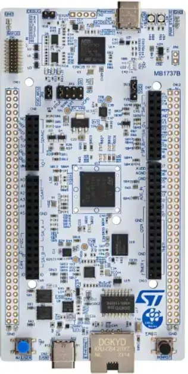

<!-- Copyright 2015-2026 Zephyr Project members and individual contributors. -->
<!-- SPDX-License-Identifier: Apache-2.0 -->
<!-- 中文翻译；编号、导航与译注为本地新增。 -->

<a id="nucleo_h7s3l8"></a>

# 第49章\_Nucleo H7S3L8开发板

原文：[官方页面](https://docs.zephyrproject.org/latest/boards/st/nucleo_h7s3l8/doc/index.html)。读取日期：2026-10-16；来源摘要见[来源记录](../SOURCES.md)。

开发板概览（Board Overview）

<a id="id2"></a>

[](images/nucleo_h7s3l8.webp)

Nucleo H7S3L8开发板

名称（Name）：

`nucleo_h7s3l8`

厂商（Vendor）：

[意法半导体（STMicroelectronics）](https://docs.zephyrproject.org/latest/boards/index.html#vendor=st)

状态（Status）：

维护中（Maintained）

架构（Architecture）：

[arm](https://docs.zephyrproject.org/latest/boards/index.html#arch=arm)

片上系统（SoC）：

[stm32h7s3xx](https://docs.zephyrproject.org/latest/boards/index.html#soc=stm32h7s3xx)

<a id="board-github-link"></a>

[浏览开发板源码（Browse Board Sources）](https://github.com/zephyrproject-rtos/zephyr/blob/main//boards/st/nucleo_h7s3l8/doc/index.rst/../..)<a id="overview"></a>

## 概述（Overview）

STM32 Nucleo-144开发板提供经济、灵活的方式，用户可按STM32微控制器的性能与功耗组合选择设备，尝试新概念和构建原型。

ST Zio扩展ARDUINO® Uno V3连接能力，结合ST morpho排针，可搭配多种专用扩展板扩展Nucleo开放开发平台。STM32 Nucleo-144内置ST-LINK V3调试器／编程器，无需独立探针。

STM32 Nucleo-144开发板可使用STM32Cube MCU软件包提供的完整免费软件库及示例。

主要特性（Key Features）


- TFBGA225封装的STM32微控制器，具有64 Kbytes Flash及620 Kbytes RAM
- 符合IEEE-802.3-2002的以太网（Ethernet）
- USB仅设备模式、USB OTG全速，或受电端／上行端口（SNK/UFP）的全速或高速模式；原文连续重复USB。
- 三个用户LED
- 用户及复位按键共2个
- 32.768 kHz晶体振荡器（Crystal Oscillator）
- 开发板连接器（Board Connectors）：

> - USB Micro-AB或USB Type-C®接口
> - 以太网RJ45接口
> - 兼容MIPI20的连接器，带跟踪（Trace）信号


- 灵活供电方式：ST-LINK USB VBUS或外部电源
- 通过外部或内部SMPS产生Vcore逻辑电源
- 板载ST-LINK/V3调试器／编程器支持USB重新枚举
- 提供大容量存储、虚拟COM端口及调试端口

更多开发板信息见[Nucleo H7S3L8网站](https://www.st.com/en/evaluation-tools/nucleo-h7s3l8.html)。

<a id="hardware"></a>

## 硬件（Hardware）

Nucleo H7S3L8提供以下硬件组件：

原文此处说明STM32H7S7xx属于STM32H7高性能微控制器系列，基于Arm® Cortex®-M7 32位RISC内核，最高工作频率500 MHz。译注：本页板型为H7S3L8，后文默认时钟写600 MHz，两处原文均保留。


- 内核：带FPU的Arm® 32位Cortex®-M7 CPU
- 性能基准（Performance Benchmark）：


  - 原文性能数值为1284 DMPIS/MHz（Dhrystone 2.1），拼写及单位照录。
- 安全（Security）


  - 灵活的生命周期（Lifecycle）方案，支持安全调试认证
  - 预配置的不可变信任根（Immutable Root of Trust，ST-iROT）
  - 安全固件安装（Secure Firmware Installation，SFI）
  - 利用硬件唯一密钥（Hardware Unique Key，HUK）进行安全数据存储
  - 支持使用可信固件M（Trusted Firmware-M，TF-M）进行安全固件升级
  - 2个AES协处理器，其中1个抵抗差分功耗分析（DPA）
  - 抵抗DPA的公钥加速器（Public Key Accelerator）
  - Octo-SPI外部存储器即时解密（On-the-fly Decryption）
  - 哈希（HASH）硬件加速器
  - 96位唯一标识（Unique ID）
  - 主动防篡改（Active Tampers）
  - 符合NIST SP800-90B的真随机数发生器（RNG）
- 时钟管理（Clock Management）：


  - 24 MHz高速外部（HSE）晶体振荡器
  - 用于RTC的32768 Hz低速外部（LSE）晶体振荡器
  - 内部64 MHz高速时钟（HSI），支持软件微调（Trimming）
  - 内部低功耗32 kHz RC振荡器（LSI），精度±5%
  - 内部4 MHz振荡器（CSI），支持软件微调
  - 内部48 MHz时钟（HSI48），带时钟恢复系统（Recovery System）
  - 三个锁相环（PLL），用于系统时钟、USB、音频和ADC
- 电源管理（Power Management）


  - 内置低压差稳压器（LDO），可配置三个输出范围，为数字电路供电
- 带硬件日历、闹钟及校准功能的实时时钟（RTC）
- 最多152个高速I/O，多数耐受5 V；最多10个I/O具有独立供电，最低1.08 V
- 最多16个定时器及2个看门狗


  - 16个16位定时器
  - 4个32位定时器，最多支持4路IC/OC/PWM、脉冲计数及正交增量编码器输入
  - 5个16位低功耗定时器，可在停止模式工作
  - 两个看门狗（Watchdogs）
  - 1个系统节拍定时器（SysTick）
- 存储器（Memories）


  - 最多64 KB Flash，双存储区，支持写入时读取
  - 1 Kbyte一次性可编程存储器（OTP）
  - 640 KB SRAM，其中64 KB支持硬件奇偶校验，320 Kbytes支持灵活ECC
  - 4 KB备份SRAM，可在最低功耗模式使用
  - 灵活外部存储控制器，数据总线最高16位，支持SRAM、PSRAM、铁电RAM（FRAM）、SDRAM／低功耗单数据率SDRAM、NOR及NAND
  - 2路八线SPI存储器接口（OCTOSPI），支持即时解密及串行PSRAM/NAND/NOR、HyperRAM/HyperFlash帧格式
  - 1路十六线SPI存储器接口（HEXASPI），支持即时解密及串行PSRAM/NAND/NOR、HyperRAM/HyperFlash帧格式
  - 2路SD/SDIO/MMC接口
- 丰富的模拟外设（Analog Peripherals），采用独立供电


  - 2个12位ADC，12位模式最高5 MSPS
  - 一个数字温度传感器
- 35个通信接口


  - 1个USB Type-C／USB PD控制器
  - 1路带PHY的USB OTG全速接口
  - 1路带PHY的USB OTG高速接口
  - 3路I2C FM+接口，支持SMBus/PMBus
  - 1路I3C
  - 7路U(S)ART，支持ISO 7816、LIN、IrDA及调制解调器控制
  - 2路低功耗UART（LP UART）
  - 6路SPI，其中3路与全双工I2S复用
  - 2路串行音频接口（SAI）
  - 2路灵活数据速率CAN（FDCAN）
  - 2路SD/SDIO/MMC接口
  - 2个16通道DMA控制器
  - 1路8～16位摄像头接口
  - 1路HDMI消费者电子控制（CEC）
  - 1路带DMA控制器的以太网MAC接口；原文将Ethernet拼作Ethernel。
  - 1路16位并行从机同步接口（Parallel Slave Synchronous Interface）
  - 1路S/PDIF输入接口（SPDIF-IN）
  - 1路管理数据输入输出从机接口（MDIO Slave）
- 坐标旋转数字计算（CORDIC），加速三角函数
- 滤波数学加速器（Filter Mathematical Accelerator，FMAC）
- 循环冗余校验计算单元（CRC Calculation Unit）
- 开发支持：串行线调试（SWD）、JTAG及嵌入式跟踪宏单元（Embedded Trace Macrocell™）

STM32H7S3的更多信息见：


- [STM32H7S3L8在ST官网的产品页](https://www.st.com/en/microcontrollers-microprocessors/stm32h7s3l8.html)
- [STM32H7Sx参考手册（Reference Manual）](https://www.st.com/resource/en/reference_manual/rm0477-stm32h7rx7sx-armbased-32bit-mcus-stmicroelectronics.pdf)

<a id="supported-features"></a>

### 支持的功能（Supported Features）

`nucleo_h7s3l8`开发板支持下表所列的硬件功能。

片上／板载（On-Chip / On-Board）

功能集成在片上系统（SoC）内／位于开发板上。

2 / 2

分别表示已启用／已禁用的实例数。点击数量标签，可查看开发板或SoC设备树源码（DTS）中该功能的第一个实例。

`vnd,foo`

与此功能匹配的设备树绑定兼容字符串（Compatible String）；点击链接可查看绑定文档。

<a id="nucleo_h7s3l8-hw-features"></a>

<a id="nucleo_h7s3l8-nucleo_h7s3l8/stm32h7s3xx-hw-features-section"></a>

#### `nucleo_h7s3l8/stm32h7s3xx`目标（Target）

<a id="nucleo_h7s3l8-nucleo_h7s3l8/stm32h7s3xx-hw-features-panel"></a>

<a id="nucleo_h7s3l8-nucleo_h7s3l8/stm32h7s3xx-hw-features-memory"></a>

该开发板目标的片上存储容量：456 KiB RAM、64 KiB Flash。

<a id="nucleo_h7s3l8-nucleo_h7s3l8/stm32h7s3xx-hw-features-table"></a>

<table>
<tr>
<th>类型（Type）</th>
<th>位置（Location）</th>
<th>说明（Description）</th>
<th>兼容字符串（Compatible）</th>
</tr>
<tr>
<td rowspan="1">中央处理器（CPU）</td>
<td>片上（On-Chip）</td>
<td>ARM Cortex-M7处理器（CPU）（<a href="https://github.com/zephyrproject-rtos/zephyr/blob/main/dts/arm/st/h7rs/stm32h7rs.dtsi?plain=1#L41">已启用：1</a>）</td>
<td><a href="../cpu_cortex_xtensa_binding_reference/P005_arm_cortex-m7.md#std-dtcompatible-arm-cortex-m7"><code>arm,cortex-m7</code></a></td>
</tr>
<tr>
<td rowspan="1">模数转换器（ADC）</td>
<td>片上（On-Chip）</td>
<td>STM32模数转换器（ADC）（<a href="https://github.com/zephyrproject-rtos/zephyr/blob/main/dts/arm/st/h7rs/stm32h7rs.dtsi?plain=1#L1088">已启用：1</a>）</td>
<td><a href="../hardware/P839_STM32模数转换器绑定.md#dtbinding-st-stm32-adc"><code>st,stm32-adc</code></a></td>
</tr>
<tr>
<td rowspan="1">控制器局域网（CAN）</td>
<td>片上（On-Chip）</td>
<td>STM32 FDCAN灵活数据速率CAN控制器（CAN FD Controller）（<a href="https://github.com/zephyrproject-rtos/zephyr/blob/main/dts/arm/st/h7rs/stm32h7rs.dtsi?plain=1#L664">已启用：1</a>；<a href="https://github.com/zephyrproject-rtos/zephyr/blob/main/dts/arm/st/h7rs/stm32h7rs.dtsi?plain=1#L677">已禁用：1</a>）</td>
<td><a href="../can_nxp_renesas_stm32_ti_binding_reference/P012_st_stm32-fdcan.md#std-dtcompatible-st-stm32-fdcan"><code>st,stm32-fdcan</code></a></td>
</tr>
<tr>
<td rowspan="8">时钟控制（Clock Control）</td>
<td>片上（On-Chip）</td>
<td>STM32H7RS复位与时钟控制器（RCC）（<a href="https://github.com/zephyrproject-rtos/zephyr/blob/main/dts/arm/st/h7rs/stm32h7rs.dtsi?plain=1#L237">已启用：1</a>）</td>
<td><a href="../timer_reference/P169_STM32H7RS复位与时钟控制绑定.md#dtbinding-st-stm32h7rs-rcc"><code>st,stm32h7rs-rcc</code></a></td>
</tr>
<tr>
<td>片上（On-Chip）</td>
<td>STM32 外部高速时钟（HSE Clock）（<a href="https://github.com/zephyrproject-rtos/zephyr/blob/main/dts/arm/st/h7rs/stm32h7rs.dtsi?plain=1#L100">已启用：1</a>）</td>
<td><a href="../timer_reference/P129_STM32高速外部时钟绑定.md#dtbinding-st-stm32-hse-clock"><code>st,stm32-hse-clock</code></a></td>
</tr>
<tr>
<td>片上（On-Chip）</td>
<td>STM32高速内部时钟（HSI）（<a href="https://github.com/zephyrproject-rtos/zephyr/blob/main/dts/arm/st/h7rs/stm32h7rs.dtsi?plain=1#L107">已禁用：1</a>）</td>
<td><a href="../timer_reference/P146_STM32H7内部高速时钟绑定.md#dtbinding-st-stm32h7-hsi-clock"><code>st,stm32h7-hsi-clock</code></a></td>
</tr>
<tr>
<td>片上（On-Chip）</td>
<td>通用固定频率时钟提供者（Fixed-Rate Clock Provider）（<a href="https://github.com/zephyrproject-rtos/zephyr/blob/main/dts/arm/st/h7rs/stm32h7rs.dtsi?plain=1#L115">已禁用：3</a>）</td>
<td><a href="../hardware/P566_固定时钟绑定.md#dtbinding-fixed-clock"><code>fixed-clock</code></a></td>
</tr>
<tr>
<td>片上（On-Chip）</td>
<td>STM32低速外部时钟（LSE Clock）（<a href="https://github.com/zephyrproject-rtos/zephyr/blob/main/dts/arm/st/h7rs/stm32h7rs.dtsi?plain=1#L129">已启用：1</a>）</td>
<td><a href="../timer_reference/P130_STM32低速外部时钟绑定.md#dtbinding-st-stm32-lse-clock"><code>st,stm32-lse-clock</code></a></td>
</tr>
<tr>
<td>片上（On-Chip）</td>
<td>STM32H7RS主锁相环（PLL）（<a href="https://github.com/zephyrproject-rtos/zephyr/blob/main/dts/arm/st/h7rs/stm32h7rs.dtsi?plain=1#L144">已启用：2</a>；<a href="https://github.com/zephyrproject-rtos/zephyr/blob/main/dts/arm/st/h7rs/stm32h7rs.dtsi?plain=1#L158">已禁用：1</a>）</td>
<td><a href="../timer_reference/P155_STM32H7RS锁相环时钟绑定.md#dtbinding-st-stm32h7rs-pll-clock"><code>st,stm32h7rs-pll-clock</code></a></td>
</tr>
<tr>
<td>片上（On-Chip）</td>
<td>STM32 时钟多路复用器（Clock Multiplexer）（<a href="https://github.com/zephyrproject-rtos/zephyr/blob/main/dts/arm/st/h7rs/stm32h7rs.dtsi?plain=1#L165">已禁用：1</a>）</td>
<td><a href="../timer_reference/P133_STM32时钟多路复用绑定.md#dtbinding-st-stm32-clock-mux"><code>st,stm32-clock-mux</code></a></td>
</tr>
<tr>
<td>片上（On-Chip）</td>
<td>STM32 微控制器时钟输出（Microcontroller Clock Output，MCO）（<a href="https://github.com/zephyrproject-rtos/zephyr/blob/main/dts/arm/st/h7rs/stm32h7rs.dtsi?plain=1#L173">已禁用：2</a>）</td>
<td><a href="../timer_reference/P134_STM32时钟输出绑定.md#dtbinding-st-stm32-clock-mco"><code>st,stm32-clock-mco</code></a></td>
</tr>
<tr>
<td rowspan="1">计数器（Counter）</td>
<td>片上（On-Chip）</td>
<td>STM32 计数器（Counters）（<a href="https://github.com/zephyrproject-rtos/zephyr/blob/main/dts/arm/st/h7rs/stm32h7rs.dtsi?plain=1#L753">已禁用：14</a>）</td>
<td><a href="../stm32_ti_xilinx_counter_binding_reference/P007_st_stm32-counter.md#std-dtcompatible-st-stm32-counter"><code>st,stm32-counter</code></a></td>
</tr>
<tr>
<td rowspan="1">循环冗余校验（CRC）</td>
<td>片上（On-Chip）</td>
<td>STM32 CRC 计算单元（Calculation Unit）（<a href="https://github.com/zephyrproject-rtos/zephyr/blob/main/dts/arm/st/h7rs/stm32h7rs.dtsi?plain=1#L1318">已禁用：1</a>）</td>
<td><a href="../crc_clock_monitor_binding_reference/P011_st_stm32-crc.md#std-dtcompatible-st-stm32-crc"><code>st,stm32-crc</code></a></td>
</tr>
<tr>
<td rowspan="2">密码学加速器（Cryptographic Accelerator）</td>
<td>片上（On-Chip）</td>
<td>STM32哈希处理器（HASH Processor）（<a href="https://github.com/zephyrproject-rtos/zephyr/blob/main/dts/arm/st/h7rs/stm32h7rs.dtsi?plain=1#L1131">已启用：1</a>）</td>
<td><a href="../crypto_secure_engine_st_ti_binding_reference/P017_st_stm32-hash.md#std-dtcompatible-st-stm32-hash"><code>st,stm32-hash</code></a></td>
</tr>
<tr>
<td>片上（On-Chip）</td>
<td>STM32密码加速器（Cryptographic Accelerator）（<a href="https://github.com/zephyrproject-rtos/zephyr/blob/main/dts/arm/st/h7rs/stm32h7s3.dtsi?plain=1#L16">已启用：1</a>）</td>
<td><a href="../crypto_secure_engine_st_ti_binding_reference/P016_st_stm32-cryp.md#std-dtcompatible-st-stm32-cryp"><code>st,stm32-cryp</code></a></td>
</tr>
<tr>
<td rowspan="3">显示（Display）</td>
<td>片上（On-Chip）</td>
<td>STM32 LCD-TFT 显示控制器（Display Controller）（<a href="https://github.com/zephyrproject-rtos/zephyr/blob/main/dts/arm/st/h7rs/stm32h7rs.dtsi?plain=1#L1276">已禁用：1</a>）</td>
<td><a href="../display_st_ultrachip_zephyr_binding_reference/P004_st_stm32-ltdc.md#std-dtcompatible-st-stm32-ltdc"><code>st,stm32-ltdc</code></a></td>
</tr>
<tr>
<td>片上（On-Chip）</td>
<td>STM32 NeoChrom-GPU2D加速器（<a href="https://github.com/zephyrproject-rtos/zephyr/blob/main/dts/arm/st/h7rs/stm32h7rs.dtsi?plain=1#L1308">已禁用：1</a>）</td>
<td><a href="../display_st_ultrachip_zephyr_binding_reference/P002_st_neochrom-gpu2d.md#std-dtcompatible-st-neochrom-gpu2d"><code>st,neochrom-gpu2d</code></a></td>
</tr>
<tr>
<td>片上（On-Chip）</td>
<td>STM32 Chrom-ART 图形加速器（Accelerator，DMA2D）（<a href="https://github.com/zephyrproject-rtos/zephyr/blob/main/dts/arm/st/h7rs/stm32h7rs.dtsi?plain=1#L1335">已禁用：1</a>）</td>
<td><a href="../display_st_ultrachip_zephyr_binding_reference/P003_st_stm32-dma2d.md#std-dtcompatible-st-stm32-dma2d"><code>st,stm32-dma2d</code></a></td>
</tr>
<tr>
<td rowspan="1">直接存储器访问（DMA）</td>
<td>片上（On-Chip）</td>
<td>STM32U5直接存储器访问（DMA）控制器（<a href="https://github.com/zephyrproject-rtos/zephyr/blob/main/dts/arm/st/h7rs/stm32h7rs.dtsi?plain=1#L1193">已启用：2</a>）</td>
<td><a href="../stm32_ti_xilinx_dma_binding_reference/P012_st_stm32u5-dma.md#std-dtcompatible-st-stm32u5-dma"><code>st,stm32u5-dma</code></a></td>
</tr>
<tr>
<td rowspan="4">以太网（Ethernet）</td>
<td>片上（On-Chip）</td>
<td>ST STM32 以太网媒体访问控制器（Ethernet MAC）（<a href="https://github.com/zephyrproject-rtos/zephyr/blob/main/dts/arm/st/h7rs/stm32h7rs.dtsi?plain=1#L1140">已启用：1</a>）</td>
<td><a href="../ethernet_synopsys_st_xilinx_binding_reference/P011_st_stm32h7-ethernet.md#std-dtcompatible-st-stm32h7-ethernet"><code>st,stm32h7-ethernet</code></a></td>
</tr>
<tr>
<td>片上（On-Chip）</td>
<td>Synopsys DesignWare MAC 的管理数据输入输出控制器（MDIO Controller）（<a href="https://github.com/zephyrproject-rtos/zephyr/blob/main/dts/arm/st/h7rs/stm32h7rs.dtsi?plain=1#L1154">已启用：1</a>）</td>
<td><a href="../ethernet_mdio_microchip_binding_reference/P010_snps_dwmac-mdio.md#std-dtcompatible-snps-dwmac-mdio"><code>snps,dwmac-mdio</code></a></td>
</tr>
<tr>
<td>板载（On-Board）</td>
<td>通用媒体独立接口物理层（MII PHY）（<a href="https://github.com/zephyrproject-rtos/zephyr/blob/main/boards/st/nucleo_h7s3l8/nucleo_h7s3l8-common.dtsi?plain=1#L206">已启用：1</a>）</td>
<td><a href="../ethernet_nxp_phy_binding_reference/P019_ethernet-phy.md#std-dtcompatible-ethernet-phy"><code>ethernet-phy</code></a></td>
</tr>
<tr>
<td>片上（On-Chip）</td>
<td>Synopsys DesignWare MAC 精确时间协议时钟（Precision Time Protocol，PTP Clock）（<a href="https://github.com/zephyrproject-rtos/zephyr/blob/main/dts/arm/st/h7rs/stm32h7rs.dtsi?plain=1#L1161">已启用：1</a>）</td>
<td><a href="../ethernet_synopsys_st_xilinx_binding_reference/P006_snps_dwmac-ptp-clock.md#std-dtcompatible-snps-dwmac-ptp-clock"><code>snps,dwmac-ptp-clock</code></a></td>
</tr>
<tr>
<td rowspan="2">闪存控制器（Flash Controller）</td>
<td>片上（On-Chip）</td>
<td>STM32 系列闪存控制器（Flash Controller）（<a href="https://github.com/zephyrproject-rtos/zephyr/blob/main/dts/arm/st/h7rs/stm32h7rs.dtsi?plain=1#L187">已启用：1</a>）</td>
<td><a href="../flash_renesas_st_ti_binding_reference/P011_st_stm32-flash-controller.md#std-dtcompatible-st-stm32-flash-controller"><code>st,stm32-flash-controller</code></a></td>
</tr>
<tr>
<td>板载（On-Board）</td>
<td>支持JEDEC通用闪存接口（CFI）的STM32 XSPI Flash控制器（<a href="https://github.com/zephyrproject-rtos/zephyr/blob/main/boards/st/nucleo_h7s3l8/nucleo_h7s3l8-common.dtsi?plain=1#L227">已启用：1</a>）</td>
<td><a href="../flash_renesas_st_ti_binding_reference/P014_st_stm32-xspi-nor.md#std-dtcompatible-st-stm32-xspi-nor"><code>st,stm32-xspi-nor</code></a></td>
</tr>
<tr>
<td rowspan="2">通用输入输出与接插件（GPIO &amp; Headers）</td>
<td>片上（On-Chip）</td>
<td>STM32 通用输入输出控制器（GPIO Controller）（<a href="https://github.com/zephyrproject-rtos/zephyr/blob/main/dts/arm/st/h7rs/stm32h7rs.dtsi?plain=1#L298">已启用：12</a>）</td>
<td><a href="../gpio_silabs_st_connectors_binding_reference/P029_st_stm32-gpio.md#std-dtcompatible-st-stm32-gpio"><code>st,stm32-gpio</code></a></td>
</tr>
<tr>
<td>板载（On-Board）</td>
<td>引出到Arduino Uno R3排针（Headers）的GPIO引脚（<a href="https://github.com/zephyrproject-rtos/zephyr/blob/main/boards/st/nucleo_h7s3l8/arduino_r3_connector.dtsi?plain=1#L9">已启用：1</a>）</td>
<td><a href="../gpio_adi_headers_ambiq_binding_reference/P023_arduino-header-r3.md#std-dtcompatible-arduino-header-r3"><code>arduino-header-r3</code></a></td>
</tr>
<tr>
<td rowspan="1">集成电路间总线（I2C）</td>
<td>片上（On-Chip）</td>
<td>STM32 I2C V2 控制器（Controller）（<a href="https://github.com/zephyrproject-rtos/zephyr/blob/main/dts/arm/st/h7rs/stm32h7rs.dtsi?plain=1#L484">已启用：1</a>；<a href="https://github.com/zephyrproject-rtos/zephyr/blob/main/dts/arm/st/h7rs/stm32h7rs.dtsi?plain=1#L496">已禁用：2</a>）</td>
<td><a href="../i2c_stm32_ti_mux_binding_reference/P008_st_stm32-i2c-v2.md#std-dtcompatible-st-stm32-i2c-v2"><code>st,stm32-i2c-v2</code></a></td>
</tr>
<tr>
<td rowspan="2">集成电路间音频总线（I2S）</td>
<td>片上（On-Chip）</td>
<td>STM32H7 I2S控制器（<a href="https://github.com/zephyrproject-rtos/zephyr/blob/main/dts/arm/st/h7rs/stm32h7rs.dtsi?plain=1#L534">已禁用：4</a>）</td>
<td><a href="../i2s_binding_reference/P018_st_stm32h7-i2s.md#std-dtcompatible-st-stm32h7-i2s"><code>st,stm32h7-i2s</code></a></td>
</tr>
<tr>
<td>片上（On-Chip）</td>
<td>STM32 串行音频接口块控制器（SAI Block Controller）（<a href="https://github.com/zephyrproject-rtos/zephyr/blob/main/dts/arm/st/h7rs/stm32h7rs.dtsi?plain=1#L1220">已禁用：2</a>）</td>
<td><a href="../i2s_binding_reference/P017_st_stm32-sai.md#std-dtcompatible-st-stm32-sai"><code>st,stm32-sai</code></a></td>
</tr>
<tr>
<td rowspan="1">输入（Input）</td>
<td>板载（On-Board）</td>
<td>一组绑定到 GPIO 的输入按键（GPIO-Bound Input Keys）（<a href="https://github.com/zephyrproject-rtos/zephyr/blob/main/boards/st/nucleo_h7s3l8/nucleo_h7s3l8-common.dtsi?plain=1#L42">已启用：1</a>）</td>
<td><a href="../hardware/P563_GPIO按键绑定.md#std-dtcompatible-gpio-keys"><code>gpio-keys</code></a></td>
</tr>
<tr>
<td rowspan="2">中断控制器（Interrupt Controller）</td>
<td>片上（On-Chip）</td>
<td>ARMv7-M 嵌套向量中断控制器（Nested Vectored Interrupt Controller，NVIC）（<a href="https://github.com/zephyrproject-rtos/zephyr/blob/main/dts/arm/armv7-m.dtsi?plain=1#L13">已启用：1</a>）</td>
<td><a href="../arm_interrupt_timer_binding_reference/P002_ARMv7_M_NVIC.md#std-dtcompatible-arm-v7m-nvic"><code>arm,v7m-nvic</code></a></td>
</tr>
<tr>
<td>片上（On-Chip）</td>
<td>STM32H7RS外部中断控制器（External Interrupt Controller）（<a href="https://github.com/zephyrproject-rtos/zephyr/blob/main/dts/arm/st/h7rs/stm32h7rs.dtsi?plain=1#L268">已启用：1</a>）</td>
<td><a href="../mcu_external_interrupt_binding_reference/P003_st_stm32h7rs-exti.md#std-dtcompatible-st-stm32h7rs-exti"><code>st,stm32h7rs-exti</code></a></td>
</tr>
<tr>
<td rowspan="1">发光二极管（LED）</td>
<td>板载（On-Board）</td>
<td>一组由 GPIO 控制的 LED（GPIO-Controlled LEDs）（<a href="https://github.com/zephyrproject-rtos/zephyr/blob/main/boards/st/nucleo_h7s3l8/nucleo_h7s3l8-common.dtsi?plain=1#L23">已启用：1</a>）</td>
<td><a href="../hardware/P564_GPIO指示灯绑定.md#dtbinding-gpio-leds"><code>gpio-leds</code></a></td>
</tr>
<tr>
<td rowspan="1">存储器控制器（Memory Controller）</td>
<td>片上（On-Chip）</td>
<td>STM32 电池备份 RAM（Battery-Backed RAM）（<a href="https://github.com/zephyrproject-rtos/zephyr/blob/main/dts/arm/st/h7rs/stm32h7rs.dtsi?plain=1#L477">已禁用：1</a>）</td>
<td><a href="../memory_controller_sdram_psram_binding_reference/P010_st_stm32-bbram.md#std-dtcompatible-st-stm32-bbram"><code>st,stm32-bbram</code></a></td>
</tr>
<tr>
<td rowspan="1">内存管理单元／内存保护单元（MMU / MPU）</td>
<td>片上（On-Chip）</td>
<td>ARMv7-M存储器保护单元（MPU / Memory Protection Unit）（<a href="https://github.com/zephyrproject-rtos/zephyr/blob/main/dts/arm/st/h7rs/stm32h7rs.dtsi?plain=1#L48">已启用：1</a>）</td>
<td><a href="../memory_protection_binding_reference/P005_arm_armv7m-mpu.md#std-dtcompatible-arm-armv7m-mpu"><code>arm,armv7m-mpu</code></a></td>
</tr>
<tr>
<td rowspan="3">存储技术设备（MTD）</td>
<td>片上（On-Chip）</td>
<td>STM32闪存（Flash Memory）（<a href="https://github.com/zephyrproject-rtos/zephyr/blob/main/dts/arm/st/h7rs/stm32h7rs.dtsi?plain=1#L196">已启用：1</a>）</td>
<td><a href="../mtd_nxp_st_ti_partition_binding_reference/P016_st_stm32-nv-flash.md#std-dtcompatible-st-stm32-nv-flash"><code>st,stm32-nv-flash</code></a></td>
</tr>
<tr>
<td>板载（On-Board）</td>
<td>闪存（Flash）节点（<a href="https://github.com/zephyrproject-rtos/zephyr/blob/main/boards/st/nucleo_h7s3l8/nucleo_h7s3l8-common.dtsi?plain=1#L241">已启用：1</a>）</td>
<td><a href="../mtd_nxp_st_ti_partition_binding_reference/P013_soc-nv-flash.md#std-dtcompatible-soc-nv-flash"><code>soc-nv-flash</code></a></td>
</tr>
<tr>
<td>板载（On-Board）</td>
<td>闪存或其他非易失性存储器的固定分区（Fixed Partitions）（<a href="https://github.com/zephyrproject-rtos/zephyr/blob/main/boards/st/nucleo_h7s3l8/nucleo_h7s3l8.dts?plain=1#L24">已启用：1</a>）</td>
<td><a href="../hardware/P568_固定分区绑定.md#dtbinding-fixed-partitions"><code>fixed-partitions</code></a></td>
</tr>
<tr>
<td rowspan="1">非易失存储器（NVMEM）</td>
<td>片上（On-Chip）</td>
<td>非易失存储器固定布局（Fixed Layout for Non-Volatile Memory）（<a href="https://github.com/zephyrproject-rtos/zephyr/blob/main/dts/arm/st/h7rs/stm32h7rs.dtsi?plain=1#L211">已启用：1</a>）</td>
<td><a href="../memory_protection_binding_reference/P009_fixed-layout.md#std-dtcompatible-fixed-layout"><code>fixed-layout</code></a></td>
</tr>
<tr>
<td rowspan="1">一次性可编程存储器（OTP Memory）</td>
<td>片上（On-Chip）</td>
<td>STM32 嵌入式非易失一次性可编程存储器（NVM OTP）（<a href="https://github.com/zephyrproject-rtos/zephyr/blob/main/dts/arm/st/h7rs/stm32h7rs.dtsi?plain=1#L207">已启用：1</a>）</td>
<td><a href="../otp_binding_reference/P010_st_stm32-nvm-otp.md#std-dtcompatible-st-stm32-nvm-otp"><code>st,stm32-nvm-otp</code></a></td>
</tr>
<tr>
<td rowspan="2">物理层（PHY）</td>
<td>片上（On-Chip）</td>
<td>用于所有内置于 USB IP 的 USB 收发器（USB Transceivers）的绑定。（<a href="https://github.com/zephyrproject-rtos/zephyr/blob/main/dts/arm/st/h7rs/stm32h7rs.dtsi?plain=1#L1360">已启用：1</a>）</td>
<td><a href="../phy_binding_reference/P008_usb-nop-xceiv.md#std-dtcompatible-usb-nop-xceiv"><code>usb-nop-xceiv</code></a></td>
</tr>
<tr>
<td>片上（On-Chip）</td>
<td>STM32 USB高速物理层控制器（USBPHYC）（<a href="https://github.com/zephyrproject-rtos/zephyr/blob/main/dts/arm/st/h7rs/stm32h7rs.dtsi?plain=1#L1365">已启用：1</a>）</td>
<td><a href="../phy_binding_reference/P004_st_stm32-usbphyc.md#std-dtcompatible-st-stm32-usbphyc"><code>st,stm32-usbphyc</code></a></td>
</tr>
<tr>
<td rowspan="1">引脚控制（Pin Control）</td>
<td>片上（On-Chip）</td>
<td>STM32 引脚控制器（Pin Controller）（<a href="https://github.com/zephyrproject-rtos/zephyr/blob/main/dts/arm/st/h7rs/stm32h7rs.dtsi?plain=1#L291">已启用：1</a>）</td>
<td><a href="../pinctrl_stm32_ti_xilinx_binding_reference/P004_st_stm32-pinctrl.md#std-dtcompatible-st-stm32-pinctrl"><code>st,stm32-pinctrl</code></a></td>
</tr>
<tr>
<td rowspan="2">电源管理（Power Management）</td>
<td>片上（On-Chip）</td>
<td>STM32H7R/S电源控制器（<a href="https://github.com/zephyrproject-rtos/zephyr/blob/main/dts/arm/st/h7rs/stm32h7rs.dtsi?plain=1#L259">已启用：1</a>）</td>
<td><a href="../stm32_soc_power_binding_reference/P015_st_stm32h7rs-pwr.md#std-dtcompatible-st-stm32h7rs-pwr"><code>st,stm32h7rs-pwr</code></a></td>
</tr>
<tr>
<td>片上（On-Chip）</td>
<td>STM32输入输出单元（I/O Cell）控制器（<a href="https://github.com/zephyrproject-rtos/zephyr/blob/main/dts/arm/st/h7rs/stm32h7rs.dtsi?plain=1#L1343">已启用：1</a>）</td>
<td><a href="../stm32_soc_power_binding_reference/P008_st_stm32-iocell.md#std-dtcompatible-st-stm32-iocell"><code>st,stm32-iocell</code></a></td>
</tr>
<tr>
<td rowspan="1">脉宽调制（PWM）</td>
<td>片上（On-Chip）</td>
<td>STM32 脉宽调制（PWM）（<a href="https://github.com/zephyrproject-rtos/zephyr/blob/main/dts/arm/st/h7rs/stm32h7rs.dtsi?plain=1#L747">已禁用：12</a>）</td>
<td><a href="../pwm_stm32_ti_generic_binding_reference/P011_st_stm32-pwm.md#std-dtcompatible-st-stm32-pwm"><code>st,stm32-pwm</code></a></td>
</tr>
<tr>
<td rowspan="1">复位控制器（Reset Controller）</td>
<td>片上（On-Chip）</td>
<td>STM32 复位与时钟控制器（Reset and Clock Control，RCC）（<a href="https://github.com/zephyrproject-rtos/zephyr/blob/main/dts/arm/st/h7rs/stm32h7rs.dtsi?plain=1#L243">已启用：1</a>）</td>
<td><a href="../reset_controller_binding_reference/P017_st_stm32-rcc-rctl.md#std-dtcompatible-st-stm32-rcc-rctl"><code>st,stm32-rcc-rctl</code></a></td>
</tr>
<tr>
<td rowspan="1">随机数生成器（RNG）</td>
<td>片上（On-Chip）</td>
<td>STM32 随机数生成器（Random Number Generator）（<a href="https://github.com/zephyrproject-rtos/zephyr/blob/main/dts/arm/st/h7rs/stm32h7rs.dtsi?plain=1#L1121">已禁用：1</a>）</td>
<td><a href="../soc_rng_binding_reference/P016_st_stm32-rng.md#std-dtcompatible-st-stm32-rng"><code>st,stm32-rng</code></a></td>
</tr>
<tr>
<td rowspan="1">实时时钟（RTC）</td>
<td>片上（On-Chip）</td>
<td>STM32 实时时钟（RTC）（<a href="https://github.com/zephyrproject-rtos/zephyr/blob/main/dts/arm/st/h7rs/stm32h7rs.dtsi?plain=1#L467">已启用：1</a>）</td>
<td><a href="../soc_rtc_binding_reference/P014_st_stm32-rtc.md#std-dtcompatible-st-stm32-rtc"><code>st,stm32-rtc</code></a></td>
</tr>
<tr>
<td rowspan="1">SD 主机控制器（SDHC）</td>
<td>片上（On-Chip）</td>
<td>STM32 SDMMC 主机控制器（Host Controller）（<a href="https://github.com/zephyrproject-rtos/zephyr/blob/main/dts/arm/st/h7rs/stm32h7rs.dtsi?plain=1#L249">已禁用：1</a>）</td>
<td><a href="../sdhc_binding_reference/P019_st_stm32-sdmmc.md#std-dtcompatible-st-stm32-sdmmc"><code>st,stm32-sdmmc</code></a></td>
</tr>
<tr>
<td rowspan="5">传感器（Sensors）</td>
<td>片上（On-Chip）</td>
<td>STM32 正交解码器（Quadrature Decoder）（<a href="https://github.com/zephyrproject-rtos/zephyr/blob/main/dts/arm/st/h7rs/stm32h7rs.dtsi?plain=1#L758">已禁用：5</a>）</td>
<td><a href="../sensor_st_lsm_stm32_binding_reference/P028_st_stm32-qdec.md#std-dtcompatible-st-stm32-qdec"><code>st,stm32-qdec</code></a></td>
</tr>
<tr>
<td>片上（On-Chip）</td>
<td>STM32 系列温度节点（TEMP），用于以两个温度点完成生产校准的传感器。（<a href="https://github.com/zephyrproject-rtos/zephyr/blob/main/dts/arm/st/h7rs/stm32h7rs.dtsi?plain=1#L1375">已禁用：1</a>）</td>
<td><a href="../sensor_st_lsm_stm32_binding_reference/P029_st_stm32-temp-cal.md#std-dtcompatible-st-stm32-temp-cal"><code>st,stm32-temp-cal</code></a></td>
</tr>
<tr>
<td>片上（On-Chip）</td>
<td>STM32 电池电压（VBAT）（<a href="https://github.com/zephyrproject-rtos/zephyr/blob/main/dts/arm/st/h7rs/stm32h7rs.dtsi?plain=1#L1387">已禁用：1</a>）</td>
<td><a href="../sensor_st_ti_power_capacitance_binding_reference/P001_st_stm32-vbat.md#std-dtcompatible-st-stm32-vbat"><code>st,stm32-vbat</code></a></td>
</tr>
<tr>
<td>片上（On-Chip）</td>
<td>STM32 参考电压（VREF+）（<a href="https://github.com/zephyrproject-rtos/zephyr/blob/main/dts/arm/st/h7rs/stm32h7rs.dtsi?plain=1#L1394">已禁用：1</a>）</td>
<td><a href="../sensor_st_ti_power_capacitance_binding_reference/P003_st_stm32-vref.md#std-dtcompatible-st-stm32-vref"><code>st,stm32-vref</code></a></td>
</tr>
<tr>
<td>片上（On-Chip）</td>
<td>STM32内核供电（Vddcore）（<a href="https://github.com/zephyrproject-rtos/zephyr/blob/main/dts/arm/st/h7rs/stm32h7rs.dtsi?plain=1#L1402">已禁用：1</a>）</td>
<td><a href="../sensor_st_ti_power_capacitance_binding_reference/P002_st_stm32-vddcore.md#std-dtcompatible-st-stm32-vddcore"><code>st,stm32-vddcore</code></a></td>
</tr>
<tr>
<td rowspan="3">串行控制器（Serial Controller）</td>
<td>片上（On-Chip）</td>
<td>STM32 通用同步／异步收发器（USART）（<a href="https://github.com/zephyrproject-rtos/zephyr/blob/main/dts/arm/st/h7rs/stm32h7rs.dtsi?plain=1#L395">已启用：2</a>；<a href="https://github.com/zephyrproject-rtos/zephyr/blob/main/dts/arm/st/h7rs/stm32h7rs.dtsi?plain=1#L404">已禁用：1</a>）</td>
<td><a href="../uart_silabs_stm32_ti_binding_reference/P016_st_stm32-usart.md#std-dtcompatible-st-stm32-usart"><code>st,stm32-usart</code></a></td>
</tr>
<tr>
<td>片上（On-Chip）</td>
<td>STM32 通用异步收发器（UART）（<a href="https://github.com/zephyrproject-rtos/zephyr/blob/main/dts/arm/st/h7rs/stm32h7rs.dtsi?plain=1#L422">已禁用：4</a>）</td>
<td><a href="../uart_silabs_stm32_ti_binding_reference/P015_st_stm32-uart.md#std-dtcompatible-st-stm32-uart"><code>st,stm32-uart</code></a></td>
</tr>
<tr>
<td>片上（On-Chip）</td>
<td>STM32低功耗通用异步收发器（LPUART）（<a href="https://github.com/zephyrproject-rtos/zephyr/blob/main/dts/arm/st/h7rs/stm32h7rs.dtsi?plain=1#L458">已禁用：1</a>）</td>
<td><a href="../uart_silabs_stm32_ti_binding_reference/P014_st_stm32-lpuart.md#std-dtcompatible-st-stm32-lpuart"><code>st,stm32-lpuart</code></a></td>
</tr>
<tr>
<td rowspan="1">串行外设接口（SPI）</td>
<td>片上（On-Chip）</td>
<td>STM32H7 串行外设接口控制器（SPI Controller）（<a href="https://github.com/zephyrproject-rtos/zephyr/blob/main/dts/arm/st/h7rs/stm32h7rs.dtsi?plain=1#L520">已启用：1</a>；<a href="https://github.com/zephyrproject-rtos/zephyr/blob/main/dts/arm/st/h7rs/stm32h7rs.dtsi?plain=1#L550">已禁用：5</a>）</td>
<td><a href="../spi_stm32_ti_xilinx_binding_reference/P013_st_stm32h7-spi.md#std-dtcompatible-st-stm32h7-spi"><code>st,stm32h7-spi</code></a></td>
</tr>
<tr>
<td rowspan="3">定时器（Timer）</td>
<td>片上（On-Chip）</td>
<td>ARMv7-M 系统节拍（System Tick）（<a href="https://github.com/zephyrproject-rtos/zephyr/blob/main/dts/arm/armv7-m.dtsi?plain=1#L21">已启用：1</a>）</td>
<td><a href="../arm_interrupt_timer_binding_reference/P006_ARMv7_M_SysTick.md#std-dtcompatible-arm-armv7m-systick"><code>arm,armv7m-systick</code></a></td>
</tr>
<tr>
<td>片上（On-Chip）</td>
<td>STM32 定时器（Timers）（<a href="https://github.com/zephyrproject-rtos/zephyr/blob/main/dts/arm/st/h7rs/stm32h7rs.dtsi?plain=1#L736">已禁用：14</a>）</td>
<td><a href="../stm32_ti_silabs_timer_binding_reference/P008_st_stm32-timers.md#std-dtcompatible-st-stm32-timers"><code>st,stm32-timers</code></a></td>
</tr>
<tr>
<td>片上（On-Chip）</td>
<td>STM32U5低功耗定时器（LPTIM）（<a href="https://github.com/zephyrproject-rtos/zephyr/blob/main/dts/arm/st/h7rs/stm32h7rs.dtsi?plain=1#L1076">已禁用：1</a>）</td>
<td><a href="../stm32_ti_silabs_timer_binding_reference/P009_st_stm32u5-lptim.md#std-dtcompatible-st-stm32u5-lptim"><code>st,stm32u5-lptim</code></a></td>
</tr>
<tr>
<td rowspan="2">通用串行总线（USB）</td>
<td>片上（On-Chip）</td>
<td>STM32 全速 USB OTG 控制器（OTGFS Controller）（<a href="https://github.com/zephyrproject-rtos/zephyr/blob/main/dts/arm/st/h7rs/stm32h7rs.dtsi?plain=1#L1166">已禁用：1</a>）</td>
<td><a href="../usb_stm32_audio_binding_reference/P004_st_stm32-otgfs.md#std-dtcompatible-st-stm32-otgfs"><code>st,stm32-otgfs</code></a></td>
</tr>
<tr>
<td>片上（On-Chip）</td>
<td>STM32 高速 USB OTG 控制器（OTGHS Controller）（<a href="https://github.com/zephyrproject-rtos/zephyr/blob/main/dts/arm/st/h7rs/stm32h7rs.dtsi?plain=1#L1180">已启用：1</a>）</td>
<td><a href="../usb_stm32_audio_binding_reference/P005_st_stm32-otghs.md#std-dtcompatible-st-stm32-otghs"><code>st,stm32-otghs</code></a></td>
</tr>
<tr>
<td rowspan="2">视频（Video）</td>
<td>片上（On-Chip）</td>
<td>STM32数字摄像头接口像素处理器（DCMIPP）（<a href="https://github.com/zephyrproject-rtos/zephyr/blob/main/dts/arm/st/h7rs/stm32h7rs.dtsi?plain=1#L1287">已禁用：1</a>）</td>
<td><a href="../video_st_sony_emulation_binding_reference/P005_st_stm32-dcmipp.md#std-dtcompatible-st-stm32-dcmipp"><code>st,stm32-dcmipp</code></a></td>
</tr>
<tr>
<td>片上（On-Chip）</td>
<td>STM32 JPEG硬件编解码器（HW Codec）（<a href="https://github.com/zephyrproject-rtos/zephyr/blob/main/dts/arm/st/h7rs/stm32h7rs.dtsi?plain=1#L1326">已禁用：1</a>）</td>
<td><a href="../video_st_sony_emulation_binding_reference/P006_st_stm32-jpeg.md#std-dtcompatible-st-stm32-jpeg"><code>st,stm32-jpeg</code></a></td>
</tr>
<tr>
<td rowspan="2">看门狗（Watchdog）</td>
<td>片上（On-Chip）</td>
<td>STM32 看门狗（Watchdog）（<a href="https://github.com/zephyrproject-rtos/zephyr/blob/main/dts/arm/st/h7rs/stm32h7rs.dtsi?plain=1#L721">已启用：1</a>）</td>
<td><a href="../stm32_ti_xilinx_watchdog_binding_reference/P001_st_stm32-watchdog.md#std-dtcompatible-st-stm32-watchdog"><code>st,stm32-watchdog</code></a></td>
</tr>
<tr>
<td>片上（On-Chip）</td>
<td>STM32 系统窗口看门狗（System Window Watchdog）（<a href="https://github.com/zephyrproject-rtos/zephyr/blob/main/dts/arm/st/h7rs/stm32h7rs.dtsi?plain=1#L728">已禁用：1</a>）</td>
<td><a href="../stm32_ti_xilinx_watchdog_binding_reference/P002_st_stm32-window-watchdog.md#std-dtcompatible-st-stm32-window-watchdog"><code>st,stm32-window-watchdog</code></a></td>
</tr>
<tr>
<td rowspan="2">扩展串行外设接口（xSPI）</td>
<td>片上（On-Chip）</td>
<td>STM32扩展SPI（XSPI）控制器管理器（<a href="https://github.com/zephyrproject-rtos/zephyr/blob/main/dts/arm/st/h7rs/stm32h7rs.dtsi?plain=1#L690">已启用：1</a>）</td>
<td><a href="../qspi_ospi_xspi_binding_reference/P017_st_stm32-xspim.md#std-dtcompatible-st-stm32-xspim"><code>st,stm32-xspim</code></a></td>
</tr>
<tr>
<td>片上（On-Chip）</td>
<td>STM32扩展SPI（XSPI）控制器（<a href="https://github.com/zephyrproject-rtos/zephyr/blob/main/dts/arm/st/h7rs/stm32h7rs.dtsi?plain=1#L710">已启用：1</a>；<a href="https://github.com/zephyrproject-rtos/zephyr/blob/main/dts/arm/st/h7rs/stm32h7rs.dtsi?plain=1#L699">已禁用：1</a>）</td>
<td><a href="../qspi_ospi_xspi_binding_reference/P016_st_stm32-xspi.md#std-dtcompatible-st-stm32-xspi"><code>st,stm32-xspi</code></a></td>
</tr>
</table>

<a id="nucleo_h7s3l8-nucleo_h7s3l8/stm32h7s3xx/ext_flash_app-hw-features-section"></a>

#### `nucleo_h7s3l8/stm32h7s3xx/ext_flash_app`目标（Target）

<a id="nucleo_h7s3l8-nucleo_h7s3l8/stm32h7s3xx/ext_flash_app-hw-features-panel"></a>

<a id="nucleo_h7s3l8-nucleo_h7s3l8/stm32h7s3xx/ext_flash_app-hw-features-memory"></a>

该开发板目标的片上存储容量：456 KiB RAM、32 MiB Flash。

<a id="nucleo_h7s3l8-nucleo_h7s3l8/stm32h7s3xx/ext_flash_app-hw-features-table"></a>

<table>
<tr>
<th>类型（Type）</th>
<th>位置（Location）</th>
<th>说明（Description）</th>
<th>兼容字符串（Compatible）</th>
</tr>
<tr>
<td rowspan="1">中央处理器（CPU）</td>
<td>片上（On-Chip）</td>
<td>ARM Cortex-M7处理器（CPU）（<a href="https://github.com/zephyrproject-rtos/zephyr/blob/main/dts/arm/st/h7rs/stm32h7rs.dtsi?plain=1#L41">已启用：1</a>）</td>
<td><a href="../cpu_cortex_xtensa_binding_reference/P005_arm_cortex-m7.md#std-dtcompatible-arm-cortex-m7"><code>arm,cortex-m7</code></a></td>
</tr>
<tr>
<td rowspan="1">模数转换器（ADC）</td>
<td>片上（On-Chip）</td>
<td>STM32模数转换器（ADC）（<a href="https://github.com/zephyrproject-rtos/zephyr/blob/main/dts/arm/st/h7rs/stm32h7rs.dtsi?plain=1#L1088">已启用：1</a>）</td>
<td><a href="../hardware/P839_STM32模数转换器绑定.md#dtbinding-st-stm32-adc"><code>st,stm32-adc</code></a></td>
</tr>
<tr>
<td rowspan="1">控制器局域网（CAN）</td>
<td>片上（On-Chip）</td>
<td>STM32 FDCAN灵活数据速率CAN控制器（CAN FD Controller）（<a href="https://github.com/zephyrproject-rtos/zephyr/blob/main/dts/arm/st/h7rs/stm32h7rs.dtsi?plain=1#L664">已启用：1</a>；<a href="https://github.com/zephyrproject-rtos/zephyr/blob/main/dts/arm/st/h7rs/stm32h7rs.dtsi?plain=1#L677">已禁用：1</a>）</td>
<td><a href="../can_nxp_renesas_stm32_ti_binding_reference/P012_st_stm32-fdcan.md#std-dtcompatible-st-stm32-fdcan"><code>st,stm32-fdcan</code></a></td>
</tr>
<tr>
<td rowspan="8">时钟控制（Clock Control）</td>
<td>片上（On-Chip）</td>
<td>STM32H7RS复位与时钟控制器（RCC）（<a href="https://github.com/zephyrproject-rtos/zephyr/blob/main/dts/arm/st/h7rs/stm32h7rs.dtsi?plain=1#L237">已启用：1</a>）</td>
<td><a href="../timer_reference/P169_STM32H7RS复位与时钟控制绑定.md#dtbinding-st-stm32h7rs-rcc"><code>st,stm32h7rs-rcc</code></a></td>
</tr>
<tr>
<td>片上（On-Chip）</td>
<td>STM32 外部高速时钟（HSE Clock）（<a href="https://github.com/zephyrproject-rtos/zephyr/blob/main/dts/arm/st/h7rs/stm32h7rs.dtsi?plain=1#L100">已启用：1</a>）</td>
<td><a href="../timer_reference/P129_STM32高速外部时钟绑定.md#dtbinding-st-stm32-hse-clock"><code>st,stm32-hse-clock</code></a></td>
</tr>
<tr>
<td>片上（On-Chip）</td>
<td>STM32高速内部时钟（HSI）（<a href="https://github.com/zephyrproject-rtos/zephyr/blob/main/dts/arm/st/h7rs/stm32h7rs.dtsi?plain=1#L107">已禁用：1</a>）</td>
<td><a href="../timer_reference/P146_STM32H7内部高速时钟绑定.md#dtbinding-st-stm32h7-hsi-clock"><code>st,stm32h7-hsi-clock</code></a></td>
</tr>
<tr>
<td>片上（On-Chip）</td>
<td>通用固定频率时钟提供者（Fixed-Rate Clock Provider）（<a href="https://github.com/zephyrproject-rtos/zephyr/blob/main/dts/arm/st/h7rs/stm32h7rs.dtsi?plain=1#L115">已禁用：3</a>）</td>
<td><a href="../hardware/P566_固定时钟绑定.md#dtbinding-fixed-clock"><code>fixed-clock</code></a></td>
</tr>
<tr>
<td>片上（On-Chip）</td>
<td>STM32低速外部时钟（LSE Clock）（<a href="https://github.com/zephyrproject-rtos/zephyr/blob/main/dts/arm/st/h7rs/stm32h7rs.dtsi?plain=1#L129">已启用：1</a>）</td>
<td><a href="../timer_reference/P130_STM32低速外部时钟绑定.md#dtbinding-st-stm32-lse-clock"><code>st,stm32-lse-clock</code></a></td>
</tr>
<tr>
<td>片上（On-Chip）</td>
<td>STM32H7RS主锁相环（PLL）（<a href="https://github.com/zephyrproject-rtos/zephyr/blob/main/dts/arm/st/h7rs/stm32h7rs.dtsi?plain=1#L144">已启用：2</a>；<a href="https://github.com/zephyrproject-rtos/zephyr/blob/main/dts/arm/st/h7rs/stm32h7rs.dtsi?plain=1#L158">已禁用：1</a>）</td>
<td><a href="../timer_reference/P155_STM32H7RS锁相环时钟绑定.md#dtbinding-st-stm32h7rs-pll-clock"><code>st,stm32h7rs-pll-clock</code></a></td>
</tr>
<tr>
<td>片上（On-Chip）</td>
<td>STM32 时钟多路复用器（Clock Multiplexer）（<a href="https://github.com/zephyrproject-rtos/zephyr/blob/main/dts/arm/st/h7rs/stm32h7rs.dtsi?plain=1#L165">已禁用：1</a>）</td>
<td><a href="../timer_reference/P133_STM32时钟多路复用绑定.md#dtbinding-st-stm32-clock-mux"><code>st,stm32-clock-mux</code></a></td>
</tr>
<tr>
<td>片上（On-Chip）</td>
<td>STM32 微控制器时钟输出（Microcontroller Clock Output，MCO）（<a href="https://github.com/zephyrproject-rtos/zephyr/blob/main/dts/arm/st/h7rs/stm32h7rs.dtsi?plain=1#L173">已禁用：2</a>）</td>
<td><a href="../timer_reference/P134_STM32时钟输出绑定.md#dtbinding-st-stm32-clock-mco"><code>st,stm32-clock-mco</code></a></td>
</tr>
<tr>
<td rowspan="1">计数器（Counter）</td>
<td>片上（On-Chip）</td>
<td>STM32 计数器（Counters）（<a href="https://github.com/zephyrproject-rtos/zephyr/blob/main/dts/arm/st/h7rs/stm32h7rs.dtsi?plain=1#L753">已禁用：14</a>）</td>
<td><a href="../stm32_ti_xilinx_counter_binding_reference/P007_st_stm32-counter.md#std-dtcompatible-st-stm32-counter"><code>st,stm32-counter</code></a></td>
</tr>
<tr>
<td rowspan="1">循环冗余校验（CRC）</td>
<td>片上（On-Chip）</td>
<td>STM32 CRC 计算单元（Calculation Unit）（<a href="https://github.com/zephyrproject-rtos/zephyr/blob/main/dts/arm/st/h7rs/stm32h7rs.dtsi?plain=1#L1318">已禁用：1</a>）</td>
<td><a href="../crc_clock_monitor_binding_reference/P011_st_stm32-crc.md#std-dtcompatible-st-stm32-crc"><code>st,stm32-crc</code></a></td>
</tr>
<tr>
<td rowspan="2">密码学加速器（Cryptographic Accelerator）</td>
<td>片上（On-Chip）</td>
<td>STM32哈希处理器（HASH Processor）（<a href="https://github.com/zephyrproject-rtos/zephyr/blob/main/dts/arm/st/h7rs/stm32h7rs.dtsi?plain=1#L1131">已启用：1</a>）</td>
<td><a href="../crypto_secure_engine_st_ti_binding_reference/P017_st_stm32-hash.md#std-dtcompatible-st-stm32-hash"><code>st,stm32-hash</code></a></td>
</tr>
<tr>
<td>片上（On-Chip）</td>
<td>STM32密码加速器（Cryptographic Accelerator）（<a href="https://github.com/zephyrproject-rtos/zephyr/blob/main/dts/arm/st/h7rs/stm32h7s3.dtsi?plain=1#L16">已启用：1</a>）</td>
<td><a href="../crypto_secure_engine_st_ti_binding_reference/P016_st_stm32-cryp.md#std-dtcompatible-st-stm32-cryp"><code>st,stm32-cryp</code></a></td>
</tr>
<tr>
<td rowspan="3">显示（Display）</td>
<td>片上（On-Chip）</td>
<td>STM32 LCD-TFT 显示控制器（Display Controller）（<a href="https://github.com/zephyrproject-rtos/zephyr/blob/main/dts/arm/st/h7rs/stm32h7rs.dtsi?plain=1#L1276">已禁用：1</a>）</td>
<td><a href="../display_st_ultrachip_zephyr_binding_reference/P004_st_stm32-ltdc.md#std-dtcompatible-st-stm32-ltdc"><code>st,stm32-ltdc</code></a></td>
</tr>
<tr>
<td>片上（On-Chip）</td>
<td>STM32 NeoChrom-GPU2D加速器（<a href="https://github.com/zephyrproject-rtos/zephyr/blob/main/dts/arm/st/h7rs/stm32h7rs.dtsi?plain=1#L1308">已禁用：1</a>）</td>
<td><a href="../display_st_ultrachip_zephyr_binding_reference/P002_st_neochrom-gpu2d.md#std-dtcompatible-st-neochrom-gpu2d"><code>st,neochrom-gpu2d</code></a></td>
</tr>
<tr>
<td>片上（On-Chip）</td>
<td>STM32 Chrom-ART 图形加速器（Accelerator，DMA2D）（<a href="https://github.com/zephyrproject-rtos/zephyr/blob/main/dts/arm/st/h7rs/stm32h7rs.dtsi?plain=1#L1335">已禁用：1</a>）</td>
<td><a href="../display_st_ultrachip_zephyr_binding_reference/P003_st_stm32-dma2d.md#std-dtcompatible-st-stm32-dma2d"><code>st,stm32-dma2d</code></a></td>
</tr>
<tr>
<td rowspan="1">直接存储器访问（DMA）</td>
<td>片上（On-Chip）</td>
<td>STM32U5直接存储器访问（DMA）控制器（<a href="https://github.com/zephyrproject-rtos/zephyr/blob/main/dts/arm/st/h7rs/stm32h7rs.dtsi?plain=1#L1193">已启用：2</a>）</td>
<td><a href="../stm32_ti_xilinx_dma_binding_reference/P012_st_stm32u5-dma.md#std-dtcompatible-st-stm32u5-dma"><code>st,stm32u5-dma</code></a></td>
</tr>
<tr>
<td rowspan="4">以太网（Ethernet）</td>
<td>片上（On-Chip）</td>
<td>ST STM32 以太网媒体访问控制器（Ethernet MAC）（<a href="https://github.com/zephyrproject-rtos/zephyr/blob/main/dts/arm/st/h7rs/stm32h7rs.dtsi?plain=1#L1140">已启用：1</a>）</td>
<td><a href="../ethernet_synopsys_st_xilinx_binding_reference/P011_st_stm32h7-ethernet.md#std-dtcompatible-st-stm32h7-ethernet"><code>st,stm32h7-ethernet</code></a></td>
</tr>
<tr>
<td>片上（On-Chip）</td>
<td>Synopsys DesignWare MAC 的管理数据输入输出控制器（MDIO Controller）（<a href="https://github.com/zephyrproject-rtos/zephyr/blob/main/dts/arm/st/h7rs/stm32h7rs.dtsi?plain=1#L1154">已启用：1</a>）</td>
<td><a href="../ethernet_mdio_microchip_binding_reference/P010_snps_dwmac-mdio.md#std-dtcompatible-snps-dwmac-mdio"><code>snps,dwmac-mdio</code></a></td>
</tr>
<tr>
<td>板载（On-Board）</td>
<td>通用媒体独立接口物理层（MII PHY）（<a href="https://github.com/zephyrproject-rtos/zephyr/blob/main/boards/st/nucleo_h7s3l8/nucleo_h7s3l8-common.dtsi?plain=1#L206">已启用：1</a>）</td>
<td><a href="../ethernet_nxp_phy_binding_reference/P019_ethernet-phy.md#std-dtcompatible-ethernet-phy"><code>ethernet-phy</code></a></td>
</tr>
<tr>
<td>片上（On-Chip）</td>
<td>Synopsys DesignWare MAC 精确时间协议时钟（Precision Time Protocol，PTP Clock）（<a href="https://github.com/zephyrproject-rtos/zephyr/blob/main/dts/arm/st/h7rs/stm32h7rs.dtsi?plain=1#L1161">已启用：1</a>）</td>
<td><a href="../ethernet_synopsys_st_xilinx_binding_reference/P006_snps_dwmac-ptp-clock.md#std-dtcompatible-snps-dwmac-ptp-clock"><code>snps,dwmac-ptp-clock</code></a></td>
</tr>
<tr>
<td rowspan="2">闪存控制器（Flash Controller）</td>
<td>片上（On-Chip）</td>
<td>STM32 系列闪存控制器（Flash Controller）（<a href="https://github.com/zephyrproject-rtos/zephyr/blob/main/dts/arm/st/h7rs/stm32h7rs.dtsi?plain=1#L187">已启用：1</a>）</td>
<td><a href="../flash_renesas_st_ti_binding_reference/P011_st_stm32-flash-controller.md#std-dtcompatible-st-stm32-flash-controller"><code>st,stm32-flash-controller</code></a></td>
</tr>
<tr>
<td>板载（On-Board）</td>
<td>支持JEDEC通用闪存接口（CFI）的STM32 XSPI Flash控制器（<a href="https://github.com/zephyrproject-rtos/zephyr/blob/main/boards/st/nucleo_h7s3l8/nucleo_h7s3l8-common.dtsi?plain=1#L227">已启用：1</a>）</td>
<td><a href="../flash_renesas_st_ti_binding_reference/P014_st_stm32-xspi-nor.md#std-dtcompatible-st-stm32-xspi-nor"><code>st,stm32-xspi-nor</code></a></td>
</tr>
<tr>
<td rowspan="2">通用输入输出与接插件（GPIO &amp; Headers）</td>
<td>片上（On-Chip）</td>
<td>STM32 通用输入输出控制器（GPIO Controller）（<a href="https://github.com/zephyrproject-rtos/zephyr/blob/main/dts/arm/st/h7rs/stm32h7rs.dtsi?plain=1#L298">已启用：12</a>）</td>
<td><a href="../gpio_silabs_st_connectors_binding_reference/P029_st_stm32-gpio.md#std-dtcompatible-st-stm32-gpio"><code>st,stm32-gpio</code></a></td>
</tr>
<tr>
<td>板载（On-Board）</td>
<td>引出到Arduino Uno R3排针（Headers）的GPIO引脚（<a href="https://github.com/zephyrproject-rtos/zephyr/blob/main/boards/st/nucleo_h7s3l8/arduino_r3_connector.dtsi?plain=1#L9">已启用：1</a>）</td>
<td><a href="../gpio_adi_headers_ambiq_binding_reference/P023_arduino-header-r3.md#std-dtcompatible-arduino-header-r3"><code>arduino-header-r3</code></a></td>
</tr>
<tr>
<td rowspan="1">集成电路间总线（I2C）</td>
<td>片上（On-Chip）</td>
<td>STM32 I2C V2 控制器（Controller）（<a href="https://github.com/zephyrproject-rtos/zephyr/blob/main/dts/arm/st/h7rs/stm32h7rs.dtsi?plain=1#L484">已启用：1</a>；<a href="https://github.com/zephyrproject-rtos/zephyr/blob/main/dts/arm/st/h7rs/stm32h7rs.dtsi?plain=1#L496">已禁用：2</a>）</td>
<td><a href="../i2c_stm32_ti_mux_binding_reference/P008_st_stm32-i2c-v2.md#std-dtcompatible-st-stm32-i2c-v2"><code>st,stm32-i2c-v2</code></a></td>
</tr>
<tr>
<td rowspan="2">集成电路间音频总线（I2S）</td>
<td>片上（On-Chip）</td>
<td>STM32H7 I2S控制器（<a href="https://github.com/zephyrproject-rtos/zephyr/blob/main/dts/arm/st/h7rs/stm32h7rs.dtsi?plain=1#L534">已禁用：4</a>）</td>
<td><a href="../i2s_binding_reference/P018_st_stm32h7-i2s.md#std-dtcompatible-st-stm32h7-i2s"><code>st,stm32h7-i2s</code></a></td>
</tr>
<tr>
<td>片上（On-Chip）</td>
<td>STM32 串行音频接口块控制器（SAI Block Controller）（<a href="https://github.com/zephyrproject-rtos/zephyr/blob/main/dts/arm/st/h7rs/stm32h7rs.dtsi?plain=1#L1220">已禁用：2</a>）</td>
<td><a href="../i2s_binding_reference/P017_st_stm32-sai.md#std-dtcompatible-st-stm32-sai"><code>st,stm32-sai</code></a></td>
</tr>
<tr>
<td rowspan="1">输入（Input）</td>
<td>板载（On-Board）</td>
<td>一组绑定到 GPIO 的输入按键（GPIO-Bound Input Keys）（<a href="https://github.com/zephyrproject-rtos/zephyr/blob/main/boards/st/nucleo_h7s3l8/nucleo_h7s3l8-common.dtsi?plain=1#L42">已启用：1</a>）</td>
<td><a href="../hardware/P563_GPIO按键绑定.md#std-dtcompatible-gpio-keys"><code>gpio-keys</code></a></td>
</tr>
<tr>
<td rowspan="2">中断控制器（Interrupt Controller）</td>
<td>片上（On-Chip）</td>
<td>ARMv7-M 嵌套向量中断控制器（Nested Vectored Interrupt Controller，NVIC）（<a href="https://github.com/zephyrproject-rtos/zephyr/blob/main/dts/arm/armv7-m.dtsi?plain=1#L13">已启用：1</a>）</td>
<td><a href="../arm_interrupt_timer_binding_reference/P002_ARMv7_M_NVIC.md#std-dtcompatible-arm-v7m-nvic"><code>arm,v7m-nvic</code></a></td>
</tr>
<tr>
<td>片上（On-Chip）</td>
<td>STM32H7RS外部中断控制器（External Interrupt Controller）（<a href="https://github.com/zephyrproject-rtos/zephyr/blob/main/dts/arm/st/h7rs/stm32h7rs.dtsi?plain=1#L268">已启用：1</a>）</td>
<td><a href="../mcu_external_interrupt_binding_reference/P003_st_stm32h7rs-exti.md#std-dtcompatible-st-stm32h7rs-exti"><code>st,stm32h7rs-exti</code></a></td>
</tr>
<tr>
<td rowspan="1">发光二极管（LED）</td>
<td>板载（On-Board）</td>
<td>一组由 GPIO 控制的 LED（GPIO-Controlled LEDs）（<a href="https://github.com/zephyrproject-rtos/zephyr/blob/main/boards/st/nucleo_h7s3l8/nucleo_h7s3l8-common.dtsi?plain=1#L23">已启用：1</a>）</td>
<td><a href="../hardware/P564_GPIO指示灯绑定.md#dtbinding-gpio-leds"><code>gpio-leds</code></a></td>
</tr>
<tr>
<td rowspan="1">存储器控制器（Memory Controller）</td>
<td>片上（On-Chip）</td>
<td>STM32 电池备份 RAM（Battery-Backed RAM）（<a href="https://github.com/zephyrproject-rtos/zephyr/blob/main/dts/arm/st/h7rs/stm32h7rs.dtsi?plain=1#L477">已禁用：1</a>）</td>
<td><a href="../memory_controller_sdram_psram_binding_reference/P010_st_stm32-bbram.md#std-dtcompatible-st-stm32-bbram"><code>st,stm32-bbram</code></a></td>
</tr>
<tr>
<td rowspan="1">内存管理单元／内存保护单元（MMU / MPU）</td>
<td>片上（On-Chip）</td>
<td>ARMv7-M存储器保护单元（MPU / Memory Protection Unit）（<a href="https://github.com/zephyrproject-rtos/zephyr/blob/main/dts/arm/st/h7rs/stm32h7rs.dtsi?plain=1#L48">已启用：1</a>）</td>
<td><a href="../memory_protection_binding_reference/P005_arm_armv7m-mpu.md#std-dtcompatible-arm-armv7m-mpu"><code>arm,armv7m-mpu</code></a></td>
</tr>
<tr>
<td rowspan="2">存储技术设备（MTD）</td>
<td>片上（On-Chip）</td>
<td>STM32闪存（Flash Memory）（<a href="https://github.com/zephyrproject-rtos/zephyr/blob/main/dts/arm/st/h7rs/stm32h7rs.dtsi?plain=1#L196">已启用：1</a>）</td>
<td><a href="../mtd_nxp_st_ti_partition_binding_reference/P016_st_stm32-nv-flash.md#std-dtcompatible-st-stm32-nv-flash"><code>st,stm32-nv-flash</code></a></td>
</tr>
<tr>
<td>板载（On-Board）</td>
<td>闪存（Flash）节点（<a href="https://github.com/zephyrproject-rtos/zephyr/blob/main/boards/st/nucleo_h7s3l8/nucleo_h7s3l8-common.dtsi?plain=1#L241">已启用：1</a>）</td>
<td><a href="../mtd_nxp_st_ti_partition_binding_reference/P013_soc-nv-flash.md#std-dtcompatible-soc-nv-flash"><code>soc-nv-flash</code></a></td>
</tr>
<tr>
<td rowspan="1">非易失存储器（NVMEM）</td>
<td>片上（On-Chip）</td>
<td>非易失存储器固定布局（Fixed Layout for Non-Volatile Memory）（<a href="https://github.com/zephyrproject-rtos/zephyr/blob/main/dts/arm/st/h7rs/stm32h7rs.dtsi?plain=1#L211">已启用：1</a>）</td>
<td><a href="../memory_protection_binding_reference/P009_fixed-layout.md#std-dtcompatible-fixed-layout"><code>fixed-layout</code></a></td>
</tr>
<tr>
<td rowspan="1">一次性可编程存储器（OTP Memory）</td>
<td>片上（On-Chip）</td>
<td>STM32 嵌入式非易失一次性可编程存储器（NVM OTP）（<a href="https://github.com/zephyrproject-rtos/zephyr/blob/main/dts/arm/st/h7rs/stm32h7rs.dtsi?plain=1#L207">已启用：1</a>）</td>
<td><a href="../otp_binding_reference/P010_st_stm32-nvm-otp.md#std-dtcompatible-st-stm32-nvm-otp"><code>st,stm32-nvm-otp</code></a></td>
</tr>
<tr>
<td rowspan="2">物理层（PHY）</td>
<td>片上（On-Chip）</td>
<td>用于所有内置于 USB IP 的 USB 收发器（USB Transceivers）的绑定。（<a href="https://github.com/zephyrproject-rtos/zephyr/blob/main/dts/arm/st/h7rs/stm32h7rs.dtsi?plain=1#L1360">已启用：1</a>）</td>
<td><a href="../phy_binding_reference/P008_usb-nop-xceiv.md#std-dtcompatible-usb-nop-xceiv"><code>usb-nop-xceiv</code></a></td>
</tr>
<tr>
<td>片上（On-Chip）</td>
<td>STM32 USB高速物理层控制器（USBPHYC）（<a href="https://github.com/zephyrproject-rtos/zephyr/blob/main/dts/arm/st/h7rs/stm32h7rs.dtsi?plain=1#L1365">已启用：1</a>）</td>
<td><a href="../phy_binding_reference/P004_st_stm32-usbphyc.md#std-dtcompatible-st-stm32-usbphyc"><code>st,stm32-usbphyc</code></a></td>
</tr>
<tr>
<td rowspan="1">引脚控制（Pin Control）</td>
<td>片上（On-Chip）</td>
<td>STM32 引脚控制器（Pin Controller）（<a href="https://github.com/zephyrproject-rtos/zephyr/blob/main/dts/arm/st/h7rs/stm32h7rs.dtsi?plain=1#L291">已启用：1</a>）</td>
<td><a href="../pinctrl_stm32_ti_xilinx_binding_reference/P004_st_stm32-pinctrl.md#std-dtcompatible-st-stm32-pinctrl"><code>st,stm32-pinctrl</code></a></td>
</tr>
<tr>
<td rowspan="2">电源管理（Power Management）</td>
<td>片上（On-Chip）</td>
<td>STM32H7R/S电源控制器（<a href="https://github.com/zephyrproject-rtos/zephyr/blob/main/dts/arm/st/h7rs/stm32h7rs.dtsi?plain=1#L259">已启用：1</a>）</td>
<td><a href="../stm32_soc_power_binding_reference/P015_st_stm32h7rs-pwr.md#std-dtcompatible-st-stm32h7rs-pwr"><code>st,stm32h7rs-pwr</code></a></td>
</tr>
<tr>
<td>片上（On-Chip）</td>
<td>STM32输入输出单元（I/O Cell）控制器（<a href="https://github.com/zephyrproject-rtos/zephyr/blob/main/dts/arm/st/h7rs/stm32h7rs.dtsi?plain=1#L1343">已禁用：1</a>）</td>
<td><a href="../stm32_soc_power_binding_reference/P008_st_stm32-iocell.md#std-dtcompatible-st-stm32-iocell"><code>st,stm32-iocell</code></a></td>
</tr>
<tr>
<td rowspan="1">脉宽调制（PWM）</td>
<td>片上（On-Chip）</td>
<td>STM32 脉宽调制（PWM）（<a href="https://github.com/zephyrproject-rtos/zephyr/blob/main/dts/arm/st/h7rs/stm32h7rs.dtsi?plain=1#L747">已禁用：12</a>）</td>
<td><a href="../pwm_stm32_ti_generic_binding_reference/P011_st_stm32-pwm.md#std-dtcompatible-st-stm32-pwm"><code>st,stm32-pwm</code></a></td>
</tr>
<tr>
<td rowspan="1">复位控制器（Reset Controller）</td>
<td>片上（On-Chip）</td>
<td>STM32 复位与时钟控制器（Reset and Clock Control，RCC）（<a href="https://github.com/zephyrproject-rtos/zephyr/blob/main/dts/arm/st/h7rs/stm32h7rs.dtsi?plain=1#L243">已启用：1</a>）</td>
<td><a href="../reset_controller_binding_reference/P017_st_stm32-rcc-rctl.md#std-dtcompatible-st-stm32-rcc-rctl"><code>st,stm32-rcc-rctl</code></a></td>
</tr>
<tr>
<td rowspan="1">随机数生成器（RNG）</td>
<td>片上（On-Chip）</td>
<td>STM32 随机数生成器（Random Number Generator）（<a href="https://github.com/zephyrproject-rtos/zephyr/blob/main/dts/arm/st/h7rs/stm32h7rs.dtsi?plain=1#L1121">已禁用：1</a>）</td>
<td><a href="../soc_rng_binding_reference/P016_st_stm32-rng.md#std-dtcompatible-st-stm32-rng"><code>st,stm32-rng</code></a></td>
</tr>
<tr>
<td rowspan="1">实时时钟（RTC）</td>
<td>片上（On-Chip）</td>
<td>STM32 实时时钟（RTC）（<a href="https://github.com/zephyrproject-rtos/zephyr/blob/main/dts/arm/st/h7rs/stm32h7rs.dtsi?plain=1#L467">已启用：1</a>）</td>
<td><a href="../soc_rtc_binding_reference/P014_st_stm32-rtc.md#std-dtcompatible-st-stm32-rtc"><code>st,stm32-rtc</code></a></td>
</tr>
<tr>
<td rowspan="1">SD 主机控制器（SDHC）</td>
<td>片上（On-Chip）</td>
<td>STM32 SDMMC 主机控制器（Host Controller）（<a href="https://github.com/zephyrproject-rtos/zephyr/blob/main/dts/arm/st/h7rs/stm32h7rs.dtsi?plain=1#L249">已禁用：1</a>）</td>
<td><a href="../sdhc_binding_reference/P019_st_stm32-sdmmc.md#std-dtcompatible-st-stm32-sdmmc"><code>st,stm32-sdmmc</code></a></td>
</tr>
<tr>
<td rowspan="5">传感器（Sensors）</td>
<td>片上（On-Chip）</td>
<td>STM32 正交解码器（Quadrature Decoder）（<a href="https://github.com/zephyrproject-rtos/zephyr/blob/main/dts/arm/st/h7rs/stm32h7rs.dtsi?plain=1#L758">已禁用：5</a>）</td>
<td><a href="../sensor_st_lsm_stm32_binding_reference/P028_st_stm32-qdec.md#std-dtcompatible-st-stm32-qdec"><code>st,stm32-qdec</code></a></td>
</tr>
<tr>
<td>片上（On-Chip）</td>
<td>STM32 系列温度节点（TEMP），用于以两个温度点完成生产校准的传感器。（<a href="https://github.com/zephyrproject-rtos/zephyr/blob/main/dts/arm/st/h7rs/stm32h7rs.dtsi?plain=1#L1375">已禁用：1</a>）</td>
<td><a href="../sensor_st_lsm_stm32_binding_reference/P029_st_stm32-temp-cal.md#std-dtcompatible-st-stm32-temp-cal"><code>st,stm32-temp-cal</code></a></td>
</tr>
<tr>
<td>片上（On-Chip）</td>
<td>STM32 电池电压（VBAT）（<a href="https://github.com/zephyrproject-rtos/zephyr/blob/main/dts/arm/st/h7rs/stm32h7rs.dtsi?plain=1#L1387">已禁用：1</a>）</td>
<td><a href="../sensor_st_ti_power_capacitance_binding_reference/P001_st_stm32-vbat.md#std-dtcompatible-st-stm32-vbat"><code>st,stm32-vbat</code></a></td>
</tr>
<tr>
<td>片上（On-Chip）</td>
<td>STM32 参考电压（VREF+）（<a href="https://github.com/zephyrproject-rtos/zephyr/blob/main/dts/arm/st/h7rs/stm32h7rs.dtsi?plain=1#L1394">已禁用：1</a>）</td>
<td><a href="../sensor_st_ti_power_capacitance_binding_reference/P003_st_stm32-vref.md#std-dtcompatible-st-stm32-vref"><code>st,stm32-vref</code></a></td>
</tr>
<tr>
<td>片上（On-Chip）</td>
<td>STM32内核供电（Vddcore）（<a href="https://github.com/zephyrproject-rtos/zephyr/blob/main/dts/arm/st/h7rs/stm32h7rs.dtsi?plain=1#L1402">已禁用：1</a>）</td>
<td><a href="../sensor_st_ti_power_capacitance_binding_reference/P002_st_stm32-vddcore.md#std-dtcompatible-st-stm32-vddcore"><code>st,stm32-vddcore</code></a></td>
</tr>
<tr>
<td rowspan="3">串行控制器（Serial Controller）</td>
<td>片上（On-Chip）</td>
<td>STM32 通用同步／异步收发器（USART）（<a href="https://github.com/zephyrproject-rtos/zephyr/blob/main/dts/arm/st/h7rs/stm32h7rs.dtsi?plain=1#L395">已启用：2</a>；<a href="https://github.com/zephyrproject-rtos/zephyr/blob/main/dts/arm/st/h7rs/stm32h7rs.dtsi?plain=1#L404">已禁用：1</a>）</td>
<td><a href="../uart_silabs_stm32_ti_binding_reference/P016_st_stm32-usart.md#std-dtcompatible-st-stm32-usart"><code>st,stm32-usart</code></a></td>
</tr>
<tr>
<td>片上（On-Chip）</td>
<td>STM32 通用异步收发器（UART）（<a href="https://github.com/zephyrproject-rtos/zephyr/blob/main/dts/arm/st/h7rs/stm32h7rs.dtsi?plain=1#L422">已禁用：4</a>）</td>
<td><a href="../uart_silabs_stm32_ti_binding_reference/P015_st_stm32-uart.md#std-dtcompatible-st-stm32-uart"><code>st,stm32-uart</code></a></td>
</tr>
<tr>
<td>片上（On-Chip）</td>
<td>STM32低功耗通用异步收发器（LPUART）（<a href="https://github.com/zephyrproject-rtos/zephyr/blob/main/dts/arm/st/h7rs/stm32h7rs.dtsi?plain=1#L458">已禁用：1</a>）</td>
<td><a href="../uart_silabs_stm32_ti_binding_reference/P014_st_stm32-lpuart.md#std-dtcompatible-st-stm32-lpuart"><code>st,stm32-lpuart</code></a></td>
</tr>
<tr>
<td rowspan="1">串行外设接口（SPI）</td>
<td>片上（On-Chip）</td>
<td>STM32H7 串行外设接口控制器（SPI Controller）（<a href="https://github.com/zephyrproject-rtos/zephyr/blob/main/dts/arm/st/h7rs/stm32h7rs.dtsi?plain=1#L520">已启用：1</a>；<a href="https://github.com/zephyrproject-rtos/zephyr/blob/main/dts/arm/st/h7rs/stm32h7rs.dtsi?plain=1#L550">已禁用：5</a>）</td>
<td><a href="../spi_stm32_ti_xilinx_binding_reference/P013_st_stm32h7-spi.md#std-dtcompatible-st-stm32h7-spi"><code>st,stm32h7-spi</code></a></td>
</tr>
<tr>
<td rowspan="3">定时器（Timer）</td>
<td>片上（On-Chip）</td>
<td>ARMv7-M 系统节拍（System Tick）（<a href="https://github.com/zephyrproject-rtos/zephyr/blob/main/dts/arm/armv7-m.dtsi?plain=1#L21">已启用：1</a>）</td>
<td><a href="../arm_interrupt_timer_binding_reference/P006_ARMv7_M_SysTick.md#std-dtcompatible-arm-armv7m-systick"><code>arm,armv7m-systick</code></a></td>
</tr>
<tr>
<td>片上（On-Chip）</td>
<td>STM32 定时器（Timers）（<a href="https://github.com/zephyrproject-rtos/zephyr/blob/main/dts/arm/st/h7rs/stm32h7rs.dtsi?plain=1#L736">已禁用：14</a>）</td>
<td><a href="../stm32_ti_silabs_timer_binding_reference/P008_st_stm32-timers.md#std-dtcompatible-st-stm32-timers"><code>st,stm32-timers</code></a></td>
</tr>
<tr>
<td>片上（On-Chip）</td>
<td>STM32U5低功耗定时器（LPTIM）（<a href="https://github.com/zephyrproject-rtos/zephyr/blob/main/dts/arm/st/h7rs/stm32h7rs.dtsi?plain=1#L1076">已禁用：1</a>）</td>
<td><a href="../stm32_ti_silabs_timer_binding_reference/P009_st_stm32u5-lptim.md#std-dtcompatible-st-stm32u5-lptim"><code>st,stm32u5-lptim</code></a></td>
</tr>
<tr>
<td rowspan="2">通用串行总线（USB）</td>
<td>片上（On-Chip）</td>
<td>STM32 全速 USB OTG 控制器（OTGFS Controller）（<a href="https://github.com/zephyrproject-rtos/zephyr/blob/main/dts/arm/st/h7rs/stm32h7rs.dtsi?plain=1#L1166">已禁用：1</a>）</td>
<td><a href="../usb_stm32_audio_binding_reference/P004_st_stm32-otgfs.md#std-dtcompatible-st-stm32-otgfs"><code>st,stm32-otgfs</code></a></td>
</tr>
<tr>
<td>片上（On-Chip）</td>
<td>STM32 高速 USB OTG 控制器（OTGHS Controller）（<a href="https://github.com/zephyrproject-rtos/zephyr/blob/main/dts/arm/st/h7rs/stm32h7rs.dtsi?plain=1#L1180">已启用：1</a>）</td>
<td><a href="../usb_stm32_audio_binding_reference/P005_st_stm32-otghs.md#std-dtcompatible-st-stm32-otghs"><code>st,stm32-otghs</code></a></td>
</tr>
<tr>
<td rowspan="2">视频（Video）</td>
<td>片上（On-Chip）</td>
<td>STM32数字摄像头接口像素处理器（DCMIPP）（<a href="https://github.com/zephyrproject-rtos/zephyr/blob/main/dts/arm/st/h7rs/stm32h7rs.dtsi?plain=1#L1287">已禁用：1</a>）</td>
<td><a href="../video_st_sony_emulation_binding_reference/P005_st_stm32-dcmipp.md#std-dtcompatible-st-stm32-dcmipp"><code>st,stm32-dcmipp</code></a></td>
</tr>
<tr>
<td>片上（On-Chip）</td>
<td>STM32 JPEG硬件编解码器（HW Codec）（<a href="https://github.com/zephyrproject-rtos/zephyr/blob/main/dts/arm/st/h7rs/stm32h7rs.dtsi?plain=1#L1326">已禁用：1</a>）</td>
<td><a href="../video_st_sony_emulation_binding_reference/P006_st_stm32-jpeg.md#std-dtcompatible-st-stm32-jpeg"><code>st,stm32-jpeg</code></a></td>
</tr>
<tr>
<td rowspan="2">看门狗（Watchdog）</td>
<td>片上（On-Chip）</td>
<td>STM32 看门狗（Watchdog）（<a href="https://github.com/zephyrproject-rtos/zephyr/blob/main/dts/arm/st/h7rs/stm32h7rs.dtsi?plain=1#L721">已启用：1</a>）</td>
<td><a href="../stm32_ti_xilinx_watchdog_binding_reference/P001_st_stm32-watchdog.md#std-dtcompatible-st-stm32-watchdog"><code>st,stm32-watchdog</code></a></td>
</tr>
<tr>
<td>片上（On-Chip）</td>
<td>STM32 系统窗口看门狗（System Window Watchdog）（<a href="https://github.com/zephyrproject-rtos/zephyr/blob/main/dts/arm/st/h7rs/stm32h7rs.dtsi?plain=1#L728">已禁用：1</a>）</td>
<td><a href="../stm32_ti_xilinx_watchdog_binding_reference/P002_st_stm32-window-watchdog.md#std-dtcompatible-st-stm32-window-watchdog"><code>st,stm32-window-watchdog</code></a></td>
</tr>
<tr>
<td rowspan="2">扩展串行外设接口（xSPI）</td>
<td>片上（On-Chip）</td>
<td>STM32扩展SPI（XSPI）控制器管理器（<a href="https://github.com/zephyrproject-rtos/zephyr/blob/main/dts/arm/st/h7rs/stm32h7rs.dtsi?plain=1#L690">已启用：1</a>）</td>
<td><a href="../qspi_ospi_xspi_binding_reference/P017_st_stm32-xspim.md#std-dtcompatible-st-stm32-xspim"><code>st,stm32-xspim</code></a></td>
</tr>
<tr>
<td>片上（On-Chip）</td>
<td>STM32扩展SPI（XSPI）控制器（<a href="https://github.com/zephyrproject-rtos/zephyr/blob/main/dts/arm/st/h7rs/stm32h7rs.dtsi?plain=1#L710">已启用：1</a>；<a href="https://github.com/zephyrproject-rtos/zephyr/blob/main/dts/arm/st/h7rs/stm32h7rs.dtsi?plain=1#L699">已禁用：1</a>）</td>
<td><a href="../qspi_ospi_xspi_binding_reference/P016_st_stm32-xspi.md#std-dtcompatible-st-stm32-xspi"><code>st,stm32-xspi</code></a></td>
</tr>
</table>

更多细节见[STM32H7R/S Nucleo-144开发板用户手册](https://www.st.com/resource/en/user_manual/um3276-stm32h7rx7sx-nucleo144-board-mb1737-stmicroelectronics.pdf)。

<a id="default-zephyr-peripheral-mapping"></a>

#### Zephyr 默认外设映射（Peripheral Mapping）：

Nucleo H7S3L8配有ST Zio连接器（扩展的Arduino Uno V3）及ST morpho连接器，配置如下：


- UART_3 TX/RX : PD8/PD9（ST-Link虚拟COM端口）
- `USER_PB : PC13`
- LD1 : PD10
- LD2 : PD13
- LD3 : PB7
- I2C : PB8, PB9
- SPI1 NSS/SCK/MISO/MOSI : PD14PA5/PA6/PB5（Arduino SPI接口）
- FDCAN1 RX/TX : PD0, PD1
- ETH : A2, A7, B6, G4, G5, G6, G11, G12, G13

<a id="system-clock"></a>

#### 系统时钟（System Clock）

Nucleo H7S3L8系统时钟可来自内部振荡器、外部振荡器或主PLL。原文默认配置以24 MHz高速外部时钟驱动PLL，产生600 MHz系统时钟。

<a id="serial-port"></a>

#### 串口（Serial Port）

Nucleo H7S3L8有4路UART、3路USART及1路低功耗UART，Zephyr控制台分配给UART3，默认参数115200、8N1。

<a id="backup-sram"></a>

#### 备份SRAM（Backup SRAM）

测试备份SRAM时，可能需要断开VBAT与VDD；可移除开发板背面的SB13跳线实现。

<a id="fdcan"></a>

#### 灵活数据速率CAN（FDCAN）

Nucleo H7S3L8没有板载CAN收发器。使用FDCAN总线时，须在PD0（RX）及PD1（TX）连接外部CAN总线收发器。

<a id="programming-and-debugging"></a>

## 烧录与调试（Programming and Debugging）

`nucleo_h7s3l8`开发板支持下表所列的运行工具（Runners）及相关west命令。

<table>
<tr>
<th></th>
<th>烧录（flash）</th>
<th>调试（debug）</th>
<th>复位（reset）</th>
<th>连接调试会话（attach）</th>
<th>实时传输（rtt）</th>
<th>调试服务器（debugserver）</th>
</tr>
<tr>
<td><a href="https://docs.zephyrproject.org/latest/develop/flash_debug/host-tools.html#runner-jlink">jlink</a></td>
<td>✅</td>
<td>✅</td>
<td>✅</td>
<td>✅</td>
<td>✅</td>
<td>✅</td>
</tr>
<tr>
<td><a href="https://docs.zephyrproject.org/latest/develop/flash_debug/host-tools.html#runner-openocd">openocd</a></td>
<td>✅</td>
<td>✅</td>
<td></td>
<td>✅</td>
<td>✅</td>
<td>✅</td>
</tr>
<tr>
<td><a href="https://docs.zephyrproject.org/latest/develop/flash_debug/host-tools.html#runner-pyocd">pyocd</a></td>
<td>✅</td>
<td>✅（默认 / default）</td>
<td>✅</td>
<td>✅</td>
<td>✅</td>
<td>✅</td>
</tr>
<tr>
<td><a href="https://docs.zephyrproject.org/latest/develop/flash_debug/host-tools.html#runner-stm32cubeprogrammer"><code>stm32cubeprogrammer</code></a></td>
<td>✅（默认 / default）</td>
<td></td>
<td></td>
<td></td>
<td></td>
<td></td>
</tr>
</table>

Nucleo H7S3L8内置ST-LINK/V3调试工具接口。

注意（Note）

检查ST-LINK V3是否使用最新固件（Firmware），可通过[STM32CubeProgrammer](https://www.st.com/en/development-tools/stm32cubeprog.html)完成。

<a id="flashing"></a>

### 烧录（Flashing）

此板默认通过west的[STM32CubeProgrammer](https://www.st.com/en/development-tools/stm32cubeprog.html)运行器（Runner）烧录，因此需要安装该工具。（[installation](https://docs.zephyrproject.org/latest/develop/flash_debug/host-tools.html#stm32cubeprog-flash-host-tools)）

也可通过`--runner`（或`-r`）选项选择OpenOCD或JLink烧录：

```text
$ west flash --runner openocd
```

<a id="flashing-an-application-to-nucleo-h7s3l8"></a>

#### 向Nucleo H7S3L8烧录应用（Flashing an Application）

先通过USB将NUCLEO-H7S3L8连接主机，为烧录做好准备，然后构建并烧录应用。

下面以[Hello World](../getting_started/P005_HelloWorld示例.md#hello_world)应用为例。

运行主机串口程序，连接NUCLEO-H7S3L8开发板。

```text
$ minicom -b 115200 -D /dev/ttyACM0
```

或使用`screen`：

```text
$ screen /dev/ttyACM0 115200
```

构建并烧录应用：

```text
# From the root of the zephyr repository
west build -b nucleo_h7s3l8 samples/hello_world
west flash
```

控制台上应显示以下消息：

```text
$ Hello World! nucleo_h7s3l8
```

也可使用Blinky示例：

```text
# From the root of the zephyr repository
west build -b nucleo_h7s3l8 samples/basic/blinky
west flash
```

<a id="debugging"></a>

#### 调试（Debugging）

可以按常规方式调试应用。下面以[Hello World](../getting_started/P005_HelloWorld示例.md#hello_world)应用为例。

```text
# From the root of the zephyr repository
west build -b nucleo_h7s3l8 samples/hello_world
west debug
```

<a id="application-in-external-flash"></a>

### 应用位于外部闪存（External Flash）

SoC内部Flash仅64 KB，可以改为将应用存储在外部八线SPI（OSPI）Flash并直接从中运行。此时需要MCUboot启动加载器链式加载（Chainload）应用，为此提供专用开发板变体ext_flash_app。

系统构建（Sysbuild）可构建及烧录外部闪存应用所需的全部镜像。（[系统构建（Sysbuild / System Build）](../sysbuild/P001_系统构建.md#sysbuild)）

以下示例启用Sysbuild构建[Hello World](../getting_started/P005_HelloWorld示例.md#hello_world)：

```text
# From the root of the zephyr repository
west build -b nucleo_h7s3l8/stm32h7s3xx/ext_flash_app --sysbuild samples/hello_world
```

Sysbuild默认生成MCUboot及用户应用镜像。

Sysbuild构建目录与传统Zephyr构建不同，输出按域（Domain）组织到子目录：

```text
build/
├── hello_world
|    └── zephyr
│       ├── zephyr.elf
│       ├── zephyr.hex
│       ├── zephyr.bin
│       ├── zephyr.signed.bin
│       └── zephyr.signed.hex
├── mcuboot
│    └── zephyr
│       ├── zephyr.elf
│       ├── zephyr.hex
│       └── zephyr.bin
└── domains.yaml
```

注意（Note）

使用--sysbuild时，每次全新构建（Pristine Build）都会重建MCUboot；但若配置未变，MCUboot只需烧录一次。

系统构建的更多信息见 Sysbuild（System Build）文档。（[系统构建（Sysbuild / System Build）](../sysbuild/P001_系统构建.md#sysbuild)）

运行以下命令烧录MCUboot及用户应用两个镜像：

```text
$ west flash
```

主机串口程序应显示以下消息：

```text
*** Booting MCUboot v2.2.0-224-g0a52195c8181 ***
*** Using Zephyr OS build v4.3.0-937-ge0490cf53e03 ***
I: Starting bootloader
I: Image index: 0, Swap type: none
I: Image index: 0, Swap type: none
I: Primary image: magic=unset, swap_type=0x1, copy_done=0x3, image_ok=0x3
I: Secondary image: magic=unset, swap_type=0x1, copy_done=0x3, image_ok=0x3
I: Boot source: none
I: Image index: 0, Swap type: none
I: Image index: 0, Swap type: none
I: Image index: 0, Swap type: none
I: Image index: 0, Swap type: none
I: Bootloader chainload address offset: 0x0
I: Image version: v0.0.0
I: Jumping to the first image slot
*** Booting Zephyr OS build v4.3.0-937-ge0490cf53e03 ***
Hello World! nucleo_h7s3l8/stm32h7s3xx/ext_flash_app
```

后续构建若只需烧录用户应用，使用：

```text
$ west flash --domain hello_world
```

默认使用MCUboot偏移交换模式（Swap-using-offset）。各运行模式及应用升级方式见[MCUboot设计文档](https://docs.mcuboot.com/design.html)；外部闪存镜像安全保护见MCUboot加密文档。（[MCUboot加密（Encryption）](https://docs.mcuboot.com/encrypted_images.html)）

<a id="id1"></a>

#### 调试（Debugging）

可通过west和GDB调试外部闪存中的应用。

烧录MCUboot及应用后执行：

```text
$ west debugserver
```

再打开另一终端，记得激活Zephyr环境，执行：

```text
$ west attach
```

## 译注

原文硬件段提到H7S7及最高500 MHz，默认时钟段写600 MHz；SPI映射PD14PA5少分隔符，均保留并提示。内部Flash仅64 KB，外部OSPI运行使用ext_flash_app与MCUboot。

## 原文外链核对

2026-10-16核对并重试以下原文外链时未能确认可访问性，保留原始目标，不将访问失败解释为原文内容有误。

- [stm32cubeprog.html](https://www.st.com/en/development-tools/stm32cubeprog.html)：HTTP Error 567: Unknown Status。
- [nucleo-h7s3l8.html](https://www.st.com/en/evaluation-tools/nucleo-h7s3l8.html)：HTTP Error 567: Unknown Status。
- [stm32h7s3l8.html](https://www.st.com/en/microcontrollers-microprocessors/stm32h7s3l8.html)：HTTP Error 567: Unknown Status。
- [rm0477-stm32h7rx7sx-armbased-32bit-mcus-stmicroelectronics.pdf](https://www.st.com/resource/en/reference_manual/rm0477-stm32h7rx7sx-armbased-32bit-mcus-stmicroelectronics.pdf)：HTTP Error 567: Unknown Status。
- [um3276-stm32h7rx7sx-nucleo144-board-mb1737-stmicroelectronics.pdf](https://www.st.com/resource/en/user_manual/um3276-stm32h7rx7sx-nucleo144-board-mb1737-stmicroelectronics.pdf)：HTTP Error 567: Unknown Status。

---

[上一章](P048_Nucleo_H7A3ZI-Q.md) · [返回大纲](大纲.md) · [全站翻译进度](../PROGRESS.md) · [下一章](P050_Nucleo_L011K4.md)
