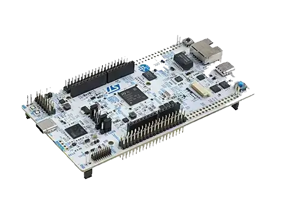

<!-- Copyright 2015-2026 Zephyr Project members and individual contributors. -->
<!-- SPDX-License-Identifier: Apache-2.0 -->
<!-- 中文翻译；编号、导航与译注为本地新增。 -->

<a id="nucleo_n657x0_q"></a>

# 第64章\_Nucleo N657X0-Q开发板

原文：[官方页面](https://docs.zephyrproject.org/latest/boards/st/nucleo_n657x0_q/doc/index.html)。读取日期：2026-10-16；来源摘要见[来源记录](../SOURCES.md)。

开发板概览（Board Overview）

<a id="id1"></a>

[](images/nucleo_n657x0_q.webp)

Nucleo N657X0-Q开发板

名称（Name）：

`nucleo_n657x0_q`

厂商（Vendor）：

[意法半导体（STMicroelectronics）](https://docs.zephyrproject.org/latest/boards/index.html#vendor=st)

状态（Status）：

维护中（Maintained）

架构（Architecture）：

[arm](https://docs.zephyrproject.org/latest/boards/index.html#arch=arm)

片上系统（SoC）：

[stm32n657xx](https://docs.zephyrproject.org/latest/boards/index.html#soc=stm32n657xx)

<a id="board-github-link"></a>

[浏览开发板源码（Browse Board Sources）](https://github.com/zephyrproject-rtos/zephyr/blob/main//boards/st/nucleo_n657x0_q/doc/index.rst/../..)<a id="overview"></a>

## 概述（Overview）

NUCLEO-N657X0-Q提供经济、灵活的方式，用户可按STM32微控制器的性能与功耗组合选择设备，尝试新概念和构建原型。兼容板可利用内部或外部SMPS显著降低运行模式功耗。

ST Zio扩展ARDUINO® Uno V3连接能力，结合ST morpho排针，可搭配多种专用扩展板扩展Nucleo开放开发平台。

NUCLEO-N657X0-Q集成ST-LINK调试器／编程器，无需独立探针。

STM32 Nucleo-144开发板可使用STM32Cube MCU软件包提供的完整免费软件库及示例。

<a id="hardware"></a>

## 硬件（Hardware）


- 通用功能（Common Features）：


  - 采用LQFP144、TFBGA225或VFBGA264封装的STM32微控制器
  - 三个用户LED
  - 1个用户按键及1个复位按键
  - 32.768 kHz晶体振荡器（Crystal Oscillator）
  - 开发板连接器（Board Connectors）：


    - SWD
    - ST morpho扩展连接器
  - 灵活供电方式：ST-LINK USB VBUS、USB连接器或外部电源
- 以下为部分开发板特有功能，详情见数据简介（Data Brief）的订购信息章节：


  - 通过外部或内部SMPS产生Vcore逻辑电源
  - 符合IEEE-802.3-2002的以太网（Ethernet）
  - USB仅设备模式、USB OTG全速，或受电端／上行端口（SNK/UFP）的全速或高速模式
  - 开发板连接器（Board Connectors）：


    - ARDUINO® Uno V3连接器，或包含ARDUINO® Uno V3的ST Zio扩展连接器
    - 摄像头模块柔性印刷电路（FPC）接口
    - 兼容MIPI20的连接器，带跟踪（Trace）信号
    - USB Micro-AB或USB Type-C®接口
    - 以太网RJ45接口
  - 板载ST-LINK调试器／编程器，可为STLINK/V2-1、STLINK-V3E或STLINK-V3EC；支持USB重新枚举，提供大容量存储、虚拟COM端口及调试端口

更多细节见：


- [NUCLEO-N657X0-Q网站](https://www.st.com/en/evaluation-tools/nucleo-n657x0-q.html)
- [STM32N657X0在ST官网的产品页](https://www.st.com/en/microcontrollers-microprocessors/stm32n657x0.html)
- [STM32N657参考手册（Reference Manual）](https://www.st.com/resource/en/reference_manual/rm0486-stm32n647657xx-armbased-32bit-mcus-stmicroelectronics.pdf)

<a id="supported-features"></a>

### 支持的功能（Supported Features）

`nucleo_n657x0_q`开发板支持下表所列的硬件功能。

片上／板载（On-Chip / On-Board）

功能集成在片上系统（SoC）内／位于开发板上。

2 / 2

分别表示已启用／已禁用的实例数。点击数量标签，可查看开发板或SoC设备树源码（DTS）中该功能的第一个实例。

`vnd,foo`

与此功能匹配的设备树绑定兼容字符串（Compatible String）；点击链接可查看绑定文档。

<a id="nucleo_n657x0_q-hw-features"></a>

<a id="nucleo_n657x0_q-nucleo_n657x0_q/stm32n657xx/sb-hw-features-section"></a>

#### `nucleo_n657x0_q/stm32n657xx/sb`目标（Target）

<a id="nucleo_n657x0_q-nucleo_n657x0_q/stm32n657xx/sb-hw-features-panel"></a>

<a id="nucleo_n657x0_q-nucleo_n657x0_q/stm32n657xx/sb-hw-features-memory"></a>

该开发板目标的片上存储容量：511 KiB RAM、N/A Flash。

<a id="nucleo_n657x0_q-nucleo_n657x0_q/stm32n657xx/sb-hw-features-table"></a>

<table>
<tr>
<th>类型（Type）</th>
<th>位置（Location）</th>
<th>说明（Description）</th>
<th>兼容字符串（Compatible）</th>
</tr>
<tr>
<td rowspan="1">中央处理器（CPU）</td>
<td>片上（On-Chip）</td>
<td>ARM Cortex-M55处理器（CPU）（<a href="https://github.com/zephyrproject-rtos/zephyr/blob/main/dts/arm/st/n6/stm32n6.dtsi?plain=1#L34">已启用：1</a>）</td>
<td><a href="../cpu_cortex_xtensa_binding_reference/P003_arm_cortex-m55.md#std-dtcompatible-arm-cortex-m55"><code>arm,cortex-m55</code></a></td>
</tr>
<tr>
<td rowspan="1">模数转换器（ADC）</td>
<td>片上（On-Chip）</td>
<td>STM32N6模数转换器（ADC）（<a href="https://github.com/zephyrproject-rtos/zephyr/blob/main/dts/arm/st/n6/stm32n6.dtsi?plain=1#L505">已启用：1</a>）</td>
<td><a href="../hardware/P842_STM32N6模数转换器绑定.md#dtbinding-st-stm32n6-adc"><code>st,stm32n6-adc</code></a></td>
</tr>
<tr>
<td rowspan="1">音频（Audio）</td>
<td>片上（On-Chip）</td>
<td>STM32多功能数字滤波器（MDF）（<a href="https://github.com/zephyrproject-rtos/zephyr/blob/main/dts/arm/st/n6/stm32n6.dtsi?plain=1#L1671">已禁用：1</a>）</td>
<td><a href="../audio_stm32_ti_wolfson_binding_reference/P003_st_stm32-mdf.md#std-dtcompatible-st-stm32-mdf"><code>st,stm32-mdf</code></a></td>
</tr>
<tr>
<td rowspan="1">控制器局域网（CAN）</td>
<td>片上（On-Chip）</td>
<td>STM32H7系列及兼容器件的FDCAN CAN FD控制器（<a href="https://github.com/zephyrproject-rtos/zephyr/blob/main/dts/arm/st/n6/stm32n6.dtsi?plain=1#L539">已启用：1</a>；<a href="https://github.com/zephyrproject-rtos/zephyr/blob/main/dts/arm/st/n6/stm32n6.dtsi?plain=1#L550">已禁用：2</a>）</td>
<td><a href="../can_nxp_renesas_stm32_ti_binding_reference/P013_st_stm32h7-fdcan.md#std-dtcompatible-st-stm32h7-fdcan"><code>st,stm32h7-fdcan</code></a></td>
</tr>
<tr>
<td rowspan="11">时钟控制（Clock Control）</td>
<td>片上（On-Chip）</td>
<td>STM32N6复位与时钟控制器（RCC）（<a href="https://github.com/zephyrproject-rtos/zephyr/blob/main/dts/arm/st/n6/stm32n6.dtsi?plain=1#L303">已启用：1</a>）</td>
<td><a href="../timer_reference/P183_STM32N6复位与时钟控制绑定.md#dtbinding-st-stm32n6-rcc"><code>st,stm32n6-rcc</code></a></td>
</tr>
<tr>
<td>片上（On-Chip）</td>
<td>STM32N6高速外部时钟（HSE）（<a href="https://github.com/zephyrproject-rtos/zephyr/blob/main/dts/arm/st/n6/stm32n6.dtsi?plain=1#L79">已启用：1</a>）</td>
<td><a href="../timer_reference/P162_STM32N6高速外部时钟绑定.md#dtbinding-st-stm32n6-hse-clock"><code>st,stm32n6-hse-clock</code></a></td>
</tr>
<tr>
<td>片上（On-Chip）</td>
<td>STM32高速内部时钟（HSI）（<a href="https://github.com/zephyrproject-rtos/zephyr/blob/main/dts/arm/st/n6/stm32n6.dtsi?plain=1#L85">已启用：1</a>）</td>
<td><a href="../timer_reference/P146_STM32H7内部高速时钟绑定.md#dtbinding-st-stm32h7-hsi-clock"><code>st,stm32h7-hsi-clock</code></a></td>
</tr>
<tr>
<td>片上（On-Chip）</td>
<td>STM32N6多速率内部时钟（MSI）（<a href="https://github.com/zephyrproject-rtos/zephyr/blob/main/dts/arm/st/n6/stm32n6.dtsi?plain=1#L92">已禁用：1</a>）</td>
<td><a href="../timer_reference/P161_STM32N6多速内部时钟绑定.md#dtbinding-st-stm32n6-msi-clock"><code>st,stm32n6-msi-clock</code></a></td>
</tr>
<tr>
<td>片上（On-Chip）</td>
<td>STM32低速外部时钟（LSE Clock）（<a href="https://github.com/zephyrproject-rtos/zephyr/blob/main/dts/arm/st/n6/stm32n6.dtsi?plain=1#L99">已启用：1</a>）</td>
<td><a href="../timer_reference/P130_STM32低速外部时钟绑定.md#dtbinding-st-stm32-lse-clock"><code>st,stm32-lse-clock</code></a></td>
</tr>
<tr>
<td>片上（On-Chip）</td>
<td>通用固定频率时钟提供者（Fixed-Rate Clock Provider）（<a href="https://github.com/zephyrproject-rtos/zephyr/blob/main/dts/arm/st/n6/stm32n6.dtsi?plain=1#L107">已禁用：1</a>）</td>
<td><a href="../hardware/P566_固定时钟绑定.md#dtbinding-fixed-clock"><code>fixed-clock</code></a></td>
</tr>
<tr>
<td>片上（On-Chip）</td>
<td>STM32N6主锁相环（PLL）（<a href="https://github.com/zephyrproject-rtos/zephyr/blob/main/dts/arm/st/n6/stm32n6.dtsi?plain=1#L114">已启用：2</a>；<a href="https://github.com/zephyrproject-rtos/zephyr/blob/main/dts/arm/st/n6/stm32n6.dtsi?plain=1#L120">已禁用：2</a>）</td>
<td><a href="../timer_reference/P157_STM32N6锁相环时钟绑定.md#dtbinding-st-stm32n6-pll-clock"><code>st,stm32n6-pll-clock</code></a></td>
</tr>
<tr>
<td>片上（On-Chip）</td>
<td>STM32N6 CPU时钟（<a href="https://github.com/zephyrproject-rtos/zephyr/blob/main/dts/arm/st/n6/stm32n6.dtsi?plain=1#L138">已启用：1</a>）</td>
<td><a href="../timer_reference/P178_STM32N6处理器时钟多路选择绑定.md#dtbinding-st-stm32n6-cpu-clock-mux"><code>st,stm32n6-cpu-clock-mux</code></a></td>
</tr>
<tr>
<td>片上（On-Chip）</td>
<td>STM32 时钟多路复用器（Clock Multiplexer）（<a href="https://github.com/zephyrproject-rtos/zephyr/blob/main/dts/arm/st/n6/stm32n6.dtsi?plain=1#L144">已启用：1</a>）</td>
<td><a href="../timer_reference/P133_STM32时钟多路复用绑定.md#dtbinding-st-stm32-clock-mux"><code>st,stm32-clock-mux</code></a></td>
</tr>
<tr>
<td>片上（On-Chip）</td>
<td>STM32N6分频器IC多路复用器（Divider IC Multiplexer）（<a href="https://github.com/zephyrproject-rtos/zephyr/blob/main/dts/arm/st/n6/stm32n6.dtsi?plain=1#L150">已启用：6</a>；<a href="https://github.com/zephyrproject-rtos/zephyr/blob/main/dts/arm/st/n6/stm32n6.dtsi?plain=1#L162">已禁用：14</a>）</td>
<td><a href="../timer_reference/P179_STM32N6分频时钟多路选择绑定.md#dtbinding-st-stm32n6-ic-clock-mux"><code>st,stm32n6-ic-clock-mux</code></a></td>
</tr>
<tr>
<td>片上（On-Chip）</td>
<td>STM32 微控制器时钟输出（Microcontroller Clock Output，MCO）（<a href="https://github.com/zephyrproject-rtos/zephyr/blob/main/dts/arm/st/n6/stm32n6.dtsi?plain=1#L272">已禁用：2</a>）</td>
<td><a href="../timer_reference/P134_STM32时钟输出绑定.md#dtbinding-st-stm32-clock-mco"><code>st,stm32-clock-mco</code></a></td>
</tr>
<tr>
<td rowspan="1">计数器（Counter）</td>
<td>片上（On-Chip）</td>
<td>STM32 计数器（Counters）（<a href="https://github.com/zephyrproject-rtos/zephyr/blob/main/dts/arm/st/n6/stm32n6.dtsi?plain=1#L1029">已禁用：18</a>）</td>
<td><a href="../stm32_ti_xilinx_counter_binding_reference/P007_st_stm32-counter.md#std-dtcompatible-st-stm32-counter"><code>st,stm32-counter</code></a></td>
</tr>
<tr>
<td rowspan="1">循环冗余校验（CRC）</td>
<td>片上（On-Chip）</td>
<td>STM32 CRC 计算单元（Calculation Unit）（<a href="https://github.com/zephyrproject-rtos/zephyr/blob/main/dts/arm/st/n6/stm32n6.dtsi?plain=1#L1663">已禁用：1</a>）</td>
<td><a href="../crc_clock_monitor_binding_reference/P011_st_stm32-crc.md#std-dtcompatible-st-stm32-crc"><code>st,stm32-crc</code></a></td>
</tr>
<tr>
<td rowspan="2">密码学加速器（Cryptographic Accelerator）</td>
<td>片上（On-Chip）</td>
<td>STM32密码加速器（Cryptographic Accelerator）（<a href="https://github.com/zephyrproject-rtos/zephyr/blob/main/dts/arm/st/n6/stm32n657.dtsi?plain=1#L13">已启用：1</a>）</td>
<td><a href="../crypto_secure_engine_st_ti_binding_reference/P016_st_stm32-cryp.md#std-dtcompatible-st-stm32-cryp"><code>st,stm32-cryp</code></a></td>
</tr>
<tr>
<td>片上（On-Chip）</td>
<td>STM32哈希处理器（HASH Processor）（<a href="https://github.com/zephyrproject-rtos/zephyr/blob/main/dts/arm/st/n6/stm32n657.dtsi?plain=1#L22">已启用：1</a>）</td>
<td><a href="../crypto_secure_engine_st_ti_binding_reference/P017_st_stm32-hash.md#std-dtcompatible-st-stm32-hash"><code>st,stm32-hash</code></a></td>
</tr>
<tr>
<td rowspan="3">显示（Display）</td>
<td>片上（On-Chip）</td>
<td>STM32 LCD-TFT 显示控制器（Display Controller）（<a href="https://github.com/zephyrproject-rtos/zephyr/blob/main/dts/arm/st/n6/stm32n6.dtsi?plain=1#L1525">已禁用：1</a>）</td>
<td><a href="../display_st_ultrachip_zephyr_binding_reference/P004_st_stm32-ltdc.md#std-dtcompatible-st-stm32-ltdc"><code>st,stm32-ltdc</code></a></td>
</tr>
<tr>
<td>片上（On-Chip）</td>
<td>STM32 NeoChrom-GPU2D加速器（<a href="https://github.com/zephyrproject-rtos/zephyr/blob/main/dts/arm/st/n6/stm32n6.dtsi?plain=1#L1604">已禁用：1</a>）</td>
<td><a href="../display_st_ultrachip_zephyr_binding_reference/P002_st_neochrom-gpu2d.md#std-dtcompatible-st-neochrom-gpu2d"><code>st,neochrom-gpu2d</code></a></td>
</tr>
<tr>
<td>片上（On-Chip）</td>
<td>STM32 Chrom-ART 图形加速器（Accelerator，DMA2D）（<a href="https://github.com/zephyrproject-rtos/zephyr/blob/main/dts/arm/st/n6/stm32n6.dtsi?plain=1#L1719">已禁用：1</a>）</td>
<td><a href="../display_st_ultrachip_zephyr_binding_reference/P003_st_stm32-dma2d.md#std-dtcompatible-st-stm32-dma2d"><code>st,stm32-dma2d</code></a></td>
</tr>
<tr>
<td rowspan="1">直接存储器访问（DMA）</td>
<td>片上（On-Chip）</td>
<td>STM32U5直接存储器访问（DMA）控制器（<a href="https://github.com/zephyrproject-rtos/zephyr/blob/main/dts/arm/st/n6/stm32n6.dtsi?plain=1#L874">已禁用：2</a>）</td>
<td><a href="../stm32_ti_xilinx_dma_binding_reference/P012_st_stm32u5-dma.md#std-dtcompatible-st-stm32u5-dma"><code>st,stm32u5-dma</code></a></td>
</tr>
<tr>
<td rowspan="4">以太网（Ethernet）</td>
<td>片上（On-Chip）</td>
<td>ST STM32 以太网媒体访问控制器（Ethernet MAC）（<a href="https://github.com/zephyrproject-rtos/zephyr/blob/main/dts/arm/st/n6/stm32n6.dtsi?plain=1#L967">已启用：1</a>）</td>
<td><a href="../ethernet_synopsys_st_xilinx_binding_reference/P013_st_stm32n6-ethernet.md#std-dtcompatible-st-stm32n6-ethernet"><code>st,stm32n6-ethernet</code></a></td>
</tr>
<tr>
<td>片上（On-Chip）</td>
<td>Synopsys DesignWare MAC 的管理数据输入输出控制器（MDIO Controller）（<a href="https://github.com/zephyrproject-rtos/zephyr/blob/main/dts/arm/st/n6/stm32n6.dtsi?plain=1#L983">已启用：1</a>）</td>
<td><a href="../ethernet_mdio_microchip_binding_reference/P010_snps_dwmac-mdio.md#std-dtcompatible-snps-dwmac-mdio"><code>snps,dwmac-mdio</code></a></td>
</tr>
<tr>
<td>板载（On-Board）</td>
<td>通用媒体独立接口物理层（MII PHY）（<a href="https://github.com/zephyrproject-rtos/zephyr/blob/main/boards/st/nucleo_n657x0_q/nucleo_n657x0_q-common.dtsi?plain=1#L309">已启用：1</a>）</td>
<td><a href="../ethernet_nxp_phy_binding_reference/P019_ethernet-phy.md#std-dtcompatible-ethernet-phy"><code>ethernet-phy</code></a></td>
</tr>
<tr>
<td>片上（On-Chip）</td>
<td>Synopsys DesignWare MAC 精确时间协议时钟（Precision Time Protocol，PTP Clock）（<a href="https://github.com/zephyrproject-rtos/zephyr/blob/main/dts/arm/st/n6/stm32n6.dtsi?plain=1#L990">已启用：1</a>）</td>
<td><a href="../ethernet_synopsys_st_xilinx_binding_reference/P006_snps_dwmac-ptp-clock.md#std-dtcompatible-snps-dwmac-ptp-clock"><code>snps,dwmac-ptp-clock</code></a></td>
</tr>
<tr>
<td rowspan="1">闪存控制器（Flash Controller）</td>
<td>板载（On-Board）</td>
<td>支持JEDEC通用闪存接口（CFI）的STM32 XSPI Flash控制器（<a href="https://github.com/zephyrproject-rtos/zephyr/blob/main/boards/st/nucleo_n657x0_q/nucleo_n657x0_q-common.dtsi?plain=1#L328">已启用：1</a>）</td>
<td><a href="../flash_renesas_st_ti_binding_reference/P014_st_stm32-xspi-nor.md#std-dtcompatible-st-stm32-xspi-nor"><code>st,stm32-xspi-nor</code></a></td>
</tr>
<tr>
<td rowspan="3">通用输入输出与接插件（GPIO &amp; Headers）</td>
<td>片上（On-Chip）</td>
<td>STM32 通用输入输出控制器（GPIO Controller）（<a href="https://github.com/zephyrproject-rtos/zephyr/blob/main/dts/arm/st/n6/stm32n6.dtsi?plain=1#L408">已启用：12</a>）</td>
<td><a href="../gpio_silabs_st_connectors_binding_reference/P029_st_stm32-gpio.md#std-dtcompatible-st-stm32-gpio"><code>st,stm32-gpio</code></a></td>
</tr>
<tr>
<td>板载（On-Board）</td>
<td>引出到Arduino Uno R3排针（Headers）的GPIO引脚（<a href="https://github.com/zephyrproject-rtos/zephyr/blob/main/boards/st/nucleo_n657x0_q/arduino_r3_connector.dtsi?plain=1#L10">已启用：1</a>）</td>
<td><a href="../gpio_adi_headers_ambiq_binding_reference/P023_arduino-header-r3.md#std-dtcompatible-arduino-header-r3"><code>arduino-header-r3</code></a></td>
</tr>
<tr>
<td>板载（On-Board）</td>
<td>引出到Raspberry Pi CSI摄像头连接器的GPIO引脚（<a href="https://github.com/zephyrproject-rtos/zephyr/blob/main/boards/st/nucleo_n657x0_q/nucleo_n657x0_q-common.dtsi?plain=1#L63">已启用：1</a>）</td>
<td><a href="../gpio_raspberrypi_renesas_binding_reference/P004_raspberrypi_csi-connector.md#std-dtcompatible-raspberrypi-csi-connector"><code>raspberrypi,csi-connector</code></a></td>
</tr>
<tr>
<td rowspan="1">集成电路间总线（I2C）</td>
<td>片上（On-Chip）</td>
<td>STM32 I2C V2 控制器（Controller）（<a href="https://github.com/zephyrproject-rtos/zephyr/blob/main/dts/arm/st/n6/stm32n6.dtsi?plain=1#L662">已启用：3</a>；<a href="https://github.com/zephyrproject-rtos/zephyr/blob/main/dts/arm/st/n6/stm32n6.dtsi?plain=1#L686">已禁用：1</a>）</td>
<td><a href="../i2c_stm32_ti_mux_binding_reference/P008_st_stm32-i2c-v2.md#std-dtcompatible-st-stm32-i2c-v2"><code>st,stm32-i2c-v2</code></a></td>
</tr>
<tr>
<td rowspan="2">集成电路间音频总线（I2S）</td>
<td>片上（On-Chip）</td>
<td>STM32H7 I2S控制器（<a href="https://github.com/zephyrproject-rtos/zephyr/blob/main/dts/arm/st/n6/stm32n6.dtsi?plain=1#L710">已禁用：4</a>）</td>
<td><a href="../i2s_binding_reference/P018_st_stm32h7-i2s.md#std-dtcompatible-st-stm32h7-i2s"><code>st,stm32h7-i2s</code></a></td>
</tr>
<tr>
<td>片上（On-Chip）</td>
<td>STM32 串行音频接口块控制器（SAI Block Controller）（<a href="https://github.com/zephyrproject-rtos/zephyr/blob/main/dts/arm/st/n6/stm32n6.dtsi?plain=1#L1546">已禁用：2</a>）</td>
<td><a href="../i2s_binding_reference/P017_st_stm32-sai.md#std-dtcompatible-st-stm32-sai"><code>st,stm32-sai</code></a></td>
</tr>
<tr>
<td rowspan="1">改进型集成电路间总线（I3C）</td>
<td>片上（On-Chip）</td>
<td>STM32H5 I3C控制器（<a href="https://github.com/zephyrproject-rtos/zephyr/blob/main/dts/arm/st/n6/stm32n6.dtsi?plain=1#L770">已禁用：2</a>）</td>
<td><a href="../i3c_smbus_binding_reference/P010_st_stm32-i3c.md#std-dtcompatible-st-stm32-i3c"><code>st,stm32-i3c</code></a></td>
</tr>
<tr>
<td rowspan="1">输入（Input）</td>
<td>板载（On-Board）</td>
<td>一组绑定到 GPIO 的输入按键（GPIO-Bound Input Keys）（<a href="https://github.com/zephyrproject-rtos/zephyr/blob/main/boards/st/nucleo_n657x0_q/nucleo_n657x0_q-common.dtsi?plain=1#L44">已启用：1</a>）</td>
<td><a href="../hardware/P563_GPIO按键绑定.md#std-dtcompatible-gpio-keys"><code>gpio-keys</code></a></td>
</tr>
<tr>
<td rowspan="2">中断控制器（Interrupt Controller）</td>
<td>片上（On-Chip）</td>
<td>ARMv8.1-M嵌套向量中断控制器（NVIC / Nested Vectored Interrupt Controller）（<a href="https://github.com/zephyrproject-rtos/zephyr/blob/main/dts/arm/armv8.1-m.dtsi?plain=1#L17">已启用：1</a>）</td>
<td><a href="../arm_interrupt_timer_binding_reference/P004_ARMv8_1_M_NVIC.md#std-dtcompatible-arm-v8.1m-nvic"><code>arm,v8.1m-nvic</code></a></td>
</tr>
<tr>
<td>片上（On-Chip）</td>
<td>STM32G0 外部中断控制器（External Interrupt Controller）（<a href="https://github.com/zephyrproject-rtos/zephyr/blob/main/dts/arm/st/n6/stm32n6.dtsi?plain=1#L379">已启用：1</a>）</td>
<td><a href="../mcu_external_interrupt_binding_reference/P002_st_stm32g0-exti.md#std-dtcompatible-st-stm32g0-exti"><code>st,stm32g0-exti</code></a></td>
</tr>
<tr>
<td rowspan="1">发光二极管（LED）</td>
<td>板载（On-Board）</td>
<td>一组由 GPIO 控制的 LED（GPIO-Controlled LEDs）（<a href="https://github.com/zephyrproject-rtos/zephyr/blob/main/boards/st/nucleo_n657x0_q/nucleo_n657x0_q-common.dtsi?plain=1#L25">已启用：1</a>）</td>
<td><a href="../hardware/P564_GPIO指示灯绑定.md#dtbinding-gpio-leds"><code>gpio-leds</code></a></td>
</tr>
<tr>
<td rowspan="3">其他绑定（Miscellaneous）</td>
<td>片上（On-Chip）</td>
<td>STM32 SRAM配置控制器（<a href="https://github.com/zephyrproject-rtos/zephyr/blob/main/dts/arm/st/n6/stm32n6.dtsi?plain=1#L315">已启用：4</a>）</td>
<td><a href="../misc_nxp_renesas_zephyr_binding_reference/P038_st_stm32n6-ramcfg.md#std-dtcompatible-st-stm32n6-ramcfg"><code>st,stm32n6-ramcfg</code></a></td>
</tr>
<tr>
<td>片上（On-Chip）</td>
<td>STM32 Neural-ART神经网络加速器（<a href="https://github.com/zephyrproject-rtos/zephyr/blob/main/dts/arm/st/n6/stm32n6.dtsi?plain=1#L1614">已禁用：1</a>）</td>
<td><a href="../misc_nxp_renesas_zephyr_binding_reference/P037_st_stm32-npu.md#std-dtcompatible-st-stm32-npu"><code>st,stm32-npu</code></a></td>
</tr>
<tr>
<td>片上（On-Chip）</td>
<td>STM32N6神经网络处理器缓存（NPU Cache），也称CACHEAXI模块（<a href="https://github.com/zephyrproject-rtos/zephyr/blob/main/dts/arm/st/n6/stm32n6.dtsi?plain=1#L1622">已启用：1</a>）</td>
<td><a href="../misc_nxp_renesas_zephyr_binding_reference/P036_st_stm32-npu-cache.md#std-dtcompatible-st-stm32-npu-cache"><code>st,stm32-npu-cache</code></a></td>
</tr>
<tr>
<td rowspan="1">内存管理单元／内存保护单元（MMU / MPU）</td>
<td>片上（On-Chip）</td>
<td>ARMv8.1-M存储器保护单元（MPU / Memory Protection Unit）（<a href="https://github.com/zephyrproject-rtos/zephyr/blob/main/dts/arm/st/n6/stm32n6.dtsi?plain=1#L41">已启用：1</a>）</td>
<td><a href="../memory_protection_binding_reference/P006_arm_armv8.1m-mpu.md#std-dtcompatible-arm-armv8.1m-mpu"><code>arm,armv8.1m-mpu</code></a></td>
</tr>
<tr>
<td rowspan="1">存储技术设备（MTD）</td>
<td>板载（On-Board）</td>
<td>闪存或其他非易失性存储器的固定分区（Fixed Partitions）（<a href="https://github.com/zephyrproject-rtos/zephyr/blob/main/boards/st/nucleo_n657x0_q/nucleo_n657x0_q-common.dtsi?plain=1#L338">已启用：1</a>）</td>
<td><a href="../hardware/P568_固定分区绑定.md#dtbinding-fixed-partitions"><code>fixed-partitions</code></a></td>
</tr>
<tr>
<td rowspan="1">非易失存储器（NVMEM）</td>
<td>片上（On-Chip）</td>
<td>非易失存储器固定布局（Fixed Layout for Non-Volatile Memory）（<a href="https://github.com/zephyrproject-rtos/zephyr/blob/main/dts/arm/st/n6/stm32n6.dtsi?plain=1#L906">已启用：1</a>）</td>
<td><a href="../memory_protection_binding_reference/P009_fixed-layout.md#std-dtcompatible-fixed-layout"><code>fixed-layout</code></a></td>
</tr>
<tr>
<td rowspan="1">一次性可编程存储器（OTP Memory）</td>
<td>片上（On-Chip）</td>
<td>STM32启动与安全控制（Boot and Security Control，BSEC）（<a href="https://github.com/zephyrproject-rtos/zephyr/blob/main/dts/arm/st/n6/stm32n6.dtsi?plain=1#L900">已启用：1</a>）</td>
<td><a href="../otp_binding_reference/P009_st_stm32-bsec.md#std-dtcompatible-st-stm32-bsec"><code>st,stm32-bsec</code></a></td>
</tr>
<tr>
<td rowspan="1">物理层（PHY）</td>
<td>片上（On-Chip）</td>
<td>STM32N6 USB高速PHY控制器（USBPHYC）（<a href="https://github.com/zephyrproject-rtos/zephyr/blob/main/dts/arm/st/n6/stm32n6.dtsi?plain=1#L1507">已启用：2</a>）</td>
<td><a href="../phy_binding_reference/P006_st_stm32n6-usbphyc.md#std-dtcompatible-st-stm32n6-usbphyc"><code>st,stm32n6-usbphyc</code></a></td>
</tr>
<tr>
<td rowspan="1">引脚控制（Pin Control）</td>
<td>片上（On-Chip）</td>
<td>支持I/O同步（I/O Synchronization）的STM32引脚控制器（<a href="https://github.com/zephyrproject-rtos/zephyr/blob/main/dts/arm/st/n6/stm32n6.dtsi?plain=1#L401">已启用：1</a>）</td>
<td><a href="../pinctrl_stm32_ti_xilinx_binding_reference/P007_st_stm32n6-pinctrl.md#std-dtcompatible-st-stm32n6-pinctrl"><code>st,stm32n6-pinctrl</code></a></td>
</tr>
<tr>
<td rowspan="1">电源管理（Power Management）</td>
<td>片上（On-Chip）</td>
<td>STM32输入输出单元（I/O Cell）控制器（<a href="https://github.com/zephyrproject-rtos/zephyr/blob/main/dts/arm/st/n6/stm32n6.dtsi?plain=1#L1728">已启用：1</a>）</td>
<td><a href="../stm32_soc_power_binding_reference/P008_st_stm32-iocell.md#std-dtcompatible-st-stm32-iocell"><code>st,stm32-iocell</code></a></td>
</tr>
<tr>
<td rowspan="1">脉宽调制（PWM）</td>
<td>片上（On-Chip）</td>
<td>STM32 脉宽调制（PWM）（<a href="https://github.com/zephyrproject-rtos/zephyr/blob/main/dts/arm/st/n6/stm32n6.dtsi?plain=1#L1023">已禁用：15</a>）</td>
<td><a href="../pwm_stm32_ti_generic_binding_reference/P011_st_stm32-pwm.md#std-dtcompatible-st-stm32-pwm"><code>st,stm32-pwm</code></a></td>
</tr>
<tr>
<td rowspan="1">复位控制器（Reset Controller）</td>
<td>片上（On-Chip）</td>
<td>STM32 复位与时钟控制器（Reset and Clock Control，RCC）（<a href="https://github.com/zephyrproject-rtos/zephyr/blob/main/dts/arm/st/n6/stm32n6.dtsi?plain=1#L309">已启用：1</a>）</td>
<td><a href="../reset_controller_binding_reference/P017_st_stm32-rcc-rctl.md#std-dtcompatible-st-stm32-rcc-rctl"><code>st,stm32-rcc-rctl</code></a></td>
</tr>
<tr>
<td rowspan="1">随机数生成器（RNG）</td>
<td>片上（On-Chip）</td>
<td>STM32 随机数生成器（Random Number Generator）（<a href="https://github.com/zephyrproject-rtos/zephyr/blob/main/dts/arm/st/n6/stm32n6.dtsi?plain=1#L1536">已启用：1</a>）</td>
<td><a href="../soc_rng_binding_reference/P016_st_stm32-rng.md#std-dtcompatible-st-stm32-rng"><code>st,stm32-rng</code></a></td>
</tr>
<tr>
<td rowspan="1">实时时钟（RTC）</td>
<td>片上（On-Chip）</td>
<td>STM32 实时时钟（RTC）（<a href="https://github.com/zephyrproject-rtos/zephyr/blob/main/dts/arm/st/n6/stm32n6.dtsi?plain=1#L1427">已启用：1</a>）</td>
<td><a href="../soc_rtc_binding_reference/P014_st_stm32-rtc.md#std-dtcompatible-st-stm32-rtc"><code>st,stm32-rtc</code></a></td>
</tr>
<tr>
<td rowspan="1">SD 主机控制器（SDHC）</td>
<td>片上（On-Chip）</td>
<td>STM32 SDMMC 主机控制器（Host Controller）（<a href="https://github.com/zephyrproject-rtos/zephyr/blob/main/dts/arm/st/n6/stm32n6.dtsi?plain=1#L995">已禁用：2</a>）</td>
<td><a href="../sdhc_binding_reference/P019_st_stm32-sdmmc.md#std-dtcompatible-st-stm32-sdmmc"><code>st,stm32-sdmmc</code></a></td>
</tr>
<tr>
<td rowspan="3">传感器（Sensors）</td>
<td>片上（On-Chip）</td>
<td>STM32 正交解码器（Quadrature Decoder）（<a href="https://github.com/zephyrproject-rtos/zephyr/blob/main/dts/arm/st/n6/stm32n6.dtsi?plain=1#L1034">已禁用：6</a>）</td>
<td><a href="../sensor_st_lsm_stm32_binding_reference/P028_st_stm32-qdec.md#std-dtcompatible-st-stm32-qdec"><code>st,stm32-qdec</code></a></td>
</tr>
<tr>
<td>片上（On-Chip）</td>
<td>STM32 电池电压（VBAT）（<a href="https://github.com/zephyrproject-rtos/zephyr/blob/main/dts/arm/st/n6/stm32n6.dtsi?plain=1#L1759">已启用：1</a>）</td>
<td><a href="../sensor_st_ti_power_capacitance_binding_reference/P001_st_stm32-vbat.md#std-dtcompatible-st-stm32-vbat"><code>st,stm32-vbat</code></a></td>
</tr>
<tr>
<td>片上（On-Chip）</td>
<td>STM32内核供电（Vddcore）（<a href="https://github.com/zephyrproject-rtos/zephyr/blob/main/dts/arm/st/n6/stm32n6.dtsi?plain=1#L1766">已启用：1</a>）</td>
<td><a href="../sensor_st_ti_power_capacitance_binding_reference/P002_st_stm32-vddcore.md#std-dtcompatible-st-stm32-vddcore"><code>st,stm32-vddcore</code></a></td>
</tr>
<tr>
<td rowspan="1">串行控制器（Serial Controller）</td>
<td>片上（On-Chip）</td>
<td>STM32 通用同步／异步收发器（USART）（<a href="https://github.com/zephyrproject-rtos/zephyr/blob/main/dts/arm/st/n6/stm32n6.dtsi?plain=1#L572">已启用：2</a>；<a href="https://github.com/zephyrproject-rtos/zephyr/blob/main/dts/arm/st/n6/stm32n6.dtsi?plain=1#L581">已禁用：8</a>）</td>
<td><a href="../uart_silabs_stm32_ti_binding_reference/P016_st_stm32-usart.md#std-dtcompatible-st-stm32-usart"><code>st,stm32-usart</code></a></td>
</tr>
<tr>
<td rowspan="1">串行外设接口（SPI）</td>
<td>片上（On-Chip）</td>
<td>STM32H7 串行外设接口控制器（SPI Controller）（<a href="https://github.com/zephyrproject-rtos/zephyr/blob/main/dts/arm/st/n6/stm32n6.dtsi?plain=1#L848">已启用：1</a>；<a href="https://github.com/zephyrproject-rtos/zephyr/blob/main/dts/arm/st/n6/stm32n6.dtsi?plain=1#L796">已禁用：5</a>）</td>
<td><a href="../spi_stm32_ti_xilinx_binding_reference/P013_st_stm32h7-spi.md#std-dtcompatible-st-stm32h7-spi"><code>st,stm32h7-spi</code></a></td>
</tr>
<tr>
<td rowspan="2">定时器（Timer）</td>
<td>片上（On-Chip）</td>
<td>ARMv8.1-M系统节拍（System Tick）（<a href="https://github.com/zephyrproject-rtos/zephyr/blob/main/dts/arm/armv8.1-m.dtsi?plain=1#L25">已启用：1</a>）</td>
<td><a href="../arm_interrupt_timer_binding_reference/P008_ARMv8_1_M_SysTick.md#std-dtcompatible-arm-armv8.1m-systick"><code>arm,armv8.1m-systick</code></a></td>
</tr>
<tr>
<td>片上（On-Chip）</td>
<td>STM32 定时器（Timers）（<a href="https://github.com/zephyrproject-rtos/zephyr/blob/main/dts/arm/st/n6/stm32n6.dtsi?plain=1#L1013">已禁用：18</a>）</td>
<td><a href="../stm32_ti_silabs_timer_binding_reference/P008_st_stm32-timers.md#std-dtcompatible-st-stm32-timers"><code>st,stm32-timers</code></a></td>
</tr>
<tr>
<td rowspan="1">通用串行总线（USB）</td>
<td>片上（On-Chip）</td>
<td>不带引脚复用（Pinmux）的STM32 OTGHS控制器（<a href="https://github.com/zephyrproject-rtos/zephyr/blob/main/dts/arm/st/n6/stm32n6.dtsi?plain=1#L1481">已启用：1</a>；<a href="https://github.com/zephyrproject-rtos/zephyr/blob/main/dts/arm/st/n6/stm32n6.dtsi?plain=1#L1494">已禁用：1</a>）</td>
<td><a href="../usb_stm32_audio_binding_reference/P008_st_stm32n6-otghs.md#std-dtcompatible-st-stm32n6-otghs"><code>st,stm32n6-otghs</code></a></td>
</tr>
<tr>
<td rowspan="3">视频（Video）</td>
<td>片上（On-Chip）</td>
<td>STM32数字摄像头接口像素处理器（DCMIPP）（<a href="https://github.com/zephyrproject-rtos/zephyr/blob/main/dts/arm/st/n6/stm32n6.dtsi?plain=1#L928">已禁用：1</a>）</td>
<td><a href="../video_st_sony_emulation_binding_reference/P005_st_stm32-dcmipp.md#std-dtcompatible-st-stm32-dcmipp"><code>st,stm32-dcmipp</code></a></td>
</tr>
<tr>
<td>片上（On-Chip）</td>
<td>STM32视频编码器（Video Encoder，VENC）（<a href="https://github.com/zephyrproject-rtos/zephyr/blob/main/dts/arm/st/n6/stm32n6.dtsi?plain=1#L1630">已禁用：1</a>）</td>
<td><a href="../video_st_sony_emulation_binding_reference/P007_st_stm32-venc.md#std-dtcompatible-st-stm32-venc"><code>st,stm32-venc</code></a></td>
</tr>
<tr>
<td>片上（On-Chip）</td>
<td>STM32 JPEG硬件编解码器（HW Codec）（<a href="https://github.com/zephyrproject-rtos/zephyr/blob/main/dts/arm/st/n6/stm32n6.dtsi?plain=1#L1639">已禁用：1</a>）</td>
<td><a href="../video_st_sony_emulation_binding_reference/P006_st_stm32-jpeg.md#std-dtcompatible-st-stm32-jpeg"><code>st,stm32-jpeg</code></a></td>
</tr>
<tr>
<td rowspan="2">看门狗（Watchdog）</td>
<td>片上（On-Chip）</td>
<td>STM32 看门狗（Watchdog）（<a href="https://github.com/zephyrproject-rtos/zephyr/blob/main/dts/arm/st/n6/stm32n6.dtsi?plain=1#L1648">已启用：1</a>）</td>
<td><a href="../stm32_ti_xilinx_watchdog_binding_reference/P001_st_stm32-watchdog.md#std-dtcompatible-st-stm32-watchdog"><code>st,stm32-watchdog</code></a></td>
</tr>
<tr>
<td>片上（On-Chip）</td>
<td>STM32 系统窗口看门狗（System Window Watchdog）（<a href="https://github.com/zephyrproject-rtos/zephyr/blob/main/dts/arm/st/n6/stm32n6.dtsi?plain=1#L1655">已禁用：1</a>）</td>
<td><a href="../stm32_ti_xilinx_watchdog_binding_reference/P002_st_stm32-window-watchdog.md#std-dtcompatible-st-stm32-window-watchdog"><code>st,stm32-window-watchdog</code></a></td>
</tr>
<tr>
<td rowspan="2">扩展串行外设接口（xSPI）</td>
<td>片上（On-Chip）</td>
<td>STM32扩展SPI（XSPI）控制器管理器（<a href="https://github.com/zephyrproject-rtos/zephyr/blob/main/dts/arm/st/n6/stm32n6.dtsi?plain=1#L1436">已启用：1</a>）</td>
<td><a href="../qspi_ospi_xspi_binding_reference/P017_st_stm32-xspim.md#std-dtcompatible-st-stm32-xspim"><code>st,stm32-xspim</code></a></td>
</tr>
<tr>
<td>片上（On-Chip）</td>
<td>STM32扩展SPI（XSPI）控制器（<a href="https://github.com/zephyrproject-rtos/zephyr/blob/main/dts/arm/st/n6/stm32n6.dtsi?plain=1#L1457">已启用：1</a>；<a href="https://github.com/zephyrproject-rtos/zephyr/blob/main/dts/arm/st/n6/stm32n6.dtsi?plain=1#L1445">已禁用：2</a>）</td>
<td><a href="../qspi_ospi_xspi_binding_reference/P016_st_stm32-xspi.md#std-dtcompatible-st-stm32-xspi"><code>st,stm32-xspi</code></a></td>
</tr>
</table>

<a id="ethernet"></a>

### 以太网（Ethernet）

NUCLEO-N657X0-Q具有以太网接口，通过简化媒体独立接口（RMII）连接外部PHY。

片上一次性可编程存储器（OTP）中有一块区域用于以太网MAC地址。制造时该区域未编程，读取值全为0，须在现场用[STM32CubeProgrammer](https://www.st.com/en/development-tools/stm32cubeprog.html)编程。

若要在应用中使用OTP的MAC_ADDR1地址，添加以下设备树覆盖（Overlay）：

```text
&mac {
    nvmem-cells = <&mac_address0>;
    nvmem-cell-names = "mac-address";
};
```

警告（Warning）

若片上OTP尚未编程，则使用该覆盖后以太网无法工作，因为会将全0的OTP值作为MAC地址，而00:00:00:00:00:00不是有效MAC地址。

为便于运行Zephyr网络示例且无需对器件进行不可逆编程，STM32以太网驱动默认根据器件唯一ID生成本地管理MAC地址（Locally Administered MAC Address）。

<a id="usb"></a>

### 通用串行总线（USB）

STM32N657XX的USB引脚分配固定，不能更改或重分配给其他功能，以保证USB通信的一致性和可靠性。

<a id="usb-pin-ios"></a>

### USB引脚（USB PIN / IOs）

<table>
<tr>
<th>名称（Name）</th>
<th>说明（Description）</th>
</tr>
<tr>
<td>OTG1_HSDM</td>
<td>USB OTG1高速数据负端（Data−）</td>
</tr>
<tr>
<td>OTG1_HSDP</td>
<td>USB OTG1高速数据正端（Data+）</td>
</tr>
<tr>
<td>OTG1_ID</td>
<td>USB OTG1 ID引脚</td>
</tr>
<tr>
<td>OTG1_TXRTUNE</td>
<td>USB OTG1发送重调（Transmit Retune，按原文名称）</td>
</tr>
<tr>
<td>OTG2_HSDM</td>
<td>USB OTG2高速数据负端（Data−）</td>
</tr>
<tr>
<td>OTG2_HSDP</td>
<td>USB OTG2高速数据正端（Data+）</td>
</tr>
<tr>
<td>OTG2_ID</td>
<td>USB OTG2 ID引脚</td>
</tr>
<tr>
<td>OTG2_TXRTUNE</td>
<td>USB OTG2发送重调（Transmit Retune，按原文名称）</td>
</tr>
</table>

<a id="connections-and-ios"></a>

### 连接与输入输出（Connections and IOs）

NUCLEO-N657X0-Q有12个GPIO控制器，负责引脚复用、输入输出、上拉等功能。

更多细节见[NUCLEO-N657X0-Q用户手册](https://www.st.com/resource/en/user_manual/um3417-stm32n6-nucleo144-board-mb1940-stmicroelectronics.pdf)。

<a id="default-zephyr-peripheral-mapping"></a>

#### Zephyr 默认外设映射（Peripheral Mapping）：


- ADC1_INP10 : PA9
- ADC1_INP11 : PA10
- FDCAN1_TX : PH2
- FDCAN1_RX : PD0
- I2C1_SCL : PH9
- I2C1_SDA : PC1
- I2C4_SCL : PE13
- I2C4_SDA : PE14
- LD1 : PO1
- LD2 : PG10
- SPI5_SCK : PE15
- SPI5_MOSI : PG2
- SPI5_MISO : PG1
- SPI5_NSS : PA3
- USART_1_TX : PE5
- USART_1_RX : PE6
- USART_3_TX : PD8
- USART_3_RX : PD9
- XSPI2_NCS1 : PN1
- XSPI2_DQS0 : PN0
- XSPI2_CLK : PN6
- XSPI2_IO0 : PN2
- XSPI2_IO1 : PN3
- XSPI2_IO2 : PN4
- XSPI2_IO3 : PN5
- XSPI2_IO4 : PN8
- XSPI2_IO5 : PN9
- XSPI2_IO6 : PN10
- XSPI2_IO7 : PN11

<a id="system-clock"></a>

#### 系统时钟（System Clock）

NUCLEO-N657X0-Q系统时钟可来自内部振荡器、外部振荡器或主PLL。默认以64 MHz高速内部振荡器驱动PLL，产生400 MHz系统时钟。

<a id="serial-port"></a>

#### 串口（Serial Port）

NUCLEO-N657X0-Q有10路U(S)ART，Zephyr控制台分配给USART1，默认参数115200、8N1。

<a id="stm32-oemurot-integration"></a>

### STM32 OEMuROT集成（Integration）

STM32CubeN6提供名为STM32 OEMuROT的外部安全启动加载器，利用STM32N657X0微控制器的安全功能。详情见[STM32N6的OEMuRoT Wiki文章](https://wiki.st.com/stm32mcu/wiki/Security:OEMuRoT_for_STM32N6)。

外部[STM32 OEMxROT模块](https://github.com/stm32-hotspot/zephyr-stm32-oemxrot)提供该启动加载器与Zephyr构建环境的集成。

<a id="programming-and-debugging"></a>

## 烧录与调试（Programming and Debugging）

`nucleo_n657x0_q`开发板支持下表所列的运行工具（Runners）及相关west命令。

<table>
<tr>
<th></th>
<th>烧录（flash）</th>
<th>调试（debug）</th>
<th>连接调试会话（attach）</th>
<th>调试服务器（debugserver）</th>
</tr>
<tr>
<td><a href="https://docs.zephyrproject.org/latest/develop/flash_debug/host-tools.html#runner-stlink-gdbserver">stlink_gdbserver</a></td>
<td></td>
<td>✅（默认 / default）</td>
<td>✅</td>
<td>✅</td>
</tr>
<tr>
<td><a href="https://docs.zephyrproject.org/latest/develop/flash_debug/host-tools.html#runner-stm32cubeprogrammer"><code>stm32cubeprogrammer</code></a></td>
<td>✅（默认 / default）</td>
<td></td>
<td></td>
<td></td>
</tr>
</table>

NUCLEO-N657X0-Q内置ST-LINK/V3调试工具接口，可使用多种工具烧录和调试开发板。

<a id="flashing-or-loading"></a>

### 烧录或加载（Flashing or Loading）

开发板配置为使用west的[STM32CubeProgrammer](https://www.st.com/en/development-tools/stm32cubeprog.html)运行工具（Runner）编程，须安装[STM32CubeProgrammer](https://www.st.com/en/development-tools/stm32cubeprog.html) 2.18.0或更高版本。（[installation](https://docs.zephyrproject.org/latest/develop/flash_debug/host-tools.html#stm32cubeprog-flash-host-tools)）

注意（Note）

固件在安全执行模式（Secure Mode）下运行，需要签名。构建结束后，构建系统会自动使用[STM32CubeProgrammer](https://www.st.com/en/development-tools/stm32cubeprog.html)的STM32_SigningTool_CLI工具生成签名二进制文件。该工具随[STM32CubeProgrammer](https://www.st.com/en/development-tools/stm32cubeprog.html)安装，但必须确认它已加入PATH。

开发板编程有两种选择：


- 将固件写入外部Flash；启动时再加载到RAM并从RAM执行。
- 也可使用启动ROM提供的串行启动接口（Serial Boot Interface），直接将固件加载到RAM执行；该方式不会将固件保留在非易失存储器中。

<a id="programming-an-application-to-nucleo-n657x0-q"></a>

#### 向NUCLEO-N657X0-Q编程应用

以下以[Hello World](../getting_started/P005_HelloWorld示例.md#hello_world)说明构建和运行步骤。

首先通过ST-Link USB接口将NUCLEO-N657X0-Q连接主机。

> <a id="tab-0-U1QtTGluaw=="></a>
>
> <a id="tab-0-U2VyaWFsIEJvb3QgTG9hZGVyIChVU0Ip"></a>
>
> <a id="panel-0-U1QtTGluaw=="></a>
>
> **ST-Link**
>
> 使用nucleo_n657x0_q目标构建并烧录应用。
>
> ```text
> # From the root of the zephyr repository
> west build -b nucleo_n657x0_q samples/hello_world
> west flash
> ```
>
> 注意（Note）
>
> 进行Flash烧录时，在上电前将启动引脚设为：
>
>
> - BOOT0为0：JP1置于位置1，PCB上有标记
> - BOOT1为1：JP2置于位置2，PCB上未标记
>
> 烧录完成后，要运行应用，将启动引脚设为：
>
>
> - BOOT0为0：JP1置于位置1，PCB上有标记
> - BOOT1为0：JP2置于位置1，PCB上有标记
>
> 重新断电再上电。
>
> <a id="panel-0-U2VyaWFsIEJvb3QgTG9hZGVyIChVU0Ip"></a>
>
> **串行启动加载器（USB Serial Boot Loader）**
>
> 除USB/ST-Link连接之外，还需通过USB接口CN8将NUCLEO-N657X0-Q连接主机。
>
> 此配置下，ST-Link的USB连接器CN10用于供电及虚拟COM串口通信，USB/CN8用于向启动ROM发送Zephyr镜像，将其加载到RAM并执行。
>
> 注意（Note）
>
> 上电前将启动引脚设为：
>
>
> - BOOT0为1：JP1置于位置2，PCB上未标记
> - BOOT1为0：JP2置于位置1，PCB上有标记
>
> 使用nucleo_n657x0_q/stm32n657xx/sb目标构建并加载应用，也可使用缩写nucleo_n657x0_q//sb。
>
> ```text
> # From the root of the zephyr repository
> west build -b nucleo_n657x0_q//sb samples/hello_world
> west flash
> ```

运行主机串口程序连接开发板：

```text
$ minicom -D /dev/ttyACM0
```

控制台上应显示以下消息：

```text
Hello World! nucleo_n657x0_q/stm32n657xx
```

<a id="debugging"></a>

### 调试（Debugging）

可使用[ST-LINK GDB Server](https://docs.zephyrproject.org/latest/develop/flash_debug/host-tools.html#runner-stlink-gdbserver)按常规方式调试应用，以下以[Hello World](../getting_started/P005_HelloWorld示例.md#hello_world)为例。

```text
# From the root of the zephyr repository
west build -b nucleo_n657x0_q samples/hello_world
west debug
```

注意（Note）

要启用调试，上电前将启动引脚设为：


- BOOT0设为0
- BOOT1设为1

另一种调试方法是使用STM32CubeIDE：


- 打开文件→导入（File → Import），选择C/C++ → STM32 Cortex-M Executable。
- 在可执行文件（Executable）字段中，选择Zephyr工程根目录下的build/zephyr/zephyr.elf；原文用<ZEPHYR_PATH>表示该工程根目录。
- 在MCU字段中选择STM32N657X0HxQ。
- 点击完成（Finish）。
- 最后点击调试（Debug），启动调试会话。

<a id="running-tests-with-twister"></a>

### 使用Twister运行测试（Running Tests with Twister）

使用nucleo_n657x0_q目标烧录时需要手动切换BOOT，因此只能在无需改变启动引脚即可加载执行的nucleo_n657x0_q/stm32n657xx/sb目标上运行Twister测试集。原文建议使用Twister硬件映射（Hardware Map），配置如下：

```text
- platform: nucleo_n657x0_q/stm32n657xx/sb
  product: BOOT-SERIAL
  pre_script: <path_to_zephyr>/boards/st/common/scripts/board_power_reset.sh
  runner: stm32cubeprogrammer
```

## 译注

区分外部Flash持久化与启动ROM临时RAM加载。签名要求STM32CubeProgrammer不低于2.18.0及PATH中的STM32_SigningTool_CLI。默认以唯一ID派生MAC，无需编程OTP；Twister仅使用无需切BOOT的/sb目标。

## 原文外链核对

2026-10-16核对并重试以下原文外链时未能确认可访问性，保留原始目标，不将访问失败解释为原文内容有误。

- [Security:OEMuRoT_for_STM32N6](https://wiki.st.com/stm32mcu/wiki/Security:OEMuRoT_for_STM32N6)：The read operation timed out。
- [stm32cubeprog.html](https://www.st.com/en/development-tools/stm32cubeprog.html)：HTTP Error 567: Unknown Status。
- [nucleo-n657x0-q.html](https://www.st.com/en/evaluation-tools/nucleo-n657x0-q.html)：HTTP Error 567: Unknown Status。
- [stm32n657x0.html](https://www.st.com/en/microcontrollers-microprocessors/stm32n657x0.html)：HTTP Error 567: Unknown Status。
- [rm0486-stm32n647657xx-armbased-32bit-mcus-stmicroelectronics.pdf](https://www.st.com/resource/en/reference_manual/rm0486-stm32n647657xx-armbased-32bit-mcus-stmicroelectronics.pdf)：HTTP Error 567: Unknown Status。
- [um3417-stm32n6-nucleo144-board-mb1940-stmicroelectronics.pdf](https://www.st.com/resource/en/user_manual/um3417-stm32n6-nucleo144-board-mb1940-stmicroelectronics.pdf)：HTTP Error 567: Unknown Status。

---

[上一章](P063_Nucleo_L552ZE_Q.md) · [返回大纲](大纲.md) · [全站翻译进度](../PROGRESS.md) · [下一章](P065_Nucleo_U031R8.md)
