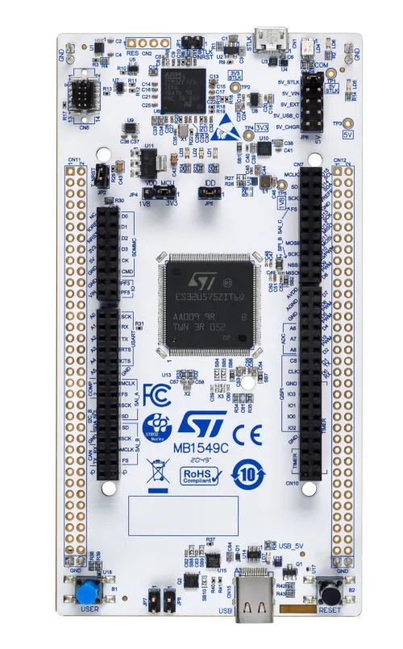

<!-- Copyright 2015-2026 Zephyr Project members and individual contributors. -->
<!-- SPDX-License-Identifier: Apache-2.0 -->
<!-- 中文翻译；编号、导航与译注为本地新增。 -->

<a id="nucleo_u5a5zj_q"></a>

# 第71章\_Nucleo U5A5ZJ Q开发板

原文：[官方页面](https://docs.zephyrproject.org/latest/boards/st/nucleo_u5a5zj_q/doc/index.html)。读取日期：2026-10-16；来源摘要见[来源记录](../SOURCES.md)。

开发板概览（Board Overview）

<a id="id1"></a>

[](images/nucleo_u5a5zj_q.webp)

Nucleo U5A5ZJ Q开发板

名称（Name）：

`nucleo_u5a5zj_q`

厂商（Vendor）：

[意法半导体（STMicroelectronics）](https://docs.zephyrproject.org/latest/boards/index.html#vendor=st)

状态（Status）：

维护中（Maintained）

架构（Architecture）：

[arm](https://docs.zephyrproject.org/latest/boards/index.html#arch=arm)

片上系统（SoC）：

[stm32u5a5xx](https://docs.zephyrproject.org/latest/boards/index.html#soc=stm32u5a5xx)

<a id="board-github-link"></a>

[浏览开发板源码（Browse Board Sources）](https://github.com/zephyrproject-rtos/zephyr/blob/main//boards/st/nucleo_u5a5zj_q/doc/index.rst/../..)<a id="overview"></a>

## 概述（Overview）

Nucleo U5A5ZJ Q搭载基于Arm Cortex-M33的STM32U5A5ZJ MCU，用户可选择不同性能与功耗组合，以经济、灵活的方式尝试新概念和构建原型。主要特点如下：


- LQFP144封装的STM32U5A5ZJ微控制器
- 内部SMPS产生Vcore逻辑电源
- 两类扩展资源：


  - Arduino Uno V3连接接口
  - ST morpho扩展排针，可访问全部STM32 I/O
- 板载ST-LINK/V3E调试器／编程器
- 灵活的开发板供电方式：


  - 通过USB VBUS或外部电源（3.3 V、5 V、7～12 V）供电
  - ST-Link V3E调试器
- 3个用户LED
- 两个按键：USER及RESET
- USB Type-C™全速受电端设备（Sink Device FS）

<a id="hardware"></a>

## 硬件（Hardware）

STM32U5A5xx属于STM32U5超低功耗微控制器系列，基于Arm® Cortex®-M33 32位RISC内核，最高工作频率160 MHz。


- 采用ST先进专利技术
- 支持FlexPowerControl的超低功耗设计：


  - 供电电压1.71～3.6 V
  - 工作温度范围−40 °C至+85／125 °C
  - 低功耗后台自主模式（LPBAM）：带DMA的自主外设可在最深Stop 2模式工作
  - VBAT模式为RTC、32个32位备份寄存器及2 Kbyte备份SRAM供电
  - 关断模式150 nA，24个唤醒引脚
  - 待机模式195 nA，24个唤醒引脚
  - 开启RTC的待机模式480 nA
  - 保留40 Kbyte SRAM的Stop 3模式2 µA
  - 保留2.5 Mbyte SRAM的Stop 3模式8.2 µA
  - 保留40 Kbyte SRAM的Stop 2模式4.65 µA
  - 保留2.5 Mbyte SRAM的Stop 2模式17.5 µA
  - 3.3 V运行模式18.5 µA/MHz
- 处理器核（Core）：


  - Arm® 32位Cortex®-M33 CPU，带TrustZone®、MPU、DSP、FPU及ART Accelerator
  - 32 Kbyte指令缓存（ICACHE），支持从Flash及外部存储器零等待执行；最高160 MHz，性能240 DMIPS
  - 用于外部存储器的16 Kbyte数据缓存1（DCACHE1）
- 电源管理（Power Management）：


  - 内置LDO及SMPS降压转换器，支持运行中切换与电压调节
- 基准测试（Benchmarks）：


  - 1.5 DMIPS/MHz，原文基准名称拼作Drystone 2.1
  - 655 CoreMark®，4.09 CoreMark®/MHz
  - ULPMark™-CP分数：369
  - ULPMark™-PP分数：89
  - ULPMark™-CM分数：47.2
  - SecureMark™-TLS分数：120000
- 存储器（Memories）：


  - 4 Mbytes Flash，支持ECC、双存储区读写并行，其中512 Kbytes耐久度100 kcycles
  - 关闭SRAM3 ECC时：2514 Kbyte RAM，其中66 Kbytes支持ECC
  - 开启SRAM3 ECC时：2450 Kbyte RAM，其中322 Kbytes支持ECC
  - 外部存储器接口，支持SRAM、PSRAM、NOR、NAND及FRAM
  - 2路Octo-SPI存储器接口
  - 16位高速SPI（HSPI）存储器接口，最高160 MHz
- 丰富的图形功能：


  - Neo-Chrom图形处理器（GPU2D），加速任意角度旋转、缩放及透视校正纹理映射（Perspective-correct Texture Mapping）
  - 16 Kbyte数据缓存2（DCACHE2）
  - Chrom-ART Accelerator（DMA2D），用于平滑运动及透明度效果
  - Chrom-GRC（GFXMMU）可优化最多20%的图形资源
  - MIPI® DSI主控制器，2条DSI通道，每条最高500 Mbit/s
  - LCD-TFT显示控制器（LTDC）
  - 数字摄像头接口
- 通用输入输出（GPIO）：


  - 最多156个支持中断的高速I/O，多数耐受5 V；最多14个I/O具有独立供电，最低1.08 V
- 时钟管理（Clock Management）：


  - 4～50 MHz晶体振荡器
  - 用于实时时钟（RTC）的32 kHz低速外部晶体振荡器（LSE）
  - 内部16 MHz出厂微调RC振荡器，精度±1%
  - 内部低功耗32 kHz RC振荡器，精度±5%
  - 2个内部多速率振荡器，范围100 kHz～48 MHz；其中1个由LSE自动微调，精度优于±0.25%
  - 内部48 MHz时钟
  - 5个PLL，用于系统时钟、USB、音频、ADC及DSI
- 安全与密码功能（Security and Cryptography）：


  - 以SESIP3及PSA Level 3认证保证为目标
  - Arm® TrustZone®，I/O、存储器及外设可配置安全属性
  - 灵活的生命周期方案，支持RDP及密码保护调试
  - 通过唯一启动入口及安全隐藏保护区域（HDP）建立信任根
  - 通过内置根安全服务（RSS）进行安全固件安装（SFI）
  - 利用硬件唯一密钥（Hardware Unique Key，HUK）进行安全数据存储
  - 支持使用可信固件M（Trusted Firmware-M，TF-M）进行安全固件升级
  - 2个AES协处理器，其中1个抵抗DPA
  - 抵抗DPA的公钥加速器（Public Key Accelerator）
  - Octo-SPI外部存储器即时解密（On-the-fly Decryption）
  - 哈希（HASH）硬件加速器
  - 符合NIST SP800-90B的真随机数发生器（TRNG）
  - 96位唯一标识（Unique ID）
  - 512字节一次性可编程存储器（OTP）
  - 主动防篡改（Active Tampers）
- 最多17个定时器、2个看门狗及RTC：


  - 原文合计19个定时器：2个16位高级电机控制、4个32位、3个16位通用、2个16位基本、4个可在停止模式工作的16位低功耗、2个SysTick及2个看门狗。
  - RTC，带硬件日历、闹钟及校准
- 最多25个通信外设：


  - 1个USB Type-C®／USB电力传输控制器
  - 1个带内置PHY的USB OTG高速接口
  - 2路串行音频接口（SAI）
  - 6路I2C FM+（1 Mbit/s），支持SMBus/PMBus™
  - 7路USART，支持ISO 7816、LIN、IrDA及调制解调器
  - 3路SPI，计入OCTOSPI/HSPI合计6路
  - 1个CAN FD控制器
  - 2路SDMMC接口
  - 1个多功能数字滤波器（含6个滤波器），以及1个带声音活动检测的音频数字滤波器
  - 并行同步从机接口（Parallel Synchronous Slave Interface）
- 数学协处理器（Mathematical Coprocessor）：


  - 坐标旋转数字计算（CORDIC），加速三角函数
  - 滤波数学加速器（Filter Mathematical Accelerator，FMAC）
- 丰富的模拟外设，具有独立供电：


  - 2个14位ADC，2.5 Msps，支持硬件过采样
  - 1个12位ADC，2.5 Msps，支持硬件过采样，可在Stop 2自主运行
  - 12位双通道DAC，支持低功耗采样保持，可在Stop 2自主运行
  - 2个运算放大器，内置PGA
  - 2个超低功耗比较器
- 符合ECOPACK2的封装

STM32U5A5ZJ的更多信息见：


- [STM32U5A5ZJ在ST官网的产品页](https://www.st.com/en/microcontrollers/stm32u5a5zj.html)
- [STM32U5A5参考手册（Reference Manual）](https://www.st.com/resource/en/reference_manual/rm0456-stm32u5-series-armbased-32bit-mcus-stmicroelectronics.pdf)

<a id="supported-features"></a>

### 支持的功能（Supported Features）

`nucleo_u5a5zj_q`开发板支持下表所列的硬件功能。

片上／板载（On-Chip / On-Board）

功能集成在片上系统（SoC）内／位于开发板上。

2 / 2

分别表示已启用／已禁用的实例数。点击数量标签，可查看开发板或SoC设备树源码（DTS）中该功能的第一个实例。

`vnd,foo`

与此功能匹配的设备树绑定兼容字符串（Compatible String）；点击链接可查看绑定文档。

<a id="nucleo_u5a5zj_q-hw-features"></a>

<a id="nucleo_u5a5zj_q-nucleo_u5a5zj_q/stm32u5a5xx-hw-features-section"></a>

#### `nucleo_u5a5zj_q/stm32u5a5xx`目标（Target）

<a id="nucleo_u5a5zj_q-nucleo_u5a5zj_q/stm32u5a5xx-hw-features-panel"></a>

<a id="nucleo_u5a5zj_q-nucleo_u5a5zj_q/stm32u5a5xx-hw-features-memory"></a>

该开发板目标的片上存储容量：2496 KiB RAM、4 MiB Flash。

<a id="nucleo_u5a5zj_q-nucleo_u5a5zj_q/stm32u5a5xx-hw-features-table"></a>

<table>
<tr>
<th>类型（Type）</th>
<th>位置（Location）</th>
<th>说明（Description）</th>
<th>兼容字符串（Compatible）</th>
</tr>
<tr>
<td rowspan="1">中央处理器（CPU）</td>
<td>片上（On-Chip）</td>
<td>ARM Cortex-M33处理器（CPU）（<a href="https://github.com/zephyrproject-rtos/zephyr/blob/main/dts/arm/st/u5/stm32u5.dtsi?plain=1#L36">已启用：1</a>）</td>
<td><a href="../cpu_arm_riscv_binding_reference/P022_arm_cortex-m33.md#std-dtcompatible-arm-cortex-m33"><code>arm,cortex-m33</code></a></td>
</tr>
<tr>
<td rowspan="1">模数转换器（ADC）</td>
<td>片上（On-Chip）</td>
<td>STM32模数转换器（ADC）（<a href="https://github.com/zephyrproject-rtos/zephyr/blob/main/dts/arm/st/u5/stm32u5.dtsi?plain=1#L897">已启用：2</a>）</td>
<td><a href="../hardware/P839_STM32模数转换器绑定.md#dtbinding-st-stm32-adc"><code>st,stm32-adc</code></a></td>
</tr>
<tr>
<td rowspan="1">音频（Audio）</td>
<td>片上（On-Chip）</td>
<td>STM32多功能数字滤波器（MDF）（<a href="https://github.com/zephyrproject-rtos/zephyr/blob/main/dts/arm/st/u5/stm32u595.dtsi?plain=1#L116">已禁用：1</a>）</td>
<td><a href="../audio_stm32_ti_wolfson_binding_reference/P003_st_stm32-mdf.md#std-dtcompatible-st-stm32-mdf"><code>st,stm32-mdf</code></a></td>
</tr>
<tr>
<td rowspan="1">控制器局域网（CAN）</td>
<td>片上（On-Chip）</td>
<td>STM32 FDCAN灵活数据速率CAN控制器（CAN FD Controller）（<a href="https://github.com/zephyrproject-rtos/zephyr/blob/main/dts/arm/st/u5/stm32u5.dtsi?plain=1#L952">已启用：1</a>）</td>
<td><a href="../can_nxp_renesas_stm32_ti_binding_reference/P012_st_stm32-fdcan.md#std-dtcompatible-st-stm32-fdcan"><code>st,stm32-fdcan</code></a></td>
</tr>
<tr>
<td rowspan="7">时钟控制（Clock Control）</td>
<td>片上（On-Chip）</td>
<td>STM32U5复位与时钟控制器（RCC / Reset and Clock Controller）（<a href="https://github.com/zephyrproject-rtos/zephyr/blob/main/dts/arm/st/u5/stm32u5.dtsi?plain=1#L230">已启用：1</a>）</td>
<td><a href="../timer_reference/P170_STM32U5复位与时钟控制绑定.md#dtbinding-st-stm32u5-rcc"><code>st,stm32u5-rcc</code></a></td>
</tr>
<tr>
<td>片上（On-Chip）</td>
<td>STM32 外部高速时钟（HSE Clock）（<a href="https://github.com/zephyrproject-rtos/zephyr/blob/main/dts/arm/st/u5/stm32u5.dtsi?plain=1#L90">已启用：1</a>）</td>
<td><a href="../timer_reference/P129_STM32高速外部时钟绑定.md#dtbinding-st-stm32-hse-clock"><code>st,stm32-hse-clock</code></a></td>
</tr>
<tr>
<td>片上（On-Chip）</td>
<td>通用固定频率时钟提供者（Fixed-Rate Clock Provider）（<a href="https://github.com/zephyrproject-rtos/zephyr/blob/main/dts/arm/st/u5/stm32u5.dtsi?plain=1#L103">已启用：1</a>；<a href="https://github.com/zephyrproject-rtos/zephyr/blob/main/dts/arm/st/u5/stm32u5.dtsi?plain=1#L96">已禁用：3</a>）</td>
<td><a href="../hardware/P566_固定时钟绑定.md#dtbinding-fixed-clock"><code>fixed-clock</code></a></td>
</tr>
<tr>
<td>片上（On-Chip）</td>
<td>STM32U5多速率内部时钟（Multi Speed Internal Clock）（<a href="https://github.com/zephyrproject-rtos/zephyr/blob/main/dts/arm/st/u5/stm32u5.dtsi?plain=1#L110">已禁用：2</a>）</td>
<td><a href="../timer_reference/P160_STM32U5多速内部时钟绑定.md#dtbinding-st-stm32u5-msi-clock"><code>st,stm32u5-msi-clock</code></a></td>
</tr>
<tr>
<td>片上（On-Chip）</td>
<td>STM32低速外部时钟（LSE Clock）（<a href="https://github.com/zephyrproject-rtos/zephyr/blob/main/dts/arm/st/u5/stm32u5.dtsi?plain=1#L124">已启用：1</a>）</td>
<td><a href="../timer_reference/P130_STM32低速外部时钟绑定.md#dtbinding-st-stm32-lse-clock"><code>st,stm32-lse-clock</code></a></td>
</tr>
<tr>
<td>片上（On-Chip）</td>
<td>STM32U5锁相环（PLL）（<a href="https://github.com/zephyrproject-rtos/zephyr/blob/main/dts/arm/st/u5/stm32u5.dtsi?plain=1#L146">已启用：1</a>；<a href="https://github.com/zephyrproject-rtos/zephyr/blob/main/dts/arm/st/u5/stm32u5.dtsi?plain=1#L152">已禁用：2</a>）</td>
<td><a href="../timer_reference/P150_STM32U5锁相环时钟绑定.md#dtbinding-st-stm32u5-pll-clock"><code>st,stm32u5-pll-clock</code></a></td>
</tr>
<tr>
<td>片上（On-Chip）</td>
<td>STM32 微控制器时钟输出（Microcontroller Clock Output，MCO）（<a href="https://github.com/zephyrproject-rtos/zephyr/blob/main/dts/arm/st/u5/stm32u5.dtsi?plain=1#L166">已禁用：1</a>）</td>
<td><a href="../timer_reference/P134_STM32时钟输出绑定.md#dtbinding-st-stm32-clock-mco"><code>st,stm32-clock-mco</code></a></td>
</tr>
<tr>
<td rowspan="1">计数器（Counter）</td>
<td>片上（On-Chip）</td>
<td>STM32 计数器（Counters）（<a href="https://github.com/zephyrproject-rtos/zephyr/blob/main/dts/arm/st/u5/stm32u5.dtsi?plain=1#L586">已禁用：11</a>）</td>
<td><a href="../stm32_ti_xilinx_counter_binding_reference/P007_st_stm32-counter.md#std-dtcompatible-st-stm32-counter"><code>st,stm32-counter</code></a></td>
</tr>
<tr>
<td rowspan="1">循环冗余校验（CRC）</td>
<td>片上（On-Chip）</td>
<td>STM32 CRC 计算单元（Calculation Unit）（<a href="https://github.com/zephyrproject-rtos/zephyr/blob/main/dts/arm/st/u5/stm32u5.dtsi?plain=1#L1070">已禁用：1</a>）</td>
<td><a href="../crc_clock_monitor_binding_reference/P011_st_stm32-crc.md#std-dtcompatible-st-stm32-crc"><code>st,stm32-crc</code></a></td>
</tr>
<tr>
<td rowspan="2">密码学加速器（Cryptographic Accelerator）</td>
<td>片上（On-Chip）</td>
<td>STM32哈希处理器（HASH Processor）（<a href="https://github.com/zephyrproject-rtos/zephyr/blob/main/dts/arm/st/u5/stm32u5.dtsi?plain=1#L975">已禁用：1</a>）</td>
<td><a href="../crypto_secure_engine_st_ti_binding_reference/P017_st_stm32-hash.md#std-dtcompatible-st-stm32-hash"><code>st,stm32-hash</code></a></td>
</tr>
<tr>
<td>片上（On-Chip）</td>
<td>STM32高级加密标准加速器（AES Accelerator）（<a href="https://github.com/zephyrproject-rtos/zephyr/blob/main/dts/arm/st/u5/stm32u5_crypt.dtsi?plain=1#L9">已禁用：1</a>）</td>
<td><a href="../crypto_secure_engine_st_ti_binding_reference/P015_st_stm32-aes.md#std-dtcompatible-st-stm32-aes"><code>st,stm32-aes</code></a></td>
</tr>
<tr>
<td rowspan="1">数模转换器（DAC）</td>
<td>片上（On-Chip）</td>
<td>STM32 系列数模转换器（DAC）（<a href="https://github.com/zephyrproject-rtos/zephyr/blob/main/dts/arm/st/u5/stm32u5.dtsi?plain=1#L889">已启用：1</a>）</td>
<td><a href="../hardware/P760_STM32数模转换器绑定.md#dtbinding-st-stm32-dac"><code>st,stm32-dac</code></a></td>
</tr>
<tr>
<td rowspan="2">显示（Display）</td>
<td>片上（On-Chip）</td>
<td>STM32 NeoChrom-GPU2D加速器（<a href="https://github.com/zephyrproject-rtos/zephyr/blob/main/dts/arm/st/u5/stm32u5.dtsi?plain=1#L1078">已禁用：1</a>）</td>
<td><a href="../display_st_ultrachip_zephyr_binding_reference/P002_st_neochrom-gpu2d.md#std-dtcompatible-st-neochrom-gpu2d"><code>st,neochrom-gpu2d</code></a></td>
</tr>
<tr>
<td>片上（On-Chip）</td>
<td>STM32 Chrom-ART 图形加速器（Accelerator，DMA2D）（<a href="https://github.com/zephyrproject-rtos/zephyr/blob/main/dts/arm/st/u5/stm32u595.dtsi?plain=1#L164">已禁用：1</a>）</td>
<td><a href="../display_st_ultrachip_zephyr_binding_reference/P003_st_stm32-dma2d.md#std-dtcompatible-st-stm32-dma2d"><code>st,stm32-dma2d</code></a></td>
</tr>
<tr>
<td rowspan="1">直接存储器访问（DMA）</td>
<td>片上（On-Chip）</td>
<td>STM32U5直接存储器访问（DMA）控制器（<a href="https://github.com/zephyrproject-rtos/zephyr/blob/main/dts/arm/st/u5/stm32u5.dtsi?plain=1#L963">已启用：1</a>）</td>
<td><a href="../stm32_ti_xilinx_dma_binding_reference/P012_st_stm32u5-dma.md#std-dtcompatible-st-stm32u5-dma"><code>st,stm32u5-dma</code></a></td>
</tr>
<tr>
<td rowspan="1">闪存控制器（Flash Controller）</td>
<td>片上（On-Chip）</td>
<td>STM32 系列闪存控制器（Flash Controller）（<a href="https://github.com/zephyrproject-rtos/zephyr/blob/main/dts/arm/st/u5/stm32u5.dtsi?plain=1#L174">已启用：1</a>）</td>
<td><a href="../flash_renesas_st_ti_binding_reference/P011_st_stm32-flash-controller.md#std-dtcompatible-st-stm32-flash-controller"><code>st,stm32-flash-controller</code></a></td>
</tr>
<tr>
<td rowspan="3">通用输入输出与接插件（GPIO &amp; Headers）</td>
<td>片上（On-Chip）</td>
<td>STM32 通用输入输出控制器（GPIO Controller）（<a href="https://github.com/zephyrproject-rtos/zephyr/blob/main/dts/arm/st/u5/stm32u5.dtsi?plain=1#L271">已启用：10</a>）</td>
<td><a href="../gpio_silabs_st_connectors_binding_reference/P029_st_stm32-gpio.md#std-dtcompatible-st-stm32-gpio"><code>st,stm32-gpio</code></a></td>
</tr>
<tr>
<td>片上（On-Chip）</td>
<td>串行线／JTAG连接器（Serial Wire–JTAG Connector）（<a href="https://github.com/zephyrproject-rtos/zephyr/blob/main/dts/arm/st/u5/stm32u5.dtsi?plain=1#L1089">已启用：1</a>）</td>
<td><a href="../gpio_ti_xilinx_sdl_binding_reference/P006_swj-connector.md#std-dtcompatible-swj-connector"><code>swj-connector</code></a></td>
</tr>
<tr>
<td>板载（On-Board）</td>
<td>引出到Arduino Uno R3排针（Headers）的GPIO引脚（<a href="https://github.com/zephyrproject-rtos/zephyr/blob/main/boards/st/nucleo_u5a5zj_q/arduino_r3_connector.dtsi?plain=1#L10">已启用：1</a>）</td>
<td><a href="../gpio_adi_headers_ambiq_binding_reference/P023_arduino-header-r3.md#std-dtcompatible-arduino-header-r3"><code>arduino-header-r3</code></a></td>
</tr>
<tr>
<td rowspan="1">集成电路间总线（I2C）</td>
<td>片上（On-Chip）</td>
<td>STM32 I2C V2 控制器（Controller）（<a href="https://github.com/zephyrproject-rtos/zephyr/blob/main/dts/arm/st/u5/stm32u5.dtsi?plain=1#L436">已启用：2</a>；<a href="https://github.com/zephyrproject-rtos/zephyr/blob/main/dts/arm/st/u5/stm32u5.dtsi?plain=1#L460">已禁用：4</a>）</td>
<td><a href="../i2c_stm32_ti_mux_binding_reference/P008_st_stm32-i2c-v2.md#std-dtcompatible-st-stm32-i2c-v2"><code>st,stm32-i2c-v2</code></a></td>
</tr>
<tr>
<td rowspan="1">集成电路间音频总线（I2S）</td>
<td>片上（On-Chip）</td>
<td>STM32 串行音频接口块控制器（SAI Block Controller）（<a href="https://github.com/zephyrproject-rtos/zephyr/blob/main/dts/arm/st/u5/stm32u5.dtsi?plain=1#L542">已禁用：2</a>）</td>
<td><a href="../i2s_binding_reference/P017_st_stm32-sai.md#std-dtcompatible-st-stm32-sai"><code>st,stm32-sai</code></a></td>
</tr>
<tr>
<td rowspan="1">输入（Input）</td>
<td>板载（On-Board）</td>
<td>一组绑定到 GPIO 的输入按键（GPIO-Bound Input Keys）（<a href="https://github.com/zephyrproject-rtos/zephyr/blob/main/boards/st/nucleo_u5a5zj_q/nucleo_u5a5zj_q-common.dtsi?plain=1#L32">已启用：1</a>）</td>
<td><a href="../hardware/P563_GPIO按键绑定.md#std-dtcompatible-gpio-keys"><code>gpio-keys</code></a></td>
</tr>
<tr>
<td rowspan="2">中断控制器（Interrupt Controller）</td>
<td>片上（On-Chip）</td>
<td>ARMv8-M嵌套向量中断控制器（NVIC / Nested Vectored Interrupt Controller）（<a href="https://github.com/zephyrproject-rtos/zephyr/blob/main/dts/arm/armv8-m.dtsi?plain=1#L13">已启用：1</a>）</td>
<td><a href="../arm_interrupt_timer_binding_reference/P003_ARMv8_M_NVIC.md#std-dtcompatible-arm-v8m-nvic"><code>arm,v8m-nvic</code></a></td>
</tr>
<tr>
<td>片上（On-Chip）</td>
<td>STM32G0 外部中断控制器（External Interrupt Controller）（<a href="https://github.com/zephyrproject-rtos/zephyr/blob/main/dts/arm/st/u5/stm32u5.dtsi?plain=1#L242">已启用：1</a>）</td>
<td><a href="../mcu_external_interrupt_binding_reference/P002_st_stm32g0-exti.md#std-dtcompatible-st-stm32g0-exti"><code>st,stm32g0-exti</code></a></td>
</tr>
<tr>
<td rowspan="2">发光二极管（LED）</td>
<td>板载（On-Board）</td>
<td>一组由 GPIO 控制的 LED（GPIO-Controlled LEDs）（<a href="https://github.com/zephyrproject-rtos/zephyr/blob/main/boards/st/nucleo_u5a5zj_q/nucleo_u5a5zj_q-common.dtsi?plain=1#L13">已启用：1</a>）</td>
<td><a href="../hardware/P564_GPIO指示灯绑定.md#dtbinding-gpio-leds"><code>gpio-leds</code></a></td>
</tr>
<tr>
<td>板载（On-Board）</td>
<td>一组由脉宽调制（PWM）控制的LED（<a href="https://github.com/zephyrproject-rtos/zephyr/blob/main/boards/st/nucleo_u5a5zj_q/nucleo_u5a5zj_q-common.dtsi?plain=1#L42">已禁用：1</a>）</td>
<td><a href="../hardware/P565_PWM指示灯绑定.md#dtbinding-pwm-leds"><code>pwm-leds</code></a></td>
</tr>
<tr>
<td rowspan="2">存储器控制器（Memory Controller）</td>
<td>片上（On-Chip）</td>
<td>STM32 灵活存储器控制器（Flexible Memory Controller，FMC）（<a href="https://github.com/zephyrproject-rtos/zephyr/blob/main/dts/arm/st/u5/stm32u5_extra.dtsi?plain=1#L56">已禁用：1</a>）</td>
<td><a href="../memory_controller_sdram_psram_binding_reference/P013_st_stm32-fmc.md#std-dtcompatible-st-stm32-fmc"><code>st,stm32-fmc</code></a></td>
</tr>
<tr>
<td>片上（On-Chip）</td>
<td>STM32灵活存储器控制器（FMC / Flexible Memory Controller），用于NOR Flash、PSRAM和SRAM（<a href="https://github.com/zephyrproject-rtos/zephyr/blob/main/dts/arm/st/u5/stm32u5_extra.dtsi?plain=1#L62">已禁用：1</a>）</td>
<td><a href="../memory_controller_sdram_psram_binding_reference/P011_st_stm32-fmc-nor-psram.md#std-dtcompatible-st-stm32-fmc-nor-psram"><code>st,stm32-fmc-nor-psram</code></a></td>
</tr>
<tr>
<td rowspan="1">内存管理单元／内存保护单元（MMU / MPU）</td>
<td>片上（On-Chip）</td>
<td>ARMv8-M存储器保护单元（MPU / Memory Protection Unit）（<a href="https://github.com/zephyrproject-rtos/zephyr/blob/main/dts/arm/st/u5/stm32u5.dtsi?plain=1#L46">已启用：1</a>）</td>
<td><a href="../memory_protection_binding_reference/P007_arm_armv8m-mpu.md#std-dtcompatible-arm-armv8m-mpu"><code>arm,armv8m-mpu</code></a></td>
</tr>
<tr>
<td rowspan="1">存储技术设备（MTD）</td>
<td>片上（On-Chip）</td>
<td>STM32闪存（Flash Memory）（<a href="https://github.com/zephyrproject-rtos/zephyr/blob/main/dts/arm/st/u5/stm32u5.dtsi?plain=1#L183">已启用：1</a>）</td>
<td><a href="../mtd_nxp_st_ti_partition_binding_reference/P016_st_stm32-nv-flash.md#std-dtcompatible-st-stm32-nv-flash"><code>st,stm32-nv-flash</code></a></td>
</tr>
<tr>
<td rowspan="1">非易失存储器（NVMEM）</td>
<td>片上（On-Chip）</td>
<td>非易失存储器固定布局（Fixed Layout for Non-Volatile Memory）（<a href="https://github.com/zephyrproject-rtos/zephyr/blob/main/dts/arm/st/u5/stm32u5.dtsi?plain=1#L204">已启用：1</a>）</td>
<td><a href="../memory_protection_binding_reference/P009_fixed-layout.md#std-dtcompatible-fixed-layout"><code>fixed-layout</code></a></td>
</tr>
<tr>
<td rowspan="1">八线串行外设接口（OCTOSPI）</td>
<td>片上（On-Chip）</td>
<td>STM32八线SPI控制器（OSPI Controller）（<a href="https://github.com/zephyrproject-rtos/zephyr/blob/main/dts/arm/st/u5/stm32u5.dtsi?plain=1#L836">已禁用：2</a>）</td>
<td><a href="../qspi_ospi_xspi_binding_reference/P002_st_stm32-ospi.md#std-dtcompatible-st-stm32-ospi"><code>st,stm32-ospi</code></a></td>
</tr>
<tr>
<td rowspan="1">一次性可编程存储器（OTP Memory）</td>
<td>片上（On-Chip）</td>
<td>STM32 嵌入式非易失一次性可编程存储器（NVM OTP）（<a href="https://github.com/zephyrproject-rtos/zephyr/blob/main/dts/arm/st/u5/stm32u5.dtsi?plain=1#L200">已启用：1</a>；<a href="https://github.com/zephyrproject-rtos/zephyr/blob/main/dts/arm/st/u5/stm32u5.dtsi?plain=1#L193">已禁用：1</a>）</td>
<td><a href="../otp_binding_reference/P010_st_stm32-nvm-otp.md#std-dtcompatible-st-stm32-nvm-otp"><code>st,stm32-nvm-otp</code></a></td>
</tr>
<tr>
<td rowspan="1">物理层（PHY）</td>
<td>片上（On-Chip）</td>
<td>STM32U5 OTG高速物理层（HS PHY）（<a href="https://github.com/zephyrproject-rtos/zephyr/blob/main/dts/arm/st/u5/stm32u5_usbotg_hs.dtsi?plain=1#L26">已启用：1</a>）</td>
<td><a href="../phy_binding_reference/P007_st_stm32u5-otghs-phy.md#std-dtcompatible-st-stm32u5-otghs-phy"><code>st,stm32u5-otghs-phy</code></a></td>
</tr>
<tr>
<td rowspan="1">引脚控制（Pin Control）</td>
<td>片上（On-Chip）</td>
<td>STM32 引脚控制器（Pin Controller）（<a href="https://github.com/zephyrproject-rtos/zephyr/blob/main/dts/arm/st/u5/stm32u5.dtsi?plain=1#L264">已启用：1</a>）</td>
<td><a href="../pinctrl_stm32_ti_xilinx_binding_reference/P004_st_stm32-pinctrl.md#std-dtcompatible-st-stm32-pinctrl"><code>st,stm32-pinctrl</code></a></td>
</tr>
<tr>
<td rowspan="2">电源管理（Power Management）</td>
<td>片上（On-Chip）</td>
<td>STM32U5电源控制器（Power Controller）（<a href="https://github.com/zephyrproject-rtos/zephyr/blob/main/dts/arm/st/u5/stm32u5.dtsi?plain=1#L992">已启用：1</a>）</td>
<td><a href="../stm32_soc_power_binding_reference/P016_st_stm32u5-pwr.md#std-dtcompatible-st-stm32u5-pwr"><code>st,stm32u5-pwr</code></a></td>
</tr>
<tr>
<td>片上（On-Chip）</td>
<td>STM32唤醒线控制器（Wake-up Lines Controller）（<a href="https://github.com/zephyrproject-rtos/zephyr/blob/main/dts/arm/st/u5/stm32u5.dtsi?plain=1#L1003">已禁用：1</a>）</td>
<td><a href="../stm32_soc_power_binding_reference/P009_st_stm32-pwr-wkupctrl.md#std-dtcompatible-st-stm32-pwr-wkupctrl"><code>st,stm32-pwr-wkupctrl</code></a></td>
</tr>
<tr>
<td rowspan="1">脉宽调制（PWM）</td>
<td>片上（On-Chip）</td>
<td>STM32 脉宽调制（PWM）（<a href="https://github.com/zephyrproject-rtos/zephyr/blob/main/dts/arm/st/u5/stm32u5.dtsi?plain=1#L636">已启用：2</a>；<a href="https://github.com/zephyrproject-rtos/zephyr/blob/main/dts/arm/st/u5/stm32u5.dtsi?plain=1#L580">已禁用：7</a>）</td>
<td><a href="../pwm_stm32_ti_generic_binding_reference/P011_st_stm32-pwm.md#std-dtcompatible-st-stm32-pwm"><code>st,stm32-pwm</code></a></td>
</tr>
<tr>
<td rowspan="1">稳压器（Regulator）</td>
<td>片上（On-Chip）</td>
<td>STM32参考电压缓冲器稳压器（VREFBUF Regulator）（<a href="https://github.com/zephyrproject-rtos/zephyr/blob/main/dts/arm/st/u5/stm32u5.dtsi?plain=1#L983">已禁用：1</a>）</td>
<td><a href="../hardware/P638_STM32参考电压缓冲器绑定.md#dtbinding-st-stm32-vrefbuf"><code>st,stm32-vrefbuf</code></a></td>
</tr>
<tr>
<td rowspan="1">复位控制器（Reset Controller）</td>
<td>片上（On-Chip）</td>
<td>STM32 复位与时钟控制器（Reset and Clock Control，RCC）（<a href="https://github.com/zephyrproject-rtos/zephyr/blob/main/dts/arm/st/u5/stm32u5.dtsi?plain=1#L236">已启用：1</a>）</td>
<td><a href="../reset_controller_binding_reference/P017_st_stm32-rcc-rctl.md#std-dtcompatible-st-stm32-rcc-rctl"><code>st,stm32-rcc-rctl</code></a></td>
</tr>
<tr>
<td rowspan="1">随机数生成器（RNG）</td>
<td>片上（On-Chip）</td>
<td>STM32 随机数生成器（Random Number Generator）（<a href="https://github.com/zephyrproject-rtos/zephyr/blob/main/dts/arm/st/u5/stm32u5.dtsi?plain=1#L862">已启用：1</a>）</td>
<td><a href="../soc_rng_binding_reference/P016_st_stm32-rng.md#std-dtcompatible-st-stm32-rng"><code>st,stm32-rng</code></a></td>
</tr>
<tr>
<td rowspan="1">实时时钟（RTC）</td>
<td>片上（On-Chip）</td>
<td>STM32 实时时钟（RTC）（<a href="https://github.com/zephyrproject-rtos/zephyr/blob/main/dts/arm/st/u5/stm32u5.dtsi?plain=1#L532">已启用：1</a>）</td>
<td><a href="../soc_rtc_binding_reference/P014_st_stm32-rtc.md#std-dtcompatible-st-stm32-rtc"><code>st,stm32-rtc</code></a></td>
</tr>
<tr>
<td rowspan="1">SD 主机控制器（SDHC）</td>
<td>片上（On-Chip）</td>
<td>STM32 SDMMC 主机控制器（Host Controller）（<a href="https://github.com/zephyrproject-rtos/zephyr/blob/main/dts/arm/st/u5/stm32u5.dtsi?plain=1#L879">已禁用：2</a>）</td>
<td><a href="../sdhc_binding_reference/P019_st_stm32-sdmmc.md#std-dtcompatible-st-stm32-sdmmc"><code>st,stm32-sdmmc</code></a></td>
</tr>
<tr>
<td rowspan="4">传感器（Sensors）</td>
<td>片上（On-Chip）</td>
<td>STM32 正交解码器（Quadrature Decoder）（<a href="https://github.com/zephyrproject-rtos/zephyr/blob/main/dts/arm/st/u5/stm32u5.dtsi?plain=1#L591">已禁用：6</a>）</td>
<td><a href="../sensor_st_lsm_stm32_binding_reference/P028_st_stm32-qdec.md#std-dtcompatible-st-stm32-qdec"><code>st,stm32-qdec</code></a></td>
</tr>
<tr>
<td>片上（On-Chip）</td>
<td>STM32 系列温度节点（TEMP），用于以两个温度点完成生产校准的传感器。（<a href="https://github.com/zephyrproject-rtos/zephyr/blob/main/dts/arm/st/u5/stm32u5.dtsi?plain=1#L1099">已禁用：1</a>）</td>
<td><a href="../sensor_st_lsm_stm32_binding_reference/P029_st_stm32-temp-cal.md#std-dtcompatible-st-stm32-temp-cal"><code>st,stm32-temp-cal</code></a></td>
</tr>
<tr>
<td>片上（On-Chip）</td>
<td>STM32 参考电压（VREF+）（<a href="https://github.com/zephyrproject-rtos/zephyr/blob/main/dts/arm/st/u5/stm32u5.dtsi?plain=1#L1111">已启用：1</a>；<a href="https://github.com/zephyrproject-rtos/zephyr/blob/main/dts/arm/st/u5/stm32u5.dtsi?plain=1#L1120">已禁用：1</a>）</td>
<td><a href="../sensor_st_ti_power_capacitance_binding_reference/P003_st_stm32-vref.md#std-dtcompatible-st-stm32-vref"><code>st,stm32-vref</code></a></td>
</tr>
<tr>
<td>片上（On-Chip）</td>
<td>STM32 电池电压（VBAT）（<a href="https://github.com/zephyrproject-rtos/zephyr/blob/main/dts/arm/st/u5/stm32u5.dtsi?plain=1#L1136">已启用：1</a>；<a href="https://github.com/zephyrproject-rtos/zephyr/blob/main/dts/arm/st/u5/stm32u5.dtsi?plain=1#L1129">已禁用：1</a>）</td>
<td><a href="../sensor_st_ti_power_capacitance_binding_reference/P001_st_stm32-vbat.md#std-dtcompatible-st-stm32-vbat"><code>st,stm32-vbat</code></a></td>
</tr>
<tr>
<td rowspan="3">串行控制器（Serial Controller）</td>
<td>片上（On-Chip）</td>
<td>STM32 通用同步／异步收发器（USART）（<a href="https://github.com/zephyrproject-rtos/zephyr/blob/main/dts/arm/st/u5/stm32u5.dtsi?plain=1#L352">已启用：2</a>；<a href="https://github.com/zephyrproject-rtos/zephyr/blob/main/dts/arm/st/u5/stm32u5.dtsi?plain=1#L361">已禁用：2</a>）</td>
<td><a href="../uart_silabs_stm32_ti_binding_reference/P016_st_stm32-usart.md#std-dtcompatible-st-stm32-usart"><code>st,stm32-usart</code></a></td>
</tr>
<tr>
<td>片上（On-Chip）</td>
<td>STM32 通用异步收发器（UART）（<a href="https://github.com/zephyrproject-rtos/zephyr/blob/main/dts/arm/st/u5/stm32u5.dtsi?plain=1#L370">已禁用：2</a>）</td>
<td><a href="../uart_silabs_stm32_ti_binding_reference/P015_st_stm32-uart.md#std-dtcompatible-st-stm32-uart"><code>st,stm32-uart</code></a></td>
</tr>
<tr>
<td>片上（On-Chip）</td>
<td>STM32低功耗通用异步收发器（LPUART）（<a href="https://github.com/zephyrproject-rtos/zephyr/blob/main/dts/arm/st/u5/stm32u5.dtsi?plain=1#L388">已启用：1</a>）</td>
<td><a href="../uart_silabs_stm32_ti_binding_reference/P014_st_stm32-lpuart.md#std-dtcompatible-st-stm32-lpuart"><code>st,stm32-lpuart</code></a></td>
</tr>
<tr>
<td rowspan="1">系统管理总线（SMbus）</td>
<td>片上（On-Chip）</td>
<td>STM32 系统管理总线控制器（SMBus Controller）（<a href="https://github.com/zephyrproject-rtos/zephyr/blob/main/dts/arm/st/u5/stm32u5.dtsi?plain=1#L1143">已禁用：6</a>）</td>
<td><a href="../i3c_smbus_binding_reference/P013_st_stm32-smbus.md#std-dtcompatible-st-stm32-smbus"><code>st,stm32-smbus</code></a></td>
</tr>
<tr>
<td rowspan="1">串行外设接口（SPI）</td>
<td>片上（On-Chip）</td>
<td>STM32H7 串行外设接口控制器（SPI Controller）（<a href="https://github.com/zephyrproject-rtos/zephyr/blob/main/dts/arm/st/u5/stm32u5.dtsi?plain=1#L397">已启用：1</a>；<a href="https://github.com/zephyrproject-rtos/zephyr/blob/main/dts/arm/st/u5/stm32u5.dtsi?plain=1#L410">已禁用：2</a>）</td>
<td><a href="../spi_stm32_ti_xilinx_binding_reference/P013_st_stm32h7-spi.md#std-dtcompatible-st-stm32h7-spi"><code>st,stm32h7-spi</code></a></td>
</tr>
<tr>
<td rowspan="1">USB Type-C 端口控制器（USB Type-C Port Controller）</td>
<td>片上（On-Chip）</td>
<td>STM32 USB Type-C／电力传输（Power Delivery）（<a href="https://github.com/zephyrproject-rtos/zephyr/blob/main/dts/arm/st/u5/stm32u5_extra.dtsi?plain=1#L83">已禁用：1</a>）</td>
<td><a href="../usbc_tcpc_binding_reference/P005_st_stm32-ucpd.md#std-dtcompatible-st-stm32-ucpd"><code>st,stm32-ucpd</code></a></td>
</tr>
<tr>
<td rowspan="3">定时器（Timer）</td>
<td>片上（On-Chip）</td>
<td>ARMv8-M系统节拍（System Tick）（<a href="https://github.com/zephyrproject-rtos/zephyr/blob/main/dts/arm/armv8-m.dtsi?plain=1#L21">已启用：1</a>）</td>
<td><a href="../arm_interrupt_timer_binding_reference/P007_ARMv8_M_SysTick.md#std-dtcompatible-arm-armv8m-systick"><code>arm,armv8m-systick</code></a></td>
</tr>
<tr>
<td>片上（On-Chip）</td>
<td>STM32U5低功耗定时器（LPTIM）（<a href="https://github.com/zephyrproject-rtos/zephyr/blob/main/dts/arm/st/u5/stm32u5.dtsi?plain=1#L484">已禁用：4</a>）</td>
<td><a href="../stm32_ti_silabs_timer_binding_reference/P009_st_stm32u5-lptim.md#std-dtcompatible-st-stm32u5-lptim"><code>st,stm32u5-lptim</code></a></td>
</tr>
<tr>
<td>片上（On-Chip）</td>
<td>STM32 定时器（Timers）（<a href="https://github.com/zephyrproject-rtos/zephyr/blob/main/dts/arm/st/u5/stm32u5.dtsi?plain=1#L626">已启用：2</a>；<a href="https://github.com/zephyrproject-rtos/zephyr/blob/main/dts/arm/st/u5/stm32u5.dtsi?plain=1#L570">已禁用：9</a>）</td>
<td><a href="../stm32_ti_silabs_timer_binding_reference/P008_st_stm32-timers.md#std-dtcompatible-st-stm32-timers"><code>st,stm32-timers</code></a></td>
</tr>
<tr>
<td rowspan="1">通用串行总线（USB）</td>
<td>片上（On-Chip）</td>
<td>STM32 高速 USB OTG 控制器（OTGHS Controller）（<a href="https://github.com/zephyrproject-rtos/zephyr/blob/main/dts/arm/st/u5/stm32u5_usbotg_hs.dtsi?plain=1#L12">已启用：1</a>）</td>
<td><a href="../usb_stm32_audio_binding_reference/P005_st_stm32-otghs.md#std-dtcompatible-st-stm32-otghs"><code>st,stm32-otghs</code></a></td>
</tr>
<tr>
<td rowspan="2">看门狗（Watchdog）</td>
<td>片上（On-Chip）</td>
<td>STM32 看门狗（Watchdog）（<a href="https://github.com/zephyrproject-rtos/zephyr/blob/main/dts/arm/st/u5/stm32u5.dtsi?plain=1#L328">已启用：1</a>）</td>
<td><a href="../stm32_ti_xilinx_watchdog_binding_reference/P001_st_stm32-watchdog.md#std-dtcompatible-st-stm32-watchdog"><code>st,stm32-watchdog</code></a></td>
</tr>
<tr>
<td>片上（On-Chip）</td>
<td>STM32 系统窗口看门狗（System Window Watchdog）（<a href="https://github.com/zephyrproject-rtos/zephyr/blob/main/dts/arm/st/u5/stm32u5.dtsi?plain=1#L335">已禁用：1</a>）</td>
<td><a href="../stm32_ti_xilinx_watchdog_binding_reference/P002_st_stm32-window-watchdog.md#std-dtcompatible-st-stm32-window-watchdog"><code>st,stm32-window-watchdog</code></a></td>
</tr>
</table>

<a id="connections-and-ios"></a>

### 连接与输入输出（Connections and IOs）

Nucleo U5A5ZJ Q有10个通用输入输出（GPIO）控制器，负责引脚复用（Pin Muxing）、输入输出、上拉等功能。

更多细节见[STM32 Nucleo-144开发板用户手册](https://www.st.com/resource/en/user_manual/um2861-stm32u5-nucleo144-board-mb1549-stmicroelectronics.pdf)（User Manual）。

<a id="default-zephyr-peripheral-mapping"></a>

#### Zephyr 默认外设映射（Peripheral Mapping）：


- CAN/CANFD_TX: PD1
- CAN/CANFD_RX: PD0
- `DAC1_OUT1 : PA4`
- `I2C_1_SCL : PB8`
- `I2C_1_SDA : PB9`
- `I2C_2_SCL : PF1`
- `I2C_2_SDA : PF0`
- LD1 : PC7
- LD2 : PB7
- LD3 : PG2
- LPUART_1_TX : PG7
- LPUART_1_RX : PG8
- SPI_1片选nCS（GPIO）：PD14
- `SPI_1_SCK : PA5`
- `SPI_1_MISO : PA6`
- `SPI_1_MOSI : PA7`
- UART_1_TX：PA9
- UART_1_RX：PA10
- UART_2_TX : PD5
- `UART_2_RX : PD6`
- `USER_PB : PC13`
- USB_DM：PA11
- `USB_DP : PA12`

<a id="system-clock"></a>

#### 系统时钟（System Clock）

Nucleo U5A5ZJ Q系统时钟可来自内部振荡器、外部振荡器或主PLL。默认以16 MHz高速振荡器驱动PLL，产生160 MHz系统时钟。

<a id="serial-port"></a>

#### 串口（Serial Port）

Nucleo U5A5ZJ Q有6路U(S)ART，Zephyr控制台分配给USART1，默认参数115200、8N1。

<a id="backup-sram"></a>

#### 备份SRAM（Backup SRAM）

测试备份SRAM时，可移除板背面的SB50跳线，断开VBAT与VDD。

<a id="using-usb"></a>

#### 使用USB（Using USB）

USB 2.0高速（HS）运行要求安装并启用高速外部时钟（HSE）。Nucleo U5A5ZJ-Q已配有16 MHz振荡器及所需跳线设置。

<a id="programming-and-debugging"></a>

## 烧录与调试（Programming and Debugging）

`nucleo_u5a5zj_q`开发板支持下表所列的运行工具（Runners）及相关west命令。

<table>
<tr>
<th></th>
<th>烧录（flash）</th>
<th>调试（debug）</th>
<th>复位（reset）</th>
<th>连接调试会话（attach）</th>
<th>实时传输（rtt）</th>
<th>调试服务器（debugserver）</th>
</tr>
<tr>
<td><a href="https://docs.zephyrproject.org/latest/develop/flash_debug/host-tools.html#runner-jlink">jlink</a></td>
<td>✅</td>
<td>✅</td>
<td>✅</td>
<td>✅</td>
<td>✅</td>
<td>✅</td>
</tr>
<tr>
<td><a href="https://docs.zephyrproject.org/latest/develop/flash_debug/host-tools.html#runner-openocd">openocd</a></td>
<td>✅</td>
<td>✅（默认 / default）</td>
<td></td>
<td>✅</td>
<td>✅</td>
<td>✅</td>
</tr>
<tr>
<td><a href="https://docs.zephyrproject.org/latest/develop/flash_debug/host-tools.html#runner-pyocd">pyocd</a></td>
<td>✅</td>
<td>✅</td>
<td>✅</td>
<td>✅</td>
<td>✅</td>
<td>✅</td>
</tr>
<tr>
<td><a href="https://docs.zephyrproject.org/latest/develop/flash_debug/host-tools.html#runner-stm32cubeprogrammer"><code>stm32cubeprogrammer</code></a></td>
<td>✅（默认 / default）</td>
<td></td>
<td></td>
<td></td>
<td></td>
<td></td>
</tr>
</table>

Nucleo U5A5ZJ-Q内置ST-LINK/V3调试工具接口，可使用多种工具烧录开发板。

<a id="flashing"></a>

### 烧录（Flashing）

此板默认通过west的[STM32CubeProgrammer](https://www.st.com/en/development-tools/stm32cubeprog.html)运行器（Runner）烧录，因此需要安装该工具。（[installation](https://docs.zephyrproject.org/latest/develop/flash_debug/host-tools.html#stm32cubeprog-flash-host-tools)）

也可以使用OpenOCD、J-Link或pyOCD，通过--runner或-r选项烧录开发板：

```text
$ west flash --runner openocd
$ west flash --runner jlink
$ west flash --runner pyocd
```

pyOCD需要安装额外的目标信息，可执行以下命令。

```text
$ pyocd pack --update
$ pyocd pack --install stm32u5
```

<a id="flashing-an-application-to-nucleo-u5a5zj-q"></a>

#### 向Nucleo U5A5ZJ Q烧录应用（Flashing an Application）

通过USB将Nucleo U5A5ZJ Q连接主机，然后构建并烧录应用。以下以[Hello World](../getting_started/P005_HelloWorld示例.md#hello_world)为例。

运行主机串口程序，连接Nucleo开发板：

```text
$ minicom -D /dev/ttyACM0
```

随后构建并烧录应用。

```text
# From the root of the zephyr repository
west build -b nucleo_u5a5zj_q samples/hello_world
west flash
```

控制台上应显示以下消息：

```text
Hello World! arm
```

<a id="debugging"></a>

### 调试（Debugging）

原文指出本板默认烧录工具为OpenOCD，可按常规方式使用，以下以[Blinky](../getting_started/P004_LED闪烁示例.md#blinky)为例。

```text
# From the root of the zephyr repository
west build -b nucleo_u5a5zj_q samples/basic/blinky
west debug
```

注意：检查build/tfm目录，确保系统提供脚本所需的命令，例如readlink；用于初始化的STM32_Programmer_CLI也必须在PATH中。

## 译注

USB高速需要安装并启用HSE，本板16 MHz振荡器及跳线条件保留；SRAM3 ECC开启／关闭时容量不同。

## 原文外链核对

2026-10-16核对并重试以下原文外链时未能确认可访问性，保留原始目标，不将访问失败解释为原文内容有误。

- [stm32cubeprog.html](https://www.st.com/en/development-tools/stm32cubeprog.html)：HTTP Error 567: Unknown Status。
- [stm32u5a5zj.html](https://www.st.com/en/microcontrollers/stm32u5a5zj.html)：HTTP Error 567: Unknown Status。
- [rm0456-stm32u5-series-armbased-32bit-mcus-stmicroelectronics.pdf](https://www.st.com/resource/en/reference_manual/rm0456-stm32u5-series-armbased-32bit-mcus-stmicroelectronics.pdf)：HTTP Error 567: Unknown Status。
- [um2861-stm32u5-nucleo144-board-mb1549-stmicroelectronics.pdf](https://www.st.com/resource/en/user_manual/um2861-stm32u5-nucleo144-board-mb1549-stmicroelectronics.pdf)：HTTP Error 567: Unknown Status。

---

[上一章](P070_Nucleo_U575ZI_Q.md) · [返回大纲](大纲.md) · [全站翻译进度](../PROGRESS.md) · [下一章](P072_Nucleo_WB05KZ.md)
