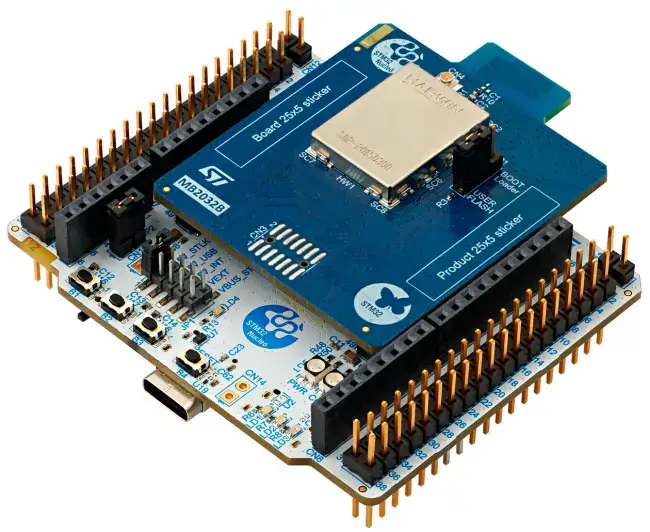

<!-- Copyright 2015-2026 Zephyr Project members and individual contributors. -->
<!-- SPDX-License-Identifier: Apache-2.0 -->
<!-- 中文翻译；编号、导航与译注为本地新增。 -->

<a id="nucleo_wb09ke"></a>

# 第74章\_Nucleo WB09KE开发板

原文：[官方页面](https://docs.zephyrproject.org/latest/boards/st/nucleo_wb09ke/doc/index.html)。读取日期：2026-10-16；来源摘要见[来源记录](../SOURCES.md)。

开发板概览（Board Overview）

<a id="id1"></a>

[](images/nucleo_wb09ke.webp)

Nucleo WB09KE开发板

名称（Name）：

`nucleo_wb09ke`

厂商（Vendor）：

[意法半导体（STMicroelectronics）](https://docs.zephyrproject.org/latest/boards/index.html#vendor=st)

状态（Status）：

维护中（Maintained）

架构（Architecture）：

[arm](https://docs.zephyrproject.org/latest/boards/index.html#arch=arm)

片上系统（SoC）：

[stm32wb09](https://docs.zephyrproject.org/latest/boards/index.html#soc=stm32wb09)

<a id="board-github-link"></a>

[浏览开发板源码（Browse Board Sources）](https://github.com/zephyrproject-rtos/zephyr/blob/main//boards/st/nucleo_wb09ke/doc/index.rst/../..)<a id="overview"></a>

## 概述（Overview）

Nucleo WB09KE是一款低功耗蓝牙（Bluetooth® LE）超低功耗无线板，搭载基于Arm Cortex®-M0+的STM32WB09KEV MCU，内置符合Bluetooth LE SIG 5.4规范的高性能超低功耗无线电。

更多信息见[Nucleo WB09KE网页](https://www.st.com/en/evaluation-tools/nucleo-wb09ke.html)。

<a id="hardware"></a>

## 硬件（Hardware）

Nucleo WB09KE提供以下硬件组件：


- VFQFPN32封装的STM32WB09KEV
- Arm 32位Cortex-M0+ CPU
- CPU最高频率64 MHz，原文将frequency拼作frequebct
- 512 KB 闪存（Flash）。
- 64 KB静态随机存储器（SRAM）

STM32WB09KEV的更多信息见：


- [WB09KE在ST官网的产品页](https://www.st.com/en/microcontrollers-microprocessors/stm32wb09ke.html)
- [STM32WB09参考手册（Reference Manual）](https://www.st.com/resource/en/reference_manual/rm0505-stm32wb09xe-ultralow-power-wireless-32bit-mcu-armbased-cortexm0-with-bluetooth-low-energy-and-24-ghz-radio-solution-stmicroelectronics.pdf)

<a id="supported-features"></a>

### 支持的功能（Supported Features）

`nucleo_wb09ke`开发板支持下表所列的硬件功能。

片上／板载（On-Chip / On-Board）

功能集成在片上系统（SoC）内／位于开发板上。

2 / 2

分别表示已启用／已禁用的实例数。点击数量标签，可查看开发板或SoC设备树源码（DTS）中该功能的第一个实例。

`vnd,foo`

与此功能匹配的设备树绑定兼容字符串（Compatible String）；点击链接可查看绑定文档。

<a id="nucleo_wb09ke-hw-features"></a>

<a id="nucleo_wb09ke-nucleo_wb09ke/stm32wb09-hw-features-section"></a>

#### `nucleo_wb09ke/stm32wb09`目标（Target）

<a id="nucleo_wb09ke-nucleo_wb09ke/stm32wb09-hw-features-panel"></a>

<a id="nucleo_wb09ke-nucleo_wb09ke/stm32wb09-hw-features-memory"></a>

该开发板目标的片上存储容量：64 KiB RAM、512 KiB Flash。

<a id="nucleo_wb09ke-nucleo_wb09ke/stm32wb09-hw-features-table"></a>

<table>
<tr>
<th>类型（Type）</th>
<th>位置（Location）</th>
<th>说明（Description）</th>
<th>兼容字符串（Compatible）</th>
</tr>
<tr>
<td rowspan="1">中央处理器（CPU）</td>
<td>片上（On-Chip）</td>
<td>ARM Cortex-M0+处理器（CPU）（<a href="https://github.com/zephyrproject-rtos/zephyr/blob/main/dts/arm/st/wb0/stm32wb0.dtsi?plain=1#L36">已启用：1</a>）</td>
<td><a href="../cpu_arm_riscv_binding_reference/P017_arm_cortex-m0+.md#std-dtcompatible-arm-cortex-m0"><code>arm,cortex-m0+</code></a></td>
</tr>
<tr>
<td rowspan="1">模数转换器（ADC）</td>
<td>片上（On-Chip）</td>
<td>STM32WB0模数转换器（ADC）（<a href="https://github.com/zephyrproject-rtos/zephyr/blob/main/dts/arm/st/wb0/stm32wb0.dtsi?plain=1#L279">已禁用：1</a>）</td>
<td><a href="../hardware/P843_STM32WB0模数转换器绑定.md#dtbinding-st-stm32wb0-adc"><code>st,stm32wb0-adc</code></a></td>
</tr>
<tr>
<td rowspan="1">蓝牙（Bluetooth）</td>
<td>片上（On-Chip）</td>
<td>ST STM32WB0系列蓝牙主机控制器接口（HCI）驱动（<a href="https://github.com/zephyrproject-rtos/zephyr/blob/main/dts/arm/st/wb0/stm32wb0.dtsi?plain=1#L352">已启用：1</a>）</td>
<td><a href="../bluetooth_st_transport_binding_reference/P004_st_hci-stm32wb0.md#std-dtcompatible-st-hci-stm32wb0"><code>st,hci-stm32wb0</code></a></td>
</tr>
<tr>
<td rowspan="4">时钟控制（Clock Control）</td>
<td>片上（On-Chip）</td>
<td>STM32WB0复位与时钟控制器（RCC）（<a href="https://github.com/zephyrproject-rtos/zephyr/blob/main/dts/arm/st/wb0/stm32wb0.dtsi?plain=1#L172">已启用：1</a>）</td>
<td><a href="../timer_reference/P175_STM32WB0复位与时钟控制绑定.md#dtbinding-st-stm32wb0-rcc"><code>st,stm32wb0-rcc</code></a></td>
</tr>
<tr>
<td>片上（On-Chip）</td>
<td>通用固定频率时钟提供者（Fixed-Rate Clock Provider）（<a href="https://github.com/zephyrproject-rtos/zephyr/blob/main/dts/arm/st/wb0/stm32wb0.dtsi?plain=1#L69">已启用：3</a>；<a href="https://github.com/zephyrproject-rtos/zephyr/blob/main/dts/arm/st/wb0/stm32wb0.dtsi?plain=1#L119">已禁用：1</a>）</td>
<td><a href="../hardware/P566_固定时钟绑定.md#dtbinding-fixed-clock"><code>fixed-clock</code></a></td>
</tr>
<tr>
<td>片上（On-Chip）</td>
<td>STM32低速外部时钟（LSE Clock）（<a href="https://github.com/zephyrproject-rtos/zephyr/blob/main/dts/arm/st/wb0/stm32wb0.dtsi?plain=1#L97">已启用：1</a>）</td>
<td><a href="../timer_reference/P130_STM32低速外部时钟绑定.md#dtbinding-st-stm32-lse-clock"><code>st,stm32-lse-clock</code></a></td>
</tr>
<tr>
<td>片上（On-Chip）</td>
<td>STM32WB0低速内部时钟（LSI）（<a href="https://github.com/zephyrproject-rtos/zephyr/blob/main/dts/arm/st/wb0/stm32wb0.dtsi?plain=1#L105">已禁用：1</a>）</td>
<td><a href="../timer_reference/P165_STM32WB0低速内部时钟绑定.md#dtbinding-st-stm32wb0-lsi-clock"><code>st,stm32wb0-lsi-clock</code></a></td>
</tr>
<tr>
<td rowspan="1">计数器（Counter）</td>
<td>片上（On-Chip）</td>
<td>STM32 计数器（Counters）（<a href="https://github.com/zephyrproject-rtos/zephyr/blob/main/dts/arm/st/wb0/stm32wb05.dtsi?plain=1#L42">已禁用：3</a>）</td>
<td><a href="../stm32_ti_xilinx_counter_binding_reference/P007_st_stm32-counter.md#std-dtcompatible-st-stm32-counter"><code>st,stm32-counter</code></a></td>
</tr>
<tr>
<td rowspan="1">循环冗余校验（CRC）</td>
<td>片上（On-Chip）</td>
<td>STM32 CRC 计算单元（Calculation Unit）（<a href="https://github.com/zephyrproject-rtos/zephyr/blob/main/dts/arm/st/wb0/stm32wb0.dtsi?plain=1#L343">已启用：1</a>）</td>
<td><a href="../crc_clock_monitor_binding_reference/P011_st_stm32-crc.md#std-dtcompatible-st-stm32-crc"><code>st,stm32-crc</code></a></td>
</tr>
<tr>
<td rowspan="2">直接存储器访问（DMA）</td>
<td>片上（On-Chip）</td>
<td>用于stm32F0、stm32F1和stm32L1片上系统（SoC）系列的STM32直接存储器访问控制器（DMA，V2bis）（<a href="https://github.com/zephyrproject-rtos/zephyr/blob/main/dts/arm/st/wb0/stm32wb0.dtsi?plain=1#L295">已禁用：1</a>）</td>
<td><a href="../stm32_ti_xilinx_dma_binding_reference/P009_st_stm32-dma-v2bis.md#std-dtcompatible-st-stm32-dma-v2bis"><code>st,stm32-dma-v2bis</code></a></td>
</tr>
<tr>
<td>片上（On-Chip）</td>
<td>STM32 DMA 多路复用控制器（DMAMUX Controller）（<a href="https://github.com/zephyrproject-rtos/zephyr/blob/main/dts/arm/st/wb0/stm32wb0.dtsi?plain=1#L306">已禁用：1</a>）</td>
<td><a href="../stm32_ti_xilinx_dma_binding_reference/P011_st_stm32-dmamux.md#std-dtcompatible-st-stm32-dmamux"><code>st,stm32-dmamux</code></a></td>
</tr>
<tr>
<td rowspan="1">闪存控制器（Flash Controller）</td>
<td>片上（On-Chip）</td>
<td>STM32WB0系列Flash控制器（<a href="https://github.com/zephyrproject-rtos/zephyr/blob/main/dts/arm/st/wb0/stm32wb0.dtsi?plain=1#L128">已启用：1</a>）</td>
<td><a href="../flash_renesas_st_ti_binding_reference/P027_st_stm32wb0-flash-controller.md#std-dtcompatible-st-stm32wb0-flash-controller"><code>st,stm32wb0-flash-controller</code></a></td>
</tr>
<tr>
<td rowspan="2">通用输入输出与接插件（GPIO &amp; Headers）</td>
<td>片上（On-Chip）</td>
<td>STM32 通用输入输出控制器（GPIO Controller）（<a href="https://github.com/zephyrproject-rtos/zephyr/blob/main/dts/arm/st/wb0/stm32wb0.dtsi?plain=1#L212">已启用：2</a>）</td>
<td><a href="../gpio_silabs_st_connectors_binding_reference/P029_st_stm32-gpio.md#std-dtcompatible-st-stm32-gpio"><code>st,stm32-gpio</code></a></td>
</tr>
<tr>
<td>板载（On-Board）</td>
<td>引出到Arduino Uno R3排针（Headers）的GPIO引脚（<a href="https://github.com/zephyrproject-rtos/zephyr/blob/main/boards/st/nucleo_wb09ke/arduino_r3_connector.dtsi?plain=1#L10">已启用：1</a>）</td>
<td><a href="../gpio_adi_headers_ambiq_binding_reference/P023_arduino-header-r3.md#std-dtcompatible-arduino-header-r3"><code>arduino-header-r3</code></a></td>
</tr>
<tr>
<td rowspan="1">集成电路间总线（I2C）</td>
<td>片上（On-Chip）</td>
<td>STM32 I2C V2 控制器（Controller）（<a href="https://github.com/zephyrproject-rtos/zephyr/blob/main/dts/arm/st/wb0/stm32wb0.dtsi?plain=1#L256">已启用：1</a>）</td>
<td><a href="../i2c_stm32_ti_mux_binding_reference/P008_st_stm32-i2c-v2.md#std-dtcompatible-st-stm32-i2c-v2"><code>st,stm32-i2c-v2</code></a></td>
</tr>
<tr>
<td rowspan="1">输入（Input）</td>
<td>板载（On-Board）</td>
<td>一组绑定到 GPIO 的输入按键（GPIO-Bound Input Keys）（<a href="https://github.com/zephyrproject-rtos/zephyr/blob/main/boards/st/nucleo_wb09ke/nucleo_wb09ke.dts?plain=1#L52">已启用：1</a>）</td>
<td><a href="../hardware/P563_GPIO按键绑定.md#std-dtcompatible-gpio-keys"><code>gpio-keys</code></a></td>
</tr>
<tr>
<td rowspan="2">中断控制器（Interrupt Controller）</td>
<td>片上（On-Chip）</td>
<td>ARMv6-M嵌套向量中断控制器（NVIC / Nested Vectored Interrupt Controller）（<a href="https://github.com/zephyrproject-rtos/zephyr/blob/main/dts/arm/armv6-m.dtsi?plain=1#L13">已启用：1</a>）</td>
<td><a href="../arm_interrupt_timer_binding_reference/P001_ARMv6_M_NVIC.md#std-dtcompatible-arm-v6m-nvic"><code>arm,v6m-nvic</code></a></td>
</tr>
<tr>
<td>片上（On-Chip）</td>
<td>STM32WB0 GPIO中断控制器（<a href="https://github.com/zephyrproject-rtos/zephyr/blob/main/dts/arm/st/wb0/stm32wb0.dtsi?plain=1#L193">已启用：1</a>）</td>
<td><a href="../mcu_external_interrupt_binding_reference/P004_st_stm32wb0-gpio-intc.md#std-dtcompatible-st-stm32wb0-gpio-intc"><code>st,stm32wb0-gpio-intc</code></a></td>
</tr>
<tr>
<td rowspan="2">发光二极管（LED）</td>
<td>板载（On-Board）</td>
<td>一组由 GPIO 控制的 LED（GPIO-Controlled LEDs）（<a href="https://github.com/zephyrproject-rtos/zephyr/blob/main/boards/st/nucleo_wb09ke/nucleo_wb09ke.dts?plain=1#L27">已启用：1</a>）</td>
<td><a href="../hardware/P564_GPIO指示灯绑定.md#dtbinding-gpio-leds"><code>gpio-leds</code></a></td>
</tr>
<tr>
<td>板载（On-Board）</td>
<td>一组由脉宽调制（PWM）控制的LED（<a href="https://github.com/zephyrproject-rtos/zephyr/blob/main/boards/st/nucleo_wb09ke/nucleo_wb09ke.dts?plain=1#L43">已启用：1</a>）</td>
<td><a href="../hardware/P565_PWM指示灯绑定.md#dtbinding-pwm-leds"><code>pwm-leds</code></a></td>
</tr>
<tr>
<td rowspan="1">存储技术设备（MTD）</td>
<td>片上（On-Chip）</td>
<td>STM32闪存（Flash Memory）（<a href="https://github.com/zephyrproject-rtos/zephyr/blob/main/dts/arm/st/wb0/stm32wb0.dtsi?plain=1#L161">已启用：1</a>）</td>
<td><a href="../mtd_nxp_st_ti_partition_binding_reference/P016_st_stm32-nv-flash.md#std-dtcompatible-st-stm32-nv-flash"><code>st,stm32-nv-flash</code></a></td>
</tr>
<tr>
<td rowspan="1">非易失存储器（NVMEM）</td>
<td>片上（On-Chip）</td>
<td>非易失存储器固定布局（Fixed Layout for Non-Volatile Memory）（<a href="https://github.com/zephyrproject-rtos/zephyr/blob/main/dts/arm/st/wb0/stm32wb0.dtsi?plain=1#L148">已启用：1</a>）</td>
<td><a href="../memory_protection_binding_reference/P009_fixed-layout.md#std-dtcompatible-fixed-layout"><code>fixed-layout</code></a></td>
</tr>
<tr>
<td rowspan="1">一次性可编程存储器（OTP Memory）</td>
<td>片上（On-Chip）</td>
<td>STM32 嵌入式非易失一次性可编程存储器（NVM OTP）（<a href="https://github.com/zephyrproject-rtos/zephyr/blob/main/dts/arm/st/wb0/stm32wb0.dtsi?plain=1#L144">已启用：1</a>；<a href="https://github.com/zephyrproject-rtos/zephyr/blob/main/dts/arm/st/wb0/stm32wb0.dtsi?plain=1#L137">已禁用：1</a>）</td>
<td><a href="../otp_binding_reference/P010_st_stm32-nvm-otp.md#std-dtcompatible-st-stm32-nvm-otp"><code>st,stm32-nvm-otp</code></a></td>
</tr>
<tr>
<td rowspan="1">引脚控制（Pin Control）</td>
<td>片上（On-Chip）</td>
<td>STM32 引脚控制器（Pin Controller）（<a href="https://github.com/zephyrproject-rtos/zephyr/blob/main/dts/arm/st/wb0/stm32wb0.dtsi?plain=1#L205">已启用：1</a>）</td>
<td><a href="../pinctrl_stm32_ti_xilinx_binding_reference/P004_st_stm32-pinctrl.md#std-dtcompatible-st-stm32-pinctrl"><code>st,stm32-pinctrl</code></a></td>
</tr>
<tr>
<td rowspan="1">电源管理（Power Management）</td>
<td>片上（On-Chip）</td>
<td>STM32WB0电源控制器（<a href="https://github.com/zephyrproject-rtos/zephyr/blob/main/dts/arm/st/wb0/stm32wb0.dtsi?plain=1#L183">已启用：1</a>）</td>
<td><a href="../stm32_soc_power_binding_reference/P017_st_stm32wb0-pwr.md#std-dtcompatible-st-stm32wb0-pwr"><code>st,stm32wb0-pwr</code></a></td>
</tr>
<tr>
<td rowspan="1">脉宽调制（PWM）</td>
<td>片上（On-Chip）</td>
<td>STM32 脉宽调制（PWM）（<a href="https://github.com/zephyrproject-rtos/zephyr/blob/main/dts/arm/st/wb0/stm32wb05.dtsi?plain=1#L36">已启用：1</a>；<a href="https://github.com/zephyrproject-rtos/zephyr/blob/main/dts/arm/st/wb0/stm32wb05.dtsi?plain=1#L65">已禁用：2</a>）</td>
<td><a href="../pwm_stm32_ti_generic_binding_reference/P011_st_stm32-pwm.md#std-dtcompatible-st-stm32-pwm"><code>st,stm32-pwm</code></a></td>
</tr>
<tr>
<td rowspan="1">复位控制器（Reset Controller）</td>
<td>片上（On-Chip）</td>
<td>STM32 复位与时钟控制器（Reset and Clock Control，RCC）（<a href="https://github.com/zephyrproject-rtos/zephyr/blob/main/dts/arm/st/wb0/stm32wb0.dtsi?plain=1#L177">已启用：1</a>）</td>
<td><a href="../reset_controller_binding_reference/P017_st_stm32-rcc-rctl.md#std-dtcompatible-st-stm32-rcc-rctl"><code>st,stm32-rcc-rctl</code></a></td>
</tr>
<tr>
<td rowspan="1">随机数生成器（RNG）</td>
<td>片上（On-Chip）</td>
<td>STM32 随机数生成器（Random Number Generator）（<a href="https://github.com/zephyrproject-rtos/zephyr/blob/main/dts/arm/st/wb0/stm32wb0.dtsi?plain=1#L328">已启用：1</a>）</td>
<td><a href="../soc_rng_binding_reference/P016_st_stm32-rng.md#std-dtcompatible-st-stm32-rng"><code>st,stm32-rng</code></a></td>
</tr>
<tr>
<td rowspan="1">实时时钟（RTC）</td>
<td>片上（On-Chip）</td>
<td>STM32 实时时钟（RTC）（<a href="https://github.com/zephyrproject-rtos/zephyr/blob/main/dts/arm/st/wb0/stm32wb0.dtsi?plain=1#L229">已启用：1</a>）</td>
<td><a href="../soc_rtc_binding_reference/P014_st_stm32-rtc.md#std-dtcompatible-st-stm32-rtc"><code>st,stm32-rtc</code></a></td>
</tr>
<tr>
<td rowspan="1">传感器（Sensors）</td>
<td>片上（On-Chip）</td>
<td>STM32 正交解码器（Quadrature Decoder）（<a href="https://github.com/zephyrproject-rtos/zephyr/blob/main/dts/arm/st/wb0/stm32wb05.dtsi?plain=1#L47">已禁用：1</a>）</td>
<td><a href="../sensor_st_lsm_stm32_binding_reference/P028_st_stm32-qdec.md#std-dtcompatible-st-stm32-qdec"><code>st,stm32-qdec</code></a></td>
</tr>
<tr>
<td rowspan="2">串行控制器（Serial Controller）</td>
<td>片上（On-Chip）</td>
<td>STM32 通用同步／异步收发器（USART）（<a href="https://github.com/zephyrproject-rtos/zephyr/blob/main/dts/arm/st/wb0/stm32wb0.dtsi?plain=1#L237">已启用：1</a>）</td>
<td><a href="../uart_silabs_stm32_ti_binding_reference/P016_st_stm32-usart.md#std-dtcompatible-st-stm32-usart"><code>st,stm32-usart</code></a></td>
</tr>
<tr>
<td>片上（On-Chip）</td>
<td>STM32低功耗通用异步收发器（LPUART）（<a href="https://github.com/zephyrproject-rtos/zephyr/blob/main/dts/arm/st/wb0/stm32wb0.dtsi?plain=1#L247">已禁用：1</a>）</td>
<td><a href="../uart_silabs_stm32_ti_binding_reference/P014_st_stm32-lpuart.md#std-dtcompatible-st-stm32-lpuart"><code>st,stm32-lpuart</code></a></td>
</tr>
<tr>
<td rowspan="1">串行外设接口（SPI）</td>
<td>片上（On-Chip）</td>
<td>带嵌入式接收和发送先进先出队列（Rx / Tx FIFOs）的STM32 SPI控制器（<a href="https://github.com/zephyrproject-rtos/zephyr/blob/main/dts/arm/st/wb0/stm32wb0.dtsi?plain=1#L268">已启用：1</a>）</td>
<td><a href="../spi_stm32_ti_xilinx_binding_reference/P009_st_stm32-spi-fifo.md#std-dtcompatible-st-stm32-spi-fifo"><code>st,stm32-spi-fifo</code></a></td>
</tr>
<tr>
<td rowspan="3">定时器（Timer）</td>
<td>片上（On-Chip）</td>
<td>ARMv6-M系统节拍（System Tick）（<a href="https://github.com/zephyrproject-rtos/zephyr/blob/main/dts/arm/armv6-m.dtsi?plain=1#L21">已启用：1</a>）</td>
<td><a href="../arm_interrupt_timer_binding_reference/P005_ARMv6_M_SysTick.md#std-dtcompatible-arm-armv6m-systick"><code>arm,armv6m-systick</code></a></td>
</tr>
<tr>
<td>片上（On-Chip）</td>
<td>STM32 定时器（Timers）（<a href="https://github.com/zephyrproject-rtos/zephyr/blob/main/dts/arm/st/wb0/stm32wb05.dtsi?plain=1#L25">已启用：1</a>；<a href="https://github.com/zephyrproject-rtos/zephyr/blob/main/dts/arm/st/wb0/stm32wb05.dtsi?plain=1#L54">已禁用：2</a>）</td>
<td><a href="../stm32_ti_silabs_timer_binding_reference/P008_st_stm32-timers.md#std-dtcompatible-st-stm32-timers"><code>st,stm32-timers</code></a></td>
</tr>
<tr>
<td>片上（On-Chip）</td>
<td>STM32WB0 Bluetooth LE无线电定时器（<a href="https://github.com/zephyrproject-rtos/zephyr/blob/main/dts/arm/st/wb0/stm32wb0.dtsi?plain=1#L360">已启用：1</a>）</td>
<td><a href="../stm32_ti_silabs_timer_binding_reference/P010_st_stm32wb0-radio-timer.md#std-dtcompatible-st-stm32wb0-radio-timer"><code>st,stm32wb0-radio-timer</code></a></td>
</tr>
<tr>
<td rowspan="1">看门狗（Watchdog）</td>
<td>片上（On-Chip）</td>
<td>STM32 看门狗（Watchdog）（<a href="https://github.com/zephyrproject-rtos/zephyr/blob/main/dts/arm/st/wb0/stm32wb0.dtsi?plain=1#L336">已启用：1</a>）</td>
<td><a href="../stm32_ti_xilinx_watchdog_binding_reference/P001_st_stm32-watchdog.md#std-dtcompatible-st-stm32-watchdog"><code>st,stm32-watchdog</code></a></td>
</tr>
</table>

<a id="bluetooth-support"></a>

#### 蓝牙支持（Bluetooth® Support）

本板已启用Bluetooth® LE支持；构建Zephyr示例前，须先下载以二进制对象（Binary BLOB）形式提供的蓝牙控制器库到Zephyr。

获取二进制对象（Binary BLOBs）：

```text
west blobs fetch hal_stm32
```

<a id="connections-and-ios"></a>

### 连接与输入输出（Connections and IOs）

<a id="default-zephyr-peripheral-mapping"></a>

#### Zephyr 默认外设映射（Peripheral Mapping）：


- USART1 TX/RX : PA1/PB0（ST-Link虚拟COM端口）
- 按键B1：PA0
- 按键B2：PB5
- 按键B3：PB14
- 蓝色LED LD1：PB1
- 绿色LED LD2：PB4
- 红色LED LD3：PB2

更多细节见[Nucleo WB09KE开发板用户手册](https://www.st.com/resource/en/user_manual/um3345-stm32wb09-nucleo64-board-mb1801-and-mb2032-stmicroelectronics.pdf)。

<a id="programming-and-debugging"></a>

## 烧录与调试（Programming and Debugging）

`nucleo_wb09ke`开发板支持下表所列的运行工具（Runners）及相关west命令。

<table>
<tr>
<th></th>
<th>烧录（flash）</th>
<th>调试（debug）</th>
<th>复位（reset）</th>
<th>连接调试会话（attach）</th>
<th>实时传输（rtt）</th>
<th>调试服务器（debugserver）</th>
</tr>
<tr>
<td><a href="https://docs.zephyrproject.org/latest/develop/flash_debug/host-tools.html#runner-pyocd">pyocd</a></td>
<td>✅</td>
<td>✅（默认 / default）</td>
<td>✅</td>
<td>✅</td>
<td>✅</td>
<td>✅</td>
</tr>
<tr>
<td><a href="https://docs.zephyrproject.org/latest/develop/flash_debug/host-tools.html#runner-stm32cubeprogrammer"><code>stm32cubeprogrammer</code></a></td>
<td>✅（默认 / default）</td>
<td></td>
<td></td>
<td></td>
<td></td>
<td></td>
</tr>
</table>

Nucleo WB09KE内置ST-LINK-V3EC调试工具接口。

本板应用可按常规方式构建和烧录，详见“[构建应用（Building an Application）](../application/P001_应用开发.md#build-an-application)”与“[运行应用（Run an Application）](https://docs.zephyrproject.org/latest/develop/application/index.html#application-run)”。译注：原文目标名称写nucleo_w09ke，缺少b；实际命令中的目标按原样保留。

<a id="flashing"></a>

### 烧录（Flashing）

开发板配置为使用west的[STM32CubeProgrammer](https://www.st.com/en/development-tools/stm32cubeprog.html)运行工具烧录，因此须预先安装该工具。（[必须安装该工具](https://docs.zephyrproject.org/latest/develop/flash_debug/host-tools.html#stm32cubeprog-flash-host-tools)）

也可使用OpenOCD，通过--runner或-r选项烧录开发板：

```text
$ west flash --runner openocd
```

<a id="flashing-an-application-to-nucleo-wb09ke"></a>

#### 向Nucleo WB09KE烧录应用（Flashing an Application）

通过USB将Nucleo WB09KE连接主机，然后运行主机串口程序连接开发板：

```text
$ minicom -D /dev/ttyACM0
```

然后构建并烧录应用。以下以[Hello World](../getting_started/P005_HelloWorld示例.md#hello_world)为例。

```text
# From the root of the zephyr repository
west build -b nucleo_wb09ke samples/hello_world
west flash
```

控制台上应显示以下消息：

```text
Hello World! nucleo_wb09ke/stm32wb09
```

<a id="debugging"></a>

### 调试（Debugging）

可以按常规方式调试应用。下面以[Hello World](../getting_started/P005_HelloWorld示例.md#hello_world)应用为例。

```text
# From the root of the zephyr repository
west build -b nucleo_wb09ke samples/hello_world
west debug
```

警告（Warning）

本板应用调试使用pyOCD运行工具，须先安装额外软件包，可执行以下命令：

```text
$ pyocd pack update
$ pyocd pack install stm32wb0
```

## 译注

原文一处目标写nucleo_w09ke；pyOCD调试需要额外目标软件包。

## 原文外链核对

2026-10-16核对并重试以下原文外链时未能确认可访问性，保留原始目标，不将访问失败解释为原文内容有误。

- [stm32cubeprog.html](https://www.st.com/en/development-tools/stm32cubeprog.html)：HTTP Error 567: Unknown Status。
- [nucleo-wb09ke.html](https://www.st.com/en/evaluation-tools/nucleo-wb09ke.html)：HTTP Error 567: Unknown Status。
- [stm32wb09ke.html](https://www.st.com/en/microcontrollers-microprocessors/stm32wb09ke.html)：HTTP Error 567: Unknown Status。
- [rm0505-stm32wb09xe-ultralow-power-wireless-32bit-mcu-armbased-cortexm0-with-bluetooth-low-energy-and-24-ghz-radio-solution-stmicroelectronics.pdf](https://www.st.com/resource/en/reference_manual/rm0505-stm32wb09xe-ultralow-power-wireless-32bit-mcu-armbased-cortexm0-with-bluetooth-low-energy-and-24-ghz-radio-solution-stmicroelectronics.pdf)：HTTP Error 567: Unknown Status。
- [um3345-stm32wb09-nucleo64-board-mb1801-and-mb2032-stmicroelectronics.pdf](https://www.st.com/resource/en/user_manual/um3345-stm32wb09-nucleo64-board-mb1801-and-mb2032-stmicroelectronics.pdf)：HTTP Error 567: Unknown Status。

---

[上一章](P073_Nucleo_WB07CC.md) · [返回大纲](大纲.md) · [全站翻译进度](../PROGRESS.md) · [下一章](P075_Nucleo_WB55RG.md)
