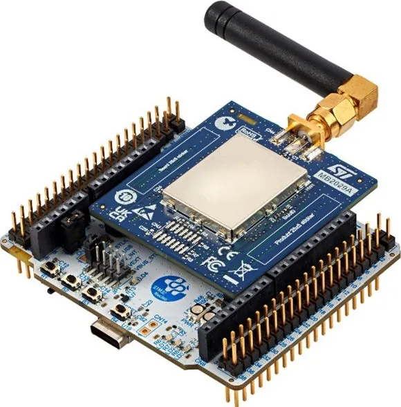

<!-- Copyright 2015-2026 Zephyr Project members and individual contributors. -->
<!-- SPDX-License-Identifier: Apache-2.0 -->
<!-- 中文翻译；编号、导航与译注为本地新增。 -->

<a id="nucleo_wl33cc1"></a>

# 第79章\_Nucleo WL33CC1开发板

原文：[官方页面](https://docs.zephyrproject.org/latest/boards/st/nucleo_wl33cc1/doc/index.html)。读取日期：2026-10-16；来源摘要见[来源记录](../SOURCES.md)。

开发板概览（Board Overview）

<a id="id1"></a>

[](images/nucleo_wl33cc1.webp)

Nucleo WL33CC1开发板

名称（Name）：

`nucleo_wl33cc1`

厂商（Vendor）：

[意法半导体（STMicroelectronics）](https://docs.zephyrproject.org/latest/boards/index.html#vendor=st)

状态（Status）：

维护中（Maintained）

架构（Architecture）：

[arm](https://docs.zephyrproject.org/latest/boards/index.html#arch=arm)

片上系统（SoC）：

[stm32wl33xx](https://docs.zephyrproject.org/latest/boards/index.html#soc=stm32wl33xx)

<a id="board-github-link"></a>

[浏览开发板源码（Browse Board Sources）](https://github.com/zephyrproject-rtos/zephyr/blob/main//boards/st/nucleo_wl33cc1/doc/index.rst/../..)<a id="overview"></a>

## 概述（Overview）

NUCLEO-WL33CC1基于MB1801夹层板（Mezzanine Board），配有MB2029 MCU射频板，内置超低功耗STM32WL33CCV6 Arm® Cortex®-M0+无线微控制器，其sub-GHz无线电工作于826～958 MHz频段。

主要功能（Key Features）：


- STM32WL33CCV6：256 KB Flash、32 KB RAM、Cortex-M0+
- sub-GHz无线电支持开关键控（OOK）、幅移键控（ASK）、2(G)FSK、4(G)FSK、差分二进制相移键控（D-BPSK）及直接序列扩频（DSSS）调制
- 3个用户LED：LD1蓝色、LD2绿色、LD3红色
- 3个用户按键
- 板载STLINK-V3EC调试器／编程器，带USB虚拟COM端口（VCP）
- ARDUINO® Uno V3及ST morpho扩展连接器，位于MB1801

<a id="id3"></a>

<a id="id7"></a>

<a id="id5"></a>

更多信息见[NUCLEO-WL33CC1产品页](https://www.st.com/en/evaluation-tools/nucleo-wl33cc1.html)[注1](#id2)、开发板用户手册[UM3418](https://www.st.com/resource/en/user_manual/um3418-stm32wl33-nucleo64-boards-mb1801-and-mb2029-stmicroelectronics.pdf)[注3](#id6)及SoC参考手册[RM0511](https://www.st.com/resource/en/reference_manual/rm0511-stm32wl30xx31xx33xx-armbased-wireless-mcus-with-subghz-radio-solution-stmicroelectronics.pdf)[注2](#id4)。

<a id="supported-features"></a>

## 支持的功能（Supported Features）

原文尚未支持的功能：sub-GHz无线电MR_SubG、ADC、定时器、看门狗及低功耗模式。

`nucleo_wl33cc1`开发板支持下表所列的硬件功能。

片上／板载（On-Chip / On-Board）

功能集成在片上系统（SoC）内／位于开发板上。

2 / 2

分别表示已启用／已禁用的实例数。点击数量标签，可查看开发板或SoC设备树源码（DTS）中该功能的第一个实例。

`vnd,foo`

与此功能匹配的设备树绑定兼容字符串（Compatible String）；点击链接可查看绑定文档。

<a id="nucleo_wl33cc1-hw-features"></a>

<a id="nucleo_wl33cc1-nucleo_wl33cc1/stm32wl33xx-hw-features-section"></a>

### `nucleo_wl33cc1/stm32wl33xx`目标（Target）

<a id="nucleo_wl33cc1-nucleo_wl33cc1/stm32wl33xx-hw-features-panel"></a>

<a id="nucleo_wl33cc1-nucleo_wl33cc1/stm32wl33xx-hw-features-memory"></a>

该开发板目标的片上存储容量：32 KiB RAM、256 KiB Flash。

<a id="nucleo_wl33cc1-nucleo_wl33cc1/stm32wl33xx-hw-features-table"></a>

<table>
<tr>
<th>类型（Type）</th>
<th>位置（Location）</th>
<th>说明（Description）</th>
<th>兼容字符串（Compatible）</th>
</tr>
<tr>
<td rowspan="1">中央处理器（CPU）</td>
<td>片上（On-Chip）</td>
<td>ARM Cortex-M0+处理器（CPU）（<a href="https://github.com/zephyrproject-rtos/zephyr/blob/main/dts/arm/st/wl3/stm32wl3x.dtsi?plain=1#L27">已启用：1</a>）</td>
<td><a href="../cpu_arm_riscv_binding_reference/P017_arm_cortex-m0+.md#std-dtcompatible-arm-cortex-m0"><code>arm,cortex-m0+</code></a></td>
</tr>
<tr>
<td rowspan="4">时钟控制（Clock Control）</td>
<td>片上（On-Chip）</td>
<td>STM32WL3x复位与时钟控制器（RCC）（<a href="https://github.com/zephyrproject-rtos/zephyr/blob/main/dts/arm/st/wl3/stm32wl3x.dtsi?plain=1#L130">已启用：1</a>）</td>
<td><a href="../timer_reference/P176_STM32WL3复位与时钟控制绑定.md#dtbinding-st-stm32wl3-rcc"><code>st,stm32wl3-rcc</code></a></td>
</tr>
<tr>
<td>片上（On-Chip）</td>
<td>通用固定频率时钟提供者（Fixed-Rate Clock Provider）（<a href="https://github.com/zephyrproject-rtos/zephyr/blob/main/dts/arm/st/wl3/stm32wl3x.dtsi?plain=1#L47">已启用：2</a>；<a href="https://github.com/zephyrproject-rtos/zephyr/blob/main/dts/arm/st/wl3/stm32wl3x.dtsi?plain=1#L85">已禁用：2</a>）</td>
<td><a href="../hardware/P566_固定时钟绑定.md#dtbinding-fixed-clock"><code>fixed-clock</code></a></td>
</tr>
<tr>
<td>片上（On-Chip）</td>
<td>通用固定比例时钟提供器（Fixed Factor Clock Provider）（<a href="https://github.com/zephyrproject-rtos/zephyr/blob/main/dts/arm/st/wl3/stm32wl3x.dtsi?plain=1#L64">已启用：1</a>）</td>
<td><a href="../timer_reference/P110_固定比例时钟绑定.md#dtbinding-fixed-factor-clock"><code>fixed-factor-clock</code></a></td>
</tr>
<tr>
<td>片上（On-Chip）</td>
<td>STM32低速外部时钟（LSE Clock）（<a href="https://github.com/zephyrproject-rtos/zephyr/blob/main/dts/arm/st/wl3/stm32wl3x.dtsi?plain=1#L77">已启用：1</a>）</td>
<td><a href="../timer_reference/P130_STM32低速外部时钟绑定.md#dtbinding-st-stm32-lse-clock"><code>st,stm32-lse-clock</code></a></td>
</tr>
<tr>
<td rowspan="1">密码学加速器（Cryptographic Accelerator）</td>
<td>片上（On-Chip）</td>
<td>STM32高级加密标准加速器（AES Accelerator）（<a href="https://github.com/zephyrproject-rtos/zephyr/blob/main/dts/arm/st/wl3/stm32wl3x.dtsi?plain=1#L242">已禁用：1</a>）</td>
<td><a href="../crypto_secure_engine_st_ti_binding_reference/P015_st_stm32-aes.md#std-dtcompatible-st-stm32-aes"><code>st,stm32-aes</code></a></td>
</tr>
<tr>
<td rowspan="2">直接存储器访问（DMA）</td>
<td>片上（On-Chip）</td>
<td>STM32直接存储器访问控制器（DMA Controller，V2）（<a href="https://github.com/zephyrproject-rtos/zephyr/blob/main/dts/arm/st/wl3/stm32wl3x.dtsi?plain=1#L212">已启用：1</a>）</td>
<td><a href="../stm32_ti_xilinx_dma_binding_reference/P008_st_stm32-dma-v2.md#std-dtcompatible-st-stm32-dma-v2"><code>st,stm32-dma-v2</code></a></td>
</tr>
<tr>
<td>片上（On-Chip）</td>
<td>STM32 DMA 多路复用控制器（DMAMUX Controller）（<a href="https://github.com/zephyrproject-rtos/zephyr/blob/main/dts/arm/st/wl3/stm32wl3x.dtsi?plain=1#L224">已启用：1</a>）</td>
<td><a href="../stm32_ti_xilinx_dma_binding_reference/P011_st_stm32-dmamux.md#std-dtcompatible-st-stm32-dmamux"><code>st,stm32-dmamux</code></a></td>
</tr>
<tr>
<td rowspan="1">闪存控制器（Flash Controller）</td>
<td>片上（On-Chip）</td>
<td>STM32WB0系列Flash控制器（<a href="https://github.com/zephyrproject-rtos/zephyr/blob/main/dts/arm/st/wl3/stm32wl3x.dtsi?plain=1#L105">已启用：1</a>）</td>
<td><a href="../flash_renesas_st_ti_binding_reference/P027_st_stm32wb0-flash-controller.md#std-dtcompatible-st-stm32wb0-flash-controller"><code>st,stm32wb0-flash-controller</code></a></td>
</tr>
<tr>
<td rowspan="2">通用输入输出与接插件（GPIO &amp; Headers）</td>
<td>片上（On-Chip）</td>
<td>STM32 通用输入输出控制器（GPIO Controller）（<a href="https://github.com/zephyrproject-rtos/zephyr/blob/main/dts/arm/st/wl3/stm32wl3x.dtsi?plain=1#L159">已启用：2</a>）</td>
<td><a href="../gpio_silabs_st_connectors_binding_reference/P029_st_stm32-gpio.md#std-dtcompatible-st-stm32-gpio"><code>st,stm32-gpio</code></a></td>
</tr>
<tr>
<td>板载（On-Board）</td>
<td>引出到Arduino Uno R3排针（Headers）的GPIO引脚（<a href="https://github.com/zephyrproject-rtos/zephyr/blob/main/boards/st/nucleo_wl33cc1/arduino_r3_connector.dtsi?plain=1#L10">已启用：1</a>）</td>
<td><a href="../gpio_adi_headers_ambiq_binding_reference/P023_arduino-header-r3.md#std-dtcompatible-arduino-header-r3"><code>arduino-header-r3</code></a></td>
</tr>
<tr>
<td rowspan="1">集成电路间总线（I2C）</td>
<td>片上（On-Chip）</td>
<td>STM32 I2C V2 控制器（Controller）（<a href="https://github.com/zephyrproject-rtos/zephyr/blob/main/dts/arm/st/wl3/stm32wl33xx.dtsi?plain=1#L27">已启用：1</a>；<a href="https://github.com/zephyrproject-rtos/zephyr/blob/main/dts/arm/st/wl3/stm32wl33xx.dtsi?plain=1#L14">已禁用：1</a>）</td>
<td><a href="../i2c_stm32_ti_mux_binding_reference/P008_st_stm32-i2c-v2.md#std-dtcompatible-st-stm32-i2c-v2"><code>st,stm32-i2c-v2</code></a></td>
</tr>
<tr>
<td rowspan="1">输入（Input）</td>
<td>板载（On-Board）</td>
<td>一组绑定到 GPIO 的输入按键（GPIO-Bound Input Keys）（<a href="https://github.com/zephyrproject-rtos/zephyr/blob/main/boards/st/nucleo_wl33cc1/nucleo_wl33cc1.dts?plain=1#L44">已启用：1</a>）</td>
<td><a href="../hardware/P563_GPIO按键绑定.md#std-dtcompatible-gpio-keys"><code>gpio-keys</code></a></td>
</tr>
<tr>
<td rowspan="2">中断控制器（Interrupt Controller）</td>
<td>片上（On-Chip）</td>
<td>ARMv6-M嵌套向量中断控制器（NVIC / Nested Vectored Interrupt Controller）（<a href="https://github.com/zephyrproject-rtos/zephyr/blob/main/dts/arm/armv6-m.dtsi?plain=1#L13">已启用：1</a>）</td>
<td><a href="../arm_interrupt_timer_binding_reference/P001_ARMv6_M_NVIC.md#std-dtcompatible-arm-v6m-nvic"><code>arm,v6m-nvic</code></a></td>
</tr>
<tr>
<td>片上（On-Chip）</td>
<td>STM32WB0 GPIO中断控制器（<a href="https://github.com/zephyrproject-rtos/zephyr/blob/main/dts/arm/st/wl3/stm32wl3x.dtsi?plain=1#L141">已启用：1</a>）</td>
<td><a href="../mcu_external_interrupt_binding_reference/P004_st_stm32wb0-gpio-intc.md#std-dtcompatible-st-stm32wb0-gpio-intc"><code>st,stm32wb0-gpio-intc</code></a></td>
</tr>
<tr>
<td rowspan="1">发光二极管（LED）</td>
<td>板载（On-Board）</td>
<td>一组由 GPIO 控制的 LED（GPIO-Controlled LEDs）（<a href="https://github.com/zephyrproject-rtos/zephyr/blob/main/boards/st/nucleo_wl33cc1/nucleo_wl33cc1.dts?plain=1#L25">已启用：1</a>）</td>
<td><a href="../hardware/P564_GPIO指示灯绑定.md#dtbinding-gpio-leds"><code>gpio-leds</code></a></td>
</tr>
<tr>
<td rowspan="1">存储技术设备（MTD）</td>
<td>片上（On-Chip）</td>
<td>STM32闪存（Flash Memory）（<a href="https://github.com/zephyrproject-rtos/zephyr/blob/main/dts/arm/st/wl3/stm32wl3x.dtsi?plain=1#L120">已启用：1</a>）</td>
<td><a href="../mtd_nxp_st_ti_partition_binding_reference/P016_st_stm32-nv-flash.md#std-dtcompatible-st-stm32-nv-flash"><code>st,stm32-nv-flash</code></a></td>
</tr>
<tr>
<td rowspan="1">一次性可编程存储器（OTP Memory）</td>
<td>片上（On-Chip）</td>
<td>STM32 嵌入式非易失一次性可编程存储器（NVM OTP）（<a href="https://github.com/zephyrproject-rtos/zephyr/blob/main/dts/arm/st/wl3/stm32wl3x.dtsi?plain=1#L114">已禁用：1</a>）</td>
<td><a href="../otp_binding_reference/P010_st_stm32-nvm-otp.md#std-dtcompatible-st-stm32-nvm-otp"><code>st,stm32-nvm-otp</code></a></td>
</tr>
<tr>
<td rowspan="1">引脚控制（Pin Control）</td>
<td>片上（On-Chip）</td>
<td>STM32 引脚控制器（Pin Controller）（<a href="https://github.com/zephyrproject-rtos/zephyr/blob/main/dts/arm/st/wl3/stm32wl3x.dtsi?plain=1#L153">已启用：1</a>）</td>
<td><a href="../pinctrl_stm32_ti_xilinx_binding_reference/P004_st_stm32-pinctrl.md#std-dtcompatible-st-stm32-pinctrl"><code>st,stm32-pinctrl</code></a></td>
</tr>
<tr>
<td rowspan="1">复位控制器（Reset Controller）</td>
<td>片上（On-Chip）</td>
<td>STM32 复位与时钟控制器（Reset and Clock Control，RCC）（<a href="https://github.com/zephyrproject-rtos/zephyr/blob/main/dts/arm/st/wl3/stm32wl3x.dtsi?plain=1#L135">已启用：1</a>）</td>
<td><a href="../reset_controller_binding_reference/P017_st_stm32-rcc-rctl.md#std-dtcompatible-st-stm32-rcc-rctl"><code>st,stm32-rcc-rctl</code></a></td>
</tr>
<tr>
<td rowspan="1">随机数生成器（RNG）</td>
<td>片上（On-Chip）</td>
<td>无中断线的STM32随机数发生器（RNG）（<a href="https://github.com/zephyrproject-rtos/zephyr/blob/main/dts/arm/st/wl3/stm32wl3x.dtsi?plain=1#L235">已禁用：1</a>）</td>
<td><a href="../soc_rng_binding_reference/P015_st_stm32-rng-noirq.md#std-dtcompatible-st-stm32-rng-noirq"><code>st,stm32-rng-noirq</code></a></td>
</tr>
<tr>
<td rowspan="1">实时时钟（RTC）</td>
<td>片上（On-Chip）</td>
<td>STM32 实时时钟（RTC）（<a href="https://github.com/zephyrproject-rtos/zephyr/blob/main/dts/arm/st/wl3/stm32wl3x.dtsi?plain=1#L176">已启用：1</a>）</td>
<td><a href="../soc_rtc_binding_reference/P014_st_stm32-rtc.md#std-dtcompatible-st-stm32-rtc"><code>st,stm32-rtc</code></a></td>
</tr>
<tr>
<td rowspan="1">串行控制器（Serial Controller）</td>
<td>片上（On-Chip）</td>
<td>STM32 通用同步／异步收发器（USART）（<a href="https://github.com/zephyrproject-rtos/zephyr/blob/main/dts/arm/st/wl3/stm32wl3x.dtsi?plain=1#L191">已启用：1</a>）</td>
<td><a href="../uart_silabs_stm32_ti_binding_reference/P016_st_stm32-usart.md#std-dtcompatible-st-stm32-usart"><code>st,stm32-usart</code></a></td>
</tr>
<tr>
<td rowspan="1">串行外设接口（SPI）</td>
<td>片上（On-Chip）</td>
<td>带嵌入式接收和发送先进先出队列（Rx / Tx FIFOs）的STM32 SPI控制器（<a href="https://github.com/zephyrproject-rtos/zephyr/blob/main/dts/arm/st/wl3/stm32wl33xx.dtsi?plain=1#L40">已启用：1</a>；<a href="https://github.com/zephyrproject-rtos/zephyr/blob/main/dts/arm/st/wl3/stm32wl3x.dtsi?plain=1#L201">已禁用：1</a>）</td>
<td><a href="../spi_stm32_ti_xilinx_binding_reference/P009_st_stm32-spi-fifo.md#std-dtcompatible-st-stm32-spi-fifo"><code>st,stm32-spi-fifo</code></a></td>
</tr>
<tr>
<td rowspan="1">定时器（Timer）</td>
<td>片上（On-Chip）</td>
<td>ARMv6-M系统节拍（System Tick）（<a href="https://github.com/zephyrproject-rtos/zephyr/blob/main/dts/arm/armv6-m.dtsi?plain=1#L21">已启用：1</a>）</td>
<td><a href="../arm_interrupt_timer_binding_reference/P005_ARMv6_M_SysTick.md#std-dtcompatible-arm-armv6m-systick"><code>arm,armv6m-systick</code></a></td>
</tr>
</table>

<a id="connections-and-ios"></a>

## 连接与输入输出（Connections and IOs）

默认板级配置：


- USART1 TX/RX：PA1/PA15（ST-LINK虚拟COM端口）
- SPI1 NSS/SCK/MISO/MOSI：PB10/PB11/PB8/PB9（ARDUINO D10/D13/D12/D11）
- I2C2 SCL/SDA：PA6/PA7（ARDUINO D15/D14）
- 蓝色LED LD1：PA14
- 绿色LED LD2：PB4
- 红色LED LD3：PB5
- 用户按键B1：PA0
- 用户按键B2：PA11
- 用户按键B3：PB15

<a id="programming-and-debugging"></a>

## 烧录与调试（Programming and Debugging）

通过板载STLINK-V3EC烧录和调试应用，默认使用stm32cubeprogrammer运行工具：

```text
# From the root of the zephyr repository
west build -b nucleo_wl33cc1 samples/basic/blinky
west flash
```

以115200波特率将串口终端连接到ST-LINK VCP，即可查看控制台输出。

<a id="references"></a>

## 参考资料（References）

<a id="id2"></a>

〔[1](#id3)〕 [https://www.st.com/en/evaluation-tools/nucleo-wl33cc1.html](https://www.st.com/en/evaluation-tools/nucleo-wl33cc1.html)

<a id="id4"></a>

〔[2](#id5)〕 [https://www.st.com/resource/en/reference_manual/rm0511-stm32wl30xx31xx33xx-armbased-wireless-mcus-with-subghz-radio-solution-stmicroelectronics.pdf](https://www.st.com/resource/en/reference_manual/rm0511-stm32wl30xx31xx33xx-armbased-wireless-mcus-with-subghz-radio-solution-stmicroelectronics.pdf)

<a id="id6"></a>

〔[3](#id7)〕 [https://www.st.com/resource/en/user_manual/um3418-stm32wl33-nucleo64-boards-mb1801-and-mb2029-stmicroelectronics.pdf](https://www.st.com/resource/en/user_manual/um3418-stm32wl33-nucleo64-boards-mb1801-and-mb2029-stmicroelectronics.pdf)

## 译注

官方页面仍将MR_SubG无线电、ADC、定时器、看门狗及低功耗模式列为未支持，不因硬件具备而标记可用。

## 原文外链核对

2026-10-16核对并重试以下原文外链时未能确认可访问性，保留原始目标，不将访问失败解释为原文内容有误。

- [nucleo-wl33cc1.html](https://www.st.com/en/evaluation-tools/nucleo-wl33cc1.html)：HTTP Error 567: Unknown Status。
- [rm0511-stm32wl30xx31xx33xx-armbased-wireless-mcus-with-subghz-radio-solution-stmicroelectronics.pdf](https://www.st.com/resource/en/reference_manual/rm0511-stm32wl30xx31xx33xx-armbased-wireless-mcus-with-subghz-radio-solution-stmicroelectronics.pdf)：HTTP Error 567: Unknown Status。
- [um3418-stm32wl33-nucleo64-boards-mb1801-and-mb2029-stmicroelectronics.pdf](https://www.st.com/resource/en/user_manual/um3418-stm32wl33-nucleo64-boards-mb1801-and-mb2029-stmicroelectronics.pdf)：HTTP Error 567: Unknown Status。

---

[上一章](P078_Nucleo_WBA65RI.md) · [返回大纲](大纲.md) · [全站翻译进度](../PROGRESS.md) · [下一章](P080_Nucleo_WL55JC.md)
