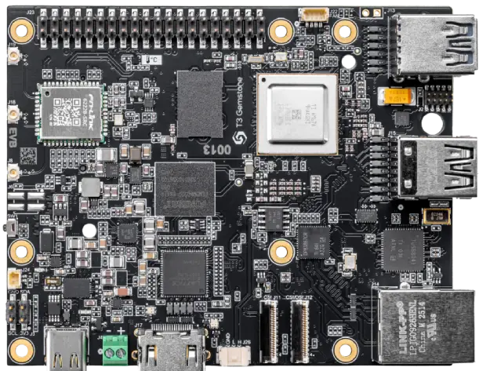

<!-- Copyright 2015-2026 Zephyr Project members and individual contributors. -->
<!-- SPDX-License-Identifier: Apache-2.0 -->
<!-- 中文翻译；编号、导航与译注为本地新增。 -->

<a id="t3_gem_o1"></a>

# 第8章\_T3 Gemstone O1

原文：[官方页面](https://docs.zephyrproject.org/latest/boards/t3gemstone/t3_gem_o1/doc/index.html)。读取日期：2026-10-16；来源摘要见[来源记录](../SOURCES.md)。

开发板概览（Board Overview）

<a id="id1"></a>

[](images/t3_gem_o1.webp)

T3 Gemstone O1

名称（Name）：

`t3_gem_o1`

厂商（Vendor）：

[T3 Gemstone](https://docs.zephyrproject.org/latest/boards/index.html#vendor=t3gemstone)

状态（Status）：

当前未积极维护（Not Actively Maintained）

架构（Architecture）：

[arm](https://docs.zephyrproject.org/latest/boards/index.html#arch=arm)

片上系统（SoC）：

[j722s](https://docs.zephyrproject.org/latest/boards/index.html#soc=j722s)

<a id="board-github-link"></a>

[浏览开发板源码（Browse Board Sources）](https://github.com/zephyrproject-rtos/zephyr/blob/main//boards/t3gemstone/t3_gem_o1/doc/index.rst/../..)<a id="overview"></a>

## 概述（Overview）

T3 Gemstone O1是一款采用TI AM67A（J722S）SoC的单板计算机，基于开源硬件及软件，将AI加速硬件与针对实时应用优化的Debian GNU/Linux结合，适用于有人／无人系统、物联网及机器人等领域。

<a id="hardware"></a>

## 硬件（Hardware）

AM67A（J722S）具有MAIN及MCU两个域，本页介绍在两个Cortex-R5F核上运行Zephyr。

板上集成ICM-20948九轴运动传感器、LPS22DF气压传感器及HDC2010温湿度传感器，提供CAN-FD收发器、两个四通道MIPI CSI摄像头接口及一个四通道MIPI DSI显示接口。其中一个CSI与DSI复用，因此可选择双CSI，或一路CSI加一路DSI。带电池输入的I2C实时时钟可在掉电后保持时间，32 GB板载eMMC允许不使用MicroSD启动；另有可编程红、绿用户LED。

<a id="l1-memory-system"></a>

### 一级存储系统（L1 Memory System）

T3 Gemstone O1的R5子系统默认使用单核模式，改变该模式会影响L1存储系统配置。


- 32 KB指令缓存（Instruction Cache）
- 32 KB数据缓存（Data Cache）
- 64 KB紧耦合存储器（TCM）：32 KB TCMA及32 KB TCMB

<a id="region-address-translation"></a>

### 区域地址转换（RAT / Region Address Translation）

区域地址转换模块（RAT）按区域将32位输入地址转换为36位输出地址。如果某已配置区域处于启用状态，起始地址位于该区域的输入事务会进行地址转换。

<a id="vim-interrupt-controller"></a>

### 向量中断管理器（VIM）中断控制器

VIM汇聚设备中断并发送给R5F CPU。每个R5F内核支持512路中断输入，每路可为电平或脉冲触发，均为高电平有效。VIM为每个内核提供IRQ及FIQ两个中断输出。

<a id="supported-features"></a>

## 支持的功能（Supported Features）

板级配置通过40引脚GPIO排针提供UART控制台，原文说明未来还将支持RPMsg控制台。

`t3_gem_o1`开发板支持下表所列的硬件功能。

片上／板载（On-Chip / On-Board）

功能集成在片上系统（SoC）内／位于开发板上。

2 / 2

分别表示已启用／已禁用的实例数。点击数量标签，可查看开发板或SoC设备树源码（DTS）中该功能的第一个实例。

`vnd,foo`

与此功能匹配的设备树绑定兼容字符串（Compatible String）；点击链接可查看绑定文档。

<a id="t3_gem_o1-hw-features"></a>

<a id="t3_gem_o1-t3_gem_o1/j722s/main_r5f0_0-hw-features-section"></a>

### `t3_gem_o1/j722s/main_r5f0_0`目标（Target）

<a id="t3_gem_o1-t3_gem_o1/j722s/main_r5f0_0-hw-features-panel"></a>

<a id="t3_gem_o1-t3_gem_o1/j722s/main_r5f0_0-hw-features-memory"></a>

该开发板目标的片上存储容量：14 MiB RAM、N/A Flash。

<a id="t3_gem_o1-t3_gem_o1/j722s/main_r5f0_0-hw-features-table"></a>

<table>
<tr>
<th>类型（Type）</th>
<th>位置（Location）</th>
<th>说明（Description）</th>
<th>兼容字符串（Compatible）</th>
</tr>
<tr>
<td rowspan="1">中央处理器（CPU）</td>
<td>片上（On-Chip）</td>
<td>ARM Cortex-R5F处理器（CPU）（<a href="https://github.com/zephyrproject-rtos/zephyr/blob/main/dts/arm/ti/j722s_main_r5.dtsi?plain=1#L29">已启用：1</a>）</td>
<td><a href="../cpu_cortex_xtensa_binding_reference/P012_arm_cortex-r5f.md#std-dtcompatible-arm-cortex-r5f"><code>arm,cortex-r5f</code></a></td>
</tr>
<tr>
<td rowspan="1">通用输入输出与接插件（GPIO &amp; Headers）</td>
<td>片上（On-Chip）</td>
<td>Davinci及Keystone器件的GPIO控制器（<a href="https://github.com/zephyrproject-rtos/zephyr/blob/main/dts/arm/ti/j722s_mcu.dtsi?plain=1#L16">已禁用：6</a>）</td>
<td><a href="../gpio_ti_xilinx_sdl_binding_reference/P014_ti_davinci-gpio.md#std-dtcompatible-ti-davinci-gpio"><code>ti,davinci-gpio</code></a></td>
</tr>
<tr>
<td rowspan="1">中断控制器（Interrupt Controller）</td>
<td>片上（On-Chip）</td>
<td>TI向量中断管理器（VIM）是TI专用外部中断控制器IP，兼容R5F的向量中断控制器（VIC）端口（<a href="https://github.com/zephyrproject-rtos/zephyr/blob/main/dts/arm/ti/j722s_main_r5.dtsi?plain=1#L50">已启用：1</a>）</td>
<td><a href="../multiarch_interrupt_binding_reference/P009_ti_vim.md#std-dtcompatible-ti-vim"><code>ti,vim</code></a></td>
</tr>
<tr>
<td rowspan="1">邮箱（Mailbox）</td>
<td>片上（On-Chip）</td>
<td>TI OMAP邮箱（MAILBOX）（<a href="https://github.com/zephyrproject-rtos/zephyr/blob/main/dts/arm/ti/j722s_main_r5.dtsi?plain=1#L67">已启用：1</a>）</td>
<td><a href="../intercore_reference/P055_TIOMAP邮箱绑定.md#dtbinding-ti-omap-mailbox"><code>ti,omap-mailbox</code></a></td>
</tr>
<tr>
<td rowspan="1">引脚控制（Pin Control）</td>
<td>片上（On-Chip）</td>
<td>TI K3引脚控制器（Pin Controller）（<a href="https://github.com/zephyrproject-rtos/zephyr/blob/main/dts/arm/ti/j722s_main.dtsi?plain=1#L16">已启用：1</a>）</td>
<td><a href="../pinctrl_stm32_ti_xilinx_binding_reference/P013_ti_k3-pinctrl.md#std-dtcompatible-ti-k3-pinctrl"><code>ti,k3-pinctrl</code></a></td>
</tr>
<tr>
<td rowspan="1">串行控制器（Serial Controller）</td>
<td>片上（On-Chip）</td>
<td>ns16550通用异步收发器（UART）（<a href="https://github.com/zephyrproject-rtos/zephyr/blob/main/dts/arm/ti/j722s_main.dtsi?plain=1#L162">已启用：1</a>；<a href="https://github.com/zephyrproject-rtos/zephyr/blob/main/dts/arm/ti/j722s_mcu.dtsi?plain=1#L25">已禁用：7</a>）</td>
<td><a href="../uart_microchip_nordic_nxp_binding_reference/P005_ns16550.md#std-dtcompatible-ns16550"><code>ns16550</code></a></td>
</tr>
<tr>
<td rowspan="1">静态随机存储器（SRAM）</td>
<td>板载（On-Board）</td>
<td>通用片上静态随机存储器（SRAM）（<a href="https://github.com/zephyrproject-rtos/zephyr/blob/main/boards/t3gemstone/t3_gem_o1/t3_gem_o1_j722s_main_r5f0_0.dts?plain=1#L34">已启用：1</a>）</td>
<td><a href="../hardware/P567_内存映射SRAM绑定.md#dtbinding-mmio-sram"><code>mmio-sram</code></a></td>
</tr>
<tr>
<td rowspan="1">定时器（Timer）</td>
<td>片上（On-Chip）</td>
<td>TI双模式定时器（Dual-Mode Timer）（<a href="https://github.com/zephyrproject-rtos/zephyr/blob/main/dts/arm/ti/j722s_main_r5.dtsi?plain=1#L59">已启用：1</a>）</td>
<td><a href="../stm32_ti_silabs_timer_binding_reference/P012_ti_am654-timer.md#std-dtcompatible-ti-am654-timer"><code>ti,am654-timer</code></a></td>
</tr>
<tr>
<td rowspan="1">看门狗（Watchdog）</td>
<td>片上（On-Chip）</td>
<td>K3代处理器的看门狗定时器，实时间隔（RTI）模块（<a href="https://github.com/zephyrproject-rtos/zephyr/blob/main/dts/arm/ti/j722s_mcu.dtsi?plain=1#L35">已禁用：1</a>）</td>
<td><a href="../stm32_ti_xilinx_watchdog_binding_reference/P006_ti_j7-rti-wdt.md#std-dtcompatible-ti-j7-rti-wdt"><code>ti,j7-rti-wdt</code></a></td>
</tr>
</table>

<a id="t3_gem_o1-t3_gem_o1/j722s/mcu_r5f0_0-hw-features-section"></a>

### `t3_gem_o1/j722s/mcu_r5f0_0`目标（Target）

<a id="t3_gem_o1-t3_gem_o1/j722s/mcu_r5f0_0-hw-features-panel"></a>

<a id="t3_gem_o1-t3_gem_o1/j722s/mcu_r5f0_0-hw-features-memory"></a>

该开发板目标的片上存储容量：14 MiB RAM、N/A Flash。

<a id="t3_gem_o1-t3_gem_o1/j722s/mcu_r5f0_0-hw-features-table"></a>

<table>
<tr>
<th>类型（Type）</th>
<th>位置（Location）</th>
<th>说明（Description）</th>
<th>兼容字符串（Compatible）</th>
</tr>
<tr>
<td rowspan="1">中央处理器（CPU）</td>
<td>片上（On-Chip）</td>
<td>ARM Cortex-R5F处理器（CPU）（<a href="https://github.com/zephyrproject-rtos/zephyr/blob/main/dts/arm/ti/j722s_mcu_r5.dtsi?plain=1#L29">已启用：1</a>）</td>
<td><a href="../cpu_cortex_xtensa_binding_reference/P012_arm_cortex-r5f.md#std-dtcompatible-arm-cortex-r5f"><code>arm,cortex-r5f</code></a></td>
</tr>
<tr>
<td rowspan="1">通用输入输出与接插件（GPIO &amp; Headers）</td>
<td>片上（On-Chip）</td>
<td>Davinci及Keystone器件的GPIO控制器（<a href="https://github.com/zephyrproject-rtos/zephyr/blob/main/dts/arm/ti/j722s_mcu.dtsi?plain=1#L16">已禁用：6</a>）</td>
<td><a href="../gpio_ti_xilinx_sdl_binding_reference/P014_ti_davinci-gpio.md#std-dtcompatible-ti-davinci-gpio"><code>ti,davinci-gpio</code></a></td>
</tr>
<tr>
<td rowspan="1">中断控制器（Interrupt Controller）</td>
<td>片上（On-Chip）</td>
<td>TI向量中断管理器（VIM）是TI专用外部中断控制器IP，兼容R5F的向量中断控制器（VIC）端口（<a href="https://github.com/zephyrproject-rtos/zephyr/blob/main/dts/arm/ti/j722s_mcu_r5.dtsi?plain=1#L50">已启用：1</a>）</td>
<td><a href="../multiarch_interrupt_binding_reference/P009_ti_vim.md#std-dtcompatible-ti-vim"><code>ti,vim</code></a></td>
</tr>
<tr>
<td rowspan="1">邮箱（Mailbox）</td>
<td>片上（On-Chip）</td>
<td>TI OMAP邮箱（MAILBOX）（<a href="https://github.com/zephyrproject-rtos/zephyr/blob/main/dts/arm/ti/j722s_mcu_r5.dtsi?plain=1#L67">已启用：1</a>）</td>
<td><a href="../intercore_reference/P055_TIOMAP邮箱绑定.md#dtbinding-ti-omap-mailbox"><code>ti,omap-mailbox</code></a></td>
</tr>
<tr>
<td rowspan="1">引脚控制（Pin Control）</td>
<td>片上（On-Chip）</td>
<td>TI K3引脚控制器（Pin Controller）（<a href="https://github.com/zephyrproject-rtos/zephyr/blob/main/dts/arm/ti/j722s_main.dtsi?plain=1#L16">已启用：1</a>）</td>
<td><a href="../pinctrl_stm32_ti_xilinx_binding_reference/P013_ti_k3-pinctrl.md#std-dtcompatible-ti-k3-pinctrl"><code>ti,k3-pinctrl</code></a></td>
</tr>
<tr>
<td rowspan="1">串行控制器（Serial Controller）</td>
<td>片上（On-Chip）</td>
<td>ns16550通用异步收发器（UART）（<a href="https://github.com/zephyrproject-rtos/zephyr/blob/main/dts/arm/ti/j722s_main.dtsi?plain=1#L162">已启用：1</a>；<a href="https://github.com/zephyrproject-rtos/zephyr/blob/main/dts/arm/ti/j722s_mcu.dtsi?plain=1#L25">已禁用：7</a>）</td>
<td><a href="../uart_microchip_nordic_nxp_binding_reference/P005_ns16550.md#std-dtcompatible-ns16550"><code>ns16550</code></a></td>
</tr>
<tr>
<td rowspan="1">静态随机存储器（SRAM）</td>
<td>板载（On-Board）</td>
<td>通用片上静态随机存储器（SRAM）（<a href="https://github.com/zephyrproject-rtos/zephyr/blob/main/boards/t3gemstone/t3_gem_o1/t3_gem_o1_j722s_mcu_r5f0_0.dts?plain=1#L36">已启用：1</a>）</td>
<td><a href="../hardware/P567_内存映射SRAM绑定.md#dtbinding-mmio-sram"><code>mmio-sram</code></a></td>
</tr>
<tr>
<td rowspan="1">定时器（Timer）</td>
<td>片上（On-Chip）</td>
<td>TI双模式定时器（Dual-Mode Timer）（<a href="https://github.com/zephyrproject-rtos/zephyr/blob/main/dts/arm/ti/j722s_mcu_r5.dtsi?plain=1#L59">已启用：1</a>）</td>
<td><a href="../stm32_ti_silabs_timer_binding_reference/P012_ti_am654-timer.md#std-dtcompatible-ti-am654-timer"><code>ti,am654-timer</code></a></td>
</tr>
<tr>
<td rowspan="1">看门狗（Watchdog）</td>
<td>片上（On-Chip）</td>
<td>K3代处理器的看门狗定时器，实时间隔（RTI）模块（<a href="https://github.com/zephyrproject-rtos/zephyr/blob/main/dts/arm/ti/j722s_mcu.dtsi?plain=1#L35">已启用：1</a>）</td>
<td><a href="../stm32_ti_xilinx_watchdog_binding_reference/P006_ti_j7-rti-wdt.md#std-dtcompatible-ti-j7-rti-wdt"><code>ti,j7-rti-wdt</code></a></td>
</tr>
</table>

<a id="running-zephyr"></a>

## 运行Zephyr（Running Zephyr）

AM67A没有供R5内核单独使用的闪存，因此需要由A53将程序加载到正确内存地址，设置程序计数器（PC）并启动R5。可在A53上的Linux中通过remoteproc完成。

下表为A53视角到R5可用内存的映射。R5始终将本地TCMA视为`0x00000000`，TCMB0视为`0x41010000`。

原文将Linux侧称为A53，其配置从DDR分配与R5共享的区域，大小可在Linux设备树中修改。T3 Gemstone O1具有4 GB LPDDR4；处理器核名称按原文注明。

<table>
<tr>
<th>区域（Region）</th>
<th>A53视角地址（Addr from A53）</th>
<th>主域R5F（MAIN R5F）</th>
<th>大小（Size）</th>
</tr>
<tr>
<td>A区紧耦合存储器（ATCM）</td>
<td>0x0078400000</td>
<td>0x0000000000</td>
<td>32KB</td>
</tr>
<tr>
<td>B区紧耦合存储器（BTCM）</td>
<td>0x0078500000</td>
<td>0x0041010000</td>
<td>32KB</td>
</tr>
<tr>
<td>DDR共享区域（Shared Region）</td>
<td>0x00A2000000</td>
<td>0x00A2000000</td>
<td>16MB</td>
</tr>
</table>

<table>
<tr>
<th>区域（Region）</th>
<th>A53视角地址（Addr from A53）</th>
<th>MCU域R5F</th>
<th>大小（Size）</th>
</tr>
<tr>
<td>A区紧耦合存储器（ATCM）</td>
<td>0x0079000000</td>
<td>0x0000000000</td>
<td>32KB</td>
</tr>
<tr>
<td>B区紧耦合存储器（BTCM）</td>
<td>0x0079020000</td>
<td>0x0041010000</td>
<td>32KB</td>
</tr>
<tr>
<td>DDR共享区域（Shared Region）</td>
<td>0x00A1000000</td>
<td>0x00A1000000</td>
<td>16MB</td>
</tr>
</table>

<a id="steps-to-run-the-image"></a>

### 运行镜像的步骤（Steps to Run）

以下以MAIN域Cortex-R5F上的[Hello World](../getting_started/P005_HelloWorld示例.md#hello_world)为例：

```text
# From the root of the zephyr repository
west build -b t3_gem_o1/j722s/main_r5f0_0 samples/hello_world
```

对于MCU域Cortex-R5F：

```text
# From the root of the zephyr repository
west build -b t3_gem_o1/j722s/mcu_r5f0_0 samples/hello_world
```

加载镜像：

将Zephyr镜像复制到目标Linux的`/lib/firmware/`目录。

`cp build/zephyr/zephyr.elf /lib/firmware/`


确保该内核未在运行。

`echo stop > /dev/remoteproc/am67a-{main,mcu}-r5f0_0/state`


为remoteproc模块配置镜像名称。

`echo zephyr.elf > /dev/remoteproc/am67a-{main,mcu}-r5f0_0/firmware`


配置镜像名称后，发送启动命令。

`echo start > /dev/remoteproc/am67a-{main,mcu}-r5f0_0/state`

<a id="console"></a>

### 控制台（Console）

T3 Gemstone O1的Cortex-R5F Zephyr使用UART1作为控制台，40引脚GPIO排针第8脚为TX，第10脚为RX。

<a id="debugging"></a>

### 调试（Debugging）

开发板提供Arm Cortex 10引脚JTAG连接器，可调试Cortex-R5F核。

<a id="references"></a>

## 参考资料（References）


- [T3 Gemstone主页](https://t3gemstone.org)
- [T3 Gemstone O1文档](https://docs.t3gemstone.org)
- [T3 Gemstone GitHub仓库](https://github.com/t3gemstone)
- [AM67A技术参考手册（TRM）](https://www.ti.com/lit/zip/sprujb3)

## 译注

T3 Gemstone O1的MAIN与MCU R5F目标分别保留，R5F默认单核模式影响L1资源。原文Linux核写作A53，存在型号描述疑点，未擅改。默认UART1位于排针8／10，RPMsg控制台仍按原文的后续计划说明。

---

[上一章](P007_T3_Gemstone.md) · [返回大纲](大纲.md) · [全站翻译进度](../PROGRESS.md) · [下一章](P009_TDK.md)
