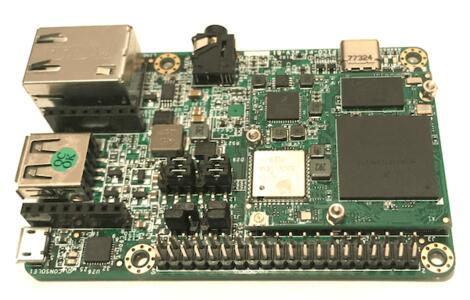

<!-- Copyright 2015-2026 Zephyr Project members and individual contributors. -->
<!-- SPDX-License-Identifier: Apache-2.0 -->
<!-- 中文翻译；编号、导航与译注为本地新增。 -->

<a id="pico_pi"></a>

# 第12章\_Pico-Pi i.MX7D：Android Things物联网开发平台

原文：[官方页面](https://docs.zephyrproject.org/latest/boards/technexion/pico_pi/doc/index.html)。读取日期：2026-10-16；来源摘要见[来源记录](../SOURCES.md)。

开发板概览（Board Overview）

<a id="id2"></a>

[](images/pico_pi.jpg)

Pico-Pi i.MX7D：Android Things物联网开发平台

名称（Name）：

`pico_pi`

厂商（Vendor）：

[TechNexion](https://docs.zephyrproject.org/latest/boards/index.html#vendor=technexion)

状态（Status）：

当前未积极维护（Not Actively Maintained）

架构（Architecture）：

[arm](https://docs.zephyrproject.org/latest/boards/index.html#arch=arm)

片上系统（SoC）：

[mcimx7d](https://docs.zephyrproject.org/latest/boards/index.html#soc=mcimx7d)

<a id="board-github-link"></a>

[浏览开发板源码（Browse Board Sources）](https://github.com/zephyrproject-rtos/zephyr/blob/main//boards/technexion/pico_pi/doc/index.rst/../..)<a id="overview"></a>

## 概述（Overview）

原文将i.MX7D描述为含一个Cortex-A7及一个Cortex-M4的异构多核处理器。Zephyr移植运行于M4，原文计划在后续版本通过RPMsg与运行Linux的A7通信。

<a id="hardware"></a>

## 硬件（Hardware）

Pico-Pi平台由CPU板及I/O板组成。

<a id="pico-pi-io-board"></a>

### Pico-Pi I/O板


- S1：开关机，MX7_ONOFF信号
- 板对板连接器：兼容Edison，70个可配置引脚
- MikroBUS扩展接口，提供ADC、GPIO、I2C、PWM、SPI及UART
- 10针探针式JTAG连接器（Needle JTAG Connector）
- 调试USB，引出一路UART
- 单通道MIPI显示串行接口（DSI）连接器
- LCD触摸屏连接器
- 音频插孔：麦克风及立体声耳机

<a id="pico-pi-cpu-board"></a>

### Pico-Pi CPU板


- CPU：i.MX7 Dual，原文列一个1 GHz Cortex-A7核及一个200 MHz Cortex-M4核
- 存储器（Memory）


  - A7侧RAM：4 GB
  - M4 RAM：三个32 KB区域TCML、TCMU及OCRAM_S，一个128 KB OCRAM区域，以及一个256 MB DDR区域
  - A7侧闪存：8 GB eMMC

i.MX7 SoC及Pico-Pi i.MX7D更多信息见：


- [i.MX 7系列网站（Series Website）](https://www.nxp.com/products/processors-and-microcontrollers/applications-processors/i.mx-applications-processors/i.mx-7-processors:IMX7-SERIES?fsrch=1&sr=1&pageNum=1)
- [i.MX 7 Dual数据手册（Datasheet）](https://www.nxp.com/docs/en/data-sheet/IMX7DCEC.pdf)
- [i.MX 7 Dual参考手册（Reference Manual）](https://www.nxp.com/webapp/Download?colCode=IMX7DRM)

<a id="supported-features"></a>

### 支持的功能（Supported Features）

`pico_pi`开发板支持下表所列的硬件功能。

片上／板载（On-Chip / On-Board）

功能集成在片上系统（SoC）内／位于开发板上。

2 / 2

分别表示已启用／已禁用的实例数。点击数量标签，可查看开发板或SoC设备树源码（DTS）中该功能的第一个实例。

`vnd,foo`

与此功能匹配的设备树绑定兼容字符串（Compatible String）；点击链接可查看绑定文档。

<a id="pico_pi-hw-features"></a>

<a id="pico_pi-pico_pi/mcimx7d/m4-hw-features-section"></a>

#### `pico_pi/mcimx7d/m4`目标（Target）

<a id="pico_pi-pico_pi/mcimx7d/m4-hw-features-panel"></a>

<a id="pico_pi-pico_pi/mcimx7d/m4-hw-features-memory"></a>

该开发板目标的片上存储容量：32 KiB RAM、32 KiB Flash。

<a id="pico_pi-pico_pi/mcimx7d/m4-hw-features-table"></a>

<table>
<tr>
<th>类型（Type）</th>
<th>位置（Location）</th>
<th>说明（Description）</th>
<th>兼容字符串（Compatible）</th>
</tr>
<tr>
<td rowspan="1">中央处理器（CPU）</td>
<td>片上（On-Chip）</td>
<td>ARM Cortex-M4 处理器（CPU）（<a href="https://github.com/zephyrproject-rtos/zephyr/blob/main/dts/arm/nxp/imx/nxp_imx7d_m4.dtsi?plain=1#L20">已启用：1</a>）</td>
<td><a href="../cpu_arm_riscv_binding_reference/P024_arm_cortex-m4.md#std-dtcompatible-arm-cortex-m4"><code>arm,cortex-m4</code></a></td>
</tr>
<tr>
<td rowspan="2">ARM 架构（ARM Architecture）</td>
<td>片上（On-Chip）</td>
<td>i.MX指令紧耦合存储器（ITCM / Instruction Tightly Coupled Memory）（<a href="https://github.com/zephyrproject-rtos/zephyr/blob/main/dts/arm/nxp/imx/nxp_imx7d_m4.dtsi?plain=1#L39">已启用：1</a>）</td>
<td><a href="../arm_nordic_nxp_control_binding_reference/P014_nxp_imx-itcm.md#std-dtcompatible-nxp-imx-itcm"><code>nxp,imx-itcm</code></a></td>
</tr>
<tr>
<td>片上（On-Chip）</td>
<td>i.MX数据紧耦合存储器（DTCM / Data Tightly Coupled Memory）（<a href="https://github.com/zephyrproject-rtos/zephyr/blob/main/dts/arm/nxp/imx/nxp_imx7d_m4.dtsi?plain=1#L44">已启用：1</a>）</td>
<td><a href="../arm_nordic_nxp_control_binding_reference/P012_nxp_imx-dtcm.md#std-dtcompatible-nxp-imx-dtcm"><code>nxp,imx-dtcm</code></a></td>
</tr>
<tr>
<td rowspan="1">通用输入输出与接插件（GPIO &amp; Headers）</td>
<td>片上（On-Chip）</td>
<td>i.MX通用输入输出（GPIO）（<a href="https://github.com/zephyrproject-rtos/zephyr/blob/main/dts/arm/nxp/imx/nxp_imx7d_m4.dtsi?plain=1#L72">已禁用：7</a>）</td>
<td><a href="../gpio_microchip_nordic_nuvoton_binding_reference/P030_nxp_imx-gpio.md#std-dtcompatible-nxp-imx-gpio"><code>nxp,imx-gpio</code></a></td>
</tr>
<tr>
<td rowspan="1">集成电路间总线（I2C）</td>
<td>片上（On-Chip）</td>
<td>i.MX I2C控制器（<a href="https://github.com/zephyrproject-rtos/zephyr/blob/main/dts/arm/nxp/imx/nxp_imx7d_m4.dtsi?plain=1#L263">已禁用：4</a>）</td>
<td><a href="../i2c_adi_atmel_esp_binding_reference/P019_fsl_imx21-i2c.md#std-dtcompatible-fsl-imx21-i2c"><code>fsl,imx21-i2c</code></a></td>
</tr>
<tr>
<td rowspan="1">中断控制器（Interrupt Controller）</td>
<td>片上（On-Chip）</td>
<td>ARMv7-M 嵌套向量中断控制器（Nested Vectored Interrupt Controller，NVIC）（<a href="https://github.com/zephyrproject-rtos/zephyr/blob/main/dts/arm/armv7-m.dtsi?plain=1#L13">已启用：1</a>）</td>
<td><a href="../arm_interrupt_timer_binding_reference/P002_ARMv7_M_NVIC.md#std-dtcompatible-arm-v7m-nvic"><code>arm,v7m-nvic</code></a></td>
</tr>
<tr>
<td rowspan="1">处理器间消息（IPM）</td>
<td>片上（On-Chip）</td>
<td>i.MX消息单元（Messaging Unit）（<a href="https://github.com/zephyrproject-rtos/zephyr/blob/main/dts/arm/nxp/imx/nxp_imx7d_m4.dtsi?plain=1#L243">已禁用：1</a>）</td>
<td><a href="../intercore_reference/P072_NXPiMX消息单元绑定.md#dtbinding-nxp-imx-mu"><code>nxp,imx-mu</code></a></td>
</tr>
<tr>
<td rowspan="2">引脚控制（Pin Control）</td>
<td>片上（On-Chip）</td>
<td>这个兼容性绑定（Compatible Binding）应应用于设备的<code>iomuxc</code>设备树源文件（DTS）节点。（<a href="https://github.com/zephyrproject-rtos/zephyr/blob/main/dts/arm/nxp/imx/nxp_imx7d_m4.dtsi?plain=1#L252">已启用：1</a>）</td>
<td><a href="../pinctrl_infineon_nordic_nxp_binding_reference/P023_nxp_imx-iomuxc.md#std-dtcompatible-nxp-imx-iomuxc"><code>nxp,imx-iomuxc</code></a></td>
</tr>
<tr>
<td>片上（On-Chip）</td>
<td>MCUX片上系统（SoC）的设备树（Devicetree）为该节点设置了<code>pinctrl</code>节点标签。（<a href="https://github.com/zephyrproject-rtos/zephyr/blob/main/dts/arm/nxp/imx/nxp_imx7d_m4.dtsi?plain=1#L257">已启用：1</a>）</td>
<td><a href="../pinctrl_infineon_nordic_nxp_binding_reference/P024_nxp_imx7d-pinctrl.md#std-dtcompatible-nxp-imx7d-pinctrl"><code>nxp,imx7d-pinctrl</code></a></td>
</tr>
<tr>
<td rowspan="1">脉宽调制（PWM）</td>
<td>片上（On-Chip）</td>
<td>该驱动支持i.MX6SX和i.MX7D的脉宽调制（PWM）。（<a href="https://github.com/zephyrproject-rtos/zephyr/blob/main/dts/arm/nxp/imx/nxp_imx7d_m4.dtsi?plain=1#L319">已禁用：4</a>）</td>
<td><a href="../pwm_adi_esp_infineon_binding_reference/P017_fsl_imx27-pwm.md#std-dtcompatible-fsl-imx27-pwm"><code>fsl,imx27-pwm</code></a></td>
</tr>
<tr>
<td rowspan="1">串行控制器（Serial Controller）</td>
<td>片上（On-Chip）</td>
<td>iMX通用异步收发器（UART）（<a href="https://github.com/zephyrproject-rtos/zephyr/blob/main/dts/arm/nxp/imx/nxp_imx7d_m4.dtsi?plain=1#L221">已启用：1</a>；<a href="https://github.com/zephyrproject-rtos/zephyr/blob/main/dts/arm/nxp/imx/nxp_imx7d_m4.dtsi?plain=1#L166">已禁用：6</a>）</td>
<td><a href="../uart_microchip_nordic_nxp_binding_reference/P011_nxp_imx-uart.md#std-dtcompatible-nxp-imx-uart"><code>nxp,imx-uart</code></a></td>
</tr>
<tr>
<td rowspan="1">定时器（Timer）</td>
<td>片上（On-Chip）</td>
<td>ARMv7-M 系统节拍（System Tick）（<a href="https://github.com/zephyrproject-rtos/zephyr/blob/main/dts/arm/armv7-m.dtsi?plain=1#L21">已启用：1</a>）</td>
<td><a href="../arm_interrupt_timer_binding_reference/P006_ARMv7_M_SysTick.md#std-dtcompatible-arm-armv7m-systick"><code>arm,armv7m-systick</code></a></td>
</tr>
</table>

<a id="connections-and-ios"></a>

### 连接与输入输出（Connections and IOs）

原文使用以下引脚复用控制器配置测试Pico-Pi开发板。

<table>
<tr>
<th>开发板名称（Board Name）</th>
<th>SoC名称（SoC Name）</th>
<th>用途（Usage）</th>
</tr>
<tr>
<td>UART_TX232</td>
<td>UART1_TX</td>
<td>UART控制台（UART Console）</td>
</tr>
<tr>
<td>UART_RX232</td>
<td>UART1_RX</td>
<td>UART控制台（UART Console）</td>
</tr>
<tr>
<td>RX_E</td>
<td>UART6_TX</td>
<td>UART，位于MikroBUS及Edison连接器</td>
</tr>
<tr>
<td>TX_E</td>
<td>UART6_RX</td>
<td>UART，位于MikroBUS及Edison连接器</td>
</tr>
<tr>
<td>I2CX_SDA_3V</td>
<td>I2C1_SDA</td>
<td>I2C，位于MikroBUS及Edison连接器</td>
</tr>
<tr>
<td>I2CX_SCL_3V</td>
<td>I2C1_SCL</td>
<td>I2C，位于MikroBUS及Edison连接器</td>
</tr>
</table>

<a id="system-clock"></a>

### 系统时钟（System Clock）

M4内核配置为以200 MHz时钟频率运行。

<a id="serial-port"></a>

### 串口（Serial Port）

i.MX7D有七路UART，UART6配置为控制台，UART2用于MikroBUS连接器。

<a id="programming-and-debugging"></a>

## 烧录与调试（Programming and Debugging）

Pico-Pi i.MX7D没有供M4使用的QSPI闪存，M4必须由A7启动。A7负责将M4应用二进制加载到RAM，使M4进入复位，设置程序计数器（PC）及栈指针（SP），再解除复位。这些步骤可在引导加载器阶段或Linux启动后执行。

M4最多可以使用5种不同的RAM。A7和M4的存储器映射（Memory Mapping）如下：

<table>
<tr>
<th>区域（Region）</th>
<th>Cortex-A7</th>
<th>Cortex-M4（系统总线 / System Bus）</th>
<th>Cortex-M4（代码总线 / Code Bus）</th>
<th>大小（Size）</th>
</tr>
<tr>
<td>双倍数据率存储器（DDR）</td>
<td>0x80000000-0xFFFFFFFF</td>
<td>0x80000000-0xDFFFFFFF</td>
<td>0x10000000-0x1FFEFFFF</td>
<td>2048 MB（M4可用容量较少）</td>
</tr>
<tr>
<td>片上RAM（OCRAM）</td>
<td>0x00900000-0x0091FFFF</td>
<td>0x20200000-0x2021FFFF</td>
<td>0x00900000-0x0091FFFF</td>
<td>128KB</td>
</tr>
<tr>
<td>高地址紧耦合存储器（TCMU）</td>
<td>0x00800000-0x00807FFF</td>
<td>0x20000000-0x20007FFF</td>
<td></td>
<td>32KB</td>
</tr>
<tr>
<td>低地址紧耦合存储器（TCML）</td>
<td>0x007F8000-0x007FFFFF</td>
<td></td>
<td>0x1FFF8000-0x1FFFFFFF</td>
<td>32KB</td>
</tr>
<tr>
<td>OCRAM_S</td>
<td>0x00180000-0x00187FFF</td>
<td>0x20180000-0x20187FFF</td>
<td>0x00000000-0x00007FFF</td>
<td>32KB</td>
</tr>
</table>

<a id="references"></a>

### 参考资料（References）


- 《[i.MX 7 Dual Reference Manual](https://www.nxp.com/webapp/Download?colCode=IMX7DRM)》第182页起，第2.1.2及2.1.3节
- [Toradex维基（Wiki）](https://developer.toradex.com/knowledge-base/freertos-on-the-cortex-m4-of-a-colibri-imx7#Memory_areas)

编译时需选择使用哪块RAM。在[boards/technexion/pico_pi/pico_pi_mcimx7d_m4.dts](https://github.com/zephyrproject-rtos/zephyr/blob/main/boards/technexion/pico_pi/pico_pi_mcimx7d_m4.dts)中，通过CONFIG_XIP=y时使用的zephyr,flash及zephyr,sram属性配置，可选方案如下：

```text
"zephyr,flash"
- &ddr_code
- &tcml_code
- &ocram_code
- &ocram_s_code
- &ocram_pxp_code
- &ocram_epdc_code

"zephyr,sram"
- &ddr_sys
- &tcmu_sys
- &ocram_sys
- &ocram_s_sys
- &ocram_pxp_sys
- &ocram_epdc_sys
```

下面说明如何从A7使用U-Boot将Zephyr加载到M4并运行。

将两个Micro-USB接口连接电脑。USB调试接口为A7控制台，Edison连接器上的UART6为M4 Zephyr控制台，两者均设为115200、8N1。USB还为CPU板及I/O板供电，并连接i.MX7D USB OTG接口。

平台上电后，中止A7内核上的U-Boot执行，在U-Boot提示符下运行`ums 0 mmc 0`，将eMMC呈现为大容量存储设备。将编译生成的`zephyr.bin`复制到第一个FAT分区，然后在U-Boot提示符下按`Ctrl+C`，移除计算机上挂载的设备。设置U-Boot环境变量，并从Zephyr编译配置所指定的相应存储器运行`zephyr.bin`：

```text
setenv bootm4 'fatload mmc 0:1 $m4addr $m4fw && dcache flush && bootaux $m4addr'
# TCML
setenv m4tcml 'setenv m4fw zephyr.bin; setenv m4addr 0x007F8000'
setenv bootm4tcml 'run m4tcml && run bootm4'
run bootm4tcml
# TCMU
setenv m4tcmu 'setenv m4fw zephyr.bin; setenv m4addr 0x00800000'
setenv bootm4tcmu 'run m4tcmu && run bootm4'
run bootm4tcmu
# OCRAM
setenv m4ocram 'setenv m4fw zephyr.bin; setenv m4addr 0x00900000'
setenv bootm4ocram 'run m4ocram && run bootm4'
run bootm4ocram
# OCRAM_S
setenv m4ocrams 'setenv m4fw zephyr.bin; setenv m4addr 0x00180000'
setenv bootm4ocrams 'run m4ocrams && run bootm4'
run bootm4ocrams
# DDR
setenv m4ddr 'setenv m4fw zephyr.bin; setenv m4addr 0x80000000'
setenv bootm4ddr 'run m4ddr && run bootm4'
run bootm4ddr
```

更多详情见“构建应用”及“运行应用”。（[构建应用（Building an Application）](../application/P001_应用开发.md#build-an-application)；[运行应用（Run an Application）](https://docs.zephyrproject.org/latest/develop/application/index.html#application-run)）

<a id="id1"></a>

### 参考资料（References）


- [在i.MX 6SoloX和i.MX 7Dual/7Solo应用处理器上从Linux向Cortex-M4加载代码（Loading Code on Cortex-M4 from Linux）](https://www.nxp.com/docs/en/application-note/AN5317.pdf)
- [J-Link iMX7D操作说明（Instructions）](https://wiki.segger.com/IMX7D)

## 译注

Pico Pi原文称i.MX7 Dual，但同时列单个A7内核；该矛盾原样标明。M4由A7将镜像加载到RAM并设置复位PC／SP，不能从QSPI独立启动。UART6 Edison与UART2 mikroBUS两种控制台连接分别保留。

## 原文外链核对

2026-10-16核对并重试以下原文外链时未能确认可访问性，保留原始目标，不将访问失败解释为原文内容有误。

- [freertos-on-the-cortex-m4-of-a-colibri-imx7](https://developer.toradex.com/knowledge-base/freertos-on-the-cortex-m4-of-a-colibri-imx7#Memory_areas)：<urlopen error [SSL: CERTIFICATE_VERIFY_FAILED] certificate verify failed: self-signed certificate in certificate chain (_ssl.c:1010)>。
- [AN5317.pdf](https://www.nxp.com/docs/en/application-note/AN5317.pdf)：HTTP Error 404: Not Found。
- [IMX7DCEC.pdf](https://www.nxp.com/docs/en/data-sheet/IMX7DCEC.pdf)：HTTP Error 404: Not Found。
- [i.mx-7-processors:IMX7-SERIES?fsrch=1&sr=1&pageNum=1](https://www.nxp.com/products/processors-and-microcontrollers/applications-processors/i.mx-applications-processors/i.mx-7-processors:IMX7-SERIES?fsrch=1&sr=1&pageNum=1)：HTTP Error 404: Not Found。
- [Download?colCode=IMX7DRM](https://www.nxp.com/webapp/Download?colCode=IMX7DRM)：HTTP Error 404: Not Found。

---

[上一章](P011_TECHNEXION.md) · [返回大纲](大纲.md) · [全站翻译进度](../PROGRESS.md) · [下一章](P013_Telink_Semiconductor.md)
