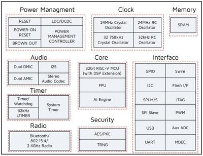

<!-- Copyright 2015-2026 Zephyr Project members and individual contributors. -->
<!-- SPDX-License-Identifier: Apache-2.0 -->
<!-- 中文翻译；编号、导航与译注为本地新增。 -->

<a id="tlsr9518adk80d"></a>

# 第14章\_TLSR9518ADK80D

原文：[官方页面](https://docs.zephyrproject.org/latest/boards/telink/tlsr9518adk80d/doc/index.html)。读取日期：2026-10-16；来源摘要见[来源记录](../SOURCES.md)。

开发板概览（Board Overview）

<a id="id1"></a>

[](images/tlsr9518adk80d.jpg)

TLSR9518ADK80D

名称（Name）：

`tlsr9518adk80d`

厂商（Vendor）：

[Telink Semiconductor](https://docs.zephyrproject.org/latest/boards/index.html#vendor=telink)

状态（Status）：

当前未积极维护（Not Actively Maintained）

架构（Architecture）：

[riscv](https://docs.zephyrproject.org/latest/boards/index.html#arch=riscv)

片上系统（SoC）：

[tlsr9518](https://docs.zephyrproject.org/latest/boards/index.html#soc=tlsr9518)

<a id="board-github-link"></a>

[浏览开发板源码（Browse Board Sources）](https://github.com/zephyrproject-rtos/zephyr/blob/main//boards/telink/tlsr9518adk80d/doc/index.rst/../..)<a id="overview"></a>

## 概述（Overview）

<a id="id3"></a>

TLSR9518A Generic Starter Kit用于验证Telink TLSR951x系列芯片[注1](#id2)，并开发Bluetooth 5.2，包括基本速率、增强速率、LE、室内定位及BLE Mesh，Zigbee 3.0、HomeKit、6LoWPAN、Thread及专有2.4 GHz等空中接口应用。（[Telink TLSR951x系列芯片组](https://wiki.telink-semi.cn/wiki/chip-series/TLSR951x-Series/)）

<a id="id5"></a>

更多板卡信息见[Telink B91通用入门套件硬件指南](https://wiki.telink-semi.cn/wiki/Hardware/B91_Generic_Starter_Kit_Hardware_Guide/)[注2](#id4)。

<a id="hardware"></a>

## 硬件（Hardware）

TLSR9518A SoC集成32位RISC-V微控制器、DSP、AI引擎、2.4 GHz ISM无线电、256 KB SRAM，其中数据本地存储及指令本地存储各128 KB，外部闪存、立体声音频编解码器、14位辅助ADC、模拟及数字麦克风输入、PWM和灵活I/O等，面向物联网、耳戴及可穿戴设备。



TLSR9518ADK80D默认板级配置提供以下硬件：


- 射频传导天线接口，原文RF conducted antenna
- 1 MB外部闪存，带复位按键
- 芯片复位按键
- Mini-USB接口
- 四线JTAG
- 四个LED及最多四键的按键矩阵
- 两路线路输入（Line-in）；切换麦克风路径跳线后支持双模拟麦克风
- 双数字麦克风
- 立体声线路输出（Line-out）

<a id="supported-features"></a>

### 支持的功能（Supported Features）

`tlsr9518adk80d`开发板支持下表所列的硬件功能。

片上／板载（On-Chip / On-Board）

功能集成在片上系统（SoC）内／位于开发板上。

2 / 2

分别表示已启用／已禁用的实例数。点击数量标签，可查看开发板或SoC设备树源码（DTS）中该功能的第一个实例。

`vnd,foo`

与此功能匹配的设备树绑定兼容字符串（Compatible String）；点击链接可查看绑定文档。

<a id="tlsr9518adk80d-hw-features"></a>

<a id="tlsr9518adk80d-tlsr9518adk80d/tlsr9518-hw-features-section"></a>

#### `tlsr9518adk80d/tlsr9518`目标（Target）

<a id="tlsr9518adk80d-tlsr9518adk80d/tlsr9518-hw-features-panel"></a>

<a id="tlsr9518adk80d-tlsr9518adk80d/tlsr9518-hw-features-memory"></a>

该开发板目标的片上存储容量：128 KiB RAM、1 MiB Flash。

<a id="tlsr9518adk80d-tlsr9518adk80d/tlsr9518-hw-features-table"></a>

<table>
<tr>
<th>类型（Type）</th>
<th>位置（Location）</th>
<th>说明（Description）</th>
<th>兼容字符串（Compatible）</th>
</tr>
<tr>
<td rowspan="1">中央处理器（CPU）</td>
<td>片上（On-Chip）</td>
<td>Telink RISC-V处理器（<a href="https://github.com/zephyrproject-rtos/zephyr/blob/main/dts/riscv/telink/telink_b91.dtsi?plain=1#L24">已启用：1</a>）</td>
<td><a href="../cpu_vendor_multiarc_binding_reference/P047_telink_b91.md#std-dtcompatible-telink-b91"><code>telink,b91</code></a></td>
</tr>
<tr>
<td rowspan="1">模数转换器（ADC）</td>
<td>片上（On-Chip）</td>
<td>Telink B91模数转换器（ADC）节点（<a href="https://github.com/zephyrproject-rtos/zephyr/blob/main/dts/riscv/telink/telink_b91.dtsi?plain=1#L215">已启用：1</a>）</td>
<td><a href="../hardware/P903_TelinkB91模数转换器绑定.md#dtbinding-telink-b91-adc"><code>telink,b91-adc</code></a></td>
</tr>
<tr>
<td rowspan="1">闪存控制器（Flash Controller）</td>
<td>片上（On-Chip）</td>
<td>Telink B91闪存控制器（<a href="https://github.com/zephyrproject-rtos/zephyr/blob/main/dts/riscv/telink/telink_b91.dtsi?plain=1#L61">已启用：1</a>）</td>
<td><a href="../flash_renesas_st_ti_binding_reference/P029_telink_b91-flash-controller.md#std-dtcompatible-telink-b91-flash-controller"><code>telink,b91-flash-controller</code></a></td>
</tr>
<tr>
<td rowspan="1">通用输入输出与接插件（GPIO &amp; Headers）</td>
<td>片上（On-Chip）</td>
<td>Telink B91 GPIO（<a href="https://github.com/zephyrproject-rtos/zephyr/blob/main/dts/riscv/telink/telink_b91.dtsi?plain=1#L92">已启用：2</a>；<a href="https://github.com/zephyrproject-rtos/zephyr/blob/main/dts/riscv/telink/telink_b91.dtsi?plain=1#L82">已禁用：3</a>）</td>
<td><a href="../gpio_ti_xilinx_sdl_binding_reference/P007_telink_b91-gpio.md#std-dtcompatible-telink-b91-gpio"><code>telink,b91-gpio</code></a></td>
</tr>
<tr>
<td rowspan="1">集成电路间总线（I2C）</td>
<td>片上（On-Chip）</td>
<td>Telink B91 I2C（<a href="https://github.com/zephyrproject-rtos/zephyr/blob/main/dts/riscv/telink/telink_b91.dtsi?plain=1#L206">已启用：1</a>）</td>
<td><a href="../i2c_stm32_ti_mux_binding_reference/P009_telink_b91-i2c.md#std-dtcompatible-telink-b91-i2c"><code>telink,b91-i2c</code></a></td>
</tr>
<tr>
<td rowspan="1">低速率无线个域网（IEEE 802.15.4）</td>
<td>片上（On-Chip）</td>
<td>Telink B91 IEEE 802.15.4节点（<a href="https://github.com/zephyrproject-rtos/zephyr/blob/main/dts/riscv/telink/telink_b91.dtsi?plain=1#L160">已启用：1</a>）</td>
<td><a href="../lora_ieee802154_binding_reference/P011_telink_b91-zb.md#std-dtcompatible-telink-b91-zb"><code>telink,b91-zb</code></a></td>
</tr>
<tr>
<td rowspan="1">输入（Input）</td>
<td>板载（On-Board）</td>
<td>一组绑定到 GPIO 的输入按键（GPIO-Bound Input Keys）（<a href="https://github.com/zephyrproject-rtos/zephyr/blob/main/boards/telink/tlsr9518adk80d/tlsr9518adk80d.dts?plain=1#L61">已启用：1</a>）</td>
<td><a href="../hardware/P563_GPIO按键绑定.md#std-dtcompatible-gpio-keys"><code>gpio-keys</code></a></td>
</tr>
<tr>
<td rowspan="2">中断控制器（Interrupt Controller）</td>
<td>片上（On-Chip）</td>
<td>RISC-V CPU中断控制器（Interrupt Controller）（<a href="https://github.com/zephyrproject-rtos/zephyr/blob/main/dts/riscv/telink/telink_b91.dtsi?plain=1#L31">已启用：1</a>）</td>
<td><a href="../interrupt_fabric_binding_reference/P006_riscv_cpu-intc.md#std-dtcompatible-riscv-cpu-intc"><code>riscv,cpu-intc</code></a></td>
</tr>
<tr>
<td>片上（On-Chip）</td>
<td>SiFive RISCV-V平台级中断控制器（PLIC / Platform-Local Interrupt Controller）（<a href="https://github.com/zephyrproject-rtos/zephyr/blob/main/dts/riscv/telink/telink_b91.dtsi?plain=1#L132">已启用：1</a>）</td>
<td><a href="../interrupt_fabric_binding_reference/P009_sifive_plic-1.0.0.md#std-dtcompatible-sifive-plic-1.0.0"><code>sifive,plic-1.0.0</code></a></td>
</tr>
<tr>
<td rowspan="2">发光二极管（LED）</td>
<td>板载（On-Board）</td>
<td>一组由 GPIO 控制的 LED（GPIO-Controlled LEDs）（<a href="https://github.com/zephyrproject-rtos/zephyr/blob/main/boards/telink/tlsr9518adk80d/tlsr9518adk80d.dts?plain=1#L28">已启用：1</a>）</td>
<td><a href="../hardware/P564_GPIO指示灯绑定.md#dtbinding-gpio-leds"><code>gpio-leds</code></a></td>
</tr>
<tr>
<td>板载（On-Board）</td>
<td>一组由脉宽调制（PWM）控制的LED（<a href="https://github.com/zephyrproject-rtos/zephyr/blob/main/boards/telink/tlsr9518adk80d/tlsr9518adk80d.dts?plain=1#L52">已启用：1</a>）</td>
<td><a href="../hardware/P565_PWM指示灯绑定.md#dtbinding-pwm-leds"><code>pwm-leds</code></a></td>
</tr>
<tr>
<td rowspan="1">存储技术设备（MTD）</td>
<td>片上（On-Chip）</td>
<td>闪存（Flash）节点（<a href="https://github.com/zephyrproject-rtos/zephyr/blob/main/dts/riscv/telink/telink_b91.dtsi?plain=1#L68">已启用：1</a>）</td>
<td><a href="../mtd_nxp_st_ti_partition_binding_reference/P013_soc-nv-flash.md#std-dtcompatible-soc-nv-flash"><code>soc-nv-flash</code></a></td>
</tr>
<tr>
<td rowspan="1">引脚控制（Pin Control）</td>
<td>片上（On-Chip）</td>
<td>Telink B91引脚控制器为单例节点（Singleton Node），控制引脚功能选择及属性（<a href="https://github.com/zephyrproject-rtos/zephyr/blob/main/dts/riscv/telink/telink_b91.dtsi?plain=1#L222">已启用：1</a>）</td>
<td><a href="../pinctrl_stm32_ti_xilinx_binding_reference/P009_telink_b91-pinctrl.md#std-dtcompatible-telink-b91-pinctrl"><code>telink,b91-pinctrl</code></a></td>
</tr>
<tr>
<td rowspan="1">电源管理（Power Management）</td>
<td>片上（On-Chip）</td>
<td>Telink B91电源控制节点（<a href="https://github.com/zephyrproject-rtos/zephyr/blob/main/dts/riscv/telink/telink_b91.dtsi?plain=1#L74">已启用：1</a>）</td>
<td><a href="../stm32_soc_power_binding_reference/P019_telink_b91-power.md#std-dtcompatible-telink-b91-power"><code>telink,b91-power</code></a></td>
</tr>
<tr>
<td rowspan="1">脉宽调制（PWM）</td>
<td>片上（On-Chip）</td>
<td>Telink B91脉宽调制（PWM）（<a href="https://github.com/zephyrproject-rtos/zephyr/blob/main/dts/riscv/telink/telink_b91.dtsi?plain=1#L174">已启用：1</a>）</td>
<td><a href="../pwm_stm32_ti_generic_binding_reference/P012_telink_b91-pwm.md#std-dtcompatible-telink-b91-pwm"><code>telink,b91-pwm</code></a></td>
</tr>
<tr>
<td rowspan="1">随机数生成器（RNG）</td>
<td>片上（On-Chip）</td>
<td>Telink B91随机数发生器（RNG）（<a href="https://github.com/zephyrproject-rtos/zephyr/blob/main/dts/riscv/telink/telink_b91.dtsi?plain=1#L168">已启用：1</a>）</td>
<td><a href="../soc_rng_binding_reference/P017_telink_b91-trng.md#std-dtcompatible-telink-b91-trng"><code>telink,b91-trng</code></a></td>
</tr>
<tr>
<td rowspan="1">串行控制器（Serial Controller）</td>
<td>片上（On-Chip）</td>
<td>Telink B91 UART（<a href="https://github.com/zephyrproject-rtos/zephyr/blob/main/dts/riscv/telink/telink_b91.dtsi?plain=1#L144">已启用：1</a>；<a href="https://github.com/zephyrproject-rtos/zephyr/blob/main/dts/riscv/telink/telink_b91.dtsi?plain=1#L152">已禁用：1</a>）</td>
<td><a href="../uart_silabs_stm32_ti_binding_reference/P017_telink_b91-uart.md#std-dtcompatible-telink-b91-uart"><code>telink,b91-uart</code></a></td>
</tr>
<tr>
<td rowspan="1">串行外设接口（SPI）</td>
<td>片上（On-Chip）</td>
<td>Telink B91 SPI（<a href="https://github.com/zephyrproject-rtos/zephyr/blob/main/dts/riscv/telink/telink_b91.dtsi?plain=1#L182">已启用：2</a>）</td>
<td><a href="../spi_stm32_ti_xilinx_binding_reference/P014_telink_b91-spi.md#std-dtcompatible-telink-b91-spi"><code>telink,b91-spi</code></a></td>
</tr>
<tr>
<td rowspan="1">静态随机存储器（SRAM）</td>
<td>片上（On-Chip）</td>
<td>通用片上静态随机存储器（SRAM）（<a href="https://github.com/zephyrproject-rtos/zephyr/blob/main/dts/riscv/telink/telink_b91.dtsi?plain=1#L46">已启用：2</a>）</td>
<td><a href="../hardware/P567_内存映射SRAM绑定.md#dtbinding-mmio-sram"><code>mmio-sram</code></a></td>
</tr>
<tr>
<td rowspan="1">定时器（Timer）</td>
<td>片上（On-Chip）</td>
<td>RISC-V机器模式定时器（Machine Timer）（<a href="https://github.com/zephyrproject-rtos/zephyr/blob/main/dts/riscv/telink/telink_b91.dtsi?plain=1#L54">已启用：1</a>）</td>
<td><a href="../interrupt_fabric_binding_reference/P011_riscv_machine-timer.md#std-dtcompatible-riscv-machine-timer"><code>riscv,machine-timer</code></a></td>
</tr>
</table>

注意（Note）

运行button按键示例时，需移除PC3-KEY3跳线，即J20第19与20脚，并从外部将KEY3（J20-19）连接到VDD3_DCDC（J51-13）。

其他示例使用默认跳线配置。

<a id="limitations"></a>

#### 限制（Limitations）


- 最多三个GPIO可同时配置为产生中断；它们必须位于不同端口，并使用不同IRQ号。
- I2C、SPI及串口均不支持DMA模式。
- 尚未实现UART硬件流控。
- 尚未实现SPI从机模式（Slave Mode）。
- 尚未实现I2C从机模式（Slave Mode）。

<a id="default-configuration-and-ios"></a>

### 默认配置及I/O（Default Configuration and I/Os）

<a id="system-clock"></a>

#### 系统时钟（System Clock）

TLSR9518ADK80D使用24 MHz外部晶体，经片上PLL及分频器生成48 MHz系统时钟。还可在[boards/telink/tlsr9518adk80d/tlsr9518adk80d.dts](https://github.com/zephyrproject-rtos/zephyr/blob/main/boards/telink/tlsr9518adk80d/tlsr9518adk80d.dts)中将系统时钟设为以下值：


- 16000000
- 24000000
- 32000000
- 48000000
- 64000000
- 96000000

```text
&cpu0 {
    clock-frequency = <48000000>;
};
```

<a id="pins-configuration"></a>

#### 引脚配置（Pins Configuration）

TLSR9518A有PORT_A至PORT_E五个GPIO控制器，但板级DTS当前仅启用用于LED的PORT_B及用于按键的PORT_C：


- LED0蓝色：PB4；LED1绿色：PB5；LED2白色：PB6；LED3红色：PB7
- 按键矩阵：SW0为PC2_PC3，SW1为PC2_PC1，SW2为PC0_PC3，SW3为PC0_PC1

[boards/telink/tlsr9518adk80d/tlsr9518adk80d.dts](https://github.com/zephyrproject-rtos/zephyr/blob/main/boards/telink/tlsr9518adk80d/tlsr9518adk80d.dts)将外设映射到以下GPIO：


- UART0：TX为PB2，RX为PB3
- UART1：TX为PC6，RX为PC7
- PWM通道0：PB4
- PSPI：CS0为PC4，CLK为PC5，MISO为PC6，MOSI为PC7
- HSPI：CS0为PA1，CLK为PA2，MISO为PA3，MOSI为PA4
- I2C：SCL为PE1，SDA为PE3

<a id="serial-port"></a>

#### 串口（Serial Port）

TLSR9518A有两路UART，Zephyr控制台使用UART0，默认115200、8N1。

<a id="programming-and-debugging"></a>

## 编程与调试（Programming and Debugging）

`tlsr9518adk80d`开发板支持下表所列的运行工具（Runners）及相关west命令。

<table>
<tr>
<th></th>
<th>烧录（flash）</th>
<th>调试（debug）</th>
</tr>
<tr>
<td>spi_burn</td>
<td>✅（默认 / default）</td>
<td>✅（默认 / default）</td>
</tr>
</table>

<a id="building"></a>

### 构建（Building）

重要提示（Important）

以下假定已按[入门指南](../getting_started/P002_入门指南.md#getting-started)准备开发环境。

使用Zephyr SDK默认RISC-V工具链时，直接运行west build，下面以hello_world为例。

```text
# From the root of the zephyr repository
west build -b tlsr9518adk80d samples/hello_world
```

<a id="id7"></a>

使用[Telink RISC-V Linux Toolchain](https://wiki.telink-semi.cn/tools_and_sdk/Tools/IDE/telink_riscv_linux_toolchain.zip) [注3](#id6)时，需设置ZEPHYR_TOOLCHAIN_VARIANT及CROSS_COMPILE，并在[boards/telink/tlsr9518adk80d/tlsr9518adk80d_defconfig](https://github.com/zephyrproject-rtos/zephyr/blob/main/boards/telink/tlsr9518adk80d/tlsr9518adk80d_defconfig)中启用CONFIG_FPU=y，因为此工具链只兼容启用浮点单元的配置。

```text
# Set Zephyr toolchain variant to cross-compile
export ZEPHYR_TOOLCHAIN_VARIANT=cross-compile
# Specify the Telink RISC-V Toolchain location
export CROSS_COMPILE=~/toolchains/nds32le-elf-mculib-v5f/bin/riscv32-elf-
# From the root of the zephyr repository
west build -b tlsr9518adk80d samples/hello_world
```

<a id="id8"></a>

<a id="id15"></a>

[Telink RISC-V Linux工具链](https://wiki.telink-semi.cn/tools_and_sdk/Tools/IDE/telink_riscv_linux_toolchain.zip)[注3](#id6)可在TLSR9 Linux烧录与调试工具页面[注6](#id14)获取。（[Linux上的TLSR9系列烧录与调试工具](https://wiki.telink-semi.cn/wiki/IDE-and-Tools/BDT_for_TLSR9_Series_in_Linux/)）

打开串口终端，设置如下：


- 速率（Speed）：115200波特率
- 数据位（Data）：8位
- 奇偶校验（Parity）：无（None）
- 停止位（Stop Bits）：1位

烧录后复位，在所选串口观察以下消息：

```text
*** Booting Zephyr OS version 2.5.0  ***
Hello World! tlsr9518adk80d
```

<a id="flashing"></a>

### 烧录（Flashing）

TLSR9518ADK80D烧录说明见：


- <a id="id11"></a>

  [全系列烧录与调试工具](https://wiki.telink-semi.cn/wiki/IDE-and-Tools/Burning-and-Debugging-Tools-for-all-Series/)[注4](#id10)
- <a id="id13"></a>

  [TLSR9系列烧录与调试工具](https://wiki.telink-semi.cn/wiki/IDE-and-Tools/Burning-and-Debugging-Tools-for-TLSR9-Series/)[注5](#id12)
- <a id="id16"></a>

  Linux下TLSR9系列烧录与调试工具[注6](#id14)（[Linux上的TLSR9系列烧录与调试工具](https://wiki.telink-semi.cn/wiki/IDE-and-Tools/BDT_for_TLSR9_Series_in_Linux/)）

也可使用west flash，但需要额外设置：


- <a id="id9"></a>

  下载[Telink RISC-V Linux Toolchain](https://wiki.telink-semi.cn/tools_and_sdk/Tools/IDE/telink_riscv_linux_toolchain.zip) [注3](#id6)，其中也包含烧录工具。
- ICEman工具针对32位系统构建，在64位系统上需安装额外软件包。

```text
sudo dpkg --add-architecture i386
sudo apt-get update
sudo apt-get install -y libc6:i386 libncurses5:i386 libstdc++6:i386
```


- 运行ICEman.sh脚本。

```text
# From the root of the {path to the Telink RISC-V Linux Toolchain}/ice repository
sudo ./ICEman.sh
```


- 然后即可在指定TELINK_TOOLCHAIN_PATH工具链路径的情况下执行west flash。

```text
west flash --telink-tools-path=$TELINK_TOOLCHAIN_PATH
```


- 若将SPI_burn及ICEman加入PATH，则无需再指定工具链路径。

```text
export PATH=$TELINK_TOOLCHAIN_PATH/flash/bin:"$PATH"
export PATH=$TELINK_TOOLCHAIN_PATH/ice:"$PATH"
```

<a id="debugging"></a>

### 调试（Debugging）

此移植支持UART调试及OpenOCD加GDB，也支持west debug，简单用法如下：

```text
west debug
```

或传入额外参数：

```text
west debug --gdb-port=<port_number> --gdb-ex=<additional_ex_arguments>
```

示例（Example）：

```text
west debug --gdb-port=1111 --gdb-ex="-ex monitor reset halt -ex b main -ex continue"
```

<a id="references"></a>

## 参考资料（References）

<a id="id2"></a>

〔[1](#id3)〕 [https://wiki.telink-semi.cn/wiki/chip-series/TLSR951x-Series/](https://wiki.telink-semi.cn/wiki/chip-series/TLSR951x-Series/)

<a id="id4"></a>

〔[2](#id5)〕 [https://wiki.telink-semi.cn/wiki/Hardware/B91_Generic_Starter_Kit_Hardware_Guide/](https://wiki.telink-semi.cn/wiki/Hardware/B91_Generic_Starter_Kit_Hardware_Guide/)

<a id="id6"></a>

〔3〕 ([1](#id7),[2](#id8),[3](#id9)) [https://wiki.telink-semi.cn/tools_and_sdk/Tools/IDE/telink_riscv_linux_toolchain.zip](https://wiki.telink-semi.cn/tools_and_sdk/Tools/IDE/telink_riscv_linux_toolchain.zip)

<a id="id10"></a>

〔[4](#id11)〕 [https://wiki.telink-semi.cn/wiki/IDE-and-Tools/Burning-and-Debugging-Tools-for-all-Series/](https://wiki.telink-semi.cn/wiki/IDE-and-Tools/Burning-and-Debugging-Tools-for-all-Series/)

<a id="id12"></a>

〔[5](#id13)〕 [https://wiki.telink-semi.cn/wiki/IDE-and-Tools/Burning-and-Debugging-Tools-for-TLSR9-Series/](https://wiki.telink-semi.cn/wiki/IDE-and-Tools/Burning-and-Debugging-Tools-for-TLSR9-Series/)

<a id="id14"></a>

〔6〕 ([1](#id15),[2](#id16)) [https://wiki.telink-semi.cn/wiki/IDE-and-Tools/BDT_for_TLSR9_Series_in_Linux/](https://wiki.telink-semi.cn/wiki/IDE-and-Tools/BDT_for_TLSR9_Series_in_Linux/)

## 译注

TLSR9518ADK80D最多同时支持来自不同GPIO端口的3个GPIO中断；原文列出的DMA、UART硬件流控及SPI／I2C从机限制保留。外部工具链需要CONFIG_FPU=y；ICEman的32位依赖与Telink烧录路径要求照原文保留。

## 原文外链核对

2026-10-16核对并重试以下原文外链时未能确认可访问性，保留原始目标，不将访问失败解释为原文内容有误。

- [telink_riscv_linux_toolchain.zip](https://wiki.telink-semi.cn/tools_and_sdk/Tools/IDE/telink_riscv_linux_toolchain.zip)：<urlopen error [SSL: CERTIFICATE_VERIFY_FAILED] certificate verify failed: certificate has expired (_ssl.c:1010)>。
- [](https://wiki.telink-semi.cn/wiki/Hardware/B91_Generic_Starter_Kit_Hardware_Guide/)：<urlopen error [SSL: CERTIFICATE_VERIFY_FAILED] certificate verify failed: certificate has expired (_ssl.c:1010)>。
- [](https://wiki.telink-semi.cn/wiki/IDE-and-Tools/BDT_for_TLSR9_Series_in_Linux/)：<urlopen error [SSL: CERTIFICATE_VERIFY_FAILED] certificate verify failed: certificate has expired (_ssl.c:1010)>。
- [](https://wiki.telink-semi.cn/wiki/IDE-and-Tools/Burning-and-Debugging-Tools-for-TLSR9-Series/)：<urlopen error [SSL: CERTIFICATE_VERIFY_FAILED] certificate verify failed: certificate has expired (_ssl.c:1010)>。
- [](https://wiki.telink-semi.cn/wiki/IDE-and-Tools/Burning-and-Debugging-Tools-for-all-Series/)：<urlopen error [SSL: CERTIFICATE_VERIFY_FAILED] certificate verify failed: certificate has expired (_ssl.c:1010)>。
- [](https://wiki.telink-semi.cn/wiki/chip-series/TLSR951x-Series/)：<urlopen error [SSL: CERTIFICATE_VERIFY_FAILED] certificate verify failed: certificate has expired (_ssl.c:1010)>。

---

[上一章](P013_Telink_Semiconductor.md) · [返回大纲](大纲.md) · [全站翻译进度](../PROGRESS.md) · [下一章](P015_ThirdReality_Temperature_and_Humidity_Sensor_Lite.md)
