<!-- Copyright 2015-2026 Zephyr Project members and individual contributors. -->
<!-- SPDX-License-Identifier: Apache-2.0 -->
<!-- 中文翻译；编号、导航与译注为本地新增。 -->

<a id="3r_tnh_sensor_lite"></a>

# 第15章\_ThirdReality温湿度传感器Lite（Temperature and Humidity Sensor Lite）

原文：[官方页面](https://docs.zephyrproject.org/latest/boards/thirdreality/3r_tnh_sensor_lite/doc/index.html)。读取日期：2026-10-16；来源摘要见[来源记录](../SOURCES.md)。

开发板概览（Board Overview）

<a id="id1"></a>

[](images/3r_tnh_sensor_lite.webp)

ThirdReality温湿度传感器Lite（Temperature and Humidity Sensor Lite）

名称（Name）：

`3r_tnh_sensor_lite`

厂商（Vendor）：

[Third Reality, Inc.](https://docs.zephyrproject.org/latest/boards/index.html#vendor=thirdreality)

状态（Status）：

维护中（Maintained）

架构（Architecture）：

[riscv](https://docs.zephyrproject.org/latest/boards/index.html#arch=riscv)

片上系统（SoC）：

[bl704l10q2iw](https://docs.zephyrproject.org/latest/boards/index.html#soc=bl704l10q2iw)

<a id="board-github-link"></a>

[浏览开发板源码（Browse Board Sources）](https://github.com/zephyrproject-rtos/zephyr/blob/main//boards/thirdreality/3r_tnh_sensor_lite/doc/index.rst/../..)<a id="overview"></a>

## 概述（Overview）

ThirdReality温湿度传感器Lite采用Bouffalo Lab BL704L，在设备内部引出JTAG、UART及启动配置引脚，便于开发。BL704L是面向物联网的高集成802.15.4与BLE组合芯片，支持Zigbee、Thread及Matter。

<a id="hardware"></a>

## 硬件（Hardware）

第17—20脚在JTAG排针上引出。

Bouffalo Lab BL704L MCU及此设备的更多信息见：


- [Bouffalo Lab BL702L MCU数据手册；型号按原文保留](https://dev.bouffalolab.com/document?id=guest)
- [博流智能开发专区（Bouffalo Lab Development Zone）](https://dev.bouffalolab.com/home?id=guest)
- [ThirdReality温湿度传感器Lite（Temperature and Humidity Sensor Lite）](https://thirdreality.com/product/temperature-and-humidity-sensor-lite/)

<a id="supported-features"></a>

### 支持的功能（Supported Features）

`3r_tnh_sensor_lite`开发板支持下表所列的硬件功能。

片上／板载（On-Chip / On-Board）

功能集成在片上系统（SoC）内／位于开发板上。

2 / 2

分别表示已启用／已禁用的实例数。点击数量标签，可查看开发板或SoC设备树源码（DTS）中该功能的第一个实例。

`vnd,foo`

与此功能匹配的设备树绑定兼容字符串（Compatible String）；点击链接可查看绑定文档。

<a id="3r_tnh_sensor_lite-hw-features"></a>

<a id="3r_tnh_sensor_lite-3r_tnh_sensor_lite/bl704l10q2iw-hw-features-section"></a>

#### `3r_tnh_sensor_lite/bl704l10q2iw`目标（Target）

<a id="3r_tnh_sensor_lite-3r_tnh_sensor_lite/bl704l10q2iw-hw-features-panel"></a>

<a id="3r_tnh_sensor_lite-3r_tnh_sensor_lite/bl704l10q2iw-hw-features-memory"></a>

此板级目标的片上存储：56 KiB RAM及1 MiB Flash。

<a id="3r_tnh_sensor_lite-3r_tnh_sensor_lite/bl704l10q2iw-hw-features-table"></a>

<table>
<tr>
<th>类型（Type）</th>
<th>位置（Location）</th>
<th>说明（Description）</th>
<th>兼容字符串（Compatible）</th>
</tr>
<tr>
<td rowspan="1">中央处理器（CPU）</td>
<td>片上（On-Chip）</td>
<td>SiFive E24标准处理器内核（Standard Core CPU）（<a href="https://github.com/zephyrproject-rtos/zephyr/blob/main/dts/riscv/bflb/bl70xl.dtsi?plain=1#L99">已启用：1</a>）</td>
<td><a href="../cpu_vendor_multiarc_binding_reference/P037_sifive_e24.md#std-dtcompatible-sifive-e24"><code>sifive,e24</code></a></td>
</tr>
<tr>
<td rowspan="1">模数转换器（ADC）</td>
<td>片上（On-Chip）</td>
<td>博流智能（Bouffalolab）模数转换器（ADC）（<a href="https://github.com/zephyrproject-rtos/zephyr/blob/main/dts/riscv/bflb/bl70xl.dtsi?plain=1#L231">已禁用：1</a>）</td>
<td><a href="../hardware/P886_BouffaloLab模数转换器绑定.md#dtbinding-bflb-adc"><code>bflb,adc</code></a></td>
</tr>
<tr>
<td rowspan="1">蓝牙（Bluetooth）</td>
<td>片上（On-Chip）</td>
<td>博流智能片上低功耗蓝牙（BLE）控制器的蓝牙主机控制器接口（Bluetooth HCI）（<a href="https://github.com/zephyrproject-rtos/zephyr/blob/main/dts/riscv/bflb/bl70xl.dtsi?plain=1#L29">已启用：1</a>）</td>
<td><a href="../bluetooth_vendor_hci_binding_reference/P002_bflb_bt-hci.md#std-dtcompatible-bflb-bt-hci"><code>bflb,bt-hci</code></a></td>
</tr>
<tr>
<td rowspan="1">高速缓存（Cache）</td>
<td>片上（On-Chip）</td>
<td>博流智能L1C缓存控制（Cache Control）（<a href="https://github.com/zephyrproject-rtos/zephyr/blob/main/dts/riscv/bflb/bl70xl.dtsi?plain=1#L275">已启用：1</a>）</td>
<td><a href="../memory_protection_binding_reference/P002_bflb_l1c.md#std-dtcompatible-bflb-l1c"><code>bflb,l1c</code></a></td>
</tr>
<tr>
<td rowspan="7">时钟控制（Clock Control）</td>
<td>片上（On-Chip）</td>
<td>通用固定频率时钟提供者（Fixed-Rate Clock Provider）（<a href="https://github.com/zephyrproject-rtos/zephyr/blob/main/dts/riscv/bflb/bl70xl.dtsi?plain=1#L35">已启用：3</a>；<a href="https://github.com/zephyrproject-rtos/zephyr/blob/main/dts/riscv/bflb/bl70xl.dtsi?plain=1#L41">已禁用：1</a>）</td>
<td><a href="../hardware/P566_固定时钟绑定.md#dtbinding-fixed-clock"><code>fixed-clock</code></a></td>
</tr>
<tr>
<td>片上（On-Chip）</td>
<td>博流智能F32K时钟（Clock）（<a href="https://github.com/zephyrproject-rtos/zephyr/blob/main/dts/riscv/bflb/bl70xl.dtsi?plain=1#L54">已启用：1</a>）</td>
<td><a href="../clock_adi_atmel_bflb_binding_reference/P022_bflb_f32k.md#std-dtcompatible-bflb-f32k"><code>bflb,f32k</code></a></td>
</tr>
<tr>
<td>片上（On-Chip）</td>
<td>BL70x/L延迟锁定环（DLL）（<a href="https://github.com/zephyrproject-rtos/zephyr/blob/main/dts/riscv/bflb/bl70xl.dtsi?plain=1#L67">已启用：1</a>）</td>
<td><a href="../clock_adi_atmel_bflb_binding_reference/P019_bflb_bl70x_l-dll.md#std-dtcompatible-bflb-bl70x_l-dll"><code>bflb,bl70x_l-dll</code></a></td>
</tr>
<tr>
<td>片上（On-Chip）</td>
<td>博流智能根时钟（Root Clock）：根据实际存在的时钟表示FCLK和HCLK，两者应保持一致（<a href="https://github.com/zephyrproject-rtos/zephyr/blob/main/dts/riscv/bflb/bl70xl.dtsi?plain=1#L73">已启用：1</a>）</td>
<td><a href="../clock_esp_infineon_microchip_binding_reference/P001_bflb_root-clk.md#std-dtcompatible-bflb-root-clk"><code>bflb,root-clk</code></a></td>
</tr>
<tr>
<td>片上（On-Chip）</td>
<td>总线时钟（BCLK）或外设时钟（Peripheral Clock）：时钟源 → 分频器 → 当前时钟（<a href="https://github.com/zephyrproject-rtos/zephyr/blob/main/dts/riscv/bflb/bl70xl.dtsi?plain=1#L80">已启用：1</a>）</td>
<td><a href="../clock_adi_atmel_bflb_binding_reference/P013_bflb_bclk.md#std-dtcompatible-bflb-bclk"><code>bflb,bclk</code></a></td>
</tr>
<tr>
<td>片上（On-Chip）</td>
<td>博流智能闪存时钟（BFLB Flash Clock）：时钟源 → 分频器 → CLK。目前只提供BL61x存储区1（Bank 1，即启动闪存）的设置（<a href="https://github.com/zephyrproject-rtos/zephyr/blob/main/dts/riscv/bflb/bl70xl.dtsi?plain=1#L86">已启用：1</a>）</td>
<td><a href="../clock_adi_atmel_bflb_binding_reference/P023_bflb_flash-clk.md#std-dtcompatible-bflb-flash-clk"><code>bflb,flash-clk</code></a></td>
</tr>
<tr>
<td>片上（On-Chip）</td>
<td>博流BL70x(L)时钟控制器（<a href="https://github.com/zephyrproject-rtos/zephyr/blob/main/dts/riscv/bflb/bl70xl.dtsi?plain=1#L215">已启用：1</a>）</td>
<td><a href="../clock_adi_atmel_bflb_binding_reference/P018_bflb_bl70x_l-clock-controller.md#std-dtcompatible-bflb-bl70x_l-clock-controller"><code>bflb,bl70x_l-clock-controller</code></a></td>
</tr>
<tr>
<td rowspan="3">密码学加速器（Cryptographic Accelerator）</td>
<td>片上（On-Chip）</td>
<td>博流智能安全引擎（SEC Engine）的真随机数发生器（TRNG）（<a href="https://github.com/zephyrproject-rtos/zephyr/blob/main/dts/riscv/bflb/bl70xl.dtsi?plain=1#L243">已启用：1</a>）</td>
<td><a href="../crypto_aes_sha_ccm_binding_reference/P006_bflb_sec-eng-trng.md#std-dtcompatible-bflb-sec-eng-trng"><code>bflb,sec-eng-trng</code></a></td>
</tr>
<tr>
<td>片上（On-Chip）</td>
<td>博流智能安全引擎（SEC Engine）的SHA硬件加速器（Hardware Accelerator）（<a href="https://github.com/zephyrproject-rtos/zephyr/blob/main/dts/riscv/bflb/bl70xl.dtsi?plain=1#L251">已启用：1</a>）</td>
<td><a href="../crypto_aes_sha_ccm_binding_reference/P005_bflb_sec-eng-sha.md#std-dtcompatible-bflb-sec-eng-sha"><code>bflb,sec-eng-sha</code></a></td>
</tr>
<tr>
<td>片上（On-Chip）</td>
<td>博流智能安全引擎（SEC Engine）的AES硬件加速器（Hardware Accelerator）（<a href="https://github.com/zephyrproject-rtos/zephyr/blob/main/dts/riscv/bflb/bl70xl.dtsi?plain=1#L260">已启用：1</a>）</td>
<td><a href="../crypto_aes_sha_ccm_binding_reference/P004_bflb_sec-eng-aes.md#std-dtcompatible-bflb-sec-eng-aes"><code>bflb,sec-eng-aes</code></a></td>
</tr>
<tr>
<td rowspan="1">直接存储器访问（DMA）</td>
<td>片上（On-Chip）</td>
<td>博流智能直接存储器访问（DMA）（<a href="https://github.com/zephyrproject-rtos/zephyr/blob/main/dts/riscv/bflb/bl70xl.dtsi?plain=1#L373">已禁用：1</a>）</td>
<td><a href="../dma_binding_reference/P012_bflb_dma.md#std-dtcompatible-bflb-dma"><code>bflb,dma</code></a></td>
</tr>
<tr>
<td rowspan="1">通用输入输出与接插件（GPIO &amp; Headers）</td>
<td>片上（On-Chip）</td>
<td>博流智能BL60x和BL70x GPIO节点（<a href="https://github.com/zephyrproject-rtos/zephyr/blob/main/dts/riscv/bflb/bl70xl.dtsi?plain=1#L203">已启用：1</a>）</td>
<td><a href="../gpio_connectors_bflb_esp_binding_reference/P005_bflb_bl60x_70x-gpio.md#std-dtcompatible-bflb-bl60x_70x-gpio"><code>bflb,bl60x_70x-gpio</code></a></td>
</tr>
<tr>
<td rowspan="1">集成电路间总线（I2C）</td>
<td>片上（On-Chip）</td>
<td>博流智能I2C接口（<a href="https://github.com/zephyrproject-rtos/zephyr/blob/main/dts/riscv/bflb/bl70xl.dtsi?plain=1#L300">已启用：1</a>）</td>
<td><a href="../i2c_adi_atmel_esp_binding_reference/P012_bflb_i2c.md#std-dtcompatible-bflb-i2c"><code>bflb,i2c</code></a></td>
</tr>
<tr>
<td rowspan="1">低速率无线个域网（IEEE 802.15.4）</td>
<td>片上（On-Chip）</td>
<td>博流智能IEEE 802.15.4节点（Node）（<a href="https://github.com/zephyrproject-rtos/zephyr/blob/main/dts/riscv/bflb/bl70xl.dtsi?plain=1#L404">已禁用：1</a>）</td>
<td><a href="../lora_ieee802154_binding_reference/P002_bflb_ieee802154.md#std-dtcompatible-bflb-ieee802154"><code>bflb,ieee802154</code></a></td>
</tr>
<tr>
<td rowspan="1">输入（Input）</td>
<td>板载（On-Board）</td>
<td>一组绑定到 GPIO 的输入按键（GPIO-Bound Input Keys）（<a href="https://github.com/zephyrproject-rtos/zephyr/blob/main/boards/thirdreality/3r_tnh_sensor_lite/3r_tnh_sensor_lite.dts?plain=1#L50">已启用：1</a>）</td>
<td><a href="../hardware/P563_GPIO按键绑定.md#std-dtcompatible-gpio-keys"><code>gpio-keys</code></a></td>
</tr>
<tr>
<td rowspan="2">中断控制器（Interrupt Controller）</td>
<td>片上（On-Chip）</td>
<td>RISC-V CPU中断控制器（Interrupt Controller）（<a href="https://github.com/zephyrproject-rtos/zephyr/blob/main/dts/riscv/bflb/bl70xl.dtsi?plain=1#L107">已启用：1</a>）</td>
<td><a href="../interrupt_fabric_binding_reference/P006_riscv_cpu-intc.md#std-dtcompatible-riscv-cpu-intc"><code>riscv,cpu-intc</code></a></td>
</tr>
<tr>
<td>片上（On-Chip）</td>
<td>RISC-V内核本地中断控制器（CLIC），预标准版本v0.9（<a href="https://github.com/zephyrproject-rtos/zephyr/blob/main/dts/riscv/bflb/bl70xl.dtsi?plain=1#L122">已启用：1</a>）</td>
<td><a href="../riscv_interrupt_binding_reference/P007_sifive_clic-draft.md#std-dtcompatible-sifive-clic-draft"><code>sifive,clic-draft</code></a></td>
</tr>
<tr>
<td rowspan="2">发光二极管（LED）</td>
<td>板载（On-Board）</td>
<td>一组由 GPIO 控制的 LED（GPIO-Controlled LEDs）（<a href="https://github.com/zephyrproject-rtos/zephyr/blob/main/boards/thirdreality/3r_tnh_sensor_lite/3r_tnh_sensor_lite.dts?plain=1#L36">已启用：1</a>）</td>
<td><a href="../hardware/P564_GPIO指示灯绑定.md#dtbinding-gpio-leds"><code>gpio-leds</code></a></td>
</tr>
<tr>
<td>板载（On-Board）</td>
<td>一组由脉宽调制（PWM）控制的LED（<a href="https://github.com/zephyrproject-rtos/zephyr/blob/main/boards/thirdreality/3r_tnh_sensor_lite/3r_tnh_sensor_lite.dts?plain=1#L59">已禁用：1</a>）</td>
<td><a href="../hardware/P565_PWM指示灯绑定.md#dtbinding-pwm-leds"><code>pwm-leds</code></a></td>
</tr>
<tr>
<td rowspan="2">存储器控制器（Memory Controller）</td>
<td>片上（On-Chip）</td>
<td>串行闪存控制器（Serial Flash Controller）（<a href="https://github.com/zephyrproject-rtos/zephyr/blob/main/dts/riscv/bflb/bl70xl.dtsi?plain=1#L340">已启用：1</a>）</td>
<td><a href="../memory_controller_hyperbus_smc_binding_reference/P008_bflb_sf-controller.md#std-dtcompatible-bflb-sf-controller"><code>bflb,sf-controller</code></a></td>
</tr>
<tr>
<td>片上（On-Chip）</td>
<td>串行闪存控制器存储区（Serial Flash Controller Bank）（<a href="https://github.com/zephyrproject-rtos/zephyr/blob/main/dts/riscv/bflb/bl70xl.dtsi?plain=1#L351">已启用：1</a>；<a href="https://github.com/zephyrproject-rtos/zephyr/blob/main/dts/riscv/bflb/bl70xl.dtsi?plain=1#L359">已禁用：1</a>）</td>
<td><a href="../memory_controller_hyperbus_smc_binding_reference/P007_bflb_sf-bank.md#std-dtcompatible-bflb-sf-bank"><code>bflb,sf-bank</code></a></td>
</tr>
<tr>
<td rowspan="1">存储技术设备（MTD）</td>
<td>板载（On-Board）</td>
<td>博流智能串行闪存控制器中的闪存（Serial Flash Controller Flash）（<a href="https://github.com/zephyrproject-rtos/zephyr/blob/main/boards/thirdreality/3r_tnh_sensor_lite/3r_tnh_sensor_lite.dts?plain=1#L83">已启用：1</a>）</td>
<td><a href="../mtd_atmel_bouffalo_binding_reference/P012_bflb_sf-flash.md#std-dtcompatible-bflb-sf-flash"><code>bflb,sf-flash</code></a></td>
</tr>
<tr>
<td rowspan="1">一次性可编程存储器（OTP Memory）</td>
<td>片上（On-Chip）</td>
<td>博流智能电子熔丝（Efuse）（<a href="https://github.com/zephyrproject-rtos/zephyr/blob/main/dts/riscv/bflb/bl70xl.dtsi?plain=1#L269">已启用：1</a>）</td>
<td><a href="../otp_binding_reference/P002_bflb_efuse.md#std-dtcompatible-bflb-efuse"><code>bflb,efuse</code></a></td>
</tr>
<tr>
<td rowspan="1">引脚控制（Pin Control）</td>
<td>片上（On-Chip）</td>
<td>博流智能引脚控制节点（Pinctrl Node）（<a href="https://github.com/zephyrproject-rtos/zephyr/blob/main/dts/riscv/bflb/bl70xl.dtsi?plain=1#L196">已启用：1</a>）</td>
<td><a href="../pinctrl_adi_ambiq_arm_binding_reference/P016_bflb_pinctrl.md#std-dtcompatible-bflb-pinctrl"><code>bflb,pinctrl</code></a></td>
</tr>
<tr>
<td rowspan="1">电源管理（Power Management）</td>
<td>片上（On-Chip）</td>
<td>博流智能电源控制器（Power Controller）（<a href="https://github.com/zephyrproject-rtos/zephyr/blob/main/dts/riscv/bflb/bl70xl.dtsi?plain=1#L384">已启用：1</a>）</td>
<td><a href="../power_control_binding_reference/P002_bflb_power-controller.md#std-dtcompatible-bflb-power-controller"><code>bflb,power-controller</code></a></td>
</tr>
<tr>
<td rowspan="2">脉宽调制（PWM）</td>
<td>片上（On-Chip）</td>
<td>博流智能脉宽调制1（PWM 1）（<a href="https://github.com/zephyrproject-rtos/zephyr/blob/main/dts/riscv/bflb/bl70xl.dtsi?plain=1#L311">已禁用：1</a>）</td>
<td><a href="../pwm_adi_esp_infineon_binding_reference/P010_bflb_pwm-1.md#std-dtcompatible-bflb-pwm-1"><code>bflb,pwm-1</code></a></td>
</tr>
<tr>
<td>片上（On-Chip）</td>
<td>博流智能脉宽调制2（PWM 2）（<a href="https://github.com/zephyrproject-rtos/zephyr/blob/main/dts/riscv/bflb/bl70xl.dtsi?plain=1#L321">已禁用：1</a>）</td>
<td><a href="../pwm_adi_esp_infineon_binding_reference/P011_bflb_pwm-2.md#std-dtcompatible-bflb-pwm-2"><code>bflb,pwm-2</code></a></td>
</tr>
<tr>
<td rowspan="2">稳压器（Regulator）</td>
<td>片上（On-Chip）</td>
<td>博流智能HBN SoC电压稳压器（Voltage Regulator），供CPU、存储器等使用。它是标称电压1.10 V的低压差稳压器（LDO）。具有两种模式，但仅在进入睡眠模式时切换，且两种模式不共用设置区域（<a href="https://github.com/zephyrproject-rtos/zephyr/blob/main/dts/riscv/bflb/bl70xl.dtsi?plain=1#L394">已启用：1</a>）</td>
<td><a href="../hardware/P648_Bouffalo_SoC稳压器绑定.md#dtbinding-bflb-soc-regulator"><code>bflb,soc-regulator</code></a></td>
</tr>
<tr>
<td>片上（On-Chip）</td>
<td>博流智能HBN AON电压稳压器，供始终开启区域（Always ON Section）使用。它是标称电压1.10 V的低压差稳压器（LDO）。具有两种模式，但仅在进入睡眠模式时切换，且两种模式不共用设置区域（<a href="https://github.com/zephyrproject-rtos/zephyr/blob/main/dts/riscv/bflb/bl70xl.dtsi?plain=1#L399">已启用：1</a>）</td>
<td><a href="../hardware/P646_Bouffalo_AON稳压器绑定.md#dtbinding-bflb-aon-regulator"><code>bflb,aon-regulator</code></a></td>
</tr>
<tr>
<td rowspan="2">传感器（Sensors）</td>
<td>片上（On-Chip）</td>
<td>博流智能片内温度传感器（TSEN / Internal Die Temperature Sensor）（<a href="https://github.com/zephyrproject-rtos/zephyr/blob/main/dts/riscv/bflb/bl70xl.dtsi?plain=1#L23">已禁用：1</a>）</td>
<td><a href="../sensor_ams_aosong_bosch_binding_reference/P023_bflb_tsen.md#std-dtcompatible-bflb-tsen"><code>bflb,tsen</code></a></td>
</tr>
<tr>
<td>板载（On-Board）</td>
<td>Sensirion SHT4x湿度与温度传感器（<a href="https://github.com/zephyrproject-rtos/zephyr/blob/main/boards/thirdreality/3r_tnh_sensor_lite/3r_tnh_sensor_lite.dts?plain=1#L145">已启用：1</a>）</td>
<td><a href="../sensor_realtek_rohm_sensirion_binding_reference/P025_sensirion_sht4x.md#std-dtcompatible-sensirion-sht4x"><code>sensirion,sht4x</code></a></td>
</tr>
<tr>
<td rowspan="1">串行控制器（Serial Controller）</td>
<td>片上（On-Chip）</td>
<td>博流智能通用异步收发器（UART）（<a href="https://github.com/zephyrproject-rtos/zephyr/blob/main/dts/riscv/bflb/bl70xl.dtsi?plain=1#L281">已启用：1</a>）</td>
<td><a href="../uart_adi_arm_atmel_binding_reference/P013_bflb_uart.md#std-dtcompatible-bflb-uart"><code>bflb,uart</code></a></td>
</tr>
<tr>
<td rowspan="1">串行外设接口（SPI）</td>
<td>片上（On-Chip）</td>
<td>博流智能串行外设接口（SPI）（<a href="https://github.com/zephyrproject-rtos/zephyr/blob/main/dts/riscv/bflb/bl70xl.dtsi?plain=1#L289">已禁用：1</a>）</td>
<td><a href="../spi_adi_atmel_esp_binding_reference/P010_bflb_spi.md#std-dtcompatible-bflb-spi"><code>bflb,spi</code></a></td>
</tr>
<tr>
<td rowspan="1">静态随机存储器（SRAM）</td>
<td>片上（On-Chip）</td>
<td>通用片上静态随机存储器（SRAM）（<a href="https://github.com/zephyrproject-rtos/zephyr/blob/main/dts/riscv/bflb/bl70xl.dtsi?plain=1#L161">已启用：3</a>）</td>
<td><a href="../hardware/P567_内存映射SRAM绑定.md#dtbinding-mmio-sram"><code>mmio-sram</code></a></td>
</tr>
<tr>
<td rowspan="1">定时器（Timer）</td>
<td>片上（On-Chip）</td>
<td>RISC-V机器模式定时器（Machine Timer）（<a href="https://github.com/zephyrproject-rtos/zephyr/blob/main/dts/riscv/bflb/bl70xl.dtsi?plain=1#L136">已启用：1</a>）</td>
<td><a href="../interrupt_fabric_binding_reference/P011_riscv_machine-timer.md#std-dtcompatible-riscv-machine-timer"><code>riscv,machine-timer</code></a></td>
</tr>
<tr>
<td rowspan="1">看门狗（Watchdog）</td>
<td>片上（On-Chip）</td>
<td>博流智能看门狗定时器（Watchdog Timer）（<a href="https://github.com/zephyrproject-rtos/zephyr/blob/main/dts/riscv/bflb/bl70xl.dtsi?plain=1#L331">已启用：1</a>）</td>
<td><a href="../watchdog_binding_reference/P010_bflb_wdt.md#std-dtcompatible-bflb-wdt"><code>bflb,wdt</code></a></td>
</tr>
</table>

<a id="system-clock"></a>

### 系统时钟（System Clock）

设备配置为以最高128 MHz运行。

<a id="serial-port"></a>

### 串口（Serial Port）

3r_tnh_sensor_lite默认串口为UART0。

<a id="programming-and-debugging"></a>

## 烧录与调试（Programming and Debugging）

`3r_tnh_sensor_lite`开发板支持下表所列的运行工具（Runners）及相关west命令。

<table>
<tr>
<th></th>
<th>烧录（flash）</th>
<th>调试（debug）</th>
<th>连接调试会话（attach）</th>
<th>实时传输（rtt）</th>
<th>调试服务器（debugserver）</th>
</tr>
<tr>
<td>bflb_mcu_tool</td>
<td>✅（默认 / default）</td>
<td></td>
<td></td>
<td></td>
<td></td>
</tr>
<tr>
<td><a href="https://docs.zephyrproject.org/latest/develop/flash_debug/host-tools.html#runner-openocd">openocd</a></td>
<td>✅</td>
<td>✅（默认 / default）</td>
<td>✅</td>
<td>✅</td>
<td>✅</td>
</tr>
</table>

<a id="samples"></a>

### 示例（Samples）


1. 构建Zephyr内核和[Hello World](../getting_started/P005_HelloWorld示例.md#hello_world)示例应用：

  ```text
  # From the root of the zephyr repository
  west build -b 3r_tnh_sensor_lite samples/hello_world
  west flash
  ```
2. 运行你惯用的终端程序，监听输出。Linux下的终端设备应为`/dev/ttyUSB0`，例如：

  ```text
  $ screen /dev/ttyUSB0 115200
  ```

  连接参数应配置如下：

  > - 速率（Speed）：115200波特率
  > - 数据位（Data）：8位
  > - 奇偶校验（Parity）：无（None）
  > - 停止位（Stop Bits）：1位

  然后按下并松开RST复位按键。

  ```text
  *** Booting Zephyr OS build v4.3 ***
  Hello World! 3r_tnh_sensor_lite/bl704l10q2i
  ```

至此，3r_tnh_sensor_lite已配置完成并运行Zephyr。

## 译注

Third Reality温湿度显示设备采用BL704L；目标可用56 KiB RAM、1 MiB闪存，JTAG使用GPIO17至20。

## 原文外链核对

2026-10-16核对并重试以下原文外链时未能确认可访问性，保留原始目标，不将访问失败解释为原文内容有误。

- [](https://thirdreality.com/product/temperature-and-humidity-sensor-lite/)：HTTP Error 429: Too Many Requests。

---

[上一章](P014_TLSR9518ADK80D.md) · [返回大纲](大纲.md) · [全站翻译进度](../PROGRESS.md) · [下一章](P016_Third_Reality_Inc..md)
