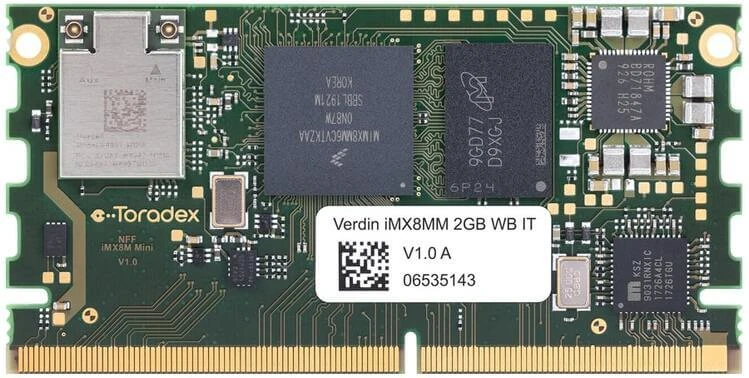

<!-- Copyright 2015-2026 Zephyr Project members and individual contributors. -->
<!-- SPDX-License-Identifier: Apache-2.0 -->
<!-- 中文翻译；编号、导航与译注为本地新增。 -->

<a id="verdin_imx8mm"></a>

# 第20章\_Verdin iMX8M Mini

原文：[官方页面](https://docs.zephyrproject.org/latest/boards/toradex/verdin_imx8mm/doc/index.html)。读取日期：2026-10-16；来源摘要见[来源记录](../SOURCES.md)。

开发板概览（Board Overview）

<a id="id1"></a>

[](images/verdin_imx8mm_m4.webp)

Verdin iMX8M Mini

名称（Name）：

`verdin_imx8mm`

厂商（Vendor）：

[Toradex AG](https://docs.zephyrproject.org/latest/boards/index.html#vendor=toradex)

状态（Status）：

当前未积极维护（Not Actively Maintained）

架构（Architecture）：

[arm](https://docs.zephyrproject.org/latest/boards/index.html#arch=arm)

片上系统（SoC）：

[mimx8mm6](https://docs.zephyrproject.org/latest/boards/index.html#soc=mimx8mm6)

<a id="board-github-link"></a>

[浏览开发板源码（Browse Board Sources）](https://github.com/zephyrproject-rtos/zephyr/blob/main//boards/toradex/verdin_imx8mm/doc/index.rst/../..)<a id="overview"></a>

## 概述（Overview）

Verdin iMX8M Mini是基于NXP i.MX 8M Mini系列的系统模块（SoM）。该系列包括Quad、QuadLite、Dual、DualLite、Solo及SoloLite。最高配置Quad的主处理器集群具有四个Cortex-A53核，完整支持64位Armv8-A并兼容32位Armv7-A软件；商业级最高1.8 GHz，工业温度级最高1.6 GHz。

除主CPU集群外，i.MX 8M Mini还有最高400 MHz的Cortex-M4F。它独立于主集群，具有专用接口，也能访问一般接口。这种异构多核系统允许在M4上运行额外实时操作系统，处理时间及安全关键任务。


- 开发板特性（Board Features）：


  - RAM：1—2 GB LPDDR4
  - 存储（Storage）：


    - 4—17 GB eMMC；容量上限17 GB按原文保留
    - 2 KB I2C EEPROM
  - 无线（Wireless）：


    - 双频Wi-Fi，802.11 ac/a/b/g/n，2.4／5 GHz
    - Bluetooth 5／BLE
  - 通用串行总线（USB）：


    - 一路USB 2.0主机接口
    - 一路USB 2.0 OTG
  - 千兆以太网
  - 接口（Interfaces）：


    - MIPI DSI，一组四条数据通道
    - PCIe Gen 2
    - MIPI摄像头串行接口（CSI-2）
    - 串行外设接口（SPI）
    - 四线串行外设接口（QSPI）
    - 通用异步收发器（UART）
    - 集成电路间总线（I2C）
    - 集成电路间音频（I2S）
    - SD/SDIO/MMC
    - 通用输入输出（GPIOs）
    - 控制器局域网（CAN）
    - 模数转换器（ADC）
    - S/PDIF
  - 调试（Debug）


    - 10引脚JTAG连接器

更多板卡信息见[Toradex网站](https://developer.toradex.com/hardware/verdin-som-family/modules/verdin-imx8m-mini/)。

<a id="supported-features"></a>

### 支持的功能（Supported Features）

`verdin_imx8mm`开发板支持下表所列的硬件功能。

片上／板载（On-Chip / On-Board）

功能集成在片上系统（SoC）内／位于开发板上。

2 / 2

分别表示已启用／已禁用的实例数。点击数量标签，可查看开发板或SoC设备树源码（DTS）中该功能的第一个实例。

`vnd,foo`

与此功能匹配的设备树绑定兼容字符串（Compatible String）；点击链接可查看绑定文档。

<a id="verdin_imx8mm-hw-features"></a>

<a id="verdin_imx8mm-verdin_imx8mm/mimx8mm6/m4-hw-features-section"></a>

#### `verdin_imx8mm/mimx8mm6/m4`目标（Target）

<a id="verdin_imx8mm-verdin_imx8mm/mimx8mm6/m4-hw-features-panel"></a>

<a id="verdin_imx8mm-verdin_imx8mm/mimx8mm6/m4-hw-features-memory"></a>

该开发板目标的片上存储容量：128 KiB RAM、128 KiB Flash。

<a id="verdin_imx8mm-verdin_imx8mm/mimx8mm6/m4-hw-features-table"></a>

<table>
<tr>
<th>类型（Type）</th>
<th>位置（Location）</th>
<th>说明（Description）</th>
<th>兼容字符串（Compatible）</th>
</tr>
<tr>
<td rowspan="1">中央处理器（CPU）</td>
<td>片上（On-Chip）</td>
<td>ARM Cortex-M4 处理器（CPU）（<a href="https://github.com/zephyrproject-rtos/zephyr/blob/main/dts/arm/nxp/imx/nxp_imx8m_m4.dtsi?plain=1#L19">已启用：1</a>）</td>
<td><a href="../cpu_arm_riscv_binding_reference/P024_arm_cortex-m4.md#std-dtcompatible-arm-cortex-m4"><code>arm,cortex-m4</code></a></td>
</tr>
<tr>
<td rowspan="2">ARM 架构（ARM Architecture）</td>
<td>片上（On-Chip）</td>
<td>i.MX指令紧耦合存储器（ITCM / Instruction Tightly Coupled Memory）（<a href="https://github.com/zephyrproject-rtos/zephyr/blob/main/dts/arm/nxp/imx/nxp_imx8m_m4.dtsi?plain=1#L27">已启用：1</a>）</td>
<td><a href="../arm_nordic_nxp_control_binding_reference/P014_nxp_imx-itcm.md#std-dtcompatible-nxp-imx-itcm"><code>nxp,imx-itcm</code></a></td>
</tr>
<tr>
<td>片上（On-Chip）</td>
<td>i.MX数据紧耦合存储器（DTCM / Data Tightly Coupled Memory）（<a href="https://github.com/zephyrproject-rtos/zephyr/blob/main/dts/arm/nxp/imx/nxp_imx8m_m4.dtsi?plain=1#L32">已启用：1</a>）</td>
<td><a href="../arm_nordic_nxp_control_binding_reference/P012_nxp_imx-dtcm.md#std-dtcompatible-nxp-imx-dtcm"><code>nxp,imx-dtcm</code></a></td>
</tr>
<tr>
<td rowspan="1">时钟控制（Clock Control）</td>
<td>片上（On-Chip）</td>
<td>i.MX时钟控制模块（CCM / Clock Controller Module）IP节点（<a href="https://github.com/zephyrproject-rtos/zephyr/blob/main/dts/arm/nxp/imx/nxp_imx8m_m4.dtsi?plain=1#L133">已启用：1</a>）</td>
<td><a href="../clock_nordic_nuvoton_nxp_binding_reference/P021_nxp_imx-ccm.md#std-dtcompatible-nxp-imx-ccm"><code>nxp,imx-ccm</code></a></td>
</tr>
<tr>
<td rowspan="1">通用输入输出与接插件（GPIO &amp; Headers）</td>
<td>片上（On-Chip）</td>
<td>i.MX通用输入输出（GPIO）（<a href="https://github.com/zephyrproject-rtos/zephyr/blob/main/dts/arm/nxp/imx/nxp_imx8m_m4.dtsi?plain=1#L83">已启用：1</a>；<a href="https://github.com/zephyrproject-rtos/zephyr/blob/main/dts/arm/nxp/imx/nxp_imx8m_m4.dtsi?plain=1#L59">已禁用：4</a>）</td>
<td><a href="../gpio_microchip_nordic_nuvoton_binding_reference/P030_nxp_imx-gpio.md#std-dtcompatible-nxp-imx-gpio"><code>nxp,imx-gpio</code></a></td>
</tr>
<tr>
<td rowspan="1">中断控制器（Interrupt Controller）</td>
<td>片上（On-Chip）</td>
<td>ARMv7-M 嵌套向量中断控制器（Nested Vectored Interrupt Controller，NVIC）（<a href="https://github.com/zephyrproject-rtos/zephyr/blob/main/dts/arm/armv7-m.dtsi?plain=1#L13">已启用：1</a>）</td>
<td><a href="../arm_interrupt_timer_binding_reference/P002_ARMv7_M_NVIC.md#std-dtcompatible-arm-v7m-nvic"><code>arm,v7m-nvic</code></a></td>
</tr>
<tr>
<td rowspan="1">处理器间消息（IPM）</td>
<td>片上（On-Chip）</td>
<td>i.MX消息单元（Messaging Unit）（<a href="https://github.com/zephyrproject-rtos/zephyr/blob/main/dts/arm/nxp/imx/nxp_imx8m_m4.dtsi?plain=1#L201">已启用：1</a>）</td>
<td><a href="../intercore_reference/P072_NXPiMX消息单元绑定.md#dtbinding-nxp-imx-mu"><code>nxp,imx-mu</code></a></td>
</tr>
<tr>
<td rowspan="1">发光二极管（LED）</td>
<td>板载（On-Board）</td>
<td>一组由 GPIO 控制的 LED（GPIO-Controlled LEDs）（<a href="https://github.com/zephyrproject-rtos/zephyr/blob/main/boards/toradex/verdin_imx8mm/verdin_imx8mm_mimx8mm6_m4.dts?plain=1#L31">已启用：1</a>）</td>
<td><a href="../hardware/P564_GPIO指示灯绑定.md#dtbinding-gpio-leds"><code>gpio-leds</code></a></td>
</tr>
<tr>
<td rowspan="2">引脚控制（Pin Control）</td>
<td>片上（On-Chip）</td>
<td>这个兼容性绑定（Compatible Binding）应应用于设备的<code>iomuxc</code>设备树源文件（DTS）节点。（<a href="https://github.com/zephyrproject-rtos/zephyr/blob/main/dts/arm/nxp/imx/nxp_imx8m_m4.dtsi?plain=1#L122">已启用：1</a>）</td>
<td><a href="../pinctrl_infineon_nordic_nxp_binding_reference/P023_nxp_imx-iomuxc.md#std-dtcompatible-nxp-imx-iomuxc"><code>nxp,imx-iomuxc</code></a></td>
</tr>
<tr>
<td>片上（On-Chip）</td>
<td>MCUX片上系统（SoC）的设备树（Devicetree）为该节点设置了<code>pinctrl</code>节点标签。（<a href="https://github.com/zephyrproject-rtos/zephyr/blob/main/dts/arm/nxp/imx/nxp_imx8m_m4.dtsi?plain=1#L127">已启用：1</a>）</td>
<td><a href="../pinctrl_nxp_pico_binding_reference/P002_nxp_imx8mp-pinctrl.md#std-dtcompatible-nxp-imx8mp-pinctrl"><code>nxp,imx8mp-pinctrl</code></a></td>
</tr>
<tr>
<td rowspan="1">串行控制器（Serial Controller）</td>
<td>片上（On-Chip）</td>
<td>此绑定（Binding）提供NXP i.MX IUART的基本描述（<a href="https://github.com/zephyrproject-rtos/zephyr/blob/main/dts/arm/nxp/imx/nxp_imx8m_m4.dtsi?plain=1#L193">已启用：1</a>；<a href="https://github.com/zephyrproject-rtos/zephyr/blob/main/dts/arm/nxp/imx/nxp_imx8m_m4.dtsi?plain=1#L169">已禁用：3</a>）</td>
<td><a href="../uart_microchip_nordic_nxp_binding_reference/P010_nxp_imx-iuart.md#std-dtcompatible-nxp-imx-iuart"><code>nxp,imx-iuart</code></a></td>
</tr>
<tr>
<td rowspan="1">串行外设接口（SPI）</td>
<td>片上（On-Chip）</td>
<td>NXP i.MX增强型可配置串行外设接口（ECSPI）控制器（<a href="https://github.com/zephyrproject-rtos/zephyr/blob/main/dts/arm/nxp/imx/nxp_imx8m_m4.dtsi?plain=1#L139">已禁用：3</a>）</td>
<td><a href="../spi_microchip_nordic_nxp_binding_reference/P020_nxp_imx-ecspi.md#std-dtcompatible-nxp-imx-ecspi"><code>nxp,imx-ecspi</code></a></td>
</tr>
<tr>
<td rowspan="1">定时器（Timer）</td>
<td>片上（On-Chip）</td>
<td>ARMv7-M 系统节拍（System Tick）（<a href="https://github.com/zephyrproject-rtos/zephyr/blob/main/dts/arm/armv7-m.dtsi?plain=1#L21">已启用：1</a>）</td>
<td><a href="../arm_interrupt_timer_binding_reference/P006_ARMv7_M_SysTick.md#std-dtcompatible-arm-armv7m-systick"><code>arm,armv7m-systick</code></a></td>
</tr>
</table>

建议在Linux主机端停用M4核正在使用的外设。

<a id="connections-and-ios"></a>

### 连接与输入输出（Connections and IOs）

通用异步收发器（UART）：

Zephyr默认使用UART4，在多数Toradex载板上连接FTDI USB转换器。

带Wi-Fi／Bluetooth芯片的模块也将UART4连接到无线芯片，因此Zephyr占用UART4时无线功能将不能正常工作。

如需Wi-Fi／Bluetooth，应为Zephyr改用其他UART，例如UART2。可修改[boards/toradex/verdin_imx8mm/verdin_imx8mm_mimx8mm6_m4.dts](https://github.com/zephyrproject-rtos/zephyr/blob/main/boards/toradex/verdin_imx8mm/verdin_imx8mm_mimx8mm6_m4.dts)中的zephyr,console及zephyr,shell-uart。

<table>
<tr>
<th>开发板名称（Board Name）</th>
<th>SoC名称（SoC Name）</th>
<th>用途（Usage）</th>
</tr>
<tr>
<td>UART_1</td>
<td>UART2</td>
<td>通用UART</td>
</tr>
<tr>
<td>UART_2</td>
<td>UART3</td>
<td>通用UART</td>
</tr>
<tr>
<td>UART_3</td>
<td>UART1</td>
<td>Cortex-A53调试UART</td>
</tr>
<tr>
<td>UART_4</td>
<td>UART4</td>
<td>Cortex-M4调试UART</td>
</tr>
</table>

通用输入输出（GPIO）：

[dts/arm/nxp/imx/nxp_imx8m_m4.dtsi](https://github.com/zephyrproject-rtos/zephyr/blob/main/dts/arm/nxp/imx/nxp_imx8m_m4.dtsi)启用全部GPIO组（Bank）。

发光二极管（LED）：

模块本身没有LED，具体取决于载板。设备树默认使用GPIO3_IO1，可连接Verdin Development Board上的LED，也可按需修改[boards/toradex/verdin_imx8mm/verdin_imx8mm_mimx8mm6_m4.dts](https://github.com/zephyrproject-rtos/zephyr/blob/main/boards/toradex/verdin_imx8mm/verdin_imx8mm_mimx8mm6_m4.dts)。

<a id="system-clock"></a>

### 系统时钟（System Clock）

M4核配置为以400 MHz运行。

<a id="programming-and-debugging"></a>

## 烧录与调试（Programming and Debugging）

`verdin_imx8mm`开发板支持下表所列的运行工具（Runners）及相关west命令。

<table>
<tr>
<th></th>
<th>烧录（flash）</th>
<th>调试（debug）</th>
<th>连接调试会话（attach）</th>
<th>实时传输（rtt）</th>
<th>复位（reset）</th>
<th>调试服务器（debugserver）</th>
</tr>
<tr>
<td><a href="https://docs.zephyrproject.org/latest/develop/flash_debug/host-tools.html#runner-jlink">jlink</a></td>
<td>✅（默认 / default）</td>
<td>✅（默认 / default）</td>
<td>✅</td>
<td>✅</td>
<td>✅</td>
<td>✅</td>
</tr>
</table>

i.MX8MM没有供M4使用的QSPI闪存，M4需由A53启动。A53负责将应用加载到RAM、复位M4、设置程序计数器及栈指针，再解除复位；可在引导加载器阶段执行，也可在Linux启动后通过remoteproc完成。

M4最多可使用3种RAM，A53与M4的内存映射如下：

<table>
<tr>
<th>区域（Region）</th>
<th>Cortex-A53</th>
<th>Cortex-M4（系统总线 / System Bus）</th>
<th>Cortex-M4（代码总线 / Code Bus）</th>
<th>大小（Size）</th>
</tr>
<tr>
<td>片上RAM（OCRAM）</td>
<td>0x00900000-0x0093FFFF</td>
<td>0x20200000-0x2023FFFF</td>
<td>0x00900000-0x0093FFFF</td>
<td>256KB</td>
</tr>
<tr>
<td>高地址紧耦合存储器（TCMU）</td>
<td>0x00800000-0x0081FFFF</td>
<td>0x20000000-0x2001FFFF</td>
<td></td>
<td>128KB</td>
</tr>
<tr>
<td>低地址紧耦合存储器（TCML）</td>
<td>0x007E0000-0x007FFFFF</td>
<td></td>
<td>0x1FFE0000-0x1FFFFFFF</td>
<td>128KB</td>
</tr>
<tr>
<td>OCRAM_S</td>
<td>0x00180000-0x00187FFF</td>
<td>0x20180000-0x20187FFF</td>
<td>0x00180000-0x00187FFF</td>
<td>32KB</td>
</tr>
</table>

内存映射的更多信息见《[i.MX 8M应用处理器参考手册](https://www.nxp.com/webapp/Download?colCode=IMX8MMRM)》（Applications Processor Reference Manual）第2.1.2及2.1.3节。

编译时需选择RAM。在[boards/toradex/verdin_imx8mm/verdin_imx8mm_mimx8mm6_m4.dts](https://github.com/zephyrproject-rtos/zephyr/blob/main/boards/toradex/verdin_imx8mm/verdin_imx8mm_mimx8mm6_m4.dts)中，通过CONFIG_XIP=y时使用的zephyr,flash及zephyr,sram属性配置，可选方案如下：

```text
"zephyr,flash"
- &tcml_code
- &ocram_code
- &ocram_s_code

"zephyr,sram"
- &tcmu_sys
- &ocram_sys
- &ocram_s_sys
```

<a id="starting-the-cortex-m4-via-u-boot"></a>

### 通过U-Boot启动Cortex-M4

先将zephyr.bin复制到eMMC的FAT或EXT4分区，例如通过U盘或以太网scp传送。上电后停在U-Boot提示符，由A53加载并运行M4上的Zephyr。

使用以下命令将M4二进制加载到所需存储器并启动：

```text
fatload mmc 0:1 ${loadaddr} zephyr.bin
cp.b ${loadaddr} 0x7e0000 <size_of_binary_in_bytes>
bootaux 0x7e0000
```

若二进制位于EXT4分区：

```text
ext4load mmc 0:2 ${loadaddr} /path/to/zephyr.bin
cp.b ${loadaddr} 0x7e0000 <size_of_binary_in_bytes>
bootaux 0x7e0000
```

使用[TorizonCore](https://developer.toradex.com/torizon/)时，应使用分区1：

```text
ext4load mmc 0:1 ${loadaddr} /path/to/zephyr.bin
cp.b ${loadaddr} 0x7e0000 <size_of_binary_in_bytes>
bootaux 0x7e0000
```

<a id="starting-the-cortex-m4-via-remoteproc"></a>

### 通过remoteproc启动Cortex-M4

将ELF复制到目标系统/lib/firmware。原文文件名拼作zepyhr.elf，实际构建输出名为zephyr.elf。

注意（Note）

使用remoteproc时，在/boot/overlays.txt该行末尾加入imx8mm-verdin_hmp_overlay.dtbo并重启目标。[TorizonCore](https://developer.toradex.com/torizon/)中的文件位置为/boot/ostree/torizon-<hash>/dtb/overlays.txt；这些均为目标系统路径。

使用以下命令加载及启动固件：

```text
verdin-imx8mm:~# echo zepyhr.elf > /sys/class/remoteproc/remoteproc0/firmware
verdin-imx8mm:~# echo start > /sys/class/remoteproc/remoteproc0/state
[   94.714498] remoteproc remoteproc0: powering up imx-rproc
[   94.720481] remoteproc remoteproc0: Booting fw image zephyr.elf, size 473172
[   94.727713] remoteproc remoteproc0: No resource table in elf
[   94.733615] remoteproc remoteproc0: remote processor imx-rproc is now up
```

M4启动运行后，可在UART4查看Zephyr输出。

<a id="debugging"></a>

### 调试（Debugging）

用外部J-Link JTAG调试器连接MIMX8MM EVK的J902调试连接器与PC，即可按常规方式调试应用。

下面以[Hello World](../getting_started/P005_HelloWorld示例.md#hello_world)应用为例。

```text
# From the root of the zephyr repository
west build -b verdin_imx8mm/mimx8mm6/m4 samples/hello_world
west debug
```

打开串口终端，在调试器中单步运行应用，应能在终端中看到以下消息：

```text
*** Booting Zephyr OS build zephyr-v3.4.0-1251-g43c549305bdb ***
Hello World! verdin_imx8mm_m4
```

## 译注

Verdin iMX8M Mini原文eMMC上限17 GB按原值保留。UART4与Wi-Fi／Bluetooth共用，需要无线功能时按原文改UART2；复用关系不能套用到Plus型号。原文zepyhr.elf拼写错误已注明。

## 原文外链核对

2026-10-16核对并重试以下原文外链时未能确认可访问性，保留原始目标，不将访问失败解释为原文内容有误。

- [](https://developer.toradex.com/hardware/verdin-som-family/modules/verdin-imx8m-mini/)：<urlopen error [SSL: CERTIFICATE_VERIFY_FAILED] certificate verify failed: self-signed certificate in certificate chain (_ssl.c:1010)>。
- [](https://developer.toradex.com/torizon/)：<urlopen error [SSL: CERTIFICATE_VERIFY_FAILED] certificate verify failed: self-signed certificate in certificate chain (_ssl.c:1010)>。
- [Download?colCode=IMX8MMRM](https://www.nxp.com/webapp/Download?colCode=IMX8MMRM)：HTTP Error 404: Not Found。

---

[上一章](P019_Verdin_AM62.md) · [返回大纲](大纲.md) · [全站翻译进度](../PROGRESS.md) · [下一章](P021_Verdin_iMX8M_Plus_SoM.md)
