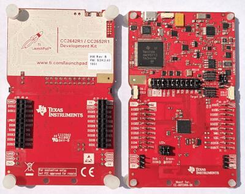

<!-- Copyright 2015-2026 Zephyr Project members and individual contributors. -->
<!-- SPDX-License-Identifier: Apache-2.0 -->
<!-- 中文翻译；编号、导航与译注为本地新增。 -->

<a id="cc26x2r1_launchxl"></a>

# 第8章\_CC26x2R1 LaunchXL

原文：[官方页面](https://docs.zephyrproject.org/latest/boards/ti/cc26x2r1_launchxl/doc/index.html)。读取日期：2026-10-16；来源摘要见[来源记录](../SOURCES.md)。

开发板概览（Board Overview）

<a id="id1"></a>

[](images/cc26x2r1_launchxl.jpg)

CC26x2R1 LaunchXL

名称（Name）：

`cc26x2r1_launchxl`

厂商（Vendor）：

[德州仪器（Texas Instruments）](https://docs.zephyrproject.org/latest/boards/index.html#vendor=ti)

状态（Status）：

维护中（Maintained）

架构（Architecture）：

[arm](https://docs.zephyrproject.org/latest/boards/index.html#arch=arm)

片上系统（SoC）：

[cc2652r](https://docs.zephyrproject.org/latest/boards/index.html#soc=cc2652r)

<a id="board-github-link"></a>

[浏览开发板源码（Browse Board Sources）](https://github.com/zephyrproject-rtos/zephyr/blob/main//boards/ti/cc26x2r1_launchxl/doc/index.rst/../..)<a id="overview"></a>

## 概述（Overview）

TI CC26x2R LaunchPad（LAUNCHXL-CC26X2R1）是用于SimpleLink多标准CC2652R无线微控制器的开发套件。

详情见[TI CC26x2R LaunchPad产品页](http://www.ti.com/tool/launchxl-cc26x2r1)。

<a id="hardware"></a>

## 硬件（Hardware）

CC26x2R LaunchPad开发套件搭载CC2652R无线微控制器，配有两个LED、两个按键及用于扩展的BoosterPack连接器，并集成XDS110调试器。

CC2652无线微控制器具有48 MHz Arm Cortex-M4F SoC及集成的2.4 GHz收发器，支持Bluetooth Low Energy及IEEE 802.15.4等多种协议。

更多信息见[TI CC2652R产品页](http://www.ti.com/product/cc2652r)。

<a id="supported-features"></a>

### 支持的功能（Supported Features）

`cc26x2r1_launchxl`开发板支持下表所列的硬件功能。

片上／板载（On-Chip / On-Board）

功能集成在片上系统（SoC）内／位于开发板上。

2 / 2

分别表示已启用／已禁用的实例数。点击数量标签，可查看开发板或SoC设备树源码（DTS）中该功能的第一个实例。

`vnd,foo`

与此功能匹配的设备树绑定兼容字符串（Compatible String）；点击链接可查看绑定文档。

<a id="cc26x2r1_launchxl-hw-features"></a>

<a id="cc26x2r1_launchxl-cc26x2r1_launchxl/cc2652r-hw-features-section"></a>

#### `cc26x2r1_launchxl/cc2652r`目标（Target）

<a id="cc26x2r1_launchxl-cc26x2r1_launchxl/cc2652r-hw-features-panel"></a>

<a id="cc26x2r1_launchxl-cc26x2r1_launchxl/cc2652r-hw-features-memory"></a>

该开发板目标的片上存储容量：80 KiB RAM、352 KiB Flash。

<a id="cc26x2r1_launchxl-cc26x2r1_launchxl/cc2652r-hw-features-table"></a>

<table>
<tr>
<th>类型（Type）</th>
<th>位置（Location）</th>
<th>说明（Description）</th>
<th>兼容字符串（Compatible）</th>
</tr>
<tr>
<td rowspan="1">中央处理器（CPU）</td>
<td>片上（On-Chip）</td>
<td>ARM Cortex-M4 处理器（CPU）（<a href="https://github.com/zephyrproject-rtos/zephyr/blob/main/dts/arm/ti/cc13xx_cc26xx.dtsi?plain=1#L24">已启用：1</a>）</td>
<td><a href="../cpu_arm_riscv_binding_reference/P024_arm_cortex-m4.md#std-dtcompatible-arm-cortex-m4"><code>arm,cortex-m4</code></a></td>
</tr>
<tr>
<td rowspan="1">模数转换器（ADC）</td>
<td>片上（On-Chip）</td>
<td>TI CC13xx／CC26xx系列模数转换器（ADC）（<a href="https://github.com/zephyrproject-rtos/zephyr/blob/main/dts/arm/ti/cc13xx_cc26xx.dtsi?plain=1#L236">已启用：1</a>）</td>
<td><a href="../hardware/P905_TICC13xxCC26xx模数转换器绑定.md#dtbinding-ti-cc13xx-cc26xx-adc"><code>ti,cc13xx-cc26xx-adc</code></a></td>
</tr>
<tr>
<td rowspan="1">时钟控制（Clock Control）</td>
<td>片上（On-Chip）</td>
<td>通用固定频率时钟提供者（Fixed-Rate Clock Provider）（<a href="https://github.com/zephyrproject-rtos/zephyr/blob/main/dts/arm/ti/cc13xx_cc26xx.dtsi?plain=1#L58">已启用：1</a>）</td>
<td><a href="../hardware/P566_固定时钟绑定.md#dtbinding-fixed-clock"><code>fixed-clock</code></a></td>
</tr>
<tr>
<td rowspan="1">闪存控制器（Flash Controller）</td>
<td>片上（On-Chip）</td>
<td>Texas Instruments CC13xx／CC26xx闪存控制器（<a href="https://github.com/zephyrproject-rtos/zephyr/blob/main/dts/arm/ti/cc13xx_cc26xx.dtsi?plain=1#L86">已启用：1</a>）</td>
<td><a href="../flash_renesas_st_ti_binding_reference/P030_ti_cc13xx-cc26xx-flash-controller.md#std-dtcompatible-ti-cc13xx-cc26xx-flash-controller"><code>ti,cc13xx-cc26xx-flash-controller</code></a></td>
</tr>
<tr>
<td rowspan="2">通用输入输出与接插件（GPIO &amp; Headers）</td>
<td>片上（On-Chip）</td>
<td>TI SimpleLink CC13xx／CC26xx GPIO（<a href="https://github.com/zephyrproject-rtos/zephyr/blob/main/dts/arm/ti/cc13xx_cc26xx.dtsi?plain=1#L70">已启用：1</a>）</td>
<td><a href="../gpio_ti_xilinx_sdl_binding_reference/P010_ti_cc13xx-cc26xx-gpio.md#std-dtcompatible-ti-cc13xx-cc26xx-gpio"><code>ti,cc13xx-cc26xx-gpio</code></a></td>
</tr>
<tr>
<td>板载（On-Board）</td>
<td>TI BoosterPack GPIO排针（<a href="https://github.com/zephyrproject-rtos/zephyr/blob/main/boards/ti/cc26x2r1_launchxl/../common/boosterpack_connector.dtsi?plain=1#L8">已启用：1</a>）</td>
<td><a href="../gpio_ti_xilinx_sdl_binding_reference/P009_ti_boosterpack-header.md#std-dtcompatible-ti-boosterpack-header"><code>ti,boosterpack-header</code></a></td>
</tr>
<tr>
<td rowspan="1">集成电路间总线（I2C）</td>
<td>片上（On-Chip）</td>
<td>TI CC13xx／CC26xx I2C（<a href="https://github.com/zephyrproject-rtos/zephyr/blob/main/dts/arm/ti/cc13xx_cc26xx.dtsi?plain=1#L172">已启用：1</a>）</td>
<td><a href="../i2c_stm32_ti_mux_binding_reference/P010_ti_cc13xx-cc26xx-i2c.md#std-dtcompatible-ti-cc13xx-cc26xx-i2c"><code>ti,cc13xx-cc26xx-i2c</code></a></td>
</tr>
<tr>
<td rowspan="2">低速率无线个域网（IEEE 802.15.4）</td>
<td>片上（On-Chip）</td>
<td>TI SimpleLink CC13xx／CC26xx IEEE 802.15.4节点（<a href="https://github.com/zephyrproject-rtos/zephyr/blob/main/dts/arm/ti/cc13xx_cc26xx.dtsi?plain=1#L218">已禁用：1</a>）</td>
<td><a href="../lora_ieee802154_binding_reference/P014_ti_cc13xx-cc26xx-ieee802154.md#std-dtcompatible-ti-cc13xx-cc26xx-ieee802154"><code>ti,cc13xx-cc26xx-ieee802154</code></a></td>
</tr>
<tr>
<td>片上（On-Chip）</td>
<td>TI SimpleLink CC13xx／CC26xx Sub-GHz IEEE 802.15.4节点（<a href="https://github.com/zephyrproject-rtos/zephyr/blob/main/dts/arm/ti/cc13xx_cc26xx.dtsi?plain=1#L223">已禁用：1</a>）</td>
<td><a href="../lora_ieee802154_binding_reference/P013_ti_cc13xx-cc26xx-ieee802154-subghz.md#std-dtcompatible-ti-cc13xx-cc26xx-ieee802154-subghz"><code>ti,cc13xx-cc26xx-ieee802154-subghz</code></a></td>
</tr>
<tr>
<td rowspan="1">输入（Input）</td>
<td>板载（On-Board）</td>
<td>一组绑定到 GPIO 的输入按键（GPIO-Bound Input Keys）（<a href="https://github.com/zephyrproject-rtos/zephyr/blob/main/boards/ti/cc26x2r1_launchxl/../common/launchxl.dtsi?plain=1#L47">已启用：1</a>）</td>
<td><a href="../hardware/P563_GPIO按键绑定.md#std-dtcompatible-gpio-keys"><code>gpio-keys</code></a></td>
</tr>
<tr>
<td rowspan="1">中断控制器（Interrupt Controller）</td>
<td>片上（On-Chip）</td>
<td>ARMv7-M 嵌套向量中断控制器（Nested Vectored Interrupt Controller，NVIC）（<a href="https://github.com/zephyrproject-rtos/zephyr/blob/main/dts/arm/armv7-m.dtsi?plain=1#L13">已启用：1</a>）</td>
<td><a href="../arm_interrupt_timer_binding_reference/P002_ARMv7_M_NVIC.md#std-dtcompatible-arm-v7m-nvic"><code>arm,v7m-nvic</code></a></td>
</tr>
<tr>
<td rowspan="1">发光二极管（LED）</td>
<td>板载（On-Board）</td>
<td>一组由 GPIO 控制的 LED（GPIO-Controlled LEDs）（<a href="https://github.com/zephyrproject-rtos/zephyr/blob/main/boards/ti/cc26x2r1_launchxl/../common/launchxl.dtsi?plain=1#L33">已启用：1</a>）</td>
<td><a href="../hardware/P564_GPIO指示灯绑定.md#dtbinding-gpio-leds"><code>gpio-leds</code></a></td>
</tr>
<tr>
<td rowspan="2">存储技术设备（MTD）</td>
<td>片上（On-Chip）</td>
<td>闪存（Flash）节点（<a href="https://github.com/zephyrproject-rtos/zephyr/blob/main/dts/arm/ti/cc13xx_cc26xx.dtsi?plain=1#L93">已启用：1</a>）</td>
<td><a href="../mtd_nxp_st_ti_partition_binding_reference/P013_soc-nv-flash.md#std-dtcompatible-soc-nv-flash"><code>soc-nv-flash</code></a></td>
</tr>
<tr>
<td>片上（On-Chip）</td>
<td>闪存或其他非易失性存储器的固定分区（Fixed Partitions）（<a href="https://github.com/zephyrproject-rtos/zephyr/blob/main/dts/arm/ti/cc1352r.dtsi?plain=1#L19">已启用：1</a>）</td>
<td><a href="../hardware/P568_固定分区绑定.md#dtbinding-fixed-partitions"><code>fixed-partitions</code></a></td>
</tr>
<tr>
<td rowspan="1">网络（Networking）</td>
<td>片上（On-Chip）</td>
<td>TI SimpleLink CC13xx／CC26xx无线电（Radio）（<a href="https://github.com/zephyrproject-rtos/zephyr/blob/main/dts/arm/ti/cc13xx_cc26xx.dtsi?plain=1#L208">已禁用：1</a>）</td>
<td><a href="../network_radio_frontend_binding_reference/P017_ti_cc13xx-cc26xx-radio.md#std-dtcompatible-ti-cc13xx-cc26xx-radio"><code>ti,cc13xx-cc26xx-radio</code></a></td>
</tr>
<tr>
<td rowspan="1">引脚控制（Pin Control）</td>
<td>片上（On-Chip）</td>
<td>TI SimpleLink CC13xx／CC26xx引脚控制器（<a href="https://github.com/zephyrproject-rtos/zephyr/blob/main/dts/arm/ti/cc13xx_cc26xx.dtsi?plain=1#L65">已启用：1</a>）</td>
<td><a href="../pinctrl_stm32_ti_xilinx_binding_reference/P010_ti_cc13xx-cc26xx-pinctrl.md#std-dtcompatible-ti-cc13xx-cc26xx-pinctrl"><code>ti,cc13xx-cc26xx-pinctrl</code></a></td>
</tr>
<tr>
<td rowspan="1">脉宽调制（PWM）</td>
<td>片上（On-Chip）</td>
<td>TI SimpleLink CC13xx／CC26xx通用定时器PWM控制器节点（GPT）（<a href="https://github.com/zephyrproject-rtos/zephyr/blob/main/dts/arm/ti/cc13xx_cc26xx.dtsi?plain=1#L107">已禁用：4</a>）</td>
<td><a href="../pwm_stm32_ti_generic_binding_reference/P015_ti_cc13xx-cc26xx-timer-pwm.md#std-dtcompatible-ti-cc13xx-cc26xx-timer-pwm"><code>ti,cc13xx-cc26xx-timer-pwm</code></a></td>
</tr>
<tr>
<td rowspan="1">随机数生成器（RNG）</td>
<td>片上（On-Chip）</td>
<td>TI SimpleLink CC13xx／CC26xx真随机数发生器（TRNG）（<a href="https://github.com/zephyrproject-rtos/zephyr/blob/main/dts/arm/ti/cc13xx_cc26xx.dtsi?plain=1#L79">已启用：1</a>）</td>
<td><a href="../soc_rng_binding_reference/P018_ti_cc13xx-cc26xx-trng.md#std-dtcompatible-ti-cc13xx-cc26xx-trng"><code>ti,cc13xx-cc26xx-trng</code></a></td>
</tr>
<tr>
<td rowspan="1">实时时钟（RTC）</td>
<td>片上（On-Chip）</td>
<td>TI SimpleLink CC13xx／CC26xx实时时钟（RTC）（<a href="https://github.com/zephyrproject-rtos/zephyr/blob/main/dts/arm/ti/cc13xx_cc26xx.dtsi?plain=1#L201">已启用：1</a>）</td>
<td><a href="../soc_rtc_binding_reference/P016_ti_cc13xx-cc26xx-rtc-timer.md#std-dtcompatible-ti-cc13xx-cc26xx-rtc-timer"><code>ti,cc13xx-cc26xx-rtc-timer</code></a></td>
</tr>
<tr>
<td rowspan="1">串行控制器（Serial Controller）</td>
<td>片上（On-Chip）</td>
<td>TI SimpleLink CC13xx／CC26xx UART节点（<a href="https://github.com/zephyrproject-rtos/zephyr/blob/main/dts/arm/ti/cc13xx_cc26xx.dtsi?plain=1#L156">已启用：1</a>；<a href="https://github.com/zephyrproject-rtos/zephyr/blob/main/dts/arm/ti/cc13xx_cc26xx.dtsi?plain=1#L164">已禁用：1</a>）</td>
<td><a href="../uart_silabs_stm32_ti_binding_reference/P018_ti_cc13xx-cc26xx-uart.md#std-dtcompatible-ti-cc13xx-cc26xx-uart"><code>ti,cc13xx-cc26xx-uart</code></a></td>
</tr>
<tr>
<td rowspan="1">串行外设接口（SPI）</td>
<td>片上（On-Chip）</td>
<td>TI SimpleLink CC13xx／CC26xx SPI控制器（<a href="https://github.com/zephyrproject-rtos/zephyr/blob/main/dts/arm/ti/cc13xx_cc26xx.dtsi?plain=1#L182">已启用：1</a>；<a href="https://github.com/zephyrproject-rtos/zephyr/blob/main/dts/arm/ti/cc13xx_cc26xx.dtsi?plain=1#L191">已禁用：1</a>）</td>
<td><a href="../spi_stm32_ti_xilinx_binding_reference/P015_ti_cc13xx-cc26xx-spi.md#std-dtcompatible-ti-cc13xx-cc26xx-spi"><code>ti,cc13xx-cc26xx-spi</code></a></td>
</tr>
<tr>
<td rowspan="1">静态随机存储器（SRAM）</td>
<td>片上（On-Chip）</td>
<td>通用片上静态随机存储器（SRAM）（<a href="https://github.com/zephyrproject-rtos/zephyr/blob/main/dts/arm/ti/cc13xx_cc26xx.dtsi?plain=1#L47">已启用：1</a>）</td>
<td><a href="../hardware/P567_内存映射SRAM绑定.md#dtbinding-mmio-sram"><code>mmio-sram</code></a></td>
</tr>
<tr>
<td rowspan="2">定时器（Timer）</td>
<td>片上（On-Chip）</td>
<td>ARMv7-M 系统节拍（System Tick）（<a href="https://github.com/zephyrproject-rtos/zephyr/blob/main/dts/arm/armv7-m.dtsi?plain=1#L21">已禁用：1</a>）</td>
<td><a href="../arm_interrupt_timer_binding_reference/P006_ARMv7_M_SysTick.md#std-dtcompatible-arm-armv7m-systick"><code>arm,armv7m-systick</code></a></td>
</tr>
<tr>
<td>片上（On-Chip）</td>
<td>TI SimpleLink CC13xx／CC26xx定时器（<a href="https://github.com/zephyrproject-rtos/zephyr/blob/main/dts/arm/ti/cc13xx_cc26xx.dtsi?plain=1#L100">已禁用：4</a>）</td>
<td><a href="../stm32_ti_silabs_timer_binding_reference/P013_ti_cc13xx-cc26xx-timer.md#std-dtcompatible-ti-cc13xx-cc26xx-timer"><code>ti,cc13xx-cc26xx-timer</code></a></td>
</tr>
<tr>
<td rowspan="1">看门狗（Watchdog）</td>
<td>片上（On-Chip）</td>
<td>TI CC13xx／CC26xx看门狗（Watchdog）（<a href="https://github.com/zephyrproject-rtos/zephyr/blob/main/dts/arm/ti/cc13xx_cc26xx.dtsi?plain=1#L229">已启用：1</a>）</td>
<td><a href="../stm32_ti_xilinx_watchdog_binding_reference/P003_ti_cc13xx-cc26xx-watchdog.md#std-dtcompatible-ti-cc13xx-cc26xx-watchdog"><code>ti,cc13xx-cc26xx-watchdog</code></a></td>
</tr>
</table>

<a id="connections-and-ios"></a>

### 连接与输入输出（Connections and IOs）

所有I/O信号均可通过BoosterPack连接器访问，引脚功能遵循LaunchPad标准。

<table>
<tr>
<th>引脚（Pin）</th>
<th>功能（Function）</th>
<th>用途（Usage）</th>
</tr>
<tr>
<td>DIO0</td>
<td>通用输入输出（GPIO）</td>
<td></td>
</tr>
<tr>
<td>DIO1</td>
<td>通用输入输出（GPIO）</td>
<td></td>
</tr>
<tr>
<td>DIO2</td>
<td>UART0_RX</td>
<td>UART接收数据（RXD）</td>
</tr>
<tr>
<td>DIO3</td>
<td>UART0_TX</td>
<td>UART发送数据（TXD）</td>
</tr>
<tr>
<td>DIO4</td>
<td>I2C_MSSCL</td>
<td>I2C串行时钟（SCL）</td>
</tr>
<tr>
<td>DIO5</td>
<td>I2C_MSSDA</td>
<td>I2C串行数据（SDA）</td>
</tr>
<tr>
<td>DIO6</td>
<td>通用输入输出（GPIO）</td>
<td>红色LED（Red LED）</td>
</tr>
<tr>
<td>DIO7</td>
<td>通用输入输出（GPIO）</td>
<td>绿色LED（Green LED）</td>
</tr>
<tr>
<td>DIO8</td>
<td>SSI0_RX</td>
<td>SPI主机输入从机输出（MISO）</td>
</tr>
<tr>
<td>DIO9</td>
<td>SSI0_TX</td>
<td>SPI主机输出从机输入（MOSI）</td>
</tr>
<tr>
<td>DIO10</td>
<td>SSI0_CLK</td>
<td>SPI时钟（CLK）</td>
</tr>
<tr>
<td>DIO11</td>
<td>SSIO_CS</td>
<td>SPI片选（CS）</td>
</tr>
<tr>
<td>DIO12</td>
<td>通用输入输出（GPIO）</td>
<td></td>
</tr>
<tr>
<td>DIO13</td>
<td>通用输入输出（GPIO）</td>
<td>按键1（Button 1）</td>
</tr>
<tr>
<td>DIO14</td>
<td>通用输入输出（GPIO）</td>
<td>按键2（Button 2）</td>
</tr>
<tr>
<td>DIO15</td>
<td>通用输入输出（GPIO）</td>
<td></td>
</tr>
<tr>
<td>DIO16</td>
<td></td>
<td>JTAG测试数据输出（TDO）</td>
</tr>
<tr>
<td>DIO17</td>
<td></td>
<td>JTAG测试数据输入（TDI）</td>
</tr>
<tr>
<td>DIO18</td>
<td>UART0_RTS</td>
<td>UART请求发送（RTS）／JTAG串行线输出（SWO）</td>
</tr>
<tr>
<td>DIO19</td>
<td>UART0_CTS</td>
<td>UART清除发送（CTS）</td>
</tr>
<tr>
<td>DIO20</td>
<td>通用输入输出（GPIO）</td>
<td>闪存片选（Flash CS）</td>
</tr>
<tr>
<td>DIO21</td>
<td>通用输入输出（GPIO）</td>
<td></td>
</tr>
<tr>
<td>DIO22</td>
<td>通用输入输出（GPIO）</td>
<td></td>
</tr>
<tr>
<td>DIO23</td>
<td>辅助输入输出（AUX_IO）</td>
<td>A0</td>
</tr>
<tr>
<td>DIO24</td>
<td>辅助输入输出（AUX_IO）</td>
<td>A1</td>
</tr>
<tr>
<td>DIO25</td>
<td>辅助输入输出（AUX_IO）</td>
<td>A2</td>
</tr>
<tr>
<td>DIO26</td>
<td>辅助输入输出（AUX_IO）</td>
<td>A3</td>
</tr>
<tr>
<td>DIO27</td>
<td>辅助输入输出（AUX_IO）</td>
<td>A4</td>
</tr>
<tr>
<td>DIO28</td>
<td>辅助输入输出（AUX_IO）</td>
<td>A5</td>
</tr>
<tr>
<td>DIO29</td>
<td>辅助输入输出（AUX_IO）</td>
<td>A6</td>
</tr>
<tr>
<td>DIO30</td>
<td>辅助输入输出（AUX_IO）</td>
<td>A7</td>
</tr>
</table>

<a id="programming-and-debugging"></a>

## 烧录与调试（Programming and Debugging）

`cc26x2r1_launchxl`开发板支持下表所列的运行工具（Runners）及相关west命令。

<table>
<tr>
<th></th>
<th>烧录（flash）</th>
<th>调试（debug）</th>
<th>连接调试会话（attach）</th>
<th>实时传输（rtt）</th>
<th>调试服务器（debugserver）</th>
</tr>
<tr>
<td><a href="https://docs.zephyrproject.org/latest/develop/flash_debug/host-tools.html#runner-openocd">openocd</a></td>
<td>✅（默认 / default）</td>
<td>✅（默认 / default）</td>
<td>✅</td>
<td>✅</td>
<td>✅</td>
</tr>
</table>

烧录或调试前，确认RESET、TMS、TCK、TDO及TDI跳线已安装。使用XDS110应用串口作为控制台时，也需安装TXD及RXD跳线。

<a id="prerequisites"></a>

### 前提条件（Prerequisites）：


1. 确认开发板上的XDS110仿真固件（Emulation Firmware）已更新。

  下载并安装最新[XDS110仿真软件包](http://processors.wiki.ti.com/index.php/XDS_Emulation_Software_Package#XDS_Emulation_Software_.28emupack.29_Download)。

  按照[XDS110固件更新说明](http://software-dl.ti.com/ccs/esd/documents/xdsdebugprobes/emu_xds110.html#updating-the-xds110-firmware)操作。

  仿真软件包可能将xdsdfu工具安装到<install_dir>/ccs_base/common/uscif/xds110/。
2. 安装OpenOCD

  可按[安装最新Zephyr SDK的说明](../toolchains/P002_ZephyrSDK.md#toolchain-zephyr-sdk)获取OpenOCD。

  安装后，将OpenOCD可执行文件所在目录加入环境变量PATH。例如，Linux中可使用以下命令：

  ```text
  export PATH=$ZEPHYR_SDK_INSTALL_DIR/sysroots/x86_64-pokysdk-linux/usr/bin/openocd:$PATH
  ```

<a id="flashing"></a>

### 烧录（Flashing）

CC26x2R LaunchPad板级配置的应用可按常规方式构建及烧录，详情见“构建应用”及“运行应用”。（[构建应用（Building an Application）](../application/P001_应用开发.md#build-an-application)；[运行应用（Run an Application）](https://docs.zephyrproject.org/latest/develop/application/index.html#application-run)）

下面以[Hello World](../getting_started/P005_HelloWorld示例.md#hello_world)应用为例。

首先运行常用终端程序查看输出。

```text
$ screen <tty_device> 115200
```

将<tty_device>替换为XDS110应用串口设备对应端口，例如/dev/ttyACM0。

随后按通常方式构建并烧录应用。

```text
# From the root of the zephyr repository
west build -b cc26x2r1_launchxl samples/hello_world
west flash
```

<a id="debugging"></a>

### 调试（Debugging）

可以按常规方式调试应用。下面以[Hello World](../getting_started/P005_HelloWorld示例.md#hello_world)应用为例。

```text
# From the root of the zephyr repository
west build -b cc26x2r1_launchxl samples/hello_world
west debug
```

<a id="bootloader"></a>

### 引导加载程序（Bootloader）

CC13x2及CC26x2器件的ROM引导加载器默认启用。闪存中没有有效应用镜像时，或通过[CONFIG_CC13X2_CC26X2_BOOTLOADER_BACKDOOR_ENABLE](https://docs.zephyrproject.org/latest/kconfig.html#CONFIG_CC13X2_CC26X2_BOOTLOADER_BACKDOOR_ENABLE)启用后门（Backdoor）且复位时按住BTN-1时，引导加载器会启动。更多信息见[TI CC13x2／CC26x2技术参考手册](http://www.ti.com/lit/pdf/swcu185)第10章。

<a id="power-management-and-uart"></a>

### 电源管理及UART（Power Management and UART）

此平台支持系统及设备电源管理，可通过[CONFIG_PM](https://docs.zephyrproject.org/latest/kconfig.html#CONFIG_PM)及[CONFIG_PM_DEVICE](https://docs.zephyrproject.org/latest/kconfig.html#CONFIG_PM_DEVICE)等标准Zephyr Kconfig选项启用。

若启用系统电源管理（CONFIG_PM=y）、允许睡眠状态2，即待机模式（Standby），并通过轮询调用uart_poll_in()读取输入，则系统可能在两次调用间进入待机，造成字符丢失，因为UART在待机时不工作。解决方法是在轮询期间禁止睡眠状态2：

```text
pm_policy_state_lock_get(PM_STATE_STANDBY, PM_ALL_SUBSTATES);
<code that calls uart_poll_in() and expects input at any point in time>
pm_policy_state_lock_put(PM_STATE_STANDBY, PM_ALL_SUBSTATES);
```

<a id="references"></a>

## 参考资料（References）

CC26X2R1 LaunchPad快速入门指南：

[http://www.ti.com/lit/pdf/swru528](http://www.ti.com/lit/pdf/swru528)

## 译注

CC26x2R1采用CC2652R，仅列2.4 GHz无线电；不套用CC1352R的sub-1 GHz功能。

## 原文外链核对

2026-10-16核对并重试以下原文外链时未能确认可访问性，保留原始目标，不将访问失败解释为原文内容有误。

- [XDS_Emulation_Software_Package](http://processors.wiki.ti.com/index.php/XDS_Emulation_Software_Package#XDS_Emulation_Software_.28emupack.29_Download)：HTTP Error 421: Misdirected Request。
- [emu_xds110.html](http://software-dl.ti.com/ccs/esd/documents/xdsdebugprobes/emu_xds110.html#updating-the-xds110-firmware)：页面可访问，但未确认目标片段。

---

[上一章](P007_CC1352R_SensorTag.md) · [返回大纲](大纲.md) · [全站翻译进度](../PROGRESS.md) · [下一章](P009_CC3220SF_LaunchXL.md)
