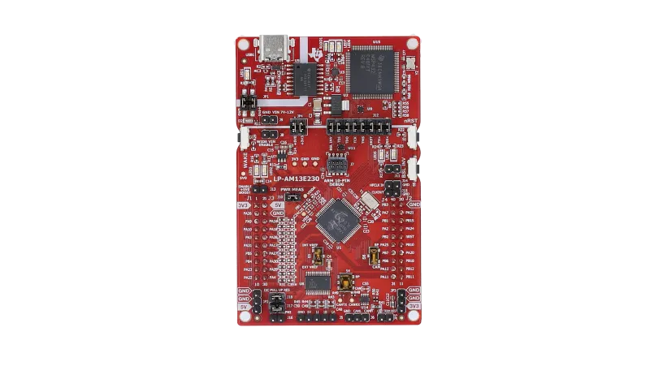

<!-- Copyright 2015-2026 Zephyr Project members and individual contributors. -->
<!-- SPDX-License-Identifier: Apache-2.0 -->
<!-- 中文翻译；编号、导航与译注为本地新增。 -->

<a id="lp_am13e230"></a>

# 第15章\_AM13E230X LaunchPad

原文：[官方页面](https://docs.zephyrproject.org/latest/boards/ti/lp_am13e230/doc/index.html)。读取日期：2026-10-16；来源摘要见[来源记录](../SOURCES.md)。

开发板概览（Board Overview）

<a id="id1"></a>

[](images/lp_am13e230.webp)

AM13E230X LaunchPad

名称（Name）：

`lp_am13e230`

厂商（Vendor）：

[德州仪器（Texas Instruments）](https://docs.zephyrproject.org/latest/boards/index.html#vendor=ti)

状态（Status）：

维护中（Maintained）

架构（Architecture）：

[arm](https://docs.zephyrproject.org/latest/boards/index.html#arch=arm)

片上系统（SoC）：

[am13e23019](https://docs.zephyrproject.org/latest/boards/index.html#soc=am13e23019)

<a id="board-github-link"></a>

[浏览开发板源码（Browse Board Sources）](https://github.com/zephyrproject-rtos/zephyr/blob/main//boards/ti/lp_am13e230/doc/index.rst/../..)<a id="overview"></a>

## 概述（Overview）

AM13E230x LaunchPad是一块基于AM13E230x SoC的开发板。该200 MHz Arm Cortex-M33实时电机控制微控制器具有边缘人工智能（Edge AI）、三角函数运算单元（TMU）及512 KB片上闪存。

详情见[TI AM13E230x产品页](https://www.ti.com/product/AM13E23019)。


<a id="hardware"></a>

## 硬件（Hardware）


- 处理器（Processor）：


  - 200 MHz Arm Cortex-M33
- 存储器（Memory）：


  - 128 KB静态随机存取存储器（SRAM）
  - 512 KB片上闪存
- 调试（Debug）：


  - 基于XDS110的JTAG

详情见[AM13E230x微控制器数据手册](https://www.ti.com/lit/gpn/am13e23019)。


<a id="supported-features"></a>

## 支持的功能（Supported Features）

`lp_am13e230`开发板支持下表所列的硬件功能。

片上／板载（On-Chip / On-Board）

功能集成在片上系统（SoC）内／位于开发板上。

2 / 2

分别表示已启用／已禁用的实例数。点击数量标签，可查看开发板或SoC设备树源码（DTS）中该功能的第一个实例。

`vnd,foo`

与此功能匹配的设备树绑定兼容字符串（Compatible String）；点击链接可查看绑定文档。

<a id="lp_am13e230-hw-features"></a>

<a id="lp_am13e230-lp_am13e230/am13e23019-hw-features-section"></a>

### `lp_am13e230/am13e23019`目标（Target）

<a id="lp_am13e230-lp_am13e230/am13e23019-hw-features-panel"></a>

<a id="lp_am13e230-lp_am13e230/am13e23019-hw-features-memory"></a>

该开发板目标的片上存储容量：96 KiB RAM、512 KiB Flash。

<a id="lp_am13e230-lp_am13e230/am13e23019-hw-features-table"></a>

<table>
<tr>
<th>类型（Type）</th>
<th>位置（Location）</th>
<th>说明（Description）</th>
<th>兼容字符串（Compatible）</th>
</tr>
<tr>
<td rowspan="1">中央处理器（CPU）</td>
<td>片上（On-Chip）</td>
<td>ARM Cortex-M33处理器（CPU）（<a href="https://github.com/zephyrproject-rtos/zephyr/blob/main/dts/arm/ti/am13/am13e.dtsi?plain=1#L23">已启用：1</a>）</td>
<td><a href="../cpu_arm_riscv_binding_reference/P022_arm_cortex-m33.md#std-dtcompatible-arm-cortex-m33"><code>arm,cortex-m33</code></a></td>
</tr>
<tr>
<td rowspan="1">中断控制器（Interrupt Controller）</td>
<td>片上（On-Chip）</td>
<td>ARMv8-M嵌套向量中断控制器（NVIC / Nested Vectored Interrupt Controller）（<a href="https://github.com/zephyrproject-rtos/zephyr/blob/main/dts/arm/armv8-m.dtsi?plain=1#L13">已启用：1</a>）</td>
<td><a href="../arm_interrupt_timer_binding_reference/P003_ARMv8_M_NVIC.md#std-dtcompatible-arm-v8m-nvic"><code>arm,v8m-nvic</code></a></td>
</tr>
<tr>
<td rowspan="1">内存管理单元／内存保护单元（MMU / MPU）</td>
<td>片上（On-Chip）</td>
<td>ARMv8-M存储器保护单元（MPU / Memory Protection Unit）（<a href="https://github.com/zephyrproject-rtos/zephyr/blob/main/dts/arm/ti/am13/am13e.dtsi?plain=1#L32">已启用：1</a>）</td>
<td><a href="../memory_protection_binding_reference/P007_arm_armv8m-mpu.md#std-dtcompatible-arm-armv8m-mpu"><code>arm,armv8m-mpu</code></a></td>
</tr>
<tr>
<td rowspan="1">存储技术设备（MTD）</td>
<td>片上（On-Chip）</td>
<td>闪存（Flash）节点（<a href="https://github.com/zephyrproject-rtos/zephyr/blob/main/dts/arm/ti/am13/am13e23019.dtsi?plain=1#L40">已启用：1</a>）</td>
<td><a href="../mtd_nxp_st_ti_partition_binding_reference/P013_soc-nv-flash.md#std-dtcompatible-soc-nv-flash"><code>soc-nv-flash</code></a></td>
</tr>
<tr>
<td rowspan="1">引脚控制（Pin Control）</td>
<td>片上（On-Chip）</td>
<td>TI MSPM0引脚控制节点（Pinctrl）（<a href="https://github.com/zephyrproject-rtos/zephyr/blob/main/dts/arm/ti/am13/am13e.dtsi?plain=1#L13">已启用：1</a>）</td>
<td><a href="../pinctrl_stm32_ti_xilinx_binding_reference/P014_ti_mspm0-pinctrl.md#std-dtcompatible-ti-mspm0-pinctrl"><code>ti,mspm0-pinctrl</code></a></td>
</tr>
<tr>
<td rowspan="1">定时器（Timer）</td>
<td>片上（On-Chip）</td>
<td>ARMv8-M系统节拍（System Tick）（<a href="https://github.com/zephyrproject-rtos/zephyr/blob/main/dts/arm/armv8-m.dtsi?plain=1#L21">已启用：1</a>）</td>
<td><a href="../arm_interrupt_timer_binding_reference/P007_ARMv8_M_SysTick.md#std-dtcompatible-arm-armv8m-systick"><code>arm,armv8m-systick</code></a></td>
</tr>
</table>


<a id="flashing-and-debugging"></a>

### 烧录及调试（Flashing and Debugging）

AM13E230x支持已合入上游OpenOCD，但原文编写时Zephyr的sdk-ng尚未采用该更新。在Zephyr SDK更新到包含此SoC支持的OpenOCD提交之前，用户需单独克隆并构建上游OpenOCD，再令west flash使用该目录。

<a id="building-openocd"></a>

#### 构建OpenOCD


1. 克隆https://github.com/openocd-org/openocd。
2. 初始化子模块：git submodule update --init。
3. `./bootstrap && ./configure --enable-internal-jimtcl --enable-xds110`
4. 构建：make -j$(nproc)。

<a id="flashing-and-debugging-using-west"></a>

#### 通过west烧录及调试

向west flash提供OpenOCD可执行文件及TCL目录路径，即可通过包含所需支持的OpenOCD烧录Zephyr应用：

```text
``west flash --openocd ~/openocd/src/openocd --openocd-search ~/openocd/tcl``
```

west debug可使用相同参数通过GDB调试。


<a id="references"></a>

## 参考资料（References）


- [TI AM13E230x产品页](https://www.ti.com/product/AM13E23019)
- [AM13E230x微控制器数据手册](https://www.ti.com/lit/gpn/am13e23019)
- [AM13E230x的OpenOCD支持补丁](https://github.com/TexasInstruments/asm-hal_ti/blob/master/am13/openocd_am13e230x_support.patch)

## 译注

AM13E230x的OpenOCD支持在原文中已合入上游，但尚未被sdk-ng采用；通过--openocd及脚本目录显式选用自建版本。

---

[上一章](P014_Texas_Instruments.md) · [返回大纲](大纲.md) · [全站翻译进度](../PROGRESS.md) · [下一章](P016_TI_AM243x_LaunchPad.md)
