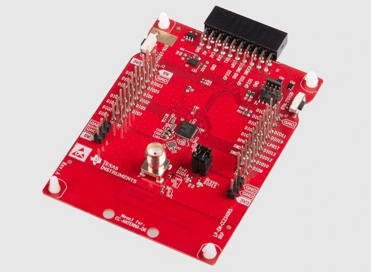

<!-- Copyright 2015-2026 Zephyr Project members and individual contributors. -->
<!-- SPDX-License-Identifier: Apache-2.0 -->
<!-- 中文翻译；编号、导航与译注为本地新增。 -->

<a id="lp_em_cc2340r5"></a>

# 第17章\_`CC2340R5 LaunchPad`

原文：[官方页面](https://docs.zephyrproject.org/latest/boards/ti/lp_em_cc2340r5/doc/index.html)。读取日期：2026-10-16；来源摘要见[来源记录](../SOURCES.md)。

开发板概览（Board Overview）

<a id="id1"></a>

[](images/lp_em_cc2340r5.webp)

`CC2340R5 LaunchPad`

名称（Name）：

`lp_em_cc2340r5`

厂商（Vendor）：

[德州仪器（Texas Instruments）](https://docs.zephyrproject.org/latest/boards/index.html#vendor=ti)

状态（Status）：

当前未积极维护（Not Actively Maintained）

架构（Architecture）：

[arm](https://docs.zephyrproject.org/latest/boards/index.html#arch=arm)

片上系统（SoC）：

[cc2340r5](https://docs.zephyrproject.org/latest/boards/index.html#soc=cc2340r5)

<a id="board-github-link"></a>

[浏览开发板源码（Browse Board Sources）](https://github.com/zephyrproject-rtos/zephyr/blob/main//boards/ti/lp_em_cc2340r5/doc/index.rst/../..)<a id="overview"></a>

## 概述（Overview）

TI CC2340R5 LaunchPad（LP_EM_CC2340R5）是用于SimpleLink多标准CC2340R5无线微控制器的开发套件。

详情见[TI CC2340R5 LaunchPad产品页](https://www.ti.com/tool/LP-EM-CC2340R5)。

<a id="hardware"></a>

## 硬件（Hardware）

CC2340R5 LaunchPad开发套件搭载CC2340R5无线微控制器，配有两个LED、两个按键及用于扩展的BoosterPack连接器。

CC2340R5无线微控制器具有48 MHz Arm Cortex-M0+ SoC及集成的2.4 GHz收发器，支持Bluetooth Low Energy及IEEE 802.15.4等多种协议。

更多信息见[TI CC2340R5产品页](https://www.ti.com/product/CC2340R5)。

<a id="supported-features"></a>

### 支持的功能（Supported Features）

`lp_em_cc2340r5`开发板支持下表所列的硬件功能。

片上／板载（On-Chip / On-Board）

功能集成在片上系统（SoC）内／位于开发板上。

2 / 2

分别表示已启用／已禁用的实例数。点击数量标签，可查看开发板或SoC设备树源码（DTS）中该功能的第一个实例。

`vnd,foo`

与此功能匹配的设备树绑定兼容字符串（Compatible String）；点击链接可查看绑定文档。

<a id="lp_em_cc2340r5-hw-features"></a>

<a id="lp_em_cc2340r5-lp_em_cc2340r5/cc2340r5-hw-features-section"></a>

#### `lp_em_cc2340r5/cc2340r5`目标（Target）

<a id="lp_em_cc2340r5-lp_em_cc2340r5/cc2340r5-hw-features-panel"></a>

<a id="lp_em_cc2340r5-lp_em_cc2340r5/cc2340r5-hw-features-memory"></a>

此板级目标的片上存储：36 KiB RAM及512 KiB Flash。

<a id="lp_em_cc2340r5-lp_em_cc2340r5/cc2340r5-hw-features-table"></a>

<table>
<tr>
<th>类型（Type）</th>
<th>位置（Location）</th>
<th>说明（Description）</th>
<th>兼容字符串（Compatible）</th>
</tr>
<tr>
<td rowspan="1">中央处理器（CPU）</td>
<td>片上（On-Chip）</td>
<td>ARM Cortex-M0+处理器（CPU）（<a href="https://github.com/zephyrproject-rtos/zephyr/blob/main/dts/arm/ti/cc23x0.dtsi?plain=1#L20">已启用：1</a>）</td>
<td><a href="../cpu_arm_riscv_binding_reference/P017_arm_cortex-m0+.md#std-dtcompatible-arm-cortex-m0"><code>arm,cortex-m0+</code></a></td>
</tr>
<tr>
<td rowspan="1">模数转换器（ADC）</td>
<td>片上（On-Chip）</td>
<td>TI CC23X0 16通道模数转换器（ADC）（<a href="https://github.com/zephyrproject-rtos/zephyr/blob/main/dts/arm/ti/cc23x0.dtsi?plain=1#L261">已启用：1</a>）</td>
<td><a href="../hardware/P906_TICC23x0模数转换器绑定.md#dtbinding-ti-cc23x0-adc"><code>ti,cc23x0-adc</code></a></td>
</tr>
<tr>
<td rowspan="2">时钟控制（Clock Control）</td>
<td>片上（On-Chip）</td>
<td>通用固定频率时钟提供者（Fixed-Rate Clock Provider）（<a href="https://github.com/zephyrproject-rtos/zephyr/blob/main/dts/arm/ti/cc23x0.dtsi?plain=1#L57">已启用：1</a>）</td>
<td><a href="../hardware/P566_固定时钟绑定.md#dtbinding-fixed-clock"><code>fixed-clock</code></a></td>
</tr>
<tr>
<td>板载（On-Board）</td>
<td>TI CC23X0外部低频振荡器（External Low-frequency Oscillator）（<a href="https://github.com/zephyrproject-rtos/zephyr/blob/main/boards/ti/lp_em_cc2340r5/lp_em_cc2340r5.dts?plain=1#L83">已启用：1</a>）</td>
<td><a href="../clock_silabs_ti_xilinx_binding_reference/P019_ti_cc23x0-lf-xosc.md#std-dtcompatible-ti-cc23x0-lf-xosc"><code>ti,cc23x0-lf-xosc</code></a></td>
</tr>
<tr>
<td rowspan="2">计数器（Counter）</td>
<td>片上（On-Chip）</td>
<td>CC23x0实时时钟（RTC）计数器驱动；除上电复位外，其他复位／睡眠模式不会停止或复位RTC定时器（<a href="https://github.com/zephyrproject-rtos/zephyr/blob/main/dts/arm/ti/cc23x0.dtsi?plain=1#L146">已禁用：1</a>）</td>
<td><a href="../stm32_ti_xilinx_counter_binding_reference/P009_ti_cc23x0-rtc.md#std-dtcompatible-ti-cc23x0-rtc"><code>ti,cc23x0-rtc</code></a></td>
</tr>
<tr>
<td>片上（On-Chip）</td>
<td>CC23x0低功耗通用定时器（LGPT）计数器驱动（<a href="https://github.com/zephyrproject-rtos/zephyr/blob/main/dts/arm/ti/cc23x0.dtsi?plain=1#L180">已启用：2</a>；<a href="https://github.com/zephyrproject-rtos/zephyr/blob/main/dts/arm/ti/cc23x0.dtsi?plain=1#L153">已禁用：2</a>）</td>
<td><a href="../stm32_ti_xilinx_counter_binding_reference/P008_ti_cc23x0-lgpt.md#std-dtcompatible-ti-cc23x0-lgpt"><code>ti,cc23x0-lgpt</code></a></td>
</tr>
<tr>
<td rowspan="1">密码学加速器（Cryptographic Accelerator）</td>
<td>片上（On-Chip）</td>
<td>TI CC23X0高级加密标准（AES）加速器（<a href="https://github.com/zephyrproject-rtos/zephyr/blob/main/dts/arm/ti/cc23x0.dtsi?plain=1#L110">已启用：1</a>）</td>
<td><a href="../crypto_secure_engine_st_ti_binding_reference/P020_ti_cc23x0-aes.md#std-dtcompatible-ti-cc23x0-aes"><code>ti,cc23x0-aes</code></a></td>
</tr>
<tr>
<td rowspan="1">直接存储器访问（DMA）</td>
<td>片上（On-Chip）</td>
<td>TI CC23X0直接存储器访问（DMA）控制器（<a href="https://github.com/zephyrproject-rtos/zephyr/blob/main/dts/arm/ti/cc23x0.dtsi?plain=1#L119">已启用：1</a>）</td>
<td><a href="../stm32_ti_xilinx_dma_binding_reference/P013_ti_cc23x0-dma.md#std-dtcompatible-ti-cc23x0-dma"><code>ti,cc23x0-dma</code></a></td>
</tr>
<tr>
<td rowspan="1">闪存控制器（Flash Controller）</td>
<td>片上（On-Chip）</td>
<td>德州仪器CC23X0闪存控制器（<a href="https://github.com/zephyrproject-rtos/zephyr/blob/main/dts/arm/ti/cc23x0.dtsi?plain=1#L64">已启用：1</a>）</td>
<td><a href="../flash_renesas_st_ti_binding_reference/P031_ti_cc23x0-flash-controller.md#std-dtcompatible-ti-cc23x0-flash-controller"><code>ti,cc23x0-flash-controller</code></a></td>
</tr>
<tr>
<td rowspan="2">通用输入输出与接插件（GPIO &amp; Headers）</td>
<td>片上（On-Chip）</td>
<td>TI SimpleLink CC23X0通用输入输出（GPIO）（<a href="https://github.com/zephyrproject-rtos/zephyr/blob/main/dts/arm/ti/cc23x0.dtsi?plain=1#L90">已启用：1</a>）</td>
<td><a href="../gpio_ti_xilinx_sdl_binding_reference/P011_ti_cc23x0-gpio.md#std-dtcompatible-ti-cc23x0-gpio"><code>ti,cc23x0-gpio</code></a></td>
</tr>
<tr>
<td>板载（On-Board）</td>
<td>TI BoosterPack GPIO排针（<a href="https://github.com/zephyrproject-rtos/zephyr/blob/main/boards/ti/lp_em_cc2340r5/boosterpack_connector.dtsi?plain=1#L9">已启用：1</a>）</td>
<td><a href="../gpio_ti_xilinx_sdl_binding_reference/P009_ti_boosterpack-header.md#std-dtcompatible-ti-boosterpack-header"><code>ti,boosterpack-header</code></a></td>
</tr>
<tr>
<td rowspan="1">集成电路间总线（I2C）</td>
<td>片上（On-Chip）</td>
<td>TI CC23x0 I2C节点（<a href="https://github.com/zephyrproject-rtos/zephyr/blob/main/dts/arm/ti/cc23x0.dtsi?plain=1#L271">已启用：1</a>）</td>
<td><a href="../i2c_stm32_ti_mux_binding_reference/P011_ti_cc23x0-i2c.md#std-dtcompatible-ti-cc23x0-i2c"><code>ti,cc23x0-i2c</code></a></td>
</tr>
<tr>
<td rowspan="1">输入（Input）</td>
<td>板载（On-Board）</td>
<td>一组绑定到 GPIO 的输入按键（GPIO-Bound Input Keys）（<a href="https://github.com/zephyrproject-rtos/zephyr/blob/main/boards/ti/lp_em_cc2340r5/lp_em_cc2340r5.dts?plain=1#L67">已启用：1</a>）</td>
<td><a href="../hardware/P563_GPIO按键绑定.md#std-dtcompatible-gpio-keys"><code>gpio-keys</code></a></td>
</tr>
<tr>
<td rowspan="1">中断控制器（Interrupt Controller）</td>
<td>片上（On-Chip）</td>
<td>ARMv6-M嵌套向量中断控制器（NVIC / Nested Vectored Interrupt Controller）（<a href="https://github.com/zephyrproject-rtos/zephyr/blob/main/dts/arm/armv6-m.dtsi?plain=1#L13">已启用：1</a>）</td>
<td><a href="../arm_interrupt_timer_binding_reference/P001_ARMv6_M_NVIC.md#std-dtcompatible-arm-v6m-nvic"><code>arm,v6m-nvic</code></a></td>
</tr>
<tr>
<td rowspan="2">发光二极管（LED）</td>
<td>板载（On-Board）</td>
<td>一组由 GPIO 控制的 LED（GPIO-Controlled LEDs）（<a href="https://github.com/zephyrproject-rtos/zephyr/blob/main/boards/ti/lp_em_cc2340r5/lp_em_cc2340r5.dts?plain=1#L39">已启用：1</a>）</td>
<td><a href="../hardware/P564_GPIO指示灯绑定.md#dtbinding-gpio-leds"><code>gpio-leds</code></a></td>
</tr>
<tr>
<td>板载（On-Board）</td>
<td>一组由脉宽调制（PWM）控制的LED（<a href="https://github.com/zephyrproject-rtos/zephyr/blob/main/boards/ti/lp_em_cc2340r5/lp_em_cc2340r5.dts?plain=1#L53">已启用：1</a>）</td>
<td><a href="../hardware/P565_PWM指示灯绑定.md#dtbinding-pwm-leds"><code>pwm-leds</code></a></td>
</tr>
<tr>
<td rowspan="3">存储技术设备（MTD）</td>
<td>片上（On-Chip）</td>
<td>闪存（Flash）节点（<a href="https://github.com/zephyrproject-rtos/zephyr/blob/main/dts/arm/ti/cc23x0.dtsi?plain=1#L71">已启用：1</a>）</td>
<td><a href="../mtd_nxp_st_ti_partition_binding_reference/P013_soc-nv-flash.md#std-dtcompatible-soc-nv-flash"><code>soc-nv-flash</code></a></td>
</tr>
<tr>
<td>片上（On-Chip）</td>
<td>此绑定描述TI CC23X0闪存自定义配置（Custom Configuration，CCFG）区域的内容（<a href="https://github.com/zephyrproject-rtos/zephyr/blob/main/dts/arm/ti/cc23x0.dtsi?plain=1#L78">已启用：1</a>）</td>
<td><a href="../mtd_nxp_st_ti_partition_binding_reference/P019_ti_cc23x0-ccfg-flash.md#std-dtcompatible-ti-cc23x0-ccfg-flash"><code>ti,cc23x0-ccfg-flash</code></a></td>
</tr>
<tr>
<td>片上（On-Chip）</td>
<td>闪存或其他非易失性存储器的固定分区（Fixed Partitions）（<a href="https://github.com/zephyrproject-rtos/zephyr/blob/main/dts/arm/ti/cc2340r5.dtsi?plain=1#L48">已启用：1</a>）</td>
<td><a href="../hardware/P568_固定分区绑定.md#dtbinding-fixed-partitions"><code>fixed-partitions</code></a></td>
</tr>
<tr>
<td rowspan="1">引脚控制（Pin Control）</td>
<td>片上（On-Chip）</td>
<td>TI SimpleLink CC23X0引脚控制器（<a href="https://github.com/zephyrproject-rtos/zephyr/blob/main/dts/arm/ti/cc23x0.dtsi?plain=1#L85">已启用：1</a>）</td>
<td><a href="../pinctrl_stm32_ti_xilinx_binding_reference/P011_ti_cc23x0-pinctrl.md#std-dtcompatible-ti-cc23x0-pinctrl"><code>ti,cc23x0-pinctrl</code></a></td>
</tr>
<tr>
<td rowspan="1">脉宽调制（PWM）</td>
<td>片上（On-Chip）</td>
<td>TI CC23x0 LGPT脉宽调制（PWM）控制器节点（<a href="https://github.com/zephyrproject-rtos/zephyr/blob/main/dts/arm/ti/cc23x0.dtsi?plain=1#L200">已启用：2</a>；<a href="https://github.com/zephyrproject-rtos/zephyr/blob/main/dts/arm/ti/cc23x0.dtsi?plain=1#L161">已禁用：10</a>）</td>
<td><a href="../pwm_stm32_ti_generic_binding_reference/P016_ti_cc23x0-lgpt-pwm.md#std-dtcompatible-ti-cc23x0-lgpt-pwm"><code>ti,cc23x0-lgpt-pwm</code></a></td>
</tr>
<tr>
<td rowspan="1">串行控制器（Serial Controller）</td>
<td>片上（On-Chip）</td>
<td>TI SimpleLink CC23X0 UART节点（<a href="https://github.com/zephyrproject-rtos/zephyr/blob/main/dts/arm/ti/cc23x0.dtsi?plain=1#L100">已启用：1</a>）</td>
<td><a href="../uart_silabs_stm32_ti_binding_reference/P019_ti_cc23x0-uart.md#std-dtcompatible-ti-cc23x0-uart"><code>ti,cc23x0-uart</code></a></td>
</tr>
<tr>
<td rowspan="1">串行外设接口（SPI）</td>
<td>片上（On-Chip）</td>
<td>TI SimpleLink CC23x0 SPI控制器（<a href="https://github.com/zephyrproject-rtos/zephyr/blob/main/dts/arm/ti/cc23x0.dtsi?plain=1#L128">已启用：1</a>）</td>
<td><a href="../spi_stm32_ti_xilinx_binding_reference/P016_ti_cc23x0-spi.md#std-dtcompatible-ti-cc23x0-spi"><code>ti,cc23x0-spi</code></a></td>
</tr>
<tr>
<td rowspan="1">静态随机存储器（SRAM）</td>
<td>片上（On-Chip）</td>
<td>通用片上静态随机存储器（SRAM）（<a href="https://github.com/zephyrproject-rtos/zephyr/blob/main/dts/arm/ti/cc23x0.dtsi?plain=1#L53">已启用：1</a>）</td>
<td><a href="../hardware/P567_内存映射SRAM绑定.md#dtbinding-mmio-sram"><code>mmio-sram</code></a></td>
</tr>
<tr>
<td rowspan="1">定时器（Timer）</td>
<td>片上（On-Chip）</td>
<td>ARMv6-M系统节拍（System Tick）（<a href="https://github.com/zephyrproject-rtos/zephyr/blob/main/dts/arm/armv6-m.dtsi?plain=1#L21">已禁用：1</a>）</td>
<td><a href="../arm_interrupt_timer_binding_reference/P005_ARMv6_M_SysTick.md#std-dtcompatible-arm-armv6m-systick"><code>arm,armv6m-systick</code></a></td>
</tr>
<tr>
<td rowspan="1">看门狗（Watchdog）</td>
<td>片上（On-Chip）</td>
<td>TI CC23x0看门狗（<a href="https://github.com/zephyrproject-rtos/zephyr/blob/main/dts/arm/ti/cc23x0.dtsi?plain=1#L140">已启用：1</a>）</td>
<td><a href="../stm32_ti_xilinx_watchdog_binding_reference/P004_ti_cc23x0-wdt.md#std-dtcompatible-ti-cc23x0-wdt"><code>ti,cc23x0-wdt</code></a></td>
</tr>
</table>

<a id="connections-and-ios"></a>

### 连接与输入输出（Connections and IOs）

所有I/O信号均可通过BoosterPack连接器访问，引脚功能遵循LaunchPad标准。

<table>
<tr>
<th>引脚（Pin）</th>
<th>功能（Function）</th>
<th>用途（Usage）</th>
</tr>
<tr>
<td>DIO0</td>
<td>通用输入输出（GPIO）</td>
<td></td>
</tr>
<tr>
<td>DIO1</td>
<td>模拟输入输出（ANALOG_IO）</td>
<td>A4</td>
</tr>
<tr>
<td>DIO2</td>
<td>模拟输入输出（ANALOG_IO）</td>
<td>A3</td>
</tr>
<tr>
<td>DIO5</td>
<td>模拟输入输出（ANALOG_IO）</td>
<td>A5</td>
</tr>
<tr>
<td>DIO6</td>
<td>SPI_CSN</td>
<td>SPI片选（CS）</td>
</tr>
<tr>
<td>DIO7</td>
<td>模拟输入输出（ANALOG_IO）</td>
<td>A0</td>
</tr>
<tr>
<td>DIO8</td>
<td>通用输入输出（GPIO）</td>
<td></td>
</tr>
<tr>
<td>DIO9</td>
<td>通用输入输出（GPIO）</td>
<td>按键2（Button 2）</td>
</tr>
<tr>
<td>DIO10</td>
<td>通用输入输出（GPIO）</td>
<td>按键1（Button 1）</td>
</tr>
<tr>
<td>DIO11</td>
<td>SPI_CSN</td>
<td>SPI片选（CS）</td>
</tr>
<tr>
<td>DIO12</td>
<td>SPI_POCI</td>
<td>SPI外设输出／控制器输入（POCI）</td>
</tr>
<tr>
<td>DIO13</td>
<td>SPI_PICO</td>
<td>SPI_PICO</td>
</tr>
<tr>
<td>DIO14</td>
<td>通用输入输出（GPIO）</td>
<td>红色LED（Red LED）</td>
</tr>
<tr>
<td>DIO15</td>
<td>通用输入输出（GPIO）</td>
<td>绿色LED（Green LED）</td>
</tr>
<tr>
<td>DIO18</td>
<td>SPI_CLK</td>
<td>SPI时钟（CLK）</td>
</tr>
<tr>
<td>DIO19</td>
<td>通用输入输出（GPIO）</td>
<td></td>
</tr>
<tr>
<td>DIO20</td>
<td>UART0_TX</td>
<td>UART发送（TX）</td>
</tr>
<tr>
<td>DIO21</td>
<td>通用输入输出（GPIO）</td>
<td></td>
</tr>
<tr>
<td>DIO22</td>
<td>UART0_RX</td>
<td>UART接收（RX）</td>
</tr>
<tr>
<td>DIO23</td>
<td>模拟输入输出（ANALOG_IO）</td>
<td>A8</td>
</tr>
<tr>
<td>DIO24</td>
<td>模拟输入输出（ANALOG_IO）</td>
<td>A7</td>
</tr>
</table>

<a id="programming-and-debugging"></a>

## 烧录与调试（Programming and Debugging）

`lp_em_cc2340r5`开发板支持下表所列的运行工具（Runners）及相关west命令。

<table>
<tr>
<th></th>
<th>烧录（flash）</th>
<th>调试（debug）</th>
<th>连接调试会话（attach）</th>
<th>实时传输（rtt）</th>
<th>复位（reset）</th>
<th>调试服务器（debugserver）</th>
</tr>
<tr>
<td><a href="https://docs.zephyrproject.org/latest/develop/flash_debug/host-tools.html#runner-jlink">jlink</a></td>
<td>✅（默认 / default）</td>
<td>✅（默认 / default）</td>
<td>✅</td>
<td>✅</td>
<td>✅</td>
<td>✅</td>
</tr>
</table>

LP_EM_CC2340R5需要LP-XDS110或LP-XDS110ET等外部调试探针。

也可在J4排针连接J-Link，并通过引脚排针输入3.3 V电源。原文说明烧录及调试目前仅使用J4上的J-Link测试过。

需要控制台时，按以下方式连接外部USB转UART转换器：

<table>
<tr>
<td>发送（TX）</td>
<td>DIO22</td>
</tr>
<tr>
<td>接收（RX）</td>
<td>DIO20</td>
</tr>
</table>

随后可从电脑连接：

```text
$ microcom -p <tty_device>
```

将<tty_device>替换为USB转UART转换器的端口，例如/dev/ttyUSB0。

<a id="flashing"></a>

### 烧录（Flashing）

CC2340R5 LaunchPad板级配置的应用可按常规方式构建及烧录，详情见“构建应用”及“运行应用”。（[构建应用（Building an Application）](../application/P001_应用开发.md#build-an-application)；[运行应用（Run an Application）](https://docs.zephyrproject.org/latest/develop/application/index.html#application-run)）

下面以[Hello World](../getting_started/P005_HelloWorld示例.md#hello_world)应用为例。

```text
# From the root of the zephyr repository
west build -b lp_em_cc2340r5 samples/hello_world
west flash
```

<a id="debugging"></a>

### 调试（Debugging）

可以按常规方式调试应用。下面以[Hello World](../getting_started/P005_HelloWorld示例.md#hello_world)应用为例。

```text
# From the root of the zephyr repository
west build -b lp_em_cc2340r5 samples/hello_world
west debug
```

<a id="references"></a>

## 参考资料（References）

CC2340R5 LaunchPad快速入门指南：

[https://www.ti.com/lit/pdf/swru588](https://www.ti.com/lit/pdf/swru588)

## 译注

CC2340R5没有本页所依赖的板载XDS110，需外部LP-XDS110／LP-XDS110ET，或J4上的J-Link加3.3 V供电；原文只确认测试过后一方式。控制台另接USB转UART。

## 原文外链核对

2026-10-16核对并重试以下原文外链时未能确认可访问性，保留原始目标，不将访问失败解释为原文内容有误。

- [LP-EM-CC2340R5](https://www.ti.com/tool/LP-EM-CC2340R5)：HTTP Error 404: Not Found。

---

[上一章](P016_TI_AM243x_LaunchPad.md) · [返回大纲](大纲.md) · [全站翻译进度](../PROGRESS.md) · [下一章](P018_MSPM0G3507_Launchpad.md)
