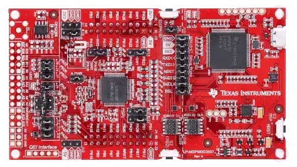

<!-- Copyright 2015-2026 Zephyr Project members and individual contributors. -->
<!-- SPDX-License-Identifier: Apache-2.0 -->
<!-- 中文翻译；编号、导航与译注为本地新增。 -->

<a id="lp_mspm0g3507"></a>

# 第18章\_MSPM0G3507 LaunchPad

原文：[官方页面](https://docs.zephyrproject.org/latest/boards/ti/lp_mspm0g3507/doc/index.html)。读取日期：2026-10-16；来源摘要见[来源记录](../SOURCES.md)。

开发板概览（Board Overview）

<a id="id1"></a>

[](images/lp_mspm0g3507.webp)

MSPM0G3507 LaunchPad

名称（Name）：

`lp_mspm0g3507`

厂商（Vendor）：

[德州仪器（Texas Instruments）](https://docs.zephyrproject.org/latest/boards/index.html#vendor=ti)

状态（Status）：

维护中（Maintained）

架构（Architecture）：

[arm](https://docs.zephyrproject.org/latest/boards/index.html#arch=arm)

片上系统（SoC）：

[mspm0g3507](https://docs.zephyrproject.org/latest/boards/index.html#soc=mspm0g3507)

<a id="board-github-link"></a>

[浏览开发板源码（Browse Board Sources）](https://github.com/zephyrproject-rtos/zephyr/blob/main//boards/ti/lp_mspm0g3507/doc/index.rst/../..)<a id="overview"></a>

## 概述（Overview）

MSPM0G350x属于MSP高度集成、超低功耗32位微控制器系列，基于增强型Arm Cortex-M0+，最高80 MHz。该系列在优化成本的同时集成高性能模拟外设，支持−40 °C至125 °C扩展温度范围及1.62—3.6 V供电。

MSPM0G350x提供最高128 KB嵌入式程序闪存，内置纠错码（ECC），以及最高32 KB、可选硬件奇偶校验的SRAM。还集成存储器保护单元（MPU）、7通道DMA、数学加速器及以下外设：


- 模拟功能（Analog）


  - 两个12位、4 Msps模数转换器（ADC）
  - 可配置的内部共享电压基准（Voltage Reference）
  - 一个12位、1 Msps数模转换器（DAC）
  - 三个高速比较器（Comparator），内置基准DAC
  - 两个零漂移、零交越失真运算放大器（Op-amp），增益可编程
- 数字功能（Digital）


  - 两个16位高级控制定时器
  - 五个通用定时器


    - 一个用于正交编码器接口（QEI）的16位通用定时器
    - 一个32位高分辨率通用定时器
    - 两个支持死区（Deadband）的16位定时器，最多12路PWM通道
  - 两个窗口看门狗（Windowed Watchdog）定时器
  - 一个具有闹钟及日历模式的实时时钟（RTC）
- 数据完整性及加密（Data Integrity and Encryption）


  - 一个支持CTR、CBC及ECB模式的AES硬件加速器
  - 一个循环冗余校验（CRC）加速器
  - 一个真随机数发生器（TRNG）
- 通信接口（Communication）


  - 四路UART，其中一路支持LIN及Manchester等高级模式
  - 两路I2C，支持SMBus／PMBus及最高1 Mbit/s的快速增强模式（FM+）
  - 两路SPI，其中一路最高32 Mbit/s
  - 一路CAN接口，支持CAN 2.0 A／B及CAN-FD



Zephyr使用lp_mspm0g3507板级配置为LP_MSPM0G3507构建。

<a id="features"></a>

## 功能（Features）：


- 板载XDS110调试探针
- 支持EnergyTrace技术，用于超低功耗调试
- 两个按键、一个普通LED及一个RGB LED，用于用户交互
- 温度传感器电路
- 光传感器电路
- 外部OPA2365，默认缓冲器模式，用于最高4 Msps的ADC评估
- 板载32.768 kHz及40 MHz晶体
- ADC输入的RC滤波器，默认未焊装

MSPM0G3507 LaunchPad详情见[TI LP_MSPM0G3507产品页](https://www.ti.com/tool/LP-MSPM0G3507)。

<a id="supported-features"></a>

### 支持的功能（Supported Features）

`lp_mspm0g3507`开发板支持下表所列的硬件功能。

片上／板载（On-Chip / On-Board）

功能集成在片上系统（SoC）内／位于开发板上。

2 / 2

分别表示已启用／已禁用的实例数。点击数量标签，可查看开发板或SoC设备树源码（DTS）中该功能的第一个实例。

`vnd,foo`

与此功能匹配的设备树绑定兼容字符串（Compatible String）；点击链接可查看绑定文档。

<a id="lp_mspm0g3507-hw-features"></a>

<a id="lp_mspm0g3507-lp_mspm0g3507/mspm0g3507-hw-features-section"></a>

#### `lp_mspm0g3507/mspm0g3507`目标（Target）

<a id="lp_mspm0g3507-lp_mspm0g3507/mspm0g3507-hw-features-panel"></a>

<a id="lp_mspm0g3507-lp_mspm0g3507/mspm0g3507-hw-features-memory"></a>

该开发板目标的片上存储容量：32 KiB RAM、128 KiB Flash。

<a id="lp_mspm0g3507-lp_mspm0g3507/mspm0g3507-hw-features-table"></a>

<table>
<tr>
<th>类型（Type）</th>
<th>位置（Location）</th>
<th>说明（Description）</th>
<th>兼容字符串（Compatible）</th>
</tr>
<tr>
<td rowspan="1">中央处理器（CPU）</td>
<td>片上（On-Chip）</td>
<td>ARM Cortex-M0+处理器（CPU）（<a href="https://github.com/zephyrproject-rtos/zephyr/blob/main/dts/arm/ti/mspm0/mspm0.dtsi?plain=1#L17">已启用：1</a>）</td>
<td><a href="../cpu_arm_riscv_binding_reference/P017_arm_cortex-m0+.md#std-dtcompatible-arm-cortex-m0"><code>arm,cortex-m0+</code></a></td>
</tr>
<tr>
<td rowspan="1">模数转换器（ADC）</td>
<td>片上（On-Chip）</td>
<td>TI MSPM0 12位模数转换器（ADC12）（<a href="https://github.com/zephyrproject-rtos/zephyr/blob/main/dts/arm/ti/mspm0/g/mspm0g.dtsi?plain=1#L25">已禁用：2</a>）</td>
<td><a href="../hardware/P908_TIMSPM0ADC12绑定.md#dtbinding-ti-mspm0-adc12"><code>ti,mspm0-adc12</code></a></td>
</tr>
<tr>
<td rowspan="1">控制器局域网（CAN）</td>
<td>片上（On-Chip）</td>
<td>TI MSPM0可变数据速率CAN（CAN-FD）（<a href="https://github.com/zephyrproject-rtos/zephyr/blob/main/dts/arm/ti/mspm0/g/mspm0g350x.dtsi?plain=1#L46">已启用：1</a>）</td>
<td><a href="../can_nxp_renesas_stm32_ti_binding_reference/P014_ti_mspm0-canfd.md#std-dtcompatible-ti-mspm0-canfd"><code>ti,mspm0-canfd</code></a></td>
</tr>
<tr>
<td rowspan="3">时钟控制（Clock Control）</td>
<td>片上（On-Chip）</td>
<td>TI MSPM0时钟（Clock）（<a href="https://github.com/zephyrproject-rtos/zephyr/blob/main/dts/arm/ti/mspm0/mspm0.dtsi?plain=1#L79">已启用：5</a>；<a href="https://github.com/zephyrproject-rtos/zephyr/blob/main/dts/arm/ti/mspm0/mspm0.dtsi?plain=1#L85">已禁用：2</a>）</td>
<td><a href="../clock_silabs_ti_xilinx_binding_reference/P025_ti_mspm0-clk.md#std-dtcompatible-ti-mspm0-clk"><code>ti,mspm0-clk</code></a></td>
</tr>
<tr>
<td>片上（On-Chip）</td>
<td>TI MSPM0锁相环（PLL）（<a href="https://github.com/zephyrproject-rtos/zephyr/blob/main/dts/arm/ti/mspm0/g/mspm0g.dtsi?plain=1#L12">已启用：1</a>）</td>
<td><a href="../clock_silabs_ti_xilinx_binding_reference/P027_ti_mspm0-pll.md#std-dtcompatible-ti-mspm0-pll"><code>ti,mspm0-pll</code></a></td>
</tr>
<tr>
<td>片上（On-Chip）</td>
<td>TI MSPM0振荡器（Oscillator）（<a href="https://github.com/zephyrproject-rtos/zephyr/blob/main/dts/arm/ti/mspm0/mspm0.dtsi?plain=1#L141">已启用：2</a>；<a href="https://github.com/zephyrproject-rtos/zephyr/blob/main/dts/arm/ti/mspm0/mspm0.dtsi?plain=1#L127">已禁用：2</a>）</td>
<td><a href="../clock_silabs_ti_xilinx_binding_reference/P026_ti_mspm0-osc.md#std-dtcompatible-ti-mspm0-osc"><code>ti,mspm0-osc</code></a></td>
</tr>
<tr>
<td rowspan="1">比较器（Comparator）</td>
<td>片上（On-Chip）</td>
<td>德州仪器MSPM0比较器模块，带基准DAC（<a href="https://github.com/zephyrproject-rtos/zephyr/blob/main/dts/arm/ti/mspm0/g/mspm0g350x.dtsi?plain=1#L11">已禁用：3</a>）</td>
<td><a href="../hardware/P758_TIMSPM0比较器绑定.md#dtbinding-ti-mspm0-comparator"><code>ti,mspm0-comparator</code></a></td>
</tr>
<tr>
<td rowspan="1">计数器（Counter）</td>
<td>片上（On-Chip）</td>
<td>TI MSPM0 SoC计数器节点（Counter Node）（<a href="https://github.com/zephyrproject-rtos/zephyr/blob/main/dts/arm/ti/mspm0/g/mspm0g.dtsi?plain=1#L58">已禁用：4</a>）</td>
<td><a href="../stm32_ti_xilinx_counter_binding_reference/P011_ti_mspm0-timer-counter.md#std-dtcompatible-ti-mspm0-timer-counter"><code>ti,mspm0-timer-counter</code></a></td>
</tr>
<tr>
<td rowspan="1">密码学加速器（Cryptographic Accelerator）</td>
<td>片上（On-Chip）</td>
<td>德州仪器MSPM0 G系列高级加密标准（AES）引擎，支持AES-128及AES-256加密和解密（<a href="https://github.com/zephyrproject-rtos/zephyr/blob/main/dts/arm/ti/mspm0/g/mspm0g350x.dtsi?plain=1#L39">已禁用：1</a>）</td>
<td><a href="../crypto_secure_engine_st_ti_binding_reference/P021_ti_mspm0-aes.md#std-dtcompatible-ti-mspm0-aes"><code>ti,mspm0-aes</code></a></td>
</tr>
<tr>
<td rowspan="1">数模转换器（DAC）</td>
<td>片上（On-Chip）</td>
<td>德州仪器MSPM0 G系列数模转换器（DAC）（<a href="https://github.com/zephyrproject-rtos/zephyr/blob/main/dts/arm/ti/mspm0/g/mspm0g350x.dtsi?plain=1#L32">已启用：1</a>）</td>
<td><a href="../hardware/P775_TIMSPM0数模转换器绑定.md#dtbinding-ti-mspm0-dac"><code>ti,mspm0-dac</code></a></td>
</tr>
<tr>
<td rowspan="1">直接存储器访问（DMA）</td>
<td>片上（On-Chip）</td>
<td>TI MSPM0直接存储器访问（DMA）（<a href="https://github.com/zephyrproject-rtos/zephyr/blob/main/dts/arm/ti/mspm0/mspm0.dtsi?plain=1#L242">已禁用：1</a>）</td>
<td><a href="../stm32_ti_xilinx_dma_binding_reference/P014_ti_mspm0-dma.md#std-dtcompatible-ti-mspm0-dma"><code>ti,mspm0-dma</code></a></td>
</tr>
<tr>
<td rowspan="1">闪存控制器（Flash Controller）</td>
<td>片上（On-Chip）</td>
<td>TI MSPM0内部闪存控制器（<a href="https://github.com/zephyrproject-rtos/zephyr/blob/main/dts/arm/ti/mspm0/mspm0.dtsi?plain=1#L159">已启用：1</a>）</td>
<td><a href="../flash_renesas_st_ti_binding_reference/P032_ti_mspm0-flash-controller.md#std-dtcompatible-ti-mspm0-flash-controller"><code>ti,mspm0-flash-controller</code></a></td>
</tr>
<tr>
<td rowspan="1">通用输入输出与接插件（GPIO &amp; Headers）</td>
<td>片上（On-Chip）</td>
<td>TI MSPM0通用输入输出（GPIO）（<a href="https://github.com/zephyrproject-rtos/zephyr/blob/main/dts/arm/ti/mspm0/mspm0.dtsi?plain=1#L208">已启用：2</a>）</td>
<td><a href="../gpio_ti_xilinx_sdl_binding_reference/P016_ti_mspm0-gpio.md#std-dtcompatible-ti-mspm0-gpio"><code>ti,mspm0-gpio</code></a></td>
</tr>
<tr>
<td rowspan="1">中断控制器（Interrupt Controller）</td>
<td>片上（On-Chip）</td>
<td>ARMv6-M嵌套向量中断控制器（NVIC / Nested Vectored Interrupt Controller）（<a href="https://github.com/zephyrproject-rtos/zephyr/blob/main/dts/arm/armv6-m.dtsi?plain=1#L13">已启用：1</a>）</td>
<td><a href="../arm_interrupt_timer_binding_reference/P001_ARMv6_M_NVIC.md#std-dtcompatible-arm-v6m-nvic"><code>arm,v6m-nvic</code></a></td>
</tr>
<tr>
<td rowspan="2">发光二极管（LED）</td>
<td>板载（On-Board）</td>
<td>一组由 GPIO 控制的 LED（GPIO-Controlled LEDs）（<a href="https://github.com/zephyrproject-rtos/zephyr/blob/main/boards/ti/lp_mspm0g3507/lp_mspm0g3507.dts?plain=1#L34">已启用：1</a>）</td>
<td><a href="../hardware/P564_GPIO指示灯绑定.md#dtbinding-gpio-leds"><code>gpio-leds</code></a></td>
</tr>
<tr>
<td>板载（On-Board）</td>
<td>一组由脉宽调制（PWM）控制的LED（<a href="https://github.com/zephyrproject-rtos/zephyr/blob/main/boards/ti/lp_mspm0g3507/lp_mspm0g3507.dts?plain=1#L43">已启用：1</a>）</td>
<td><a href="../hardware/P565_PWM指示灯绑定.md#dtbinding-pwm-leds"><code>pwm-leds</code></a></td>
</tr>
<tr>
<td rowspan="1">存储技术设备（MTD）</td>
<td>片上（On-Chip）</td>
<td>闪存（Flash）节点（<a href="https://github.com/zephyrproject-rtos/zephyr/blob/main/dts/arm/ti/mspm0/mspm0.dtsi?plain=1#L166">已启用：1</a>）</td>
<td><a href="../mtd_nxp_st_ti_partition_binding_reference/P013_soc-nv-flash.md#std-dtcompatible-soc-nv-flash"><code>soc-nv-flash</code></a></td>
</tr>
<tr>
<td rowspan="1">引脚控制（Pin Control）</td>
<td>片上（On-Chip）</td>
<td>TI MSPM0引脚控制节点（Pinctrl）（<a href="https://github.com/zephyrproject-rtos/zephyr/blob/main/dts/arm/ti/mspm0/mspm0.dtsi?plain=1#L203">已启用：1</a>）</td>
<td><a href="../pinctrl_stm32_ti_xilinx_binding_reference/P014_ti_mspm0-pinctrl.md#std-dtcompatible-ti-mspm0-pinctrl"><code>ti,mspm0-pinctrl</code></a></td>
</tr>
<tr>
<td rowspan="1">脉宽调制（PWM）</td>
<td>片上（On-Chip）</td>
<td>MSPM0 SoC的TI MSPM0 PWM节点（<a href="https://github.com/zephyrproject-rtos/zephyr/blob/main/dts/arm/ti/mspm0/g/mspm0g.dtsi?plain=1#L122">已启用：1</a>；<a href="https://github.com/zephyrproject-rtos/zephyr/blob/main/dts/arm/ti/mspm0/g/mspm0g.dtsi?plain=1#L138">已禁用：1</a>）</td>
<td><a href="../pwm_stm32_ti_generic_binding_reference/P017_ti_mspm0-timer-pwm.md#std-dtcompatible-ti-mspm0-timer-pwm"><code>ti,mspm0-timer-pwm</code></a></td>
</tr>
<tr>
<td rowspan="1">稳压器（Regulator）</td>
<td>片上（On-Chip）</td>
<td>Texas Instruments MSPM0参考电压（VREF）稳压器（<a href="https://github.com/zephyrproject-rtos/zephyr/blob/main/dts/arm/ti/mspm0/mspm0.dtsi?plain=1#L191">已启用：1</a>）</td>
<td><a href="../hardware/P658_MSPM0参考电压绑定.md#dtbinding-ti-mspm0-vref"><code>ti,mspm0-vref</code></a></td>
</tr>
<tr>
<td rowspan="1">随机数生成器（RNG）</td>
<td>片上（On-Chip）</td>
<td>Texas Instruments MSPM0系列真随机数发生器（TRNG）（<a href="https://github.com/zephyrproject-rtos/zephyr/blob/main/dts/arm/ti/mspm0/g/mspm0g.dtsi?plain=1#L175">已禁用：1</a>）</td>
<td><a href="../soc_rng_binding_reference/P019_ti_mspm0-trng.md#std-dtcompatible-ti-mspm0-trng"><code>ti,mspm0-trng</code></a></td>
</tr>
<tr>
<td rowspan="1">实时时钟（RTC）</td>
<td>片上（On-Chip）</td>
<td>Texas Instruments MSPM0实时时钟（RTC）驱动（<a href="https://github.com/zephyrproject-rtos/zephyr/blob/main/dts/arm/ti/mspm0/mspm0.dtsi?plain=1#L183">已禁用：1</a>）</td>
<td><a href="../soc_rtc_binding_reference/P017_ti_mspm0-rtc.md#std-dtcompatible-ti-mspm0-rtc"><code>ti,mspm0-rtc</code></a></td>
</tr>
<tr>
<td rowspan="1">串行控制器（Serial Controller）</td>
<td>片上（On-Chip）</td>
<td>TI MSPM0通用异步收发器（UART）（<a href="https://github.com/zephyrproject-rtos/zephyr/blob/main/dts/arm/ti/mspm0/mspm0.dtsi?plain=1#L226">已启用：1</a>；<a href="https://github.com/zephyrproject-rtos/zephyr/blob/main/dts/arm/ti/mspm0/g/mspm0g.dtsi?plain=1#L145">已禁用：3</a>）</td>
<td><a href="../uart_ti_wch_virtual_binding_reference/P002_ti_mspm0-uart.md#std-dtcompatible-ti-mspm0-uart"><code>ti,mspm0-uart</code></a></td>
</tr>
<tr>
<td rowspan="1">串行外设接口（SPI）</td>
<td>片上（On-Chip）</td>
<td>Texas Instruments MSPM0串行外设接口（SPI）（<a href="https://github.com/zephyrproject-rtos/zephyr/blob/main/dts/arm/ti/mspm0/mspm0.dtsi?plain=1#L236">已启用：2</a>）</td>
<td><a href="../spi_stm32_ti_xilinx_binding_reference/P017_ti_mspm0-spi.md#std-dtcompatible-ti-mspm0-spi"><code>ti,mspm0-spi</code></a></td>
</tr>
<tr>
<td rowspan="1">静态随机存储器（SRAM）</td>
<td>片上（On-Chip）</td>
<td>通用片上静态随机存储器（SRAM）（<a href="https://github.com/zephyrproject-rtos/zephyr/blob/main/dts/arm/ti/mspm0/mspm0.dtsi?plain=1#L155">已启用：1</a>）</td>
<td><a href="../hardware/P567_内存映射SRAM绑定.md#dtbinding-mmio-sram"><code>mmio-sram</code></a></td>
</tr>
<tr>
<td rowspan="2">定时器（Timer）</td>
<td>片上（On-Chip）</td>
<td>ARMv6-M系统节拍（System Tick）（<a href="https://github.com/zephyrproject-rtos/zephyr/blob/main/dts/arm/armv6-m.dtsi?plain=1#L21">已启用：1</a>）</td>
<td><a href="../arm_interrupt_timer_binding_reference/P005_ARMv6_M_SysTick.md#std-dtcompatible-arm-armv6m-systick"><code>arm,armv6m-systick</code></a></td>
</tr>
<tr>
<td>片上（On-Chip）</td>
<td>TI MSPM0定时器（Timer）（<a href="https://github.com/zephyrproject-rtos/zephyr/blob/main/dts/arm/ti/mspm0/g/mspm0g.dtsi?plain=1#L49">已禁用：6</a>）</td>
<td><a href="../stm32_ti_silabs_timer_binding_reference/P015_ti_mspm0-timer.md#std-dtcompatible-ti-mspm0-timer"><code>ti,mspm0-timer</code></a></td>
</tr>
<tr>
<td rowspan="1">看门狗（Watchdog）</td>
<td>片上（On-Chip）</td>
<td>MSPM0窗口看门狗定时器（Windowed Watchdog Timer）（<a href="https://github.com/zephyrproject-rtos/zephyr/blob/main/dts/arm/ti/mspm0/mspm0.dtsi?plain=1#L175">已禁用：2</a>）</td>
<td><a href="../stm32_ti_xilinx_watchdog_binding_reference/P007_ti_mspm0-watchdog.md#std-dtcompatible-ti-mspm0-watchdog"><code>ti,mspm0-watchdog</code></a></td>
</tr>
</table>

<a id="building-and-flashing"></a>

## 构建与烧录（Building and Flashing）

<a id="building"></a>

### 构建（Building）

Zephyr应用开发请遵循[入门指南](../getting_started/P002_入门指南.md#getting-started)。

例如，为MSPM0G3507 LaunchPad构建Blinky应用：

```text
# From the root of the zephyr repository
west build -b lp_mspm0g3507 samples/hello_world
```

构建目录中生成的zephyr.bin可按以下步骤烧录到MSPM0G3507 LaunchPad。

<a id="flashing"></a>

### 烧录（Flashing）

OpenOCD用于编程器件闪存。较早版本可能需要使用为此器件提供支持的OpenOCD分支。

原文说明在所需OpenOCD支持公开之前，可克隆所链接仓库，再按以下方式构建：（[此仓库](https://github.com/openocd-org/openocd.git)）

```text
$ cd <cloned_OPENOCD_dir>
$ ./bootstrap (when building from the git repository)
$ ./configure
$ make
$ sudo make install
```

构建完成后，向烧录命令传入额外参数即可烧录器件：

```text
$ west flash --openocd <path to cloned dir>/src/openocd --openocd-search <path to cloned dir>/tcl
```

使用J-Link烧录

```text
$ west flash --runner jlink
```

<a id="debugging"></a>

### 调试（Debugging）

可以按常规方式调试应用。下面以[Hello World](../getting_started/P005_HelloWorld示例.md#hello_world)应用为例。

```text
# From the root of the zephyr repository
west build -b lp_mspm0g3507 samples/hello_world
west debug
```

<a id="references"></a>

## 参考资料（References）

TI MSPM0微控制器页面：

[https://www.ti.com/microcontrollers-mcus-processors/arm-based-microcontrollers/arm-cortex-m0-mcus/overview.html](https://www.ti.com/microcontrollers-mcus-processors/arm-based-microcontrollers/arm-cortex-m0-mcus/overview.html)

TI MSPM0G3507产品页：

[https://www.ti.com/product/MSPM0G3507](https://www.ti.com/product/MSPM0G3507)

TI MSPM0 SDK：

[https://www.ti.com/tool/MSPM0-SDK](https://www.ti.com/tool/MSPM0-SDK)

## 译注

MSPM0G3507为80 MHz Cortex-M0+。早期OpenOCD分支说明与J-Link烧录步骤均保留；不能据硬件外设列表推定驱动支持。

---

[上一章](P017_CC2340R5_LaunchPad.md) · [返回大纲](大纲.md) · [全站翻译进度](../PROGRESS.md) · [下一章](P019_MSPM0G3519_Launchpad.md)
