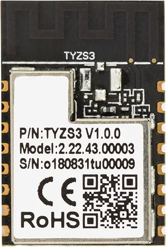

<!-- Copyright 2015-2026 Zephyr Project members and individual contributors. -->
<!-- SPDX-License-Identifier: Apache-2.0 -->
<!-- 中文翻译；编号、导航与译注为本地新增。 -->

<a id="tyzs3"></a>

# 第2章\_TYZS3

原文：[官方页面](https://docs.zephyrproject.org/latest/boards/tuya/tyzs3/doc/index.html)。读取日期：2026-10-16；来源摘要见[来源记录](../SOURCES.md)。

开发板概览（Board Overview）

<a id="id1"></a>

[](images/tyzs3.webp)

TYZS3

名称（Name）：

`tyzs3`

厂商（Vendor）：

[Tuya Inc.](https://docs.zephyrproject.org/latest/boards/index.html#vendor=tuya)

状态（Status）：

当前未积极维护（Not Actively Maintained）

架构（Architecture）：

[arm](https://docs.zephyrproject.org/latest/boards/index.html#arch=arm)

片上系统（SoC）：

[efr32mg13p732f512gm48](https://docs.zephyrproject.org/latest/boards/index.html#soc=efr32mg13p732f512gm48)

<a id="board-github-link"></a>

[浏览开发板源码（Browse Board Sources）](https://github.com/zephyrproject-rtos/zephyr/blob/main//boards/tuya/tyzs3/doc/index.rst/../..)<a id="overview"></a>

## 概述（Overview）

TYZS3是涂鸦开发的低功耗嵌入式Zigbee模块，由高度集成的无线射频处理器EFR32MG13P732F512GM48及若干外设组成。模块搭载低功耗32位ARM Cortex-M4内核，具有512 KB闪存、64 KB RAM及丰富外设。

<a id="hardware"></a>

## 硬件（Hardware）


- EFR32MG13P732F512GM48 Gecko片上系统（SoC）
- CPU内核：带浮点单元（FPU）的ARM Cortex-M4
- 闪存（Flash）：512 kB
- 随机存取存储器（RAM）：64 kB
- 发射功率：最高+19 dBm
- 工作频率（Operation Frequency）：2.4 GHz
- 高频晶体振荡器（HFXO）：38.4 MHz晶体。

EFR32MG13 SoC及TYZS3模块的更多信息：


- [EFR32MG13网站](https://www.silabs.com/wireless/zigbee/efr32mg13-series-1-socs)
- [EFR32MG13数据手册](https://www.silabs.com/documents/public/data-sheets/efr32mg13-datasheet.pdf)
- [EFR32xG13参考手册](https://www.silabs.com/documents/public/reference-manuals/efr32xg13-rm.pdf)
- [TYZS3模块数据手册](https://developer.tuya.com/en/docs/iot/tuya-tyzs3-zigbee-module-datasheet?id=K96efadaercw6)

<a id="supported-features"></a>

### 支持的功能（Supported Features）

`tyzs3`开发板支持下表所列的硬件功能。

片上／板载（On-Chip / On-Board）

功能集成在片上系统（SoC）内／位于开发板上。

2 / 2

分别表示已启用／已禁用的实例数。点击数量标签，可查看开发板或SoC设备树源码（DTS）中该功能的第一个实例。

`vnd,foo`

与此功能匹配的设备树绑定兼容字符串（Compatible String）；点击链接可查看绑定文档。

<a id="tyzs3-hw-features"></a>

<a id="tyzs3-tyzs3/efr32mg13p732f512gm48-hw-features-section"></a>

#### `tyzs3/efr32mg13p732f512gm48`目标（Target）

<a id="tyzs3-tyzs3/efr32mg13p732f512gm48-hw-features-panel"></a>

<a id="tyzs3-tyzs3/efr32mg13p732f512gm48-hw-features-memory"></a>

该开发板目标的片上存储容量：64 KiB RAM、512 KiB Flash。

<a id="tyzs3-tyzs3/efr32mg13p732f512gm48-hw-features-table"></a>

<table>
<tr>
<th>类型（Type）</th>
<th>位置（Location）</th>
<th>说明（Description）</th>
<th>兼容字符串（Compatible）</th>
</tr>
<tr>
<td rowspan="1">中央处理器（CPU）</td>
<td>片上（On-Chip）</td>
<td>ARM Cortex-M4F 处理器（CPU）（<a href="https://github.com/zephyrproject-rtos/zephyr/blob/main/dts/arm/silabs/xg13/efr32xg13.dtsi?plain=1#L23">已启用：1</a>）</td>
<td><a href="../cpu_arm_riscv_binding_reference/P025_arm_cortex-m4f.md#std-dtcompatible-arm-cortex-m4f"><code>arm,cortex-m4f</code></a></td>
</tr>
<tr>
<td rowspan="1">蓝牙（Bluetooth）</td>
<td>片上（On-Chip）</td>
<td>Silicon Labs Series 2蓝牙主机控制器接口（Bluetooth HCI）（<a href="https://github.com/zephyrproject-rtos/zephyr/blob/main/dts/arm/silabs/xg13/efr32xg13.dtsi?plain=1#L276">已禁用：1</a>）</td>
<td><a href="../bluetooth_vendor_hci_binding_reference/P015_silabs_bt-hci-efr32.md#std-dtcompatible-silabs-bt-hci-efr32"><code>silabs,bt-hci-efr32</code></a></td>
</tr>
<tr>
<td rowspan="6">时钟控制（Clock Control）</td>
<td>片上（On-Chip）</td>
<td>Silabs Gecko时钟管理单元（Clock Management Unit）（<a href="https://github.com/zephyrproject-rtos/zephyr/blob/main/dts/arm/silabs/xg13/efr32xg13.dtsi?plain=1#L104">已启用：1</a>）</td>
<td><a href="../clock_renesas_rockchip_sifli_silabs_binding_reference/P030_silabs_series0-cmu.md#std-dtcompatible-silabs-series0-cmu"><code>silabs,series0-cmu</code></a></td>
</tr>
<tr>
<td>片上（On-Chip）</td>
<td>Silicon Labs Series 0低频晶体振荡器（LFXO）（<a href="https://github.com/zephyrproject-rtos/zephyr/blob/main/dts/arm/silabs/xg13/efr32xg13.dtsi?plain=1#L49">已禁用：1</a>）</td>
<td><a href="../clock_silabs_ti_xilinx_binding_reference/P003_silabs_series0-lfxo.md#std-dtcompatible-silabs-series0-lfxo"><code>silabs,series0-lfxo</code></a></td>
</tr>
<tr>
<td>片上（On-Chip）</td>
<td>Silicon Labs Series 0低频RC振荡器（LFRCO）（<a href="https://github.com/zephyrproject-rtos/zephyr/blob/main/dts/arm/silabs/xg13/efr32xg13.dtsi?plain=1#L56">已启用：1</a>）</td>
<td><a href="../clock_silabs_ti_xilinx_binding_reference/P002_silabs_series0-lfrco.md#std-dtcompatible-silabs-series0-lfrco"><code>silabs,series0-lfrco</code></a></td>
</tr>
<tr>
<td>片上（On-Chip）</td>
<td>Silicon Labs Series 0高频晶体振荡器（HFXO）（<a href="https://github.com/zephyrproject-rtos/zephyr/blob/main/dts/arm/silabs/xg13/efr32xg13.dtsi?plain=1#L63">已启用：1</a>）</td>
<td><a href="../clock_silabs_ti_xilinx_binding_reference/P001_silabs_series0-hfxo.md#std-dtcompatible-silabs-series0-hfxo"><code>silabs,series0-hfxo</code></a></td>
</tr>
<tr>
<td>片上（On-Chip）</td>
<td>通用固定频率时钟提供者（Fixed-Rate Clock Provider）（<a href="https://github.com/zephyrproject-rtos/zephyr/blob/main/dts/arm/silabs/xg13/efr32xg13.dtsi?plain=1#L69">已禁用：1</a>）</td>
<td><a href="../hardware/P566_固定时钟绑定.md#dtbinding-fixed-clock"><code>fixed-clock</code></a></td>
</tr>
<tr>
<td>片上（On-Chip）</td>
<td>通用固定比例时钟提供器（Fixed Factor Clock Provider）（<a href="https://github.com/zephyrproject-rtos/zephyr/blob/main/dts/arm/silabs/xg13/efr32xg13.dtsi?plain=1#L89">已启用：2</a>；<a href="https://github.com/zephyrproject-rtos/zephyr/blob/main/dts/arm/silabs/xg13/efr32xg13.dtsi?plain=1#L75">已禁用：2</a>）</td>
<td><a href="../timer_reference/P110_固定比例时钟绑定.md#dtbinding-fixed-factor-clock"><code>fixed-factor-clock</code></a></td>
</tr>
<tr>
<td rowspan="1">闪存控制器（Flash Controller）</td>
<td>片上（On-Chip）</td>
<td>Silicon Labs Gecko闪存控制器（Flash Controller）（<a href="https://github.com/zephyrproject-rtos/zephyr/blob/main/dts/arm/silabs/xg13/efr32xg13.dtsi?plain=1#L113">已启用：1</a>）</td>
<td><a href="../flash_renesas_st_ti_binding_reference/P006_silabs_gecko-flash-controller.md#std-dtcompatible-silabs-gecko-flash-controller"><code>silabs,gecko-flash-controller</code></a></td>
</tr>
<tr>
<td rowspan="2">通用输入输出与接插件（GPIO &amp; Headers）</td>
<td>片上（On-Chip）</td>
<td>Silicon Labs Series 0—2 GPIO外设（<a href="https://github.com/zephyrproject-rtos/zephyr/blob/main/dts/arm/silabs/xg13/efr32xg13.dtsi?plain=1#L196">已启用：1</a>）</td>
<td><a href="../gpio_silabs_st_connectors_binding_reference/P013_silabs_gecko-gpio.md#std-dtcompatible-silabs-gecko-gpio"><code>silabs,gecko-gpio</code></a></td>
</tr>
<tr>
<td>片上（On-Chip）</td>
<td>Silicon Labs Series 0—2 GPIO端口（<a href="https://github.com/zephyrproject-rtos/zephyr/blob/main/dts/arm/silabs/xg13/efr32xg13.dtsi?plain=1#L206">已启用：4</a>；<a href="https://github.com/zephyrproject-rtos/zephyr/blob/main/dts/arm/silabs/xg13/efr32xg13.dtsi?plain=1#L224">已禁用：1</a>）</td>
<td><a href="../gpio_silabs_st_connectors_binding_reference/P012_silabs_gecko-gpio-port.md#std-dtcompatible-silabs-gecko-gpio-port"><code>silabs,gecko-gpio-port</code></a></td>
</tr>
<tr>
<td rowspan="1">集成电路间总线（I2C）</td>
<td>片上（On-Chip）</td>
<td>Silicon Labs Series 0—2 I2C（<a href="https://github.com/zephyrproject-rtos/zephyr/blob/main/dts/arm/silabs/xg13/efr32xg13.dtsi?plain=1#L166">已禁用：2</a>）</td>
<td><a href="../i2c_stm32_ti_mux_binding_reference/P004_silabs_gecko-i2c.md#std-dtcompatible-silabs-gecko-i2c"><code>silabs,gecko-i2c</code></a></td>
</tr>
<tr>
<td rowspan="1">中断控制器（Interrupt Controller）</td>
<td>片上（On-Chip）</td>
<td>ARMv7-M 嵌套向量中断控制器（Nested Vectored Interrupt Controller，NVIC）（<a href="https://github.com/zephyrproject-rtos/zephyr/blob/main/dts/arm/armv7-m.dtsi?plain=1#L13">已启用：1</a>）</td>
<td><a href="../arm_interrupt_timer_binding_reference/P002_ARMv7_M_NVIC.md#std-dtcompatible-arm-v7m-nvic"><code>arm,v7m-nvic</code></a></td>
</tr>
<tr>
<td rowspan="1">存储技术设备（MTD）</td>
<td>片上（On-Chip）</td>
<td>闪存（Flash）节点（<a href="https://github.com/zephyrproject-rtos/zephyr/blob/main/dts/arm/silabs/xg13/efr32xg13.dtsi?plain=1#L122">已启用：1</a>）</td>
<td><a href="../mtd_nxp_st_ti_partition_binding_reference/P013_soc-nv-flash.md#std-dtcompatible-soc-nv-flash"><code>soc-nv-flash</code></a></td>
</tr>
<tr>
<td rowspan="1">引脚控制（Pin Control）</td>
<td>片上（On-Chip）</td>
<td>Silabs Gecko引脚控制器（Pin Controller）（<a href="https://github.com/zephyrproject-rtos/zephyr/blob/main/dts/arm/silabs/xg13/efr32xg13.dtsi?plain=1#L281">已启用：1</a>）</td>
<td><a href="../pinctrl_renesas_silabs_binding_reference/P025_silabs_gecko-pinctrl.md#std-dtcompatible-silabs-gecko-pinctrl"><code>silabs,gecko-pinctrl</code></a></td>
</tr>
<tr>
<td rowspan="1">随机数生成器（RNG）</td>
<td>片上（On-Chip）</td>
<td>GECKO真随机数发生器（TRNG / True Random Number Generator）（<a href="https://github.com/zephyrproject-rtos/zephyr/blob/main/dts/arm/silabs/xg13/efr32xg13.dtsi?plain=1#L268">已启用：1</a>）</td>
<td><a href="../soc_rng_binding_reference/P013_silabs_gecko-trng.md#std-dtcompatible-silabs-gecko-trng"><code>silabs,gecko-trng</code></a></td>
</tr>
<tr>
<td rowspan="1">实时时钟（RTC）</td>
<td>片上（On-Chip）</td>
<td>Silicon Labs Series 2实时时钟与计数器（RTCC）（<a href="https://github.com/zephyrproject-rtos/zephyr/blob/main/dts/arm/silabs/xg13/efr32xg13.dtsi?plain=1#L186">已启用：1</a>）</td>
<td><a href="../soc_rtc_binding_reference/P011_silabs_rtcc.md#std-dtcompatible-silabs-rtcc"><code>silabs,rtcc</code></a></td>
</tr>
<tr>
<td rowspan="2">串行控制器（Serial Controller）</td>
<td>片上（On-Chip）</td>
<td>Gecko通用同步／异步收发器（USART）（<a href="https://github.com/zephyrproject-rtos/zephyr/blob/main/dts/arm/silabs/xg13/efr32xg13.dtsi?plain=1#L131">已启用：1</a>；<a href="https://github.com/zephyrproject-rtos/zephyr/blob/main/dts/arm/silabs/xg13/efr32xg13.dtsi?plain=1#L140">已禁用：2</a>）</td>
<td><a href="../uart_silabs_stm32_ti_binding_reference/P008_silabs_gecko-usart.md#std-dtcompatible-silabs-gecko-usart"><code>silabs,gecko-usart</code></a></td>
</tr>
<tr>
<td>片上（On-Chip）</td>
<td>Gecko低能耗UART（LEUART）（<a href="https://github.com/zephyrproject-rtos/zephyr/blob/main/dts/arm/silabs/xg13/efr32xg13.dtsi?plain=1#L158">已禁用：1</a>）</td>
<td><a href="../uart_silabs_stm32_ti_binding_reference/P006_silabs_gecko-leuart.md#std-dtcompatible-silabs-gecko-leuart"><code>silabs,gecko-leuart</code></a></td>
</tr>
<tr>
<td rowspan="1">静态随机存储器（SRAM）</td>
<td>片上（On-Chip）</td>
<td>通用片上静态随机存储器（SRAM）（<a href="https://github.com/zephyrproject-rtos/zephyr/blob/main/dts/arm/silabs/xg13/efr32xg13.dtsi?plain=1#L44">已启用：1</a>）</td>
<td><a href="../hardware/P567_内存映射SRAM绑定.md#dtbinding-mmio-sram"><code>mmio-sram</code></a></td>
</tr>
<tr>
<td rowspan="1">定时器（Timer）</td>
<td>片上（On-Chip）</td>
<td>ARMv7-M 系统节拍（System Tick）（<a href="https://github.com/zephyrproject-rtos/zephyr/blob/main/dts/arm/armv7-m.dtsi?plain=1#L21">已启用：1</a>）</td>
<td><a href="../arm_interrupt_timer_binding_reference/P006_ARMv7_M_SysTick.md#std-dtcompatible-arm-armv7m-systick"><code>arm,armv7m-systick</code></a></td>
</tr>
<tr>
<td rowspan="1">看门狗（Watchdog）</td>
<td>片上（On-Chip）</td>
<td>Silicon Labs Series 0–2看门狗（WDOG）（<a href="https://github.com/zephyrproject-rtos/zephyr/blob/main/dts/arm/silabs/xg13/efr32xg13.dtsi?plain=1#L252">已启用：2</a>）</td>
<td><a href="../realtek_renesas_silabs_watchdog_binding_reference/P011_silabs_gecko-wdog.md#std-dtcompatible-silabs-gecko-wdog"><code>silabs,gecko-wdog</code></a></td>
</tr>
</table>

<a id="system-clock"></a>

### 系统时钟（System Clock）

EFR32MG13P SoC配置为使用板上38.4 MHz外部振荡器。

<a id="serial-port"></a>

### 串口（Serial Port）

EFR32MG13P SoC具有三路USART及一路低能耗UART（LEUART，最高波特率9600）；USART0用作控制台。

<a id="programming-and-debugging"></a>

## 烧录与调试（Programming and Debugging）

`tyzs3`开发板支持下表所列的运行工具（Runners）及相关west命令。

<table>
<tr>
<th></th>
<th>烧录（flash）</th>
<th>调试（debug）</th>
<th>连接调试会话（attach）</th>
<th>实时传输（rtt）</th>
<th>复位（reset）</th>
<th>调试服务器（debugserver）</th>
</tr>
<tr>
<td><a href="https://docs.zephyrproject.org/latest/develop/flash_debug/host-tools.html#runner-jlink">jlink</a></td>
<td>✅（默认 / default）</td>
<td>✅（默认 / default）</td>
<td>✅</td>
<td>✅</td>
<td>✅</td>
<td>✅</td>
</tr>
<tr>
<td><a href="https://docs.zephyrproject.org/latest/develop/flash_debug/host-tools.html#runner-openocd">openocd</a></td>
<td>✅</td>
<td>✅</td>
<td>✅</td>
<td>✅</td>
<td></td>
<td>✅</td>
</tr>
<tr>
<td><a href="https://docs.zephyrproject.org/latest/develop/flash_debug/host-tools.html#runner-pyocd">pyocd</a></td>
<td>✅</td>
<td>✅</td>
<td>✅</td>
<td>✅</td>
<td>✅</td>
<td>✅</td>
</tr>
</table>

<a id="flashing"></a>

### 烧录（Flashing）

此板支持jlink、openocd及pyocd。使用pyocd前须先安装器件包：

```text
pyocd pack install efr32mg13p732f512gm48
```

将导线焊到SWDIO、SWDCLK、nRST、GND及VCC（3.3 V），再连接电源与所选调试适配器。

下面以[Hello World](../getting_started/P005_HelloWorld示例.md#hello_world)应用为例。

```text
# From the root of the zephyr repository
west build -b tyzs3 samples/hello_world
west flash
```

打开串口终端（如minicom或PuTTY），设置如下：


- 波特率（Speed）：9600
- 数据位（Data）：8位
- 奇偶校验（Parity）：无（None）
- 停止位（Stop Bits）：1位

复位开发板后，终端应显示以下消息：

```text
Hello World! tyzs3/efr32mg13p732f512gm48
```

## 译注

TYZS3供电为3.3 V，调试线需焊接。芯片LEUART上限9600与USART0控制台分别说明；pyOCD需先安装器件包。

## 原文外链核对

2026-10-16核对并重试以下原文外链时未能确认可访问性，保留原始目标，不将访问失败解释为原文内容有误。

- [efr32mg13-datasheet.pdf](https://www.silabs.com/documents/public/data-sheets/efr32mg13-datasheet.pdf)：HTTP Error 403: Forbidden。
- [efr32xg13-rm.pdf](https://www.silabs.com/documents/public/reference-manuals/efr32xg13-rm.pdf)：HTTP Error 403: Forbidden。
- [efr32mg13-series-1-socs](https://www.silabs.com/wireless/zigbee/efr32mg13-series-1-socs)：HTTP Error 403: Forbidden。

---

[上一章](P001_Tuya.md) · [返回大纲](大纲.md) · [全站翻译进度](../PROGRESS.md) · [下一章](P003_u-blox.md)
